# DY作品采集工具使用指南：偏向数据洞察的分析型软件

> 来源：[https://da6r699qsri.feishu.cn/docx/NyrcdYjecoq0lsxRkeucHmDSnwd](https://da6r699qsri.feishu.cn/docx/NyrcdYjecoq0lsxRkeucHmDSnwd)

#### 欢迎来到江湖数据、江湖工具箱旗下的 DY 采集工具。这款程序的定位是 DY 领域的数据拆解。

#### 与市面上以搬运为目的的采集类软件不同，我们更聚焦在数据层面做研究。

#### 产品设计的初衷，是帮助创作者分析竞品内容为何能获得高曝光，从而产出更高质感的原创。

#### 系统内所有信息均来自 DY 网页公开内容，在创作者圈内认可度较高。

#### 初次上手会感觉功能点较多，熟练后操作会十分流畅，后续版本会持续迭代，提升分析价值。

* * *

* * *

* * *

# 常见疑问解答

<h8>问：为什么采集个人页作品时只得到18、19、20、21条，而不是整页？</h8> <h8>答1：请在软件自带的浏览器里完成扫码登录，点击采集界面里的【登录DY】入口，不要使用外部浏览器。</h8> <h8>答2：确认是否勾选了新内容提醒模式，开启后默认只抓取首屏。</h8> <h8>问：采集进程显示已抓取数量很多，但符合条件的条目很少甚至为零？</h8> <h8>答：说明你设置了筛选规则，未通过规则的内容不会进入列表，也不会计入统计。</h8> <h8>问：下载时列表提示失效，文件未成功保存？</h8> <h8>答1：受官网机制影响，采集后半小时内需完成下载，超时链接会自动失效。</h8> <h8>答2：官网存在下载流量限制，同一时段可能出现部分成功部分失败。</h8>

### 问：为什么单条视频下载极慢，即便开启了极速下载也慢？

#### 答：请核查保存路径是否位于U盘或移动硬盘。建议将存储位置设在电脑本地盘符，机械盘或固态盘均可，优先固态盘，因为U盘与部分移动硬盘写入速度较慢，难以达到工具要求。

# 个人页数据采集教程

## 1. 录入个人页链接

### 电脑端获取链接步骤

先用浏览器打开 DY 官网，进入目标视频，点击视频头像进入创作者页，再复制地址栏的完整网址即可。操作顺序如下：

图1是视频页，点击进入可看到视频内容

图2是创作者头像，点击后进入

图3点击昵称后浏览器会跳转到个人主页

图4复制地址栏全部字符，这就是个人页链接

若需把链接传到电脑，可用微信文件传输助手，手机发送，电脑端即可同步。

图1：

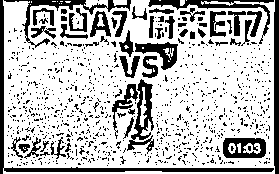

图2：

图3：

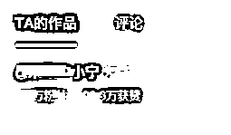

图4：

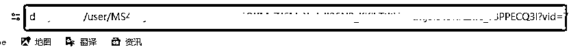

### 移动端获取链接步骤

打开 DY APP，找到目标视频，按下方顺序操作：

图1：从视频点击创作者头像进入个人页

图2：个人页右上角有三个点，点击它

图3：选择分享个人页，会出现下拉菜单

图4：点击复制链接，链接即保存到剪贴板

传到电脑的方式同上，使用微信文件传输助手即可。

图1：

图2：

图3：

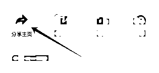

图4：

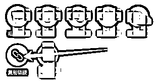

### 录入个人页操作视频

### 表格字段说明

#### 选择列：

用于批量采集、删除、修改等操作，

最顶部的全选框可对整列进行全选或取消。

#### 序号：

按你录入的先后顺序自动生成。

#### 创作者信息：

全部取自网页公开信息，此处不展开。

#### 本地视频数 / 本地图文数 / 本地点赞数：

指你已完成采集并保存的数据，统计依据保存目录，只要目录未更改且文件未删除，工具会持续记录。如保存了10个，删除1个，下次打开会根据标题是否存在自动核对，显示为9个。

#### 备注：

录入后自动生成默认备注，可手动修改，支持右键修改或批量修改。

录入时间：录入时自动记录，以本地电脑时间为准。

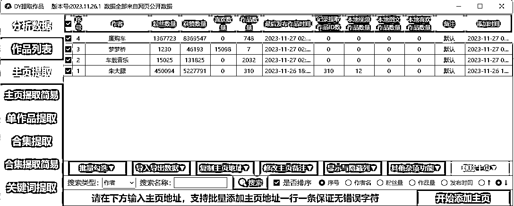

### 列表右键菜单

在个人页列表任一行右键，会弹出该创作者的快捷操作。

#### 上移一位：

选中项会上移一个位置

#### 下移一位：

选中项会下移一个位置

#### 清空已采作品数量记录：

清空该创作者已记录的作品ID数量，与未记录ID的判断相关

#### 复制全部已采作品ID：

复制该创作者已采集到的作品ID，清空后将无法复制

#### 打开本地数据目录：

打开该创作者信息记录的文件夹，若下载目录未更改，文件都在此

#### 复制个人页链接：

复制该创作者的 DY 主页网址，可直接在浏览器打开

#### 复制创作者昵称：

复制创作者昵称

#### 删除当前创作者：

从列表中移除该创作者，本地信息同步删除，已保存作品保留

#### 修改备注信息：

用于赛道分类，不同领域可做不同标注，如动漫、小说、沙雕动画等，可按备注批量选中，也可按备注目录保存文件，采集时作品会自动带上个人页备注。

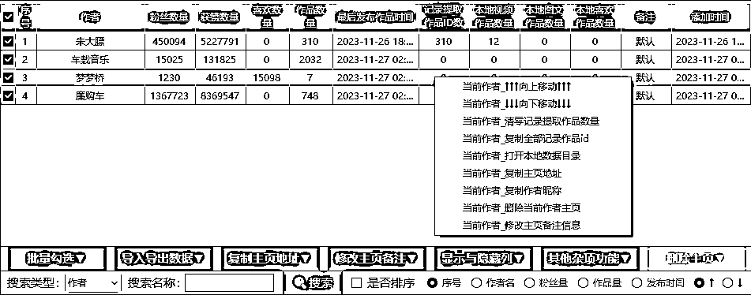

### 批量选中▼

点击后弹出菜单，批量选中仅支持按备注分类。

例如有1000个个人页，分动漫、小说、沙雕动画三类，点击对应备注即可一次性选中该类全部。

注意：选中不会自动取消之前的选中，建议先清空列表所有选中，再操作。点击序号列的总选择框可全选或全不选。

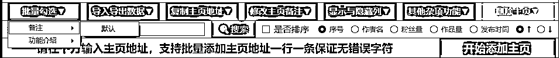

### 数据导入导出▼

#### 作品数据TXT导入导出：

导出的 TXT 可导入，Excel 表格暂不支持导入。

#### 导出列表全部数据为TXT：

导出全部个人页数据，JSON 格式，用于大数据分析。

#### 导出列表已选数据为TXT：

导出已选中个人页数据，JSON 格式。

#### 导出列表全部数据为Excel：

导出全部个人页数据，Excel 格式，便于查看。

#### 导出列表已选数据为Excel：

导出已选中个人页数据，Excel 格式。

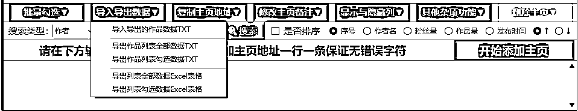

### 复制链接▼

#### 复制全部链接：

复制列表中所有创作者的主页链接。

#### 复制已选链接：

复制已选中创作者的主页链接。

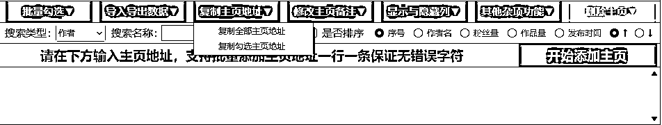

### 批量修改备注▼

#### 修改全部备注：

点击后弹出输入框，输入新备注后确认，全部个人页备注将被统一修改。

#### 修改已选备注：

同上，仅修改已选中个人页的备注。

提示：单个个人页备注修改可通过列表右键完成。

图1

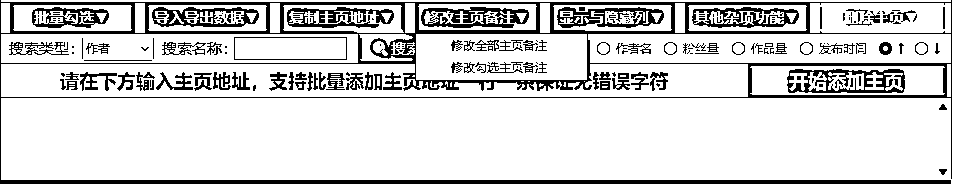

图2

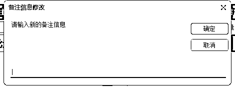

### 显示隐藏列▼

#### 显示隐藏列：

点击后显示个人页列表各列开关，取消勾选则隐藏该列，勾选则显示，可按需精简界面。

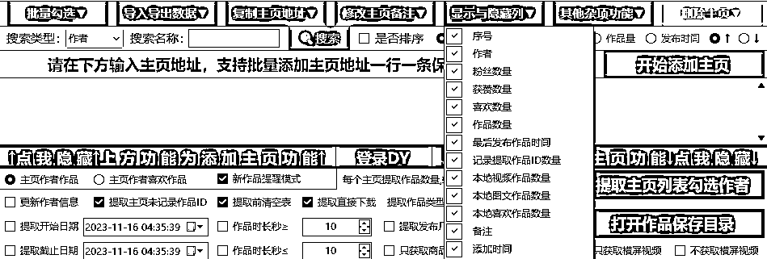

### 其他功能▼

#### 重新加载本地文档、创作者信息与作品数量：

删除作品后列表不会自动刷新，点击此按钮可手动刷新。

#### 网络更新列表信息对比报告：

软件会自动更新创作者信息，非作品采集，会生成新旧数据对比报告。

#### 打开创作者对比报告：

若存在对比报告，可在此查看。

#### 清空全部已采作品ID数量：

清空列表所有创作者的已记录作品ID。

#### 清空已选已采作品ID数量：

清空已选中创作者的已记录作品ID。

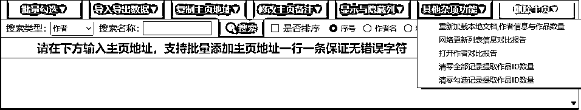

### 删除条目▼

### 删除全部条目：

删除列表中所有创作者数据及本地信息，已保存作品不删除。

### 删除已选条目：

删除已选中创作者数据及本地信息，已保存作品不删除。

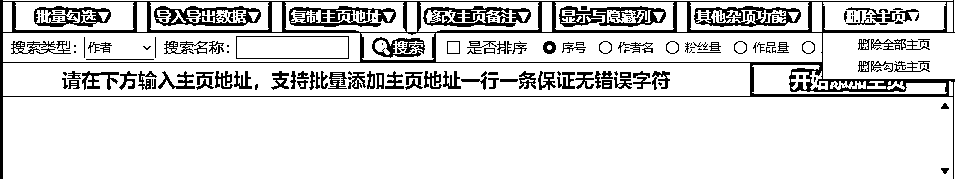

### 搜索方式与关键词

### 搜索创作者：

输入名称后点击搜索，软件会模糊匹配创作者名称并自动选中。

### 搜索备注：

输入备注关键词后点击搜索，软件会模糊匹配备注并自动选中。

### 两种搜索均为模糊匹配：

例如列表中有“江湖数据工具箱”，输入“江湖”即可匹配到。

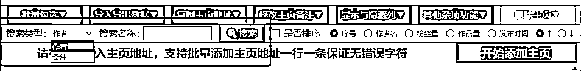

### 列表排序

开启排序后可按指定字段自动排序。

左右箭头含义：

↑ 为升序，从小到大

↓ 为降序，从大到小

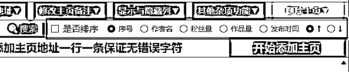

## 2. 隐藏显示录入区 与 登录入口 与 隐藏显示采集区

下方三个红色框为功能按钮

最左侧为隐藏录入区，不用时可收起，列表显示更宽。

中间为登录按钮，点击后弹出内置浏览器，自动打开 DY 官网，扫码登录几秒后显示登录成功。

最右侧为隐藏采集区，不用时可收起。

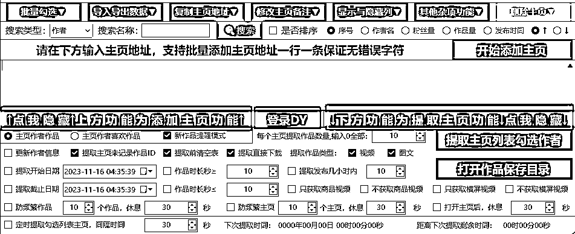

## 3. 个人页作品采集

### 个人页作品采集视频

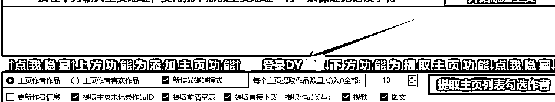

采集个人页作品的关键是登录，未登录可能无法获取完整内容。点击上图的按钮进入内置浏览器扫码登录，注意必须使用软件内部浏览器登录才有效。

### 创作者喜欢作品采集

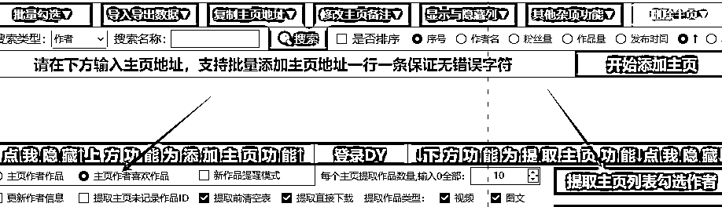

若添加的创作者的喜欢作品为公开状态，可采集；不公开则无法获取。勾选该选项后点击开始采集，操作方式与个人页作品采集一致。

### 新内容提醒模式

开启新内容提醒模式后，

软件会自动勾选个人页及未记录作品ID，可自定义是否勾选提取时下载、采集作品类型、循环间隔等。

开启定时采集已选列表后，可实现全自动提醒，软件需保持运行。

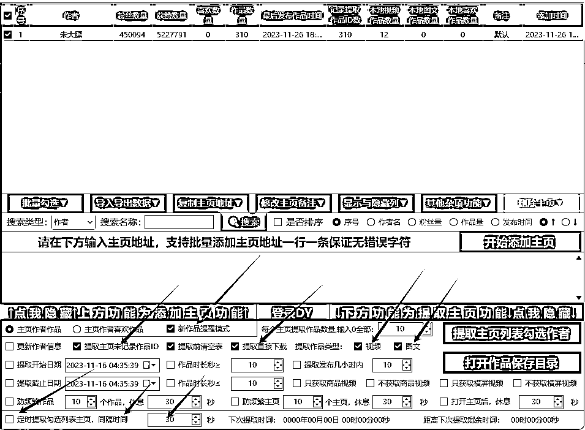

### 微信推送，新作品发布提醒

在软件设置的新内容消息推送微信设置里，最下方有详细教程，按教程填写微信 Webhook 地址。

设置完成后建议先发送测试消息，确认推送正常。

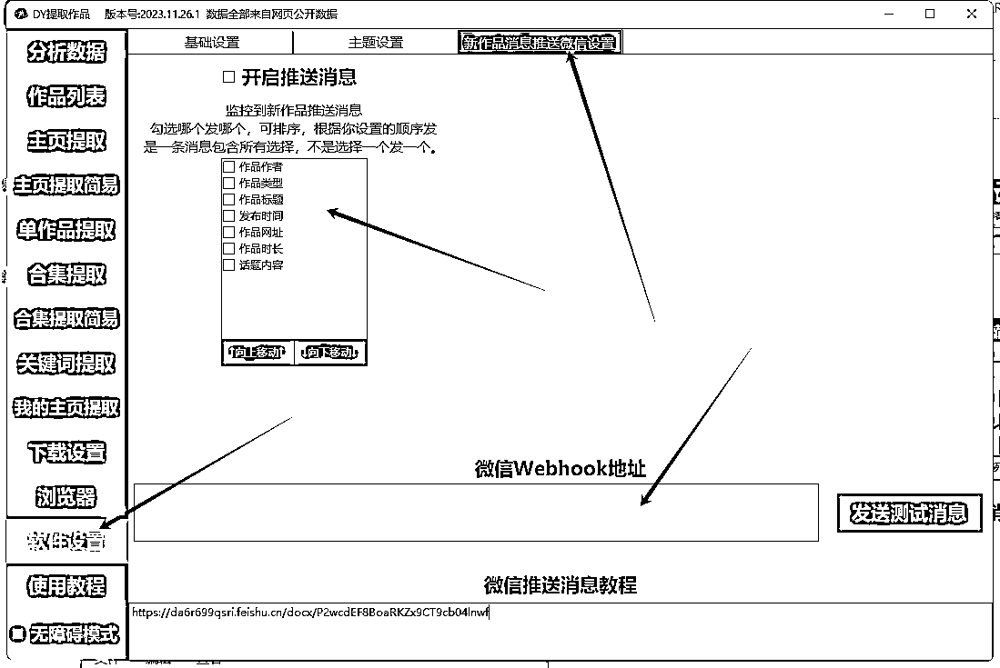

### 采集筛选条件与功能说明

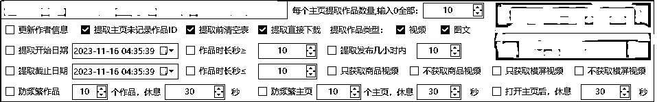

#### 每个主页采集数量

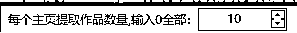

每个个人页的采集数量，填0代表全部。若填10，则每个个人页只采集最新置顶的10条。

例如列表有10个个人页全部选中，设置10，则共采集10×10条。

#### 更新创作者信息

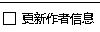

勾选后每次采集时个人页列表数据会实时更新。

#### 仅采集未记录作品ID

勾选后只采集未记录过的作品ID。

例如第一次已采集全部并记录ID，第二次采集时已记录的ID会被跳过。

#### 采集前清空表格

开启后，点击开始采集前会清空作品列表，仅保留本次采集的数据。

#### 采集时自动下载

勾选后采集时自动下载，未勾选则只采集数据不下载。

#### 采集内容类型

勾选视频与图文后会同时采集两者。取消视频只采集图文，取消图文只采集视频。软件会自动保留至少一种选项，避免条件为空。

#### 采集开始日期 与 采集截止日期

开始日期为作品发布的最早时间，截止日期为最晚时间，可单选或双选。

举例：同时勾选

开始日期：2023年8月8日08:08:08

截止日期：2023年9月9日09:09:09

只有发布时间在此区间内的作品才达标，精确到秒。

只勾选开始日期时，仅需在开始日期之后发布。

只勾选截止日期时，仅需在截止日期之前发布。

#### 视频时长秒 ≥ ≤

视频时长秒 ≥ 为大于等于指定秒，视频时长秒 ≤ 为小于等于指定秒。筛选仅作用于视频，图文默认通过。

#### 仅采集发布 N 小时内内容

例如设置后，采集开始时为11点整，则只有1点整之后发布的内容才达标。

#### 仅采集商品视频 与 排除商品视频

勾选仅采集商品视频，则仅带购物车的商品视频达标。

勾选排除商品视频，则带购物车的作品不达标。

#### 仅采集横屏视频 与 排除横屏视频

勾选仅采集横屏视频，则仅横屏视频达标。

勾选排除横屏视频，则横屏视频不达标。

#### 防频繁采集，每 N 条休息 N 秒

开启后按设置频率休息，例如每采集10条休息30秒，然后继续，以此类推。

用途：在实际使用中偶尔会因为访问过于密集导致受限，通过设置间隔休眠能有效降低频次，特别是配合定时任务时效果更明显。

#### 防频繁主页 N个主页，休息N秒

开启该选项后，提取过程会按设定的节奏执行。以截图中的参数举例，

每采集完10个主页，程序会自动暂停30秒再继续，循环往复。。。

用途：在实际使用中偶尔会因为访问过于密集导致受限，通过设置间隔休眠能有效降低频次，特别是配合定时任务时效果更明显。

#### 打开主页后，休息N秒

勾选后，提取期间每当程序通过内置浏览器打开并访问一个主页，就会先进入30秒的静默等待，期间无任何操作。

此功能主要用于在浏览器中人工修改发布日期等信息，请参考下图所示：

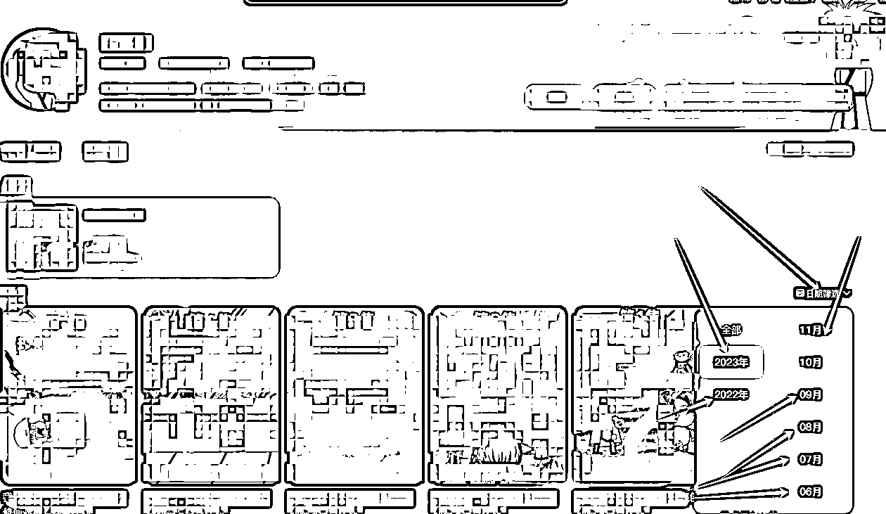

#### 定时提取勾选列表主页

勾选后即可定时自动触发开始提取，方便持续获取最新作品数据。
间隔时长表示定时开启后，软件内部开始计时，并在上方显示下一次提取的预计时间与倒计时。
注意：列表中未勾选的主页，即使开启定时提取也不会被处理。

* * *

# 主页简易提取数据教程【新手推荐】

这是主页提取的简化模式，无需事先添加主页，只需把主页链接逐行粘贴到输入框，点击开始提取主页作品即可执行。没有任何筛选条件，上手门槛低，非常适合初次使用。

提取结束后，作品数据会直接进入作品列表，前往作品列表查看即可。

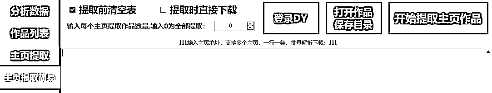

* * *

# 单作品提取数据教程

## 1.单作品提取数据教程

### 提取单作品数据

将准备好的作品链接逐行填入文本框，点击开始提取作品即可启动。
完成后作品数据会自动写入作品列表，进入作品列表查看即可。

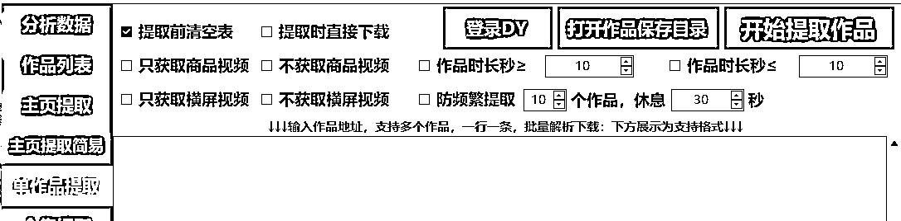

## 2.单作品提取数据功能讲解：

### 单作品提取数据功能讲解：

### 提取前清空表：

表示点击开始提取时，软件会先清空作品列表中全部已有数据，仅保留本次提取结果。

### 提取直接下载：

勾选后开始提取会同步跟随下载，未勾选则只提取不下载。

### 只获取商品视频：

勾选后仅商品视频计为达标，带有购物车但非商品视频的作品会被排除。

### 不获取商品视频：

勾选后所有商品视频均不计为达标。

### 只获取横屏视频：

勾选后仅横屏视频计为达标，非横屏视频会被排除。

### 不获取横屏视频：

勾选后所有横屏视频均不计为达标。

### 作品时长秒≥≤

作品时长秒≥ 全称：作品时长秒大于等于【？】秒
作品时长秒≤ 全称：作品时长秒小于等于【？】秒
该筛选仅作用于视频作品的时长，图片类作品不受此限制，一律视为达标。

### 防频繁作品 N个作品，休息N秒

开启后，提取过程中会按设定节奏休眠。以图中设置为例，
每处理10个作品，程序自动休息30秒后继续，如此循环。。。
用途：在实际使用中偶尔会因为访问过于密集导致受限，通过设置间隔休眠能有效降低频次，特别是配合定时任务时效果更明显。

* * *

# 合集提取数据教程

## 1.添加合集地址

### 电脑端网页获取合集作品地址方式

先在浏览器打开抖音官网，找到目标合集作品，直接从地址栏复制链接即可。
提示：合集中任一作品链接均可，软件会自动定位到合集主页。

下图按顺序说明：
图1为作品链接，需确保是带合集的作品。
图2复制地址栏全部内容，这就是可用的主页链接。
关于链接的跨端传递，可在电脑登录微信，通过手机发送至微信文件传输助手，电脑端即可同步接收。

图1：

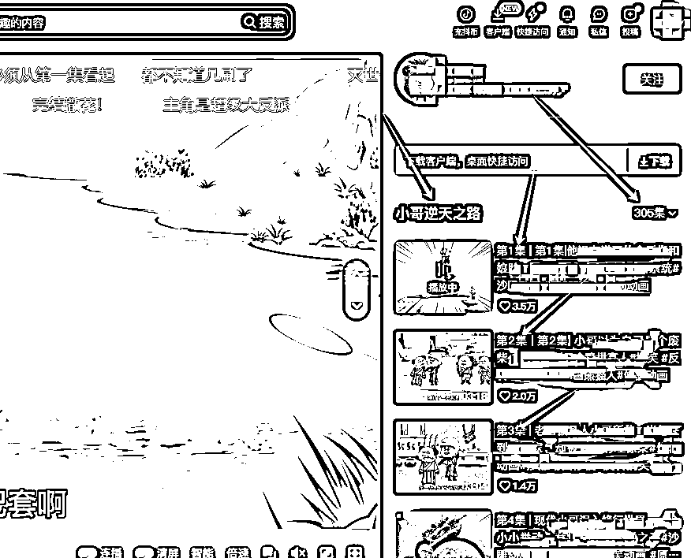

图2：

### 手机端获取合集作品地址方式

打开抖音APP，找到所需合集作品，按下方图片顺序操作：
图1：在作品页点击分享按钮，会弹出菜单。
图2：在菜单中点击复制链接即可。
链接的跨端传递同上，可通过微信文件传输助手实现手机到电脑的同步。

图1：

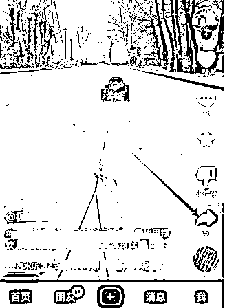

图2：

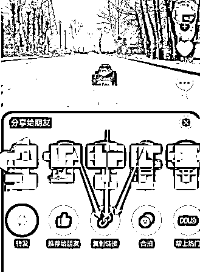

### 添加合集地址到合集列表

#### 图1：

把复制好的带合集的作品链接粘贴到输入框，点击开始添加合集主页。

图1：

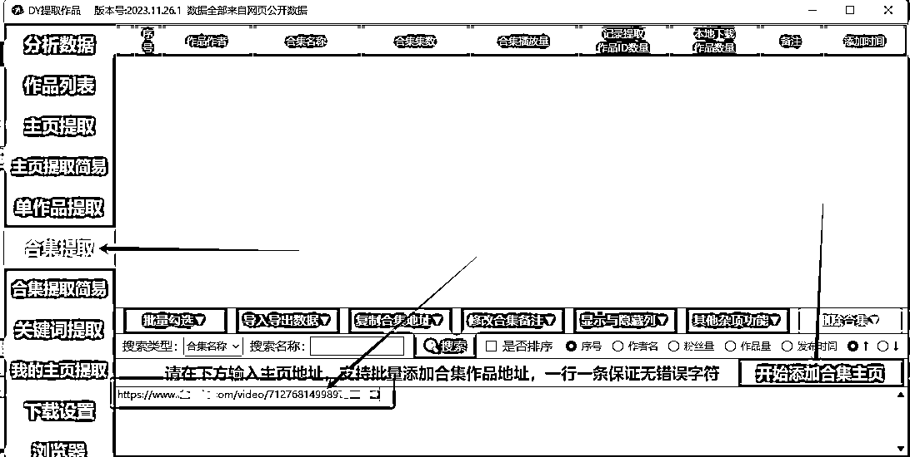

#### 图2：添加成功

点击开始添加合集主页后数秒会弹出结果提示，图2表示添加成功。

#### 图3：合集主页列表已经存在这个合集

点击开始添加合集主页后数秒会弹出结果提示，图3表示该合集已存在于列表。

#### 图4：添加失败与超时地址

点击开始添加合集主页后数秒会弹出结果提示，图4表示添加失败或超时，
此时需核查输入的链接是否正确，确认无误后可重试。

图2：

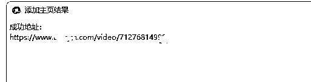

图3：

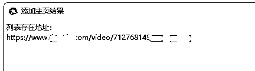

图4：

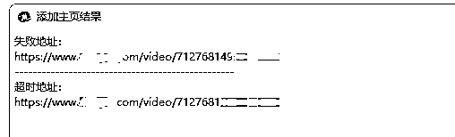

### 表内数据

#### 选择框：

用于批量提取、删除、修改等操作，
最顶部的选择框可操作整列，一键全选或全不选。

#### 序号：

按添加顺序自动生成。

#### 合集信息数据：

全部来源于网页公开信息，此处不展开说明。

#### 本地下载作品数量 ：

反映你已下载的数据。判定依据是保存目录，只要目录路径未变更且作品未删除，系统会持续记录。
例如已保存10个作品，后续删除其中1个，目录未变的情况下，下次打开软件会自动校验标题是否存在，存在则计数+1，未找到则保持不变，最终显示9个。

#### 备注：

添加后默认显示，可手动修改，支持右键修改或批量修改。

#### 添加时间：

添加时自动记录当前本地电脑时间，非网络时间。

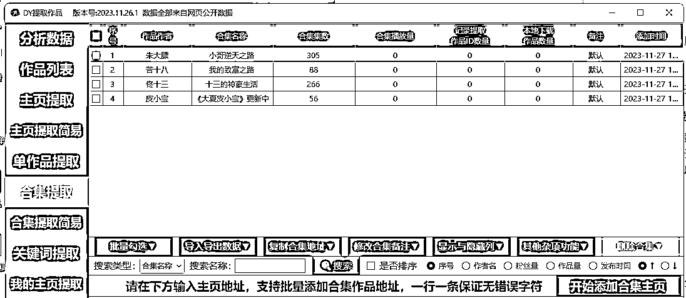

### 列表右键功能

在合集列表中右键任意一行作者合集，会弹出菜单，提供单条合集操作。

#### 复制全部记录作品ID：

复制当前作者已记录的作品ID，若已清零则无法复制。

#### 清零记录提取作品数量：

清空已记录的作品ID数量归零，与合集提取的未记录作品ID筛选相关。

#### 复制主页地址：

复制该合集的主页链接，可直接在浏览器打开。

#### 删除合集主页：

从当前列表移除该合集，主本地合集信息同步删除，作品数据本身不删除。

#### 修改合集备注信息：

用于分类管理。不同领域可做不同备注，
例如动漫、小说、沙雕动画等，便于后续按备注批量勾选、按备注目录保存，提取时自动带入合集备注。

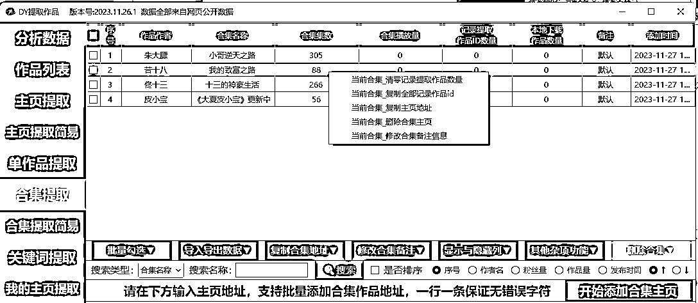

### 批量勾选▼

点击后弹出菜单，合集批量勾选仅支持按备注分类。
若你有1000个合集主页，分3类：动漫、小说、沙雕动画，点击对应分类即可勾选全部同备注的合集。
注意：勾选操作不会自动取消之前的勾选，建议先通过序号列顶部的总选择框清空所有勾选，再进行新一轮勾选。

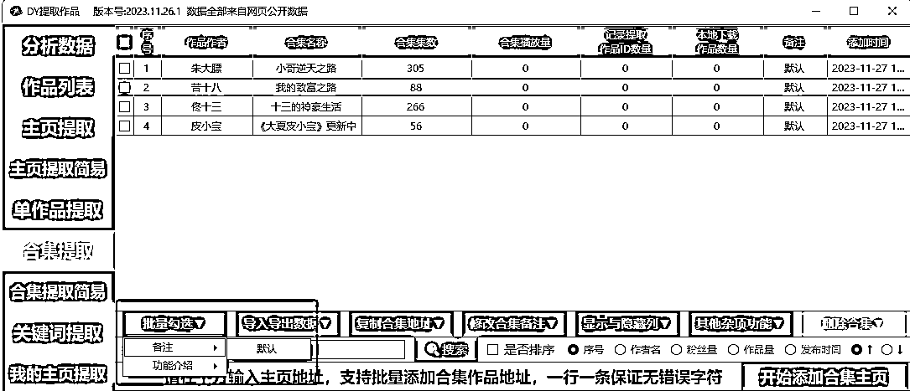

### 导入导出数据▼

#### 导入导出的作品数据TXT：

导出的TXT格式支持导入，Excel表格不支持导入。

#### 导出作品列表全部数据TXT：

导出合集列表全部数据，JSON格式，便于大数据分析。

#### 导出作品列表勾选数据TXT：

导出合集列表中已勾选的数据，JSON格式。

#### 导出列表全部数据Excel表格：

导出合集列表全部数据，Excel表格格式。

#### 导出列表勾选数据Excel表格：

导出合集列表中已勾选数据，Excel表格格式。

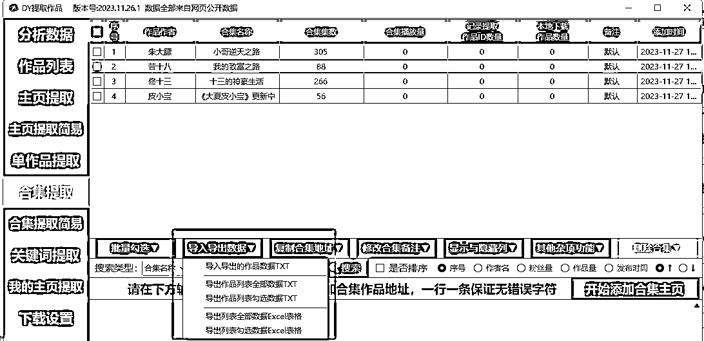

### 复制合集地址▼

#### 复制全部合集地址：

复制列表中所有合集的主页链接。

#### 复制勾选合集地址：

复制列表中已勾选合集的主页链接。

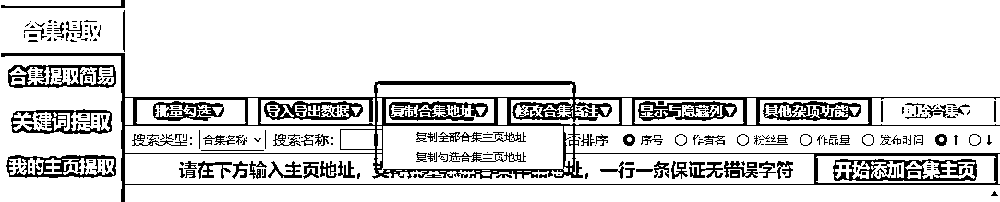

### 修改合集备注▼

#### 修改全部合集主页备注：

点击后弹出图2，输入新备注并确认，所有合集备注将被统一修改。

#### 修改勾选合集主页备注：

点击后弹出图2，输入新备注并确认，仅勾选合集的备注将被修改。
小提示：单个合集备注修改可通过列表右键完成。

图1

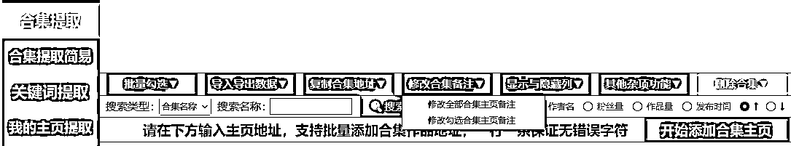

图2

### 显示与隐藏列▼

#### 显示与隐藏列：

点击后弹出菜单，对应合集列表的每一列。
取消勾选则隐藏该列，勾选则显示。
用途：隐藏不需要的列，仅保留关注的数据。

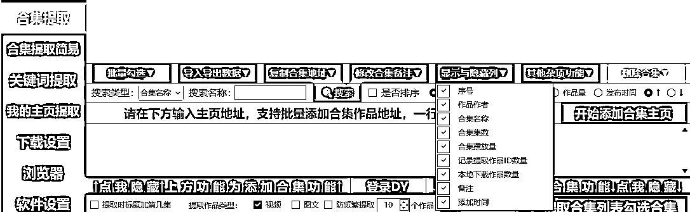

### 其他杂项功能▼

#### 重新加载本地文档,合集作者信息与作品数量：

当你手动删除作品后列表未即时刷新，可点击此按钮强制刷新。

#### 清零全部记录提取作品ID数量：

清空列表中所有合集主页的已记录作品ID。

#### 清零勾选记录提取作品ID数量：

清空列表中已勾选合集主页的已记录作品ID。

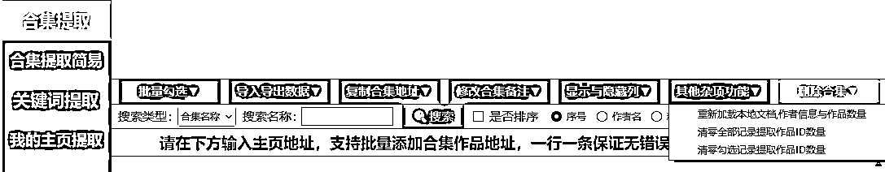

### 删除合集▼

### 删除全部合集主页：

删除合集列表中全部合集数据及本地保存的合集信息，作品数据不受影响。

### 删除勾选合集主页：

删除合集列表中已勾选合集数据及本地保存的合集信息，作品数据不受影响。

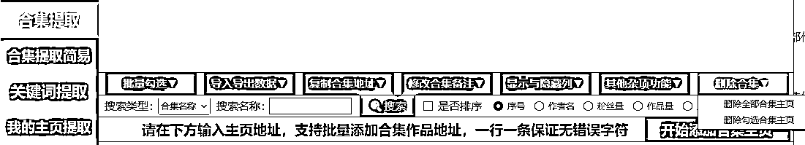

* * *

### 搜索类型与搜索名称

### 搜索合集名称：

输入关键词点击搜索，软件会对合集名称做模糊匹配。

### 搜索作者：

输入关键词点击搜索，软件会对作者名称做模糊匹配。

### 搜索备注：

输入关键词点击搜索，软件会对备注名称做模糊匹配。

### 搜索合集名称 或 作者 或 搜索备注都是模糊搜索：

例如列表中存在江湖数据工具箱的合集名称、作者或备注，输入“江湖”即可匹配到，匹配结果会自动勾选。

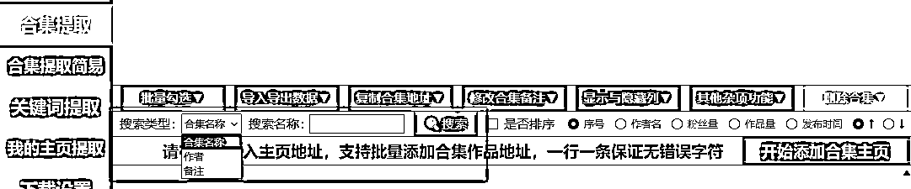

### 排序列表

勾选是否排序后，按所选字段自动排序。
左右箭头含义：
↑ 表示升序，从小到大
↓ 表示降序，从大到小

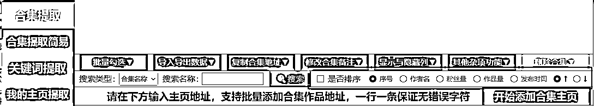

## 2.隐藏显示添加合集 与 登录DY 与 隐藏显示提取合集

下图三个红色框为按钮。
最左侧为隐藏添加合集功能，闲置时可收起以获得更大列表显示区域。
中间为登录DY按钮，点击后弹出内置浏览器自动打开抖音官网，扫码登录后数秒显示登录成功。
最右侧为隐藏提取合集功能，闲置时可收起以获得更大列表显示区域。

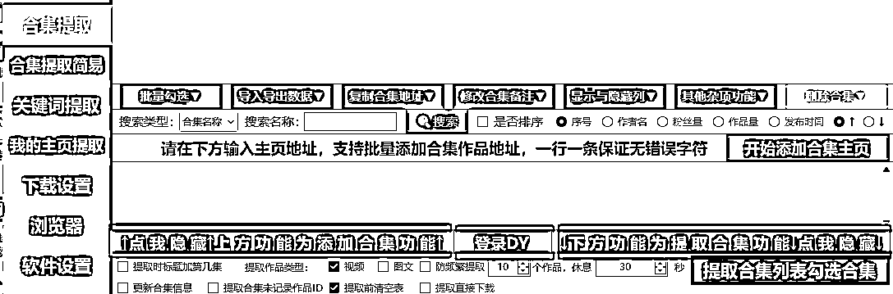

## 3.合集提取作品数据

### 合集提取教程

#### 图1：

在合集列表中勾选需要提取的合集，点击提取合集列表勾选合集，程序即开始提取。

#### 图2：

提取过程中，软件下方会实时显示当前进度、已获取作品数与达标作品数。达标数即最终写入作品列表的数量，若与获取数不一致，说明启用了筛选条件。

#### 图3：

提取结果提示达标作品56个，与合集信息中的集数一致，表示已全部提取并记录。若下次勾选提取合集未记录作品ID，已记录的ID将不再重复提取。

图1：

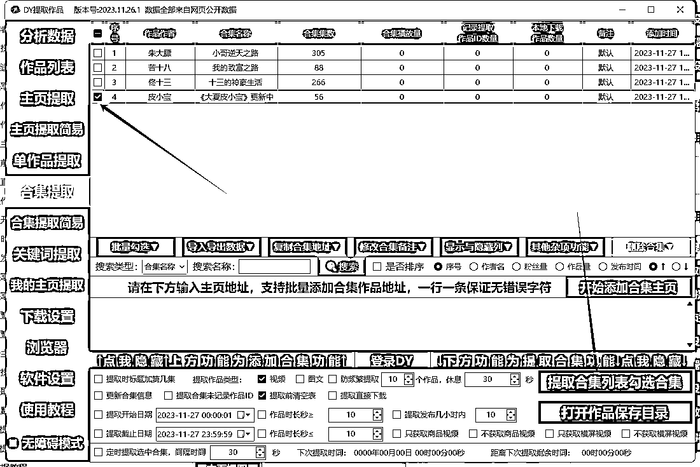

图2：

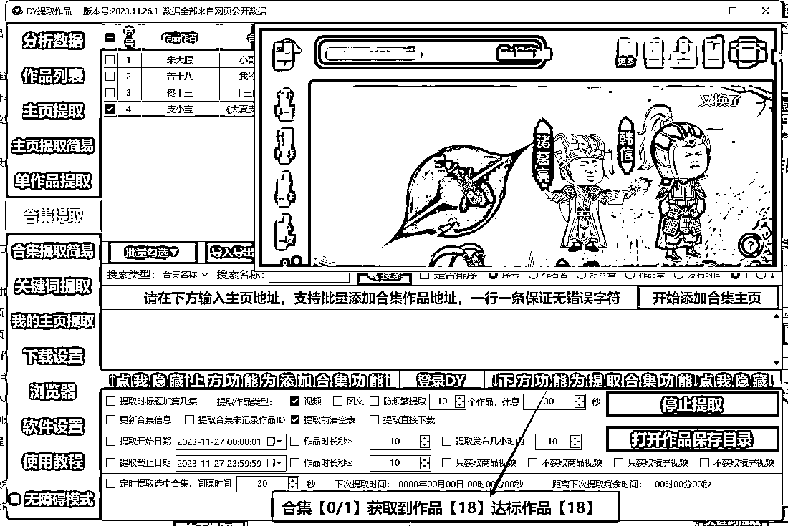

图3：

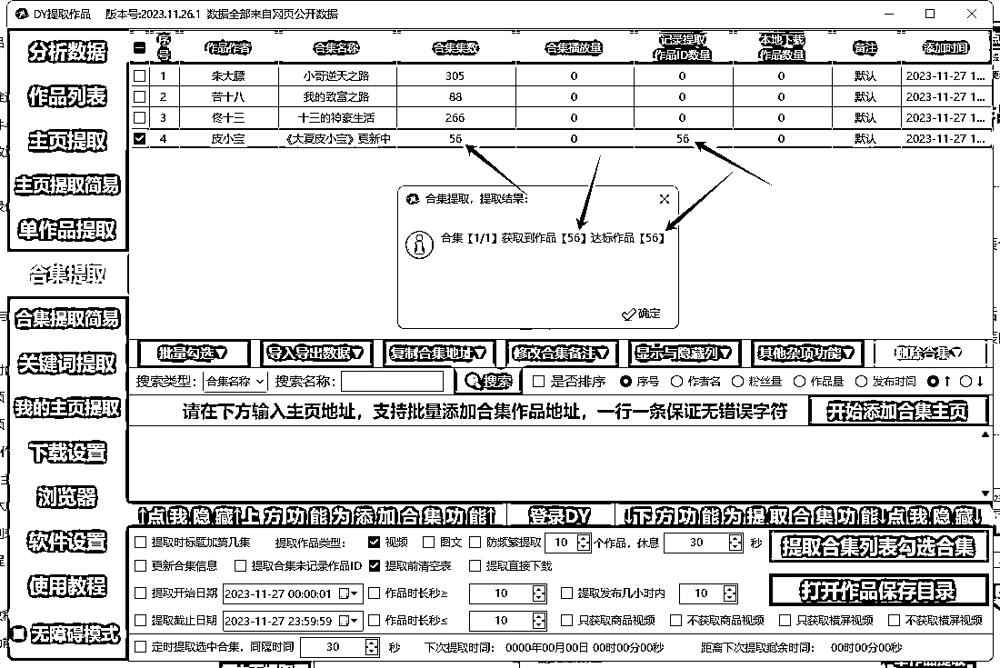

### 合集提取筛选条件与其他功能讲解。

#### 提取时标题加第几集

开启后，作品标题会自动追加集数。

#### 提取作品类型

勾选视频与图文后，会同时提取视频和图文。
仅勾选图文则只提取图文；仅勾选视频则只提取视频。
系统会自动防止两者均未勾选的情况，若同时取消，会自动补选视频以保证有可达标条件。

#### 防频繁作品 N个作品，休息N秒

开启后，提取过程中会按设定节奏休眠。以图中设置为例，
每处理10个作品，程序自动休息30秒后继续，如此循环。。。
用途：在实际使用中偶尔会因为访问过于密集导致受限，通过设置间隔休眠能有效降低频次，特别是配合定时任务时效果更明显。

#### 更新合集信息

开启后，每次提取合集数据时，合集列表的信息会同步实时更新。

#### 提取合集未记录作品ID

开启后，仅提取尚未记录的作品ID。
例如首次提取已获取全部作品并记录ID，二次提取时已记录的ID将被跳过。
用途：便于增量提取，只获取新作品。

#### 提取前清空表

表示点击开始提取时，软件会先清空作品列表中全部已有数据，仅保留本次提取结果。

#### 提取直接下载

勾选后开始提取会同步跟随下载，未勾选则只提取不下载。

#### 提取开始日期 与 提取截止日期

提取开始日期指作品发布日期的下限；
提取截止日期指作品发布日期的上限。
两者可同时启用，也可单独启用。

举例：同时启用
开始日期：2023年8月8日08:08:08
截止日期：2023年9月9日09:09:09
作品需同时满足：发布时间 ≥ 2023-08-08 08:08:08 且 ≤ 2023-09-09 09:09:09，精确到秒。

不达标：2023-08-08 08:08:07
达标：2023-08-08 08:08:09
达标：2023-09-09 09:09:08
不达标：2023-09-09 09:09:10

举例：仅启用开始日期
开始日期：2023年8月8日08:08:08
满足发布时间 ≥ 该时间的作品才达标。

不达标：2023-08-08 08:08:07
达标：2023-08-08 08:08:09

举例：仅启用截止日期
截止日期：2023年9月9日09:09:09
满足发布时间 ≤ 该时间的作品才达标。

达标：2023-09-09 09:09:08
不达标：2023-09-09 09:09:10

#### 作品时长秒≥≤

作品时长秒≥ 全称：作品时长秒大于等于【？】秒
作品时长秒≤ 全称：作品时长秒小于等于【？】秒
该筛选仅作用于视频作品的时长，图片类作品不受此限制，一律视为达标。

#### 提取发布几小时内

例如图中勾选设置后，若当前提取时间为上午11点整，
只有发布时间在凌晨1点整之后发布的作品才视为达标。

#### 只获取商品视频 与 不获取商品视频

打开只获取商品视频的开关后，系统会严格限定，只有自带商品购物车的带货视频才会被判定为合格，其余不含购物车的素材都会被过滤掉。

打开不获取商品视频的开关后，只要是商品视频就直接被排除在合格范围之外。

#### 只获取横屏视频 与 不获取横屏视频

启用只获取横屏视频后，只有横向画幅的视频才能通过筛选，竖屏作品一律不算达标。

启用不获取横屏视频后，所有横屏视频都会被判定为不达标。

#### 定时提取勾选列表合集

勾选该功能后，软件会按设定的间隔自动按下开始提取，帮你持续抓取最新的合集内容。

间隔时长指的是定时启动后，程序内部自行计时，并在界面上实时显示下一次提取的预计时间以及剩余倒计时。

注意：若列表中没有任何合集被勾选，定时提取开启也无法执行。

* * *

# 合集简易提取数据教程【新手推荐】

这是合集提取的极简模式，无需单独添加合集管理，直接把含有合集的作品链接逐行粘贴进输入框，点击开始提取即可，默认不做任何条件过滤，最适合首次使用的用户上手。

提取完毕后，所有作品信息会自动汇总到作品列表，记得去作品列表查看。

* * *

# 关键词提取数据教程

## 关键词提取数据教程

在左侧输入框里填入想要搜索的关键词，每行一个，设置好筛选规则后再点开始提取关键词，程序就会依规则抓取。未做筛选时直接点击也能开始抓取。

特别提醒：DY官网获取多条作品数据必须先登录，务必点击登录DY进行扫码登录。

## 关键词提取筛选条件讲解。

#### 提取作品数据数量

每个关键词可单独设定抓取条数，填0代表全部抓取，按照官网返回结果全部取回。若设定为10，则每个关键词仅取前10条，这10条不代表是最新，需要配合网页排序设置。

举例：输入10个关键词，并设置数量为10，则共计抓取10×10=100条作品。

#### 提取作品类型

勾选视频和图文两个选项，提取时会同时包含两种类型。只勾选图文则仅抓取图文作品，只勾选视频则仅抓取视频作品。系统会自动兜底，不会让两个选项都空选。

举例：若将视频和图文同时取消，程序会自动默认勾选视频，避免出现无条件的状况。

#### 提取前清空表

开启此项后，每次点击开始提取，作品列表里的旧数据会被先清空，只保留本次抓取的结果。

#### 提取直接下载

勾选后，提取的同时会自动触发下载；未勾选则仅提取数据不下载。

#### 提取发布几小时内

例如当前时间为上午11点整，勾选该条件后，只有在凌晨1点以后发布的内容才会被视为符合。

#### 只获取商品视频 与 不获取商品视频

勾选只获取商品视频，则只有携带商品购物车的视频才算达标，其余均不通过。

勾选不获取商品视频，则所有商品视频均被判定为不达标。

#### 只获取横屏视频 与 不获取横屏视频

勾选只获取横屏视频，则只有横屏作品才算达标，其余竖屏均不通过。

勾选不获取横屏视频，则横屏作品全部被排除。

#### 提取开始日期 与 提取截止日期

提取开始日期指作品发布时间的下限，提取截止日期指作品发布时间的上限。两者可单独使用也可同时使用。

举例：同时使用
开始日期设为2023年8月8日08:08:08
截止日期设为2023年9月9日09:09:09
则只有发布时间在两者区间内的作品才达标，精确到秒。

不达标：2023年8月8日08:08:07
达标：2023年8月8日08:08:09
达标：2023年9月9日09:09:08
不达标：2023年9月9日09:09:10

举例：仅使用开始日期
开始日期：2023年8月8日08:08:08
发布时间在此时间点之后的作品才达标。

举例：仅使用截止日期
截止日期：2023年9月9日09:09:09
发布时间在此时间点之前的作品才达标。

#### 作品时长秒≥≤

作品时长秒≥ 表示视频时长大于等于设定秒数
作品时长秒≤ 表示视频时长小于等于设定秒数
该条件仅作用于视频，图文作品默认视为达标。

#### 防频繁作品N个作品，休息N秒

开启后，抓取过程中每完成设定数量的作品会强制暂停设定秒数后再继续。可有效降低频繁访问风险，尤其适合定时任务。

#### 网页选择排序依据

该选项决定抓取时网页端的排序方式，实际效果可到关键词页面自行查看。

#### 网页选择发布时间

该选项决定抓取时网页端的时间筛选范围，实际效果可到关键词页面自行查看。

#### 定时提取关键词

勾选后，软件会按间隔自动触发开始提取关键词，帮助你持续获取新作品。界面会显示下一次提取时间和剩余时间。

注意：若输入框中没有关键词，定时功能不会生效。

* * *

# 话题提取教程

1.获取话题网址

* * *

# 我的主页提取数据教程

## 我的关注主页地址提取

### 步骤1：
先登录DY，未登录无法读取主页信息。

### 步骤2：
点击开始提取我的关注作者主页地址，等待片刻后结果会显示在文本框中。

### 图2：
提取进行时的状态，已抓取到100个关注作者地址。

### 图3：
提取完成提示，共获取128条作者地址，与关注数量一致。

图1：

图2：

图3：

## 我的主页作品提取

### 步骤1：
先登录DY，未登录无法读取主页信息。

### 步骤2：
点击开始提取我的作品，片刻后作品会导入作品列表。

### 图2：
提取进行时状态，作品较少未截图完整过程。

### 图3：
提取完成提示，共获取4个作品，与实际一致。

图1：

图2：

图3：

## 我的主页喜欢作品提取

### 步骤1：
先登录DY，未登录无法读取主页信息。

### 步骤2：
点击开始提取我的喜欢作品，完成后喜欢作品会加入作品列表。

### 图2：
提取进行时状态，已抓取52个喜欢作品。

### 图3：
提取完成提示，共获取117个作品，与实际一致。

图1：

图2：

图3：

## 我的主页收藏作品提取

### 步骤1：
先登录DY，未登录无法读取主页信息。

### 步骤2：
点击开始提取我的收藏，完成后收藏作品会加入作品列表。

### 图2：
提取进行时状态，已抓取9个作品。

### 图3：
提取完成提示，共获取15个作品，与实际一致。

图1：

图2：

图3：

* * *

# 作品列表教程

## 表内数据

#### 选择框：
用于批量提取、删除、修改等操作，顶部选择框可一键全选或取消全选。

#### 序号：
按添加顺序自动生成。

#### 提取方式：
记录该条数据是通过哪种方式进入列表的。

#### 作品类型：
仅显示视频或图文。

#### 作品数据：
来源于网页公开信息，此处不展开说明。

#### 商品：
作品自带购物车则显示是，否则显示否。

#### 横屏：在手机端可点击全屏观看
横屏作品显示是，竖屏显示否。

#### 备注：
可在列表中为单条作品添加备注，也可批量备注。

#### 主页备注：
提取主页作品时若为主页添加了备注，该备注会随作品带入列表。

#### 合集备注：
提取合集作品时若为合集添加了备注，该备注会随作品带入列表。

## 批量勾选▼

单击后弹出多种勾选方式，当前已勾选状态不会被清空。

#### 作者昵称勾选：
展示所有作者昵称，可按作者批量勾选其全部作品。

#### 提取方式勾选：
按提取方式批量勾选，关键词方式会展示关键词列表，选择后勾选对应作品。

#### 作品类型勾选：
可一键勾选全部视频或全部图文。

#### 作品质量勾选：
根据列表中存在的质量标签展示，点击即可勾选对应质量的全部作品。

#### 下载状态勾选：
展示列表全部下载状态，可按需勾选。

#### 商品视频勾选：
提供两个选项，按需勾选商品视频或非商品视频。

#### 横屏视频勾选：
提供两个选项，按需勾选横屏或非横屏。

#### 备注系列勾选：
下拉选择指定备注，可快速勾选带有该备注的作品。

## 导入导出数据▼

#### 导入导出的作品数据TXT：
TXT格式支持导入，Excel暂不支持导入。

#### 导出作品列表全部数据TXT：
导出全部作品的JSON格式数据，便于大数据分析。

#### 导出作品列表勾选数据TXT：
导出已勾选作品的JSON格式数据。

#### 导出列表全部数据Excel表格：
导出全部作品为Excel表格。

#### 导出列表勾选数据Excel表格：
导出已勾选作品为Excel表格。

## 复制作品地址▼

#### 全部复制作品地址：
复制列表中所有作品链接。

#### 勾选复制作品地址：
复制已勾选作品链接。

#### 全部复制作品主页：
复制列表中所有作品的主页链接，自动去重。

#### 勾选复制作品主页：
复制已勾选作品的主页链接，自动去重。

## 修改主页备注▼

#### 全部修改作品备注：
弹出输入框，输入新备注后所有作品备注会被更新。

#### 勾选修改作品备注：
弹出输入框，输入新备注后仅勾选作品备注会被更新。
小贴士：单条修改可在列表右键操作。
主页备注与合集备注在此不可修改，跟随提取来源。

图1：

图2：

## 显示与隐藏列▼

#### 显示与隐藏列：
点击后可对每一列进行显示或隐藏，勾选则显示，取消则隐藏，用于精简界面。

## 删除作品▼

### 删除列表全部作品：
清空作品列表数据及本地保存信息，不删除已下载文件。

### 删除列表勾选作品：
仅删除已勾选作品的数据及本地保存信息，不删除文件。

## 排序列表

勾选任意排序项后列表会按条件重排。

#### 最多在上：
降序排列。

#### 最少在上：
升序排列。

排序为全自动，增删数据后会自动刷新。

## 筛选显示

#### 图1：
必须勾选筛选开关，条件才会生效，按达标与不达标在列表中显示。

#### 图2：
未勾选时，满足任一条件即显示；勾选后，必须全部条件同时达标才显示。

图3：

筛选为全自动，数据变动后自动刷新，修改条件后需手动点刷新筛选按钮。

图1：

图2：

图3：

## 双击标题的播放逻辑

首先确认播放模式的勾选状态：

- 当“本地播放”被勾选时，在作品列表的标题列双击某条记录，若本机已缓存该作品则直接本地打开；若本地未找到，则自动唤起浏览器在网页端播放。图文类型不支持本地播放，一律走网页。
- 当“网页播放”被勾选时，双击标题后程序会直接调用浏览器在网页端打开播放。

小提示：部分电脑未设置默认浏览器，双击可能无响应；被安全软件拦截也会出现同样的情况。

## 作品数据刷新

点开图1中的按钮，会弹出图2的控制面板，用于刷新作品数据。可按需设定周期，方便后续做分析。

操作流程是先设定好筛选条件，再在列表里标记“更新数据”，软件便会自动执行。完成后会告知本次共刷新了多少条记录。

图1：

图2：

图3：

### 刷新→防频繁访问

打开“防频繁”后，刷新过程会按设定的节奏执行，例如每处理10条记录就自动暂停30秒再继续，如此循环。目的是降低高频请求触发的风险，对定时任务尤其有用。

### 刷新→素材类型筛选

视频与图文两个选项决定刷新范围。双选则两者都刷新；仅选图文则只刷新图文；仅选视频则只刷新视频。程序会做兜底处理，若两者都被取消，会自动恢复勾选视频，避免出现无可用条件的情况。

### 刷新→同步保存

勾选“刷新时同步保存”后，开始刷新就会同时保存文件；不勾选则仅更新数据，不会保存。

### 刷新→定时任务

启用该开关后，软件会按设定的间隔自动触发一次刷新，便于持续获取最新数据。间隔以启动定时为准，界面上会同时展示下一次执行的时间点及倒计时。请注意，若列表中没有被标记的作品，定时任务不会生效。

* * *

# 保存设置说明

## 标题内容替换

开启“替换标题内容”后，每次保存数据时都会按设定的规则进行替换。

示例：
原始标题：
江湖工具箱是分析作品数据的软件
需要把“是分析作品”替换为“是最好的一款分析作品”
文本框输入：
是分析作品*是最好的一款分析作品
注意：`*` 必须作为分隔符使用
保存后标题变为：
江湖工具箱是最好的一款分析作品数据的软件

## 标题组成规则

这里定义保存时标题的构成。至少需勾选一项，否则标题为空，程序会自动补上作品ID。
开启“标题编码”后，会在所勾选的标题项后追加编码，常规做法是把汉字转为拼音首字母，具体样式可自行尝试。

## 封面保存

勾选后，作品存在封面时会自动保存。

## 图文作品的伴音

当作品为图文且自带背景音频时，勾选后会一并保存下来。

## 标题清洗 # 与 @

从数据源获取的标题中常带有 #话题 或 @用户，勾选后可自动清理。

## 视频指纹修改

勾选后会更改已保存视频的MD5指纹。详情可自行检索“MD5值是什么”。

## 保存类型选择

常见疑问：提取阶段已做过视频/图文筛选，为何保存阶段还要再选？
开发说明：很多用户习惯在提取时同时保留两种类型，而保存类型的选择是最后一次过滤。

规则：
- 视频与图文同时勾选：保存任务中两者均会被处理
- 仅勾选视频：只保存视频，图文跳过
- 仅勾选图文：只保存图文，视频跳过

## 硬盘空间保护

该保护默认开启。当根目录所在磁盘剩余空间低于设定值时，保存操作会自动停止，防止磁盘写满。

## 下载引擎选择：推荐高速引擎

- 高速引擎：第三方付费，费用较低、速度快且支持多线程，月费9.68元
- 内置引擎：免费，速度一般，不支持多线程
- aria2c引擎：免费，速度一般，不支持多线程

## 高速引擎配置【必读】

先点击红色按钮查看对接说明，首要步骤是先安装江小二工具箱。
购买后在软件中填入江小二工具箱的账号密码，点击查询，授权日期大于当前日期即可启用。
先勾选“高速引擎”，见图1；再把线程数建议设为5，见图2，即可获得较高速度。

演示时间：2023年11月28日06:13:31，具体以你查询结果为准。

图1：

图2：

## 线程数设置【必读】

内置引擎与aria2c引擎请保持为【1】，不支持多线程。
若使用高速引擎，可设置大于1，多线程下载会更快。

## 经典目录结构

此结构保留给老用户，新用户建议使用下方的自定义独立结构。

## 自定义独立目录结构【必读】

自定义独立目录结构允许你自行决定文件夹层级，勾选的项目就会在路径中多出对应一层。

示例：
根目录：D:\保存作品\
关键词：美食
作者：老江湖牛逼
类型：视频
标题：测试标题.mp4

按上图勾选后路径为：
D:\保存作品\关键词作品\美食\视频作品\测试标题.mp4

图1示例，根目录与各项不变：
D:\保存作品\关键词作品\美食\老江湖牛逼\视频作品\测试标题.mp4

图2示例，各项不变但顺序改变：
D:\保存作品\关键词作品\老江湖牛逼\视频作品\美食\测试标题.mp4

注意图1与图2的层级顺序差异，保存时文件夹会按新顺序重建。此处仅以关键词说明，其他项同理。

图1：

图2：

## 目录模式切换

新用户直接使用自定义独立目录结构，经典目录结构仅供老用户保留。

## 图文独立文件夹

未勾选时：所有图文作品的图片、音频、封面均放在同一目录，不会单独建子文件夹。
勾选后：每个图文作品会按标题名新建独立文件夹，图片、音频、封面统一放入其中。
图1为新建的文件夹，图2为内部内容。

图1：

图2：

## 顶级保存路径【必读】

此路径为所有下载数据的最上层目录。

- 修改保存路径：可自由指定新位置
- 恢复默认路径：点击后回到软件出厂路径
- 打开当前路径：直接在资源管理器中定位

* * *

# 内置浏览器说明

浏览器默认自动启动。在提取数据或使用内置浏览器时，页面会呈现在此。若在提取主界面或单条作品时，浏览器会跟随页面跳转；如需最大化查看，可进入本页面，浏览器会同步切换。

下方视频演示了浏览器在各界面的拖动与缩放操作。

小提示：
拖动边缘可移动位置；边缘出现的小圆点可用于缩放大小。

* * *

# 通用设置说明

### 基础设置

- 最小化隐藏到托盘：勾选后窗口最小化时不在任务栏显示，会出现在右下角托盘
- 清理浏览器缓存：点击后清空全部缓存，网页无法打开或卡顿可尝试
- 清理浏览器全部 Cookie：仅删除登录态，不影响缓存
- 登录入口：DY / DY(ies) / DY(v)，部分网络环境下后两者更易打开

### 皮肤设置

软件提供默认主题，也可选择暗夜主题或自定义配色。每个颜色项左侧均有标注，对应界面位置及字体颜色。

# 无障碍模式说明

开启无障碍模式后，所有筛选条件失效，提取到的全部数据都会进入列表。

