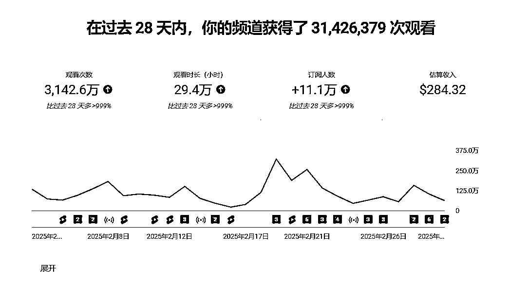
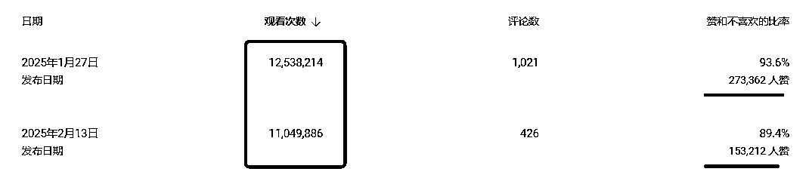
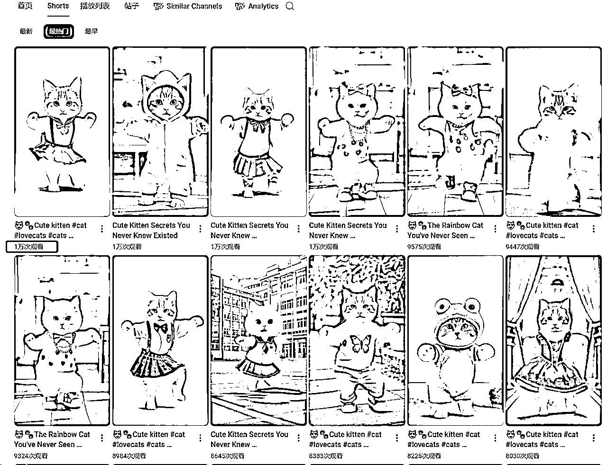
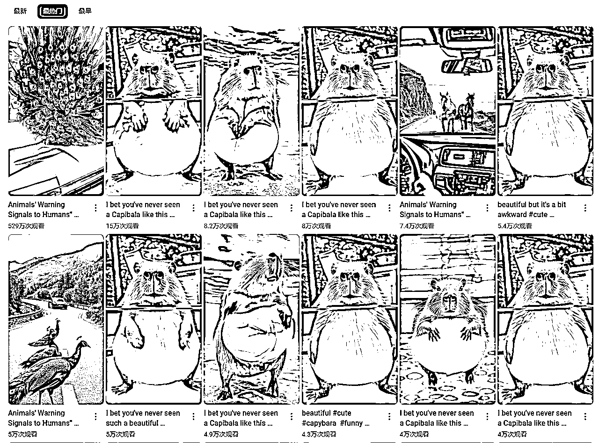
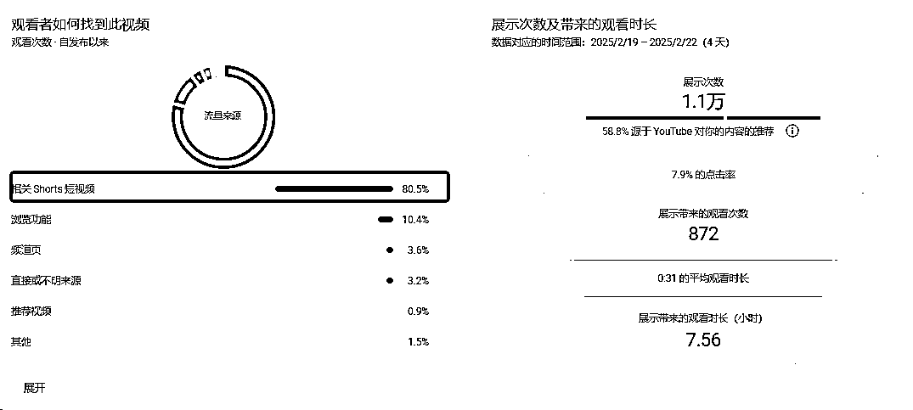
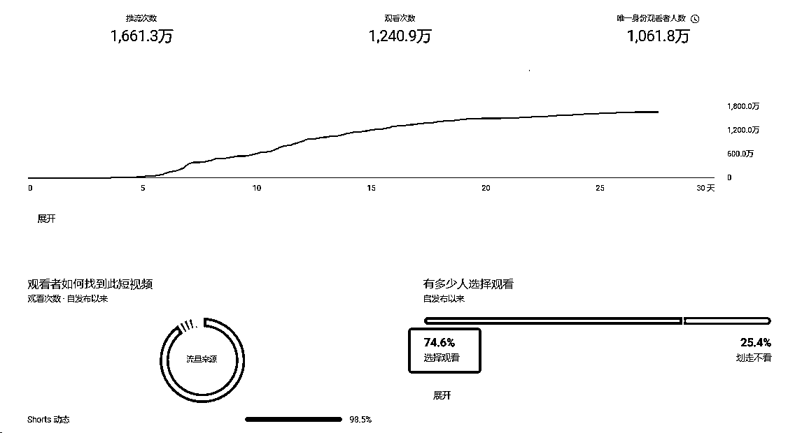
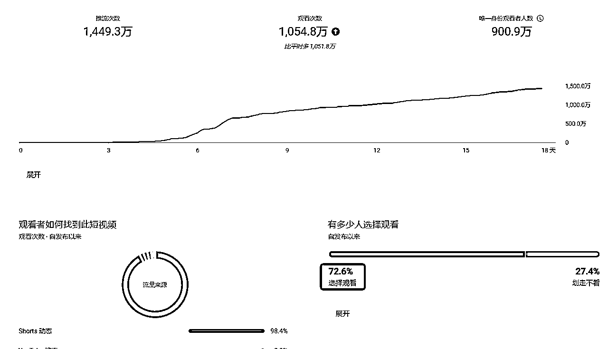

# 双号高级YPP达成：动物示警赛道从试错到放量的复盘记录

# 总览

大家好，我是As，目前在做全职自媒体。2024年12月起加入YouTube大航海计划，先后摸过猫咪跳舞、治愈向动物两条线。后来被选进YouTube私教陪跑体系，在Gary教练与方波妮教练的带教下转到动物示警方向，取得了阶段性进展。现在已有两个账号成功开通高级YPP，第三个账号数据已达标近期将提交申请，基本完成了陪跑初期立下的目标。下面用自己的历程做个梳理，希望对正在观望或已入场的朋友有些参考。

到目前为止，已产出两条千万播放作品，并完成高级YPP开通。

YouTube的内容同步分发到国内社交平台做二次利用，粉丝还在增长中：

| 平台 | 账号创建日期 | 订阅 | 累计播放 | 累计变现 |

| 视频号 | 2025.1.20 | 4.8w | 1400w | 1400 |

| 快手 | 2025.1.20 | 3.3w | 1200w | 60 |

| 📕 | 2025.1.20 | 2600 | 27w | 390 |

# 突破路径

## 初期受阻

第一个尝试的是猫咪舞蹈类。刚进入航海时信心很足，制作也快，三分钟左右能出一条。12月航海期基本保持日更一到两条，坚持即胜利。航海结束时粉丝只有600，最高播放1万。

## 换线再试

随后开始反思品类是否过于拥挤。在继续做猫咪舞蹈的同时，开辟了AI萌宠线。那段时间国内出现不少爆款案例，我先后做了小浣熊、卡皮巴拉。第3条作品迎来首个万播，1.3万播放，让我重拾信心。坚持大概一个月，曾出现十几万播放，但距离千万级仍有差距。陪跑期间与教练做了一对一复盘后，选择战术性退出，主要原因：

1. 门槛低、竞争激烈
2. 这类内容在YouTube的受众盘相对有限

## 转向翻盘

鱼丸推送的私教陪跑消息像一束光线，我马上报名并被录取。陪跑的深度远超航海，我花了一天时间研读手册，学到品类挑选思路、推流周期规律、数据解读方法。准备就绪后，启动会第二天就发布了第一条动物示警的Shorts。

初期以复刻为主，掌握流程后发现同类作品高度同质化：大多是动物起身拦车、抓引擎盖、跳上车顶。于是开始做微创新，可调节的维度包括：

1. 动物本身：
2. 阻车的物种选择
3. 动物状态是否加入受伤设定
4. 阻车时的动作与表情
5. 交通工具
6. 车型
7. 车身颜色
8. 环境
9. 改为阻挡轮船、飞机【目前测试反馈一般，可自行尝试】
10. 灾难类型【山崩、地裂、洪水、坍塌等】

实测有利于放量的做法：

1. 多只动物同框比单只效果更好
2. 不同物种混搭
3. 鸟类表现普遍优于常见陆地动物
4. 卡车、牧马人、SUV等大型车优于小轿车
5. 白色车更受欢迎
6. 车色与动物色形成强烈反差更好
7. 冷门稀有物种更容易出圈
8. 独特的阻路行为更吸睛，如孔雀开屏、变色龙变色等

个人总结的爆款模型

(稀有物种 × 强烈配色) + (突发事件 × 情绪共鸣) = 病毒传播

按此模型，我产出首条千万爆款：多只孔雀拦路并开屏示警。

依据陪跑手册“爆过的题材还能再爆”的观点，我对首条千万作品做了小幅改动，将开屏动作提前到第二个镜头，又获得第二条千万爆款。

首条千万爆款

第二条千万爆款

|  | 文生图【即梦】 | 图生视频【可灵&智谱】 | 备注 |

| 分镜一 | 山间蜿蜒的单车道上，三只孔雀背对镜头站在路中央，远处有白色牧马人吉普驶来，两侧有碎石与低矮植被，远景是连绵山峰，光线明亮，电影感野生动物画面 | 三只孔雀站在路中央向车辆鸣叫，白车高速驶来并紧急制动 |  |

| 分镜二 | 车内视角，前方道路被三只孔雀阻断，右侧碎石与低矮植被，远处岩石山峰，画面宁静紧张 | 镜头固定，两只孔雀朝镜头方向快步走来 |  |

| 分镜三 | 近景，白色牧马人正面，一只孔雀站于引擎盖上，两侧碎石与山峰，画面逼真明亮 | 智谱生成，孔雀尾羽从闭合缓慢展开，金色虹彩流动，眼斑在阳光下闪烁，尾屏从0.3米扩展至1.8米扇形 | 开屏效果需多抽，也欢迎分享词 |

| 分镜四 | 同分镜二 | 镜头固定，右侧山坡发生剧烈滑坡，巨石滚落路面，浓烟升起，道路被掩埋 |  |

更精细的制作方法：

@逸凡风顺

## 陪跑助力冲YPP

陪跑中期，教练分享了新打法，尝试后效果明显，凭借一定播放积累，账号很快达到高级YPP门槛。

# 赛道判断与收益思路

## 动物示警现状

该赛道入局者持续增加，衍生形态也不断出现。尚未出爆款的同学可继续深挖微创新。对新人的建议：先复刻经典熟悉流程，再尝试冷门物种、独特阻路方式。动物示警仍有流量空间。可关注：

1. AI动物救援：受伤动物求救拦路
2. AI动物救援：地面密集恐惧症求救拦路
3. AI动物救援：海上巨物密集恐惧症救援
4. AI“动物救援”变种——“天使狗狗”制作教程@轻舟

## 短长结合扩大收益

我认为Shorts搭配长视频是当前YPP变现的较优解。

Shorts的导流价值

YouTube Shorts的无限滑动推荐能让爆款快速吸粉，并将流量导入频道主页及长视频，提升整体曝光。平台更偏爱高观看时长的频道，Shorts单条时长短，但能把用户带入长视频，从而提升频道整体时长权重。

收益最大化逻辑

Shorts成本低、传播快，适合冷启动与涨粉；长视频广告收益更强。Shorts的核心作用是为长视频蓄水。以我自己的长视频为例，约80%的流量来自相关Shorts，爆款Shorts能显著放大长视频收益。

# 工具推荐

1. 收益查询与赛道挖掘
https://www.viewstats.com/top-list?tab=videos&musicChannels=true&madeForKids=true&movies=true
2. Whisk，可同时添加多个主体与场景，主体一致性保持优秀
https://labs.google/fx/tools/whisk

# 随笔

1. 坚持本身具备价值
2. 门槛越高，壁垒越稳
3. 先易后难，快速获得正反馈更重要
4. 不要追求完美，先发布再迭代
5. 选对方向比单纯努力更关键
6. 复刻能小爆，微创新才更易大爆，爆过的题材仍可再爆
7. 量变不等于质变，需持续提升单条质量
8. 可先制作16:9图片，生成视频后剪出9:16的Shorts，基本无违和
9. 直播时可在聊天区放置视频链接，提升回看
10. 不要被短期数据裹挟，保持更新，静待时机

# 鸣谢

感谢赚钱提供的平台，感谢Gary教练与方波妮教练的专业指导，感谢@七天老师对文章的建议，也感谢众多圈友的无私分享。私教陪跑提供的赛道判断与实操方法极具价值，原本以为一个月内开通YPP难以实现，达成后才体会到方向比努力重要。感谢当初填写问卷的勇气，也感谢陪跑团队的认可。

祝大家早日出爆款，早日开通YPP，早日赚美元！