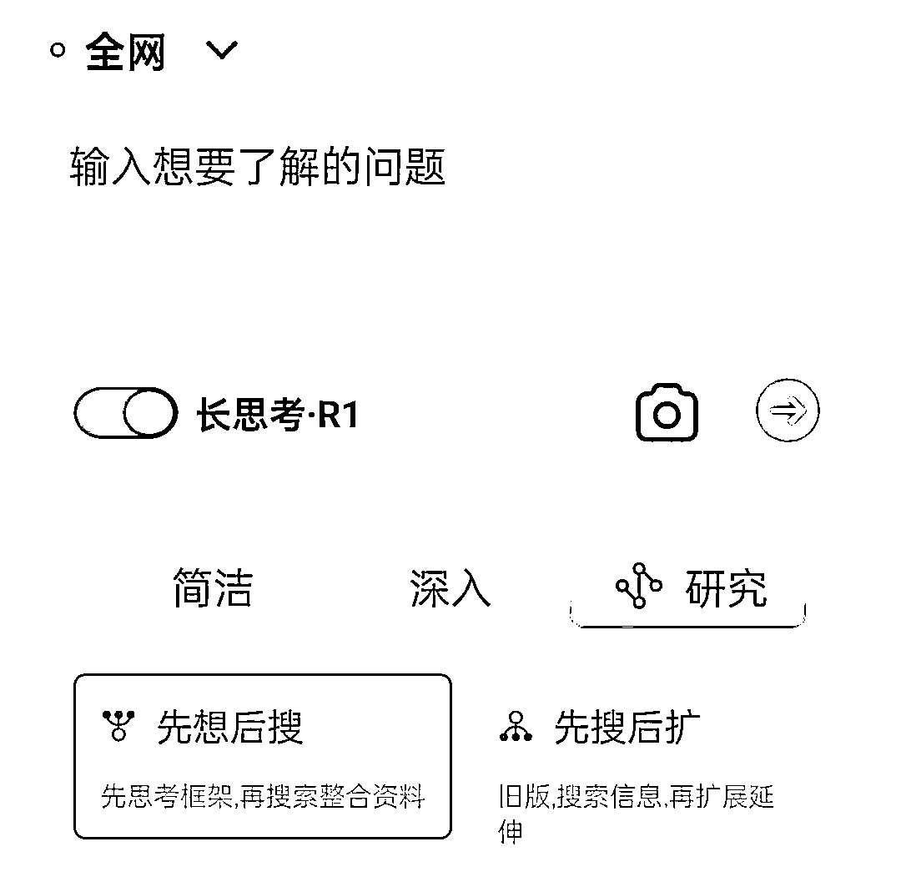
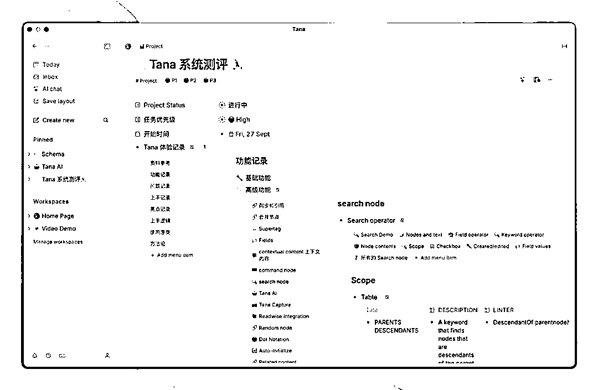
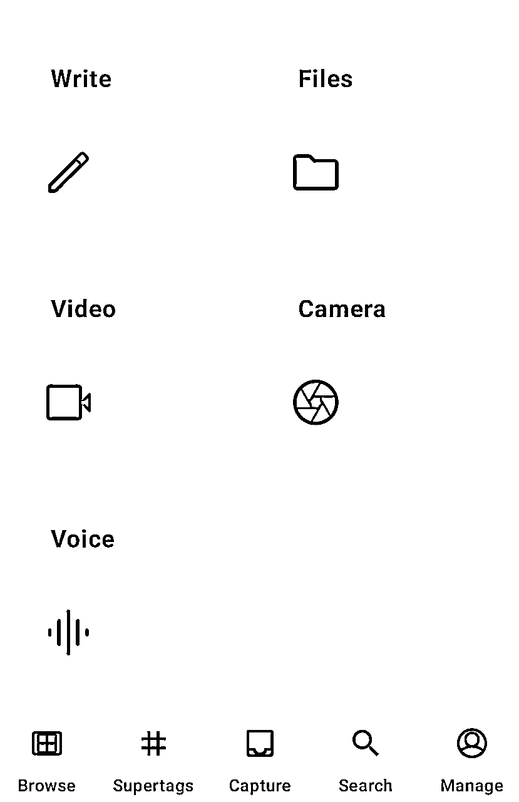
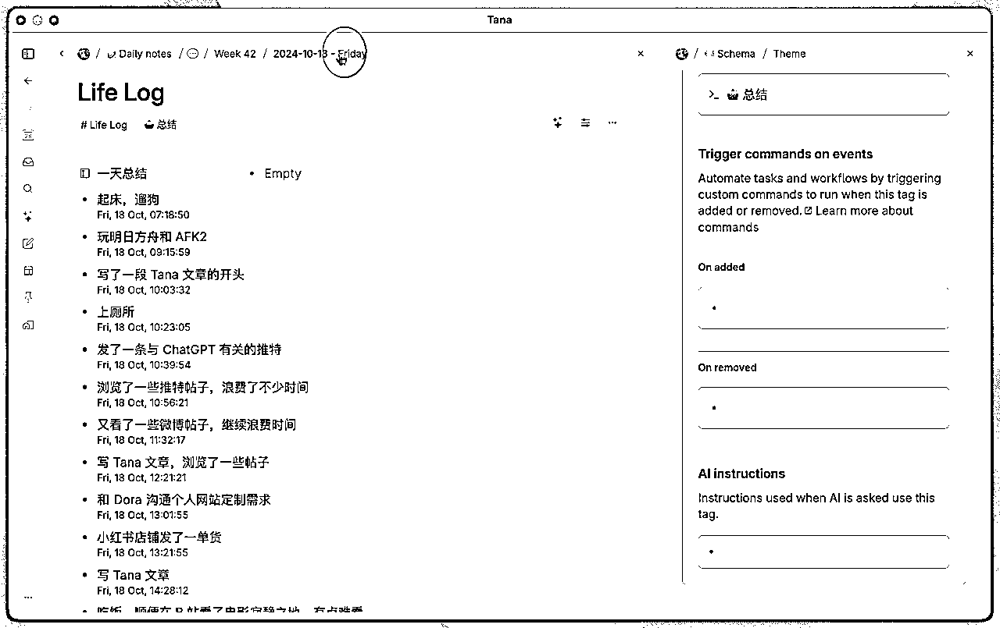
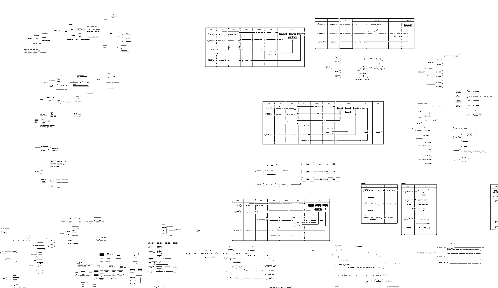

# 一次AI提效工具的踩坑与相见恨晚清单

DeepSeek的席卷式走红，让AI工具的门槛被彻底拉低。大家都在用，用得也越来越顺手。但这到底是让信息更公平了，还是让懂得用的人跑得更快、拉开了认知差？

数据挺扎眼的：国内AI工具的整体渗透率目前才11.3%，而北上广深杭五城的用户就聚拢了78%。地域鸿沟摆在那。

抛开这些议论，AI确实是肉眼可见地好用。回想上次我像这样集中式地去试大规模工具，还得是半年前。过完年回来，打开工具箱，基本大换血，新玩意新能力层出不穷，用起来手感都不错。

## 这两周我试了20来款，挑5款真正顺手的说说

这次主要聚焦两条线：生成式AI的推理能力，和笔记知识库的整理能力。为什么是这两类？

**推理型AI的价值，在于补脑。**它能把零散的信息拼成完整逻辑，还能把思考过程摊开给你看，倒逼你想得更周全。人脑的瓶颈是硬件级的，工作记忆就4-7个单位，容易过载、容易掉链子。推理模型正好能兜住这个短板。

**笔记类APP的价值，在于外脑。**知识工作者不可能把所有信息都硬塞进大脑，强行记忆只会拖慢思维。一个上手快的笔记工具能大幅降载，再加上AI，把笔记直接变成可检索的知识库，效率直接翻倍。

下面前三款是推理向，后两款是笔记向。

### 1. 腾讯元宝：现在最稳的国民级入口

冲着推理去的，我最近主力就是它。DeepSeek火是火，官网经常卡，各种山寨客户端也多。

本地用ollama，显卡扛不住基本是阉割版；cherryStudio没手机端；chatbox我用时也是非满血版，联网体验一般；felo又得🪜；360纳米搜索其实还行，但元宝出来后我就换了。

简单说，元宝现在是兼顾稳定、体验和本地化的第一选择。

### 2. 秘塔AI：专业检索的补位专家

元宝的联网检索重度依赖腾讯生态，视角容易偏。秘塔AI不一样，它的源头里有大量论文、期刊等专业资料，信息颗粒度更扎实。

它新上的 Shallow Research 很有意思，是 Deep Research 的轻量版，分三步走：先判断需要什么资料，再去检索，最后归纳总结。也就是先想后搜。

我现在把它当元宝的补充用。之前秘塔不能多轮追问，现在追问功能上线了，用作主力也没问题。

### 3. Grok3：推理天花板级别的存在

这款最突出的点是开放度高，国际局势、限制级内容都能聊，多模态也全，图片视频都能生。

它自带的 deepsearch 和秘塔路径类似，也是三步推理，路线更清晰，看着更启发性。同样也是元宝的补充位。

注：需要🪜。

### 4. Tana：知识管理的黑马

前两天在AI交流会上，一个00后小朋友安利的。乍一看像 Workflowy 这种大纲笔记，每一行都是一个节点。

实际用起来界面很克制，功能却很猛。短板是上手陡峭，深度玩要有点面向对象的思维，节点是核心。也不支持 Markdown。

但上手后有两个点特别爽。

第一，极速捕获。电脑手机都能一键弹窗输入，打个标签进去就行，会自动归类并带上创建时间等元数据，检索起来很准。

第二，超强提取。既能像 ES query 那样精准检索，也能用AI问答直接提炼，比如“一键总结今天的内容”。

个人体验比 Notion、Workflowy 都更顺手。Notion 太臃肿，飞书基本能覆盖；Workflowy 只有树状结构，强迫你结构化，用着不自由。

详细上手笔记可参考：https://sspai.com/post/93555

### 5. Get笔记：灵感的临时缓存盘

罗振宇团队出的新品，内置 DeepSeek 知识库，可以基于你的笔记和自建库问答。

不喜欢 Tana 的，可以直接把 Get 当主力，它也能替代 Flomo。对我来说是做补充，Tana 是国外服务，手机同步偶尔会慢。手机端先用 Get 快速抓灵感，回电脑再同步到 Tana 或飞书整理，很丝滑。

### 顺带提两款没进主力的

**Logseq：开源党的代表。**大纲+Markdown，功能很全。直觉上它的输入和提取没 Tana 流畅，但卡片记忆做得独特，记人名、知识点像背单词一样复盘，记忆友好。

**Miro：发散思维的白板。**就是一块无限大的清爽画布，想怎么连线怎么连，思维导图、大纲、泳道图都能放。自由度很高。

相比飞书白板和国产的 broadmix，Miro 更顺手，界面轻，几乎无延迟。

最后说一句，飞书在我这里依然是终极集散地，所有最终成果都收拢到那里。以上纯属个人使用体感，供你参考避坑。