# 京东外卖商家拓展指南：政策、流程、渠道与风险一次讲清

> 资料来源：[https://jx8j59ahkjb.feishu.cn/docx/HnijdTy7TotdVBxvBHDc057dnie](https://jx8j59ahkjb.feishu.cn/docx/HnijdTy7TotdVBxvBHDc057dnie)

## 开始之前，先看这几句话

如果你最近关注本地生活、餐饮数字化或平台平台招商，应该已经注意到：京东正在加快布局即时消费场景。

这份内容围绕京东外卖餐饮门店拓展业务展开，重点整理平台背景、适合人群、执行方式、结算问题、服务商选择以及官方学习资料。

需要特别说明的是：

- 本文仅作项目研究和实操参考，不代表任何收益承诺；
- 相关规则处于持续调整状态，实际执行以最新通知为准；
- 5月1日前的相关优惠政策具有明显时效性，后续可能变化；
- 新手不宜把它理解成“短期暴利项目”，更适合当作本地生活业务的练习入口。

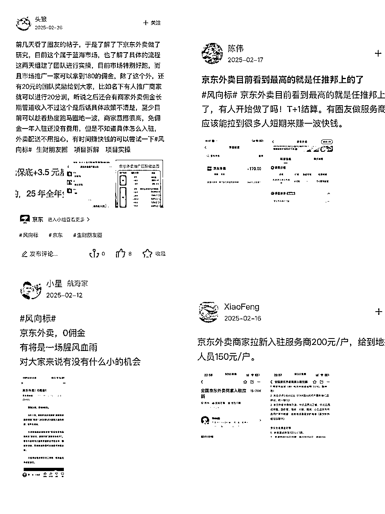

# 3月｜京东外卖｜实战手册

内容出品人：、@彻易、@云天  
手册出品方：凌尘团队  
发布时间：2025年3月3日

## 使用说明

本文通过项目拆解的方式，帮助读者了解京东外卖餐饮门店拓展的实际链路。内容出品人排名不分先后，文中信息主要基于2025年3月2日前的公开资料。

阅读时，如果想快速找到某个主题，可以使用：

- Windows：Ctrl + F
- Mac：Command + F

输入关键词即可定位。

# 一、入场前必须了解的基本情况

## 1. 这究竟是什么业务？

京东外卖属于京东旗下的餐饮到家业务。2025年2月11日，平台启动“品质堂食餐饮商家”招募，并推出阶段性优惠：在5月1日前完成入驻的商户，可享受全年免佣政策，同时存在相应的推广激励。

京东并不是第一次尝试即时消费领域。早在2015年，京东就开始布局京东到家。此次重新加码外卖，意味着即时零售和餐饮配送可能成为其后续重点建设方向。

不过，业务早期也存在现实问题：

- 平台政策更新频繁；
- 不同合作渠道的审核与付款节奏不一；
- 回款可能需要20—45天；
- 部分参与者持续投入后，短期内仍可能没有订单或奖励；
- 规则收紧后，门店审核速度可能明显放缓。

因此，正确的预期应该是：先熟悉业务、积累有效门店资源，再等待平台稳定，而不是期待加入后立刻产生大量收益。

建议至少连续运营一个月，保持稳定内容输出或客户拓展节奏，同时提升沟通、筛选和资料整理能力。

## 2. 哪些人更适合参与？

以下几类人相对更有优势：

- 做过线下拓客、商户拜访或本地生活业务；
- 手里有餐饮门店、连锁品牌或区域商圈资源；
- 愿意把前期投入视为学习成本；
- 能接受审核延迟、收入不稳定甚至阶段性无回报；
- 希望了解餐饮平台招商、门店运营和本地商业合作模式。

如果你是完全没有经验的个人，只是希望快速拿到结果，那么3月份并不是特别理想的切入时点。但你仍然可以借此观察商户合作、门店拓展、团购运营以及第三方代运营的工作方式。

本文由凌尘团队联合圈友整理，主要供学习交流使用。由于业务更新较快，部分信息可能随时间失效，请以平台及合作渠道的最新通知为准。

* * *

# 二、平台基础认知

（资料整理截至2025年3月2日）

## 2.1 京东外卖在哪里使用？

目前，京东外卖主要位于京东手机端的“秒送”场景中。

打开京东App后，可以在相关入口看到多个即时消费品类，例如：

- 餐饮配送；
- 咖啡与茶饮；
- 药品配送；
- 生鲜采购；
- 数码急送；
- 水果切配等。

从当时的页面情况来看，餐饮板块以连锁品牌和知名门店为主，普通中小餐饮商户数量相对有限，这也为后续门店拓展留下了一定空间。

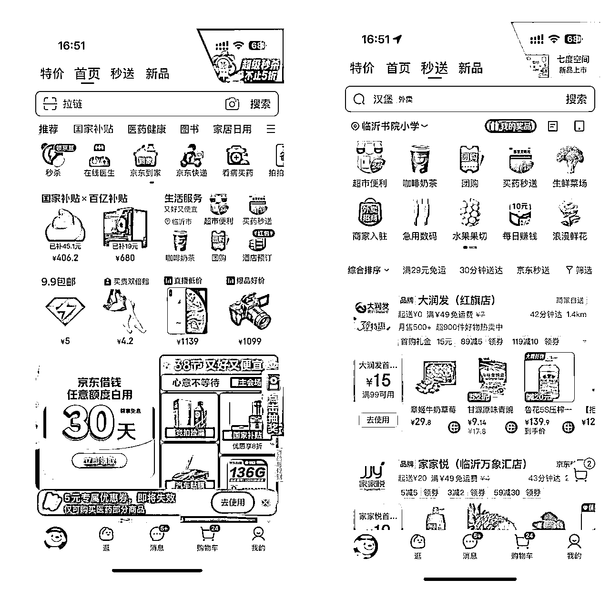

## 2.2 平台当时呈现出的几个特点

### 商户优惠

按照当时的公开政策，5月1日前完成入驻的餐饮商家，可获得全年免佣资格。配送相关费用则可能根据距离、时段等因素动态变化。

### 价格表现

京东外卖并非所有商品都比其他平台便宜，部分商品价格甚至偏高。因此，拓展时不能只强调“价格低”，还需要结合平台入口、品牌背书、阶段政策和潜在流量进行说明。

### 配送体系

大部分订单由达达秒送承担履约，少量商户采用自配送模式。京东即时零售的配送体系，在较大程度上依赖达达相关网络。

### 配送人员保障

京东曾表示，骑手不会因为社保福利安排而降低收入，相关成本由平台承担。2月27日平台上线补贴活动，自3月1日起，逐步为全职配送人员配置五险一金，并为兼职配送人员提供意外险和健康医疗保障。

## 2.3 有效门店的判断要求

门店资料并不是提交后就能计入有效结果。按照当时的要求，需要同时满足多项条件：

1. 必须是真实存在、正常经营的堂食餐饮门店；
2. 不得用虚构店铺、无实体经营场所或虚假资料进行申报；
3. 门店提交按照先提交先记录的原则处理，最终以官方核验结果为准；
4. 提交时要核对门店编号、商户名称和门头照片；
5. 门店需通过审核并正式上线；
6. 有效营业当天，营业时间应达到4小时或以上；
7. 商品原价不得高于美团或饿了么对应价格；
8. 商品数量不能少于其他主流平台；
9. 门店首次营业后的30天内，至少完成3笔订单。

随意试填门店编号、重复提交或向商户作出不符合政策的承诺，都可能造成资料无效，严重时还会影响账户后续结算。

# 三、行业变化与时间节点

## 3.1 平台近期动作

京东外卖在短时间内连续释放多项信号：

- 1月：京东宣布拟私有化达达集团，以进一步整合即时零售资源；
- 2月11日：开启品质堂食餐饮商户招募；
- 2月24日：说明骑手收入不会因福利保障安排而减少；
- 2月27日：推出较大力度的补贴活动；
- 3月1日起：逐步完善全职与兼职配送人员的保障方案。

从这些动作可以看出，京东正在加速完善外卖业务的基础设施和供给侧生态。

## 3.2 市场反馈与现实情况

公开消息显示，京东外卖上线一周后，部分城市的订单规模增长超过100倍，并覆盖39个城市，申请入驻的商家数量接近20万。

同时，也有圈内参与者反馈，个别门店能够产生1000元以上的奖励，但更多人经历的是长时间等待、审核缓慢和没有明显结果。

早期快速扫街、批量提交的阶段已经逐渐过去，平台开始加强资料审核和经营规范。预计3月底前后，部分地区可能继续处于低活跃状态。

所以，参与者需要区分两件事：

- 长期方向可能有潜力；
- 短期执行结果未必稳定。

## 3.3 行业空间

艾媒咨询数据显示：

- 2024年中国在线餐饮外卖市场规模约为16357亿元；
- 预计2027年将达到19567亿元。

京东进入该领域后，可能通过以下方式争取市场：

- 阶段性免佣，降低商户试错成本；
- 借助京东App入口导流；
- 以即时配送能力补充履约；
- 通过中高客单价场景吸引品质餐饮商户；
- 以平台补贴和商家扶持推动供给增长。

当时公开信息显示，京东秒送的平均客单价可能高于部分传统即时零售场景，更适合品牌餐饮、特色餐厅及中高端堂食商户。

按照当时的合作规则，成功推荐符合要求的餐饮门店，可能获得1XX元左右的现金奖励，具体金额和结算方式需以合作渠道最新政策为准。

平台早期免佣对商户具有一定吸引力，尤其是对长期承担较高平台服务费用的餐饮店而言，新增一个低成本渠道，可能有助于扩大曝光和订单来源。

3月1日起，当时可拓展范围主要为125个城市的主城区。县城、县级市等区域暂未纳入有效拓展范围，具体城市名单需查看当时发布的官方表格。

# 四、可以采用哪些业务路径？

## 4.1 直接拓展门店

这是最基础的执行方式，适合具备商圈资源或有线下沟通经验的人。

### 选店建议

优先关注：

- 大众点评等平台评分较高的门店；
- 有堂食基础、经营状态稳定的餐厅；
- 已经在其他平台运营外卖的商户；
- 有品牌意识、愿意尝试新渠道的连锁门店；
- 客单价较高、商品结构较完整的餐饮店。

### 沟通重点

不要只重复“免佣”两个字，可以从以下角度展开：

- 新增销售入口；
- 京东平台品牌背书；
- 阶段性政策支持；
- 可能获得的曝光机会；
- 配送体系和履约能力；
- 对现有外卖业务的补充作用。

### 操作准备

正式沟通前，建议准备：

- 简短项目介绍；
- 商家常见问题清单；
- 入驻步骤说明；
- 所需资料列表；
- 政策有效期提醒；
- 结算与审核风险提示。

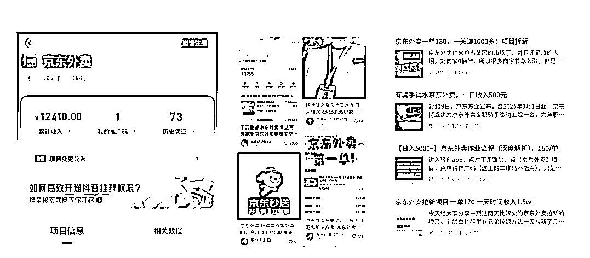

## 4.2 发展推广伙伴

如果个人拓展能力有限，可以通过伙伴协作扩大覆盖面。

基本做法包括：

1. 从社交平台、兼职渠道、线下商圈等地方寻找合作人员；
2. 通过专属邀请码或推广关系完成绑定；
3. 为伙伴提供基础资料、沟通范本和培训内容；
4. 定期检查资料质量和门店有效率；
5. 按合作渠道规则获取相应的团队奖励或管理补贴。

这种模式的优势是覆盖范围更大，但管理要求也更高。若只招人、不培训，很容易出现资料重复、门店虚假、承诺失真等问题。

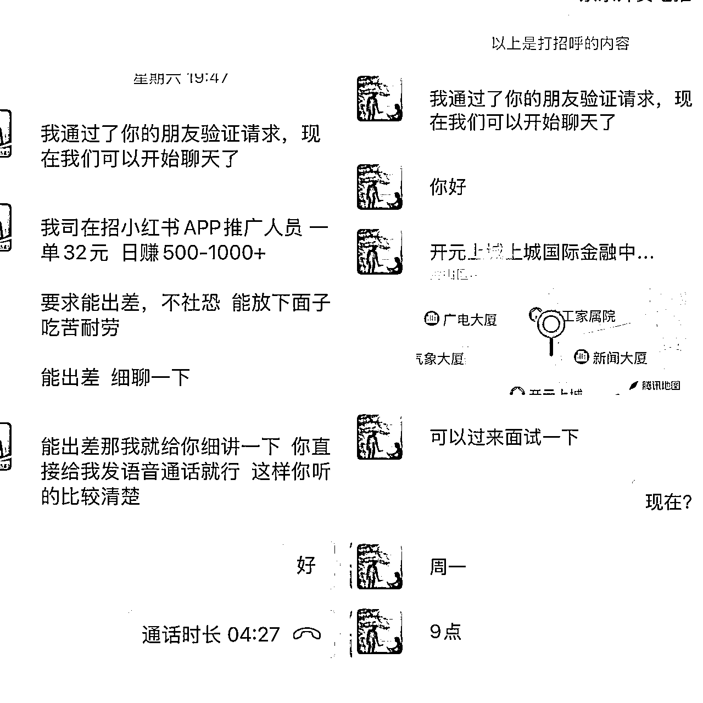

## 4.3 组织兼职拓展

兼职人员适合负责商圈采集、初步联系和线索整理。

为了提高执行效率，可以设置：

- 按有效门店数量计算的分段奖励；
- 首次培训与资料审核；
- 统一的沟通材料；
- 每日或每周数据复盘；
- 对无效提交、虚假承诺设置明确限制。

这类方式适合希望扩大触达规模、但自身时间有限的参与者。不过，兼职数量越大，越需要建立清晰的审核和培训机制。

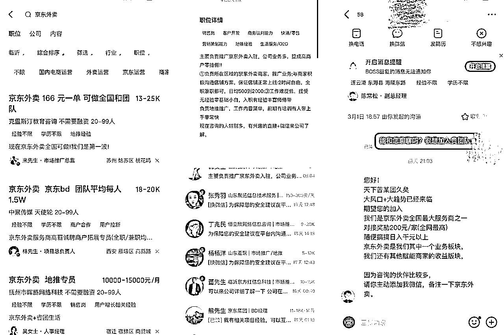

## 4.4 为商户提供后续服务

完成门店拓展后，还可以围绕商户经营提供增值服务，例如：

- 店铺页面整理；
- 商品结构优化；
- 活动方案设计；
- 图片与文案更新；
- 月度经营分析；
- 外卖渠道日常维护。

此类服务可以按照项目或月度收取费用，但必须提前明确工作范围，不宜对商家承诺平台无法保证的流量或订单。

## 4.5 组合其他内容渠道

如果本身在抖音、小红书等平台有内容能力，可以尝试为商家设计“内容曝光+餐饮配送”的组合方案。

例如：

- 发布商家政策解读；
- 分享门店入驻流程；
- 做区域餐饮探店内容；
- 通过表单收集商家意向；
- 再由专人完成后续沟通。

按照当时的合作政策，符合条件的门店可能对应1XX元左右奖励，但最终金额、审核周期和有效标准都可能变化。

## 4.6 为什么不少商户愿意尝试？

传统平台的服务费和抽佣长期是商户关注的问题。若新平台在阶段性窗口期提供免佣政策，商户往往愿意先尝试开通，尤其是：

- 已经有成熟堂食业务；
- 现有平台经营成本较高；
- 希望增加一个订单来源；
- 有能力同步维护多个销售渠道。

但拓展时仍要如实说明政策期限、审核条件和结算节奏，不能夸大收益。

# 五、参考执行案例

## 案例一：线下商圈拓展

与连锁餐饮或区域品牌建立联系，由专职商务人员对接门店负责人，重点说明平台阶段性政策、配送支持和可能的曝光资源。

## 案例二：线上内容获客

在抖音、小红书等平台发布餐饮商户关心的内容，例如：

- 如何降低外卖渠道成本；
- 新平台开店需要哪些资料；
- 餐饮门店如何增加订单入口；
- 多平台经营时如何安排商品和配送。

用户通过表单或私信留下信息后，再进行人工跟进。按照当时的案例，成功推荐一家门店可能对应100元奖励，但实际标准必须以渠道通知为准。

# 六、商户合作的完整链路

## 第一步：建立目标名单

可以优先寻找：

- 全国性餐饮品牌；
- 区域头部餐厅；
- 高评分堂食门店；
- 客单价较高的餐饮店；
- 已经在其他平台有外卖经营记录的商家。

## 第二步：核对资质和经营情况

重点确认：

- 门店是否真实营业；
- 店铺名称是否一致；
- 商品信息是否完整；
- 营业时间是否符合要求；
- 其他平台价格与商品数量是否匹配；
- 是否愿意承担后续维护工作。

## 第三步：进行政策说明

沟通时应明确：

- 免佣政策的适用时间；
- 平台可能提供的流量支持；
- 配送由谁负责；
- 商家需要准备哪些材料；
- 审核和结算可能需要多久；
- 哪些情况会导致资料无效。

## 第四步：提交资料并跟踪

资料提交后，保存好：

- 商户编号；
- 商户名称；
- 门店照片；
- 联系人信息；
- 提交时间；
- 审核进度；
- 订单和营业情况。

## 第五步：做好后续维护

门店上线后，还要关注：

- 商品是否正常展示；
- 营业状态是否持续；
- 是否达到有效营业条件；
- 是否出现价格或SKU不符合要求；
- 是否按规定产生有效订单。

# 七、参与过程中最容易遇到的问题

## 7.1 回款周期不固定

当时的情况是：

- 快则3—5天；
- 慢则按月处理；
- 不同合作渠道可能存在明显差异；
- 直接签约与第三方合作的流程也不相同。

因此，不建议把尚未到账的奖励提前计入现金流，也不要为了追求数量而大量垫付成本。

## 7.2 规则持续增加

平台上线早期，很多流程还在完善。可能出现：

- 上午发布解释，下午补充要求；
- 同一类门店的审核口径发生变化；
- 2月和3月的结算条件不同；
- 后续月份继续增加资料或经营要求。

当时重点关注的文件包括：

- 京东外卖服务商激励细则（2025年3月）；
- 京东外卖服务商激励细则2025年3月补充方案。

核心原则始终是：提交的数据必须满足官方标准。

## 7.3 团队扩张过快

在测试阶段，如果一开始就大规模招募新人，却没有完成培训，常见后果包括：

- 误导商户；
- 提交虚假或不完整资料；
- 大量门店无法通过审核；
- 一线人员浪费时间；
- 团队整体数据质量下降；
- 后续结算受到影响。

更稳妥的做法是：

1. 与合作方保持及时沟通；
2. 把最新要求整理成团队可执行的清单；
3. 对新成员进行统一培训；
4. 先小规模测试，再逐步扩大；
5. 定期复盘无效案例；
6. 保持重要通知渠道畅通。

招募人数固然重要，但培训、质检和过程管理更关键。

# 八、服务商与渠道如何选择？

## 8.1 为什么有人选择第三方渠道？

主要原因是资金压力和流程复杂度。

据当时流传的信息，直接与京东签约的服务商可能需要：

- 缴纳10万元保证金；
- 接受27—45天左右的结算周期；
- 经过资料核验、账单确认、财务审批等环节。

常见流程大致为：

提交门店资料 → 平台核验 → 生成账单 → 财务审核 → 结算到账

第三方合作渠道通常不需要个人直接承担全部前期投入，但也要注意其审核口径、收费方式、结算能力和合规性。

## 8.2 当时可见的收益组成

根据当时的公开信息，服务商收益主要可能包括：

1. 餐饮门店拓展奖励：约200元/店，按月处理；
2. 商家后续交易分成：餐饮业务预计约1%—2%。

具体金额不应视为固定承诺，须以实际签署的合作规则为准。

## 8.3 直接申请服务商需要什么条件？

当时公开条件包括：

- 具备独立法人资格；
- 有固定办公地点；
- 持有营业执照、税务登记资料及组织机构相关证明，或统一社会信用代码营业执照；
- 经营范围中包含培训、咨询、代运营等相关内容；
- 团队规模达到10人以上；
- 具备商务拓展、门店运营等岗位配置；
- 有餐饮、物流或本地商业资源者优先；
- 需要缴纳约10万元保证金；
- 可能接受城市规模考核和退出机制。

服务商主要承担商户侧运营，并不等同于配送承包商，业务范围可能涉及餐饮和零售。

# 九、城市服务商与区域代理的区别

这两个概念不能混为一谈。

## 9.1 城市服务商

城市服务商属于京东外卖体系中的一级合作角色，需要通过京东秒送官网电脑端提交申请。

大致流程为：

1. 在电脑端搜索“京东秒送”或“京东到家”；
2. 进入官方网站；
3. 找到“入驻合作”；
4. 选择“服务商合作”；
5. 填写企业和团队资料；
6. 等待平台审核。

当时提到的硬性条件包括：

- 团队人数达到10人以上，并提供社保或劳动合同等证明；
- 注册资金达到50万元且为实缴；
- 在重点城市拥有餐饮、物流或本地生活资源，可能更有利于审核。

## 9.2 区域代理

区域代理属于二级授权，通常由已经取得城市服务商资质的机构再进行授权。

也就是说：

- 城市服务商需要向京东官方申请；
- 区域代理需要向取得资质的城市服务商申请；
- 二者在授权层级、申请入口和责任范围上不同。

如果自身不满足团队、资金和资源条件，直接申请一级服务商可能会浪费时间，应先确认适合哪一种合作方式。

# 十、当时较受关注的合作渠道

当时市场上讨论较多的渠道包括省团和任推帮。

公开信息显示：

- 省团2月直推奖励约180元/店；
- 省团3月直推奖励约166元/店；
- 任推帮单店奖励约170元，累计达到500家后可能按190元计算；
- 任推帮还存在邀请伙伴获得一定比例分成的安排；
- 不同渠道在审核速度、结算周期、门店要求上可能存在差异。

以上内容仅为当时信息记录，不代表当前政策，也不建议据此直接判断收益。

# 十一、省团推广权限开通参考

省团生活是一款覆盖餐饮、娱乐等消费场景的App。

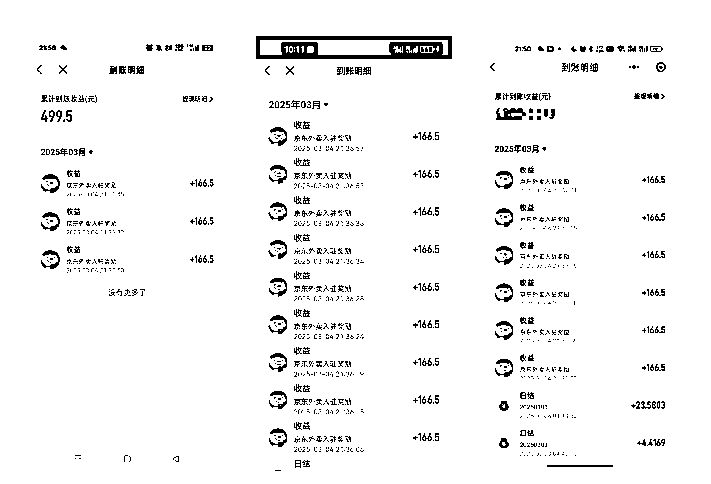

## 省团生活App

下载地址：https://a.app.qq.com/o/simple.jsp?pkgname=com.hs.stsh.android

也可以在手机应用市场搜索“省团生活”进行安装和注册。

当时使用的邀请码为：sc888

* * *

以上为2月份的结算规则记录。后续规则、奖励金额、审核条件和结算方式，请务必以合作渠道最新通知为准。

# 最后总结

京东外卖的商户拓展业务，核心看点在于：

- 平台处于扩张早期；
- 阶段性免佣政策对商户具有吸引力；
- 本地餐饮仍存在大量新增渠道需求；
- 线上内容与线下商圈都可以作为获客入口；
- 后续还可能延伸到门店运营、活动策划和代运营服务。

但与此同时，也必须正视：

- 政策会持续变化；
- 审核和回款并不稳定；
- 有效门店标准较多；
- 团队扩张需要培训和质检；
- 收益不能脱离真实经营和平台规则。

更稳妥的做法是：先核实最新政策，再选择正规合作渠道；先小范围测试，确认审核与结算链路后再扩大规模；所有对商户的承诺，都应以官方可验证的信息为依据。

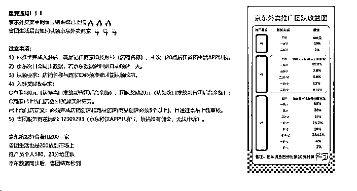

3月份第二波政策调整：

原180元的奖励标准下调至166.67元，团队分佣原20元调整为18.52元，均为税后金额；自3月1日起结算方式改为按月结算。

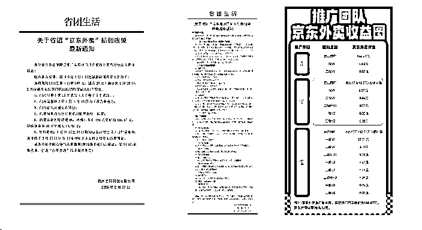

3月3日最新动态——

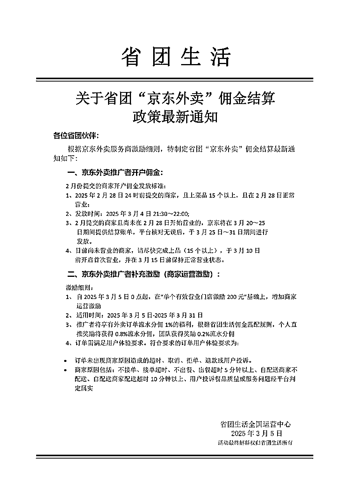

京东外卖联合省团生活后台，奖金到账实操演示视频

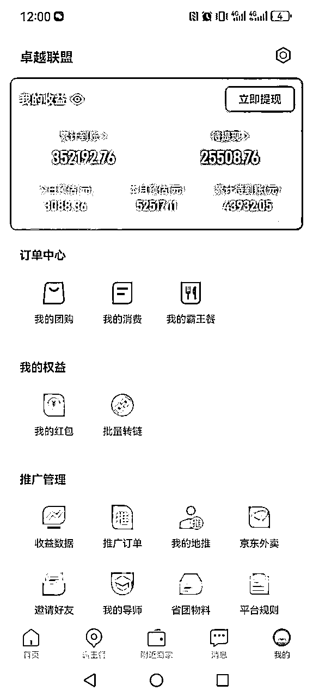

京东外卖入驻省团生活，奖金秒到账全流程图解

上门拜访商家完成入驻→创建门店，创建过程中务必填写邀请码，填错则无佣金可拿。省团全国统一BD码：12309293→等待平台审核通过→登录商家端APP查看是否已开通运力→制作菜单上线并绑定商家收款账户后正式营业→平台后台扫描任务采集作业数据，此步骤可锁定是哪位推广员完成的业绩。

* * *

商家入驻需提前准备的材料清单

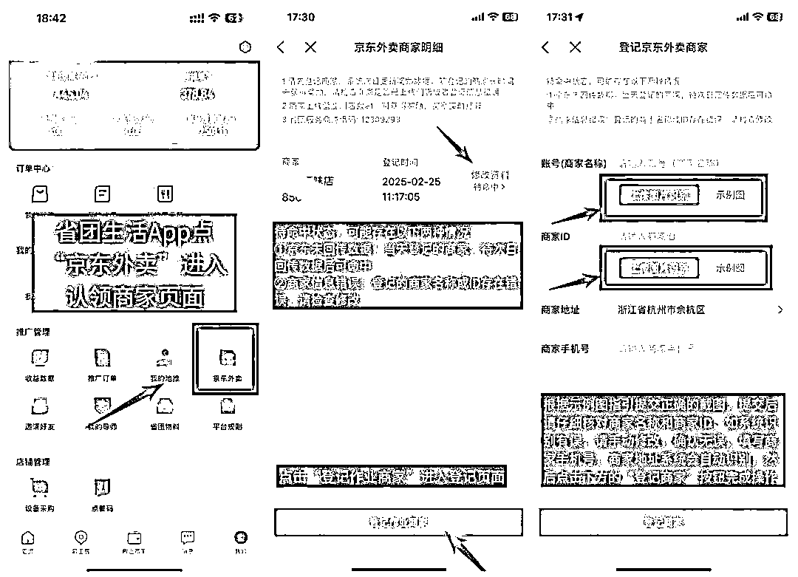

京东商户开通指引

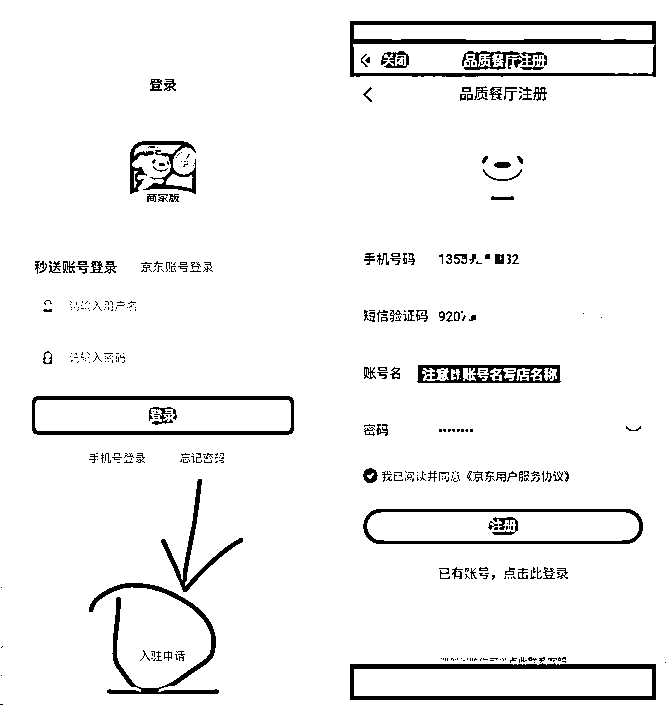

此页有两点务必注意：

第一，手机号一定要填写长期在用的号码，连锁品牌建议填外卖负责人手机号，后续号码变更非常麻烦。

第二，账号名和密码要便于记忆。信息填写完毕后获取验证码，点击注册进入下一步。第二步为店铺资质信息填写，是整个入驻流程里最关键的一环。

（1）联系人部分，填写本店负责外卖运营的人员姓名即可，自己负责就填自己；联系电话会默认带出注册时填写的号码。

（2）经营品类必须选择“外卖美食”，选择其他品类将无法享受零抽佣优惠。

（3）商家名称要与证件图片保持一致，可填写门店名或品牌名。

特别提醒：注册时账号必须写入门店名称，后续认领时名称也需一致才可通过。

商家名称与登录密码页面务必截图保存，后续上品会用到。

品类选择外卖美食，商家才能享受全年免佣。

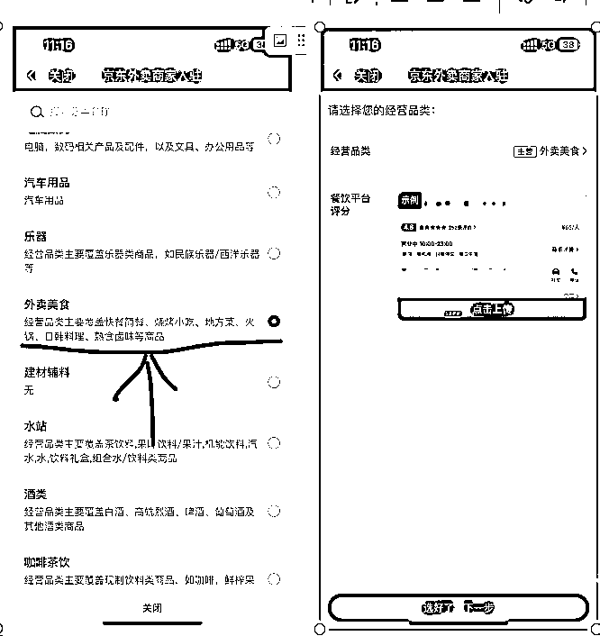

从各大平台截取评分凭证任选其一上传即可

* 高德评分≥4分
* 美团评分≥4分
* 抖音评分≥4分
* 大众点评评分≥3.8分

必须是团购页面的完整截图，不能出现外卖、快送字样。

优先上传高德截图，当天可通过审核。

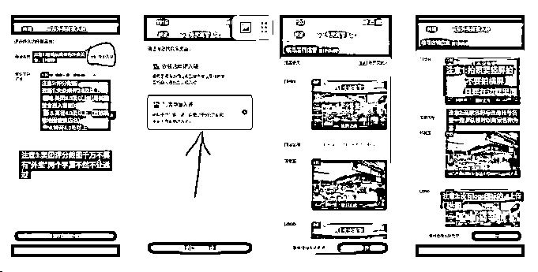

照片横拍同样可通过，邀请码务必核对无误后填写

全国省团统一邀请码：12309293

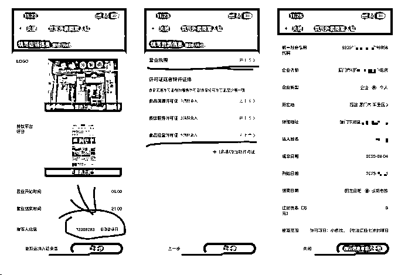

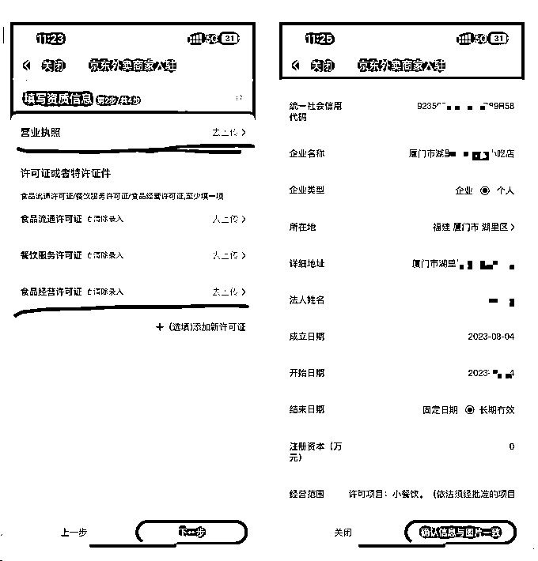

上传营业执照，注意核对内容与日期；上传食品经营许可证，注意核对内容与日期；上传法人身份证正反面。

此步操作相对简单，上传营业执照后系统通常会自动识别信息，若信息未识别或识别错误可手动补充。第五步进入配送方式选择页，根据实际需求选择。

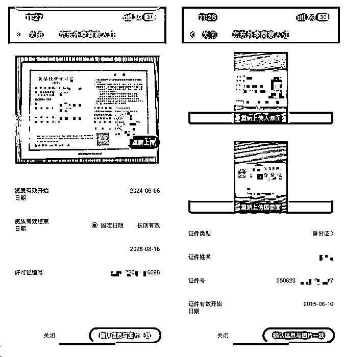

在未覆盖达达秒送的区域可选择商家自配送，并填写银行卡信息

（1）若此前未做过自配送，建议优先选择达达秒送；若想自行配送则选择商家自配。

（2）结算方式目前有三种：统一结算，京东将所有门店金额汇总打至总部银行卡；分门店结算，每个门店单独收款；分门店组结算，按门店分组收款，如北京门店汇总到一张卡、上海门店汇总到另一张卡。分门店组结算灵活性最高，未确定方案时可先选此项，后续仍可切换为前两种。

（3）收款方式选择银行卡收款即可。填写完毕后提交申请，进入审核阶段。

第六步提交后将进入“审核中”状态页。

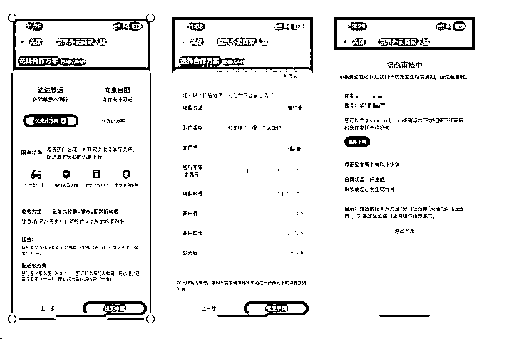

### 京东钱包开通方式

打开【京东APP】-【我的】-【我的钱包】-【余额】-【立即开通】，按页面指引完成即可。

京东钱包开通指引

非白名单内真实品质堂食餐厅的要求如下：

（1）商家具备堂食或实体经营门店，小吃、卤味等均可；
（2）经营品类限定为中式及西式正餐、快餐、自助餐、海鲜、火锅、烧烤、小吃卤味等满足早中晚餐、下午茶、夜宵场景需求的商家，咖啡茶饮、烘焙、蛋糕、奶茶等不可入驻，务必注意；
（3）平台或将结合其他餐饮平台评分综合判断是否属于品质堂食。

注：品质单店签约前需向对应渠道经理报备，初审通过后方可签约，最终以客服审核结果为准。

商家结算账户必须为对公账户吗？

无需强制对公，可法人或非法人结算。

超市能否入驻？

目前仅开放餐饮类目，超市类商家暂不支持，重点推进餐饮业入驻京东外卖。

若在操作中跳过当前界面未截图，如何查询ID？

返回注册页面，下方有“入驻申请”入口，点击后即可查看商家ID。

审核周期多久？

人工审核目前无法给出精确时间，京东承诺尽量做到当日清。最长不超过3天，若超过3天可反馈投诉。AI系统审核预计于2月底上线，期间请耐心配合。

连锁店开多家但只有一个ID，如何核算提成？

以实际ID数量为准核算。

如何判断是否审核通过？

通过后需进入下一步签约流程。

目前暂无系统自动支撑，需人工二次跟进商户。

京东客户端外卖入口在哪？

京东APP顶部切换至秒送，即为京东外卖。

评分要求是否必须大众点评≥3.8？

要求为大众点评≥3.8分，美团/饿了么/抖音/高德≥4.0分。

已存在账号的商户如金婆婆重庆小面阳光城店还能操作吗？

可更换账号组合后重新提交审核，以官方最终审核为准。

商家经营款何时到账？

结算周期为T+5。

未填写邀请码操作到中途还能补填吗？

必须填写邀请码，无邀请码则平台无数据记录，所有业绩以邀请码为准，不可补填。

连锁餐饮新店未开业能否入驻？已有评分的老店能否注册？

可以。

已认证但外部显示未认证是什么情况？

可再次点击认证，若已完成认证则等待京东客服人工审核即可。

单体店结算方式选择？

建议选择分门店组结算，后续操作更灵活。

京东提成是否需要缴税？

省团直推伙伴税后实得166元。

渠道后续25元达标后多久打款？

达标后自行统计并报备，即安排结算。

京东外卖上的优惠是否由商家承担？

需要承担，但前期京东提供补贴。优惠分商家自设套餐满减和官方发券两种，券面优惠由官方补贴。

从未上过外卖平台的新店能否做？

不建议操作。

连锁加盟店不走CKA走单店模式是否影响结算？

有独立营业执照则不影响。

营业执照上传反复失败怎么办？

检查营业执照是否清晰、是否过期、是否已年检、拍照是否失焦。

顾客下单超过6公里是否会展示？配送费如何计算？

商户可自行设置配送范围。6公里内配送费为3元/单，超出范围配送费原则上由用户承担。

保底1元是什么意思？

指6%抽佣+最低1元保底，非6%+1元叠加。

显示招商审核中、实名认证中，下一步如何操作？

等待审核，做好二次回访，人工审核耗时较长。

配送环节出现问题找谁处理？

同美团模式，由京东官方客服处理。

自配送也是3元吗？

自配送价格由商户选择的运力公司决定。

两个门店同法人是否需要重复认证？

需要。

营业执照为房东名下，身份证应提供谁的？

以法人为准。

入驻成功后未填邀请码可否补填？

不可补填。

周边暂无运力时可先选自送，后期能否改成达达？

可以，后期可更改。

提示“操作失败：请完整填写食品经营许可证所需信息”如何解决？

清空证件后重新上传食品经营许可证，若证件持有人与营业执照不一致可尝试更换其他证件。

商鹏打印机支持京东到家但未在平台对接列表中，能否使用？

可尝试，市面上已有商户用美团打印机适配。平台已对接：飞蛾、佰时、大趋智能、佳博云打印、接单小帮手、老板有单、芯烨云打印等。

银行卡必须为法人名下吗？

可法人或非法人银行卡收款。对公则选公司对公账户，银行卡可用非法人名下卡验证。

提示“该区域暂不合作”是什么原因？

提供截图并报备区域。

注册时提示已注册怎么办？

可能账号与门店名重复，可在名称后加区位词区分，如xxx路xxxx小区。

商家注册时的账号是否为对外展示的店名？

不是。

加盟店可否单独入驻？

可以，单独营业执照可单独入驻。

取餐地址可否修改？

可以。

美食城商户只有营业执照，美食城持有许可证能否通用？

按美团入驻标准准备资料即可入驻。

无打印机能否接单？

配置打印机后系统自动接单，未配置需在APP或PC端手动接单。

业务员设置的密码，待审核后无法登录？

登录方式选择错误，需用当时注册的账号密码或手机验证码登录。下方的账户名密码为商家登录使用，务必保存。

提示“信息比对不通过，请检查信息正确性”原因？

可能是营业执照法人与身份证不一致，或门店名与营业执照不符。信息比对不一致时可重新填写正确的食品经营许可证编码，系统识别可能出错。

法人不在本地无法刷脸认证，能否用银行卡认证？

可以。

无打印机如何打印小票？

经京东确认，未配置打印机不影响结算。

商家门店编码是否必填？

非必填，可先空置。

连锁店如何建店？

总店建店成功后，其他门店可远程批量建店。

连锁店入驻判定标准？

统一LOGO、商标注册证、总营业执照、统一对公结算。单独营业执照的连锁店按单店操作。

无产品图片如何上架？

必须拍摄实物图片后上架。

一证多店，四家门店共用一个执照能否入驻？

可以入驻，后期创建门店时可能存在问题。

小餐饮店营业执照为三合一，无独立许可证，上传后无法下一步怎么办？

可上传两次营业执照。

上架菜单是否有视频教程，能否从美团导入？

提供图文教程，不支持直接导入。

打印机能否用WiFi连接？有教程吗？

支持蓝牙连接，官方提供教程。

店铺审核通过后如何查看？

登录后点击-开店任务-查看签署情况。

商家地址与营业执照不一致如何处理？

多数情况可入驻，已有成功案例。

填写法人信息后提示信息不通过，核对无误仍失败原因？

必然存在信息不一致，或之前填写与当前认证信息不符。

连锁店是否每家都要到店操作？

不需要，后期商家登录PC端下载模板批量导入即可。

各环节审核时间？

1. 建店审核约0.5天；
2. 合同签约审核1-2天；
3. 创建门店、上传菜品、上线接单。

三步合计最少需2.5天完成一家有效门店入驻。

如何高效抢占市场？

业务员按三阶段推进：

第一阶段：规划每日拓店区域，按片区完成建店审核并录入商户联系方式，减少二次回访成本。

第二阶段：根据前一日审核结果，远程或上门引导商户完成二次回访，进入签约审核，为上线做准备。

第三阶段：签约审核通过后短信通知，统一备注预计完成时间，方便快速跟进并完成第三次回访上线。

按此节奏可高效占领市场并兑现入驻奖励。

初审不通过能否变更邀请码？

初审不通过时，已填邀请码和未填邀请码均不可变更。重新入驻无需再次填写邀请码。

银行卡必须绑定法人吗？部分店铺营业执照在房东名下？

可不绑定法人，若资料不过可先绑定法人，后续可更改结算账户。

校验不通过原因？

系统可能存在BUG，注意核对照片识别信息是否正确。

门店中途休息如何设置？

经营期间需休息可下线处理。

一年后收费标准如何？

专送：抽佣6%+最低1元保底+3.5元基础履约服务费；
自送：抽佣6.5%+最低1元保底。

清真类商家是否需要备案？

先尝试提交，按营业执照和食品经营许可证操作。

驳回原因“该区域暂不合作”怎么办？

更换运力，切换为自配送。

50家连锁店，其中20家已被其他业务员单独注册，如何区分？

首个使用该资质注册的业务员拥有权，第二人无法重复使用该资质注册。

昨日忘记填邀请码，审核已通过还能绑定吗？

不可逆，无法修改。

商家自行登录拿到ID号后被其他业务员提报，如何判定？

以首个上报商户ID的业务员为准结算。

连锁店总店已提交，分店是否每家都要领取佣金？

可批量开店。

法人不在本地，走对公收款验证需多久？

约半天。

商家此前使用过达达，申请入驻直接跳到邀请码、营业执照信息未填写步骤，如何处理？

此类情况较少，不必过度纠结，未填邀请码即不可逆。

驳回原因显示“其他”，门店条件均符合怎么办？

重新上传资料，补传评分截图。

商户曾注册过京东账号，直接登录可否使用？

可以。

法人证件信息比对不通过怎么办？

重新拍摄身份证，避免边角遮挡；再次核对食品经营许可证编码，系统可能识别错误。

全国连锁加盟店能否操作？

可以，所有加盟店均可，直营店不可。

招牌名称与美团名称不一致，如门头为樊司令汤包，美团为樊傻儿汤包，是否影响审核？

不影响。

京东外卖任务上传时省团系统显示商家名称错误，处理方法

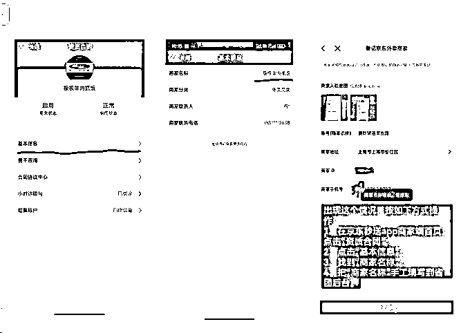

商家名称错误

平台评分标准截图要求

截图需选择团购，团购餐券页面

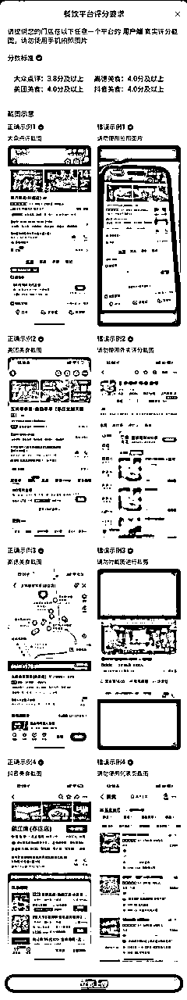

商家注册审核通过后收到【京东到家】短信提示，即可上架商品

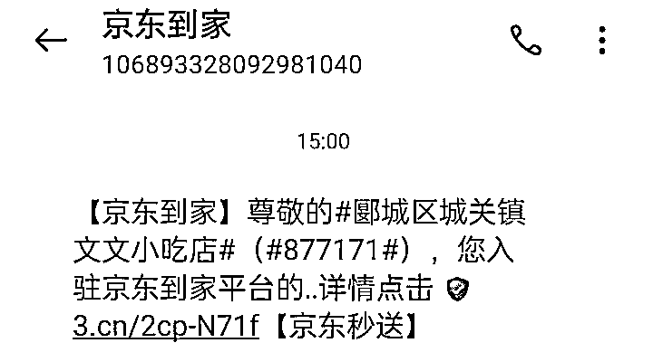

待命中状态可能原因如下：

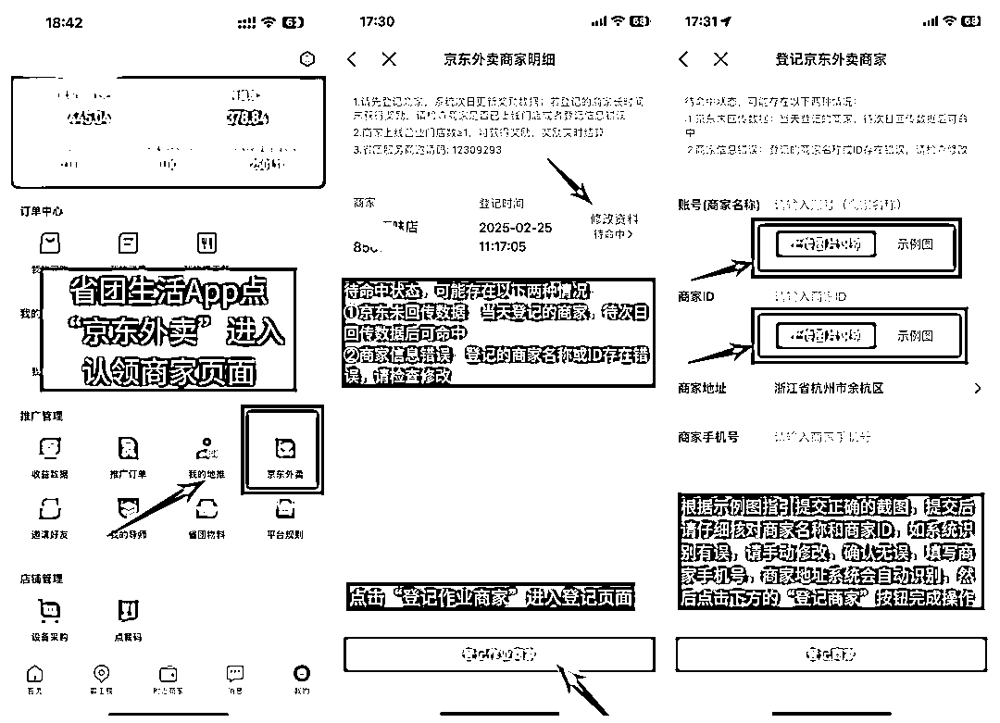

①京东未回传数据：当天登记的商家，需次日回传数据后可命中
②商家信息错误：登记的商家名称或ID有误，需核对修改

### 京东后台打印机链接指引

平台已对接：飞蛾打印机、佰时打印机、大趋智能打印机、佳博云打印、接单小帮手打印机、老板有单打印机、芯烨云打印机。

第二部分为系统对接与打印机对接。目前市面上主流收银系统京东均已对接，可联系厂商对接，但周期较长，建议前期先用打印机接单。

主流打印机品牌对接方法均已公开，可在各品牌公众号查看详细教程：

（1）飞鹅打印机绑定流程点此进入；
（2）芯烨云打印机绑定流程点此进入；
（3）商鹏打印机绑定流程点此进入；
（4）大趋打印机绑定流程点此进入；

如未找到可致电打印机官方客服咨询。第三部分为店铺上线。

单店部分京东已制作两张长图可供参考，不明之处可私下咨询。

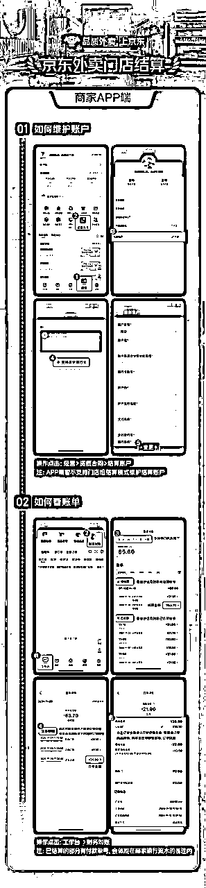

### 连锁品牌操作指引

连锁品牌请登录电脑端https://store.jddj.com/，使用京东账号登录：

进入后点击“商家设置-商家资质合同”，确认所有内容已填写且状态为通过，即代表已完成京东外卖入驻。若未绑定京东钱包，点击“绑定钱包”-“注册”，将“注册”页面“账户管理”中的商户号复制至商户后台即可完成绑定。

另请注意，连锁品牌无论单店或多店创建，在“商家设置-门店设置”中均应选择“批量导入”，不要选择“单个创建”。

在表格录入阶段，直接把美团、饿了么已有的资料搬过来即可。特别留意配置列中用于接收商家账号密码的手机号，界面提示为非必填，实际上是强必填项。只有填写该手机号，子门店才能收到对应门店的登录账号密码，而子门店首次登录必须使用这套凭证。

配送半径建议前期先填 3000 米到 3900 米左右。京东目前的流量分配逻辑与美团早期较为相近，配送范围设置过大会拉低下单转化，进而影响店铺曝光。

其余流程难度不大。总体来看，京东外卖的门店资料填写、资质上传、结算绑定等，和美团的操作习惯很像，连锁品牌的运营人员基本能独立完成。

提示需要提交三证合一材料时，上传营业执照即可。

问：2 月份成功提交的任务，多久能提现？
答：只要商家在 3 月 1 日至 3 月 15 日期间持续营业，京东会完成审核并回传给省团。我们这边不人工打款，系统会自动拨款到各位账户。

问：怎样才能出现品质外卖的提示？
答：以门店为中心 5 公里乘 5 公里的范围内，经营品类达到 5 个，且有 8 家商户在营业，系统就会显示品质外卖的圆环标识。

问：手机端已显示店铺上线成功，为什么没有数据？
答：京东秒送后台仅能查看商家是否营业，具体经营数据需 T+1 日后才会在京东后台展示。

运力配送建议
一二线发达城市优先选达达，配送费 3 元。若运力不足，也可选择自配送，即第三方平台配送，费用会贵一些。

后期有没有管道收益？
目前没有，后续会开放。未来将按城市、按区划分服务商，业绩最好的区域会匹配给对应服务商。目前省团排名前四，建议多聚焦 39 个核心城市范围。等省团拿到区域服务商资格后，参与开发的伙伴即可获得流水分润。

### 消费者进入京东外卖频道的路径
打开京东 App 首页，顶部【秒送】频道，点击【品质外卖】即可进入。

门店无法上线、资质未提交、营业前校验失败时，可排查：
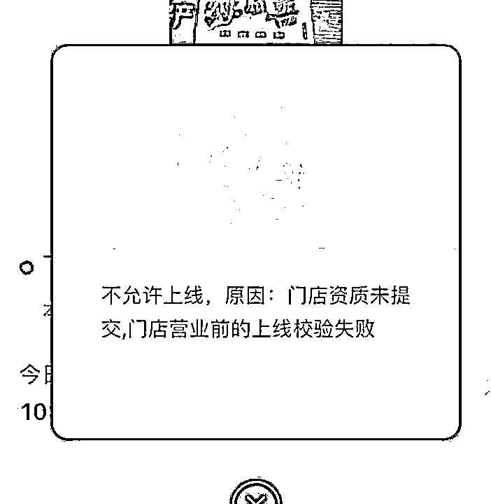
查看门店管理，核查门店资质是否已全部上传；缺失的补充营业执照和食品经营许可证等资料后重新提交。

# 任推帮：如何开通【京东外卖】推广权限！

可参考：圈友云天
京东对接服务商：任推帮
相关资质齐全，结算有保障

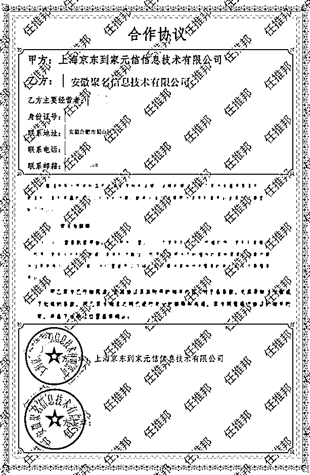

## 一、京东外卖推广流程

## 【从入门到收益】

### 注册与登录：迈出第一步
想推广京东外卖，先加入任推帮。完成平台注册登录后，报备京东外卖项目，即可获得推广资格。

开通推广渠道：注册链接
https://dt.bd.cn/#/pages/index/components/detail?appId=891&invite_code=650955

1. 获取推广码：专属金钥匙
登录任推帮后，点击“新上”找到京东外卖项目，进入详情页申请推广，审核通过后即可拿到专属商家邀请码。该码是推广京东外卖的核心凭证。

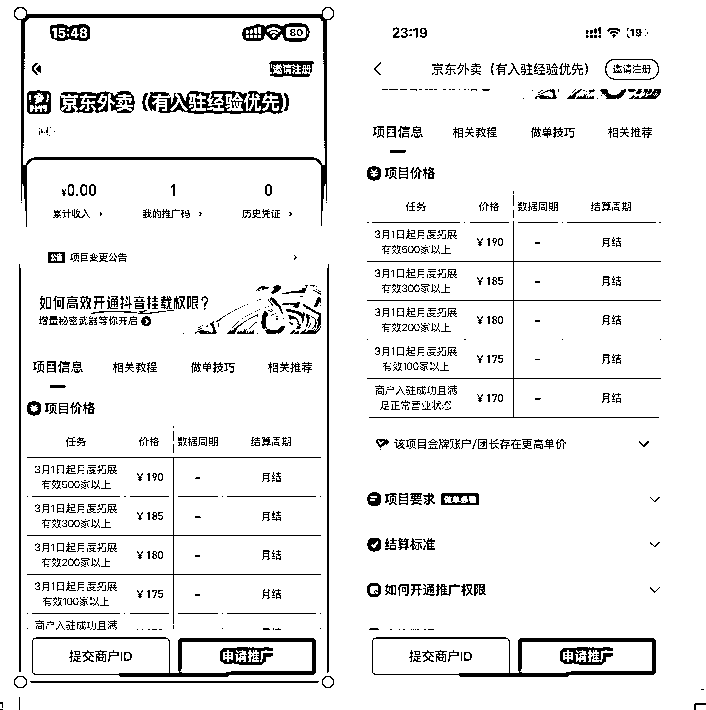

## 3. 然后搜索京东外卖

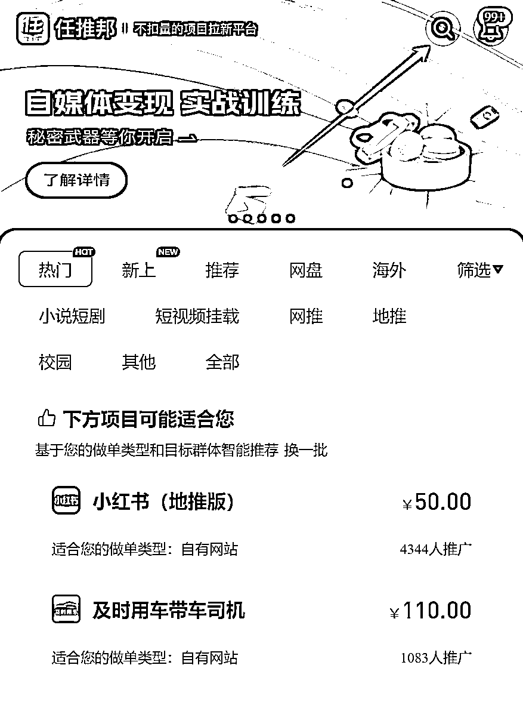

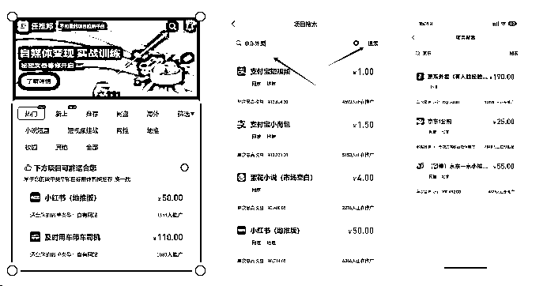

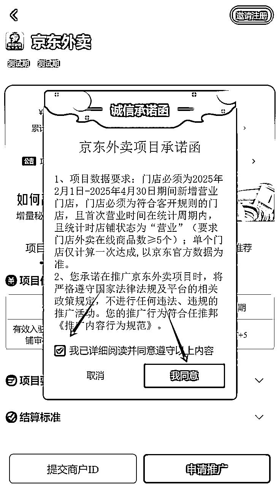

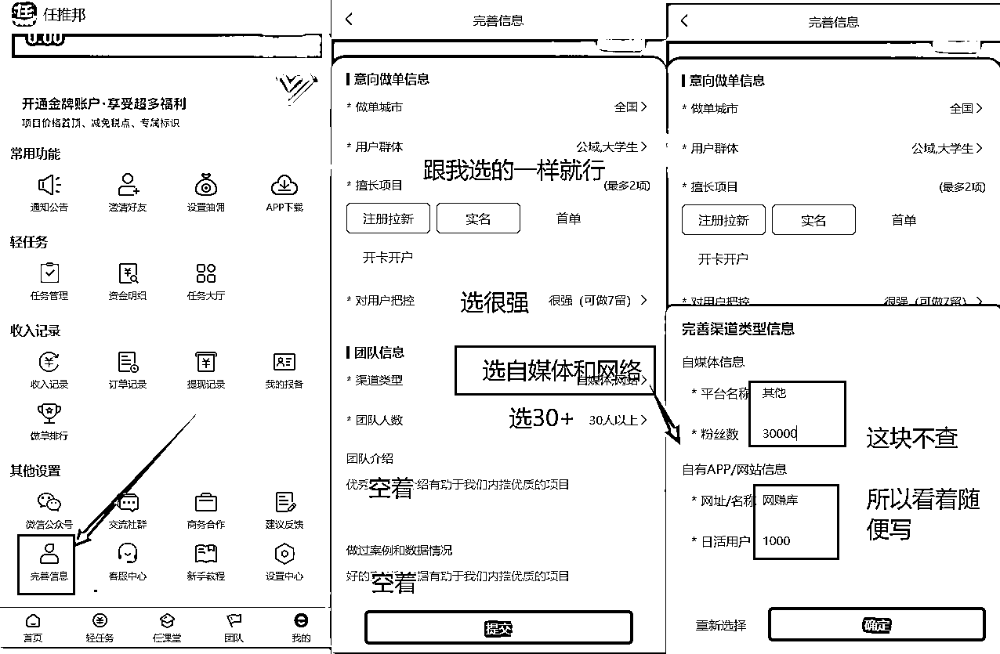

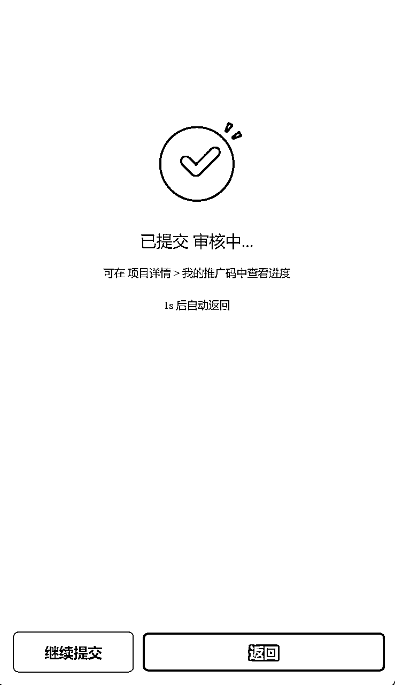

## 4、等待审核通过后，就可去推广了

## 推广操作流程

商户需要准备的资料：
1. 门头照、店内照，格式为 png、jpg，单张不超过 3M。
2. 营业执照，格式为 png、jpg，单张不超过 3M。
3. 法人身份证正反面，支持身份证、护照、港澳居民通行证、台湾居民通行证。

相关入驻信息：
1. 法人手机号。
2. 入驻手机号，即账号登录手机号，后续用于接收验证码，建议使用运营人员号码。
3. 邮箱，建议使用店主邮箱，便于接收信息。
4. 对公账户信息，开户行及支行、账号，用于京东验证品牌企业。个体工商户无对公账户可用法人银行卡或刷脸验证。
5. 品牌 Logo 或店铺 Logo、商标注册证如有。

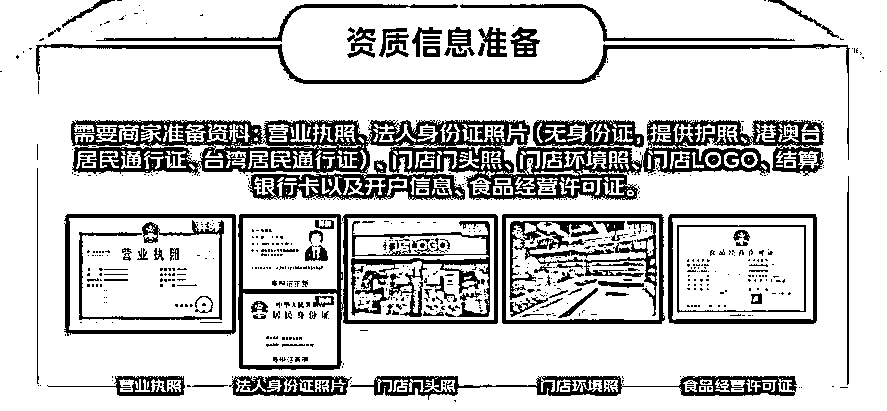

### 项目问答

问：全国还是 39 个城市可以作业？
答：全国均可作业，39 城为重点区域。

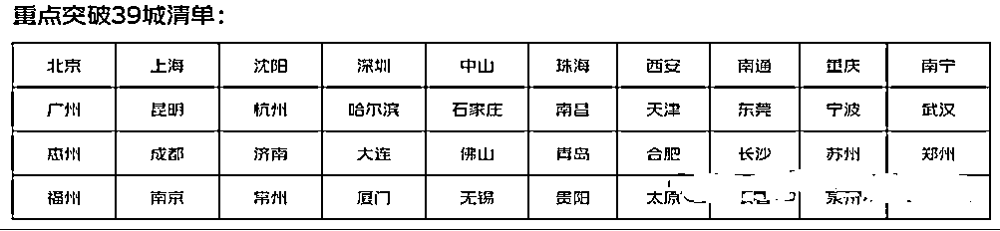

重要通知：最新政策
3 月 1 日起京东外卖可推广城市为 125 个城市主城区，即县城和县级市暂不纳入拓展范围且不计算为有效商户，125 城名单见下图

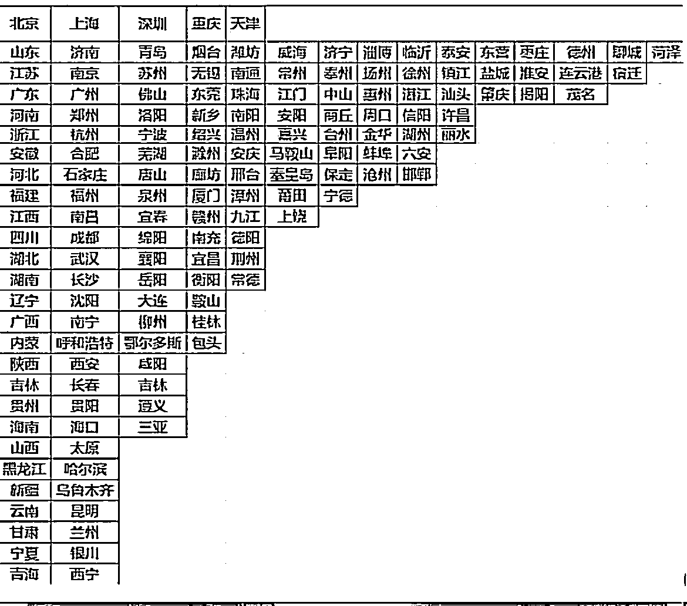

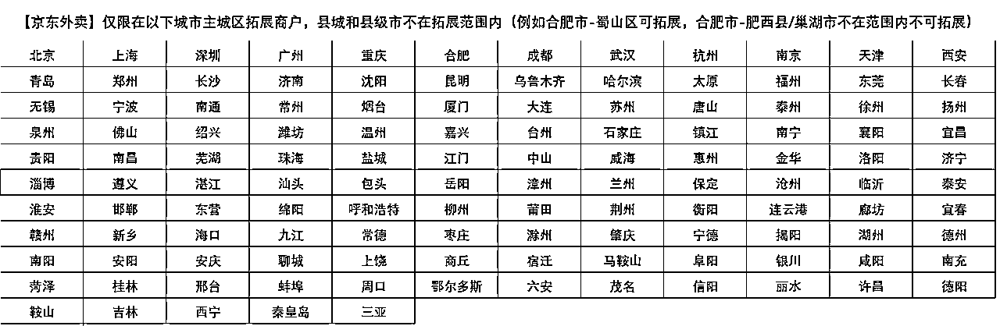

问：有评分要求吗？
答：商户入驻标准：商家有堂食或实体经营门店，小吃、卤味等，大众点评 3.8 分以上或美团高德 4.0 分以上，建议不要选连锁店，连锁店京东官方基本已直签。

外卖商家包含：中式及西式正餐、中式及西式快餐、自助餐、海鲜、火锅、烧烤、小吃卤味、下午茶烘焙甜品等，符合用户早中晚餐、夜宵场景需求的商家，咖啡奶茶店、蛋糕店类除外。
入驻商家需上架商品数量参考美团饿了么，保持正常营业状态。

问：商家入驻后没有骑手配送怎么办？
答：39 城基本都有骑手配送，若没有需商家自配送，商家不愿则放弃。先不要上菜单，先确认商家是否有骑手覆盖。

问：推广员有独立后台吗？
答：没有，做一单需提交一次。
商家入驻时必须正确填写“推荐人信息”即渠道邀请码，邀请码在任推帮报备通过信息内，需通过商户 ID 进行数据区分。
请保留【商户 ID】及【商户名称】【商家门头照片】并在下方提交，禁止批量乱提交，否则不结算并项目拉黑。
自行保留推广证据和商家相关信息，京东官方不定期抽查，包括但不限于商家门店照片、地址、营业执照、联系人方式、推广照片或其他证明。
如因商户未达标或提交商户 ID 错误、延迟等其他不通过原因，则无法结算；禁止向商家收取手续费，禁止承诺给商家返现，违规操作取消所有门店推广金。
严令禁止地推团队以明示或暗示京东外卖官方名义招募团队或邀请商家。
需要超级详情文档可领取：
https://www.kdocs.cn/l/cezzzCOSgccS

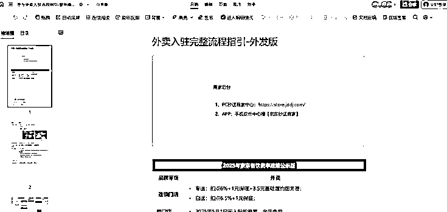

## 项目流程图

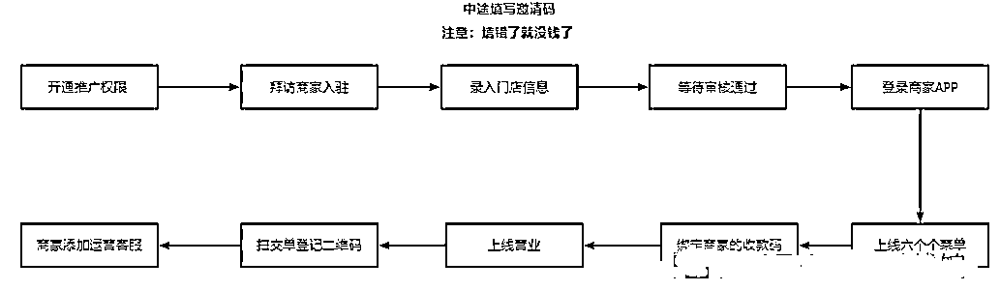

## 手把手教小伙伴们如何推广！

## 商户前期准备资料

### 推广步骤一
安卓手机在应用商店、苹果手机在 App Store 搜索“京东秒送商家” App 下载。下载后点击下方入驻申请，填写商家注册信息，此处仅注册账号。

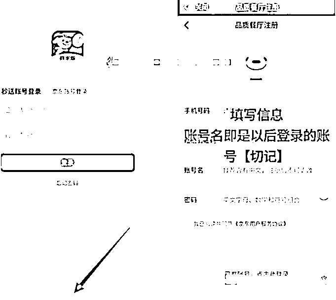

### 推广步骤二
商家入驻类型：门店为连锁店则选连锁店，否则选门店申请。
填写店铺信息：联系人和联系电话须与注册账号信息一致。
经营品类只能选咖啡茶饮或外卖美食。
推荐人信息必须填写，可后续再补。

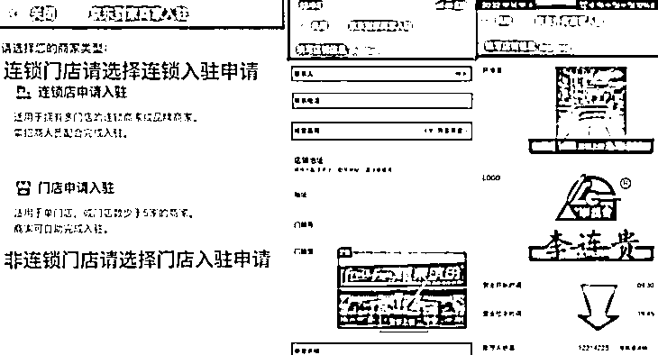

### 推广步骤三
上传营业执照并选择合同方案、结算和收款方式，保留好商家 ID 便于后续提交。

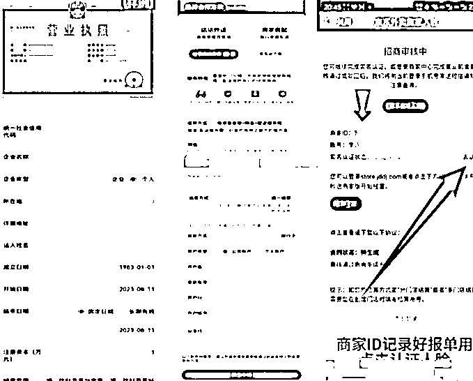

### 推广步骤四
招商审核通过后重新登录商家账号进行认证，认证方式选京东实名。

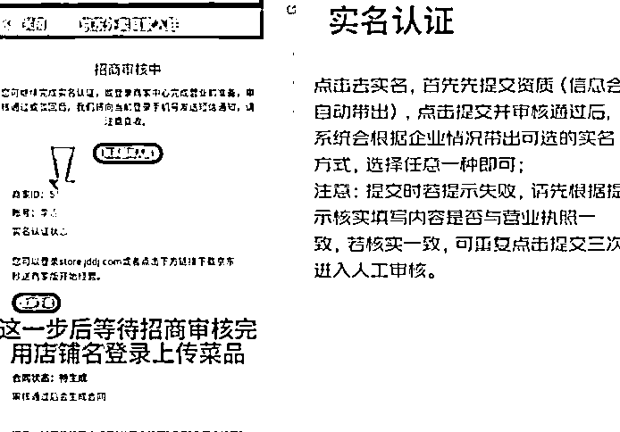

### 推广步骤五
商家入驻完成后进入合同签署流程，完成线上签署。

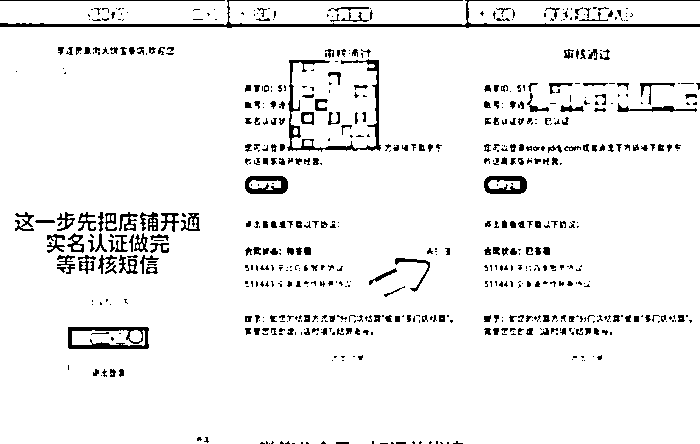

### 推广步骤六：创建门店
1、填写门店基本信息
点击：经营→切换门店→创建门店
门店 Logo 与商家 Logo 需一致，点击使用商家 Logo 即可。

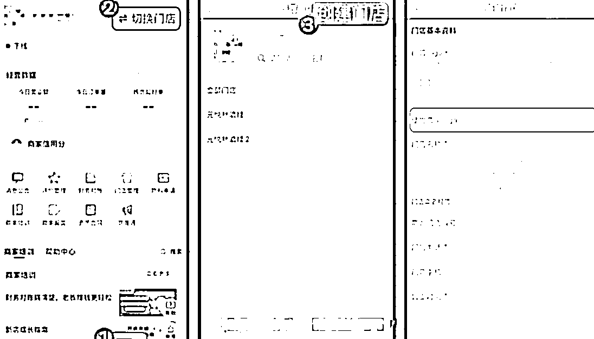

2、地址与配送范围
详细地址须与营业执照地址一致，配送范围输入小于 6 公里即可。

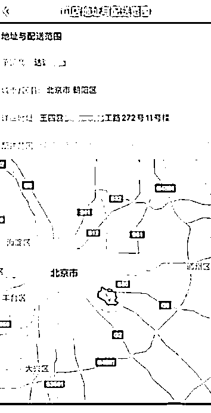

3、门店资质
填写门店经营资质：营业执照及身份证。企业上传身份证须与营业执照法人信息一致。
餐饮类选择食品经营许可证，点击确认提交。

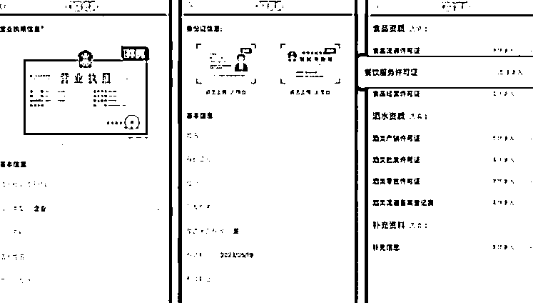

### 推广步骤七：创建商品
1、创建分类
点击：工作台→商品管理→分类管理，至少创建 5 个分类。

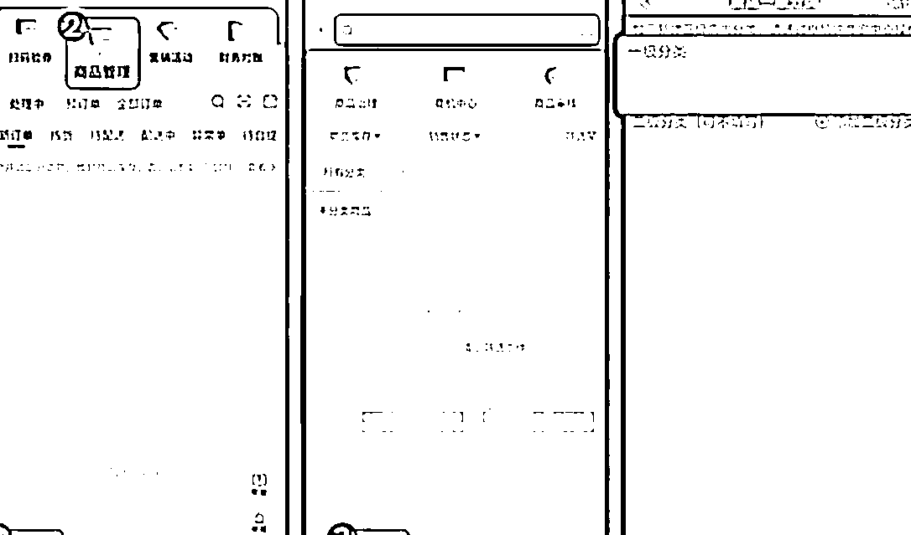

2、商品创建
点击：工作台→商品管理→新建商品→手动创建。

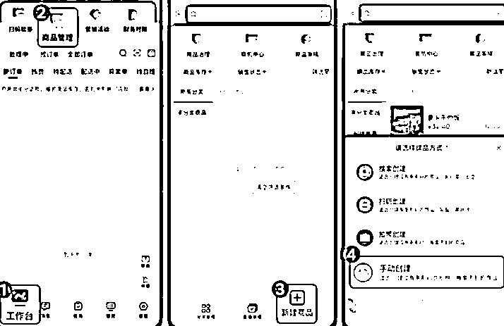

商品图片最多 6 张，尺寸 800*800 像素。
填写商品品牌，无品牌要求可填其他品牌。
店内分类为消费者端展示分类，便于快速选择。

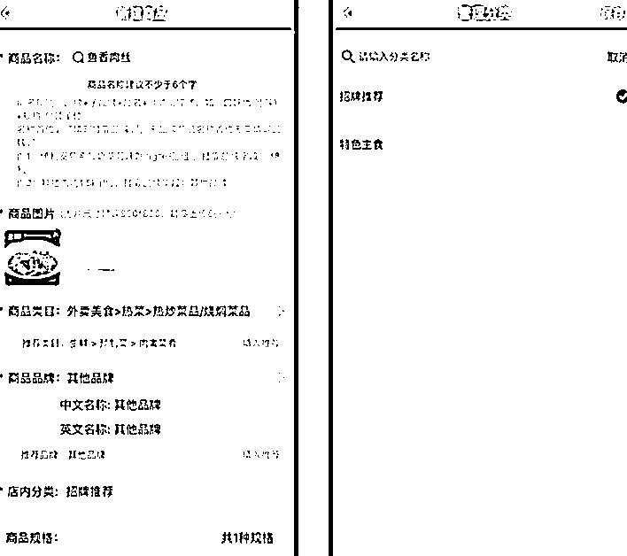

添加规格如大份、小份，新规格会生成新的 SKU，需维护价格、库存、最小购买量和打包费。
新增口味如微辣、中辣，仅增加口味选项不新增 SKU。

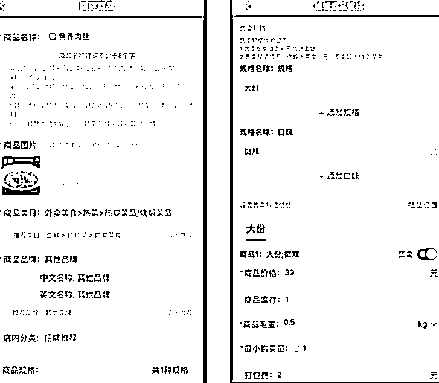

确认规格后返回新建商品页，选择配送属性后保存完成创建。

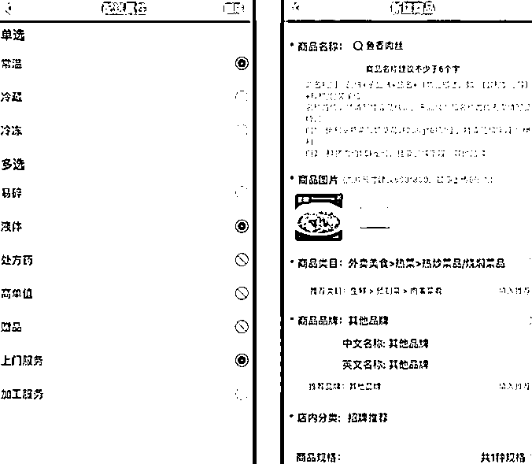

### 推广步骤八：门店检查
点击：经营→门店名称，检查运力是否匹配、资质是否齐全。

点击：经营→资质合同→结算账户。注意 App 端暂不支持门店组结算模式维护结算账户。

### 推广步骤九：门店上线
点击：经营→门店状态→今日营业时间。设置营业时间后点击我要营业，即可完成上线。

# 我是如何地推的？

# 如何参与推广？

以下是一套完整的邀请商家入驻话术指南，包含核心场景话术、常见问题应答及解决方案，可直接用于地推实战：

### 第一步：线上电话确定初步意向
先筛选大众点评 3.8 分、高德美团 4.0 分以上的商家获取电话。
再通过京东—秒送搜索对方店铺名称，尤其是营业执照上的店名。

先电话确认对方是否已入驻。
可能遇到的难点：3 月刚开始，周边约七成商家可能已被拜访，但他们可能仅拿到注册码、商户 ID，保护期 45 天。若秒送中搜不到该店，仍有机会抢占。
3 月规则公布后，更强调推广员与商家的实时追踪，尤其是上架商品、京东钱包开通，这对前期信任搭建是考验，也将淘汰一批只做拉新的朋友。

图片来源——彻易：

### 第二步：上门拜访建立信任，开通商家账号
拜访前熟练掌握话术与应变，服务态度要专业，拒绝一次不要立刻离开。
着装专业，佩戴工作证等。

上门时间避开备餐及高峰期，餐饮店上午 10 点前后不建议。

不同业态黄金拜访时段：
正餐/中高端：上午 10:00-11:00 或下午 14:00-16:00，避开 11:30-13:30、17:30-19:30。
快餐/简餐：上午 8:30-9:30 或下午 15:00-16:30，避开 10:30-13:00、17:00-19:00。
奶茶/咖啡：上午 10:00-11:00 或下午 13:00-14:00，避开 11:30-13:00、16:00-18:00。
火锅/烧烤：上午 9:00-10:30 或下午 16:00-17:00，避开 11:00-14:00、18:00-20:00。
企业团餐：工作日 9:00-10:30 或周五 14:00-16:00，避开午休及月末结算。

通用要点：统一着装佩戴工牌，展示收款系统，避免私人转账，可提供小额预付款降低顾虑；单次拜访控制在 30 分钟内；使用利润对比计算器现场演示。

进门话术：
男老板：您好，我们是京东外卖官方，邀请您 0 元免费入驻，免佣金。
女老板：您好，京东外卖官方人员，今日来帮您开通京东外卖，完全免费，不抽佣。

### 商家常见问题应答与解决方案

### 一、初次接触破冰话术
目标：30 秒内引起兴趣，建立信任
场景：进入门店，老板正在忙碌

地推人员：
“老板您好！我是京东外卖区域经理，注意到咱们店的菜品、环境、人气都很棒，但线上订单可能尚未完全开发。
京东现对优质商家有扶持政策：
✅ 前 3 个月抽成直降 5%
✅ 新店首月保底 200 单，达不到补流量
✅ 专业团队免费帮您上架商品，您只管接单
占用您 2 分钟，给您看个数据案例？”

动作要点：边说边指向菜单/排队人群，强化潜力未开发的暗示；手机提前准备好同品类商家入驻 7 天增长 80 单的截图。

本项目目前处于测试期，建议推广员前期小批量测试，后续全面放开再加大投入，提前布局优势明显。
以上分享希望能帮助到大家。

#### 问题1：“我已有美团/饿了么，没必要再上”
应答策略：强调增量市场，弱化竞争
话术：
“您说得对，美团覆盖广，但用户主要追求低价。
京东用户画像不同：
🔹 35-45 岁中高收入家庭用户占比超 60%
🔹 客单价平均比美团高 40%
🔹 更适合咱们店的高品质套餐、家庭餐”

这套线下推广打法，在多个城市被反复验证后，把商家合作率从行业平均8%拉到了22%。核心不是话术多漂亮，而是提前把老板可能拒绝的理由全部预演了一遍。下面把完整打法拆开讲。

一、当老板说“美团都卖不动，京东能行？”

先别急着证明平台强，直接抛案例：一份招牌菜搭配78元双人套餐，放在美团可能没多少人点，放到京东或许就能成为爆款。把京东当成一条新增渠道，平台负责带客，商家不用先掏钱试错。

落地动作：
- 错峰卖货：美团继续推低价引流款，京东上架利润更高的套餐；
- 给对方看一份顾客画像对比表，用数据说明两边客群并不重合。

二、当老板嫌“佣金比美团还高”

老板看的是费率，你要帮他算到手金额。表面京东收15%，美团可能说只要12%，但美团会强制参加满30减10这类活动。以40元套餐为例：

- 美团到手：40－10－4.8＝25.2元；
- 京东到手：40－6＝34元；
- 一单多赚8.8元。

现场用利润计算器演示，再给一个阶梯承诺：首月流水超过2万，佣金降到12%。

三、当老板怕“没人手操作”

给两种合作方式：
- 极简模式：商家只交菜单和价格，平台免费拍照、上架、设置活动，老板每天花3分钟核对订单；
- 全托管模式：指定一名店员，培训30分钟就能独立操作。

现场调出同商圈炸鸡店的后台，老板亲口说平时只要扫码看单就行。再配上《3分钟接单指南》和一次上门培训，顾虑基本就消除了。

四、当老板说“再考虑一下”

先接住情绪，再给三个理由：
- 这周入驻的商家能锁定平台首页的核心展示位；
- 前50名签约额外送500元推广补贴；
- 运营经理明天就在同一栋楼帮竞对商家上线。

然后补一句：今天签约，明天优先处理你的店。动作上打开手机倒计时页面，显示剩余补贴名额；提到竞对时压低声音，让紧迫感自然出来。

五、当老板担心“京东单量不稳定”

直接亮保底协议：
- 首月日均单量低于15单，补偿300元推广金；
- 连续两周垫底，可无责退出，且不扣押金。

把盖好章的合作模板放在对方面前，强调风险几乎为零，商家只需要花10分钟注册。

六、成交收口：别问要不要，直接走流程

“老板，我现在帮你走绿色通道：扫码填资料5分钟，设计师今晚做店铺装修，明天中午12点就能接单。你只需要决定：是现在签，拿下首页流量位加500元补贴；还是等明天竞对先上，再用两倍成本去抢客源？”

说完把二维码放收银台，合同和笔递到对方手边，身体前倾，等一句“好”。

七、三个很有用的心理引导

1. 用屏幕说话：打开后台地图，“你看这条街已经有6家店亮灯，全是已入驻的商家。”
2. 用邻居带节奏：楼下的火锅店老板签约时说了一句：“每天多来10单也是赚。”
3. 放大损失感：每犹豫一天，可能少做80单，按每单30元算，就是2400元流水。

八、错误回应对照，别踩坑

- “佣金太高” → 别说“我们服务更好”，要说“费率背后要看利润，我帮你算清楚”
- “没听过京东外卖” → 别说“我们刚起步”，要说“正因为刚开始打本地市场，现在进场的商家能吃到先发红利”
- “要和合伙人商量” → 别说“那我改天再来”，要说“没问题，合伙人最关心什么？我现在就准备资料”

九、推广前，这些规则必须背熟

- 入驻评分：美团、抖音、高德评分要在4分以上，大众点评要达到3.8分，四选一即可。截图必须来自“团购”频道的完整页面，不能出现“外卖/快送”字样。优先用高德评分，通常当天过审。
- 推广范围：全国开放，官方重点城市是125个。
- 用户入口：在京东App首页最上方点“秒送”即可下单。
- 商品数量：入驻后至少上传5个商品；2月26日后提交的商家，审核通过后最低上架15个，最好与美团菜单对齐。
- 收款账户：要有对公账户；个体户可以用经营者本人的银行卡。
- 基础配送费：3公里内3元，商家或用户承担都可以。
- 提现规则：订单完成后第3天货款到商家端，商家提现后T+1到账。
- 审核周期：京东人工审核，时长不确定；建议加商家微信，过审后提醒对方回店上品并开启营业。
- 有效营业定义：首次开店30天内至少14天在线营业；单日营业时长不低于4小时；菜品标价不能高于美团或饿了么；菜品数量不能少于美团或饿了么；30天内至少完成3张订单。
- 结算规则：月结，一般第二个月20号前后出账单。2月26日前提交的商家ID按原标准结算，2月26日后提交的按新规月结。3月1日到15日期间会随机抽查营业状态，抽到未营业则无效。
- 报备与佣金：报备通过后返回的“推荐人信息”必须让商家填写，否则无法结算；连锁品牌按门店数计算佣金，单个品牌最高可算100家店佣金；禁止向商家收费或返现；不能用京东官方名义做地推或招人。

十、免费工具：京东批量上架

用谷歌浏览器同时登录美团商家后台和京东商家后台，解压工具包里的插件文件。点击浏览器右上角“设置→扩展程序→管理扩展程序”。开启“开发者模式”，选择“加载已解压的扩展程序”，把解压好的文件夹传上去。之后就能把美团商品批量同步到京东，省去大量人工录入。

十一、行业信号：京东外卖正在抢商家

2月11日，京东外卖正式招募有实体堂食的餐饮商家，2025年5月1日前入驻全年零佣金。汉堡王通过京东外卖单日订单破万，零佣金政策让它省了约15%的成本。目前京东App首页首屏的“秒送”已经成为独立入口，外卖品类从轻餐扩展到了更丰富的正餐，海底捞、袁记云饺、汉堡王等品牌均已上线。

另一边，北京地区美团、饿了么的综合抽成普遍在20%-30%，很多餐饮老板还不知道京东外卖。这个信息差，正是地推的窗口期。再加上网上外卖用户规模已超过5.45亿，本地生活市场突破万亿，巨头加码完全在情理之中。业内判断，万物到家正在加速，即时零售会成为实体门店转型的新通道。

机会不等人。外卖市场没有“等等再说”，只有“现在就干”。别人还在犹豫时，你每多进一家店，就多一次赚佣金的机会。别再等了，去门店找到老板，问一句：京东外卖零佣金入驻，要不要了解一下？想要推广权限的，私聊我。