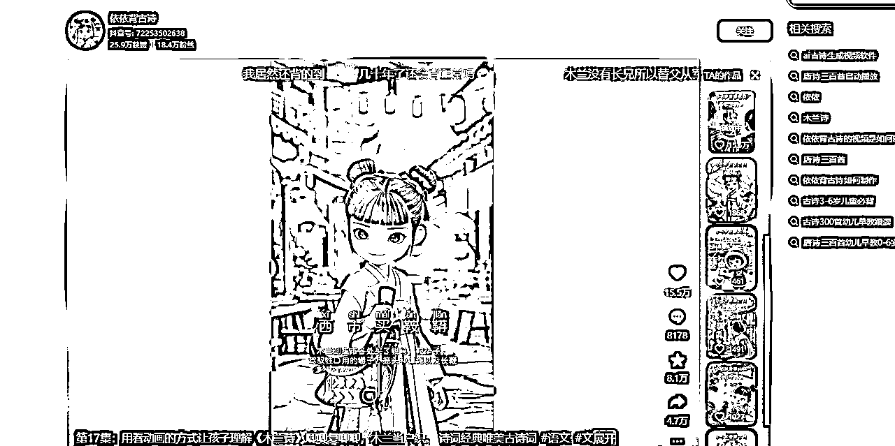
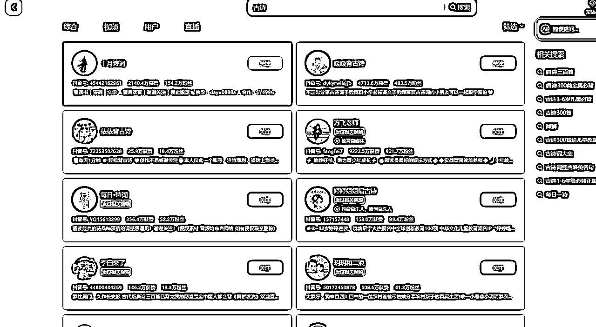
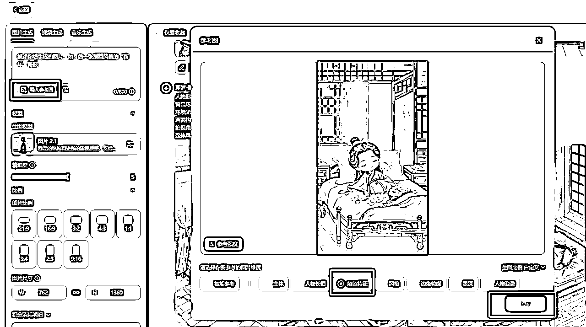
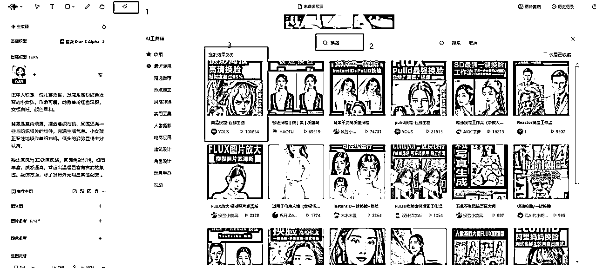
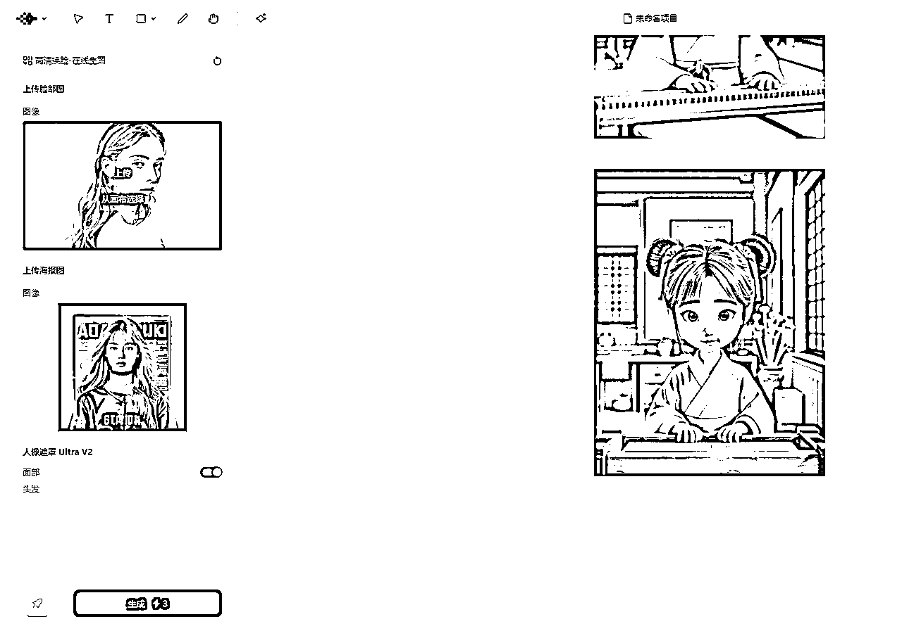

# 30分钟做一个AI古诗词视频教程

最近刷到一个很有意思的赛道：AI古诗词短视频。有个叫“依依背古诗”的博主，只发了46条视频，就攒下了18.4万粉丝。说实话，真人背古诗的赛道早就有了，以前没AI，咱们普通人根本挤不进去；现在工具成熟了，机会也就来了。

这类视频怎么赚钱？核心思路就一条：用好看的画面吸引人，再把流量变成收入。具体路子有这么几种——

一是平台分成：发到抖音、快手、📕，播放量和点赞上去了，平台自然会给广告分成。二是带货：在视频里挂上古诗词相关的书、文具、小摆件，观众下单你就有佣金。三是接商单：粉丝多了，品牌会找上门，要么植入广告，要么付费定制视频。四是知识付费：把粉丝导到👸号或🛰️群，卖学习资料、开收费课程。五是卖版权：视频质量高的话，可以授权给教育机构或出版社，或者帮他们做定制，收制作费。六是教学变现：你熟练了，可以教别人怎么做，收学费或卖教程。七是卖文创：围绕古诗词做书签、摆件之类的创意产品，走电商渠道。总之，先用内容圈住人，然后各凭本事转化。

接下来是实操，总共三步，30分钟能出一支成品。

第一步，用DeepSeek生成AI绘画提示词。打开DeepSeek，输入你想做的诗词主题。比如做孟浩然的《春晓》，可以这样问：把每一句诗先翻译成大白话，再根据大白话联想画面，转成符合指定格式的AI绘画提示词。要求包含人物形象、背景环境、环境光线、画面构图、拍摄角度，主角是Q版儿童，整体3D动画风格，色彩鲜艳、细节丰富、质感逼真，要有温馨古韵。也可以换个更简单的问法：每句诗分别写成Q版卡通画面的AI绘画提示词。如果提示词太复杂，或者出现了“量子物理”这类跑偏的词，记得关掉深度思考R1重新生成。问DeepSeek、豆包、Kimi都行，挑你觉得合适的用，不必全盘照收，自己写也完全可以。

第二步，用即梦生成AI视频。打开即梦，把刚才的提示词粘进去。先生成图片，不满意就多生成几次，直到看到想要的效果。如果你已经有固定风格，可以点参考图锁定角色特征；或者生成图片后，在星流AI的AI工具箱里选高清换脸。图片搞定后，点“生成视频”按钮，不用额外填提示词，预览后挑效果最好的那条就行。除了即梦，通义万相也不错，可灵、vidu略逊一筹。新手建议直接用即梦，想做出个人特色的话，不妨多试几个工具。

第三步，用剪映做后期。打开剪映，导入生成的AI视频。先配音乐：在音乐素材库搜“春晓”或相关古诗词音频，选中后裁掉多余部分，让音频长度和视频匹配；如果不喜欢现成的，可以真人配音，或者用DubbingX、TTSMAKER做AI配音。再加字幕：用剪映的“识别字幕”功能自动生成，然后选“拼音体”字体，就能得到拼音；再去动画-字幕-卡拉OK里挑一个效果，字幕划过就有了。接着加特效和转场，按视频内容配上合适的音效和转场，提升观感。最后导出，一支精美的AI古诗词视频就完成了。

几个小提醒：第一次生成效果不好很正常，多试几次；剪映的编辑功能很丰富，色调、字幕样式都可以按喜好调整；除了古诗词，现代诗、散文也能做，创意空间很大。工具网址我放在文案里了，照着步骤走，今晚就能做出第一条视频，快去试试吧。

工具链接：
DeepSeek：https://www.deepseek.com/
即梦AI：https://jimeng.jianying.com/s/KlAtfoT5jlo/?t=-1
剪映免费电脑会员版：https://pan.quark.cn/s/5dbd3ddfbd21
星流AI：https://www.xingliu.art/
TTSMAKER：https://ttsmaker.cn/
DubbingX：https://www.dubbingx.com/

