# Tempo Labs：一款让你用设计软件的思路来改前端代码的AI工具

> 来源：[https://hqhhkfm2ink.feishu.cn/docx/HqwWdRfXKo25FVxA2GIc8xfHnCH](https://hqhhkfm2ink.feishu.cn/docx/HqwWdRfXKo25FVxA2GIc8xfHnCH)

# 一、认识 Tempo Labs

今天给大家安利一个刚被我挖到的新工具：Tempo Labs。

我在刷社区时碰到它，第一反应就是惊喜。市面上大部分 AI 编程助手都是偏向写代码、跑命令，而 Tempo Labs 的玩法完全不一样，它把前端项目的编辑体验做成了设计工具的交互方式，直接上手改界面。

以前我们习惯用 blot 这类工具来一键搭骨架，现在可以给 Tempo Labs 一个机会。

## 1.1 它能做什么

### 1、可视化方式改代码

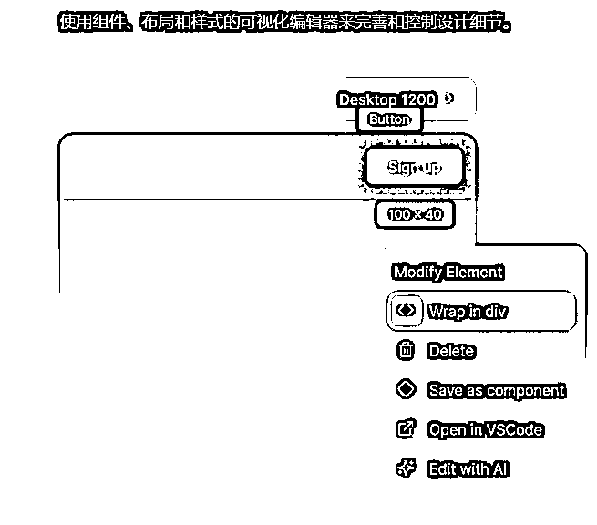

### 2、定制化生成组件库

### 3、从零起步建项目，也能导入 Github 仓库


## 1.2 价格情况

目前的免费额度体验起来已经很足够了。

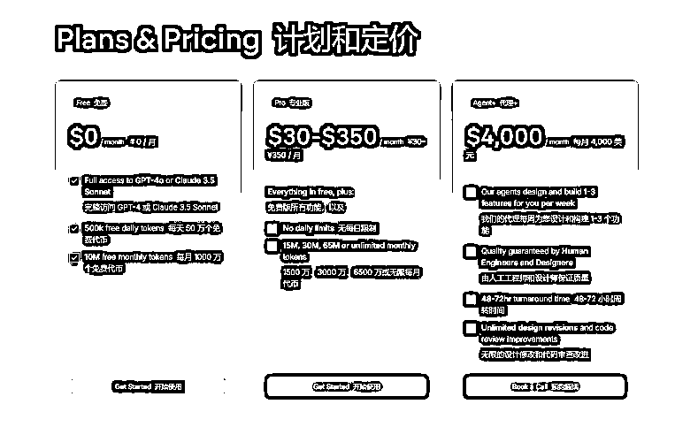

# 二、上手实测

## 2.1 这次用的提示词

这次我借用了刘小排老师之前在 blot.new 上演示过的那个案例提示词，来对比一下 Tempo Labs 的表现。

```
1\. 技术栈：用纯粹的HTML + TailwindCSS来做
2.核心功能：我要做一个运势网站，用户填入自己的姓名、选择生日，点击按钮，就可以就行运势计算。运势计算
具体算法我不管，你帮我完成，但是要算出来让用户感觉专业、有理有据、愿意付费。计算出来的运势至少要包括
运势评级、运势分数、宜、忌、理由等等。
1\. 功能区域：你要有完整的header,hero, testinoials, faq, features, pricing, how it works ,footer 区域。 网站的版权所
有人是阿杰，联系方式hahaxswl@gmail.com，其他内容需要编写得专业、真实。
4.网站文案：所有网站上的文案内容，我要求你使用中文。关于这个运势计算网站，你需要强调我们是结合东方玄
学、紫微斗数、易经、星座等等，强调中西方结合。
5.网站风格：网站配色和风格需要现代化、高级，类似于苹果官网的风格。网站需要自适应各种屏幕尺寸。
```

## 2.2 如何创建项目

先去 Tempo Labs 登录一下，账号是基于 Github 登录的，提前准备好 Github 账号就行。

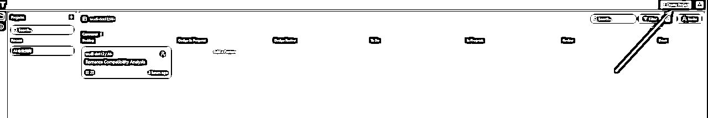

进入后有两个入口，一个是新建项目，一个是从 Github 导入。文章撰写时导入功能还没开放，这里就点 Generate New App 来新建。

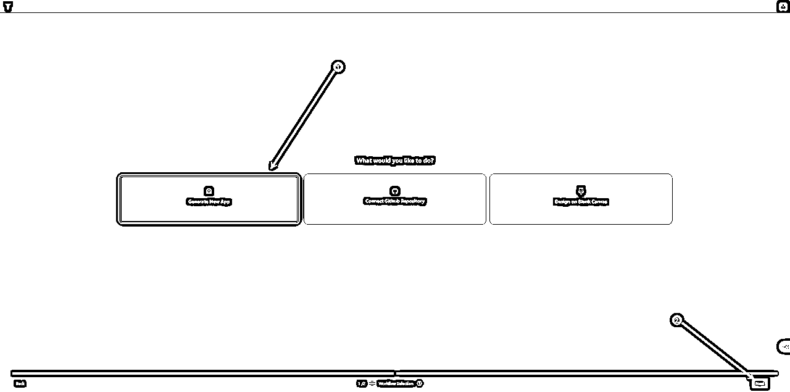

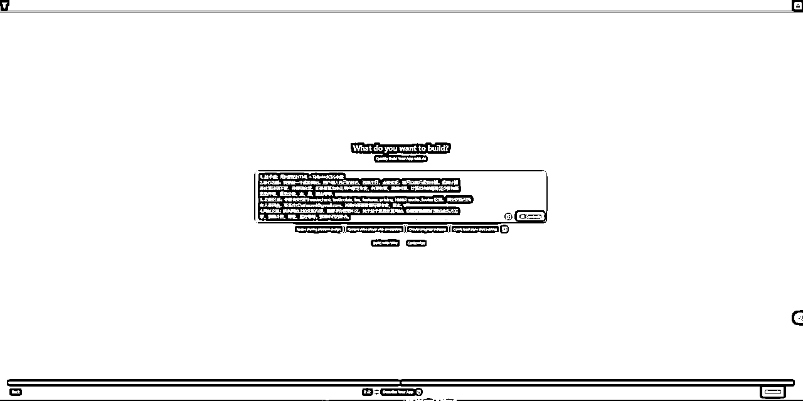

敲回车，项目就开始生成了。

## 2.3 工作台长什么样

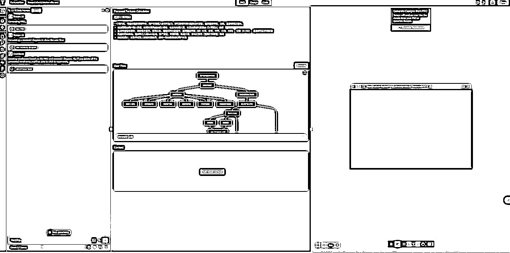

左侧面板是对话记录和任务执行进度；
中间区域展示项目说明和自动生成的流程图；
右侧就是实时生成的页面预览。

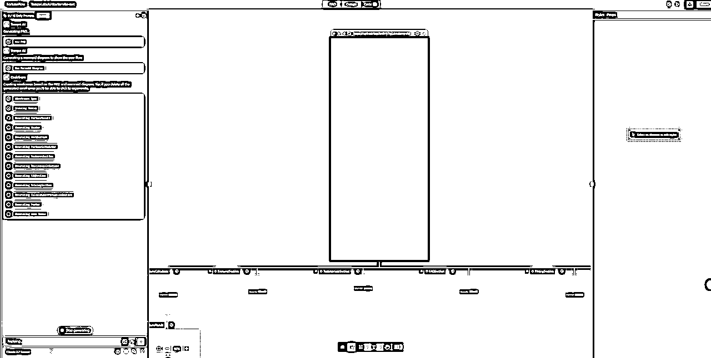

顶部有三个切换按钮，可以在 PRD 文档、设计稿、源码 三个视图之间自由切换。

## 2.3 线上预览效果

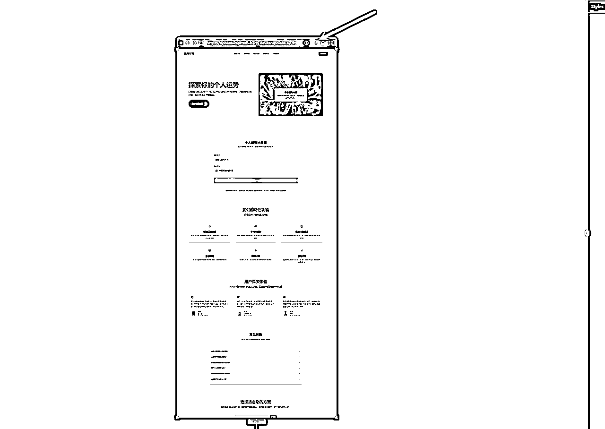

预览链接基于 Vite + React + TS 构建。


整体效果看着挺顺眼的。

## 2.4 一键推到 Github

‘

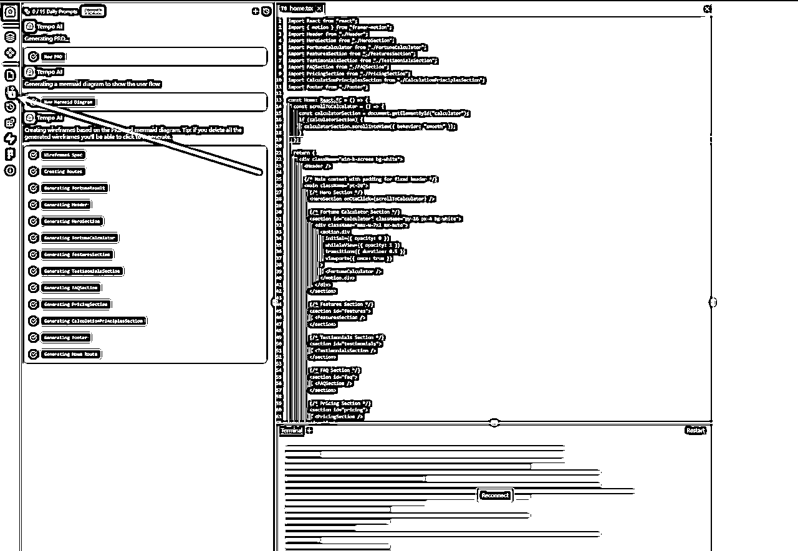

我这边之前已经绑定过 Github，所以可以直接填写项目信息；如果是首次使用，会先引导你完成授权，步骤很简单，一直下一步就行。

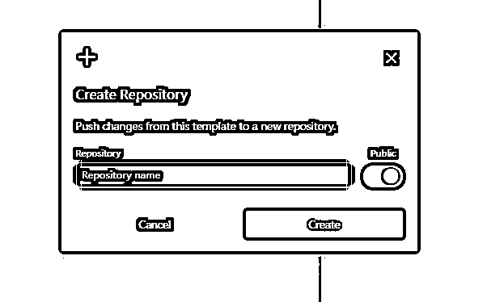

给项目起个名字，我这里起名叫 fortune-telling，还能选择仓库是否公开，确认后点 Create 即可。

随后到个人 Github 看看是否创建成功。

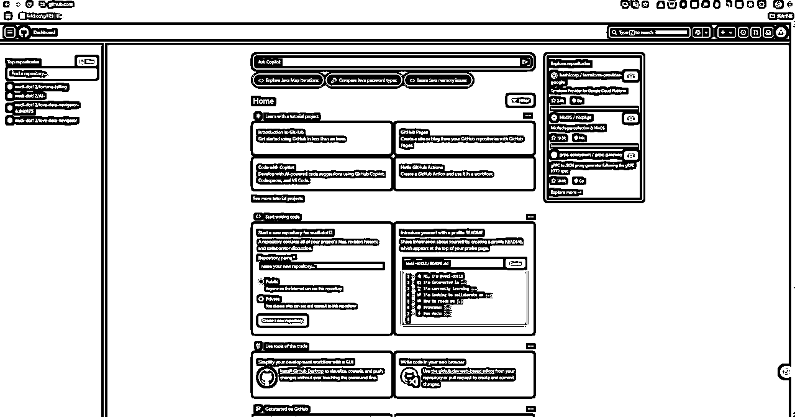

项目地址：GitHub - wudi-dot12/fortune-telling

这样之后想用 Cursor、Windsurf 等本地 AI 工具继续改代码，直接从 Github 拉下来就行。

## 2.5 在线直接改页面

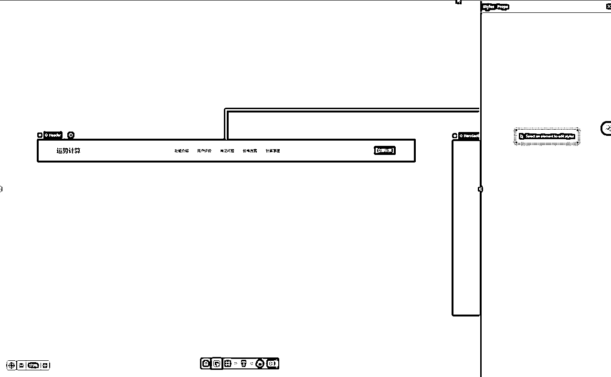

点选任意一个组件，右侧就会弹出编辑面板，可以直接调整属性。

选中组件后，还能调用内置的 AI 助手来改，只要描述需求即可。

我这里选中了导航栏，告诉 AI 我的修改想法

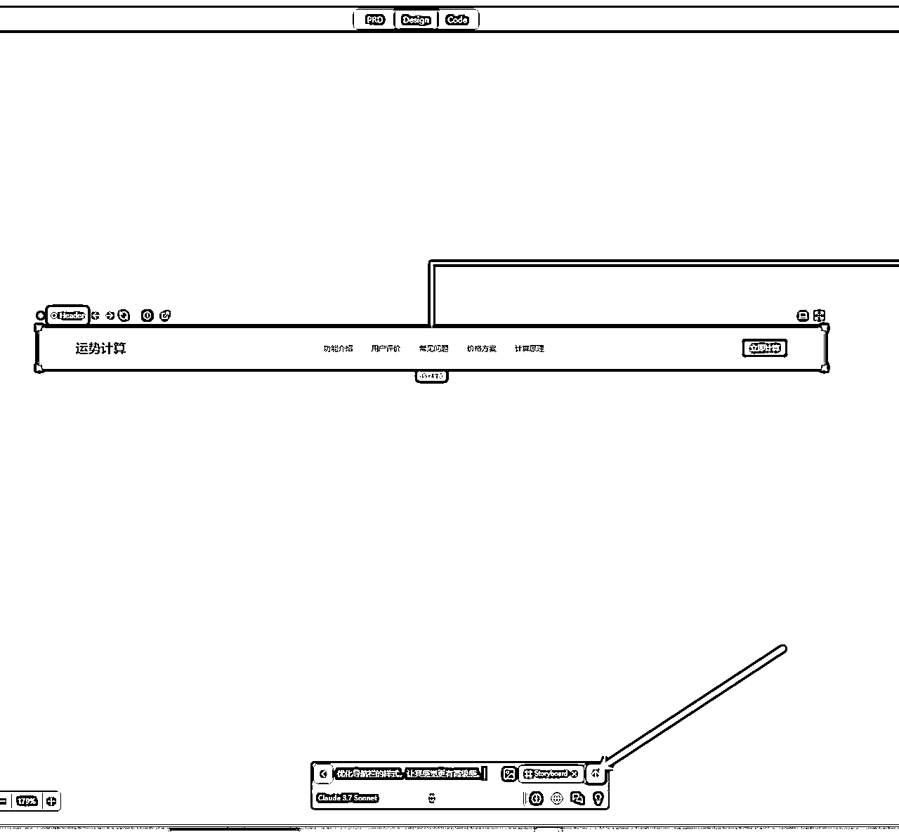

等待片刻，优化就完成了。

看起来就是按钮的圆角变大了。

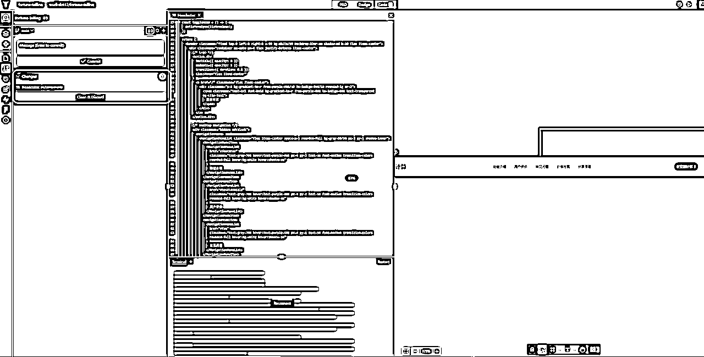

每次改动完，对应修改了哪些文件和代码，都会在这里列出来，和本地用 git 看 diff 的感觉一模一样。

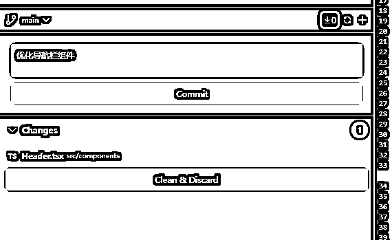

填上本次提交的说明，点 Commit 再点 Push，就能把改动同步到 Github 远程仓库了。

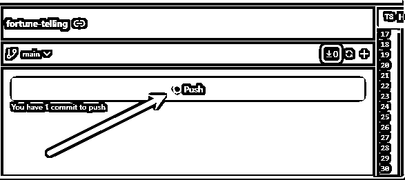