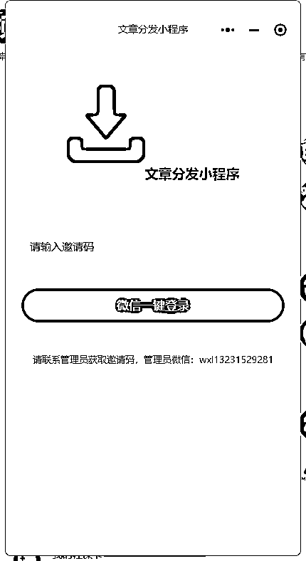
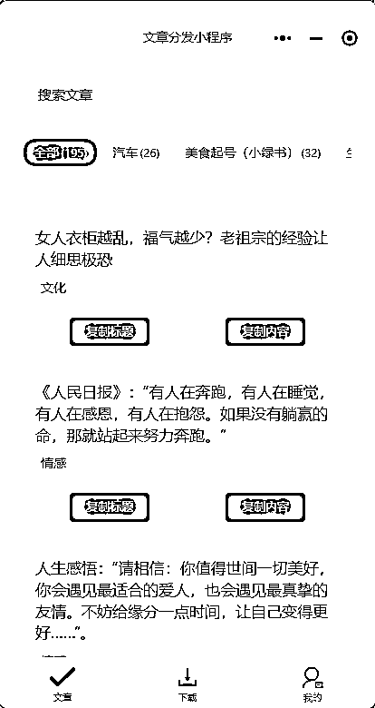
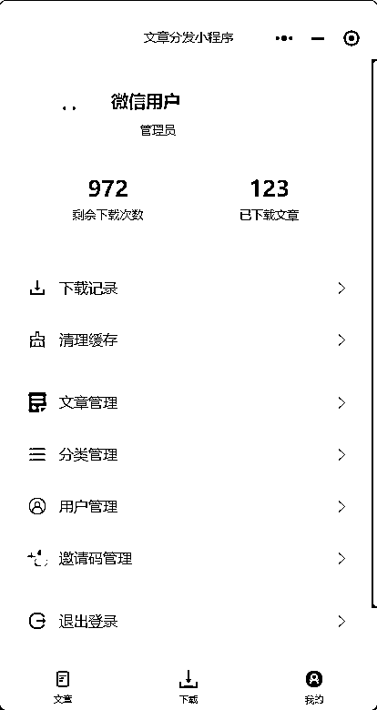
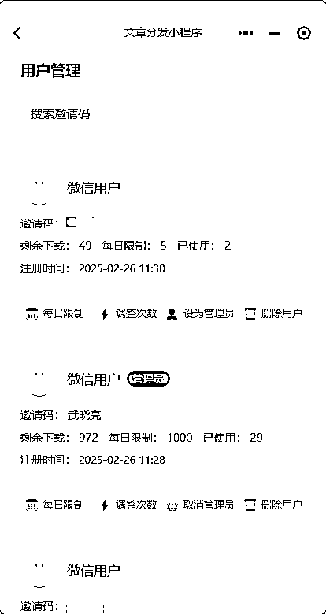
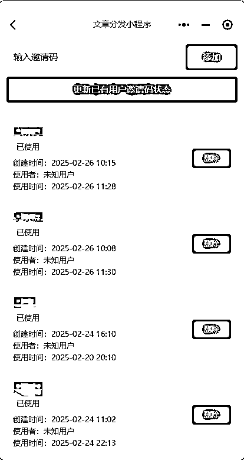

# 我用 Cursor 打了一个公众号代运营分发文章的小程序

点子是怎么来的

最近做公众号代运营的人不少，但几乎所有人都会卡在同一个痛点上：文章分发。客户是零散的，上线时间是错乱的，消息一波接一波的，处理起来真的很耗神。我见过 @兔子的玩法，他们是靠团队分工把流程理顺，效率确实高。可对大多数单打独斗的个人创作者来说，这件事依然是个负担。我自己也正被这件事困扰，于是就想着试试用 Cursor 把它自动化。

说实话，这个尝试的路并不顺。反复踩坑、反复重来，从构思到第一版能跑起来，整整折腾了14天，期间状态一度有点低落。好在最后还是做出来了，我会把打包好的小程序放在文末，免费分享给大家。顺便感谢一下稳健圈友，他在陪伴群里每天分享自己的思考，让我获益很多。

# 整个小程序是怎么搭起来的

1. 文章领取功能：用户进去就能取文章，标题一键复制，整篇内容也能一键复制，系统会自动识别文档里的标题，不用手动找。
2. 使用额度控制：给每个用户设置每日领取次数，到第二天凌晨0点自动清零重置，额度会恢复。
3. 文章图文合并：用 Cursor 完成了自动配图。做法很直接，先用影刀把每篇图文的链接都抓出来存成文件，再把生成的文章文档和图片链接文件做匹配插入，阅读体验比纯文字好很多。
4. 访问权限管控：小程序采用邀请码机制，没有邀请码就无法注册登录，用来控制用户范围。

# 关于源码

小程序的完整打包文件我会在下方提供，希望能帮到同样在做代运营的朋友。

最后祝愿各位圈友都能在龙哥盟里拿到自己想要的成果，一起龙哥盟！