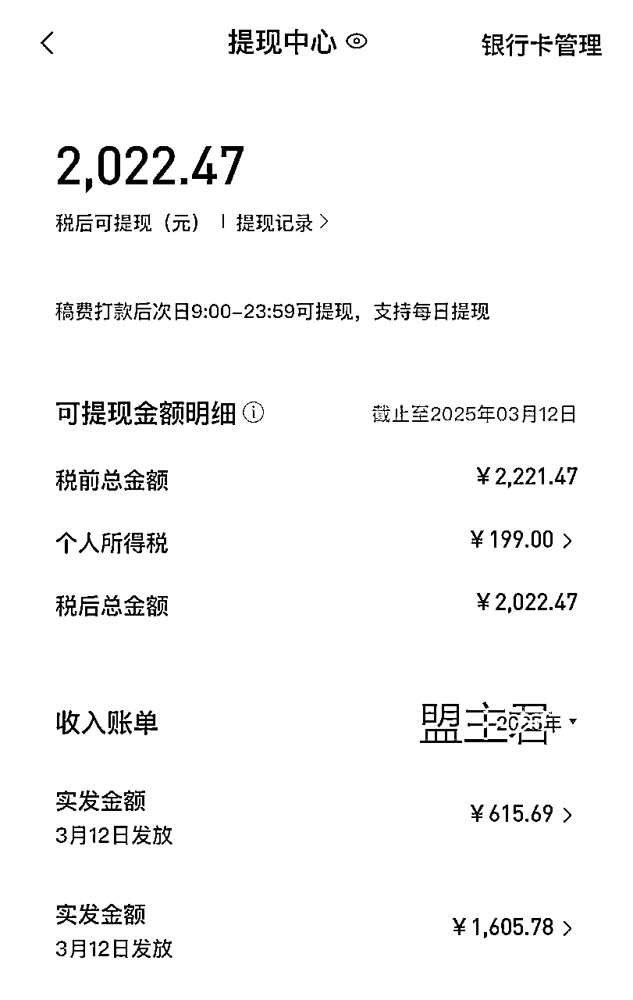
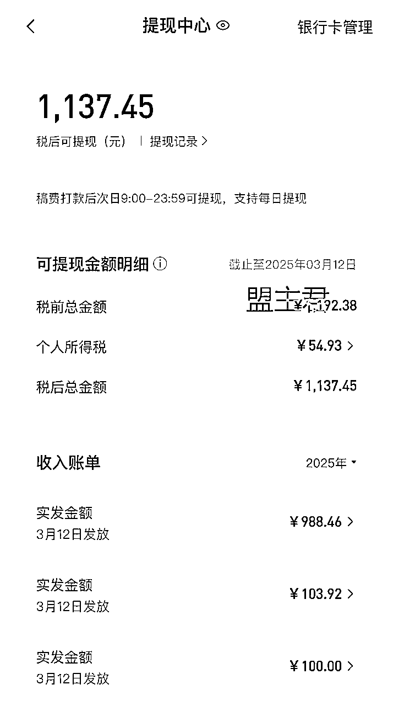
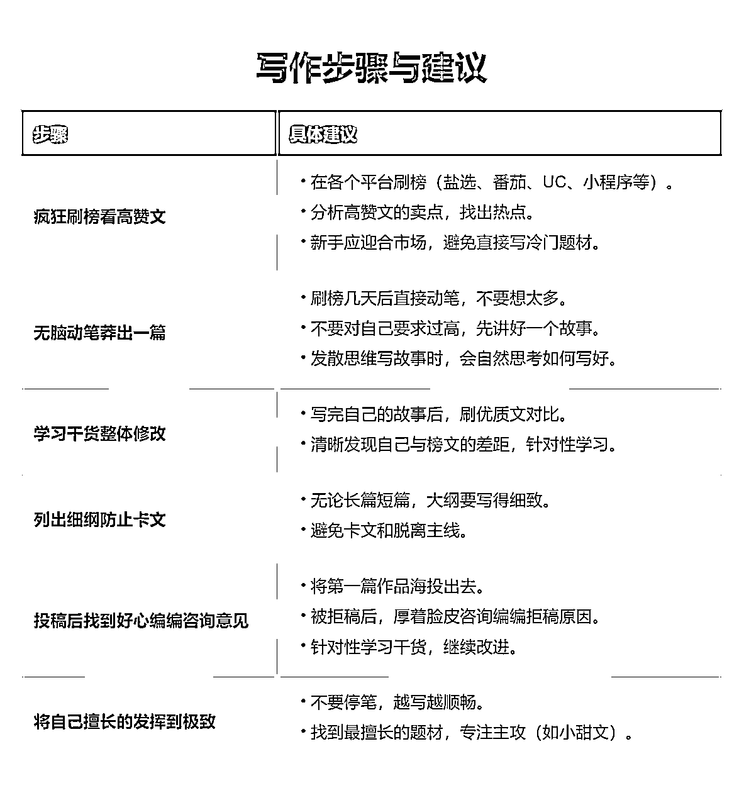
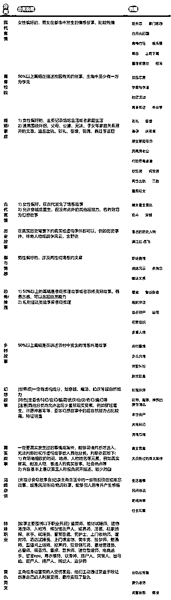
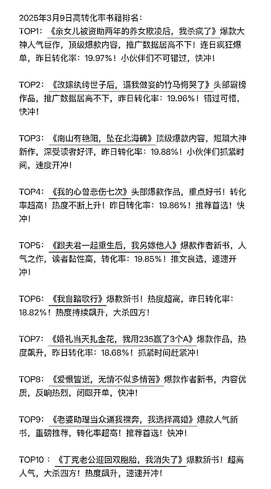
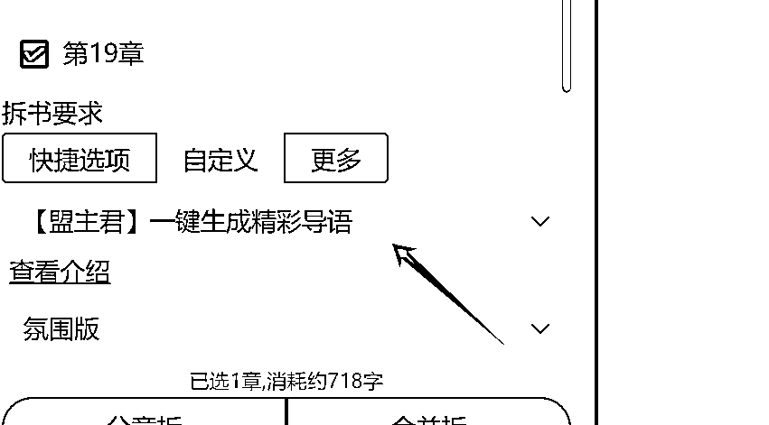
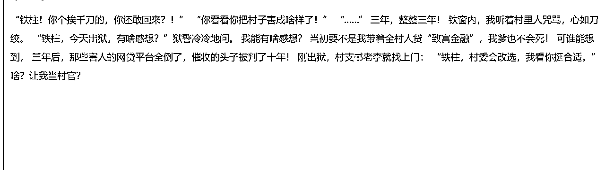
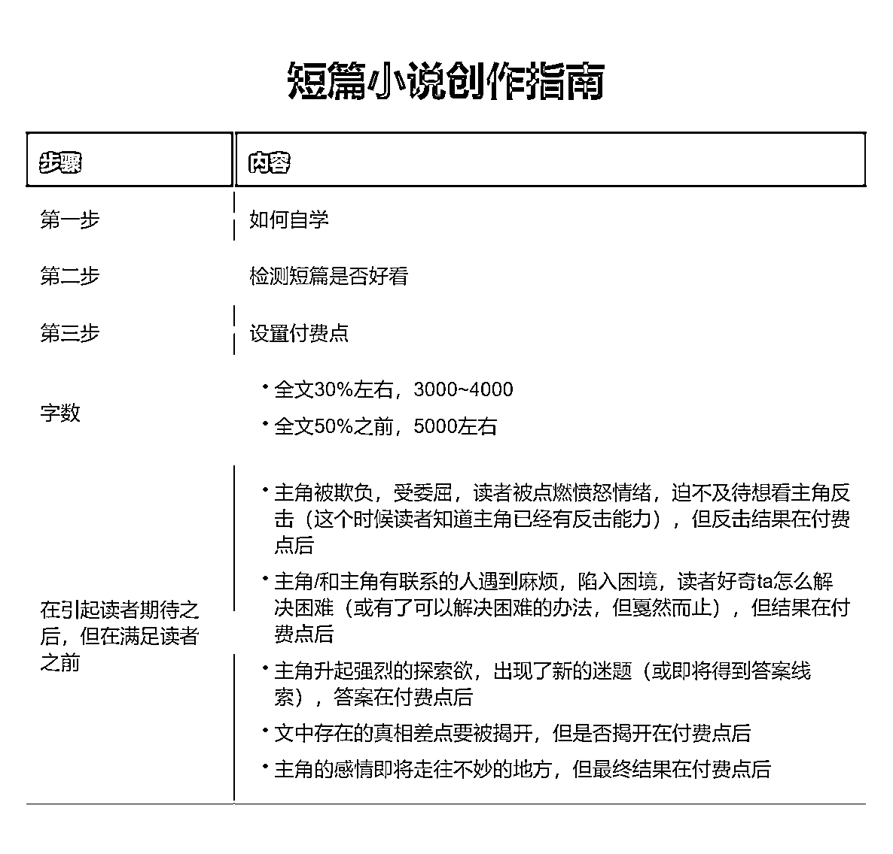

# 让AI成为你的内容放大器：从灵感到收入的完整方法

大家好，我是盟主君，一名90后创业者，也是在内容项目中借助智能工具实现累计收入20万+的人。

今天想和你聊聊：为什么有人用了很久的智能工具，依然没有收入；而有人却能把一篇篇内容，变成持续回流的资产。

目前我运营的三个账号，收益已经趋于稳定。2月份事务较多，更新数量只有平时的大约三分之一，但过去发布的内容仍在不断带来回报。尤其是小说类文章，最近拿到的稿费中，有不少来自数月前的作品。

很多人都会使用智能工具写稿、剪视频、运营账号，却始终没有获得理想结果。问题往往不在工具，而在于：没有选对方向，也没有掌握内容生产和变现的关键节点。

没有资源、没有背景，普通人是不是就只能一直原地踏步？

未必。

起步阶段拼的不是运气，而是持续行动、不断试错，以及把有限的工具真正用到刀刃上。只要熬过最初的积累期，内容就有机会形成长期回报。

下面进入实操部分。

## 一、先找到值得写的方向

### 选题别靠猜，先观察市场正在发生什么

写小说之前，可以先查看平台上的热门榜单，了解近期读者正在关注哪些类型、人物关系和情绪冲突。

一个省时的方法是：在📕搜索“知乎小说榜单”或“黑岩小说榜单”，通过相关整理内容，快速判断哪些题材更有热度。

知乎相关榜单：

https://www.xiaohongshu.com/user/profile/597806c46a6a69564b1f9616?xsec_token=ABITZR8iwKyBH-NU7i-1miPgZ6-RLTu11WR0EA5746Gz8=&xsec_source=pc_search

黑岩相关榜单：

https://www.xiaohongshu.com/user/profile/63970cde000000002702a1cb?xsec_token=AByDgh78rtpmB4k_ZGFAxi57IgXF2tUj9GB7U-Kw2McPs=&xsec_source=pc_search

看榜单时，不只是看标题，还要留意以下信息：

- 哪些题材反复出现；
- 哪类人物设定最容易引发讨论；
- 作品开头用了什么冲突；
- 评论区读者最关心哪个问题。

先做观察，再动笔，效率会比闭门创作高很多。

## 二、小说开篇，要让读者立刻产生疑问

### 一个高点击开头的基本结构

可以把开场拆成三层：

**处境铺陈 → 表面进展 → 意外转折**

第一层，让读者知道人物是谁、正在面对什么局面；

第二层，给出一个看似合理的发展，让故事暂时形成方向；

第三层，突然抛出与前文产生落差的新信息，制造继续阅读的动力。

真正有效的反转，不是单纯“突然发生一件事”，而是前后信息之间出现明显错位。

例如：

> 我天生看不见，却能听见每个人心里的恶意。  
> 可当他站到我面前时，我第一次什么都听不到。

前面交代能力，后面立刻设置例外，读者自然会想知道：他究竟是谁？为什么会成为特殊的人？

### 开头最好形成连续的变化

每一层信息都可以推翻上一层认知。这样一来，读者的判断会不断被刷新，阅读动力也会持续增强。

同时，还要注意情绪曲线：

- 如果主人公一开始处于困境，开头结尾最好给出翻盘征兆；
- 如果人物最初看起来顺风顺水，就可以在结尾埋下坠落风险。

所谓“高位”，可以是名声、财富、爱情或目标即将实现；所谓“低位”，则可能是一无所有、被误会、遭背叛，甚至面临死亡。

开篇通常不宜过长，控制在约100至150字比较合适。平台首页展示字数有限，因此最前面的几十个字必须尽快让读者看到人物处境和核心矛盾。

### 读者通常更容易被强情绪带动

从阅读偏好来看，虐恋、复仇、打脸、追悔等类型，往往比单纯甜蜜更容易制造讨论。

原因很简单：前期压抑越充分，后面的反击、真相揭开或关系逆转，就越容易产生情绪释放。

常见的写法包括：

- 先让人物承受误会和伤害，再安排身份或能力反转；
- 把传统男女角色的主动与被动位置调换；
- 将熟悉的感情套路改成完全不同的关系结构；
- 利用娱乐圈、名人、粉丝等天然带有光环和矛盾的场景。

不过，开头不需要追求辞藻华丽。最重要的是让目标读者一眼看出：这是一篇复仇文、甜宠文、悬疑文，还是娱乐圈故事。

常用的吸引方式主要有两种：

**第一种：留下一个无法解释的疑点。**  
结尾的信息与前文形成断裂，让读者忍不住追问“究竟发生了什么”。

**第二种：把情绪推到极致。**  
通过一句狠话、一个动作、一个细节，直接呈现委屈、暧昧、心碎或反击。

想提升判断力，可以每天浏览十篇平台热门作品的开场，连续观察一周，重点分析它们如何交代人物、安排矛盾，以及在哪句话结束。

### 如何借助智能工具完成初稿

在AI写作平台中选择“小说开场”或类似功能，输入题材、人物设定、冲突和目标情绪，让工具先提供多个版本。

工具负责快速生成，你负责筛选和修改：

- 删除空泛背景；
- 强化人物动作；
- 提前露出核心矛盾；
- 把最有冲击力的信息放到结尾。

示例效果如下：

如果第一版不够抓人，可以继续补充限制条件，让它改写不同风格，直到找到适合你作品的开头。

## 三、把读者最想知道的地方设为转化节点

### 收费位置，本质上是“还差一个答案”

读者愿意付费，通常不是因为字数到了，而是因为故事已经让他产生了明确疑问，却还没有得到答案。

因此，转化节点要满足一个条件：

> 前面已经把期待推起来，关键结果却暂时不揭晓。

悬疑故事可以让某件不可能发生的事先出现；爽文可以先写人物被压制，再把反击停在爆发前；感情故事则可以把关系推进到即将改变的瞬间。

不要在付费前塞入大量无关内容。读者需要清楚知道自己为什么要继续看。

### 1. 节点不宜拖到故事末尾

通常可以把收费位置安排在全文约35%至60%的区间，很多作品会选择前半段附近。

例如，一篇约1万字的内容，可以考虑在3000字左右处理第一个短线悬念，但不要把所有问题一次性解释完。后续仍需要保留新的矛盾、秘密和反转。

换句话说，吸引人的内容不能只集中在开头：

- 开始部分负责建立兴趣；
- 中段负责升级矛盾；
- 后段负责兑现承诺并继续制造新的期待。

### 2. 让节点服务于题材卖点

不同类型，适合卡住的位置并不相同。

**感情向作品：**  
可以放在两位主角关系发生实质变化、误会即将揭开，或者某个重要承诺出现的时刻。

**爽感向作品：**  
适合停在更大范围的反击即将发生、身份即将曝光，或对手即将受到惩罚的位置。

**替身与虐恋题材：**  
可以选择人物离开、消失、死亡，或者另一位主角终于意识到真相的前一刻。

核心原则是：前文已经积累了足够期待，读者到了这里，恰好最想知道后果。

### 3. 借用“只听到一半的八卦”制造继续阅读

生活中的八卦之所以让人上瘾，往往不是因为开头，而是因为结局被故意藏起来。

比如有人告诉你：校长在学校门口拿着花向一位已婚老师表白。你听到这里，第一反应一定是追问：“她答应了吗？”

对方却只描述围观人群、拍摄画面和表白过程，迟迟不说对方的回答。此时，真正重要的信息被留到了最后。

小说中的收费节点也是同样的逻辑：

- 先把事件说到足够劲爆；
- 让读者确认事情确实严重；
- 在最关键的回应或结果出现前停住。

读者购买的并不是几千字本身，而是那个迟迟没有揭晓的答案。

## 四、正文推进与标题设计

关于正文节奏、标题组合以及完整创作流程，已经在《一起靠AI写小说慢慢变富全流程版》中做过系统整理，想继续深入的话，可以结合那篇内容学习。

最后提醒大家：

智能工具能够提高效率、协助构思、帮助你快速试错，但它不会替你选择方向，也不会自动把内容变成收入。

真正决定结果的，仍然是你的观察力、创意、执行力和长期坚持。把工具用好，把内容做扎实，普通人也能逐步建立属于自己的持续收益。