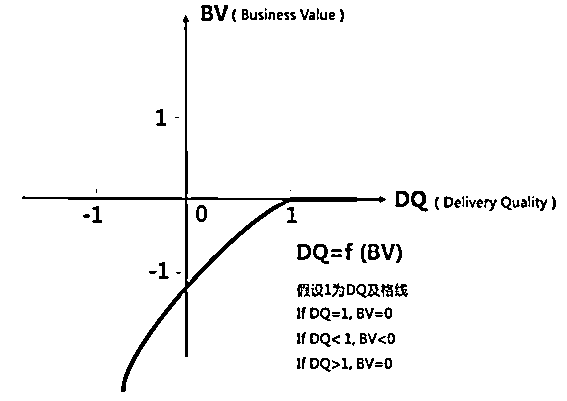
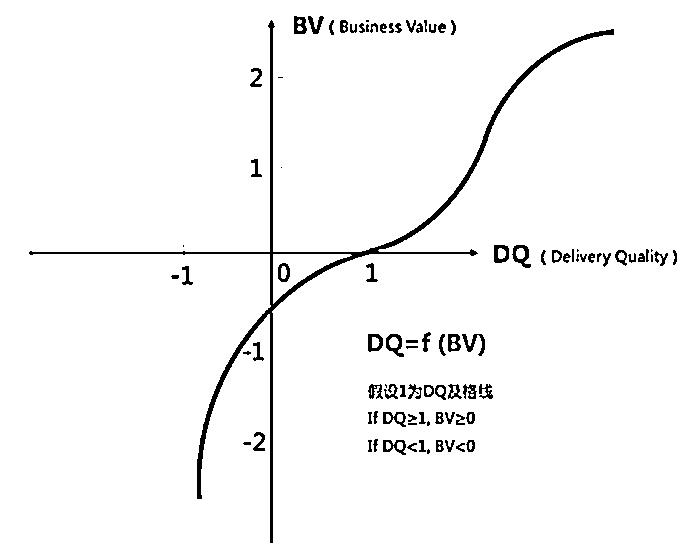
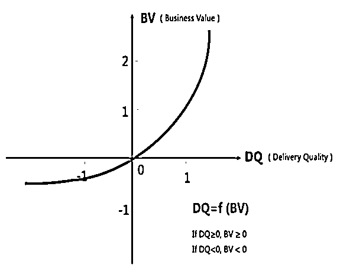

# 创业者可能忽视的团队——支持性团队的管理逻辑

很多创业者会把目光牢牢锁在业务团队身上，却常常忽略一支同样关键的队伍——支持性团队（也叫职能团队）。人事、财务、法务、行政、IT……他们看似不直接创造营收，却在悄悄决定公司能不能稳得住、跑得远。这篇文章，我想聊聊支持性团队背后的管理逻辑，希望能给你带来一些不一样的思考。

先说一个常见现象：公司刚起步的时候，职能线可能只需要两三个人处理基础事务；慢慢长大，就开始像部落里多兵种配合，大家分工明确，但朝同一个目标发力；再往后，业务变复杂，就像多个部落联合作战，既要看清部落间的协作关系，也要保证每个人手里都有真功夫，箭能射得准。要做到这种大规模协同，背后必须有一套统一的认知和行为方式。这就需要把职能力量的工作理念梳理清楚，形成自己的逻辑。

那么，好的职能团队应该具备什么样的工作风格？

第一，务实。从价值和收益出发，天然反感假大空、形式主义和经验主义。比如年会，很多公司习惯于包五星级酒店、搞节目汇演，让员工提前一个月加班排练。可问题是，办年会的真正目的是什么？是为了感谢大家一年的付出，同时在不影响业务产出的前提下，提升员工对公司的满意度。那不如把预算集中投到大家最喜欢的抽奖环节，反而更直接有效。再比如培训，如果只是给大家上点瑜伽、茶艺课，那叫福利，不叫培训。培训必须为了解决真实存在的问题而存在，比如你马上要当面试官，但不知道怎么面试，那就需要面试官培训。福利培训，不如直接发健康补贴来得实在。职能团队的人要有一种“把脚插进泥里，脸贴在地上”的劲儿，而不是只会纸上谈兵。

第二，不满足。从骨子里反感“佛系”和“差不多得了”。一个项目跑通一次，不代表它就该稳定了。真正的不满足，是承认自己平凡，然后不断追求极致。标准要高，所谓“求其上者得其中，求其中者得其下”。如果你不觉得现在的自己比一年前更强，那就是没有成长。还要多看看标杆做到了什么程度，问问自己能不能做得更好。

第三，能扛事。公司越来越大，模糊地带越来越多。这时候不要过分划清边界，发现问题别觉得“跟我没关系”。原则很简单：有人负责我支持，没人负责我负责。谁先碰到问题，谁就去解决，尤其是有能力解决的人，别让球掉在地上。这种有大局观的人，往往能在公司成长过程中发挥更大价值，自己也收获更多。但要注意，负责不等于奉献，因为对工作负责，本质上就是对自己负责，有意义的产出一定会被看到。

第四，保持靠谱和真诚。同事不是过日子的家人，而是一起打仗的伙伴。比起互相喜欢，更重要的是基于专业和靠谱的信任与尊重。为了持续创造价值，管理者要敢于给员工真诚直接的反馈，而不是和稀泥。人和人之间的沟通，有没有带着诚意，大家其实都感觉得到。如果你和小伙伴在价值动机上有分歧，那就正大光明地讨论甚至争论，不需要因为对方资历老就畏首畏尾。

有了这些工作风格，职能团队还需要一个核心工作理念——以价值为归依。换句话说，做对的事情，比把事情做对更重要。要怎么做到？分三步。

第一步，坚持问题驱动。任何工作都应该源于真实存在的问题，而且要看透问题的本质。比如业务团队提出“项目管理培训”的需求，说大家缺乏项目整体概念。但深入沟通后你会发现，真正的问题可能是业务目标、规划和交付标准不清晰——这根本不是培训能解决的，所谓的培训需求是伪需求。还有一点要坚决反对：没有问题，也不要创造问题去刷存在感。比如一个HR最近没产出，就搞什么冥想培训、旅行分享，为了做事而做事。这是极大的资源浪费。工作场景是实战，不是武术表演，花拳绣腿没用。

第二步，把握价值动机。看到了问题，要不要解决、怎么解决，关键看动机——你做这件事到底为了什么？它是否符合公司价值观和文化？同一件事，在这个公司可以做，换到另一个公司可能就不行。给你讲个真实案例：某公司20周年，定了“司龄纪念币”，但发放前一晚被紧急叫停。为什么？因为这家公司价值观是“结果导向”，只认功劳，不认苦劳。“呆得久”本身不值得激励。如果你真的感谢老员工，电子贺卡也可以，不一定非要用物质礼品。这里有个警示：公司变大时要警惕“全民福利”，因为福利就是大锅饭，对绩效好的员工不公平。还有，少数不一定服从多数。多数人拿到礼品很开心，但如果有少数关键业绩贡献者表达了困惑，那你做这件事就要慎重。当然，也不是说要刻意反常规、刻意讨好少数人，核心还是回到价值动机，只要对公司有价值的事，主流常规也一样要做。

第三步，理解价值衡量标准。确定要做一件事之后，你得知道公司怎么衡量它的价值，这决定了你做到什么程度。职能线的工作，可以分成不同类型，衡量方式完全不一样。

第一类是“底线保障型产品”，像空气一样。比如干净整洁的办公环境、稳定连接的网络、准确无误的薪酬数据。这些事做好了，大家毫无感知，因为那是理所当然的；但只要一出错，就是事故，就会拖累业务。这类产品的价值曲线很有意思：交付质量达到及格线时，业务价值为0；低于及格线，业务价值为负；高于及格线，业务价值依旧是0。什么意思？你从普通写字楼搬到外滩顶级办公室，把桶装水换成气泡水，研发进度并不会加快；前台小姐姐每天跳舞，产品质量也不会提升。所以这类工作的要求是：不能出事，但也不需要盲目追求最高标准。要做到0事故、高性能、高可用，最好把工作从非标流程推向标准化，再升级到自动化，让工具代替人，减少人为失误。做这类工作的伙伴，要耐得住寂寞，兢兢业业守住底线，同时要明白，没有业务赚来的钱，谁给谁发工资？你的价值就是让业务团队安心打仗。

第二类是“最低标准型产品”，比如新人培训。这类产品有个特点：如果交付质量没有达到及格线，还不如不做。为什么？因为让大家花半天时间参加培训，如果毫无价值，这半天本来可以投入生产，反而产生了机会成本。更糟的是，如果新人培训里传递了负面信息，让人觉得这家公司不行，那效果更是灾难性的。但一旦做好了，新人通过培训理解了公司的使命、价值观、工作方式，他们会兴奋地说：“哇，我加入了一家很棒的公司，我要好好干，还要把朋友推荐过来。”这时候，培训就产生了正向价值，而且做得越好，价值越大。

最后想说，支持性团队不是“边角料”，也不是“后勤大爷”。他们有自己的价值逻辑，需要被看见、被理解、被正确评价。作为创业者，如果能把这套逻辑想清楚，你就知道该如何评估支持性团队每个岗位的工作产出，也知道该怎样让这支队伍真正成为公司增长的助推器。希望今天的内容对你有启发。

把职能工作当成产品来经营，常能一眼看清它到底值不值得做、该怎么做。不同工作对交付的容错度完全不一样，我把它拆成三大类来看。

先说第一类，底线保障型。
图一：底线保障型

这类工作只有一个及格线，达标了就守住底线，不达标就直接拖垮业务。它和后文提到的最低标准型在逻辑上相近，但侧重点在“不能失守”。

第二类是最低标准型。
图二：最低标准型

这类产品的及格线设在1分，只要交付质量 DQ≥1，业务价值 BV 就≥0。刚好踩线，工作才有意义；做得越高，业务正向反馈越大。

反过来，如果 DQ<1，BV<0。低于及格线，不是白干，简直是反向添乱，资源打水漂、还给业务添堵。培训、领导力培养、专业技能培训、TD、OD、组织策略优化都属于这一类。做得好是助力，做不好不仅没效，还会消耗信任。信任一旦裂开很容易，修起来却极难。

最低标准型该怎么要求自己：

意在笔先。动手前先把闭环想透，花时间把问题、价值点、行动与问题的映射关系捋清，最后交付什么、怎么判断高质量，心里要有数。

宁缺毋滥。信息密度决定成败。说十句话九句废话，效率只有十分之一。出去的东西必须是好内容，达不到临界值就等于负分。坚持八十分原则，不够八十分就别交付。

提前验证。尽早找典型用户做用户测试 CE，最好让有产品思维的高手参与到设计里。

先小范围试水。能灰度就灰度，让问题在内部暴露，别直接在生产环境打脸。新产品能用 Excel 跑通就先别急着上系统。

第三类是持续增长型，也是多多益善型。
图三：持续增长型

这类工作有量就比没有强，越多越好。像校园招聘，简历池越大，选择面越宽，筛出高匹配人才的概率越高。社招盘点候选人资源也一样，触达人越多，即使部分候选人因地点、项目临时拒绝，仍能提高最终 offer 的命中率。哪怕招聘做得差，简历全是无关信息，业务看几眼也会主动止损，负面影响可控。

这类产品的存在意义是创造增益或减少损耗，做得一般顶多没增益，对业务通常无害。

怎么看它的价值：

当 DQ≥0 时，BV≥0。交付质量和数量一起提升，业务价值持续走高。
当 DQ<0 时，BV＜0。做得太差才会产生负面影响，大多数情况只是不产生增益或没减少损耗。

招聘、税务筹划等都属于可反复做、边际价值递增的工作。

持续增长型该如何把握：

盯住有效率。虽是多多益善，也要保证合理效率。比如简历放量时，要兼顾有质量简历的占比，别为了量牺牲效率。

保住增长优先。第一目标是争取更多新增、更好的新增。不能为了提高有效率而刻意缩量，本末倒置。

万事皆产品

好工作背后一定有产品思维。职能线每一项工作都是产品，用户用它来满足需求。

什么叫产品？就是被用户使用和消费、能满足某种需求的东西，既可以是有形物品，也可以是无形服务、流程、观念等。入职 SOP、培训课程、校园招聘，都是典型产品。

好产品的三个标尺：

有用：真能解决战场上的问题。文档要回答“写来干嘛”，系统要回答“能解决啥”，新增 BP 角色要回答“组织有什么好处”。

易用：好懂，会说人话。用户一看就会用。比如盘点工具，读一下指引就能操作；文档，新手也能看懂。

友好：体验好，甚至超出预期。操作顺畅，文案贴心，流程透明，像财务报销的审批进度提示，让人心里有底。

做产品的思考路径

把自己当成商人，围绕“创造价值才能结算”来思考。

1. 识别用户、客户和评价中心，并用问题驱动。

用户是实际使用者。入职 SOP 的用户包括 IT，要做实操。
客户是付钱的人。入职流程的真正买单方是公司。
评价中心是判定好坏的人。入职体验的主体是新人，HR 不能自嗨。

2. 明确认知差和价值。

我能解决客户/用户的什么痛点？不解决会怎样？解决好了会怎样？入职流程解决的是新人融入和产能损耗问题。不管好，品牌受损、人才流失；搞好了，快速产出。

3. 用户和客户是否认同这个价值？

成员社恐却强行喊口号，价值就是负的。用户需求与客户价值不一致时，以客户价值为准。比如全员英语私教用户想要，但对业务无帮助，就不该投入。

4. 深度思考可交付的东西。

能做到什么程度，是否满足最低要求？没达标会不会扣分、扣成负分？成本与价值是否划算？如何让用户结算更多产值？

学会定阈值。烧水要 100° 才算开，1° 和 99° 都是不开。

交付物清单是什么？上下游能协同到什么程度？解决一个问题能否带出更多价值？

潜在风险会不会产生副作用？组织能不能消化？

项目管理能否按计划走？突发状况止损原则是什么？

不同工作之间是否耦合？

最后谈引擎思维。

做职能产品的本质是做引擎。Input 是新人，Output 是满意度高、能快速融入并带动别人的新人。处理过程就是 CPU。

单兵作战的引擎过时了。团队要把一个单元设计成可复用的引擎，把 Input/Output/CPU 清晰描述清楚，让人可接手、可复制。

引擎要沉淀为组织能力，而不是个人英雄。设计者熟悉引擎，但优秀的引擎要做到降维操作：换一批新人，简单指导后也能稳定复现高质量、高效率的 Output。可视化、易用、友好是检验标准。

全局视角

不要盯着局部。要看到整个流水线，最短板决定装水量。拉高视角看协同，再回头打磨细节，才有机会负责整体。

多种视角

HR 工作不止 HR 视角。外部用户视角、开发者视角都很重要。跳出自身视角才能交付真正被认可的产品。

职能工作也一样，万事皆产品。用产品思维、引擎思维、全局视角做事，才能让工作既有价值，又可持续。