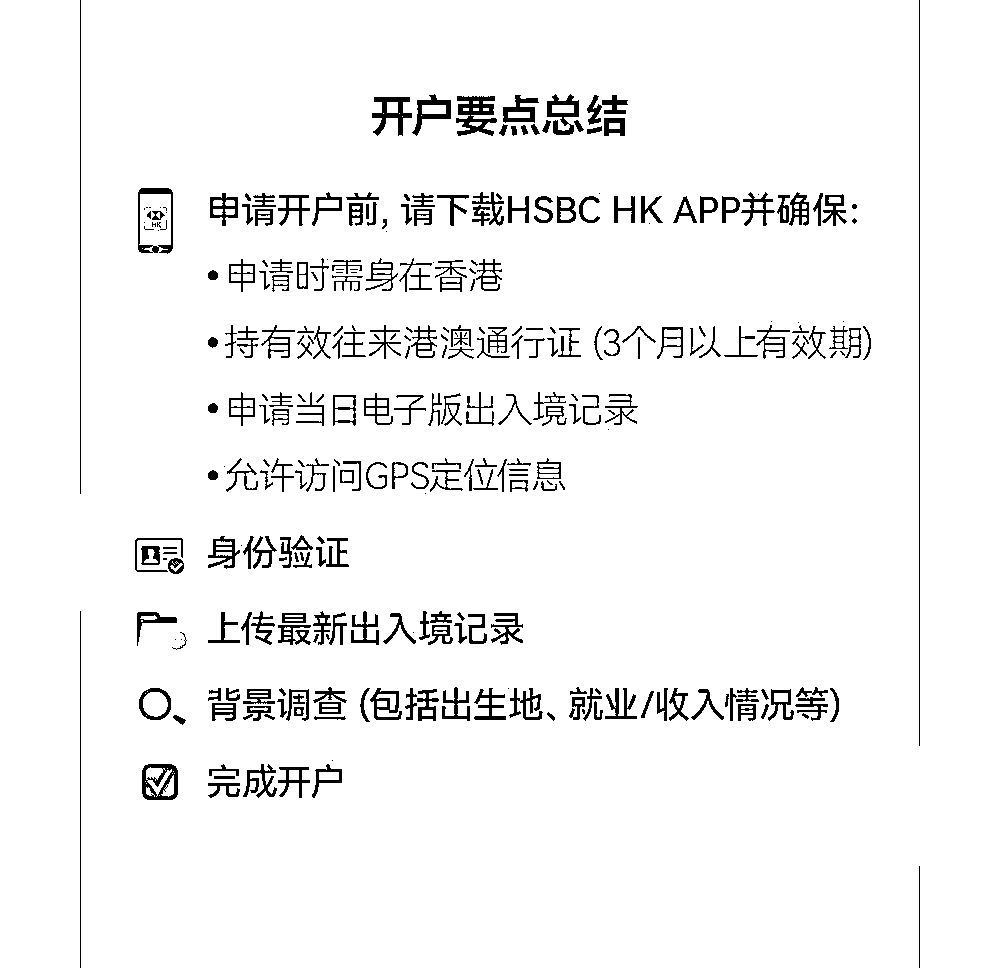
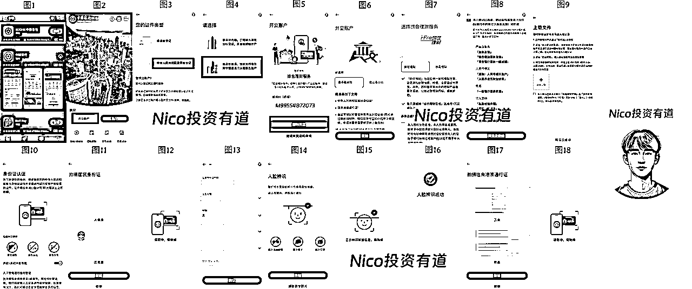
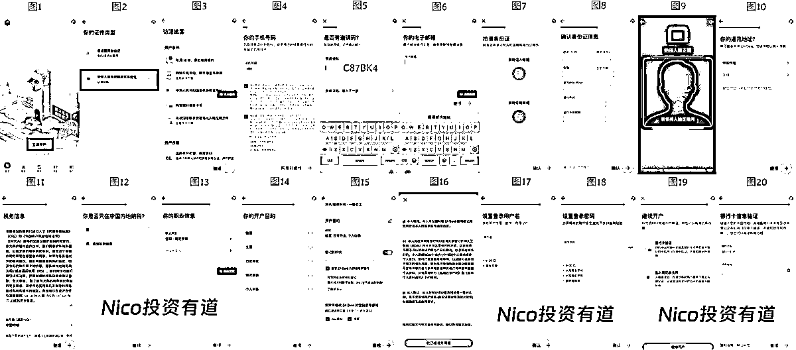
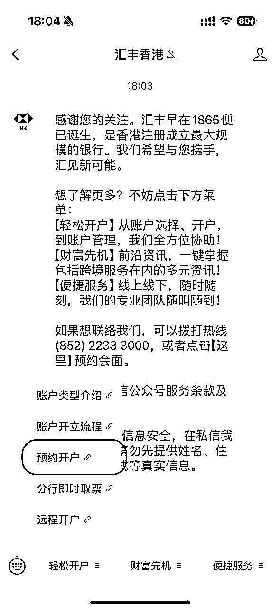
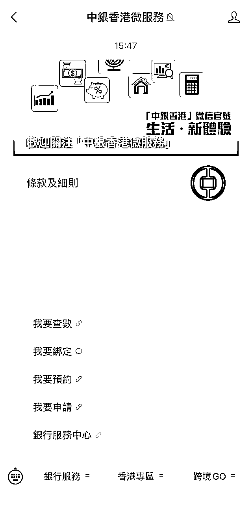

# 香港办卡攻略(动态更新中)

最近不少朋友都在折腾境外账户，头一步往往卡在香港银行卡上。我正好在写一本《出海Stripe注册攻略》，里面也详细聊了港卡准备，感兴趣的可以看这里：https://www.getstripe.me/

# 为什么都爱办“中银香港 + 汇丰香港”？

这对组合常被叫作“王炸搭配”，原因很实在：

- 内地中国银行转账到中银香港的同名账户，手续费为0，资金可以低成本出境；
- 中银香港再转去汇丰香港，同样免费，相当于把资金拆到两个户口里，更灵活；
- 拿着汇丰卡在全球汇丰ATM取现，免手续费，出门旅游随时取当地现金。

简单说，一张负责“出海”，一张负责“花钱”，分工明确。

# 虚拟银行：不是主角，但很省事

像众安ZA Bank、天星银行、蚂蚁银行这类虚拟银行，开户门槛低、全程App搞定，适合当资金中转站或日常消费用。不需要跑柜台，也不用排队，属于“有就更好”的辅助选择。

# 线上还是线下？前提都是人到香港

不管选哪种方式，人都得到香港，这是硬条件。

- 线上办：汇丰、中银以及虚拟银行都支持。但汇丰和中银线上申请后，实体卡不会当场给你，而是后续邮寄到通讯地址。
- 线下办：当场就能拿卡。可以提前预约再去，也可以直接walk in，凭运气看当天有没有号。

# 出发前，材料宁可多带

必备清单如下：

- 身份证
- 港澳通行证（至少提前5个工作日办理）
- 2000港币现金。开完卡后建议顺手存一点：汇丰存100，中银存1000，省得之后跨境汇款还要等
- 住址证明：打印最近3个月的信用卡账单，中银线下开户大概率会看，汇丰基本不用。招行卡怎么做地址证明？水电煤账单也可以，具体办法参考素材里的链接
- 过关小票，过关时千万记得拿
- 出入境记录：到香港后通过“移民局12367”小程序下载，不用提前准备
- 手机提前装好“BOC HK”和“HSBC HK”两个App；导航用高德，比Google Map顺手
- 手机漫游记得先找运营商开通，再买一个香港流量包，落地后打开国际漫游就能用
- 充电宝建议带着，线下排队时手机掉电特别快

另外，建议准备：

- 英文通讯地址：拼音写就行，注意别漏掉门牌号、楼层这些关键信息，否则后面收不到寄来的卡
- 投资证明：不用打印，把支付宝基金或股票账户给柜员看一眼就够了
- 如果在香港过夜，带个转换插头
- 上班族可以备好工资流水或纳税记录；学生或自由职业者就提供存款、收入证明这类
- 关键是要让银行觉得你是正常用户，开卡后确实会存钱、会交易，而且有一定经济基础

# 线上办理怎么操作？

先看汇丰：不用排队，跟着App提示走，大约15分钟就能完成开户。具体步骤可以去看参考视频。 

再看中银香港：如果你的名字是两个汉字，建议直接去线下，因为线上申请容易被拒。线上流程大致是：下载App连上香港WiFi，下载入境记录文件，开立账户、上传资料、做人脸识别，最后还要去分行补签字。 

虚拟银行以众安ZA Bank为例：人在香港，直接在App里申请，系统会自动核查出入境记录。开好后会得到一张虚拟Visa卡，如果愿意花25港币，还可以申请实体卡，卡片从珠海寄出。 

# 线下办理：选对网点，成功一半

热门区域尽量避开，比如深水埗、油尖旺、九龙城、黄大仙、观塘区、港岛区，因为人流密集，开户的人多，容易被拒。相对偏远的网点反而好办，比如葵芳、荃湾、粉岭、沙田、德辅道中、半岛中心、旺角、观塘等分行。

时间上，工作日是9:00到17:00，汇丰和中银周六只开到13:00，周日全天休息。想walk in的话，最好早上8点前就到门口排队，不然后面很可能没号。

预约方式也给大家整理好了：

- 汇丰香港：在微信公众号「汇丰香港」里预约。如果日期点不了，说明当天号已经约完。没约到也可以去现场排队试运气，但不保证有号。 
- 中银香港：关注「中银香港微服务」公众号，菜单栏“我要预约”操作。提前7天放号，最晚只能约到7天后的第一个工作日或周六，每天凌晨12点放号。 

这里分享一个高效打法：挑一家偏远的网点，比如元朗教育路中行和元朗汇丰大厦，两家步行只要3分钟。9点开门前15分钟，先到中银取个号，再去汇丰二楼取号，两边同时排着。汇丰效率奇高，30分钟就能拿卡，办完再去中银，排队时顺便把App资料填了。

# 汇丰开户细节

进门口直接告诉工作人员要开银行卡，如果当天还有号，他会引导你去取号。问开卡目的，就说是“投资港美股”。到柜台后，主动递上身份证和港澳通行证，地址、工作、收入如实回答就行。系统会自动审核，通过的话当场领卡；如果需要进一步审核，1-3个工作日内会发邮件，收到“Say hello”那封就表示通过了，之后卡片会平邮或挂号信寄到你填的地址。

开卡后，工作人员会教你登录汇丰App，按提示操作即可。拿到手的除了银行卡，还有一张密码纸，沿边撕开能看到初始密码，然后去ATM机改掉。注意：香港的银行账号和卡号不是一回事！银行给的信封千万别扔，里面写着账号信息。汇丰One的卡号和账号一致，但蓝狮子卡两者不一样。

# 中银开户，稍微严格些

中银要的资料更多，流程也细致。给工作人员看预约编号，他会指导你在App上提交申请，顺便问一下WiFi密码。如果被问办卡原因，别说理财，就说准备开港股和美股账户，最好把证券App里的交易记录提前打开，给他看一下。

App提交资料后，还需要往工作人员给的邮箱发一份地址证明文件，然后去窗口继续办。注意App里填的地址必须和地址证明文件上的一致。一般半小时左右就能办好，多数情况下当场下卡。如果分行没有卡了，后续会平邮寄给你。

拿到卡后，先去楼下存款机存入1000港币。注意：存款机不用插卡，直接输入存款账号，把钱放进去确认就行。香港的存款机和取款机是分开的，存完还要去隔壁取款机查一下余额才算激活。操作时注意，存取款机的屏幕没有提示框，按键也没有声音，直接按顺序按就好，内地朋友可能不太习惯。

另外，如果要从内地中银汇款到香港中银，务必使用香港中银的“外汇宝”账号，这点非常重要。

# 再办一张Mastercard

汇丰One和中银香港发的卡都是银联卡。如果你在国内想绑定微信、支付宝使用，可以在App里申请Mastercard。汇丰可以办蓝狮子卡，中银可以办万事达扣账卡，两张卡都能在家申请，非常方便。具体攻略在小红书上搜一下就能找到。

# 参考资料

想看更详细的教程、踩坑记录和最新政策，可以翻翻素材里附的链接。总之，材料带齐、避开人流密集区、早点排队，拿下一张香港卡真的不难。