# 读懂 App Store 榜单：海外营销人的一线雷达

> 来源：[https://jt0evptqde.feishu.cn/docx/RTYHdtIBZoyRTLxpQtrcMb5Cnhd](https://jt0evptqde.feishu.cn/docx/RTYHdtIBZoyRTLxpQtrcMb5Cnhd)

# App Store 榜单到底是什么

App Store 榜单就是苹果应用商店的应用排行，能直观看到哪些 App 在被大量下载，哪些 App 在赚最多钱。国内大家熟悉的小米、华为应用商店的榜单，就是同样的逻辑。

海外应用分发基本被两家垄断：App Store 和 Google Play。本文以 App Store 为主线展开，Google Play 的看法和做法基本一致。

为了方便阅读，后文提到的苹果榜单、iOS 榜单、App 榜单，统指 App Store 榜单。

# 为什么营销人要每天看榜单

看榜单并不会立刻给你带来转化，某个 App 一天涨了上百名，也不会分你一分钱。

对我来说，看榜单的价值在于保持市场嗅觉。作为做海外营销和用户增长的人，必须靠第一手信息去捕捉市场脉动。

你没法也不用一个个去扒每个 App 的下载数据，App Store 已经帮你排好；你也不用等媒体报道才知道什么应用在火，榜单本身就是官方的权威数据。

我负责海外用户增长时，每天上班第一件事就是打开榜单。看得久了，市场上哪怕一点风吹草动也藏不住。

下面这套方法，入门并不难。

# 去哪看 App Store 榜单

直接用苹果手机也能看，但营销关注的维度太多，手机操作很费劲。实操中更常用点点数据、七麦数据这类第三方监测站。

注意，这些网站自己不造榜，只是抓取 iOS、Google 等官方榜单后做聚合展示。它们呈现的内容和手机上看到的一模一样。

我个人常用点点数据，下面就以它为例。其他平台操作逻辑相近。

平台需要注册，流程很简单。免费版的信息对日常使用已经足够，付费功能可按需开通。

进入后点进 App Store 榜单即可。

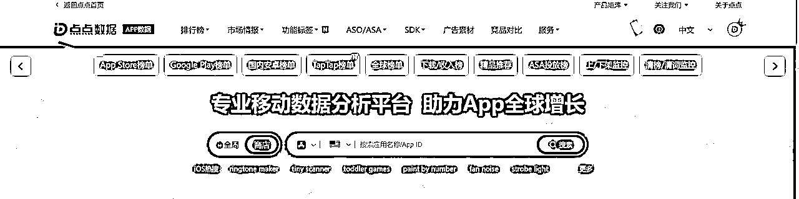

另外一个小建议，如果你做海外市场，直接用英文界面。很多名词翻译成中文后会产生歧义，直接看英文更清晰。

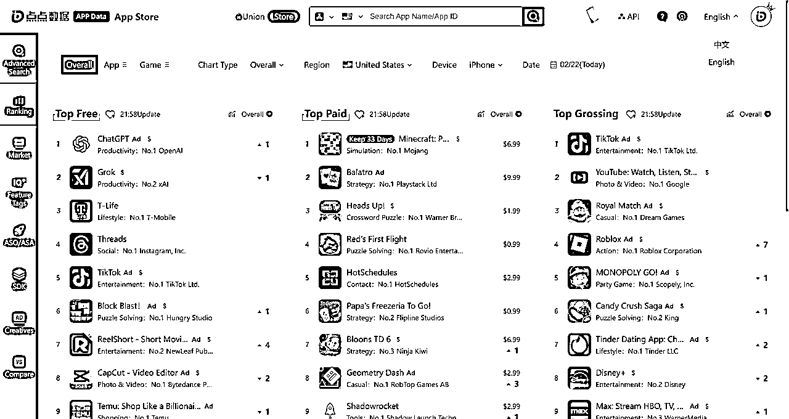

# 榜单是复杂还是分类没理清

很多新手觉得 iOS 榜单一团乱，其实根源是分类维度没搞懂。搞懂维度，看榜就清晰了。

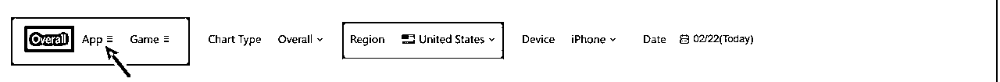

*   榜单分类

*   Overall
涵盖游戏和非游戏，也叫总榜。默认就是这个，能反映全量应用的态势。
*   App
这里的 App 指非游戏类应用。注意区分：App Store 里的 App 是泛指所有应用，而这里的 App 分类专指非游戏。
可以进一步筛选细分品类，比如图像视频、娱乐、教育等。
*   Game
仅游戏类。选择后只显示游戏排名，也能再细分到解密、动作、角色扮演等。

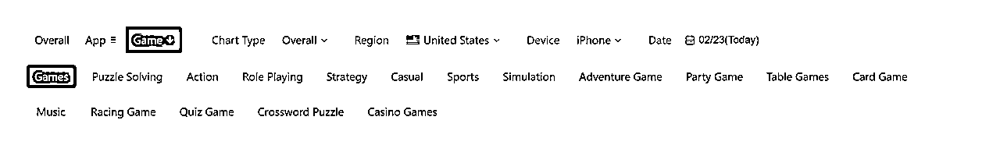

注：榜单分类并非官方命名，是行业通用说法。

*   地区
通常看美国 United States。
*   Chart Type
可忽略，主要是展示形式的影响。
*   设备
默认 iPhone，iPad 体量小，影响有限。
*   日期
一般选实时或当前日期。

# 三大核心榜单怎么读

上面维度理清后，读榜就很简单了。以下截图均基于 Overall。

*   Top Free 免费榜

*   统计范围
可免费下载的应用。
*   统计指标
近期下载量。官方未公开具体算法，市场普遍认为是以近期每天下载量加权，越近权重越大。简单理解为近期下载量即可，通常指最近三天左右。
*   重要性
最核心的榜单。
App Store 只分免费榜和付费榜，没有把免费和付费合在一起的榜。付费应用占比很小，所以 Overall 下的 Top Free 基本等同于全量 iOS 应用的排名。日常提到某 App 排到第几名，默认说的就是免费榜。
*   关注范围
Top 20
前20名都是头部巨头或潜力新星，覆盖面足够。
*   关注点
头部位置是否变动，有无新上榜应用；
新上榜背后可能的驱动因素；
头部产品的获客来源；
涨幅异常的应用；
掉出 Top 20 的产品；
品类分布占比；
不同国家头部是否一致；
……

*   Top Paid 付费榜

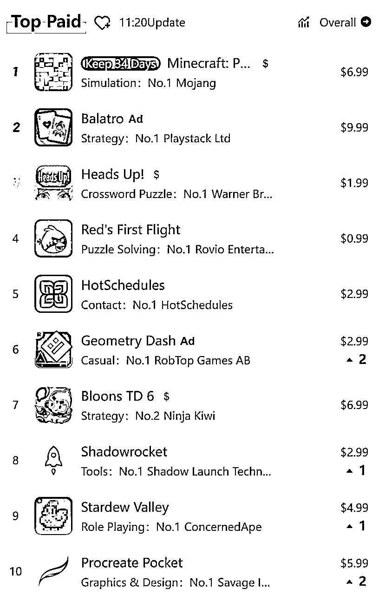

*   统计范围
下载本身需要付费的应用。
国内很少见付费下载，但海外仍有此类产品。注意别和 Top Grossing 混淆：这里统计的是“不付费就下不了”，不看下载后的付费行为。
*   统计指标
近期下载量，和免费榜逻辑类似。
*   重要性
一般。做付费下载产品的才需要重点盯。
*   关注范围
Top 10 即可。
*   关注点
同免费榜。

*   Top Grossing 收入榜

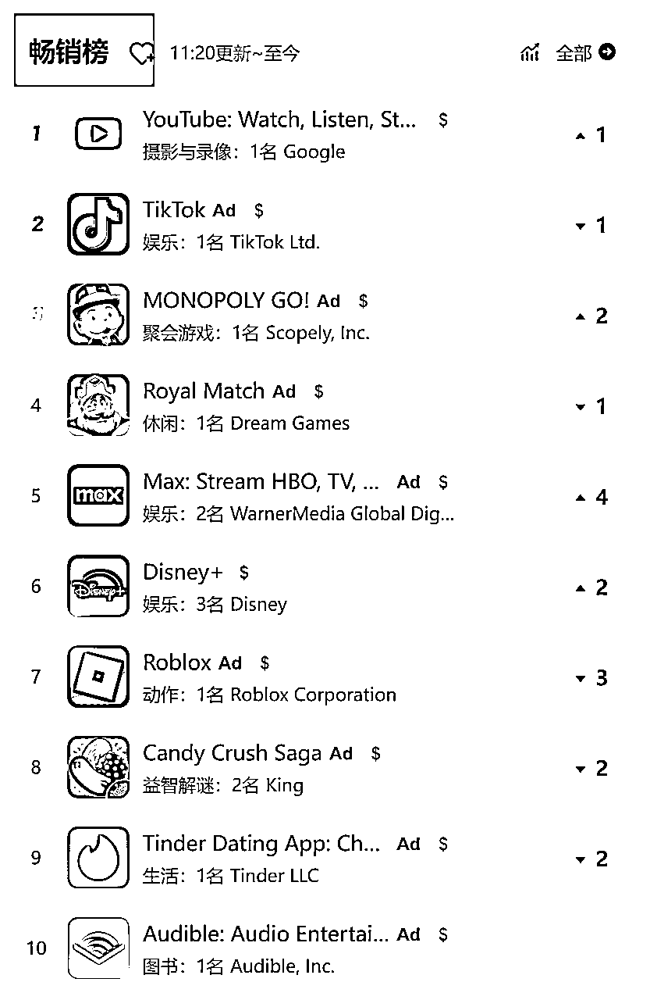

中文常译成畅销榜，容易误解。App Store 本身就是畅销排名，这里又一个畅销，到底指什么？看英文就明白了，Top Grossing，Gross 就是收入的意思，类似电商的 GMV。中文叫收入榜或应用内购榜更准确。

*   统计范围
所有应用，不区分是否免费下载。
*   统计指标
应用内收入，主要是充值、付费道具等。
注意电商类卖实物的应用不在此榜范围内，否则榜单会变成电商榜。
*   重要性
一般。
*   关注范围
Top 10。
*   关注点
除了免费榜的关注点，还可以对比收入榜和免费榜头部变动频率，哪个更动荡。
思考题：哪个应用能在前10里待最久？

# 几个实战案例

1）时间对比看趋势

左图是25年2月中旬美国免费榜 Top 10，右图是24年12月底。变化很明显。
右图第2名是字节系 Lemon8，当时正值 TikTok 禁令传闻发酵，替代品流量扶摇直上。

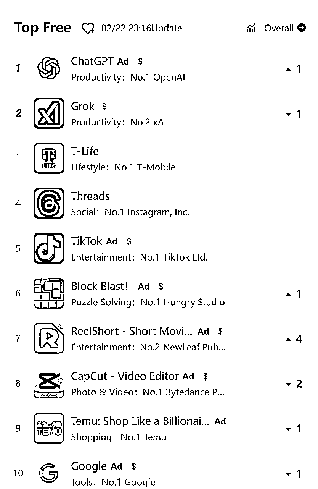

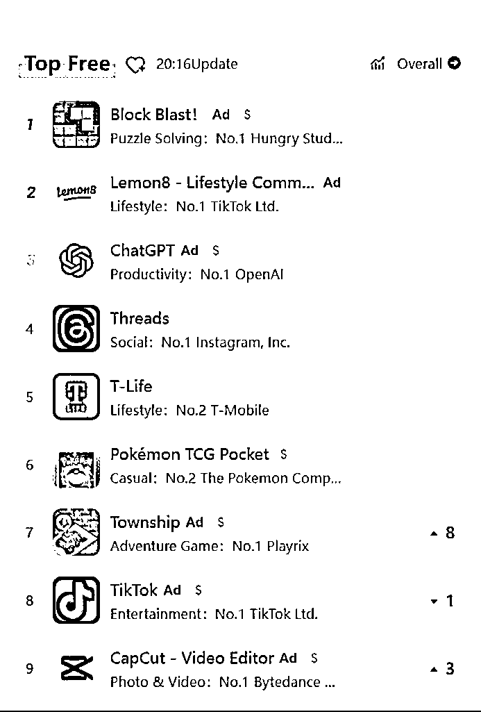

2）Kalshi 为何涨得快掉得快

第一张图，24年11月初，默默无闻的 Kalshi 一跃冲到总榜第1，随后迅速回落。
第二张图，25年2月再度飙升，但最高只到总榜207，又快就消失了。

体量很小的 App 正常根本不会被注意，但11月的表现太突出。我后来持续追踪，结合当时政治和体育新闻，很容易就能推断出上涨原因。

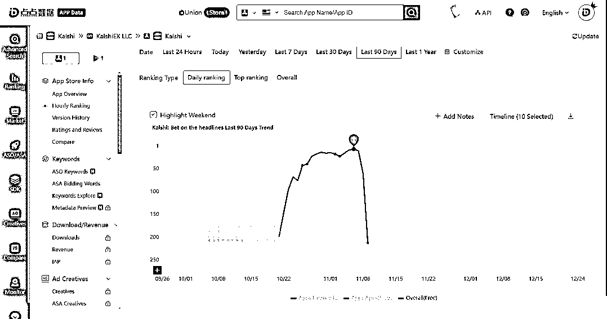

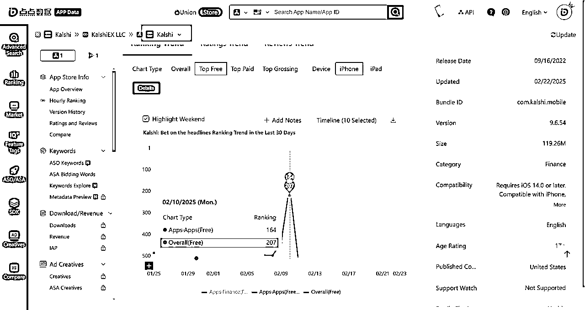

3）Candy Crush Saga：常青三消吸金怪兽

2012年上线，火了十多年，装机量超10亿，几乎没有衰退期。

点进 App 详情页，

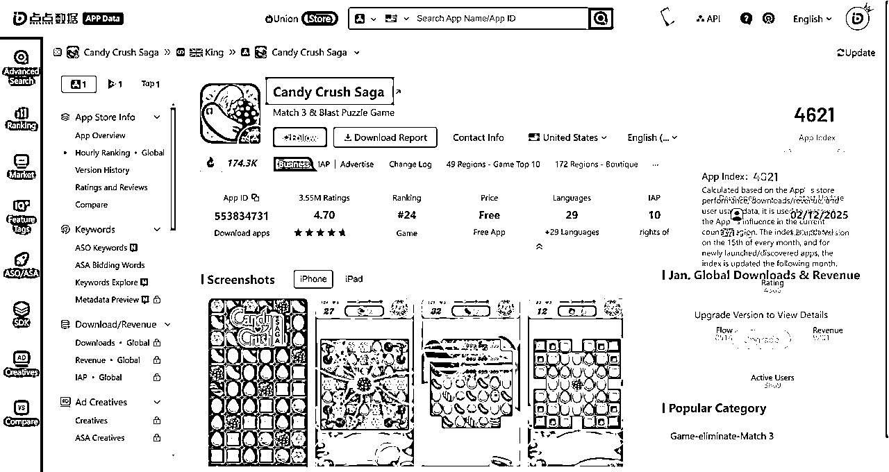

把 Chart Type 设为 Overall，能看到 Overall Free 和 Overall Top Grossing 两个指标。

下载排名171，说明新装不高；收入排名6，说明靠老用户持续变现。运营十多年仍稳在收入榜前十，实力惊人。

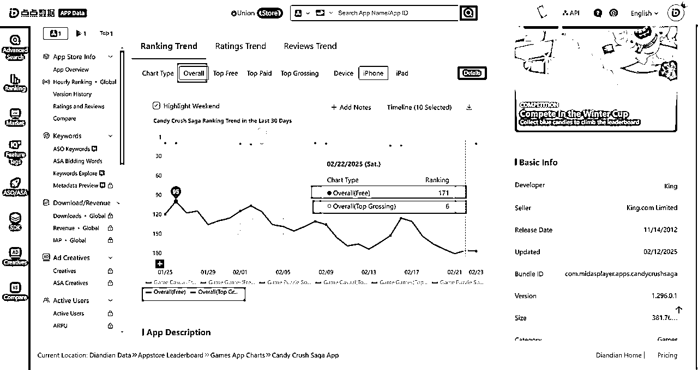

# iOS 榜和 Google Play 榜，到底看哪个

本文聚焦 iOS 榜。海外营销人也需要关注 Google Play，但实践中两者走势差异不大。时间精力有限，单盯 App Store 也足够保持市场敏感度。

国内情况更复杂。国内有系统榜单、手机厂商榜单、小米华为OPPOvivo等、还有第三方渠道榜单应用宝百度360豌豆荚等，数据口径各不相同，很容易让人迷糊，比如一个 App 在 A 榜前3，在 B 榜连前10都没有。

我的经验是，国内用户增长只要看 iOS App Store 榜单即可。之前我负责拉新时出现过现象级增长，我对照了各榜表现，只有 iOS 榜单的波动和我们内部下载趋势高度一致。

小结

如果你觉得以上太细致，只需要记住一件事：免费榜 Top 20 就是海外市场的晴雨表。

作者：梁山

全文完