# 飞书多维表格高级玩法，90%的人都不知道的隐藏功能，保姆级教程！

你敢信吗？像DeepSeek、Kimi这些站在AI浪潮尖上的公司，内部居然都在用飞书。光凭这一点，飞书就绝对值得你花点时间研究一下。

很多人对飞书多维表格的理解，还停留在“表格工具”的层面。说白了，它就是“加强版Excel + 轻量数据库 + 团队协作神器”的结合体。也有人说，它能同时指挥好几个DeepSeek帮你批量写稿，提升效率。但今天我想聊的，不是这些老生常谈。

说实话，我也看了不少关于多维表格的教程，甚至翻过官方文档，但看完依然一头雾水，根本发挥不出它的真实威力。后来干脆自己动手，花了三天时间慢慢折腾，还真挖出了几个让同事直呼“还能这样”的隐藏操作。这篇文章我会把详细步骤全部分享出来，内容比较长，但都是亲手敲出来的，最后一个功能真的强到离谱，请一定看到最后。

飞书官网：https://www.feishu.cn/

进入官网，点开“多维表格”，熟悉的表格界面就出现了。从这一刻起，你的探索就开始了。

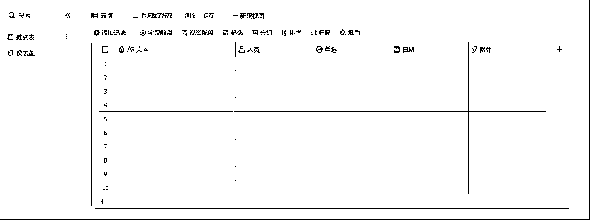

**一、让多个AI模型同时为你打工**

先看个例子：女神节快到了，要给部门每位女生写一段专属祝福。你可能会说，这有什么难的，直接让DeepSeek生成不就行了？但如果我告诉你，你可以同时召唤无数个豆包、无数个DeepSeek、无数个其他AI免费帮你干活呢？

具体怎么做？

**步骤1：** 把第一列的标题改成“小姐姐的姓名”。

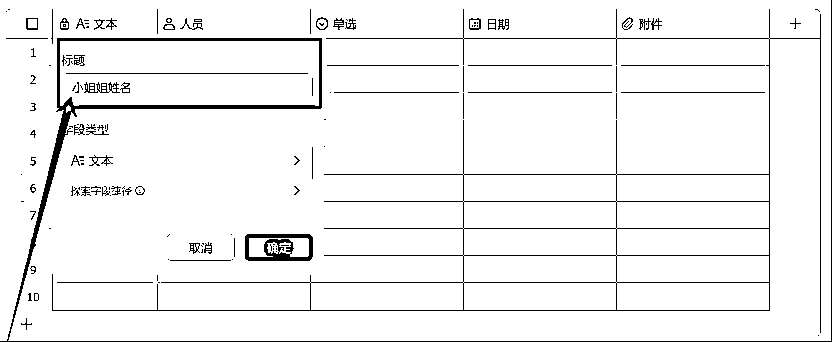

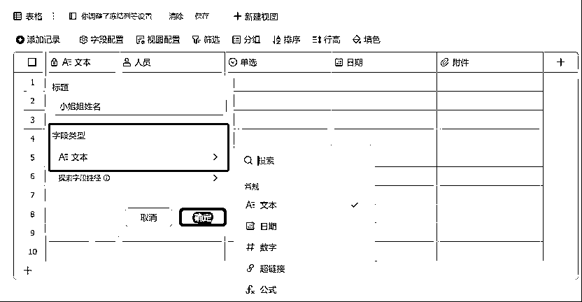

注意，第一列能选的字段类型有限，但从第二列开始，所有字段类型都能选。

**步骤2：** 把字段类型改成“附件”。

**步骤3：** 手动把小姐姐们的姓名和头像导入进来。

**步骤4：** 找到“字段捷径中心”，选择“豆包模型”。

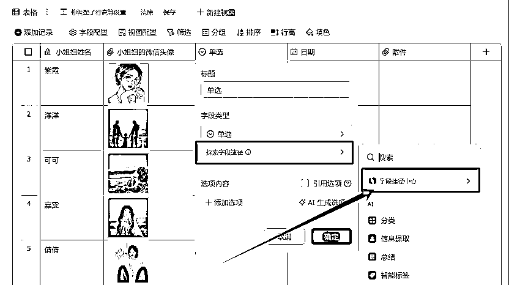

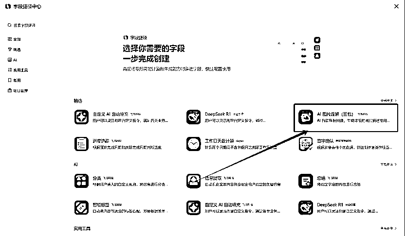

这个中心里有近百款模型，覆盖各种功能，之后你可以按需挑选。

**步骤5：** 选择要关联的列，输入你的指令，打开自动更新，点“确定”生成。

这一步很关键，意思就是告诉豆包：你要干这件事。

几秒钟后，AI会根据头像自动分析出这个人的性格特征。我拿朋友的头像试了试，分析结果准到离谱，我当场笑出声。

**步骤6：** 再加一个字段，调用DeepSeek，让它根据刚才分析出的性格，批量写女神节祝福语。

稍等片刻，一批专属祝福就全部生成了。看效果：

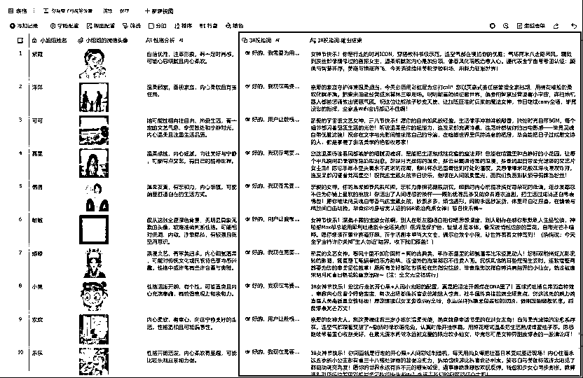

整个过程只要几分钟，你只需要填一点点内容，剩下的全交给AI。

这只是一个具体例子。掌握了方法，你的想象力可以无限扩展——想分析什么，写指令就行。比如帮用户画像、做员工分析、写表白小作文，一键搞定。以后还愁什么恋爱难题？

当然，它的用途远不止谈恋爱，学生管理、客户分析、员工管理都能轻松实现。大胆去探索吧。

**二、让多维表格批量生成图片**

再来看第二个例子：生成24节气主题图。

这里有个小技巧：不用手动输入内容，直接问AI，把AI给的结果复制过来，或者让AI直接输出成表格再导入多维表格就行了。都2026年了，谁还手动录入啊。

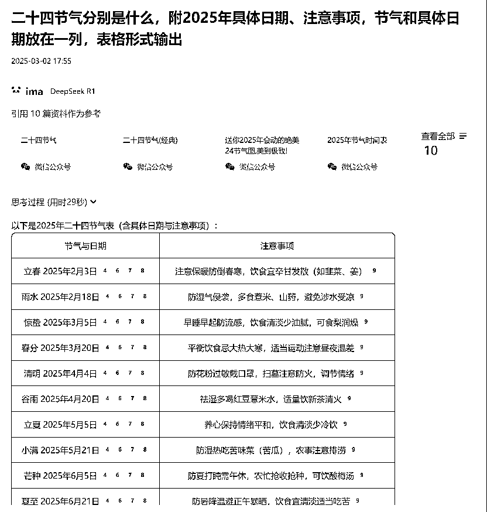

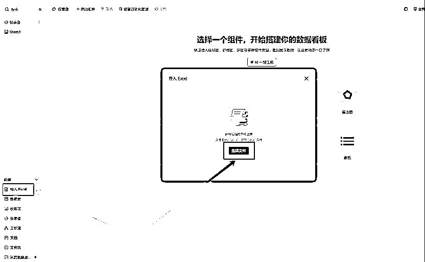

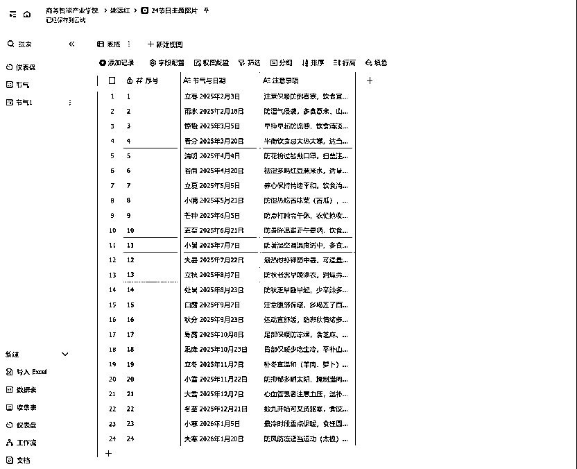

**步骤1：** 调用DeepSeek，让它根据每个节气的特征，写出图片生成提示词。

具体操作和上面一样，就不详细展示了。

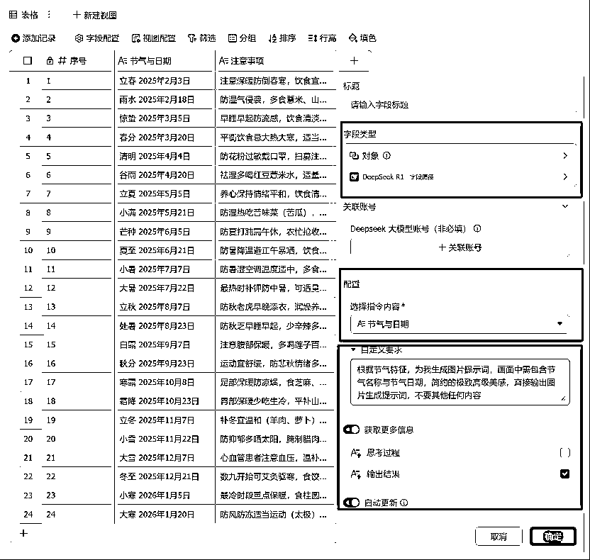

**步骤2：** 调用图片生成模型，开始批量出图。

来看看成果：

图片还支持一键批量下载。

实话实说，目前生成图片的质量比较一般。这跟多维表格无关，也跟DeepSeek无关，问题出在图片模型本身。但如果哪天飞书把自家的即梦模型接入进来，从技术难度来看没有任何障碍，到时候质量会直接起飞。所以大家先记住有这么一个功能。

想想是不是很震撼？以后你只需要提供方向，然后尽管去钓鱼、爬山，后面有一群AI在帮你干活，你直接拿结果就行。这世界，真是魔幻。

**三、仪表盘：多维表格的王者功能**

用多维表格的“仪表盘”，可以搭建十万级数据可视化看板，关键信息由AI自动整理，不需要手工汇总。

来看第三个例子：国内最具潜力的AI上市公司数据分析看板。

**步骤1：** 先把基础表格搞定，分四个小动作：

（1）让DeepSeek整理20家国内最有潜力的AI上市公司。

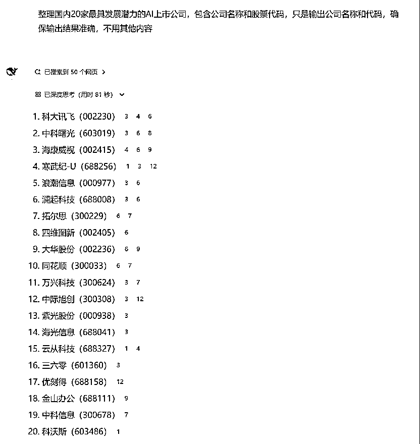

（2）把DeepSeek输出的信息导入多维表格。

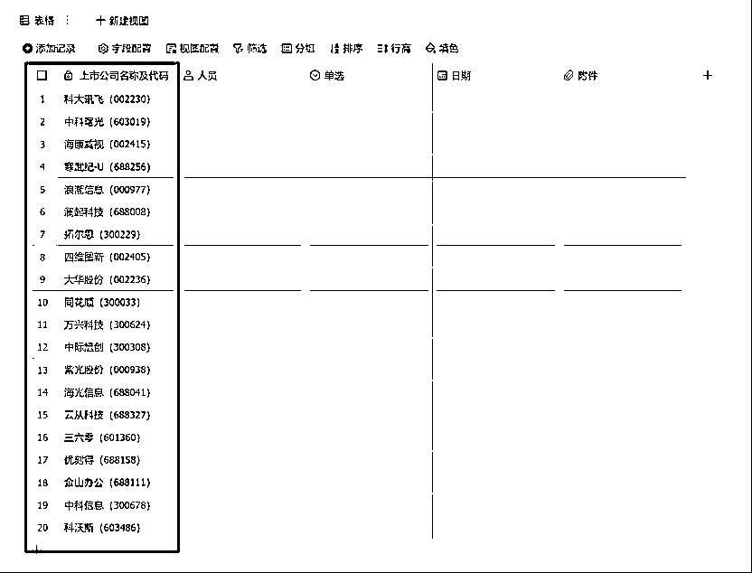

（3）再调用DeepSeek，根据公司名称整理主营业务、市值、营业额、利润、净资产收益率（ROE）等数据。方法一样，过程略过，这些内容全部由DeepSeek整理输出，部分思考过程被隐藏了。

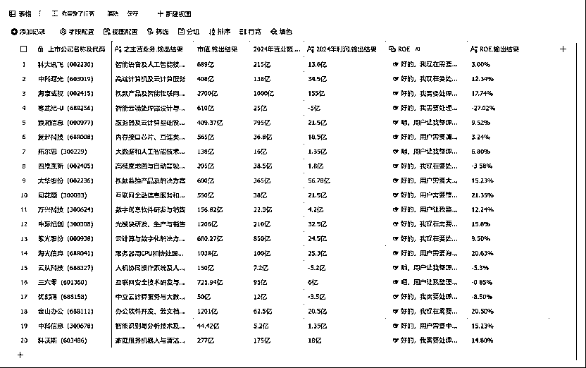

（4）把输出文本结果的字段类型改成“数字”，因为文本没法参与计算。

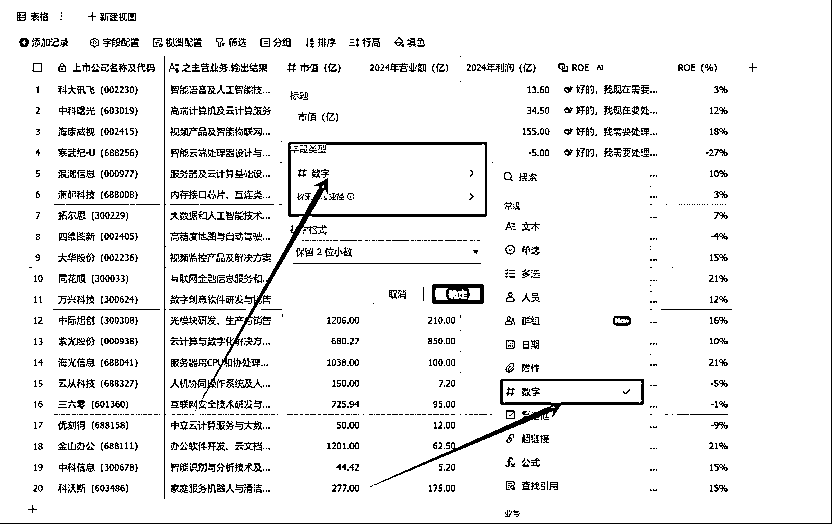

**步骤2：** 打开仪表盘，进入仪表盘界面。

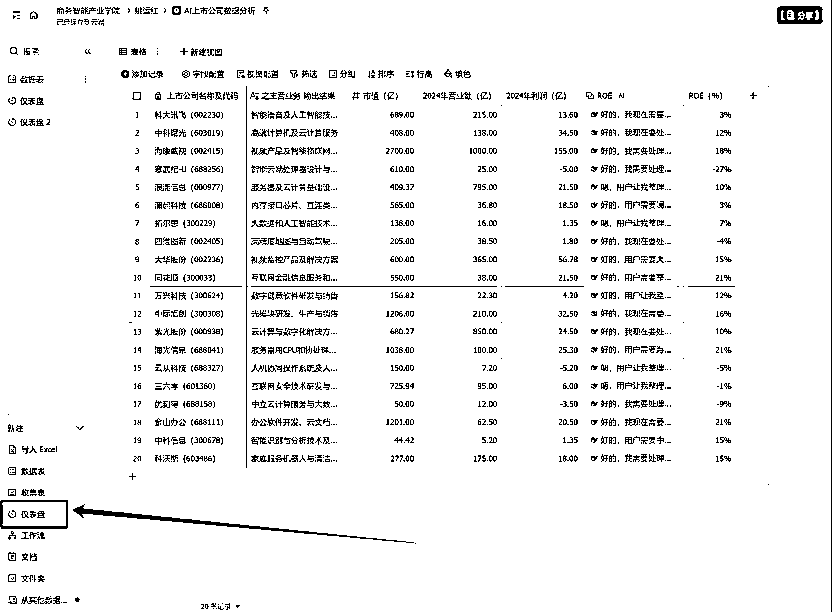

这时候，你就可以自由创建专属看板了，想展示什么、用什么形式展示，完全由你决定。

**步骤3：** 编辑仪表盘。

（1）在横轴和纵轴分别选好想展示的内容，点确定。

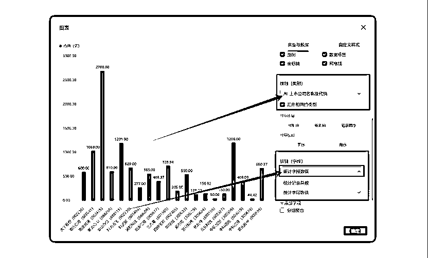

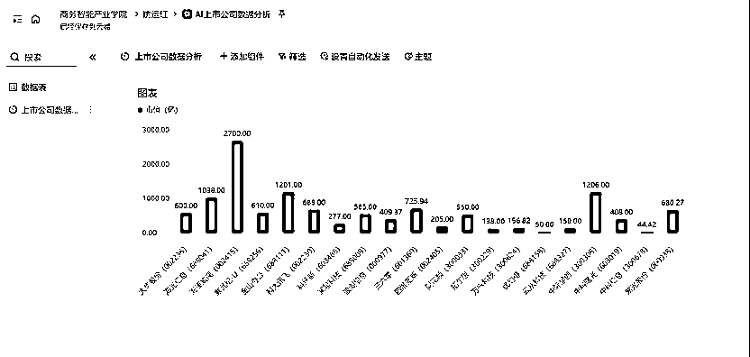

（2）添加其他你想要的组件，步骤同上，不多说。

（3）自由调整组件的大小和位置。

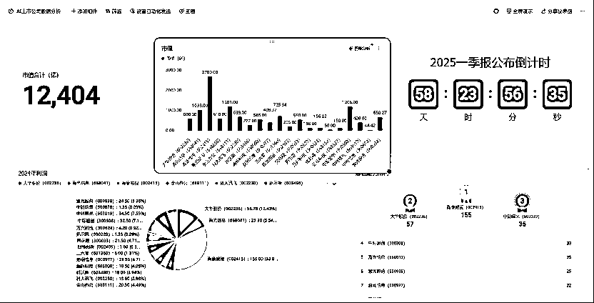

这样，一份最赚钱的AI上市公司动态数据图就完成了。来看成品：

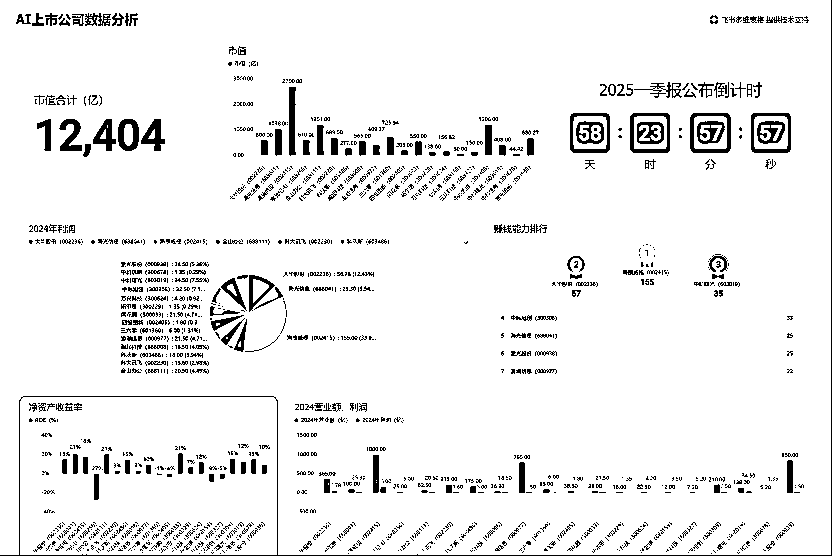

只能说，真的强到离谱。而且上面演示的所有功能，至今全部免费。

以上还只是冰山一角。想想看，哪怕是一个小公司、小工作室，甚至个体户，都能免费搭建自己的经营数据动态看板。

可能有人会问：用WPS不也能做吗？

区别很大：

第一，这里所有展示都是动态的，鼠标指到哪，数据就精准显示到哪。原始表格一旦更新，仪表盘上的所有计算结果会同步刷新。

第二，飞书多维表格整合了自家的表单功能。所有数据都能生成一个表单，你指定的人填写表单后，仪表盘数据会实时更新。

当然，如果你希望不同的人按权限查看或修改原始数据，那就需要开通付费版了。但对普通用户来说，上面这些免费功能已经完全够用。

要知道，搁以前，想搭建这样一套动态数据系统，没个几万块根本拿不下来。现在免费给你用，还有什么理由拒绝？

最后说点掏心窝的话。

AI的发展速度快到让人窒息，往往上一代工具还没学会，新一代产品已经出来了。写到这儿，我背后确实有一阵凉意，焦虑和危机感挥之不去。以后的事情，可能都让AI和会用AI的人做了，那不会用AI的人，又该干什么呢？总不能真等着机器人交税发救济金吧。

换个角度想，过度焦虑毫无意义，还不如乐观点。飞书多维表格已经整合了近百款实用工具，飞书本身就很强大了，现在又融入了DeepSeek和各种AI模型，既然工具已经摆在你面前，连动手学一下都觉得麻烦吗？

今天展示的只是部分玩法，更多功能还需要大家一起去挖掘。不管你是管理者还是普通职员，如果能熟练使用这些工具去解决实际问题，当别人还在和Office、WPS较劲时，你已经能用多维表格向老板展示一套精美的动态数据大屏了。想一想，你不升职加薪，难道老板还能给AI升职加薪吗？

这，就是属于你的AI变现之路。