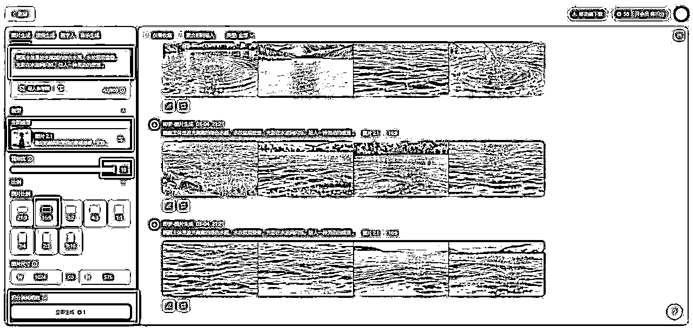
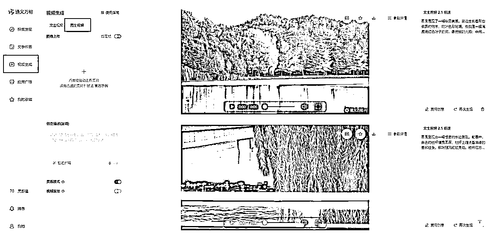
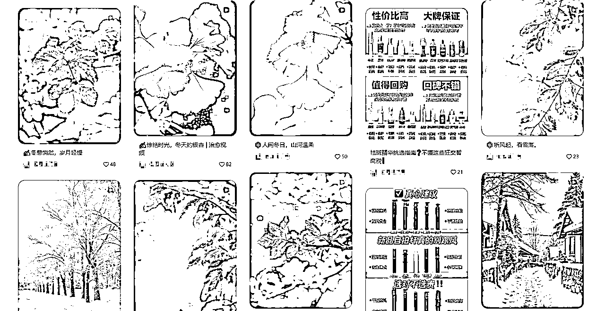

# 5分钟制作治愈风景视频：即梦、通义万相、剪映快速上手

想做出有氛围感的风景空镜，却总觉得流程复杂、软件难学、制作时间太长？

其实，只要准备好即梦、通义万相和剪映这三个工具，按照下面的步骤操作，几分钟就能完成一条具有治愈感的风景视频。更重要的是，这类内容还可以用于账号运营、素材销售和知识付费，创作之余也有机会获得收益。

## 第一步：在即梦制作静态画面

首先打开即梦APP或网页版，进入“生图”功能。

在提示词区域描述你想呈现的场景。例如：

“绿色水面在阳光下泛起细碎波光，水纹一圈圈扩散，光影随波浪轻轻闪动，整体氛围灵动、安静、治愈。”

接着进行参数设置：

- 模型选择“2.1”版本；
- 精细度调整为“10”；
- 画面比例设为“16:9”，方便后续制作横屏视频。

点击生成后，系统通常会一次输出4张图片。挑选最符合预期的一张保存下来即可。

如果画面构图、色彩或氛围不够理想，可以继续修改提示词，多生成几轮，直到得到满意的素材。

## 第二步：利用通义万相让画面动起来

打开通义万相的视频生成功能，选择“图生视频”。

把刚才从即梦保存的图片上传进去。这里不必额外撰写复杂的创意描述，直接沿用默认配置即可。

为了让成片更有氛围，记得开启“灵感模式”和“视频音效”。这样，AI不仅会让静态画面产生动态效果，还会自动匹配相应的背景声音。

点击生成，等待片刻，一条带有动态效果和音效的AI风景空镜就完成了。

为什么推荐通义万相？

即梦同样支持视频生成，但通义万相可以在生成视频的同时自动添加音效，后续不用再花时间单独寻找和制作声音，整体流程更省事。

## 第三步：用剪映完成包装

接下来打开剪映，将通义万相生成的视频导入项目。

如果有多个片段，可以在它们之间加入适合的转场，例如“叠化”，让画面衔接更加柔和，不会显得突兀。

对于音量、背景音乐等内容，也可以在剪映里进一步调整。确认画面和声音都符合预期后，点击导出，并根据发布平台选择合适的分辨率与帧率。

这样，一条安静、舒缓、充满氛围感的治愈系风景视频就制作完成了。

## 这类视频有哪些变现方式？

### 1.运营短视频账号

在抖音、快手发布治愈系风景内容，持续积累粉丝后，可以通过平台分成、品牌广告、直播打赏等方式获得收益。

如果选择在B站发布，也可以参与创作激励计划，根据视频播放表现获得相应收入。

### 2.出售视频素材

可以把制作完成的风景视频上传到视觉中国、包图网等素材平台，根据用户下载情况获得收益。

此外，还能为个人或商家提供定制服务，根据客户需求制作特定主题的治愈系视频，并按照项目收取费用。

### 3.借助社交媒体接单与合作

在📕分享制作好的风景视频，吸引对氛围内容感兴趣的用户和品牌。当账号拥有一定影响力后，可以通过品牌合作、内容推广等方式实现商业变现。

### 4.制作课程或开展教学

如果你已经熟悉这套制作流程，可以将从画面生成、动态制作到剪辑导出的完整步骤整理成课程，在知乎、得到等知识付费平台上架销售。

也可以通过直播讲解风景视频的制作方法，借助观众打赏或课程付费获得收益。

即梦负责生成画面，通义万相负责赋予画面动态和声音，剪映则完成最后的剪辑与输出。三款工具配合使用，操作并不复杂，效率也很高。

现在就动手试试，用几分钟做出属于自己的治愈风景，也许这份安静的内容创作，还能成为新的收入来源。