# 认证门槛降低之后，YouTube 出海窗口怎么抓住？
作者：龙哥

> 这段复盘来自赚钱社群首期 AI 短片陪跑项目，主教练是负责这次实训的人之一。

先交代一下我自己的时间线：去年 11 月上旬，我看到平台放出了一个强信号，于是做了第一条短片；4 个多月后，我所在的教练团队，和 104 位成员一起，完成了 100 多个 YouTube 认证资格的突破。

上周，这期实训正式结营。憋了很久的结果，终于可以拿出来说了。

## 这一期，我们换回了什么

首期从 1 月 16 日开始，到 2 月 28 日结束。104 位成员加入后，70 多人先后拿下 107 个平台认证资格（也就是大家常说的 YPP），算下来人均接近一个。20 多人持有不止一个资格，小芬、九月、茜茜这三位成员，更是在同一个周期里各自拿下了四个。

除了资格数量，我们还攒下了一批可以反复用的内容资产：6 场主题直播、12 场由优秀成员主持的经验分享、17 篇深度复盘，其中 7 篇被选为精华帖。话题覆盖面很广，包括数字人表演、动物预警、动物叙事、旁白解说、叙事号、中长内容等，基本上都是当下 AI 短片圈里正在起风的方向。

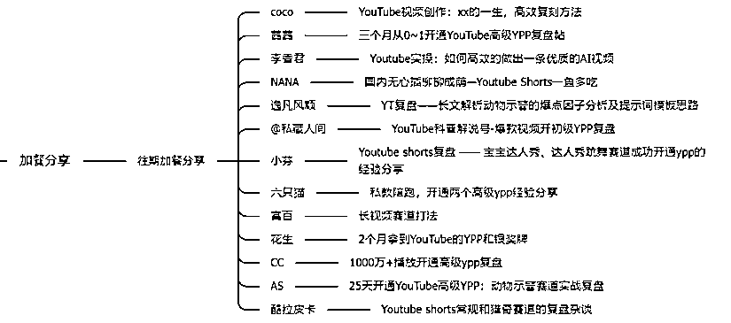

收入方面，一个月的训练周期确实不太可能直接放大回报：平台审核要花时间，多数人又都集中在 AI 内容方向，所以账面并不夸张。不过已经有几位成员靠着认证权限拿到了几百美元分成，也有成员把 YouTube 视频同步到🛰️短视频，单条作品换回接近 3 千元人民币。

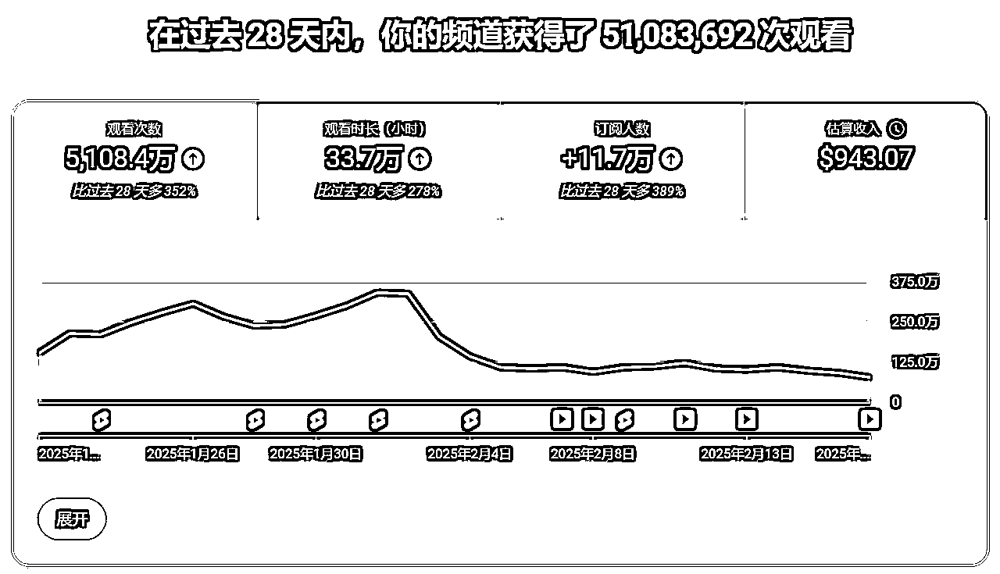

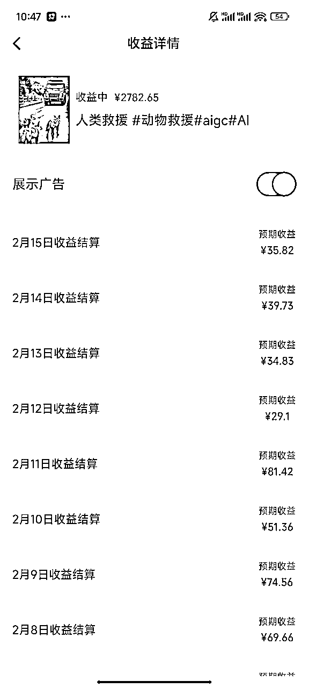

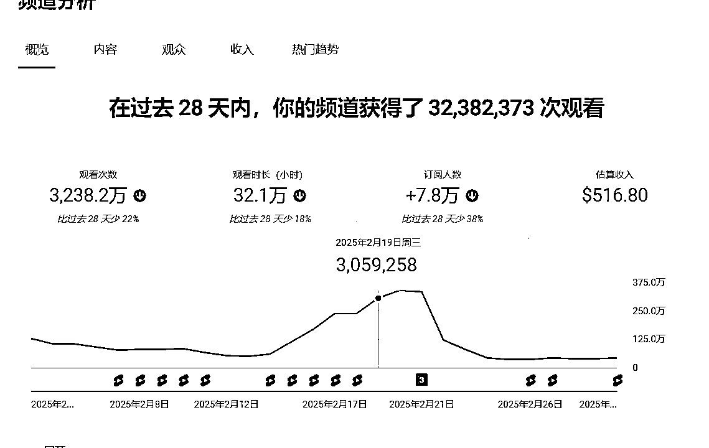

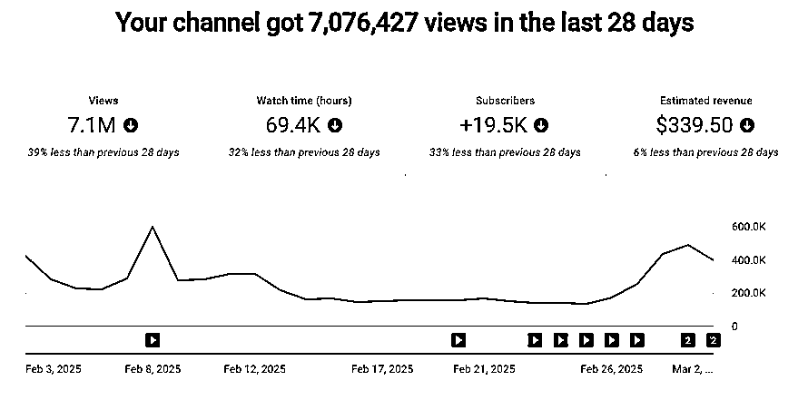

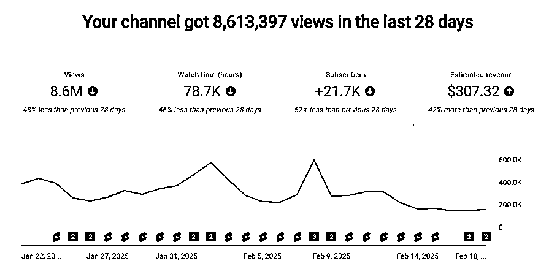

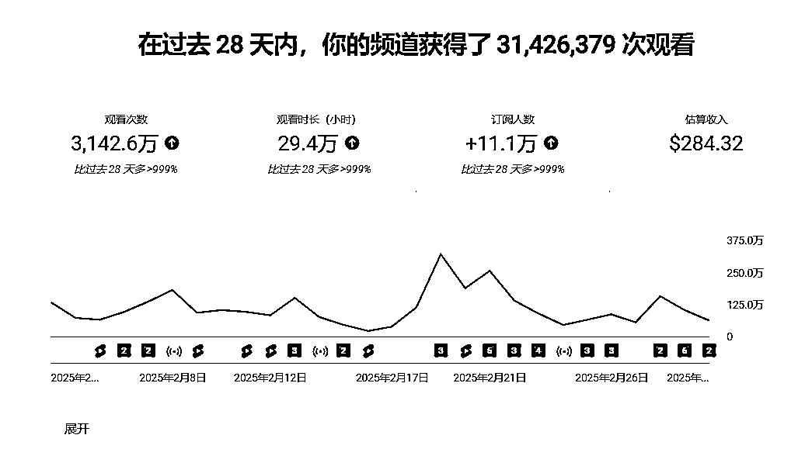

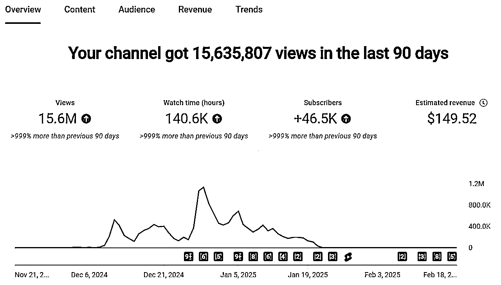

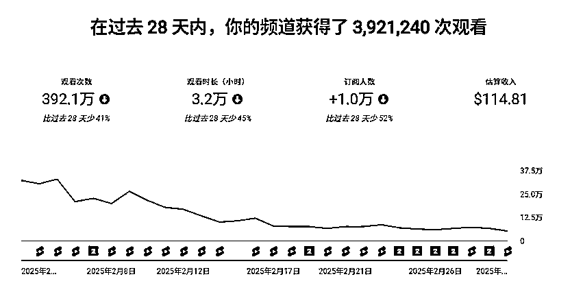

回看这三组结果，其实已经超过了我们最初写下的“100 个认证”目标。为什么能做到？下面按时间线拆开讲。

## 第一阶段：先把出发点校准（第 1—14 天）

报名的基本信息填得五花八门，真正看下来，和我想象中的“已经会做视频的人”差距不小。

当时最常见的问题有几种：

- 已经在一个降温的题材里坚持更新，播放量长期停在三位数；
- 一个人同时维护五六个账号，结果每个都没有正向反馈；
- 方向和参考样本都还行，但每天都在换对标，始终没有自己的判断。

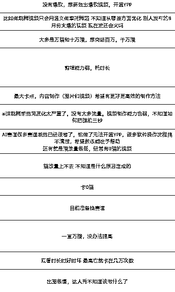

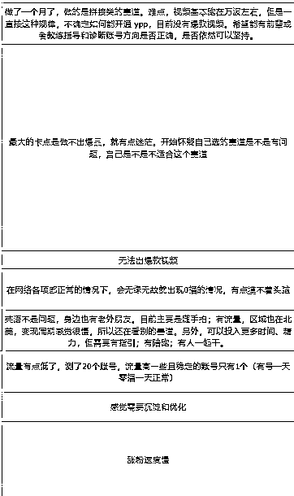

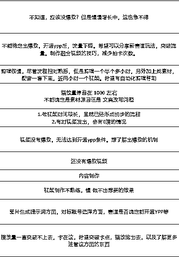

所以我们做的第一件事，不是再教一遍工具怎么用，而是先把认知掰回正确的轨道。

### 第一步，选对还在上升期的方向

AI 短内容的周期非常短。工具一旦更新、观众胃口一变，之前的爆款套路就会快速失效。航海手册里收录过的宠物跳舞、萌娃时装，素材完成度很高，但到大家批量上手时，流量已经过了最热的阶段，继续闷头做下去很容易没有水花。

当然，旧题材也不是完全没有机会。关键看能不能做出新变体。小芬后来把萌娃时装改造成达人秀，就是一次很聪明的延伸。

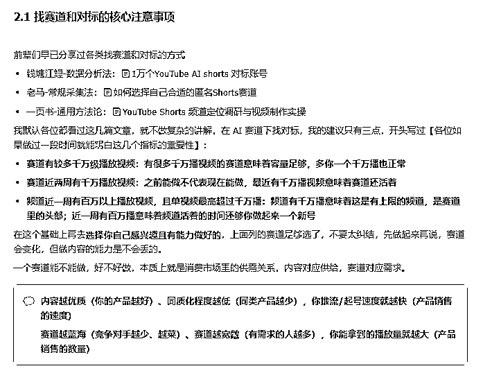

开营第一讲，我们直接把筛选后的结果给到所有人：近 10 个还在增长期的细分方向，30 多个有参考价值的对标账号。这样做，既减少大家走弯路的概率，也避免 100 个人同时涌进同一个赛道互相消耗。

### 第二步，学会“有效复刻”

方向选对之后，真正动手又会遇到新门槛：太难的做不出来，太容易的又没有流量。针对不同基础的人，我们准备的解法也不一样。

基础比较弱的成员，可以从门槛相对低、但潜力并不小的方向入手。比如动物预警，方向公布后的第二天就上线了完整教程，很多之前连动物叙事都做不出来的成员，因为这一招先拿到了第一批稳定过万的播放。

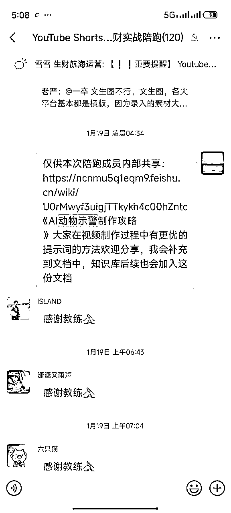

基础较强的成员，我们则提供更花心思、也更接近当前流量喜好的制作方案。平时收集到的操作难点，会在手册、直播和一对一沟通里逐个解答，尽量让成片和普通 AI 模板拉开差距。

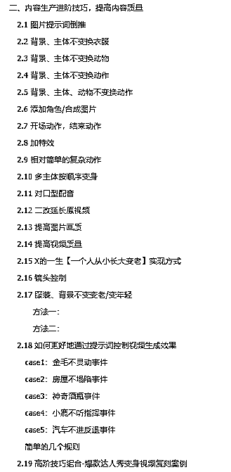

不管处于哪个水平，都绕不开一条底线：复刻不是照搬，更不是垫着别人的画面直接生成。尤其不要用即梦这类工具做图生图式的仿制，版权风险和账号风险都很高。

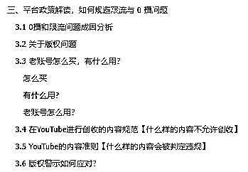

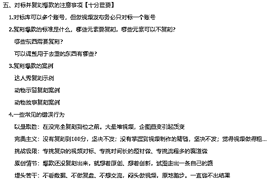

### 第三步，把更新变成一场数据实验

刚做 YouTube 的人，最常问的问题无非是：要更新多久才会被推流？什么样的数据才算健康？

经过大量账号和作品的实际对照，我们推演出了一套更适合 AI 短片赛道的判断方式：

- 先看作品被刷到之后的持续观看意愿；
- 再看整条片子的播放完成情况。

不同题材之间没有统一标准，所以我们还单独建了分赛道的数据参照表，把一部分百万播放、千万播放账号的内容互动记录拉出来，方便每个人判断自己处在什么水位、该改哪一个环节。

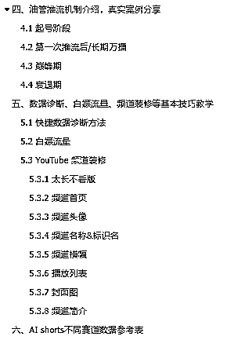

如果你现在也卡在“数据一动不动”的状态里，我的建议很朴素：方向没有大问题，就给自己预留 15 到 25 天的观察期，别在第 10 天放弃。数据有波动时，先查开头能不能留住人，再查中段是不是节奏拖沓，然后继续做小改动、小验证。

## 第二阶段：从跟随者，变成有方法论的人（第 15—25 天）

这个阶段，我把“成功”的门槛定义为：单条视频播放量突破百万。

能达到这个数字，说明你已经能够比较完整地还原热门内容的结构，或者已经在一板一眼的模仿之外，做出了自己的变化。

但蓝海也不会一直蓝。当越来越多人进入同一条赛道，千篇一律的做法就会快速失效，视频卡在几万播放上不去。第一阶段的重点是学会“形”，第二阶段的重点，是理解“神”。

为了让方法论真正落到每个人手里，我们做了一件很关键的事：请已经跑出结果的成员来做分享。

这些人的内容不是理论推演，而是自己一步一步试出来的。同赛道的人只要听到其中一位分享，就能迅速补上信息差，再结合自己的情况，迭代出更适合自己的打法。

至于“轻创新”，多数时候并不是推翻重来，而是把一支爆款拆成可以重组的零件：

- 角色设定
- 情绪触发点
- 视觉反差
- 叙事节奏
- 结尾钩子

有人看中的是人物关系，有人关注的是画面冲击力，也有人只在意情绪转折。只要重组之后的成果能稳定拿到更好的数据，它就不再是模仿，而是属于你个人的方法。

NaNa、小芬、逸凡，都是这样试出结果的：

@NaNa

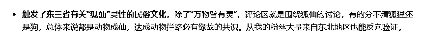

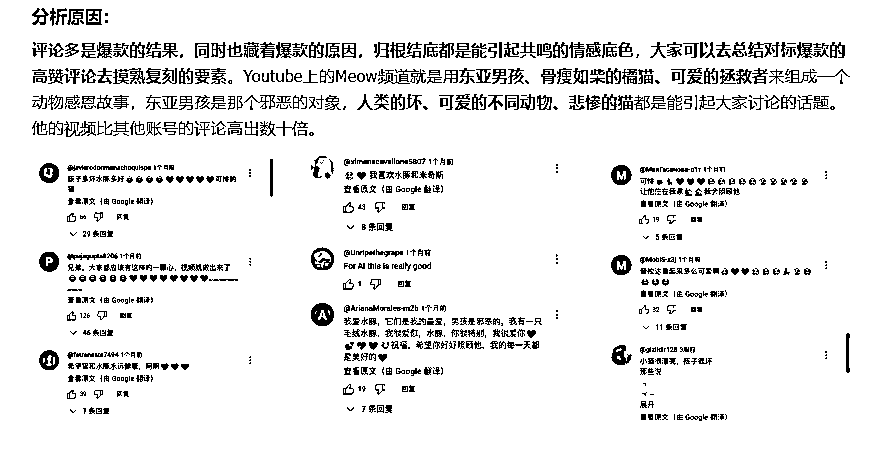

@小芬

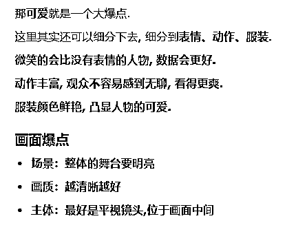

@逸凡

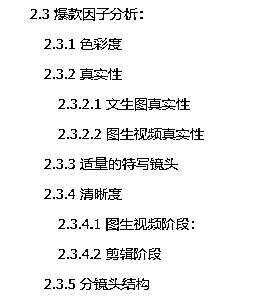

我不能替每个人指出唯一的答案，但可以尽量缩短你去找到答案的时间。

## 第三阶段：让认证成为起点，而不是终点（第 25—44 天）

在这个阶段，平台审核成了最关键的一关。我的教练搭档和社群里的志愿者伙伴做了很多支持工作，搭了一套“材料预审 + 人工复核”的机制，帮 20 多位被驳回的成员重新准备复议材料，大约 80% 的人一次就通过了。具体操作步骤，可以在知识星球的置顶内容里找到。

认证不再是大瓶颈之后，目标自然切换到两件事：一是让认证数量继续往上走，二是跑通更多可以复制和放大的收入路径。

光靠两位教练，精力远远不够。于是我们邀请首批完成认证的 20 多位成员，组成了 6 个共创小组：

1. 规模化组：探索多账号并行、标准化产出的方式；
2. 中长内容组：尝试 AI 做成完整的中长片；
3. 直播电商组：和 TikTok 侧联动，测试多类商品的短视频与直播带货；
4. 新题材组：持续挖掘下一波可能爆发的方向；
5. 音乐授权组：把解说号、故事号的收益与音乐版权合作叠加；
6. 联盟营销组：申请接入多个推荐分成平台。

不到 20 天，各组的实验就有了超出预期的结果：

- 规模化组新增 29 个认证资格；
- 中长内容组做出一条 5 分钟全 AI 成片，跑出 1.9 万播放和 20 美元广告分成，目前还在持续获得推荐；
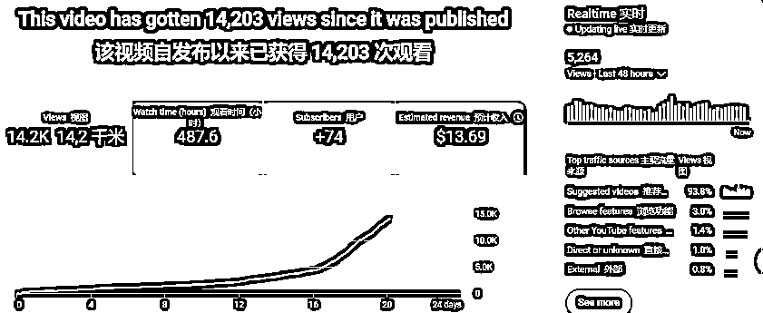

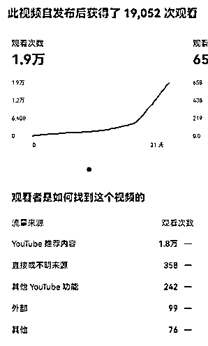

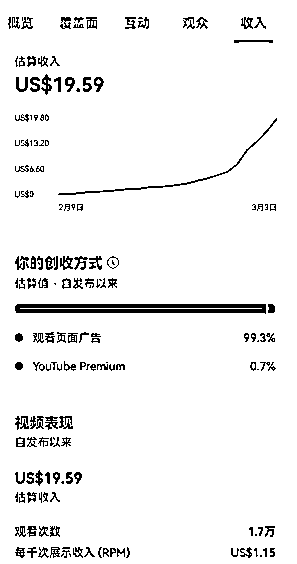

- 直播电商组已经试过多个产品类目的带货方案；
- 新题材组找出 10 多个近期值得押注的方向，其中两条测试片分别拿到 700 万和 300 万播放；
- 音乐授权组把叙事号的内容收益与音乐合作结合起来，实现每万次播放约 3 美元的收入；
- 联盟营销组成功接入多家合作平台。

这些结果不是来自我的推动，而是厉害的人聚在一起之后，自然长出来的。我们做的只是给出方向、资源和信任。

## 下一步：洋流已经到了，要不要上船

前阵子在社群里看到一位同行立下的目标，我的第一反应是：目标定得还是太保守了。当然，这只是半句玩笑。

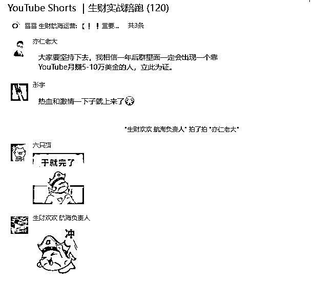

还有一组很有意思的搜索热度数据：YouTube 作为全球头号内容平台，在国内的热度，只有 TikTok 和海外电商业务量的约二十分之一。

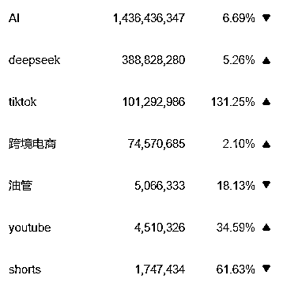

这组数据说明的不是差距，而是机会：平台本身足够大，国内长期投入的人又足够少。过去，认证门槛挡住了绝大多数人；现在，门槛低到普通创作者也能够得着，接下来几年，这个赛道里的参与者和获利者都会迅速变多。

我去年 11 月上旬才第一次走上这条路，那时觉得认证要求的播放量遥不可及。不到 5 个月，团队已经带着大家做出 100 多个认证资格。如果当初换一个已经完全内卷的项目，我也许不会这么快被看到；但如果换另一位执行力强的伙伴来做这件事，我相信他同样能拿到结果。这就是 AI 工具叠加平台早期红利所带来的机会。

认证不是终局，只是一张入场券。真正值得期待的是，拿到券之后，商业化的大门才开始一扇扇打开：

- YouTube 自带的商品推广功能；
- 逐渐成熟的直播商业化；
- 音乐版权合作的接单机会；
- 中长内容带来的广告分成。

拿带货来对比：TikTok 带货现在的势头，很像国内短视频电商当年的上升期；YouTube 带货还没怎么被关注，又像早几年的🛰️短视频带货。谁先把这条链路跑通，10 个认证就是 10 倍的试验样本，100 个认证就是 100 倍的放大空间，1000 个认证就意味着 1000 次试错和迭代的机会。这个机会不只属于内容作者，也属于所有想在海外做出品牌的人。

首期实训已经证明：普通人完全可以通过系统训练，快速拿下 YouTube 入场券。那下一步，自然是从入场走向深度经营。

所以，我们决定把一个新计划正式公开。它不会像首期那样，只盯着“认证资格”这一座山头，而是把认证当作第一站，把更多资源压在更长期的事情上：让更多账号稳定产出、让更多商业路径被验证、让已经有效的经验可以被规模化复制。

我依然会和教练搭档一起，以服务者与同路人的身份，出现在每一次咨询、每一个小组、每一场复盘里。

如果你也想在一个增量充足的平台里找到自己的位置，现在就是动手研究它的好时候。

报名入口：https://sourl.cn/ByHuXY

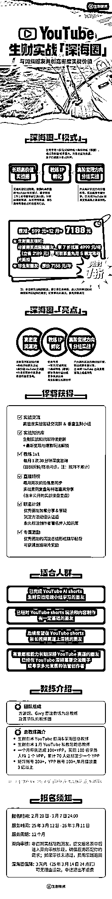