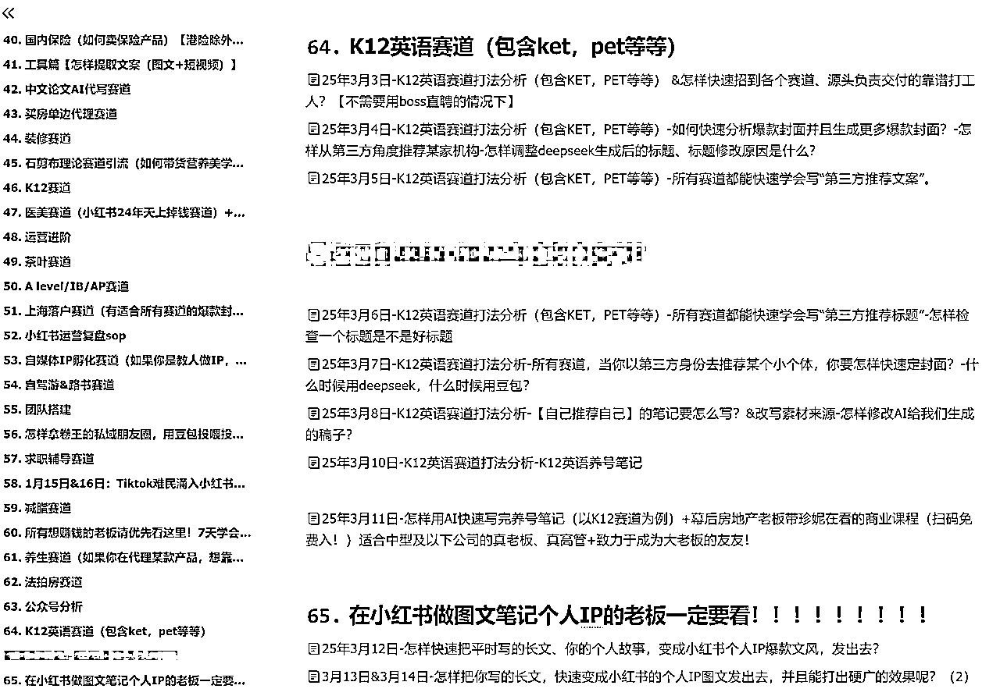
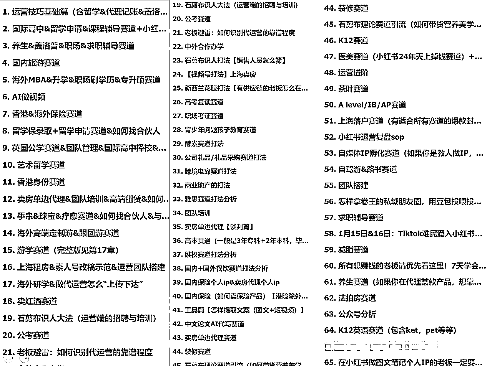
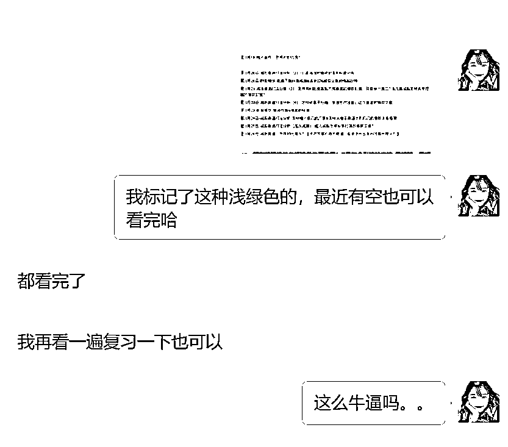

# 老板避雷手册5：红书运营用人的完整避坑路径
作者：龙哥

我是龙哥。靠1500块钱起步，留学和房产两个方向都碰过，既做自己的项目，也接其他公司的代运营，拿得出手的案例还算有一些。

去年那版《老板避雷手册》被龙哥盟邀请去做过直播。这一年我面试的人比之前多得多，雷区也踩得更多。最大的感受是：很多生意做不大，问题往往不在后端的培养，而在前端就招错了人。人一旦不对，后面怎么管都像在填坑。

现在有老板来找我做平台运营内训，我会先反问一句：你手底下的人现在是什么状态？然后我会给一份清单，告诉他：哪种人可以收，哪种人碰都不能碰。有一部分人招进来再花钱培训，基本等于打水漂。他们既不会自己迭代，也干不满一个月随时可能跑路，你的投入就是直接损耗。

这篇我按三条线来说：怎么省钱招人，怎么精准筛人，怎么把日常成本压住。

## 一、省钱招人，先换思路

### 1. 换平台，从“我去找”变成“等我发现”

很多经营者一提招人，想到的就是那几个招聘App、招聘👸号，或者是各种群聊里蹭免费资源。这些路我都走过，后来发现真正零成本的办法是反向操作：不主动去搜人，而是让目标人群自己找上门。

2023年我判断留学赛道未来几年会走下坡，哪怕那年做到了1100万营收，也照样在到处折腾、测试新方向，同时给不少留学细分领域的从业者送客资。

我当时在红书发了一条很粗糙的帖，大意是：我的留学生客资多到消化不完，求留学行业的经营者来帮我分担。这条帖子的视觉非常简陋，比团队日常内容差太多了。但因为利益足够直接，发出去一天，我没留🛰️号，全靠帖子里藏着的线索，几十个留学行业的老板、负责人、渠道方主动加了过来。

我让他们把业务方向、签约转化率、核心团队构成、能给多少返佣，全部自己报一遍。然后我挑了一部分人送客资，剩下的人问起来，我就说已经有稳定合作方了。

后来我又用同一招，筛过独立化妆师、独立剪辑师。等以后孩子长大了要请家教，我也打算这么干。

### 2. 扩渠道，把转介绍变成长期机制

早期我还没想出上面那招，用的还是传统办法：买招人公告位，400块投一次。为了省钱，我会给已经在职的大学生发红包，请他们把招人信息转到学校内网、班级群、朋友圈这类地方。每成功带来一个人，并且对方干满一个月过了试用期，我会再给大学生发一笔提成。

我还会顺便问一句：你是从哪个渠道看到公告的？有人回答是某个👸号。我这才发现，当时花400块买的广告，平台方还替我转发到了另一个小渠道。如果跳过中间商直接联系那个小渠道，发布一次只要20块。所以后来预算紧张时，我就只花20块去发。

### 3. 换地区，用好城市间的成本差

2024年7月之前我在长沙，之后搬到了深圳。两个城市同样岗位的用人成本差得非常多。长沙是我的创业起点，也算稀里糊涂拿到了一张低成本好牌。

我在长沙招人时，基础工资开得不高，线上协作，收入主要靠业绩提成。但我心里清楚谁在真正付出。遇到干得好的人，我会在月底或年底私下转一个大红包，用这种突然出现的惊喜，留住想一起往前走的人。

那段时间我主要用三类人：

第一类是有主业、只来兼差的，社保成本省了，而且对方想做好副业，积极性通常很高。

第二类是把我这边当主业的人，学历从大专到一本都有，多数来自偏远地区。这类人我会重点带，往操盘手方向培养。

第三类是家境不错、孩子已经上初中的，她们不缺钱，就是想找份线上事做。我会多给管理、行政类工作，少安排运营执行。

所有招人公告里，我都会加一句：线上协作、免会议、免考勤。所以我不需要买任何曝光卡，每天主动来投的人已经很多了。还有一部分细节不方便公开讲，感兴趣的老板可以私下找我聊。

## 二、精准筛人，看细节更要看本质

### 1. 先笔试后面试，用流程卡掉不靠谱的人

很多人招运营还是老路线：先看简历，再聊天，最后笔试。我完全反过来。简历可以包装得很漂亮，但执行层面的能力骗不了人。我招的是冲在一线干活的人，不是来当管理层的人。所以越是在简历上写得天花乱坠、实际动手能力差的人，越不适合。

我不看简历，一上来先设关卡。应聘者在招聘App上找我聊天，我不会正面回复，只给一个邮箱线索，让对方按规定投递资料。要求很简单：邮件标题写成“学校＋姓名＋手机号”，简历转成PDF，自我介绍不超过200字。

这一步筛掉很多人。细心的人会照着要求做，粗心的人会发Word文档、漏掉学校、自我介绍写一千多字。对不太细心的候选人，我会快速用石剪布理论判断下属性，觉得还能用就给🛰️，太马虎就直接不回。

笔试前我会问对方：你预计几点能交？有人说下午6点，我会把截止时间定在晚上8点。很多人习惯高估自己的速度，原本担心的事，果然到了8点还没交。过了宽限时间还交不出来，那就不是我要找的人。一线做执行的人必须守时、能扛事。不同岗位用不同标准，抓大放小就好。

笔试过了，我才会回头认真看简历、谈薪资。前20篇笔记算试用期，写通过的人再转成长期合作。

### 2. 看MBTI，判断能不能沉下心

我统计过公司里运营表现好的人，MBTI里有几个共同点，具体是哪个维度不方便展开，想知道的可以私聊。但有一个结论可以直接说：缺了J特质，很难长期做好一线执行。

另外，运营要管账号、盯后台、回私信，这需要坐得住的人。I型人更适合这样的工作节奏，E型人更想出门社交，适合去做销售，让他们整天守着手机，反而会别扭。

如果老板就是看中了一个E型人怎么办？可以安排I型人来管账号和回复，E型人负责写稿出内容。但如果让E型人去回复后台私信，那就等于看着亏损发生。

### 3. 看盖洛普，观察执行板块的排位

盖洛普测评里，执行板块排在第一、第二的人，适合做一线运营。排到第三、第四，就说明这个人更适合做幕后协调或管理。

我自己的经历就很能说明问题。2021年2月，创业还没起来，我的执行板块排在第三，那时候月收入天花板也就1.8万。

到了2023年9月，创业到现在，执行板块被现实磨到了第二，战略思维也进步了一些。

现在已经25年，我不再测了。比起关注测评数据，我更关心今天做了什么事、有没有给别人创造价值。相关书籍里提到，责任、专注、信仰、成就这几项天赋进前10的人，执行板块都不会弱。更细的内容大家自己找书看。

### 4. 观察🛰️沟通风格，提前避开内耗型

一个人刚加上HR的🛰️，如果第一反应是连环提问、反问HR，那他不适合做运营，更适合去做进攻性强的销售。运营要能做到指哪打哪，先执行再提问题。

还有人刚加🛰️就问公司有没有营业执照、你们是不是骗子、会不会画饼。这类人往往是典型的精神消耗型。成年人偶尔被坑一次很正常，但如果每次都在说自己被骗、被画饼，那大概率是他自身的选择出了问题。对着刚认识的HR倒苦水，再反问一句“你们该不会也这样吧”，这是典型的交情太浅却掏心窝，要赶紧避开。

还有一类人，发消息不分段、不空行、不加标点，一大片字直接砸过来。这通常说明共情能力比较弱，而共情能力恰恰是做内容的基本功。

### 5. 用小单子，识别“奖惩倒挂”的人

当一群人被初步筛出来之后，还会遇到一个隐蔽的问题：有的人你给他越多钱和资源，他对你越上心，这类人可以重用。有的人你给得越多，他反而越无所谓，甚至开始偷懒，这类人就是奖惩倒挂。

我遇到过一个人，干活看起来很认真，我给的报酬也比市场价高，本想长期合作。结果他把活外包出去，自己不再把关质量。每次都要我来发现问题，他态度很好，说改就改，但同样的错误反复出现。遇到这样的人，我会先开始找替补，找到合适的人之后，马上结束合作。

怎么提前发现这种人？方法很简单：初期给一个小任务，让回报明显高于他的预期。比如一个活正常值10块，我给40块，看他知不知道自己是多得了。知道的人，下次接活会更有冲劲。不知道的人，会把我的好当成理所当然，慢慢开始躺平偷懒。等合作结束时，他反而会抱怨是我耽误了他的时间。

我不会当面拆穿，只会平和地说一句：你没问题，是我这边有些难处。但在心里，我会把这个人从合作名单上划掉。创业最怕人不对，用几十上百块的成本提前测出风险，比在大项目上踩坑划算太多了。

## 三、管好成本，让用人不烧钱

### 1. 做一套可以反复使用的培训资料

新来一个人，我就要重新培训一次吗？员工不会自我迭代怎么办？老员工踩过的坑，新员工继续踩怎么办？这些问题我都经历过，也被耽误过很多时间。

到2024年初，我意识到了：就算写出一套傻瓜式操作手册，也不够用。因为矩阵打法一直在变，说换就能换吗？很难。大部分运营人员都搞不定打法迭代，包括以前的我。打法一旦失效，平台不给量，流量成本变高，最后就会亏钱。

运营新人进来以后，我会告诉他们：先看哪份资料，再看哪份资料。

如果有人在具体环节反复犯错，我会回一句：去查资料。如果我从外部发现了适合我们赛道的打法，我会直接转发给运营，说：明天把这个复制过来，套到房产赛道。

这套动作极大减少了带教成本。之前有个大学生，花了不到三个月把我更新了一年多的内容全部看完，很快就顺利上手。

### 2. 把写稿的人分成两类

不是每个人都擅长写内容，不是每个人都能做到天赋值80分。但业务要跑量，就需要让只有40分的人，也能发挥出60分的价值，靠数量堆积出效果。

所以，先分清楚两类人：核心写手和非核心写手。核心写手负责产出有灵魂的原创内容，非核心写手负责用AI工具改编核心写手写出来的爆款。这样一来，带人成本立刻降下来，内容数量也不会断。

核心写手要用心带，除了教平台玩法，还要教一些看人用人的思路。这些内容以后有机会再展开。

### 3. 提前做好封面模板

我们平台的封面模板，一般会让配图同事提前做成可画模板，其他人只需要复制副本来改字就能用。

2024年我每周更新六次内容，拆解了不少行业的爆款封面，对哪种封面能火已经有了判断。我也清楚：这个行业的封面可以搬到那个行业，但可能没法搬到第三个行业。

提前把不合适的封面淘汰掉，能少做很多无用功，也能省下团队不少精力。

### 4. 用云端设备降低硬成本

我们有一位开发同事搭了套云端设备系统，用来降低设备投入。以后铺大量素人号，不用再买一堆手机、配一堆手机号。目前这套系统还在测试中，感兴趣的可以留意后续分享。

## 四、写在后面

感谢龙哥盟这个平台。因为在这里发帖，我认识了带我做项目的各位经营者，他们来自不同的高单价行业。通过代运营，我对这些行业有了更深的了解，也拿到了不错的分成。

感谢所有给过我机会的行业前辈。我原本只蹲在留学赛道，如今因为你们，看见了更多可能性，也找到了不同行业之间相通的流量和转化逻辑。

感谢一起接代运营的伙伴们。只靠我一个人、一个内部团队，体量始终有限。正因为有人同行，我们才能接住更多项目，路也越走越宽。

希望这篇内容，能帮你在招人、筛人、用人的路上少踩几个坑。