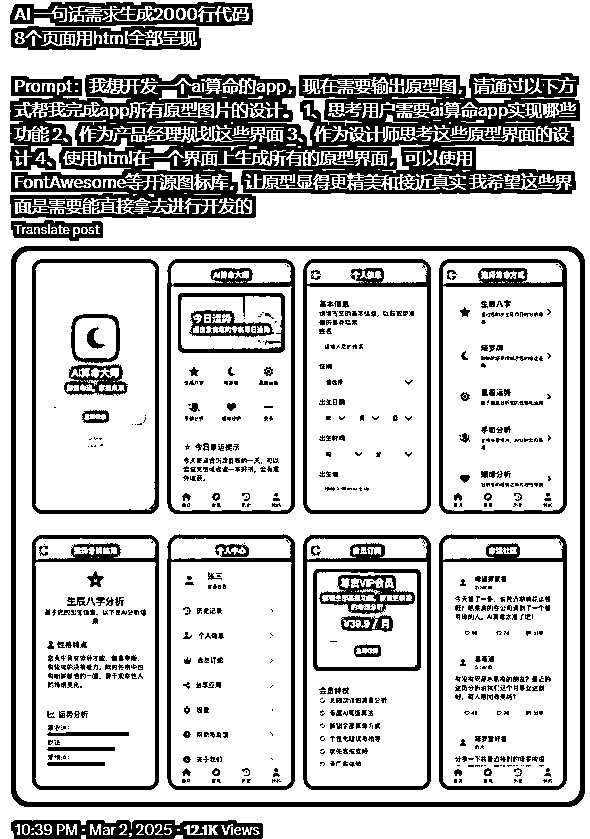
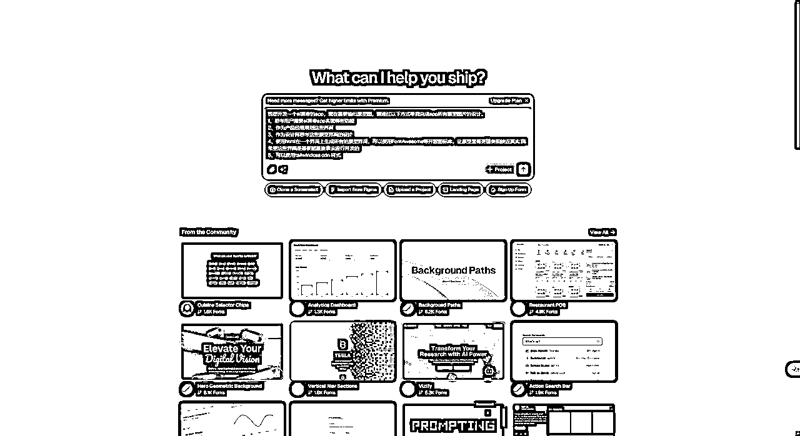
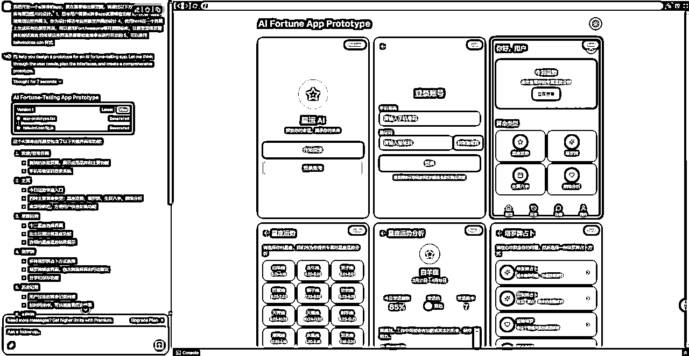

# 不用写前端，用 V0 也能搞定产品原型和 UI，AI 编程太省心了

事情的起因特别简单：刷 X 的时候刷到一条帖子，有位老哥直接用 Cursor + Claude 3.7 就干出了一个 App 的原型图和整套 UI，看得我心痒痒。



心想这事儿我也能试试啊，于是转头就拿 V0 来验一验。我准备的提示词是这样的：

```
我想开发一个ai算命的app，现在需要输出原型图，请通过以下方式帮我完成app所有原型图片的设计。
1、思考用户需要ai算命app实现哪些功能 
2、作为产品经理规划这些界面 
3、作为设计师思考这些原型界面的设计 
4、使用html在一个界面上生成所有的原型界面，可以使用FontAwesome等开源图标库，让原型显得更精美和接近真实 我希望这些界面是需要能直接拿去进行开发的 
5、可以使用tailwindcss cdn 样式
```

工具嘛，用的就是 Vercel 家的 v0，打开网页就能开工：



把提示词丢进去，敲下回车，然后就盯着屏幕等它慢慢把原型画出来。



出来的成品确实没让人失望，页面质感在线，交互流转也做得顺滑自然。

不过嘛，后来我又连着试了好几轮，发现大多数情况下生成的都是单页，不像头一回那样把所有页面整整齐齐地摊在同一屏里展示。


但转念一想，单页好像也够用了。

反正工具就在那儿，感兴趣的话，强烈建议你亲自上手鼓捣一下。