# 用 DeepSeek 搭建📕内容流水线


## 一、做出更吸睛的📕标题

### 1. 先准备好模型

AI 工具很多，关键是找到自己用着顺手的。

目前实测下来，腾讯元宝里的满血版 DeepSeek 反应比较快，输出也相对稳定。

入口：https://yuanbao.tencent.com（非商业推广）

打开后，将默认模型切换为 DeepSeek。需要更强的推理能力时，可以开启深度思考；联网搜索建议先关掉，避免结果被外部信息带偏。

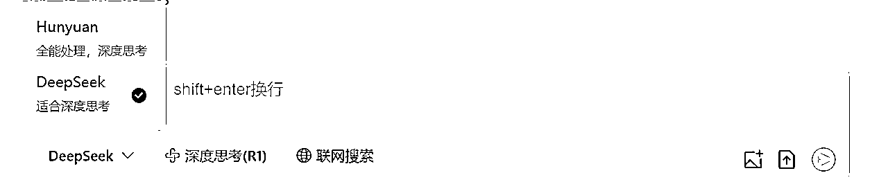

### 2. 先设定工作身份

不要一上来就让模型“随便写几个标题”，先告诉它负责什么、要遵守哪些规则。

可以直接发送：

> 我正在运营一个📕账号。接下来，请你担任📕高点击标题策划师。我会通过“请学习”的方式告诉你标题创作规律。理解后，请回复“学会了”。
>
> 学习完成后，我会提供一个主题词。请结合刚才掌握的方法，从多个切入点设计若干标题。若明白，请回复：“好的，没问题，我已经准备好学习新知识，并会在之后根据主题词完成标题创作。”

## 实操：

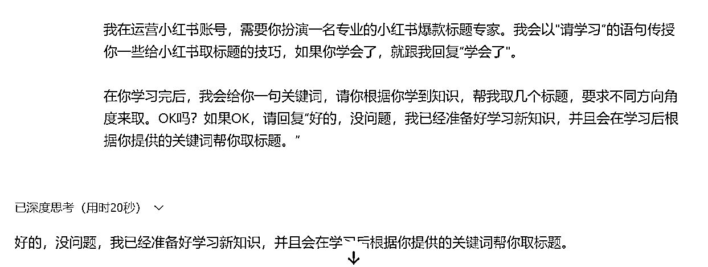

### 3. 用优质样本喂给模型

准备几份表现不错的标题资料，让模型观察其中的吸引力来源，包括冲突感、情绪张力、利益点和表达方式。

提示词可以这样写：

> 下面有四份高表现标题资料。请分析它们为什么容易吸引点击，并总结可迁移的写法。完成后，请根据我之后提供的主题，从不同角度进行延展创作。理解后回复“学会了”。

## 文档：

## 实操：

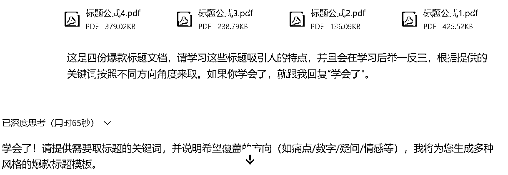

### 4. 输入主题词开始创作

例如：

> 主题：AI与📕

## 实操：

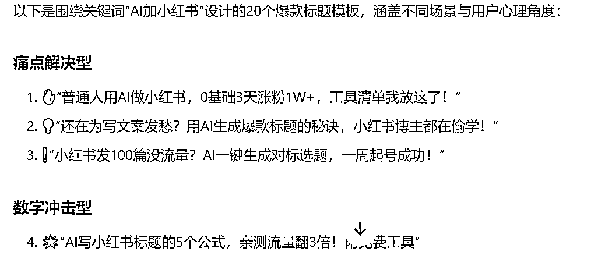

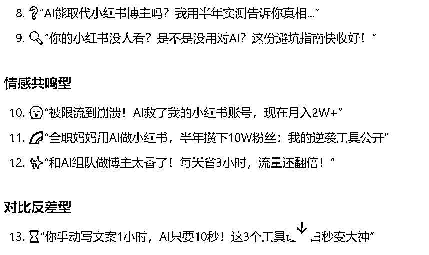

### 5. 通过追问继续打磨

初次结果不一定完全符合发布要求。遇到标题过长、方向不对、情绪不足时，直接指出问题即可。

例如：

> 这批标题方向基本可以，但长度偏长。请将每条压缩到20字以内，并增加几条偏情绪共鸣的版本。重复或不符合账号调性的角度可以删掉。

还可以继续补充具体偏好，比如：

- 更突出省钱效果
- 多写新手痛点
- 减少夸张语气
- 增加反差感
- 重点突出实用方法

## 实操：

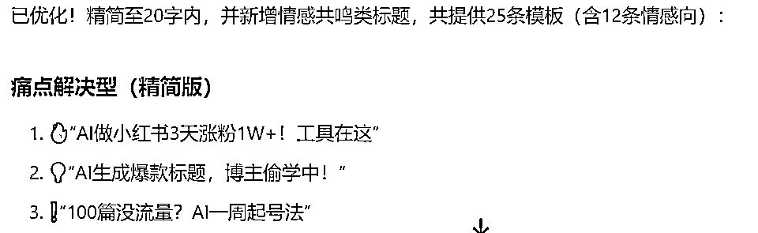

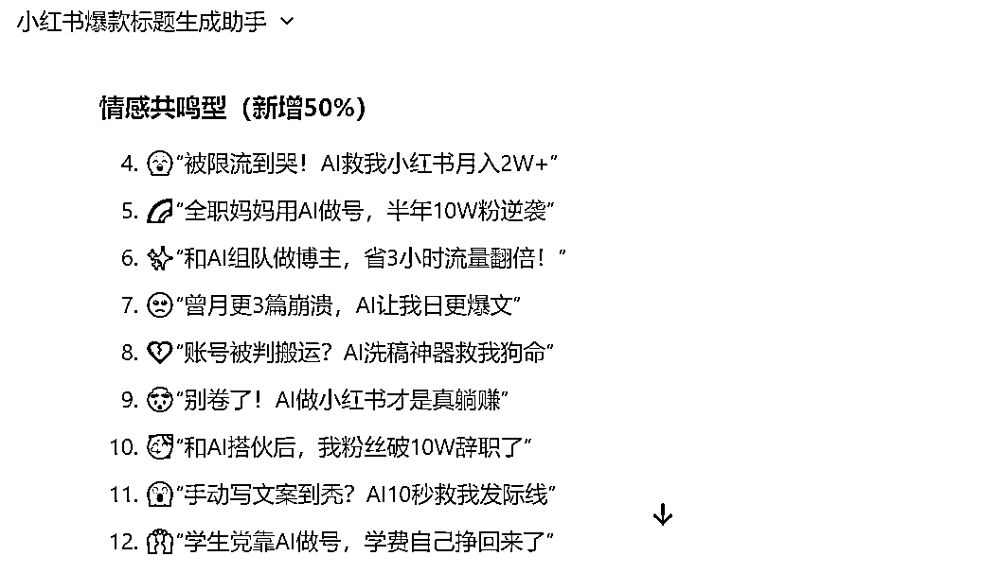

### 换一个主题继续测试

后面只需发送新的主题词，模型就能沿用前面建立的规则继续产出。

不过，AI给出的内容仍建议人工筛选。标题是否适合账号定位、是否符合真实体验，最终还要自己把关。

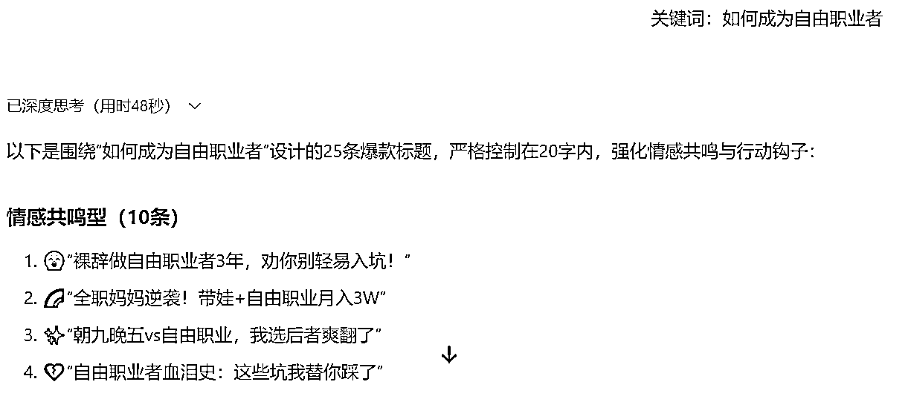

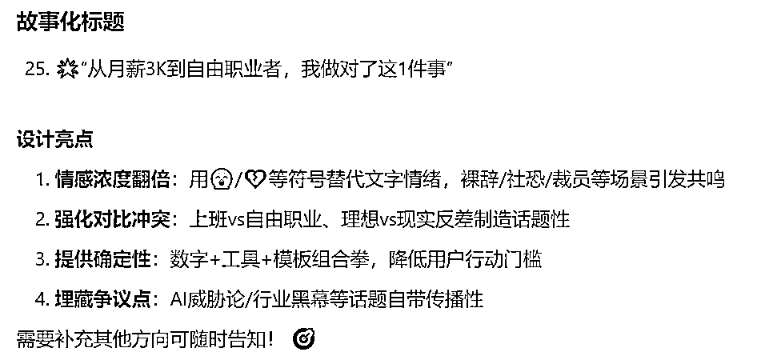

### 给对话做好标记

建议将这条对话改名，例如“标题灵感库”，并设置置顶。

这样以后换主题时，不用重新解释规则，打开对话就能接着用。

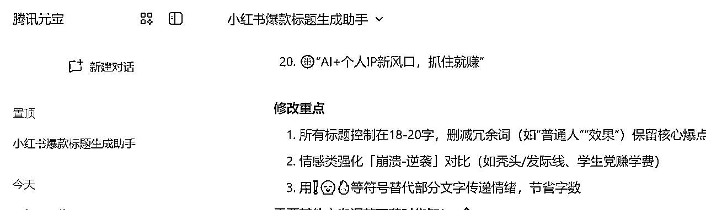

---

## 二、让 DeepSeek 写出完整📕笔记

### 1. 先建立内容写作角色

#### 第一版提示词

可以先让模型熟悉以下写作方向：

1. 表达像真人聊天，少用模板化套话。
2. 加入情绪和共鸣，让读者产生代入感。
3. 适当使用反直觉观点，制造阅读兴趣。
4. 内容尽可能落到细节，例如预算、耗时、真实对话等。
5. 通过短段落、换行、少量表情增强阅读节奏。

然后补充任务要求：

> 学习完成后，我会发送一个选题。请依据这些规则写一篇不超过1000字的📕笔记。在我给出选题之前，不要提前创作，只需回复：“好的，没问题，我已准备好接收选题。”

## 实操选题：洗碗机选购

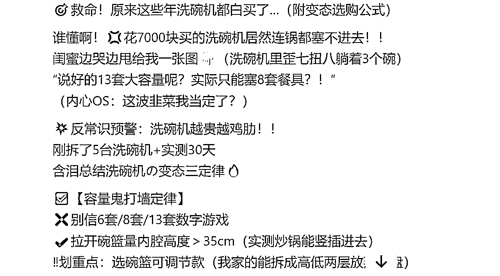

第一版通常会出现两个问题：心理活动太密集，括号和画面说明太多。

如果想拿到可以直接发布的正文，就要继续收紧限制。

#### 第二版提示词

> 我正在运营📕账号，请你担任生活消费类内容作者。
>
> 写作时请遵守：
>
> 1. 用自然、口语化的表达，避免固定模板。
> 2. 情绪要真实，不能反复使用同一个感叹词。
> 3. 可以加入反常识观点，但必须服务于主题。
> 4. 多写可验证的细节，例如金额、周期、使用场景。
> 5. 只输出正文，不要添加批注、写作说明或画面安排。
> 6. 不提供拍摄和配图方案。
> 7. 标题不超过20字，可搭配少量表情符号。
> 8. 正文要包含可执行的选择建议和常见误区。
>
> 收到选题后，再开始写作；在此之前只回复：“好的，没问题，我已准备好接收选题。”

## 实操选题：洗碗机选购

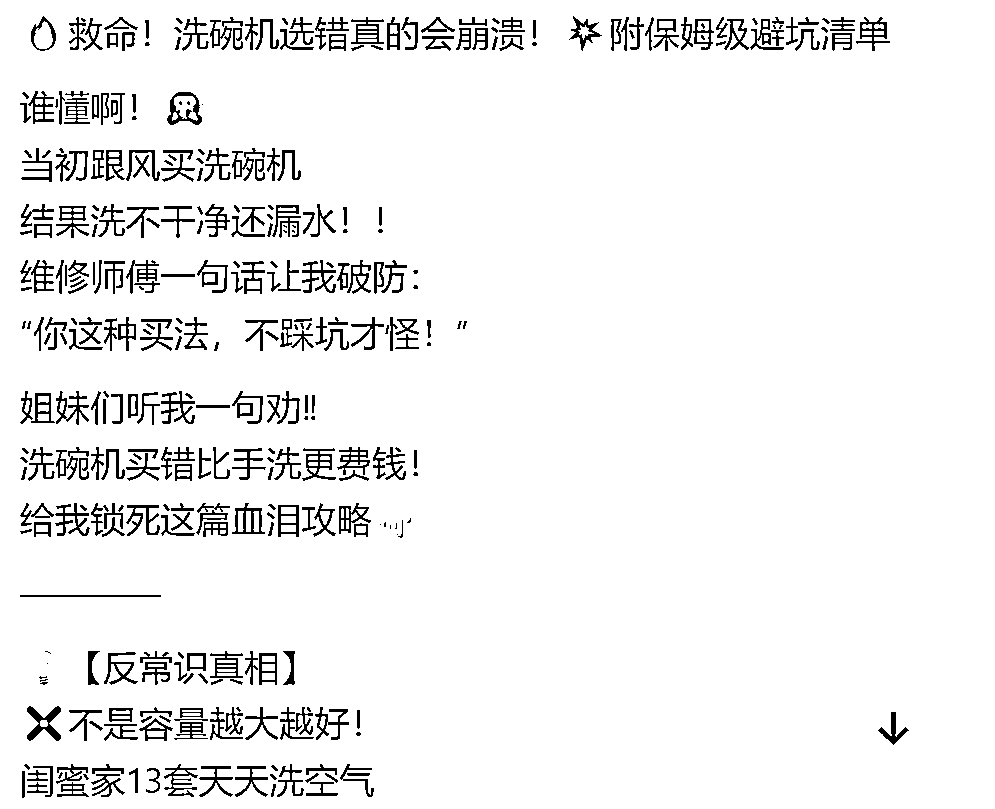

如果模型习惯性重复某个感叹词，或者标题依旧超长，可以进一步加上硬性格式。

#### 第三版提示词

> 请先掌握以下内容方向：清单盘点、产品测评、知识解释、消费避雷、操作教学、购买指南。
>
> 写作规则如下：
>
> 1. 语言像朋友分享亲身经历，不要写成说明书。
> 2. 情绪表达要多样化，避免反复使用固定口头禅。
> 3. 标题最多15个字，必须围绕“表情符号＋情绪表达＋主题重点”展开。
> 4. 只交付可直接发布的正文，不添加括号批注或段落标签。
> 5. 不出现任何引导读者看图片的词语。
> 6. 每段控制在5行以内，适度换行并少量加入表情符号。
> 7. 全文控制在800字以内。
>
> 未收到选题前，只需回复：“好的，没问题，我已准备好接收选题。”

## 实操选题：洗衣机选购

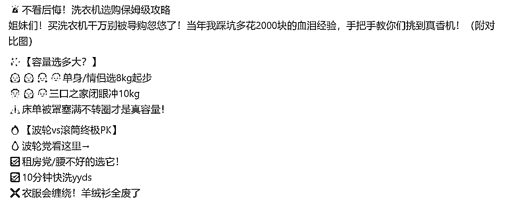

## 再试一题：怎么买冰箱

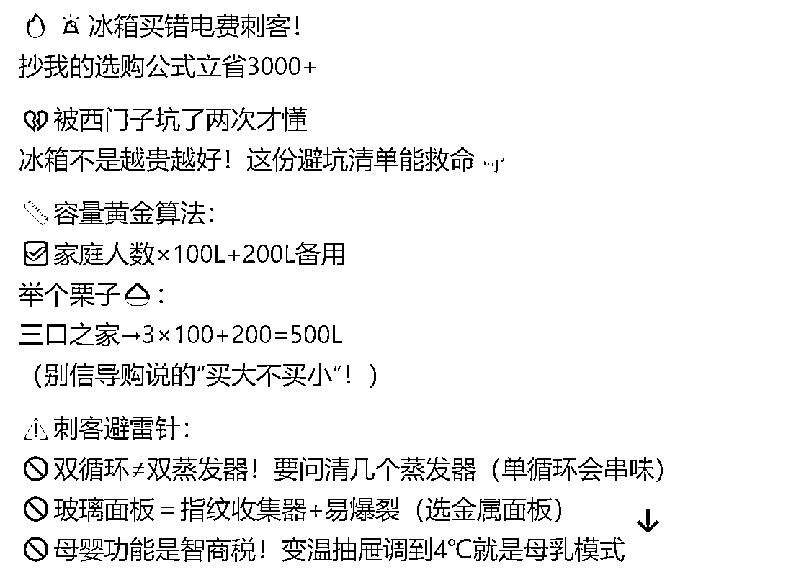

这套规则已经能让成稿更接近平台内容风格，但发布前仍建议根据自己的语气、经历和产品信息做一次人工调整。

### 2. 命名并固定这条对话

将对话改成“生活好物笔记助手”之类的名称，并置顶保存。

之后发送“选题：……”即可继续调用。

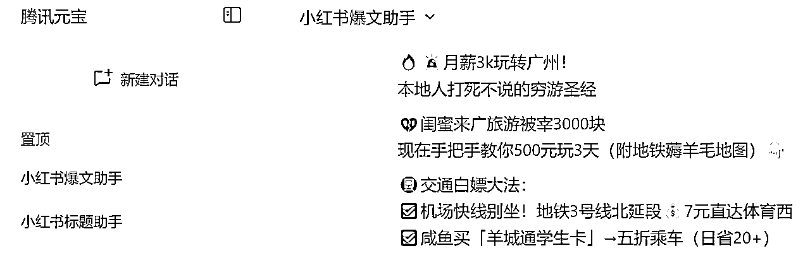

---

## 三、把现有内容改写成全新笔记

### 1. 建立二次创作助手

#### 第一版提示词

> 我正在运营📕账号。请担任内容重构编辑，负责将参考笔记改写成表达独立、结构不同的新版本。
>
> 改写时可以采用这些方式：
>
> - 更换词语，但不能改变原本含义
> - 补充原文已有信息中的具体层次
> - 调整语序和句型
> - 把肯定表达改成另一种说法
> - 拆分或合并句子
> - 根据读者习惯转换表达风格
>
> 具体要求：
>
> 1. 不照搬原文的段落顺序。
> 2. 不改变事实，不凭空增加信息。
> 3. 尽量更换措辞、视角和叙述方式。
> 4. 主动句、被动句、长短句交替使用。
> 5. 《》中的书名，以及双引号“”里的示例必须保留。
> 6. 人名、地点、数字、日期、政策、金额、型号等专有内容不得遗漏。
> 7. 成稿控制在1000字以内。
>
> 没有收到原文前，只需回复：“好的，没问题，我已准备好接收文案。”

## 实操原文：

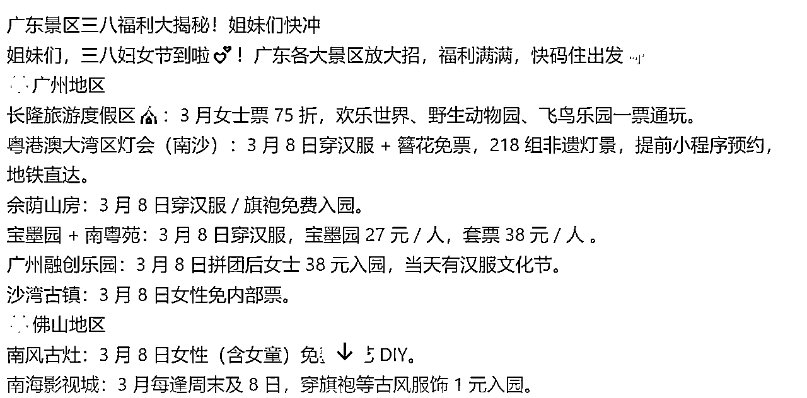

## 二创文案：

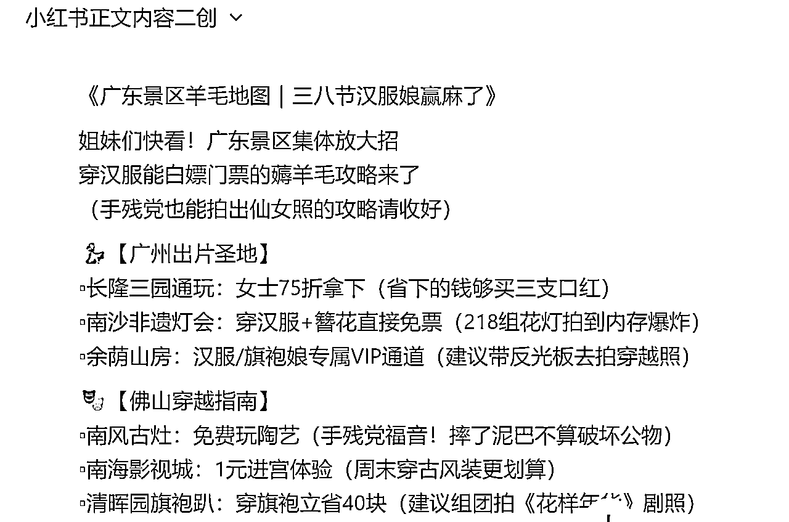

实际测试中，普通内容一般没问题，但涉及活动日期、价格和资格条件时，模型可能会漏掉关键信息。因此，最好把保留规则写得足够明确。

#### 第二版提示词补充

将专有信息保存要求细化为：

> 时间必须原样保留：
>
> - 单日日期：例如“3月8日”或“3.8”
> - 日期区间：例如“3.8-10”或“3月8日-10日”
> - 有效期限：例如“持续7天”“至4月30日”
> - 固定时段：例如“每周六”“法定节假日”“逢整点”
>
> 数字与优惠不得改动：
>
> - 金额：保留“¥38”“￥99元”等符号和单位
> - 折扣：保留“75折”“5折优惠”
> - 满减：保留“满100减30”“第二件半价”
> - 年龄条件：保留“60岁以上”“12周岁以下”
>
> 资格与地点同样不可删：
>
> - 身份要求：如“医护”“教师”“退役军人凭证”
> - 参与条件：如“穿汉服”“持学生证”“提前预约”
> - 地理信息：如“广州市”“粤北地区”
> - 交通坐标：如“地铁4号线”“公交B12路”

## 二创文案：

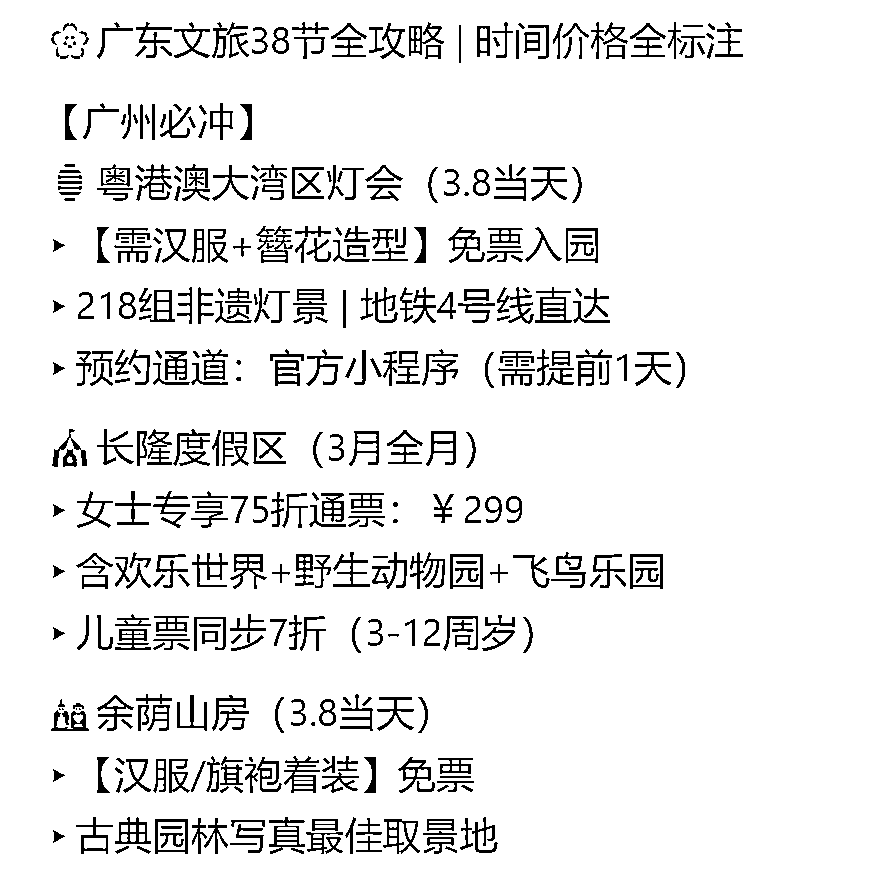

这样处理后，时间、价格、优惠门槛等内容更不容易在改写过程中消失。

## 实操原文：

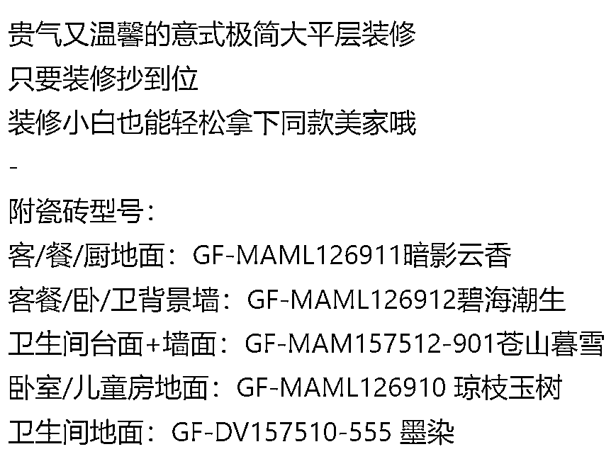

## 二创文案：

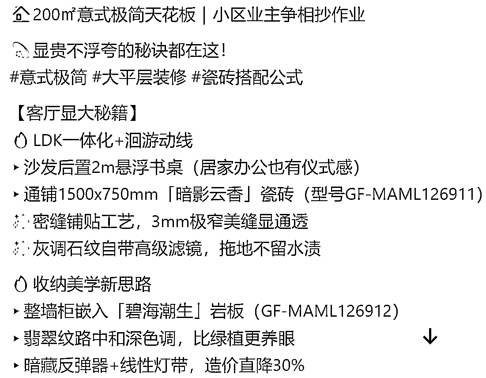

如果原文结尾包含产品型号，建议在提示词中再次强调：型号必须完整保留，不得拆分、替换或删减。

### 2. 给对话设置专属名称

将对话改名为“笔记重构助手”并置顶。

以后发送“文案：……”即可继续处理新的参考内容。

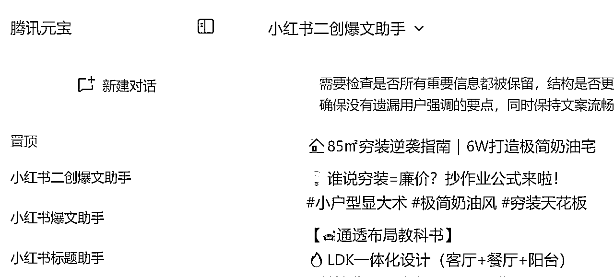

---

## 四、用 DeepSeek 配合飞书多维表格批量处理内容

如果需要同时整理很多标题和正文，可以把模型能力接入飞书多维表格，减少重复复制粘贴。

### 1. 创建数据表

登录飞书，在文档区域点击新增入口，找到多维表格并进入。

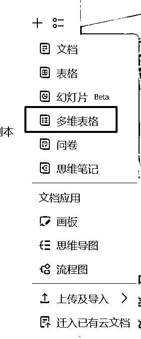

选择空白表格，不必套用现成模板。

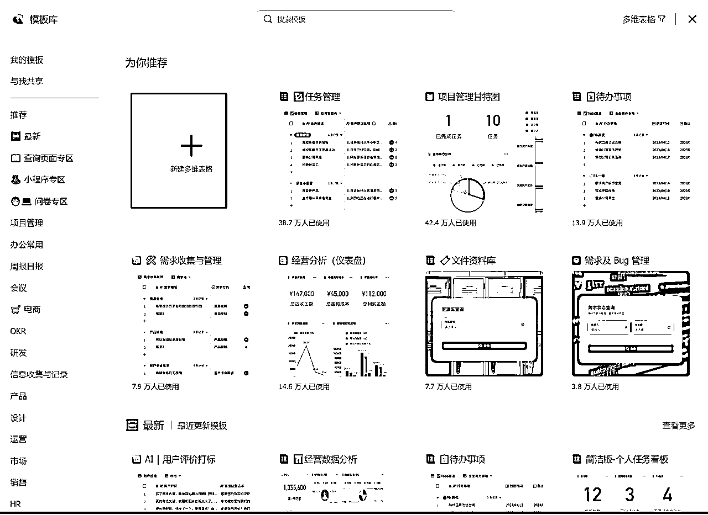

完成后，就会得到一个可录入标题、正文和处理结果的表格。

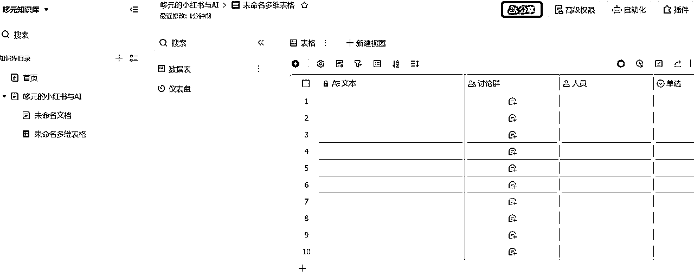

### 2. 准备原始内容

先把自己的笔记，或已获授权使用的参考资料，填入表格中。

常见字段可以包括：

- 原始标题
- 原始正文
- 改写结果
- 内容类型
- 发布状态

如果数据量较大，也可以通过自动化方式导入。

例如，哆元搭建了一个包含参考标题与正文的表格。

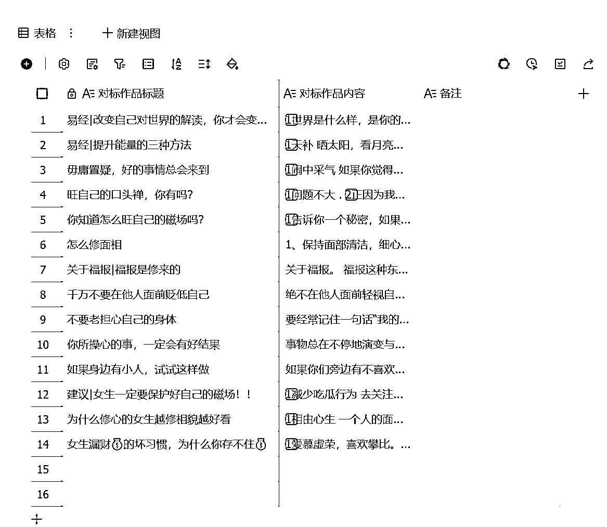

### 3. 新增 AI 处理字段

在已有字段右侧增加一列，打开字段设置入口。

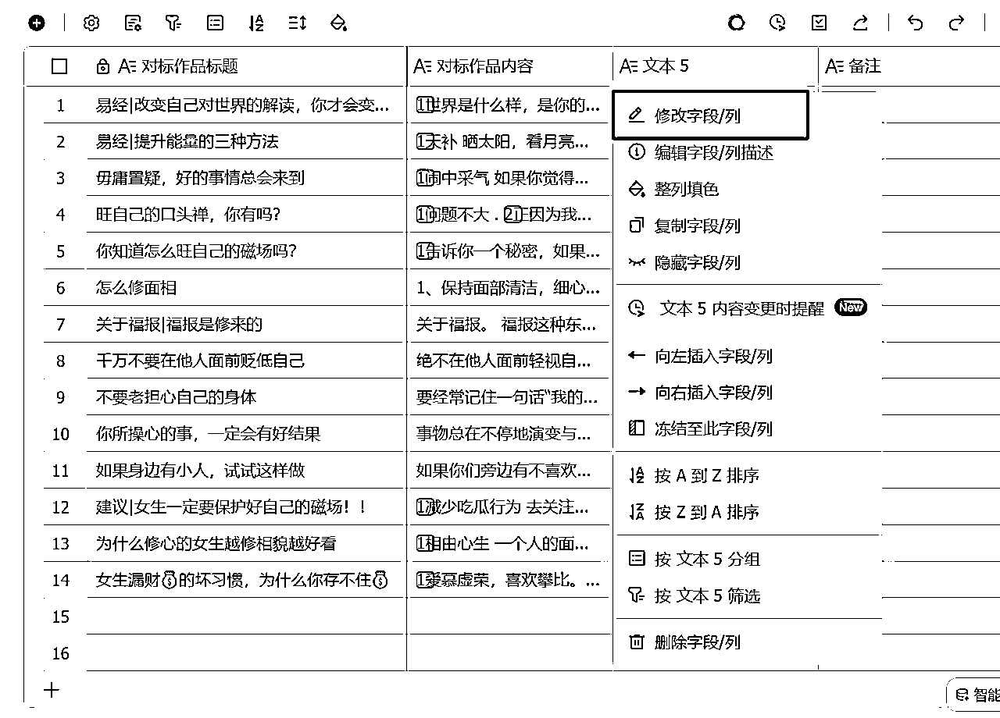

进入字段捷径中心。

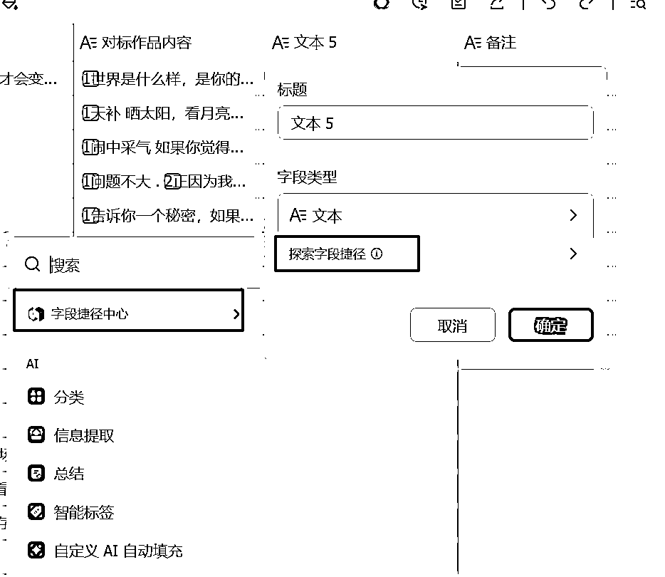

飞书目前可以调用 DeepSeek。进入 AI 类工具后找到对应模型，也能直接在搜索栏输入模型名称定位。

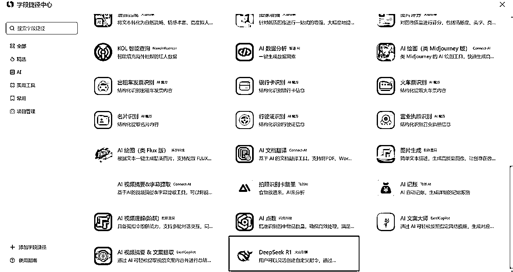

### 4. 配置处理指令

根据自己的任务填写规则，例如：

- 仅重写表达，不改变事实
- 保留数字、日期、金额和型号
- 调整标题风格
- 输出适合平台发布的段落
- 禁止补充未经提供的信息

完成设置后即可运行。

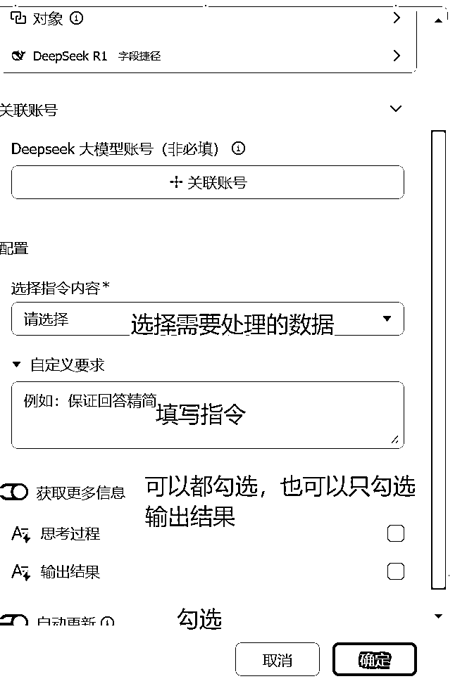

这里可以准备两类指令：

#### 多角度案例重构

在原有内容基础上加入不同人物、场景和使用背景，让内容层次更丰富，但不能虚构事实。

提示词填写在配置区域即可。

```
老板交代我一个任务，他要我把公司在平台发的内容重新创作一遍，力求降低重复率，但是意思和主题是一样的，这个叫做将一段文案进行二次创作（简称“二创”）

现在根据我教你的二创方法论进行二创

文案二创规则：
1\. 视角转换法
使用方法：改变叙述视角，从不同角度讲述同一件事
示例：
原文：（旅游博主视角）
来三亚必须打卡的美食街，人均只要50，每家店都能排队排到天亮，尤其是第一家海鲜档口，连本地人都说好吃。
改写：（本地人视角）
我在三亚生活20年，看着这条街从默默无闻变成网红打卡地，说实话50块确实能吃到好东西，不过最地道的还得是第一家海鲜档，我家就在附近，经常去。
2\. 情节重构法
使用方法：保持核心信息，重新设计内容展开顺序和细节
示例：
原文：
99块钱买了一条连衣裙，真的太划算了，面料是冰丝的，穿上特别凉快，而且显瘦，这个款式很适合上班穿。
改写：
最近公司空调坏了，每天穿正装都要闷死。逛街的时候发现一条显瘦的冰丝连衣裙，还纠结要不要买，一看才99，果断入手，现在天天穿去上班。
3\. 场景延展法
使用方法：将单一场景扩展成完整故事，添加前因后果
示例：
原文：
今天去吃新开的火锅店，4个人258元，味道是真的绝，尤其是秘制蘸料。
改写：
朋友圈看到一家火锅店开业优惠，4人套餐258。本来以为这价格肯定是坑，结果他家的蘸料绝了，老板说是祖传配方，我们连着要了三份，打包带回家吃早饭。
4\. 矛盾设计法
使用方法：设置矛盾冲突，制造戏剧性效果
示例：
原文：
分享一个超实用的衣柜收纳方法，让衣柜告别乱糟糟。
改写：
天天喊着要断舍离，但衣服越扔越多，柜子都快炸了。直到学会这个收纳方法，老妈以为我换了个新衣柜，其实就是把原来的东西重新整理了一遍。
5\. 反差创作法
使用方法：制造前后反差，增加内容反转点
示例：
原文：
用这个护肤方法，皮肤越来越好，痘痘都没了。
改写：
以前总觉得护肤要用十几个步骤，各种贵妇产品买了一大堆。后来皮肤越来越差，直到遇到一个皮肤科医生，他说我的护肤方法完全错了，现在只用三个步骤，皮肤反而越来越好。
6\. 情景对比法
使用方法：通过前后/多种情景对比，突出内容反差
示例：
原文：
三年前辞职创业，现在终于月入10万，真的很感激一路上帮助过我的人。
改写：
还记得三年前辞职那天，老板说我犯傻，同事说我异想天开，连家人都说我不切实际。现在公司每月稳定营收10万，最感动的是那些质疑我的人，现在都成了我的客户。
7\. 细节倒叙法
使用方法：从结果开始，层层递进展示细节
示例：
原文：
今天去吃了一家网红面馆，排队3小时，一碗面要80块，太贵了。
改写：
看着眼前这碗80块的面，想到自己排了3小时的队，就觉得好笑。掏出手机一看，朋友圈已经被这家网红面馆刷屏了，据说老板从日本请来的大厨，就为了这一碗面。

要求：
1.避免直接复制原文结构，通过改写方法重新组织内容。
2.在保持原意的基础上，增加细节描述，使内容更丰富具体。
3.灵活调整句子的语序和结构，避免与原文过于相似。
4.尽量多使用不同的同义词和近义词替换，避免重复原文中的用词
5.尝试将原句的主动句变为被动句，或将复合句拆分成多个简单句。
6.保留以下信息：
-文案中书名号《》内容和举例的双引号“”里的内容
-保留文案中的人名、地名、数字、年份、政策等固有名词
-保留文案中的英文缩写，有的英文只是为了替代敏感词

输出流程：
1.输出最终二创文案

注意:
1.不用晦涩难懂和复杂的词语，尽量使用日常生活中的表达。
2.看到文案后才能二创输出，不得自行输出
3.二创后的文案要通顺
4.要采用多种二创方法论进行二创
5.不需要标注使用的方法论，直接输出完整的结果就行
```

确认设置后，点击生成。

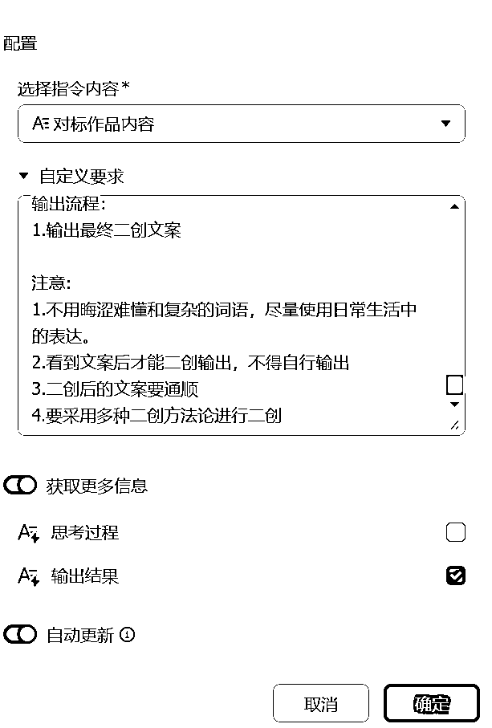

系统会逐行处理，耐心等待任务结束。

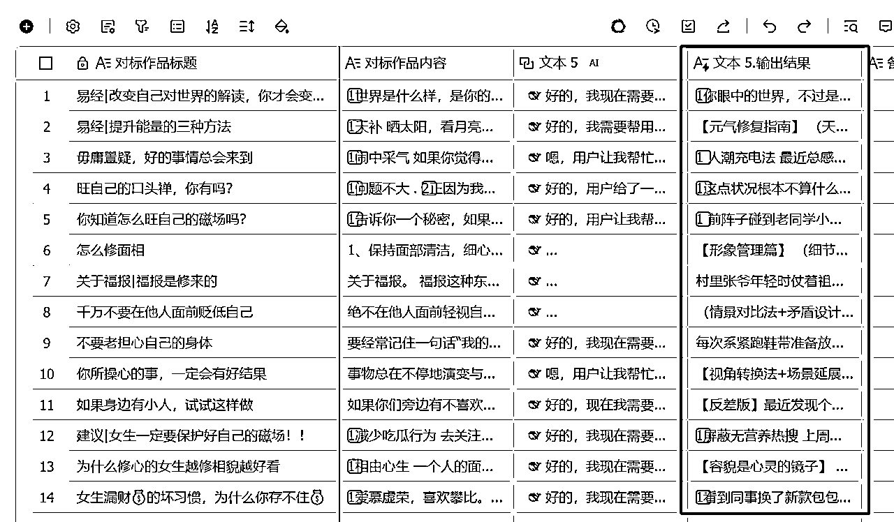

完成后，随机抽取一条，与原始版本进行核对。

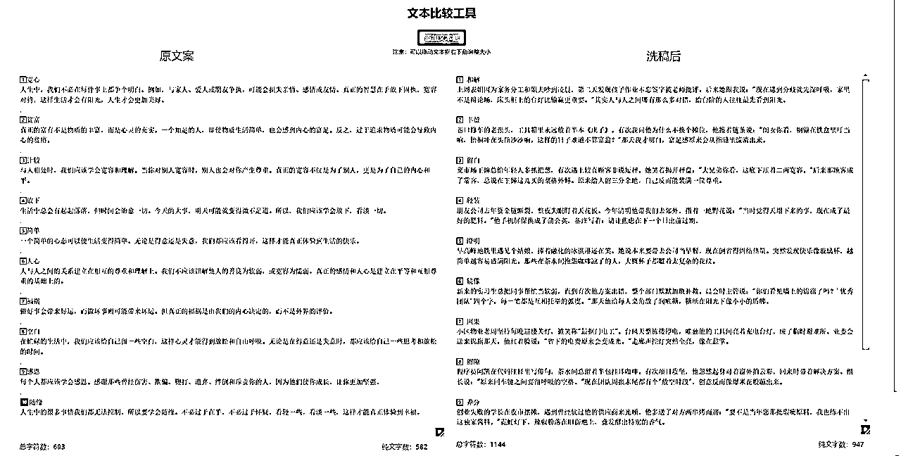

如果事实、数字和重点都保留，同时表达方式已经明显不同，说明配置基本合适。

当然，也有人只想做轻量化改写，不需要增加场景和人物。这种情况就使用更克制的“基础重构指令”，重点放在调整句式、替换表达和优化段落上。

普通改写法

```
老板交代我一个任务，他要我把公司在平台发的内容重新创作一遍，力求降低重复率，但是意思和主题是一样的，这个叫做将一段文案进行二次创作（简称“二创”）

现在根据我教你的二创方法论进行二创

文案二创规则：

1.同义词替换
使用方法：通过使用同义词/同义字或近义词/近义字替换原句中的关键词或关键字，达到保留原文含义的同时生成看似不同的内容。
示例：
原句：你理想中的伴侣是什么样子的
改写：你心目中的另一半是什么样子的

2.添加细节
使用方法：通过增加信息的详细程度，创造出独特的内容，同时根据目标受众调整信息的丰富度。
示例：
原句：保持良好的生活习惯很重要。
改写：保持早睡早起、均衡饮食等良好的生活习惯，对健康真的很重要。

3.改变句型结构
使用方法：通过改变句子的结构或语序，实现内容的改写而不改变其原有的意思。
示例：
原句：她认为这个计划非常有前景。
改写：在她看来，她觉得这个计划很有前景。

4.反义表达
使用方法：通过将句子的意思反过来表达，以新的方式传达相同的信息。
示例：
原句：这道题对我来说很难。
改写：这道题对我来说并不简单。

5.分句重组
使用方法：将长句拆分为短句或将短句合并为长句，以改变表达形式。
示例：
原句：天气很好，我们去散步吧。
改写：今天天气不错。我们一起去散步吧

6.语言风格转换
使用方法：调整语言风格，使其更贴近目标受众的习惯和喜好。
示例：
原句：这个计划具有很高的可行性。
改写：这个方案真的挺靠谱的。

要求：
1.避免直接复制原文结构，通过改写方法重新组织内容。
2.在保持原意的基础上，增加细节描述，使内容更丰富具体。
3.灵活调整句子的语序和结构，避免与原文过于相似。
4.尽量多使用不同的同义词和近义词替换，避免重复原文中的用词
5.尝试将原句的主动句变为被动句，或将复合句拆分成多个简单句。
6.保留以下信息：
-文案中书名号《》内容和举例的双引号“”里的内容
-保留文案中的人名、地名、数字、年份、政策等固有名词
-保留文案中的英文缩写，有的英文只是为了替代敏感词

输出流程：
1.输出最终二创文案

注意:
1.不用晦涩难懂和复杂的词语，尽量使用日常生活中的表达。
2.看到文案后才能二创输出，不得自行输出
3.二创后的文案要通顺
4.要采用多种二创方法论进行二创
5.不需要标注使用的方法论，直接输出完整的结果就行
```

普通的改写法只能算是基础操作，但和真正意义上的文案创作还是有明显差距的，绝不能仅仅靠替换几个同义词或者调整一下语序来蒙混过关。

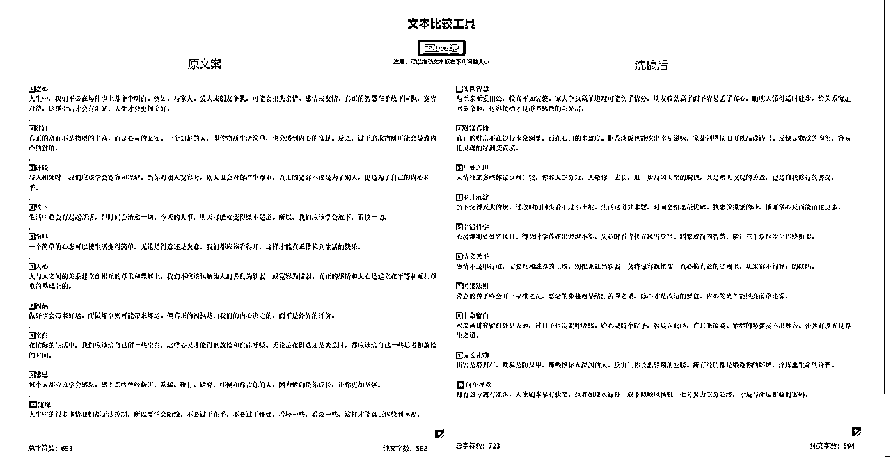

接下来，我们继续处理标题的改写，然后就要开始写飞书多维表格的提示词了。其实提示词这部分，完全可以参考刚才改写文案时用的那套，稍作调整就能直接用，具体如下所示。

```
老板交代我一个任务，他要我把公司在平台发的标题重新创作一遍，力求降低重复率，但是意思和主题是一样的，这个叫做二次创作（简称“二创”）

现在根据我教你的二创方法论进行二创，📕标题不超过20字，不要使用AI常见的套路化表达：比如"秘诀"、"秘籍"、"干货"、“任务”、“选手”等网文常见词，方法论如下，我会给你选题、文案等信息，你来选择如下合适的方法论进行创作，也可以原创，总共生成5个，全部说人话：

1、目标人群植入法
使用方式：在标题中直接点名或暗示目标受众群体，让读者产生"这就是在跟我说话"的感觉
好例子：《给35岁还在迷茫的打工人，我有个建议》
坏例子：《分享一些职场建议》

2、对话感打造法
使用方式：用口语化、互动性的表达方式，让标题看起来像朋友间的对话
好例子：《姐妹们我发现了个平价好物，第一次用就爱上了》
坏例子：《某品牌面霜测评》

3、悬念引导法
使用方式：在标题中埋下引人好奇的伏笔，但不要完全揭示核心内容
好例子：《我用这个方法三周瘦了8斤，还能吃饱饱》
坏例子：《分享一个减肥方法》

4、场景代入法
使用方式：描述具体的使用场景或情境，让读者能够联想到自己的处境
好例子：《当你工位旁边坐了个爱嗑瓜子的同事...这招绝了》
坏例子：《如何处理同事关系》

5、资源整合法
使用方式：强调内容的独特性和资源价值
好例子：《我整理了50个副业赚钱渠道，适合宝妈在家做》
坏例子：《分享一些副业机会》

6、紧迫感营造法
使用方式：创造一种"不看会错过"的感觉
好例子：《趁着双11还没到，先给你们种草这些高性价比好物》
坏例子：《双11购物清单分享》

7、争议话题法
使用方式：提出一个具有讨论空间的观点，引发互动
好例子：《那些说副业能月入过万的，都忽略了这个残酷真相》
坏例子：《聊聊副业那些事》

8、共鸣引导法
使用方式：描述大多数目标用户都经历过的共同处境
好例子：《熬夜打工人必看：这些护肤品让你看起来比同事年轻5岁》
坏例子：《护肤品推荐》

9、解决方案法
使用方式：直接点出你要解决用户的什么问题
好例子：《再也不用每天想穿什么了！4个公式搞定一周穿搭》
坏例子：《穿搭技巧分享》

10、反转期待法
使用方式：先说一个常规认知，再用转折来制造惊喜
好例子：《我以为28岁就晚了，直到遇见这个机会》
坏例子：《分享一个创业机会》

11、利益放大法
使用方式：把用户能获得的具体收益放大化，让人一眼就看到价值
好例子：《零基础副业3个月，让我在魔都付了首付》
坏例子：《分享我的副业经历》

12、专业感植入法
使用方式：在标题中加入行业专业词汇，提升可信度
好例子：《HR亲授：用这4个话术和领导谈加薪，成功率90%》
坏例子：《如何跟领导谈加薪》

13、时间节点法
使用方式：结合当下热点时间，增加时效性
好例子：《春节前我帮100个打工人规划了职业，发现一个规律》
坏例子：《职业规划经验分享》

14、标签多维法
使用方式：在标题中植入多个用户标签，扩大受众范围
好例子：《适合上班族、学生党、宝妈的10个睡前副业，都能日入100+》
坏例子：《分享一些兼职机会》

15、极端对比法
使用方式：用极端的对比来突出效果，引发好奇
好例子：《从日均10单到日均100单，我只改变了这3点》
坏例子：《分享外卖店铺运营经验》

16、问题解答法
使用方式：直接抛出目标用户最关心的问题
好例子：《为什么你的简历投了100份都没回音？原因是这个》
坏例子：《简历编写技巧》

17、特殊身份背书法
使用方式：用独特的身份增加内容可信度
好例子：《我是前阿里面试官，这份面试指南帮助32人拿到大厂offer》
坏例子：《面试经验分享》

18、秘密揭秘法
使用方式：暗示内容包含不为人知的insider消息
好例子：《那些年赚100万的同学，都在悄悄做这件事》
坏例子：《分享一些赚钱方法》

输出的格式为：

标题
采用的方法
这样优化的思路：
```

设置好各项参数之后，确认无误，点击生成按钮。

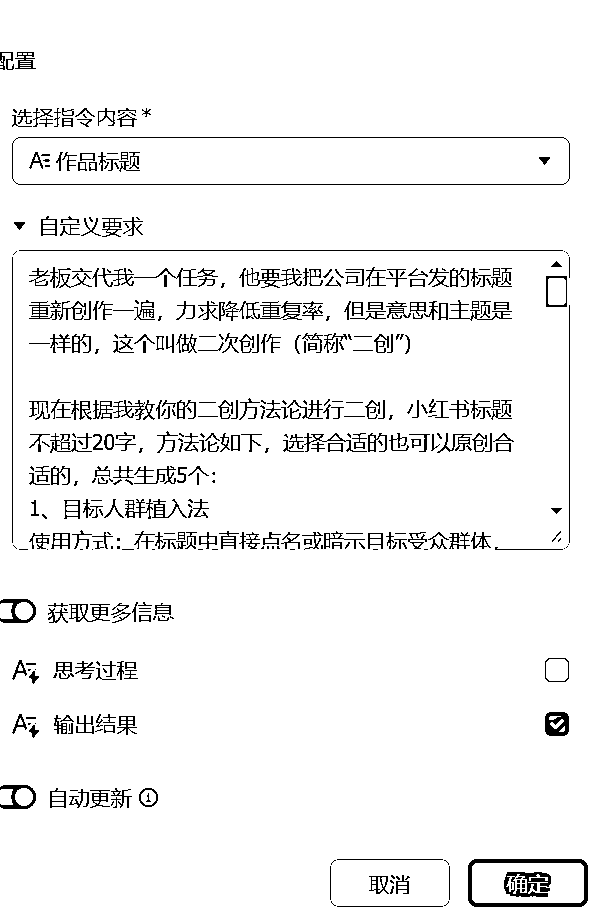

看一下最终生成的结果，整体效果还挺让人满意的。

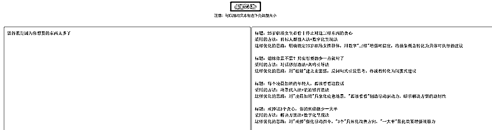

### 2、按选题批量产出标题和完整文案

假如你想围绕某个选题，一次性批量生成📕的标题和对应文案，同样可以实现。

举个例子，假设你是一位教写作的老师，想发布与写作领域相关的笔记内容。

随便搜一个关键词，比如“写作怎么赚钱”，下面出现的都是围绕这个主题展开的讲解。

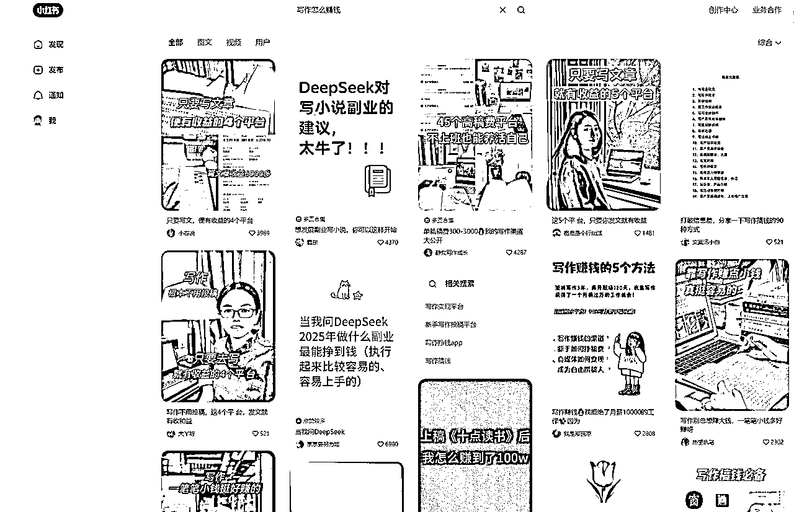

我这边整理了几十个相关素材。

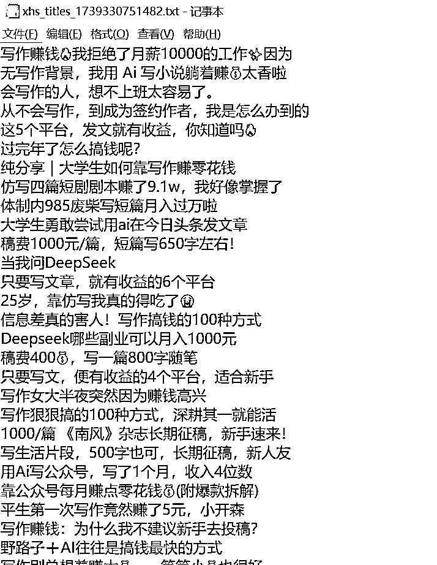

接着，用 DeepSeek 来生成一批参考选题。

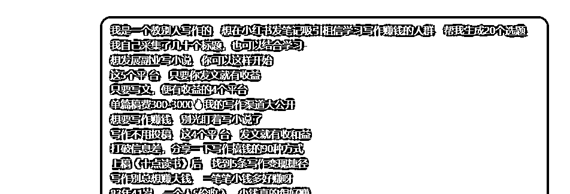

生成后的选题列表长这样。

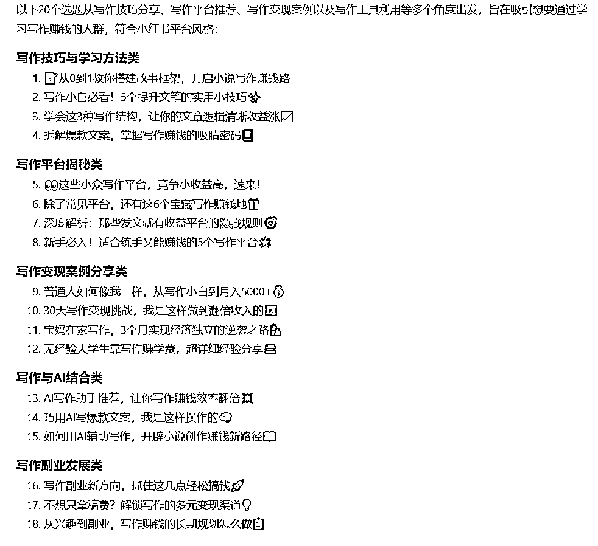

把这些选题复制到飞书多维表格里，再新建一列，把提示词粘贴进去。

```
你现在要根据选题生成对应的📕标题和文案

其中📕标题要灵活组合标题公式

标题公式：（说人话，不超过20字）

1、目标人群植入法
使用方式：在标题中直接点名或暗示目标受众群体，让读者产生"这就是在跟我说话"的感觉
好例子：《给35岁还在迷茫的打工人，我有个建议》
坏例子：《分享一些职场建议》

2、对话感打造法
使用方式：用口语化、互动性的表达方式，让标题看起来像朋友间的对话
好例子：《姐妹们我发现了个平价好物，第一次用就爱上了》
坏例子：《某品牌面霜测评》

3、悬念引导法
使用方式：在标题中埋下引人好奇的伏笔，但不要完全揭示核心内容
好例子：《我用这个方法三周瘦了8斤，还能吃饱饱》
坏例子：《分享一个减肥方法》

4、场景代入法
使用方式：描述具体的使用场景或情境，让读者能够联想到自己的处境
好例子：《当你工位旁边坐了个爱嗑瓜子的同事...这招绝了》
坏例子：《如何处理同事关系》

5、数字化呈现法
使用方式：用具体数字增加可信度和吸引力
好例子：《我找到了22个上海隐藏款咖啡店，人均不超过38》
坏例子：《推荐一些性价比高的咖啡店》

6、资源整合法
使用方式：强调内容的独特性和资源价值
好例子：《我整理了50个副业赚钱渠道，适合宝妈在家做》
坏例子：《分享一些副业机会》

7、紧迫感营造法
使用方式：创造一种"不看会错过"的感觉
好例子：《趁着双11还没到，先给你们种草这些高性价比好物》
坏例子：《双11购物清单分享》

8、争议话题法
使用方式：提出一个具有讨论空间的观点，引发互动
好例子：《那些说副业能月入过万的，都忽略了这个残酷真相》
坏例子：《聊聊副业那些事》

9、共鸣引导法
使用方式：描述大多数目标用户都经历过的共同处境
好例子：《熬夜打工人必看：这些护肤品让你看起来比同事年轻5岁》
坏例子：《护肤品推荐》

10、解决方案法
使用方式：直接点出你要解决用户的什么问题
好例子：《再也不用每天想穿什么了！4个公式搞定一周穿搭》
坏例子：《穿搭技巧分享》

11、反转期待法
使用方式：先说一个常规认知，再用转折来制造惊喜
好例子：《我以为28岁就晚了，直到遇见这个机会》
坏例子：《分享一个创业机会》

12、利益放大法
使用方式：把用户能获得的具体收益放大化，让人一眼就看到价值
好例子：《零基础副业3个月，让我在魔都付了首付》
坏例子：《分享我的副业经历》

13、专业感植入法
使用方式：在标题中加入行业专业词汇，提升可信度
好例子：《HR亲授：用这4个话术和领导谈加薪，成功率90%》
坏例子：《如何跟领导谈加薪》

14、时间节点法
使用方式：结合当下热点时间，增加时效性
好例子：《春节前我帮100个打工人规划了职业，发现一个规律》
坏例子：《职业规划经验分享》

15、标签多维法
使用方式：在标题中植入多个用户标签，扩大受众范围
好例子：《适合上班族、学生党、宝妈的10个睡前副业，都能日入100+》
坏例子：《分享一些兼职机会》

16、极端对比法
使用方式：用极端的对比来突出效果，引发好奇
好例子：《从日均10单到日均100单，我只改变了这3点》
坏例子：《分享外卖店铺运营经验》

17、问题解答法
使用方式：直接抛出目标用户最关心的问题
好例子：《为什么你的简历投了100份都没回音？原因是这个》
坏例子：《简历编写技巧》

18、特殊身份背书法
使用方式：用独特的身份增加内容可信度
好例子：《我是前阿里面试官，这份面试指南帮助32人拿到大厂offer》
坏例子：《面试经验分享》

19、秘密揭秘法
使用方式：暗示内容包含不为人知的insider消息
好例子：《那些年赚100万的同学，都在悄悄做这件事》
坏例子：《分享一些赚钱方法》

20、数据证明法
使用方式：用具体数据增加说服力
好例子：《我帮3000个新手做副业，总结出这7个坑千万别踩》
坏例子：《副业需要注意的事项》

文案创作规范
1\. 结构模板：（模板可以自己创新，不限于下面的模板）
 现象共鸣：100字内描述痛点场景
 转折引导：50字制造认知冲突
 解决方案：分点说明核心方法（3-5点）
 行动呼吁：30字内促动点击/收藏
2\. 禁用任何emoji和#话题标签
3\. 用换行符分段，每段不超过3行
4\. 多说自己的感受和体验
5\. 字数不低于500字，不超过950字
6\. 像写文章一样的排版格式
排版格式参考:
在家带娃4年的我，41岁重返职场，目前在一家新媒体公司做编辑，业余时间投稿赚稿费，刚看了上个月的稿费大概5300多块钱，一个月的基本生活费够了。

我主要是在公号投稿，目前收稿稿费一般在300—1000居多，少数也有2000，3000一篇的，一般要求高，需要反复修稿。

做📕，大家都知道要从找对标账号开始，其实投稿的思路也类似。

你想投哪类平台，就去搜相关账号，看他们过往发表文章的风格，多看，多揣摩，拆解标题，结构，文风，用的哪类素材，把之前的文章拆解个十篇八篇的，再从仿写开始。

最终只需要一个标题一个正文，不需要标注使用了什么标题方法，标题不超过20字
```

点击提交生成，稍等片刻，等待结果跑完。

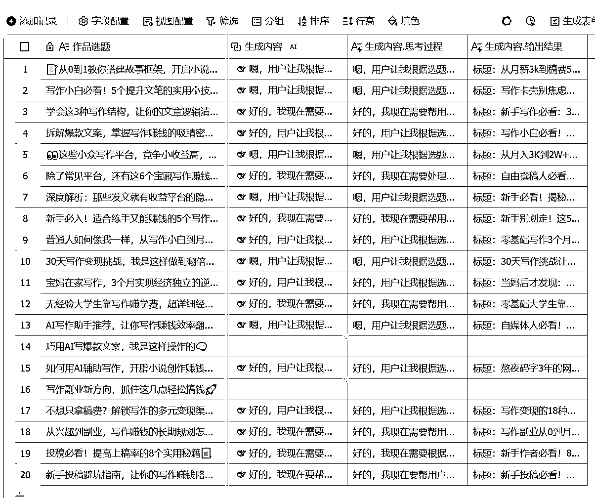

随便点开一条看看效果。

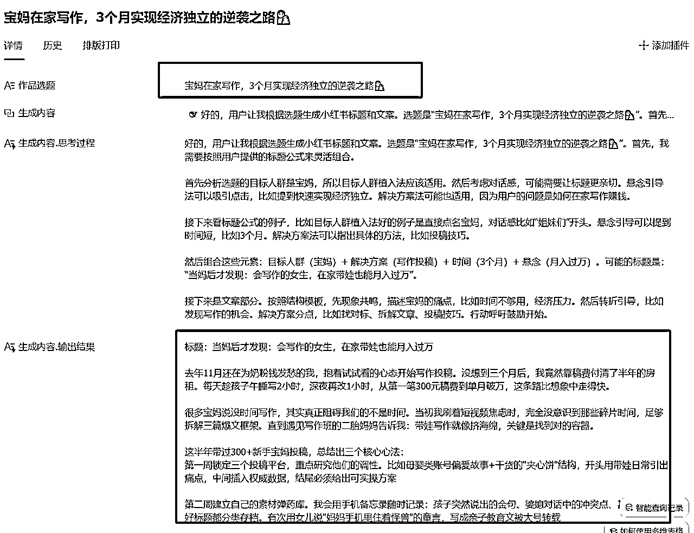

这里我们可以把标题单独抽出来，新建一列。还是在“探索字段捷径”那个位置，找到“信息提取”功能。

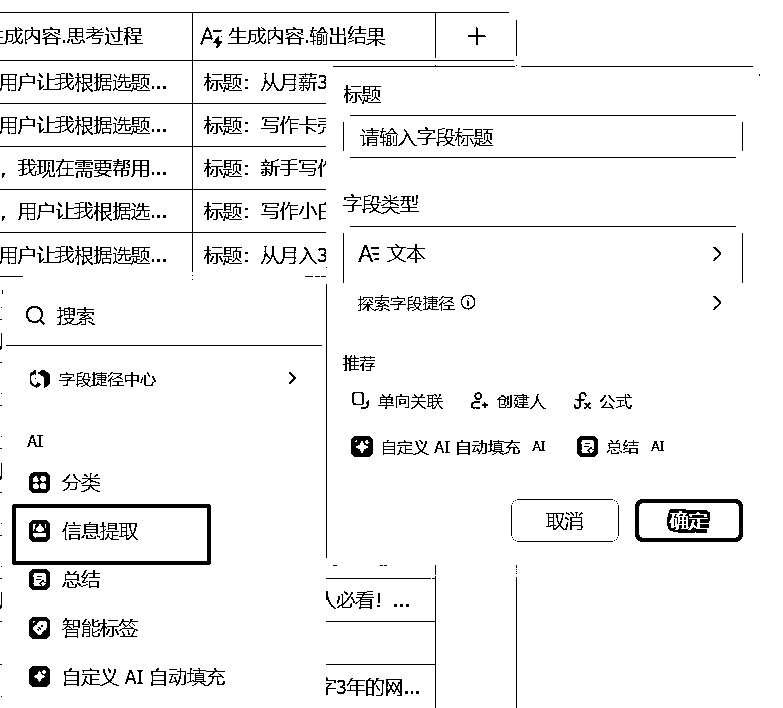

点进去之后，先填好表头标题，然后选择对输出结果执行操作，接着在提取信息里填写“提取标题”。

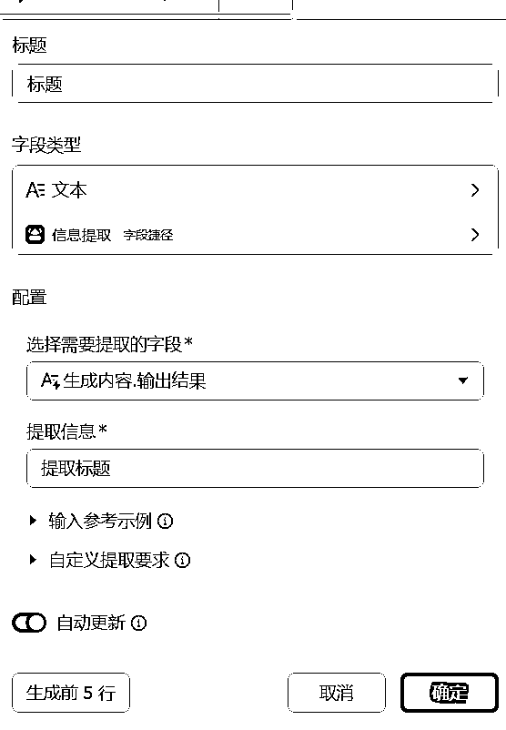

点击确定并生成，就会发现每个标题都被单独整理出来了。

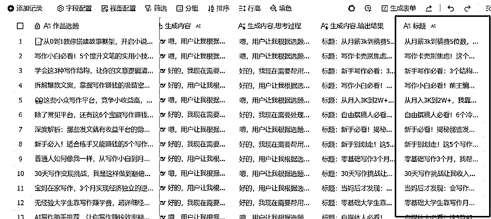

文案部分也是一样的处理方式。

需要注意的是，想要做出真正高质量的内容，就必须编写属于你自己的提示词。上面给的是通用版本，因为 AI 并不了解你的个人设定和其他背景信息，它只是根据选题来生成内容，所以难免会出现偏差。

你可以针对自己所在的赛道，设计专属的提示词，在提示词中提供足够清晰的背景信息，这样就能有效限制 AI 的输出方向。

如果你想生成短视频的文案，同样可以做到，参考下面的提示词模板即可。

```
我想写短视频口播文案，你的任务是从我提供的选题/文章/主要信息，然后结合我总结的短视频文案方法论，按照指定的脚本模型进行原创文案创作。文案需自然、口语化，符合中国人聊天的语气。

## 选题提炼与文案创作方法论：
1\. 脚本模型选择：根据提炼出的选题，选择合适的脚本模型进行文案创作。
   - 例子：如果选题是“如何提高自己的复制能力”，可以选择“脚本模型4：罗列痛点+制造认同+给出答案+聚合推荐”。

2\. 脚本模型1：讲故事+唤起疑问+引导互动+给出答案（三段论）：
   - 讲故事：讲述与选题相关的个人经历或观察。
   - 唤起疑问：引发观众的好奇心或问题。
   - 引导互动：鼓励观众参与，点赞或收藏。
   - 给出答案：清晰地提供问题的解决方案。
   - 三段论：罗列三个理由或事实支撑答案。

3\. 脚本模型2：输出结果+讲故事+确认承诺+给出答案+引导互动：
   - 输出结果：直接给出令人关注的结果。
   - 讲故事：解释结果背后的经历或故事。
   - 确认承诺：保证观众能从视频中获得有价值的信息。
   - 给出答案：揭示实现结果的关键步骤或方法。
   - 引导互动：鼓励观众点赞或收藏。

4\. 脚本模型3：唤起选择+制造冲突+给出分析+说明原因+下结论：
   - 唤起选择：提出一个让观众思考的问题或选择。
   - 制造冲突：介绍与选择相关的不同观点或矛盾。
   - 给出分析：详细分析每个观点的利弊。
   - 说明原因：解释你支持哪个选择的原因。
   - 下结论：总结并引导观众做出自己的选择。

5\. 脚本模型4：罗列痛点+制造认同+给出答案+聚合推荐：
   - 罗列痛点：列出与选题相关的痛点或问题。
   - 制造认同：分享自己或他人的经历，引起观众共鸣。
   - 给出答案：提供解决痛点的方法或技巧。
   - 聚合推荐：推荐相关资源或行动步骤。

6\. 脚本模型5：引起恐慌+给出论据+唤起需求+满足需求：
   - 引起恐慌：提示观众可能面临的风险或问题。
   - 给出论据：用数据或事实支持这个风险。
   - 唤起需求：引导观众意识到需要解决问题。
   - 满足需求：提供解决问题的方法或策略。

7\. 口语化表达：无论使用哪个脚本模型，都需使用自然、接地气的词语和表达方式，让文案更贴近观众的日常语言习惯。

##文案开头方法论：根据提炼出的选题，选择合适的开头方法论，以吸引观众注意。
公式1：好奇
使用方式：人都喜欢凑热闹，先提出一个能引发观众强烈好奇心的问题，更容易看完视频。
示例：
为什么有些人吃再多都不会胖？
给自己的前女友拍婚礼是一种什么样的体验？

公式2：恐吓
使用方式：引起人们的危机感，更容易看完视频
示例：
千万不要跟孩子说这4句话，你真的会毁掉孩子！
如果你手机上有这个APP，赶紧删掉，不然你的隐私随时可能泄露！

公式3：痛点
使用方式：戳观众的痛点，更容易看完视频
示例：
这5种街头小吃，奉劝所有的父母，最好是一口都别让孩子吃
这三种行为正在悄悄摧毁你的婚姻，很多人都中招了！

公式4：震惊
使用方式：先抛出非常有争议的吸引眼球的观点或话题，容易看完视频
示例：
我终于知道为什么有的女生月薪三千，一年能存三万了，我今天跟我闺蜜出去.....
你永远不知道上海的二房东有多离谱，昨天我......
一天花了两千万是什么体验，我今天.....

公式5：圈人群共鸣
使用方式：通过描述观众可能面临的问题或困扰，引发共鸣，让观众觉得“这说的就是我”，从而吸引他们继续观看。
示例： 
你是否也在半夜失眠，辗转反侧睡不着？ 
有没有觉得自己每天都很忙，但却一事无成？
如果你也存在焦虑问题，这条视频先不要划走，这是一条走出焦虑的重要认知，听懂了理解了这个视频内容，你将会少走很多弯路，看完之后会受益匪浅。

公式6:疑问
使用方式：通过提出一个观众可能有的疑问或困惑，激发他们的好奇心和求知欲，从而吸引他们继续观看。
示例：
发现自己其实也没啥焦虑，但一去医院，医生就给我定性为焦虑，这是啥情况？
为什么我一直努力却看不到成果？

公式7：逆向思维
使用方式：提出一个与常识相反的观点，引发观众思考和兴趣进而继续观看。 
示例：
你知道吗？吃巧克力居然有助于减肥！
别再相信“早睡早起身体好”了，真正健康的人都是这样做的。

公式8：数据对比 
使用方式：通过一组有趣或意外的数据对比，引起观众注意进而继续观看。 
示例：
为什么日本的老人比美国的年轻人更健康？
这些国家的工资水平，可能让你大吃一惊！

公式9：情感共鸣 
使用方式：通过唤起观众的情感，引发他们的共鸣和兴趣。 
示例：
你有多久没有和家人好好吃顿饭了？
你是否也在为自己的梦想而努力奋斗？

公式10：揭秘
使用方式：揭示一个鲜为人知的秘密或内幕，激发观众的好奇心。
示例：
今天我来揭秘一下，为什么网红店排队的人总是这么多？
你知道吗？这些隐藏功能让你的手机变得更强大！

公式11：故事引入
使用方式：通过讲述一个有趣或感人的小故事，引发观众的兴趣。
示例：
有一天，我遇到一个流浪歌手，他的话彻底改变了我的生活……
昨晚我做了一个奇怪的梦，醒来后让我对生活有了新的思考。

公式12：反问
使用方式：通过提出一个反问，引发观众的思考和兴趣。
示例：
你真的认为加班是为了自己的未来吗？
为什么别人说你不可能成功，你却相信了？

公式13：悬念
使用方式：通过设置悬念，引发观众的好奇心，让他们想知道接下来的内容。
示例：
你知道吗？这个简单的习惯可以让你每天多睡一个小时！

公式14：：对比
使用方式：通过对比引发观众的思考和兴趣。
示例：
为什么同样是留学，有些人成功，有些人却一无所获？
城市和农村的生活，究竟有什么不同？

公式15：情景假设
使用方式：通过设定一个情景假设，引发观众的兴趣和思考。
示例：
如果你突然中了500万，你会怎么花？
如果你只有一天的时间，你会怎么度过？

公式16：成功案例
使用方式：分享一个成功案例，激励和吸引观众。
示例：
他从负债50万到赚到第一桶金，只用了两年时间！
这个女生通过自学编程，成功转行进入大厂！

公式17：观众误解
使用方式：纠正观众常见的误解，引发兴趣。
示例：
很多人都觉得喝红酒有益健康？其实并不是你想的这样！

## 要求：
1\. 每篇原创文案要结合合适的开头文案方法论和脚本模型创作。
2\. 文案必须口语化，符合中国人聊天的语气和表达习惯。
3\. 可适当加入个人经历、故事或案例，使文案更具吸引力和共鸣感。
4.不要加入“嘿”“哈喽”“大家好”等打招呼的词
5.不要使用首先、其次、最后等词，使用第一/第一个、第二/第二个、第三/第三个

直接输出完整的一篇文案即可，不要标注用到的公式和方法论
```光说不练假把式，效果到底怎么样，直接摆出来看。

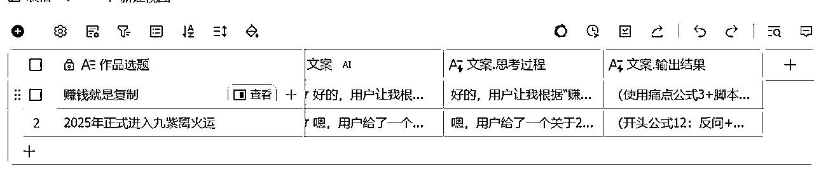各位如果感兴趣，动动手指点进去就能一目了然。

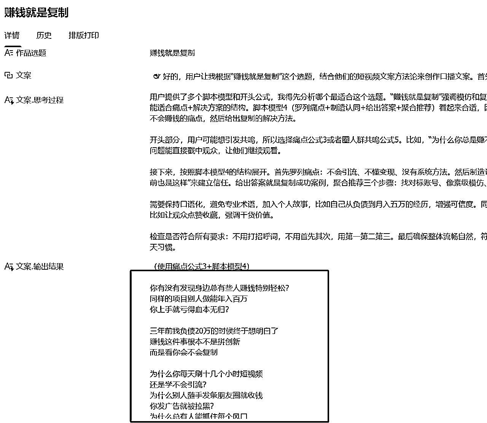不过说实话，这还只是冰山一角。真正有意思的地方在于，把不同方向的 AI 工具搭在一起，往往能碰撞出意想不到的火花。到底能折腾出多少花样，就留给各位慢慢发掘了。