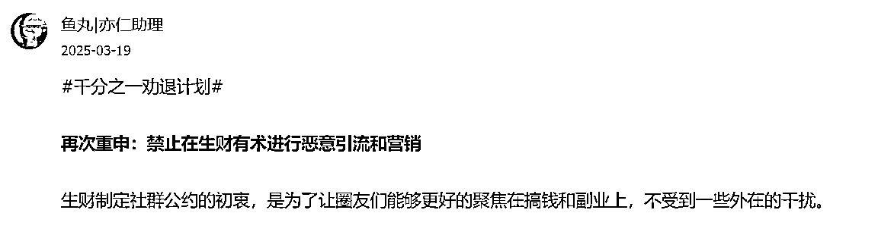
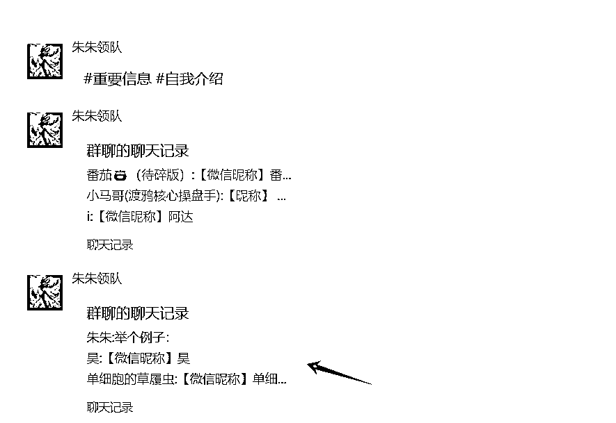
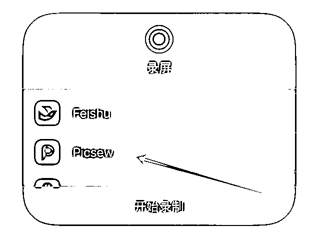
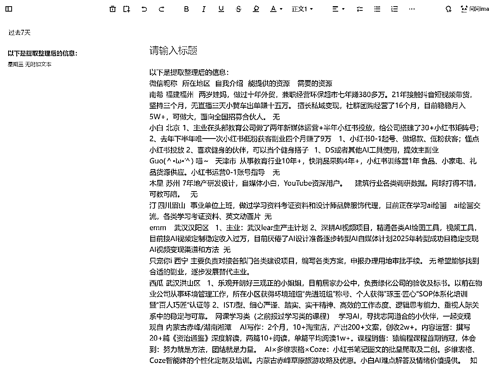
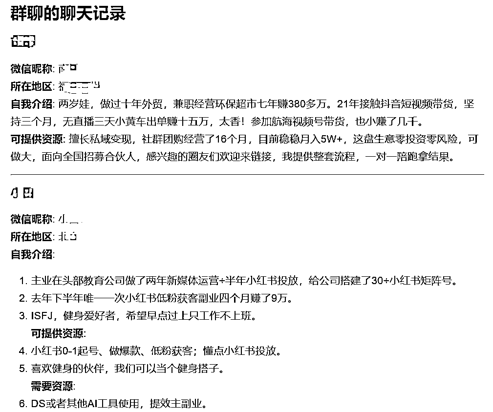
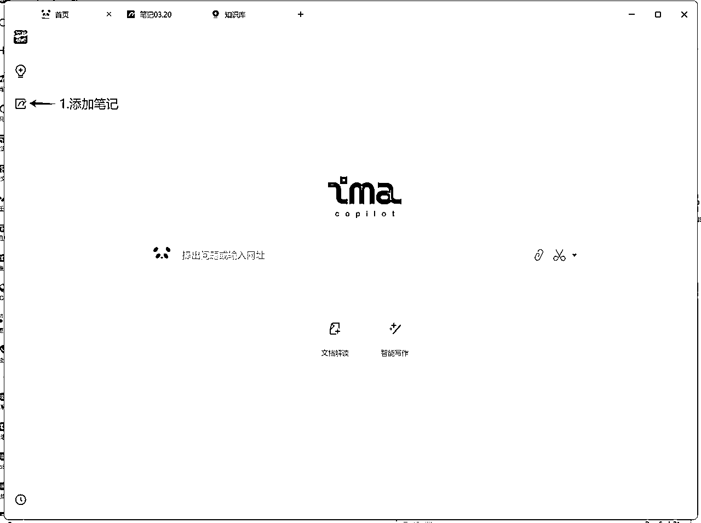
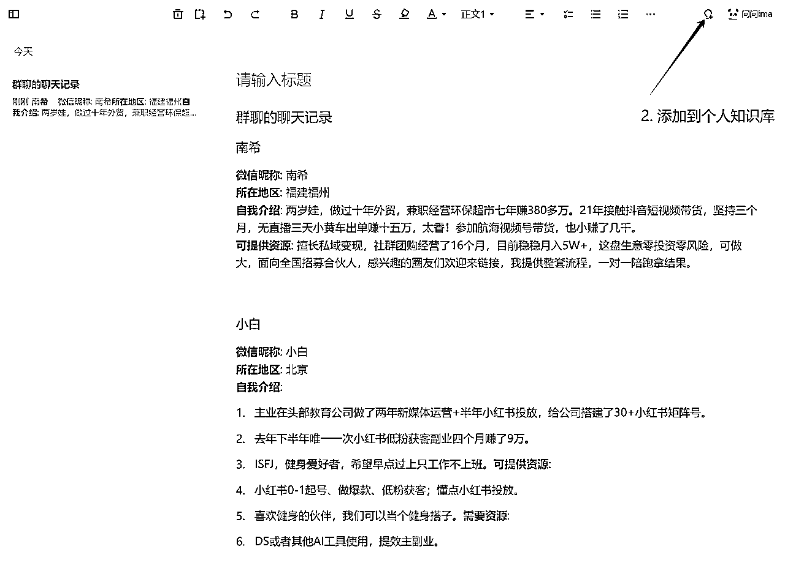
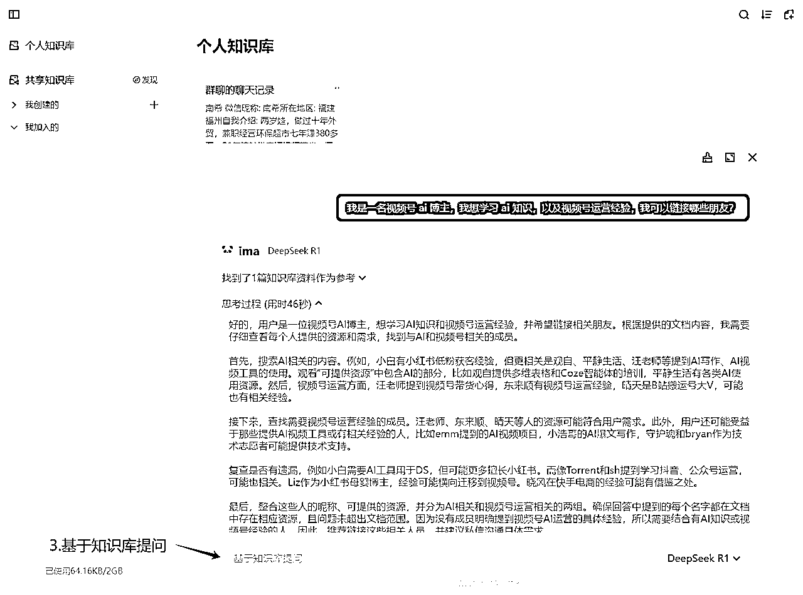
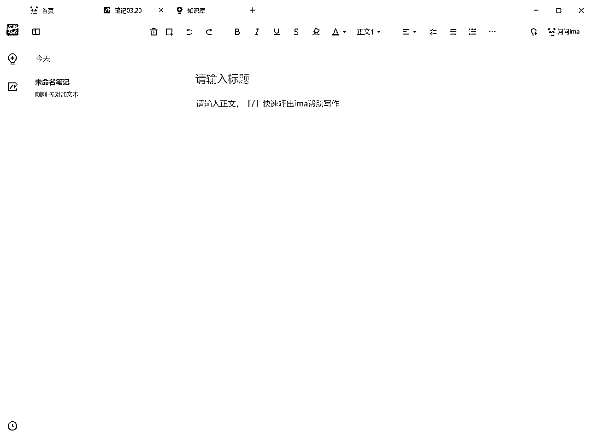
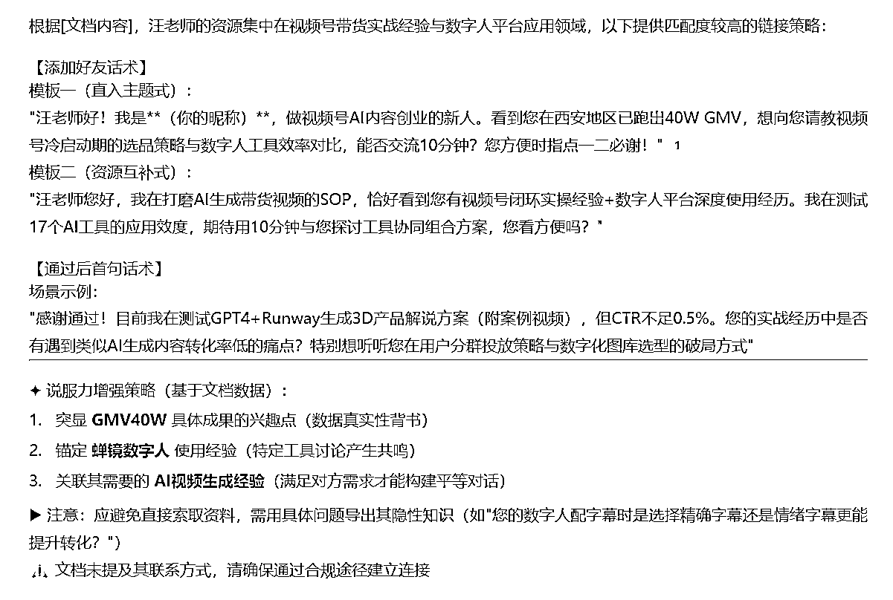

# 用 AI 管好航海人脉：告别无效加好友，建立自己的智能联系人库

## 先说结果

参加航海时，面对几百位圈友，如何快速了解每个人、找到真正适合链接的对象，还能避免重复沟通和无效加好友？

我的做法是：

**把圈友的自我介绍统一整理成资料，再交给 AI 建立一个可检索的人脉知识库。**

之后，无论是查询某位圈友，还是寻找某个方向的同行，都可以直接提问，让 AI 帮你完成筛选、归类和链接准备。

---

## 一、为什么要做这件事？

第一次参加航海时，破冰群里往往聚集了大量优秀圈友。

看到一个个精彩的自我介绍，难免会产生这样的想法：

> 这个人以后可能会成为合作伙伴。  
> 那个人也值得认识。  
> 说不定哪位就是未来能帮助我的贵人。

但真正操作起来，问题很快就出现了。

群里可能有几百人，按照顺序逐个添加、逐一回复，不仅耗时，而且非常容易混乱。加得越多，越记不清每个人是谁，也不知道之前聊过什么。

更重要的是，社群通常都会明确禁止恶意引流和营销。我们需要做的是建立有价值的真实连接，而不是无差别加人、群发话术。



刚开始，我采用的是最传统的方法：阅读自我介绍，然后按顺序添加好友，再复制一套固定的话术。

可当联系人数量逐渐增加后，我发现自己根本无法准确记住每个人。很多人最后只会安静地躺在通讯录里，既没有继续交流，也没有真正形成连接。

正好那段时间我在使用 ima，也看过「本子在隔壁」分享的联系人管理思路，于是产生了一个想法：

**能不能把航海圈友资料整理成一个 AI 通讯录，让 AI 帮我管理和检索？**

于是，我开始了下面这套实践。

---

## 二、具体怎么做？

### Step 01：先把完整的自我介绍整理成一张长图

航海破冰结束后，领队和志愿者通常会在禁言群里，把所有圈友的自我介绍汇总整理好。



接下来，需要把这份内容保存下来。

如果使用安卓手机，直接调用系统自带的滚动截屏功能即可，截完后可以直接进入下一步。

如果是苹果手机，可以使用 Picsew 来完成长截图。操作方式和普通录屏比较接近，只是在选择工具时改为 Picsew。



这类工具通常会有免费次数或功能限制。Picsew 的 Pro 版本是一次性 15 元永久订阅。

如果希望尽量降低成本，也可以尝试搭配其他滚动截屏 App，或者通过闲鱼等渠道寻找解决方案。

---

### Step 02：用 Kimi 读取图片中的文字

完成长截图后，把图片上传到 Kimi 1.5，让它识别其中的文字内容。

最开始，我直接把截图交给 Kimi，让它自行提取和整理。实际对照后发现，识别结果比较完整，而且还会自动以表格形式呈现。

就长截图文字识别和结构化整理而言，我个人感觉 Kimi 1.5 的表现相当不错。其他模型也可以尝试，大家完全可以根据自己的使用习惯进行选择。

不过，后来我发现 ima 知识库对表格格式的处理并不算理想。把表格复制进去之后，排版容易出现错乱。

如果不介意格式问题，表格版本也能直接使用。但我个人比较在意资料的整洁度，所以重新调整了提示词，要求 Kimi 用 Markdown 格式输出。



这样处理之后，所有内容就会被拆分成一段段清晰的文本，后续导入知识库会更加方便。

```
将图片中的信息进行提取，以Markdown形式输出，相邻两个联系人用"---"分割。
```



---

### Step 03：把整理后的内容放进 ima 知识库

接下来就是建立自己的联系人资料库。

#### 1. 新建一条笔记



#### 2. 粘贴整理好的 Markdown 内容，并将笔记加入知识库



#### 3. 直接基于知识库进行提问



整个流程可以参考下面的视频教程：



完成之后，你就拥有了一个可以随时查询的 AI 人脉库。

比如你可以询问：

- 群里有哪些人正在做短视频？
- 哪些圈友擅长私域运营？
- 有没有做知识库、自动化或 AI 应用的人？
- 某位圈友之前介绍过什么项目？
- 如果我想认识某个方向的人，优先联系谁？

比起在群聊记录里不断翻找，这样的查询方式会高效很多。

---

### Step 04：在群聊中定位目标圈友

当你通过知识库筛选出合适的人之后，就可以回到群聊中搜索对方的名字，找到其自我介绍，再结合对方的具体背景进行交流。

这样做的好处是，你不再是漫无目的地添加好友，而是先了解对方，再决定是否建立联系。

---

### Step 05：让 ima 帮你设计个性化开场话术

找到目标圈友后，还可以继续利用 ima，根据对方的介绍和你的真实需求，生成更有针对性的沟通方式。

```
我想链接XX圈友，请帮我生成添加好友话术，以及添加成功后的第一句。
```



当然，具体表达最好结合自己的实际情况进行修改，不建议完全照搬 AI 的结果。

我更建议大家把 AI 当作一个辅助工具，先让它提供几种可能的表达方向，再由自己选择最合适的方式。

毕竟，AI 可以帮助我们提高效率，却不应该替我们完成所有表达。

**真正有温度的连接，最终还是需要来自真实的自己。**

---

## 三、进一步升级：记录每次链接结果

如果想把这套系统做得更完整，还可以尝试使用 Trae 加 Obsidian，对每次链接结果进行动态记录。

例如记录：

- 第一次联系的时间
- 对方的兴趣和需求
- 双方聊过的内容
- 后续是否建立合作
- 下一次适合什么时候继续沟通

具体方法可以参考归藏老师的文章：

> Obsidian 加 Cursor，就是最强 AI 知识库！藏师傅教你从零学习 Obsidian 01

如果大家确实感兴趣，后续我也可以尝试在这篇文章的基础上做一点补充，权当抛砖引玉。

---

## 四、人脉不是通讯录，而是彼此之间的互动

写到这里，我想起费孝通先生在《乡土中国》中提到的一段话。

亲密关系的维系，往往依赖于人与人之间不断发生的“人情往来”。你帮我一次，我找机会回馈你；我给你提供帮助，未来也可能在某个时刻接受你的帮助。

这种一来一往，并不是简单的利益交换，而是关系逐渐建立的过程。

很多关系，恰恰是从一句轻松的：

> “这件事可以麻烦你一下吗？”

开始的。

今天我向你请教一个问题，算是承了你一份情；以后我再找机会帮助你，或者你在需要时来找我，彼此之间就有了连接。

过去的我，总觉得能自己完成的事情就不要麻烦别人，什么都想独立解决，仿佛这样才能证明自己足够厉害。

但问题是，当一个人长期只埋头处理自己的事情，就会越来越少和别人交流。时间久了，自己的圈子也会变得狭窄，甚至逐渐封闭起来。

后来我学习了黄执中老师关于沟通与表达的课程，才意识到：

**主动寻求帮助，并不代表自己能力不足。**

很多时候，我们认为别人不会帮忙，但真实情况可能远没有想象中那么糟。即使某件事自己能够完成，也可以适当向朋友请教，给彼此创造一次互动的机会。

这不仅是在解决问题，也是在建立关系。

---

## 最后

希望大家都能借助这次航海，认识真正适合自己的人，建立有效而长期的连接，而不是让通讯录里堆满彼此陌生的名字。

也感谢生财有术这个平台，让我这个刚入圈的新人，有机会通过线下组局认识大魔哥、刘同学、老陈、强总等优秀前辈，也感谢大家对我 3.22 线下组局的支持。

我也清楚，大家愿意关注我，一部分是因为多维表格和 Coze 本身很有价值，一部分是因为大魔哥的官方背书，还有一部分是刘同学在线下活动中的支持。

而我现在仍然只是一个新人，还有很多需要学习和成长的地方。

但我相信，总有一天，大家会因为我的专业能力，而愿意主动认识我、信任我、与我建立连接。

* * *

### 参考资料

#千分之一劝退计划#再次重申：禁止在生财有术进行恶意引流和营销

Obsidian加Cursor就是最强AI知识库！藏师傅教你从零学习 Obsidian 01

❗️ Z-Library 下载，含水印，请勿随意搜索。

黄执中：成为懂情绪的高效沟通者

生命管理：强化记忆力和方向感的终身笔记系统