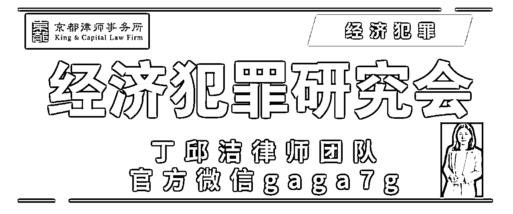
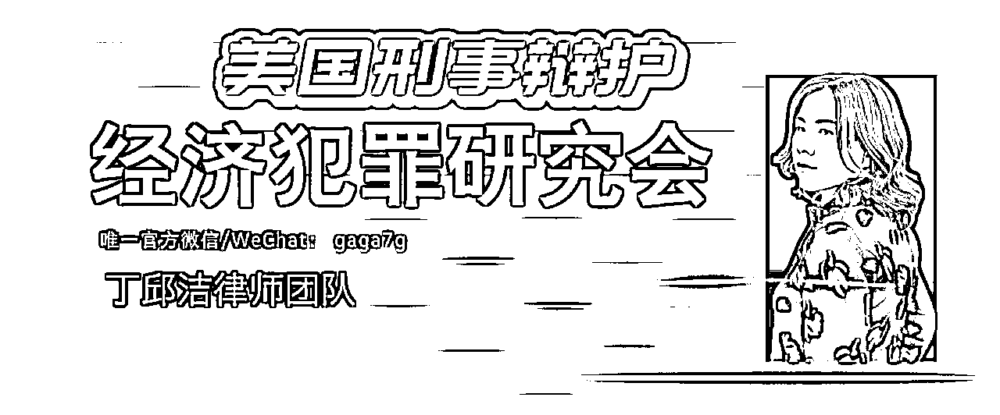

# 00后创业留学⚠️犯罪警示录「2025版」v1.0 20250321

各位00后创业者、留学生朋友，还有揪心的家长们，今天想跟你们聊点沉重但必须正视的事。这些年，我们看到太多年轻面孔因为法律意识缺位，亲手把人生推入深渊。有的在创业路上踩到犯罪边缘，运气好的在侦查阶段被放了出来，更多人没能逃脱制裁——家属东拼西凑付律师费、赔偿金、谅解金，甚至眼睁睁看着孩子留下案底、坐牢，人生轨迹彻底改写。也有的远赴海外留学，不熟悉当地法律，也不懂得敬畏规则，在文化冲突的缝隙里一步步滑向监狱；家人隔着时差和国界，想救都使不上劲，只能任由孩子前程毁掉，整个家庭陷入长久的沉默。

法律的后果从来不是儿戏，越早认识到越好。我们最近接咨询，越来越觉得：能帮人时伸手帮一把，关键时刻才能有人拉你一把。尤其是在涉外案件里，法律资源本就稀缺，家长手足无措往往会让事情更糟，文化隔阂又容易带来误解和冷漠。所以，平时多结善缘，让律师愿意真心帮忙，别让00后独自扛下所有的后果。

为了尽量覆盖风险、避免踩坑，我们结合2024年至今亲办和接待的案例，分成国内、海外/出海两个大板块来讲。千言万语一句话：远离！重视！

## 一、国内创业：这些业务千万别碰

这类业务有个共同特征：来钱快、不用动脑、只出力气、只出身份或证件，看似“躺着赚钱”，实际是通往监狱的快车道。

### 1. 帮信罪
有个大学生，找工作处处碰壁，压力很大，既不想干体力活，又觉得学历没优势。有天刷小红书、抖音看到“商机”：把银行卡和身份证借出去，立刻到账2000块。结果呢？构成帮助信息网络犯罪活动罪。认罪认罚，判了缓刑，但案底留下了，影响一辈子。

法律不会因为你年轻就不定罪，只会因为你年轻而酌情从轻处罚。这个罪名太常见了，入罪形式五花八门，再怎么强调“别贪轻松快钱”都不为过。

### 2. 侵犯公民个人信息罪
另一个大学生，看视频学到“赚钱项目”：一件代发流量卡、电话卡，线上套利、线下营业厅开卡，59元套餐秒变29元，每开一张返佣几百块。他觉得这是躺赚，开始拉人头、做直播、教话术，还发展代理。现在同案的人，有的被拘留，有的暂时被释放——但没定罪绝不代表业务没问题。

在灰色地带游走，一旦刑法开始关注你，别信“前辈没事”的经验。刑法条文可能是稳定的，但社会现象是流动的，过去不犯罪，现在入罪，一点也不奇怪。

### 3. 侵犯著作权罪（案例一）
一位研究生搬运视频网站内容，心想“搬运的人那么多，怕什么”，还开发外挂小程序，一边赚广告费，一边收会员费。结果没等回本，案发了。警方全国布网，抓了15人，主犯公司老板被判赔上百万，15人全部获刑，其中一人就是缓刑加数倍罚金。

很多人问：“别人搬没事，我搬就被罚，冤枉啊！”可案子之所以能立起来，往往是因为权利人起诉民事赔偿，发现你转移财产拿不到钱，干脆直接刑事报案，既省力又能拿赔偿，还能杀鸡儆猴。当你只盯着自己的小利，看不到权利人的损失已泛滥成灾，可不就是这个下场？

### 4. 侵犯著作权罪（案例二）：复制粘贴代码，小心侵权
某大学生在软件公司工作，赶项目压力大，发现一个开源项目跟要做的新应用很像，心想“省时间直接复制改一改”，未经许可就用了。原作者发现后立马追责。

代码不是用来随意“复制粘贴”的，尊重原创是底线。工作中要遵守开源协议，要用别人的代码必须先获得授权，并按约定方式使用。

### 5. 买卖国家机关证件相关犯罪
有个大学生被“贵人”带，没毕业就入股开公司，做抖音投流一条龙，流水很大。客户尝到甜头，想扩店群又怕账号关联，公司就推出证照一条龙：给电子执照、法人身份，还赠送法人视频验证。结果钱还没进口袋，人先进了看守所。

很多00后可能在干这个，必须强调：这类罪名入罪门槛极低，是行为犯，只要实施了买卖行为，原则上就构成犯罪。工商执照、驾照、身份证都算。买卖多次、买卖重要证件或造成严重后果的，属于“情节严重”，要判三到十年。单位干这事，单位罚金，责任人也要坐牢；共同犯罪的话，参与者一个都跑不掉。如果买卖证件还为了实施其他犯罪，可能数罪并罚。价格再高，也换不回自由和案底，千万掂量清楚。

### 6. 非法经营罪
程序员小刘技术不错，想做虚拟货币交易平台，收手续费赚一份。他没多想就开干，很快被警方盯上。

根据刑法第二百二十五条，未经许可经营法律、行政法规规定的专营、专卖物品或限制买卖物品，情节严重的，构成非法经营罪。小刘未经许可从事虚拟货币交易，就是典型例子。

### 7. 洗钱罪（中国与中国香港）
有大学生帮朋友挂名香港公司董事、股东，结果卷进洗钱大网。香港海关曾破获涉案数十亿港元的洗钱案：犯罪团伙用空壳公司伪造国际贸易，把内地诈骗、走私所得伪装成正常货款，经地下钱庄流入香港，再转到海外。

香港《打击洗钱及恐怖分子资金筹集（修订）条例》规定，处理、转换犯罪所得以掩饰非法来源，就是洗钱罪。别以为“帮忙挂名”没事，一旦进入这个链条，后果非常严重。

## 二、业务红线：开始合法，做着做着就犯罪了

有些业务一开始动机合法，但行为走了样，最后依然触法。

### 1. 非法获取计算机信息系统数据罪
程序员小张发现某电商平台新用户注册送优惠券，就写脚本批量注册、批量领券，被平台发现，直接进警局。

电商平台注册系统是受法律保护的计算机信息系统，存储着用户信息和账号数据。未经授权以技术手段侵入并获取数据，就是犯罪，还会给平台造成损失。

### 2. 非法控制计算机信息系统罪
程序员小丁研究游戏漏洞，发现能改数据、加金币、解锁装备，他真去改了，玩得很开心。游戏公司随后发现异常，他被追究责任。

游戏服务器同样是受法律保护的计算机信息系统，擅自利用漏洞修改数据，就是非法控制，还会破坏游戏平衡，损害其他玩家权益。

### 3. 破坏计算机信息系统罪
程序员小陈发现公司考勤系统有漏洞，能改考勤记录，他就把自己迟到早退的记录全抹掉了。同事看到后纷纷效仿，考勤系统彻底乱套，最后被查出来。

违反国家规定，对计算机信息系统功能进行删除、修改、增加、干扰，导致系统不能正常运行，后果严重的，就构成此罪。情节严重可判五年以下，后果特别严重可判五年以上。

### 4. 开设赌场罪
程序员小张突发奇想：区块链去中心化、不可篡改，拿来做在线赌博平台，玩家用虚拟货币下注，他收手续费，岂不美哉？很快平台上线，火爆一时，但警方也来了。

根据刑法第三百零三条，以营利为目的开设赌场或聚众赌博，无论传统还是高科技手段，都构成犯罪。赌资巨大、扰乱秩序，直接刑事拘留。

### 5. 职务侵占罪
程序员小陈维护公司内部系统时发现漏洞，能绕过权限访问财务数据，便偷偷给自己多发了几笔工资。财务审计时发现异常，他被追究。

利用职务便利把本单位财物非法占为己有，数额较大的，构成职务侵占罪。技术是用来创造价值的，不是用来偷公司钱的，别拿职业生涯赌。

### 6. 挪用公款罪
程序员小张在国企管财务系统，买房首付差一点，觉得“公司钱那么多，先挪一点，发工资再还”，就动用了公款。审计时被发现，涉嫌挪用公款罪。

国家工作人员利用职务便利，挪用公款归个人使用，超三个月未还，或进行营利活动、非法活动的，都构成犯罪。公款就是公款，永远别想着“临时借用”。

### 7. 侵犯商业秘密罪
程序员小李在互联网公司，听说公司要发布用独有核心技术的新产品，便偷偷复制了一份技术文档，准备带回家研究，顺便找下家。公司发现泄露后，他涉嫌侵犯商业秘密。

以盗窃、利诱、胁迫或其他不正当手段获取商业秘密，或违反保密要求披露使用，造成重大损失的，构成犯罪。核心技术是公司的命根子，不能碰。

### 8. 非法向境外提供数据罪
程序员小李做数据分析，发现用户数据里包含消费习惯、地理位置等敏感信息。他把数据邮件发给国外朋友，想获得合作机会，公司发现后他涉嫌非法向境外提供数据。

《数据安全法》第三十一条规定，关键信息基础设施运营者在境内收集和产生的重要数据，出境安全适用本法。未经批准向境外提供重要数据，可能构成犯罪。数据安全无小事，必须走合法审批程序。

## 三、留学/出海创业涉罪，怎么办？

### 1. 侵犯知识产权：境外开发“擦边”成“侵权”
某大学生在国外初创公司工作，为了吸引用户，在界面设计上“借鉴”了Google的配色、字体、布局和图标。他们觉得“大公司经典，改改就没事”。结果Google法务找上门，构成侵权。

做产品一定要尊重知识产权，别追求所谓“创意”而不顾商标权、著作权。想借鉴可以，必须获得合法授权并付费。更多涉美知识产权案件，可参考「如何在美国打官司」系列文章。

### 2. 伪造留学文件的黑色产业链（香港）
我们处理过一个留学生退费谈判，最后全额退款。过程难，结果顺畅，正是因为中介涉嫌伪造文件，心虚才全退。在香港留学申请中，需要提交学历证明、成绩单、推荐信等，一些不良机构就借此包装“保录取”，声称成绩差也能靠假材料进名校。

请记住：伪造留学文件本身就是犯罪，一旦查出，学籍没了，还可能面临刑事指控。找中介一定要擦亮眼，走正规通道。

---

人生没有重来键。看到这些案例，我们真的很痛心。00后不是法盲，只是有时被“快钱”蒙住眼，被“经验”误导，被“朋友义气”裹挟。无论在国内创业还是海外求学，都请把法律风险放在第一位。遇到问题，第一时间找专业律师，别让事态恶化。平时多积累善意，关键时刻才有人愿意真心帮你。千言万语，还是那句话：远离犯罪，重视规则，才是对青春最好的保护。

别让一纸假材料，毁掉整个人生。

最近一个真实案例让人后背发凉：一位内地的大学生想冲进香港的知名高校，在虚荣心作祟加上某家留学中介的怂恿下，选择了一条捷径——花钱伪造本科成绩单和教授推荐信。中介打包票说自己有“特殊渠道”，文件上得去就能蒙混过关，学校根本查不出来。学生深信不疑，付了高价把假材料交了上去。可一旦被戳穿，后果绝不是撤档那么简单。

⚠️ 警示：提供虚假文书罪
在香港，伪造申请材料不是小把戏，是重罪。按《刑事罪行条例》，以虚假文件意图误导他人，比如高校招生办，并造成不公平竞争等不良后果，就构成提供虚假文书罪，最高刑期可达14年。

被发现的瞬间，录取资格会被直接取消，学籍还没开始就已终结。即便侥幸进了校门，后续被查实也会被开除。香港多所大学此前都处理过类似的造假入学事件，被曝光的学生学业戛然而止，个人名誉扫地，后续的深造和求职之路也被一层阴影笼罩。而帮着造假的中介和个人，也难逃法律追责，罚款坐牢都是有可能的。

给家长和学生一个忠告：选机构要擦亮眼睛，别被“包过”“内推通道”等话术迷惑。了解香港高校正规的申请流程和硬性要求，用真实成绩、真实经历去提升竞争力，才是正道。留学不是靠假的捷径换来的，靠造假换来的名额，最终只会反噬自己。

* * *

留学美国，法律红线同样遍布日常。很多00后以为只要成绩好就万事大吉，却忽略了在异国他乡一个小错就能让前程断送。

#### 1. 危险驾驶罪——美国怀俄明州
一位留学生因高速路段超速被拦检，酒测结果显示酒精超标。怀俄明州把酒驾归为危险驾驶，严重情况下会吊销驾照、高额罚款甚至直接入狱。

⚠️ 警示：美国各地对酒驾的尺度虽有差异，但惩罚都极重。留学生一定要把交通规则刻进骨子里，酒后绝不碰方向盘，别因一时的方便搭上自由。

#### 2. 非法持有枪支罪——美国德克萨斯州
另有留学生出于好奇，在德州私下买了一把未登记的手枪，还带进了校园。根据当地法规，无证持枪属于重罪，会面临刑事起诉和牢狱之灾。

⚠️ 警示：美国枪支法复杂且严格，因州而异。留学生务必做到不碰、不买、不带，远离一切与枪支相关的行为。

#### 3. 学术欺诈罪——美国加州
加州某高校一名留学生考试作弊被当场抓获。加州法律把学术造假也视作违法，严重者除了被开除，还可能被罚款甚至追究刑事责任。

⚠️ 警示：在美国，学术诚信是底线。抄袭、代写、作弊等行为不会被当成“聪明”，而是会直接毁掉签证和未来。严格遵守校规，用实力说话。

* * *

创业也好，留学也罢，对00后来说，法律风险从不缺席。它不只存在于远方的法庭，更藏在一次酒驾的冲动、一次造假的诱惑、一次好奇的试探里。提高风险意识、尊重当地规则、拒绝侥幸心理，才是守护前程的最好方式。别让无知和一时的贪念，换来一辈子的遗憾。