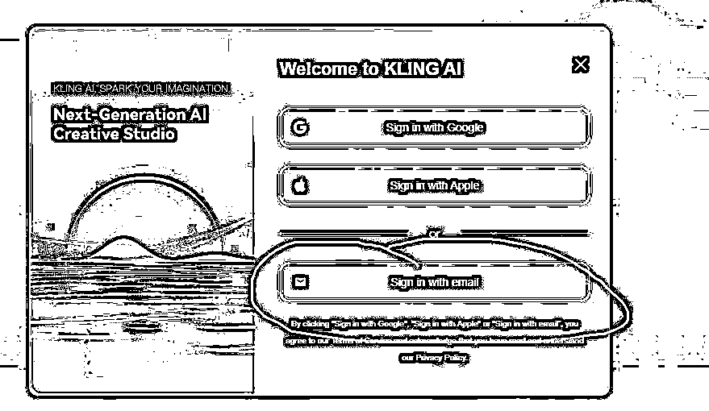
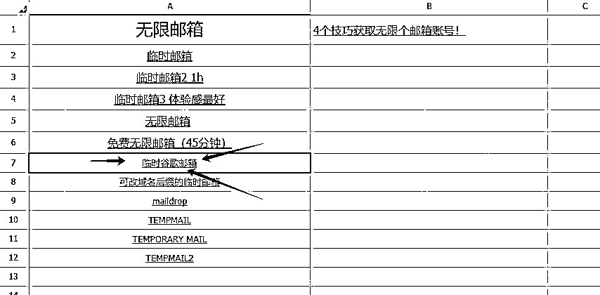
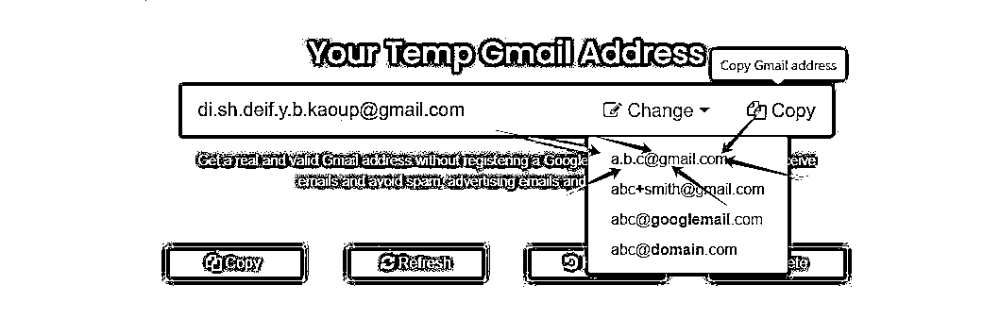
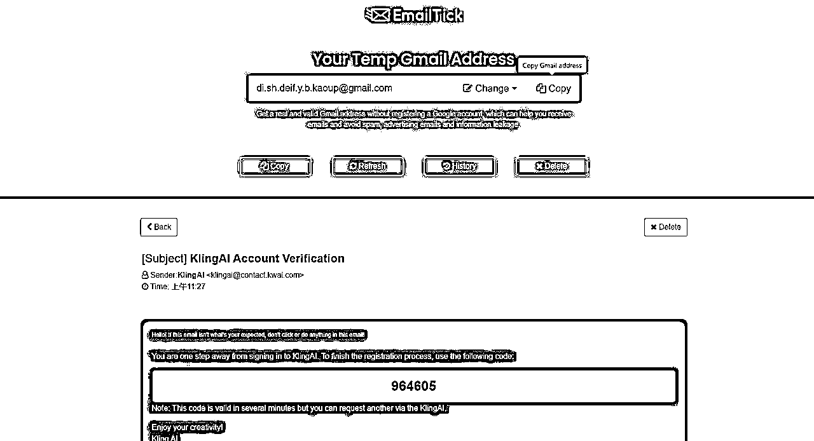
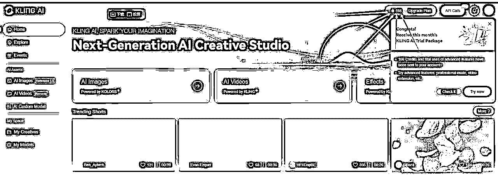

# 告别付费焦虑！可灵、Runway灵感值/积分无限刷的实操思路
作者：龙哥

做YouTube内容或者玩AI出图出片的朋友应该都懂，文生图、图生视频这几款工具真的香，尤其是可灵、Runway这种。但香归香，一旦开始算钱，灵感值、积分的消耗速度就太让人肉疼了。

我最近也在研究航海变现的素材库，跟群里一聊才发现大家都在愁同一个事：额度用完了就卡住了。今天就把我正在用的一个零成本续命方法分享出来，核心逻辑很简单。

**思路就是：临时邮箱 + 国际版可灵的账号注册福利循环。**

可灵的国际站会给新注册用户赠送启动灵感值，每次用全新邮箱注册一次，就能到账166点灵感值。以这个额度来算，足够你产出 4 条10秒视频，或者8条5秒短视频。等用完了就换一个邮箱再注册，循环往复。

重点是，目前这个操作门槛非常低，不需要去折腾IP代理、换设备、多开环境，纯粹靠账号本身就能走通。而且这个打法不止可灵通用，Runway以及其他支持邮箱注册送积分的AI平台，基本都能照这个套路玩。

实操入口我整理好了：

国际版可灵地址：https://klingai.com/

临时邮箱工具，推荐使用谷歌系的临时邮箱服务，方便快速生成一次性地址：

直接暴力重复注册即可，灵感值就源源不断。以后做测试、做批量封面、做短视频素材，再也不用担心额度花光的问题了。