# YT Shorts 复盘：动物预警赛道爆款拆解与万能提示词方案

# 开场心路

大家好，我是龙哥，12月 YouTube 航海的一员。从加入航海到现在，我的心态一路在变：先是兴奋上手实操，然后怀疑，再到激动，接着焦虑，最后变得笃定。起因是航海开跑前后几天，我试了完全不同的两个方向。之前做过内容，所以在看完老马教练的《YouTube Shorts 赛道选择与收益解读》后，我先走了解说类 Shorts，挑了与教练案例不同的工厂解说路线。数据起步不错，第一支就拿到4万多播放，后续大多破万。没过多久，账号直接进入0播放期，新老视频一起被停推。硬撑几日无果后，第一条线宣告失败。

重新梳理赚钱圈内关于 YouTube 的讨论，我才意识到自己漏掉了关键信息，

龙哥大佬提出的风向标是：用 AI 生成各类视频，搬到 YouTube 和 Shorts 去挂广告分成。我当时只盯住“广告、分成”几个字，没留意到“AI 生成”四个字。恰好自己也想补 AI 技能，索性借着航海把 AI 应用也学起来，于是开启了第一个 AI Shorts 赛道。

# Shorts AI 赛道的选择

## 航海数据自报

先说成绩。航海期间主攻 AI Shorts，8天冲到初级 YPP 标准，18天达到高级 YPP 标准。单支最高播放约3470万，涨粉18万+，累计播放量在6000万+左右。收益就不晒了，期间踩坑太多，实际到手并不理想，后面会逐一讲到。

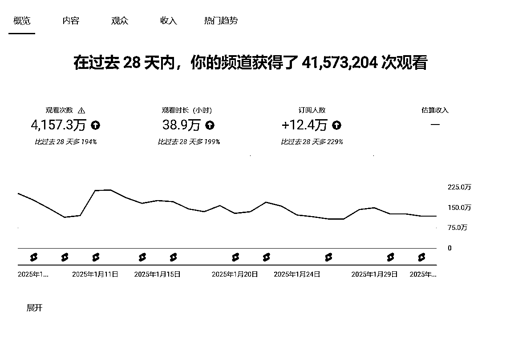

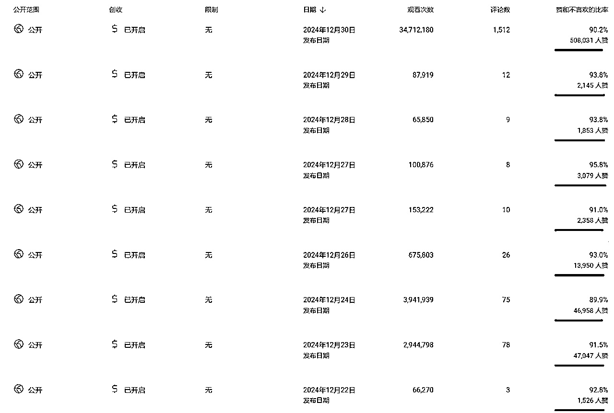

## 如何锁定 AI 动物预警

看过方波妮教练的《YouTube Shorts 项目实操：从 0 到 1 跑通账号，12 天收获 2700+订阅与 90 万+播放》，竹子的《YouTube Shorts 实操指南：AI 宝宝走秀与 Magic 变身视频制作》，以及老马教练的《YouTube Shorts 赛道选择与收益解读》后，我最初入局的是达人变身秀。选择它纯粹因为航海手册里是教练验证过的赛道。但理科男的特质让我对做这种内容提不起劲，实操中就是敷衍式产出，为了完成而完成。随便放两支航海初期做的变身秀，大家感受一下。

随后我想找一个能坚持做的方向。随意刷了一阵油管后，我注意到第一个对标频道：快乐探险家。

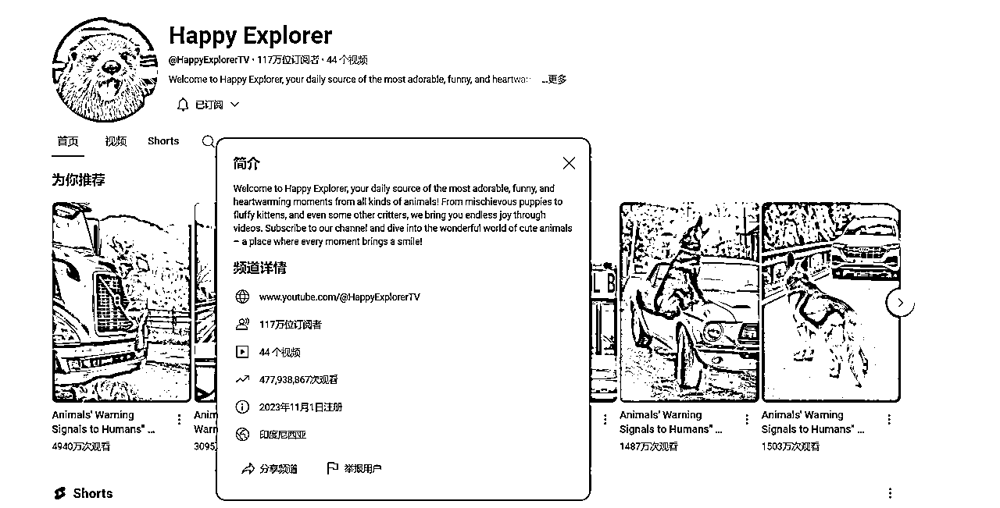

点进去看注册时间、视频数量等航海手册里强调的对标指标，发现频道虽然注册较早，但这个细分类型的投放时间并不长，播放表现却很亮眼。接着我按标签进一步深挖同类频道。可惜当时同赛道账号很少，找了很久只锁定三个，而且航海手册里未曾提及。但数据都不差。综合判断后，我决定对标这个账号的形式开干。工具、方法直接照搬圈友分享的资源。

数据很快给了反馈，前几支都在1.5万播放上下。不断对标拆解、精炼提示词后，第6到7支时出现首个小爆款，86万播放。这让我坚信赛道有流量潜力。接下来的一周里，陆续出现几十万、几百万级别的视频。

在创作过程中，我逐步归纳出自己理解的爆款要素。

## 爆款要素拆解

AI 动物示警、AI 动物救援这类内容，本质是靠共情和情绪共鸣驱动，国内国外都一样，情绪到位流量自然来。但为什么有的能爆，有的卡在万播？

我从几十万到几千万的跃迁里，总结了几个关键点，供参考。

### 色彩质感

反复看对标和自己的片子后，我发现差异点在于“像不像真拍”。对标账号几乎能以假乱真，我的片子一眼就能看出 AI 感。上两支做对比，一支2.6万播放，一支3400多万播放。去掉运气因素，第二个视频的画面色彩更接近实拍，让用户误以为不是 AI 产物。评论区也印证了这一点，这类视频一旦爆，评论基本都是观众分享自己的真实经历。相信做同赛道的朋友已经猜到我的账号了。

建议：文生图阶段要把色彩搭配放在第一位，力求还原相机实拍的观感，画面明亮但不过曝。

下面放两张图直观感受色彩对真实感的影响，后面我会讲我的做法。

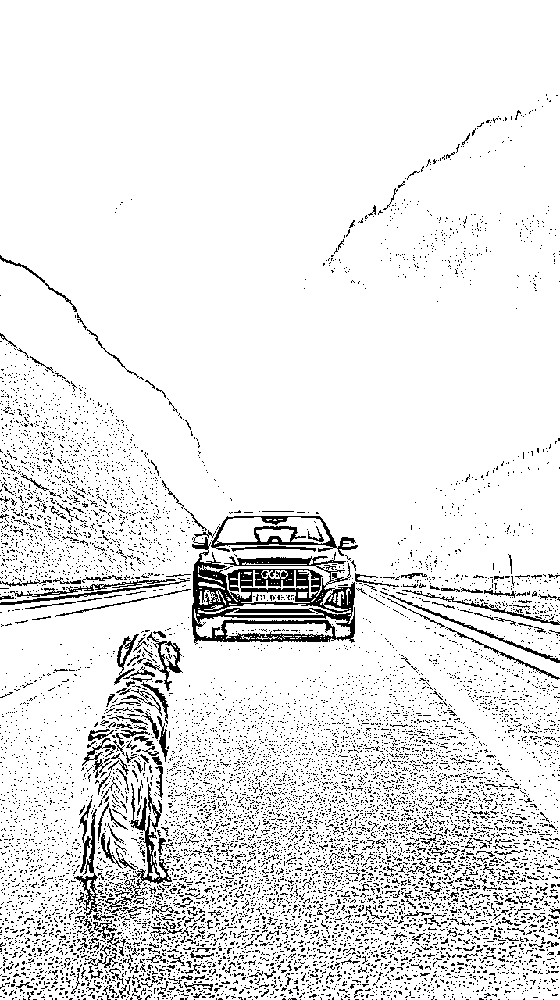

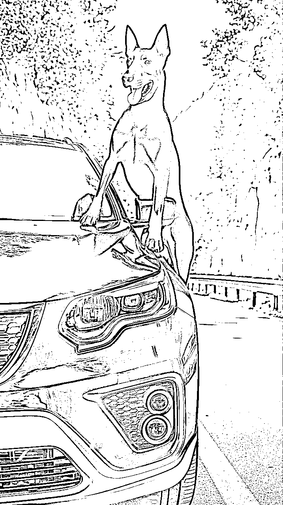

### 真实度

#### 文生图真实度

这点贯穿全流程，从文生图到图生视频。第一步文生图，提示词写法不同、绘图工具不同，结果差异很大，后面会分享我用过的软件。

#### 图生视频真实度

有了合格的分镜图后，下一步是图生视频。这里的真实度体现在主体运动是否符合自然规律，比如狗奔跑、跳跃、攀爬等。动作连贯是基础，但如果僵硬或明显有计算机味，AI 痕迹太重，这类素材就不建议用。

另外要提醒：第一步文生图的质量会直接影响到图生视频的还原度和表现力。

当然也有人走抽象路线，故意保留离谱的 AI 镜头当槽点，借此引评论。真实派走真实，抽象派走抽象，各取所需。

### 适度特写

实操验证后我发现，适当加入特写或近距离镜头，能明显提升代入感。我通常会把动物异常行为的分镜单独做一个特写，或把镜头稍稍推近。无论是图生视频的细节质感，还是整体观感，都会有惊喜。放两张图感受下，近距离确实更容易让人沉浸。

这只是我的体感，因人而异，大家自行测试。

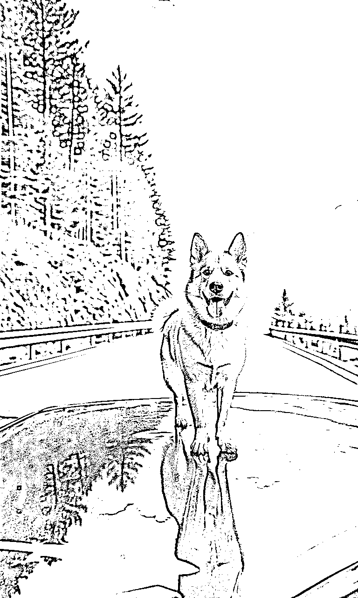

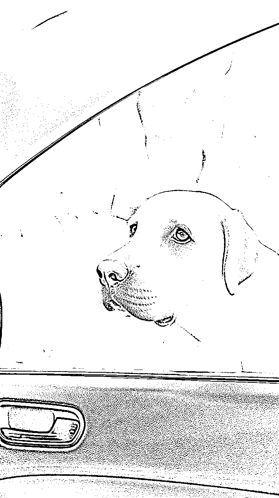

### 清晰度

有些伙伴会疑惑：我生成的图已经很清晰甚至是超清，为什么成片看着总有种糊感？这问题多半不在源图，而在图生视频和剪辑环节。

#### 图生视频阶段

不同平台的模型推理方式不同，部分模型在生成时会主动损失画质。图生视频不会因为你喂 4K 图就输出 4K 视频，高清图主要是帮助模型更好识别和理解提示。大部分输出在 720P 或 1080P 左右，部分平台对会员开放更高画质，比如可灵的 35 灵感值档、即梦会员高画质、智谱清言会员等。根据预算选择画质损失最小的方案。

#### 剪辑阶段

分镜剪辑和加音效本身对画质影响不大。即便为了去水印把画面放大到 105%，再把 Y 轴调到 -70 到 -80 左右，也不会明显糊掉。最关键的是导出参数。以剪映为例，我的做法是 4K 60 帧导出，码率用推荐值即可。

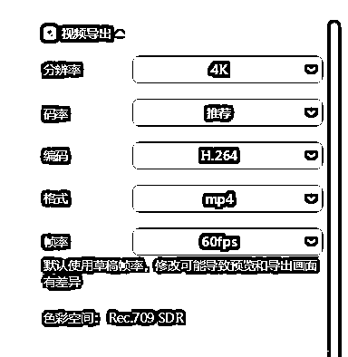

### 分镜结构

我目前常用 5-6 个分镜组合：动物拦车 + 动物与车互动中景车外视角 + 动物与车互动近景特写车内向外拍 + 灾难镜头主角车辆与动物二选一入画 + 动物近景特写可选 + 温情收尾。按这个结构控制时长在 22-26 秒之间，节奏比较稳。

# 创作工具与使用感受

工欲善其事必先利其器，下面是我实操中用过的工具。

## 提示词环节

* 提示词优化工具：GPT4、DeepSeek

思路：先对对标视频做分镜拆解，整理出自己的分镜需求，再把分镜图上传给 GPT 让它反推提示词。

说明一下为何不用 MJ、SD 反推：一来我对 MJ、SD 不熟，二来它们反推的词经常混乱。GPT 能识别图片，反推准确度更高。DeepSeek 我不用它做主推，因为它只能识别图片里的文字，无法整体理解画面。选用 GPT 的主要原因是想固定提示词的结构，因为词序会影响权重。让 GPT 用中英文对照输出，便于后续修改和优化。

比如我想做“狗趴在窗外”的分镜，自己写一直出不来。把想法和对标图一起丢给 GPT，才拿到理想效果。

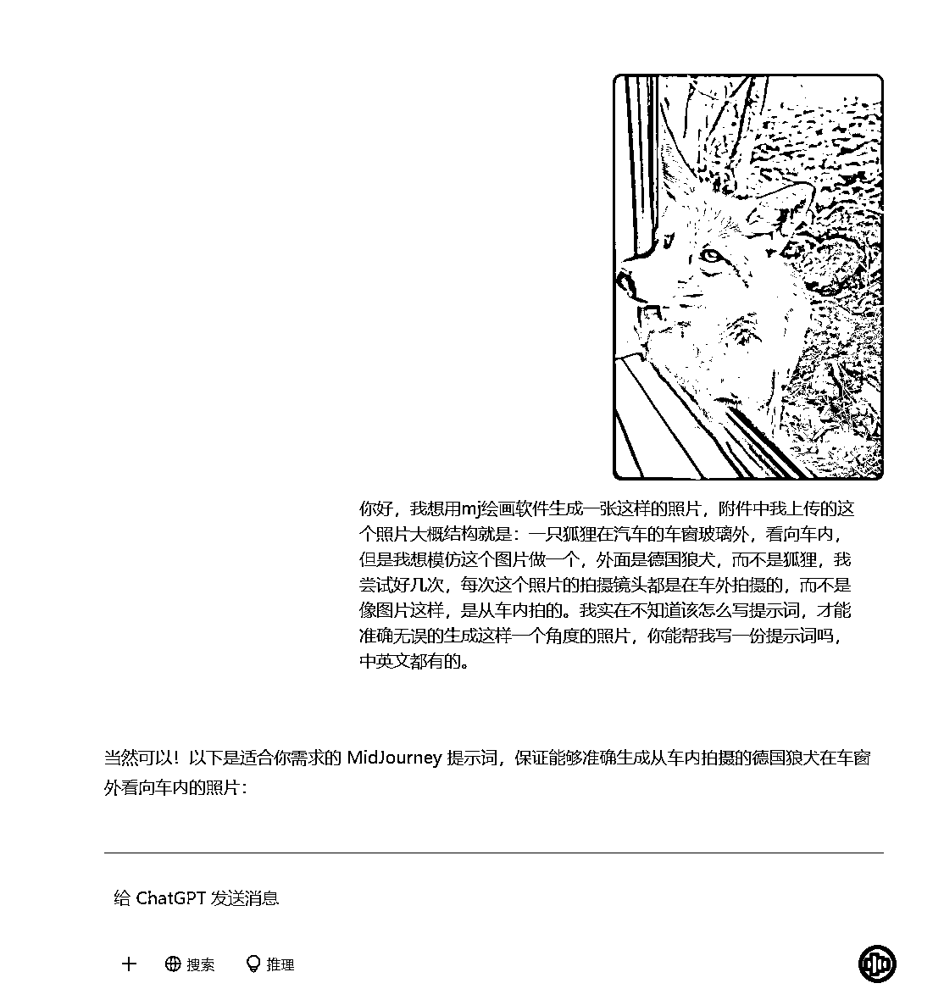

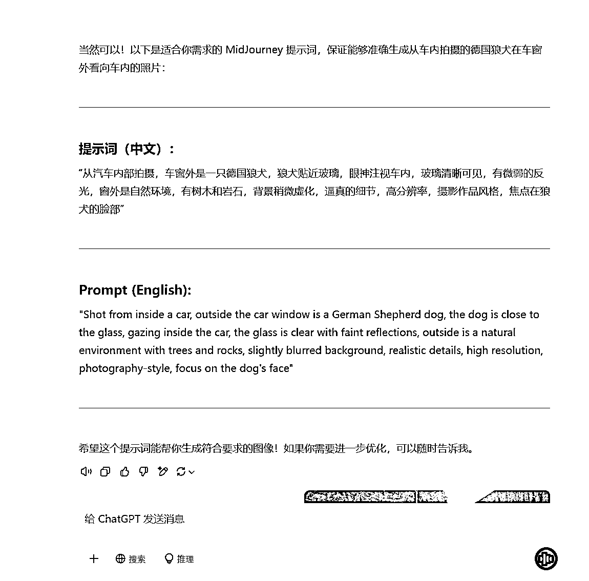

再比如我想做侧面镜头拍摄车头坠入坑里，对标里没有这个镜头，我就找一张侧面网图让它推理提示词。

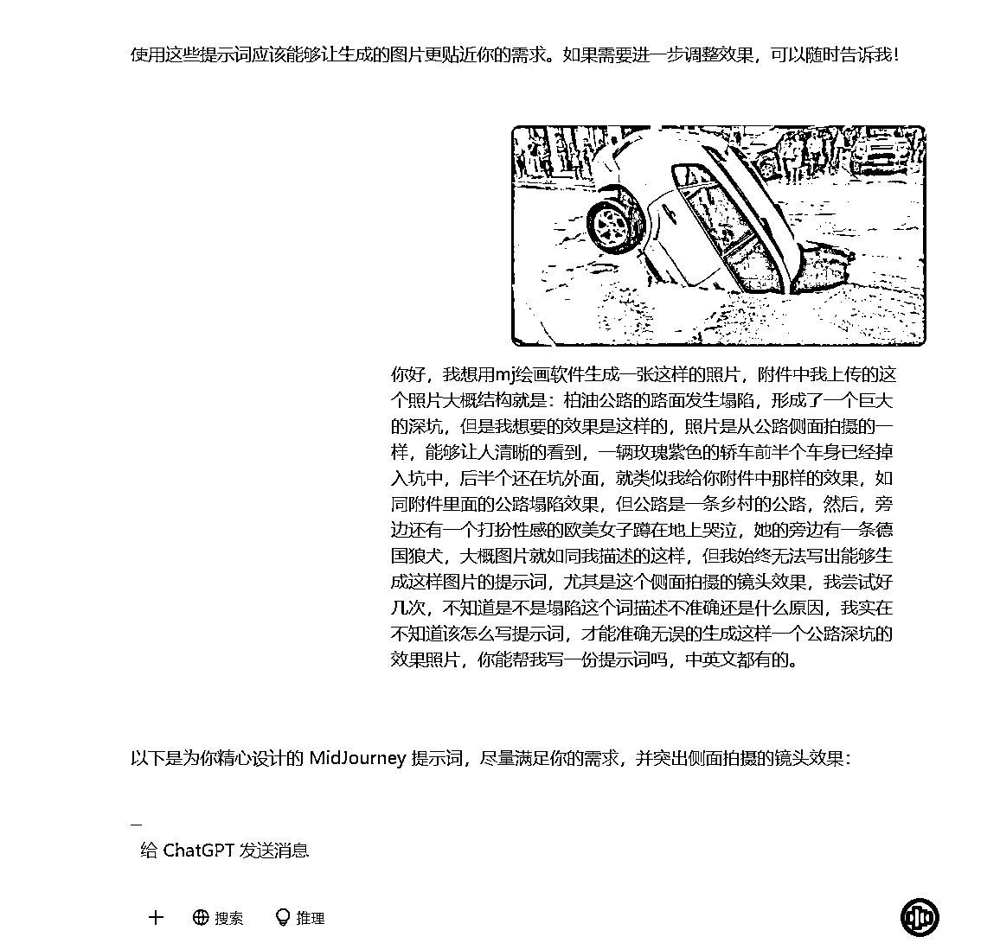

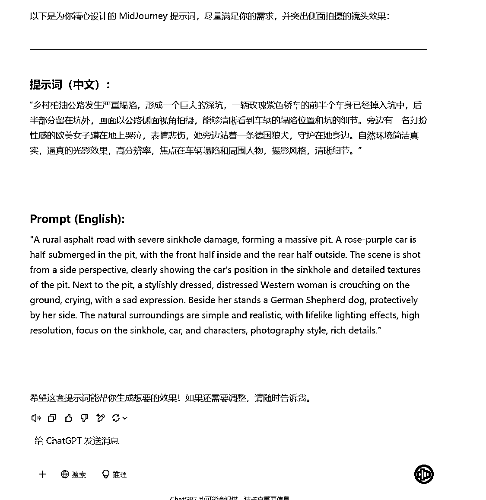

即便如此，GPT 给的词也不一定一次到位。这时 DeepSeek 就派上用场，把 GPT 的提示词丢进去，把生成后出现的问题一起描述，让它帮忙优化。最近 DeepSeek 很火，试了一下效果不错，基本能实现想要的效果。

但光靠复制粘贴每天都要重复操作，必须整理成自己的模板，才能真正降本增效。具体模板后面会详细展开。

## 文生图绘画工具

* 文生图：Midjourney、Stable Diffusion

这两个我也是新手，方法就不赘述了，重点说色彩和真实感的心得。综合体验下来，SD 的出图更胜一筹。

* Stable Diffusion

自己电脑跑不动 F1 模型，我用的是 liblib 在线端 https://www.liblib.art/sd

大模型：绘梦写实摄影大模型、F.1 基础模型、星流 Star-Alpha 大模型

Lora 模型：纪实摄影 F.1、蔚蓝 Blue 高清动物摄影大模型

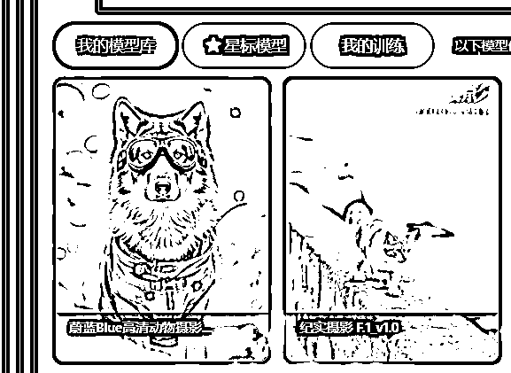

* Midjourney

用的是 v6.1，有时会出图过度清晰、色彩过饱和甚至发黑。遇到色彩偏离预期时，我会先用 SD 生成一张参考图，再用 MJ 的 --sref 加图链接做风格参考，这样质感会接近 SD。目前还没找到更好的 MJ 调色方法。

无论是 SD 还是 MJ，文生图阶段我优先看色彩和真实感，其次才是主体变形或站位。

PS：以上两个 Lora 效果不错，但还没达到我心中的最优动物质感，后续找到更好的会再分享。

## 图生视频工具

* 即梦：提示词复杂时响应不准，不开会员只能下低画质，pass
* Runway：不会用，个人感觉总是抽不到预期画面
* 海螺：效果接近可灵甚至更好，但容易动画化
* 可灵 AI：主力工具，基本一次过，缺点是基础额度有限
* 智谱清言：动作幅度小效果好，幅度大容易变形，AI 痕迹明显

# 提效方案：万能提示词模板

## 提示词拆解与模板化

为了减少抽卡，提高效率，我把提示词拆成主体描述、环境描述、镜头语言、画面质量四部分。比如：

一只拉布拉多站在乡间公路上，

back to the camera,

米白色的皮毛，俊美的外表

The 拉布拉多 is facing a 橘黄色轿车 approaching the camera，

the 橘黄色轿车's front headlights turned on and clearly visible。

这条路右边是高大的岩石峭壁，左边是草原和苔藓

天空下着毛毛雨，蓝色的天空，夏天的季节

focusing on the 拉布拉多's back and the 橘黄色轿车's front。

Natural light enhances realistic details.

照片视角是从人站立的高度拍摄的，中距离镜头拍摄

The image is in cinematic composition, realistic style, ,Film Photography,4k quality,

其中主体部分用绿色和红色标注，黄色为环境模块，其余为镜头语言和画面质量。

为什么用中英文混排？坦白说全英文我看不懂，分不清主体和环境。另外翻译软件不稳定，尤其是镜头语言，同一个意思不同次翻译结果不同，导致效果时有时无。所以我直接用英文固定关键词，避免翻译误差。

中英文混排的好处是减少因翻译偏差导致的无效抽卡，我基本一次过，偶尔才出现变形。相比纯中文提示词，抽卡次数大幅下降。

同理，狗狗从窗外看向车内的提示词可以这样写：

Shot from inside a car,

outside the car window is a 德国牧羊犬，

the 德国牧羊犬 is close to the glass，

gazing inside the car, the glass is clear with faint reflections,

outside is a 温馨的农场的自然环境，

focus on the 德国牧羊犬's face"

slightly blurred background, realistic details, Film Photography,4k quality,

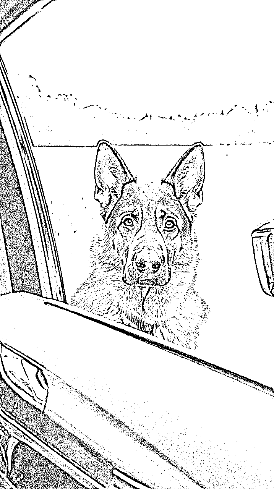

后续分镜都可以用同一套模板，只需更换汉字部分的主体和环境，镜头和画质部分保持不变即可。这样生产速度和通过率都会显著提升。

分镜头1：动物拦车

一只 [动物] 站在乡间公路上,

back to the camera,

[外貌特征] 保持角色一致性

The [动物] is facing a [车辆] approaching the camera,

the [车辆] 's front headlights turned on and clearly visible.

这条路右边是 [环境] ，左边是 [环境2] 主要为后续灾难做适应性对照

[天气描述] 调节图片整体色彩构图

照片视角是从人的站立的高度拍摄的，中距离镜头拍摄

focusing on the [动物] 's back and the [车辆]'s front.

Natural light enhances realistic details. （自然光增强了逼真的细节）

The image is in cinematic composition, realistic style, ,Film Photography,4k quality,

分镜1示例输出：

A white moose stands on a rural road,

back to the camera,

white fur Huge antlers, domineering appearance

The moose is facing a dark green car approaching the camera,

The dark green sedan's front headlights turned on and clearly visible

右侧道路是耸立的岩壁，左侧则是被草甸与苔痕覆盖的坡地

蓝天白云的盛夏

镜头高度按常人站姿取景，选用中景范围

画面主轴落在白鼣的身后与深绿轿车的车头

环境光的自然投射让质感细节更逼真

整体采用电影级构图，写实质感，胶片摄影，4K分辨率

镜头二、三：动物不寻常的举止

机位置于车厢内部

车窗外出现一头[动物]

毛色纯白、鹿角硕大、气势凌厉

该[动物]几乎贴近玻璃面

注视车内空间，玻璃透明度高仅有轻微反光

车外能看到[其中一侧环境]

[同步分镜一天气描述]

视觉落点集中在[动物]面部

整体采用电影级构图，写实质感，胶片摄影，4K分辨率

分镜示例输出：

Shot from inside a car,

Outside the car window is an albino moose

White fur Huge antlers, domineering appearance

The albino moose is close to the glass,

gazing inside the car, the glass is clear with faint reflections,

Outside is a primitive forest with thick trunks

Blue sky, summer season,

Focus on the face of the albino moose

The image is in cinematic composition, realistic style, ,Film Photography,4k quality,

镜头二、三：动物不寻常的举止

从驾驶位穿过[车辆]挡风玻璃的极近特写，画面底部微现方向盘轮廓，

一头[动物]立于[车辆]前方道路中央，

毛色纯白、鹿角庞大，[动物]面部约占画面60%，唾液滴落引擎盖，嘴部张开有口水顺流，

右方是高耸的岩石峭壁，左方是草甸与苔藓，

[同步分镜一天气描述]

The image is in cinematic composition, realistic style, ,Film Photography,4k quality,

分镜示例输出：

Through the extreme close-up of the dark green car windshield from the driver's perspective, the steering wheel can be vaguely seen at the bottom edge of the image,

A white skinned Rangifer Taranduss stands on the road of a dark green sedan,

White fur The huge antlers of the albino reindeer occupy 60% of the screen, and saliva drips onto the hood. Opening its mouth, saliva flows down,

On the right is a tall rocky cliff, and on the left is grassland and moss,

Blue sky, summer season,

The image is in cinematic composition, realistic style, ,Film Photography,4k quality,

在此基础上可把镜头四设定为危机或动物救护，救护时动物需呈现病态；镜头五设定为人与动物的亲善互动如抚摸拥抱，救护则需呈现包扎后的状态，形成一套可复用的框架。

## 视频拆解中的异同策略

拥有稳定分镜提示框架后，生产中仍需做微调。直接截图对标再图生图虽可操作，但可变性受限，有时仅对分镜做小幅调整即可保留原意并形成差异。

以动物示警举例，对标账号提炼的通用链路为：

镜头一：动物拦停车辆
镜头二、三：动物反常行为
镜头四：危机降临
镜头五：人与动物互动

在保留核心节拍的前提下，可对局部分镜做等价替换。例如二、三的反常行为，可更换动物的姿态、与车体的相对位置、取景机位等，从车内向外拍摄或车外后视的呈现感不同，但警示意图一致。

灾害段落则可依据前序环境词库切换，如山体滑坡、泥石流、大石坠落、桥梁断裂、地陷、猛兽现身等。

此外，修改提示词可把动物示警转为动物自救、动物救援等方向，实现赛道迁移。吃透逻辑后分镜安排就顺畅了。因内容可能对密集恐惧人群不适，故不放视频。

# 视频制作全流程

## 文生图

把提示词模板复制到翻译工具，修改主体与环境要素后得到各分镜提示词，再用绘图软件出图，我常用的是 stable diffusion，具体模型与 lora 参见 3.2 部分。可得到分镜图

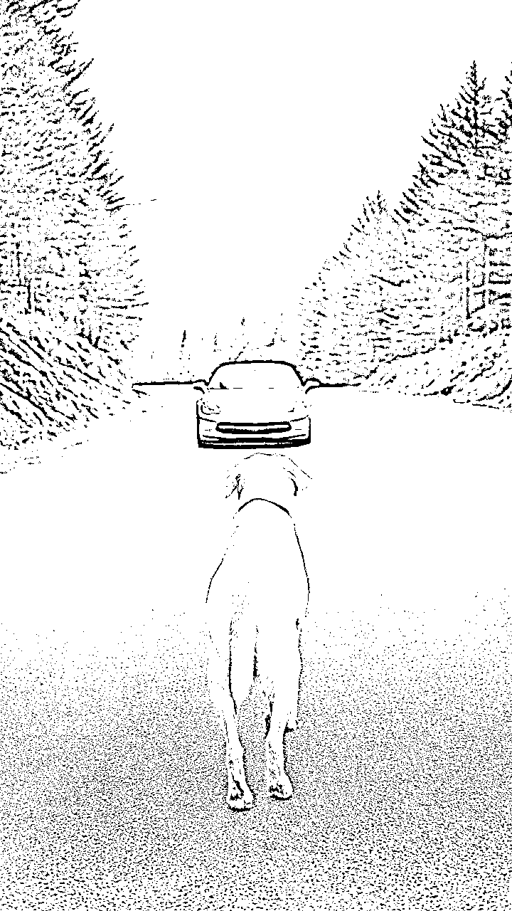

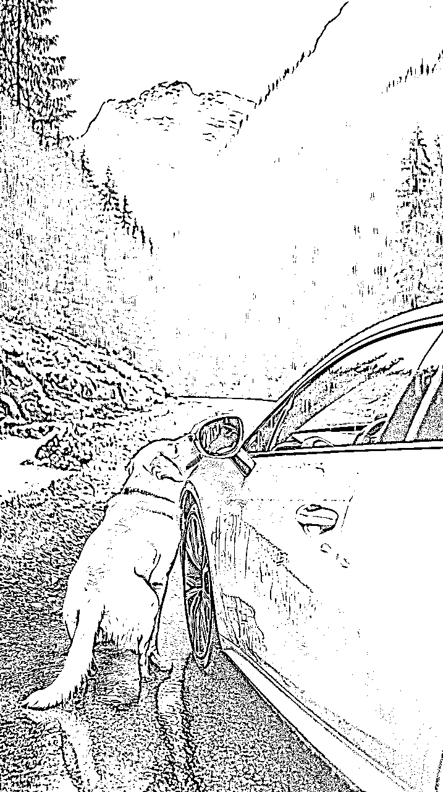

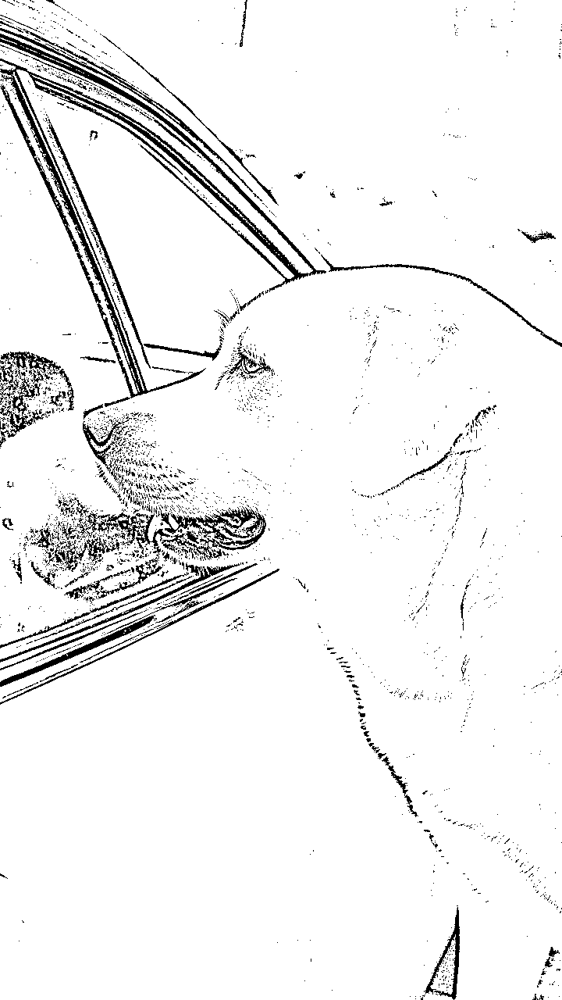

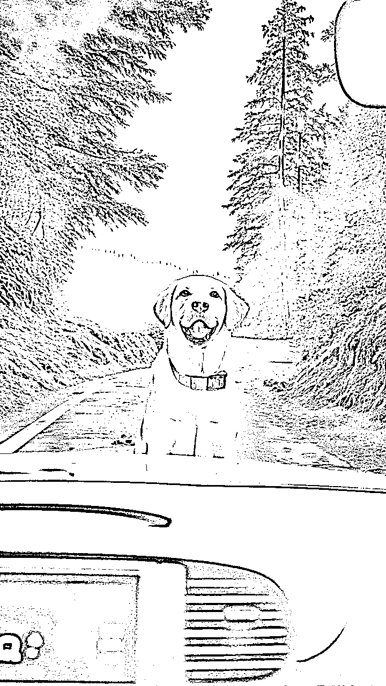

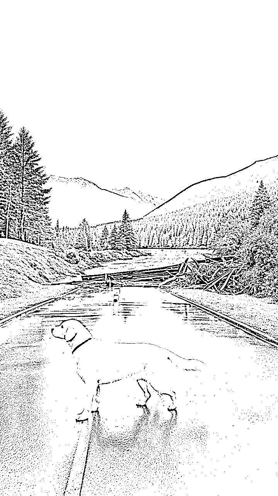

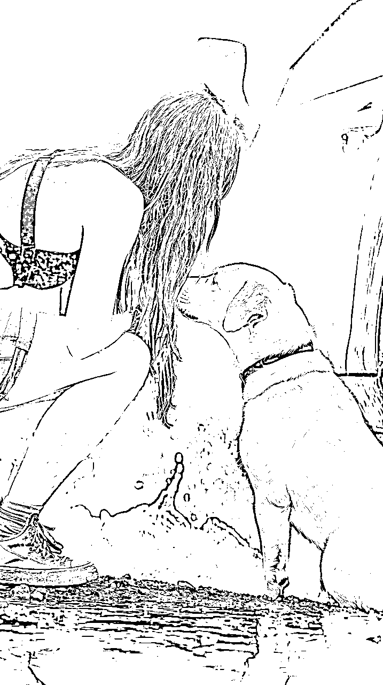

## 图生视频

随后用海螺 AI / 可灵 AI 将分镜图生成片段，图生视频提示词基本固定，需留意先后顺序与权重，权重变化会影响画面运动。

可灵 AI 我采用标准模式，比高品质模式更省成本。

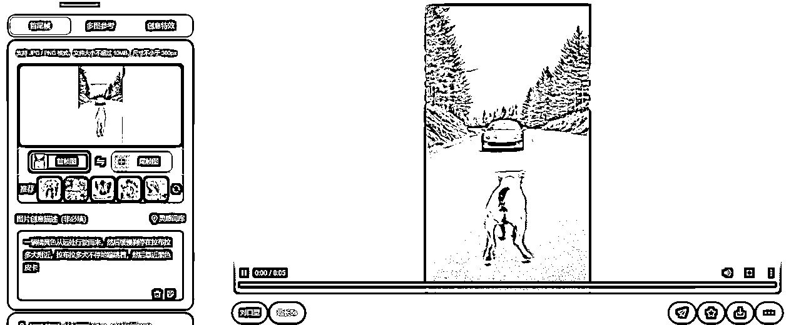

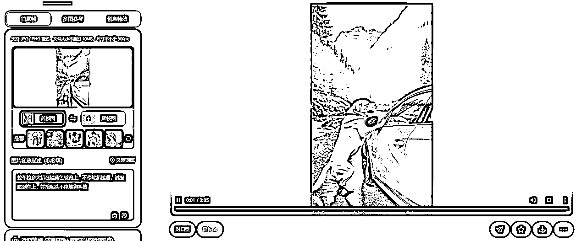

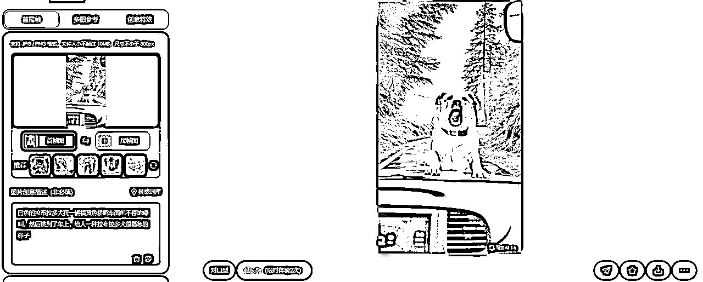

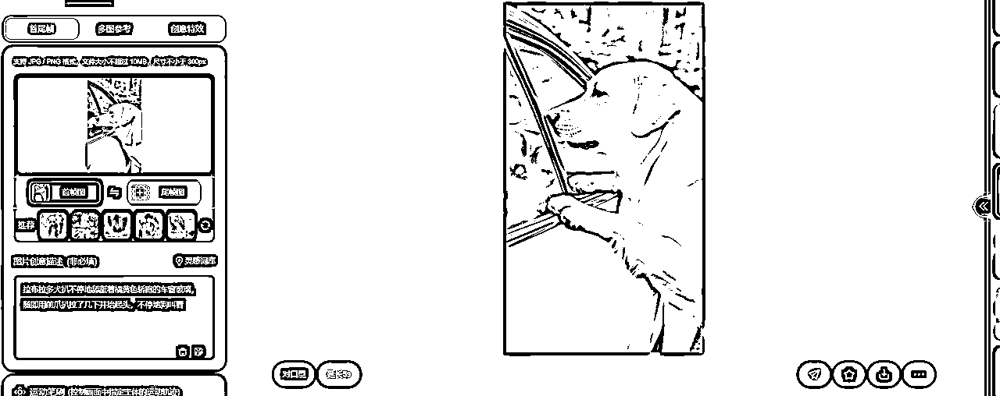

## 剪辑配音

与达人秀不同，达人秀一条 BGM 就行，动物示警需按进度严格匹配音效。

把生成片段按顺序导入剪映，全选后先统一 1.2 倍速，使节奏更紧凑。

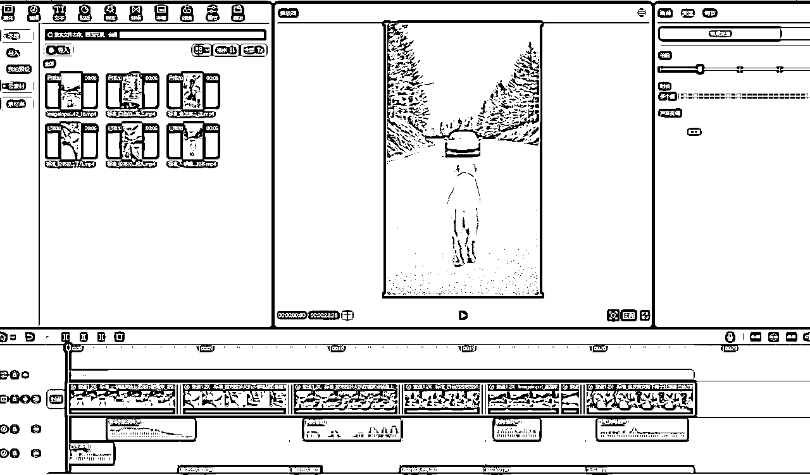

再逐段检查，剪掉首秒静止影响流畅的部分，随后进行音效配音。

音效可直接在剪映自带库中搭配。

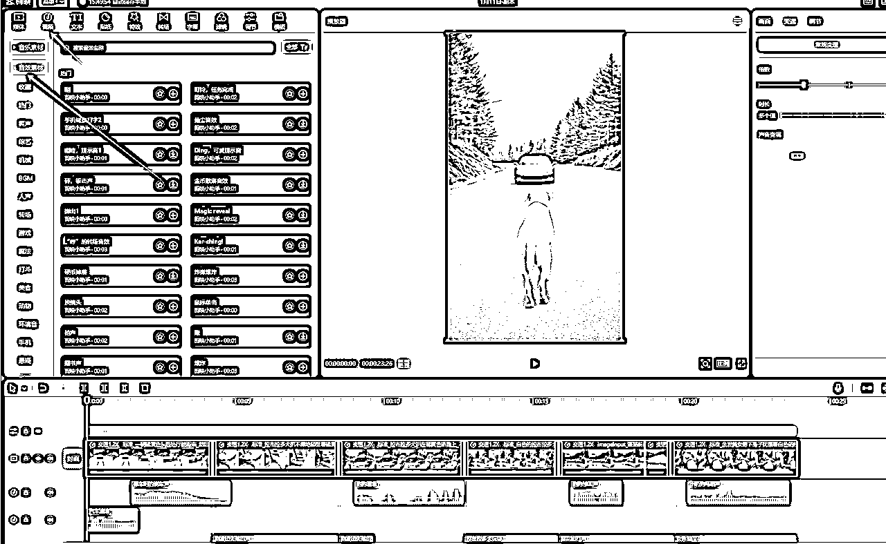

在搜索框检索所需音效素材。

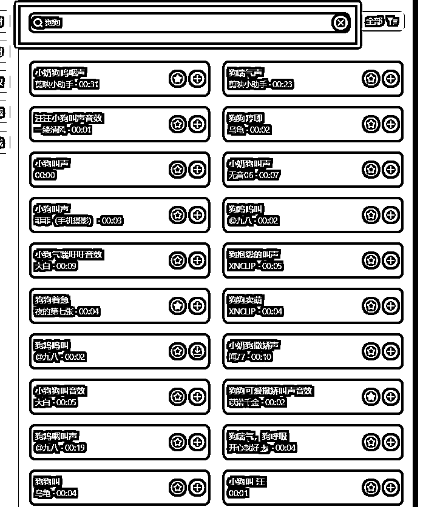

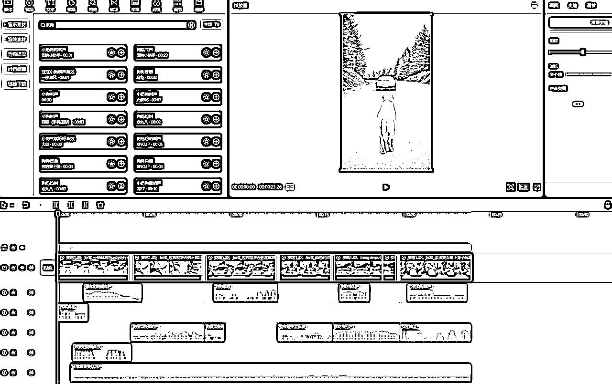

常用音效有：环境白噪音、犬吠、委屈叫声、焦急叫声、舔舐声、拉布拉多玩耍声、汽车喇叭、刹车声、发动机怠速声、海浪拍打声等，按视频与审美自行搭配。

亦可按表现调节色彩等，最后以 4K 60 帧导出。

# 从起号到首个 100 美金的心得与问题

## 网络环境

实操初期最大难题是网络，我对 IP 犹豫很久，试过市面上常见的 Airport，也按圈友施仁的《搭建海外节点：三款免费工具 + 99 元腾讯云，实现每月 1000G 流量》自建过，还买过数据中心 IP、静态住宅 IP，均出现不同程度的 0 播。

参考航海实战教练的检测法，只要欺诈风险、黑名单等指标安全即可使用。整体看 YouTube 对 IP 管控不严，数据中心 IP 与住宅 IP 都能使用，兼顾经济性前期不建议直接上住宅 IP。当然预算充足时住宅 IP 体验最佳，能模拟真实家庭宽带地址，只是成本较高。

多账号操作可参考《将任意协议节点转换为 socks 节点，无需搭建 socks 代理，小白一键生成 clash 配置文件，socks 代理多入口多出口，一个端口对应一个节点，助力跨境运营、网络爬虫，跨境电商必备工具》，实现低成本运营。

账号可自注册也可购买，我一般买与 IP 同地区的账号，如网络环境在新加坡，就选新加坡账号，或买了新加坡账号就配新加坡网络，减少地区跨度触发风控。

## 0 播问题

0 播耽误我最久。第一个号做得不错时开始扩号，遇到过首条就 0 播、数据正常数日后突然 0 播、连历史视频也不再推荐。总结原因如下：

0 播 ≠ 0 推荐

视频 0 播放时，先看 YouTube 工作室 - 内容 - 覆盖面，若推流次数为个位数但播放为 0，说明账号基本正常，可继续更新观察。若推流为 0，播放自然为 0，则账号、IP、内容三者至少有一项异常，需逐项排查或直接换号，多为账号问题。

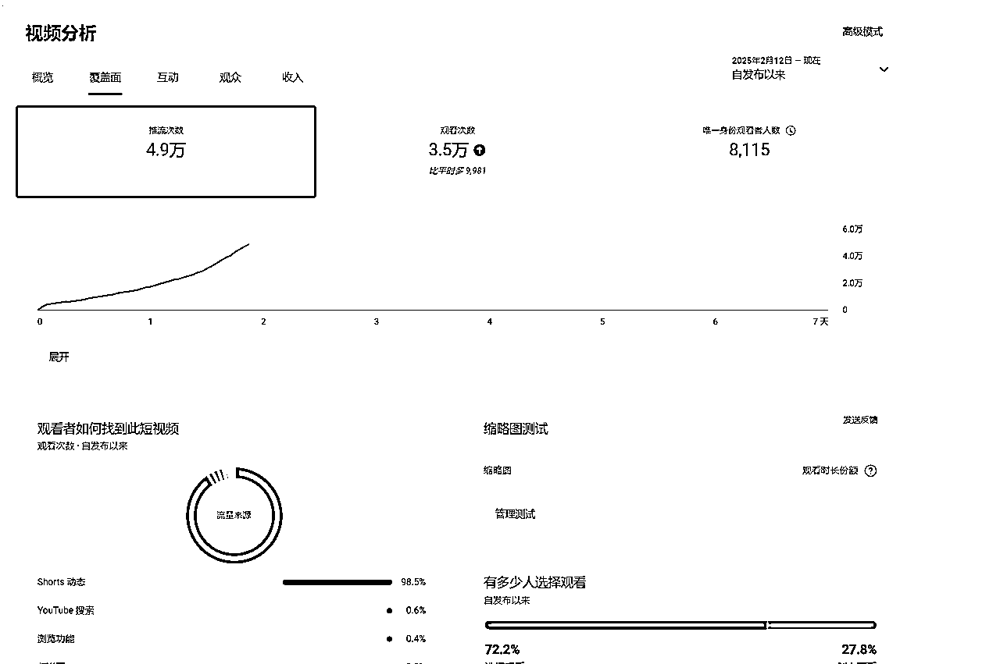

### 频道是否被收录

视频能播放的前提是频道被收录，若频道搜不到，视频也难被推荐，新频道收录约需 24 小时内。发视频前最好完成频道装修，头像、简介、名称齐全。

首条 0 播可先观察，有时隔两天才开始推。

### 网络引发的 0 播

经自己验证与圈友实践，IP 确实会导致 0 播，且即使检测达标也不一定安全。有圈友换了网络环境后 0 播消失。

### 界面语言引发的 0 播

养号一周后发视频仍 0 播，已是第 7、8 个 0 播号。两天无播放时我刷视频发现刷不到日本内容，突发奇想把界面语言改为日语，此前为中文。两天后登录发现前两天视频开始有播放。怀疑账号地区与界面语言不一致导致 0 播。此后严格按账号地区对应语言，再未频繁出现 0 播。

### 更新数日后突然 0 播

此情况出现在新号、自建节点时，注册养号发布内容网络未变，IP 固定，初期流量稳定破万，三四天后新内容 0 推荐。暂无理想解法，只能换号应对。

## YPP 开通

我很快达到初级 YPP 条件，但首次申请被拒，理由为重复利用他人内容。

当时心态崩了，正准备申诉，却因删视频、改头像昵称导致不符合申诉要求而放弃。感谢教练方波妮的指点让我宽心不少。

一个月后重新申请，当晚提交次日通过。为提高通过率，我做了以下调整供参考：

* 1. 视频左下角加入人头实拍镜头，每条随机截取数十秒加入。
* 2. 后续视频加入文字描述，用纯文本讲解剧情，无配音。
* 3. 后台设定视频简介模板，后续自动添加。官方审核会考量简介，故全量添加。大致内容为：

Note: This is a short video generated by AI, not a real thing,

All the pictures and sound effects are made by myself, please do not copy or plagiarize,

Production software: mj, sd, runway, kelingAI, hailuoAI

The original intention of this channel and short video production is to call on everyone not to harm wild animals,

Sometimes, their abnormal behavior may simply be to help you.

Even without your knowledge, help you avoid danger.

# AI 动物示警赛道的后续思路

## 思考

老马教练、方波妮教练、Gary 曹淦教练多次提到，任何赛道和账号都会进入流量衰退期，衰退期来临，AI 动物示警该如何转型？

以下为我实践的一点思考。

前面提到为提升效率，我用提示词模板降低抽卡率，转型时可沿用此模板过渡。

思路如下：

在动物示警模板中，把主体换成受伤动物，或近期热门的动物密集恐惧救援，即爬满蜜蜂、遍布虫子的那种。第二、三镜头同理，只需把自然灾害镜头换成人救援分镜，如人类为动物驱虫、包扎、手术。最后镜头按剧情微调即可，已在小号测试可达万播的基础流量池，因新号流量规则暂无法确定是否为长期赛道，有爆款会及时分享。

这样动物示警模板即可巧妙变为动物救援赛道，同理可发散到更多赛道。

后续创作只需更换动物主体、环境等要素。分享一个我正在尝试的动物救治赛道的固定模板，可能存在优化空间，模板已验证可跑出数十万流量，目前尚未自动化，正在学习李哥帖子。

## 分镜头模板库

分镜 1：危机引入

A [动物] stands on [路面类型],

[受伤部位] trapped in [伤害源] (with [细节特征]), [液体描述] seeping from wounds.

[动物] faces camera sideways, [表情描写] reflecting pain and helplessness.

Right: [右侧环境], Left: [左侧环境].

[天空状态], [季节].

[镜头高度]+[镜头类型] focusing on [焦点].

The image is in cinematic composition, realistic style, Film Photography, 4k quality.

示例：A kangaroo stands on the gravel road of the grassland, with gray white fur.

这是一组以动物救援为核心的影像分镜脚本，画面始终围绕一只颈部受伤的袋鼠展开，环境与镜头语言保持高度统一。

初始画面里，袋鼠的脖颈被生锈的铁丝网紧紧勒住，尖锐的挂钩深深刺入皮肤，伤口处渗出鲜红的液体。它的神情满是痛苦，眼中透着挣扎与无助。道路右侧是辽阔的非洲大草原，左侧则是沼泽地。天是湛蓝的，季节为夏季。拍摄视角在站立人类的高度，中焦镜头取景。整体采用电影级构图，写实风格，胶片摄影质感，4k画质。

分镜2：车辆介入
一只受困的动物在紧张地注视着驶近的[车辆颜色][车辆型号]，重复的伤害细节被进一步强调并加入新特征。动物的身体反应显露出应激状态。车辆的某处部件占据画面大面积比例。环境保持一致，右侧草原左侧沼泽不变。镜头参数的调整突出关键主体。画面依旧是电影级构图、写实风格、胶片摄影、4k画质。

示例参考：袋鼠站在草原的碎石路上，颈部被生锈铁丝网束缚，尖钩刺穿皮肤，血色液体渗出。背对镜头，它的灰白色毛发在阳光下泛着光。面前是一辆驶来的蓝色Jeep，前大灯清晰可见。路右为广阔非洲草原，路左为沼泽。天蓝夏日。人高的视角，中焦镜头。焦点落在袋鼠背部与蓝色Jeep车头。自然光强化细节。电影级构图、写实风格、胶片摄影、4k。

分镜3：车窗视角特写
动物立于[路面类型]上，[受伤部位]被困于[伤害源]，细节特征明显，伤口处[液体描述]渗出。动物侧脸面向镜头，表情描写传达疼痛与无助。右侧为[右侧环境]，左侧为[左侧环境]。天空状态与季节如前。镜头高度与类型聚焦于指定焦点。电影级构图、写实风格、胶片摄影、4k。

示例参考：从蓝色Jeep车内拍摄，通过车窗看到袋鼠。颈部被生锈铁丝网紧缚，尖钩刺入皮肤，鲜红液体渗出。袋鼠靠近玻璃凝视车内，玻璃清澈， faint地反射着外侧的广阔草原。焦点在袋鼠面部，背景略虚，细节真实，高分辨率。电影级构图、写实风格、胶片摄影、4k。

分镜4：动物与车的互动
动物站在[路面类型]上，[受伤部位]被困[伤害源]，细节特征清晰，液体渗出。动物侧身对镜头，表情显现疼痛与无助。右侧环境、左侧环境、天空状态、季节均延续。镜头高度与类型聚焦焦点。电影级构图、写实风格、胶片摄影、4k。

示例参考：袋鼠站在草原碎石路上，正在舔舐蓝色Jeep车身侧面。颈部被生锈铁丝网紧缚，尖钩刺入皮肤，鲜红液体渗出。路右为非洲大草原，路左为沼泽。天蓝夏日。特写镜头，站立高度拍摄，3/4右后视角，电影质感，写实，自然光，4k胶片。

分镜5：人类介入
动物站在[路面类型]上，[受伤部位]被困[伤害源]，细节特征可见，液体渗出。动物侧身对镜头，表情描写体现疼痛与无助。右侧环境、左侧环境、天空季节不变。镜头高度与类型聚焦焦点。电影级构图、写实风格、胶片摄影、4k。

示例参考：袋鼠立于草原碎石路。颈部被生锈铁丝网紧缚，尖钩刺入皮肤，鲜红液体渗出。身旁一名中年白发男子，身穿白衬衫与蓝色牛仔裤，手持钳子走向袋鼠。背景中蓝色Jeep停靠路边。天蓝夏日正午。人高视角，中焦镜头。焦点在袋鼠身体与Jeep车头。电影级构图、写实风格、胶片摄影、4k。

分镜6：救援特写
动物站在[路面类型]上，[受伤部位]被困[伤害源]，细节特征可见，液体渗出。动物侧身对镜头，表情体现疼痛与无助。环境与天空季节延续。镜头高度与类型聚焦焦点。电影级构图、写实风格、胶片摄影、4k。

示例参考：袋鼠站在草原碎石路。中年男子身穿白衬衫蓝牛仔裤，用钳子拆除袋鼠颈部生锈铁丝网。颈部深可见割伤，暗红色液体沾染灰白毛发。路右草原路左沼泽。背景蓝色Jeep停靠。男子与袋鼠近景，袋鼠占画面约70%。电影级构图、写实风格、胶片摄影、4k。

分镜7：救援递进
动物站在[路面类型]上，[受伤部位]被困[伤害源]，细节特征可见，液体渗出。动物侧身对镜头，表情体现疼痛与无助。环境与天空季节延续。镜头高度与类型聚焦焦点。电影级构图、写实风格、胶片摄影、4k。

示例参考：袋鼠站在草原碎石路。中年白发男子身着白衬衫蓝牛仔裤，为袋鼠颈部缠绕绷带。绷带处渗出暗红色液体。路右草原路左沼泽。背景蓝色Jeep停靠。人物与动物近景，袋鼠占画面约70%。电影级构图、写实风格、胶片摄影、4k。

分镜8：救治结束 动物与车辆离开
动物站在[路面类型]上，颈部已缠绕多圈绷带，少量暗红色液体自绷带渗出。表情转为释然，眼中流露感激。右侧为广阔非洲草原，左侧为沼泽。天蓝夏日。蓝色Jeep停靠路边，车尾面向镜头，似将驶向远方。拍摄视角为人高高度，中焦镜头偏离主体。电影级构图、写实风格、胶片摄影、4k。

特别感谢

@方波妮教练，如果你心态不对了，请一定找方波妮教练聊聊，一个自信乐观充满能量的美女。

@Gary 曹淦 曹教练，几乎可以称之为 YouTube 百事通，不管是什么问题总能在曹教练这找到解决办法。热情且慷慨，是真的在解决问题，分享干货。

@吖占 认识占哥是在后续的陪跑阶段，从此不再孤单，作为项目搭子，我跟占哥几乎每天都在交流如何增强视觉效果，互相分享新赛道，很享受这种互相激励，互相探讨，加油打气的氛围。

最后，感谢@七天老师、@波妮教练、@Gary曹教练对文章给予的指导！

后续有新的爆款玩法，再来给大家做汇报，祝大家早日开通ypp。

本文引用

1.老马教练：《YouTube Shorts 赛道选择与收益解读》

2.方波妮教练：《YouTube Shorts 项目实操：从 0 到 1 跑通账号，12 天收获 2700+订阅与 90 万+播放》

3.竹子：《YouTube Shorts 实操指南：AI 宝宝走秀与 Magic 变身视频制作》

4.老马教练：《YouTube Shorts 赛道选择与收益解读》

今天想和大家分享两个亲测值得收藏的干货主题，分别来自施仁和李香君，都是能直接解决实际问题的。

施仁的主题是把海外节点搭起来。很多人觉得这事又贵又麻烦，但他的思路很落地：不需要复杂的设备，用三款免费工具打配合，再入手一台99元的腾讯云服务器，就能把节点搞定。而且这套配置的月流量可以达到1000G，日常折腾完全够用。

李香君则把目光投向了AI视频的生产效率。她分享的是怎样把视频制作的整体效率拉上去，减少无谓的等待和返工，让创作节奏更快、更顺。

两篇内容方向不同，但都讲究实用和效率。如果你正需要搭建节点，或者想让AI视频创作更快更顺，建议认真看看这两篇。