# 我利用影刀制作了一批自动发布工具，在解决了拖延的同时还提高了效率，方法和工具奉上

我把重复的发布工作全扔给影刀了，拖延症好了，效率也上来了——脚本和教程都给你

先交代下背景。我做事特别容易拖拉，特别是手上同时有好几个项目的时候，明明每一件都不难，就是会忍不住往后推。后来有天早晨泡茶的时候，我把手头所有项目、每日要做的事都摊在纸上，无意间想起了大学时读过的泰勒科学管理法，突然就找到自己拖延的根源了。所以这篇文章想写给那些同样被困住的朋友。

先说一个常见的坑。做内容的人基本都同时面对七八个平台：视频那边的抖音、快手、B站、视频号，图文端的📕、小绿书，写文章的👸号、知乎。普通人想在哪个平台吃到流量，就得顺着哪个平台的脾气来。我之前图省事，剪好一个视频就用一键分发工具往所有平台推，结果每条内容都是四不像，哪个平台都不待见。后来我总算想明白：越是有价值的平台，越不能用假装努力来糊弄。

想明白之后我的策略变成了按平台定制内容：按📕爆款思路做的，只发📕；按抖音思路做的，只发抖音。可这样一来，我反而变得更拖了。原本最理想的状态是做完📕顺手做抖音，但我常常做完了📕就开始喝茶、刷视频、翻书，两小时能干完的事最后拖四个小时。这才有了后面这套方案。

整套方案的理论底座还是泰勒科学管理法。这方法在企业里到处可见——部门分工，各管一摊，组合起来效率就高。个人干活也一样，同一类任务连着干两三遍之后，不仅平均耗时越来越短，质量也越来越稳。我自己的经验是，重复到一定程度就进入了心流状态，那会儿效率真的高。

方法本身不难：一次瞄准一件事，把一周的同类任务集中做完。比如我周一上午就专门做📕图文，其他一律不管，效果确实立刻上来了。但问题出在发布环节——我规定每天上午10点、下午5点要发📕，可上午10点我可能正聚精会神做抖音的内容，还得放下手里的事去点发布。发布倒是很快，思路却被人为拆断了。我在脑子里过了一遍：这个动作又机械又重复，为什么不交给RPA来点呢？那时我刚好会一点影刀，于是就开始动手做自动化。

最初的工具做得特别粗糙，毕竟只给自己用。那阵子我买了一个AI站的会员，为了省调API的钱，干脆用影刀模拟人工去识别界面元素，再把内容批量填到表格里，后台显示一天能烧掉200万token。发布脚本也一样，我缺什么就写什么，识别元素麻烦我就直接改成识别图片，在我两台电脑上跑得相当顺。

那阵子效率确实起来了。之后赶上315前流量不大好，我把工具重新打磨了一轮，做成普通人也能上手的版本。现在基本能实现：花半个钟头把表格配好，之后天天只需要点几下启动键。

影刀工具有四个版本：Edge单号、Chrome单号、Chrome多号、比特多号。发布端已经做了抖音、📕、👸号、B站、小绿书、闲鱼自动上架；视频号后面抽空补。AI内容生产端目前是那个全平台文章洗稿工具。只要配置表填得没毛病，执行过程完全不用守着，让脚本自己跑就行。例如📕发布时能指定合集和群聊；👸号发布支持在正文前后拼固定内容；洗稿工具内置的引导语也默认用Markdown格式输出。

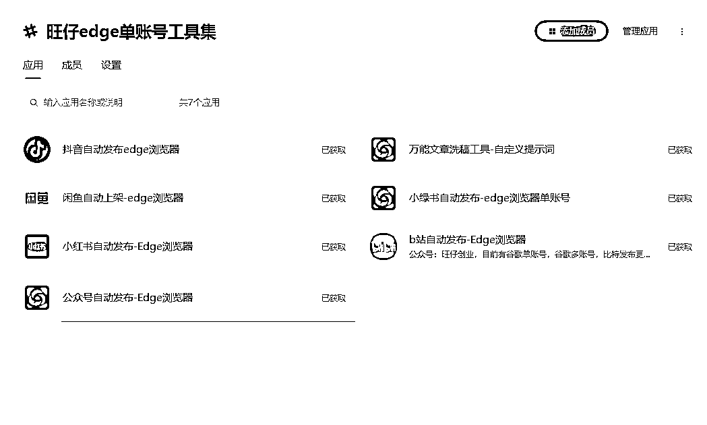

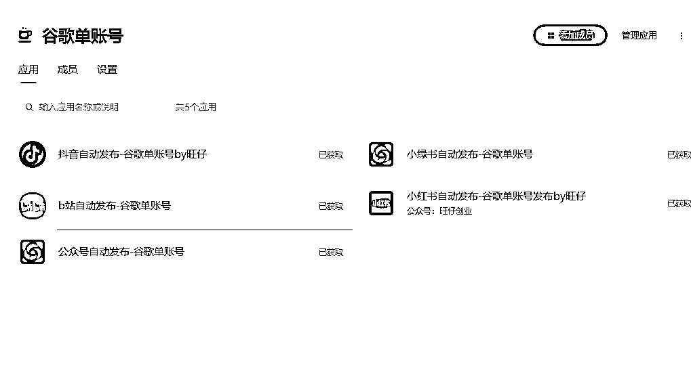

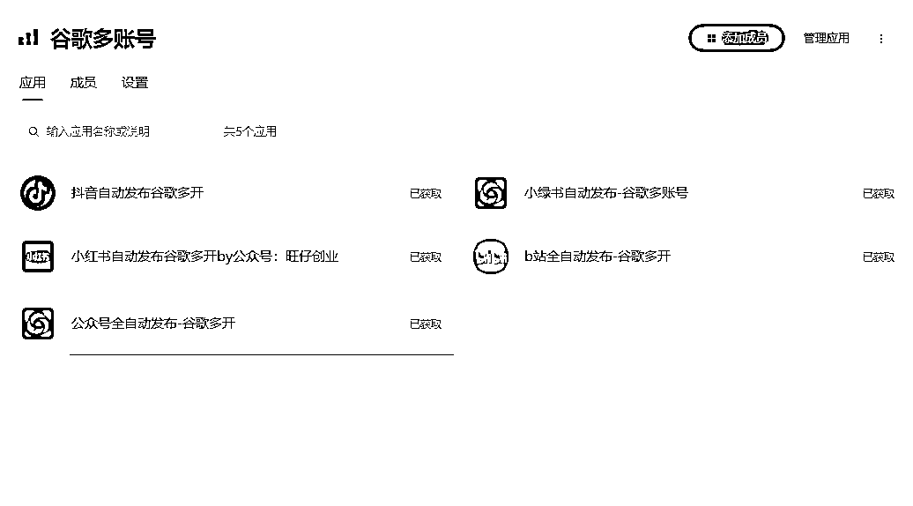

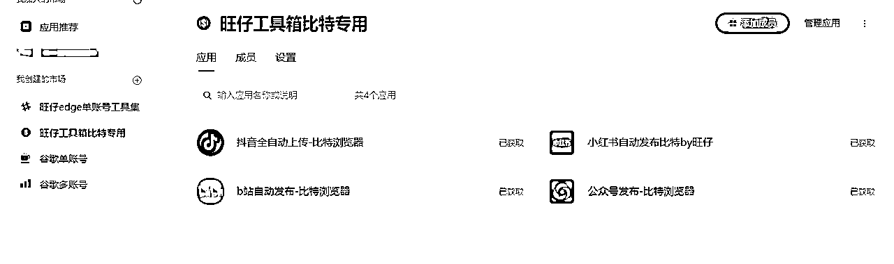

# 影刀脚本获取与使用

今年我会持续更新影刀相关工具，这篇先讲清楚怎么获取以及怎么跑起来。新手按图文步骤走；老手直接看链接就行。注意脚本里预设了暗号：龙哥盟。

## 影刀首次安装：视频演示

## 影刀首次安装：图文教程

### 第一步：获取客户端（已装好的可无视）
https://www.winrobot360.com/share/activity?inviteUserUuid=598859198794305538

### 第二步：申请进入应用市场
已有账号直接登录，还没有的话先注册一个：
https://www.winrobot360.com/share/accede?inviteKey=e63955eb-3ba7-4bf4-bd67-2476508a3a39

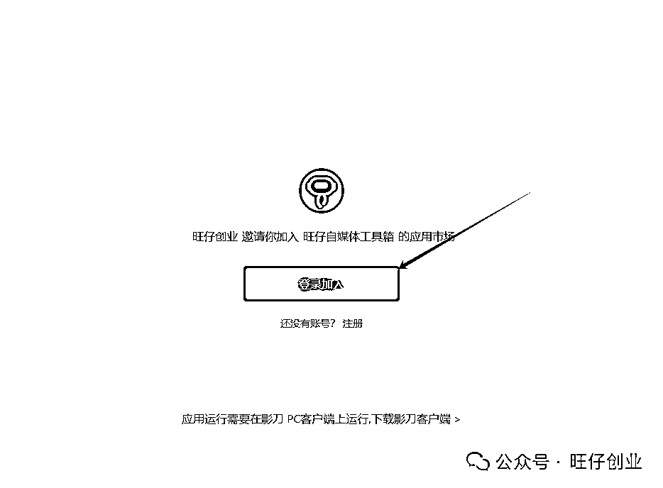

### 第三步：确认已进入市场
影刀桌面版打开后，切到“市场”标签，就能看到加入的团队。

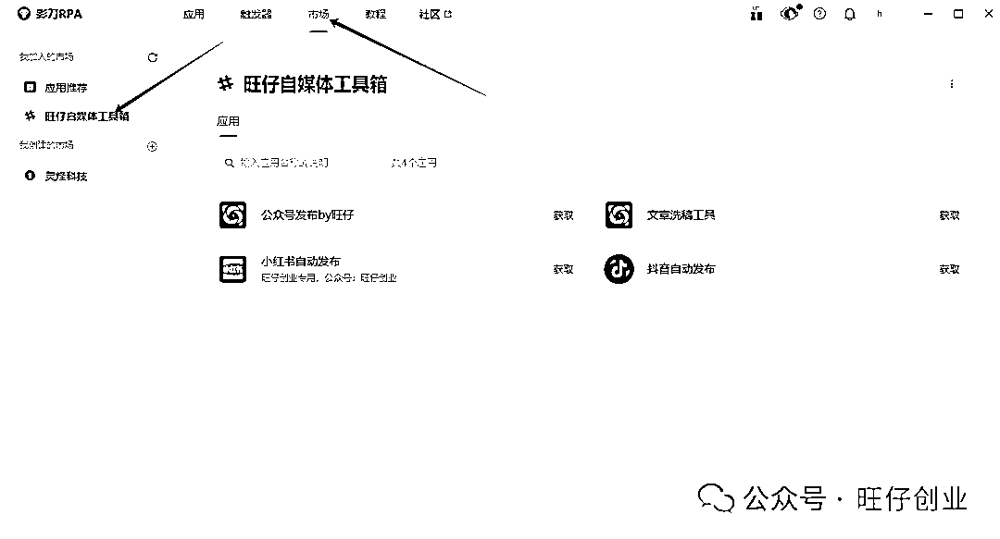

### 第四步：在应用市场里获取应用
对应的应用点“获取”即可。

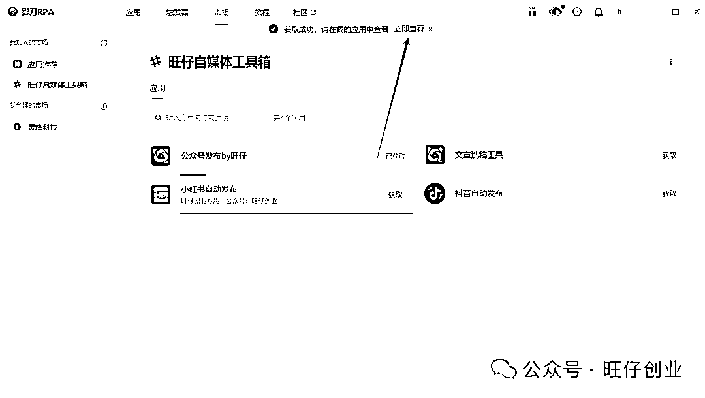

### 第五步：查看已获取的应用
在获取记录或对应列表里就能找到。

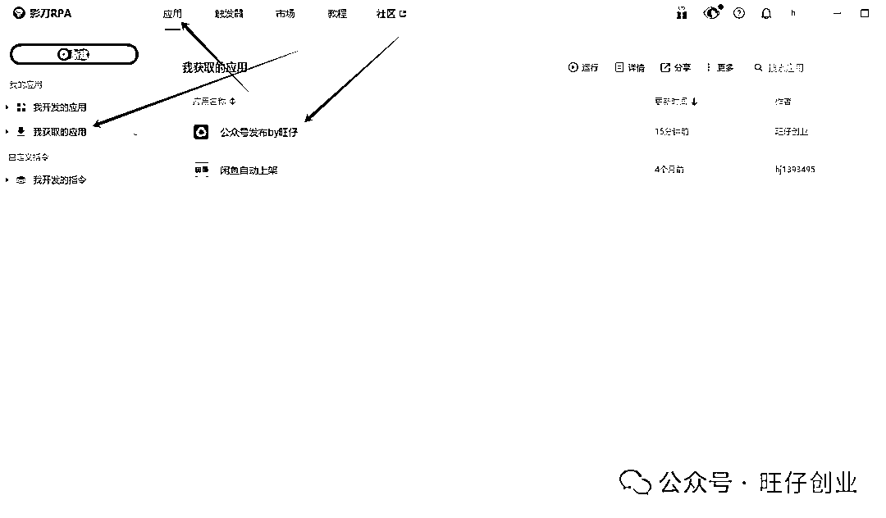

### 第六步：浏览器插件的安装与配置
我自己主要以系统自带的Edge和比特浏览器为主，所以教程只针对这两款，别的思路都一样（下面直接借影刀官方文档来说明）。

#### Microsoft Edge
插件安装方法见官方帮助中心。

#### 谷歌浏览器
插件安装方法见官方帮助中心。

#### 比特浏览器

##### 1. 下载比特浏览器
官网地址：https://www.bitbrowser.cn/download/
装好后注册账号，免费版能开10个环境，每天累计打开50次，个人用完全够。

##### 2. 给比特浏览器装影刀插件
在扩展中心搜“影刀”，搜到后点击安装，在设置里选择所有窗口。

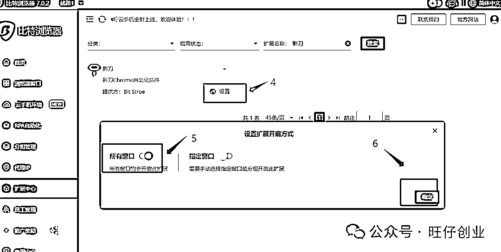

##### 2.2 验证插件是否装上
随便开一个窗口，进去就能看到插件入口。

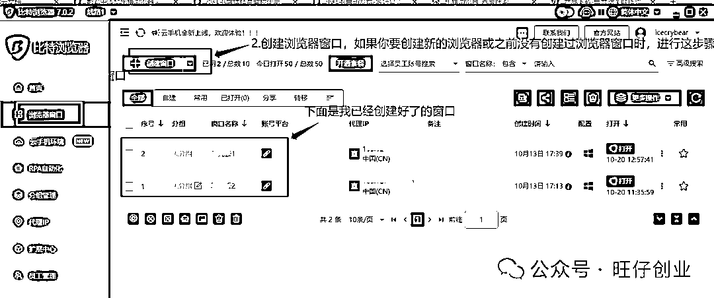

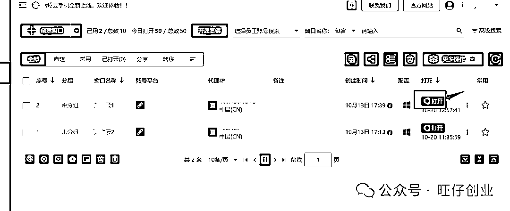

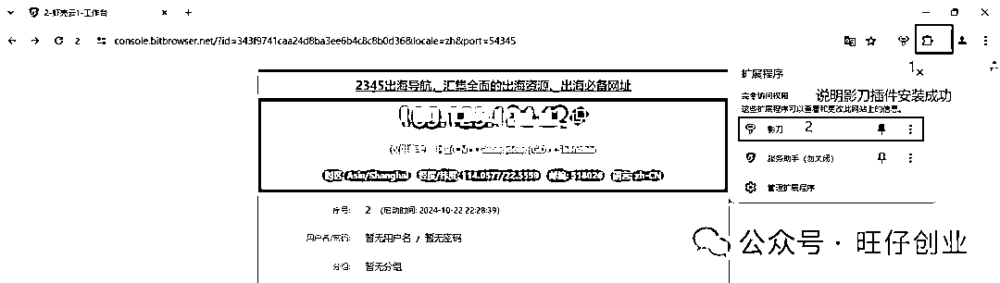

##### 3. 把比特浏览器路径同步给影刀
3.1 先开一个比特窗口。
3.2 在电脑底部任务栏空白处右键，选“任务管理器”。

3.3 找到刚开的比特浏览器进程（注意看进程名，有个很像的容易选错），右键“打开文件所在目录”，把目录复制保留下来。
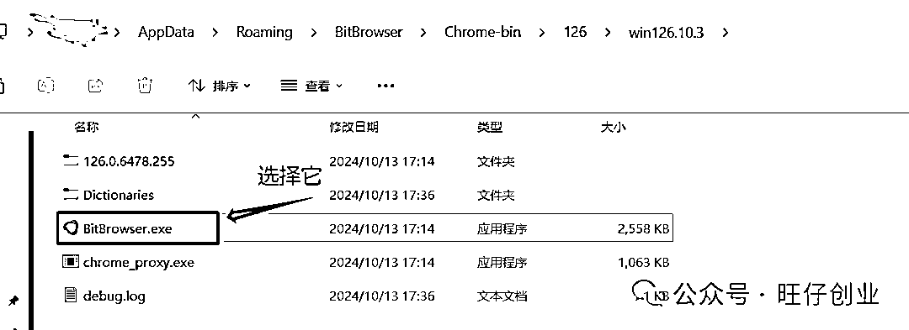

##### 4. 在影刀里加上比特浏览器
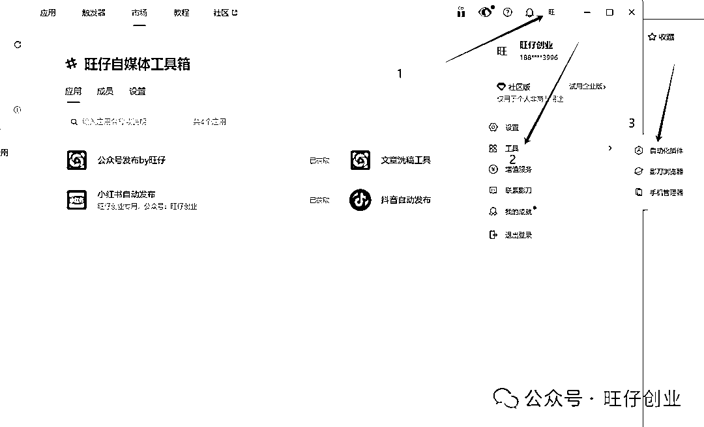
把刚才复制的路径粘到影刀的文件地址栏，回车后找到比特浏览器主程序，选中即可。成功后显示效果和上图一致。

##### 获取比特浏览器窗口ID

### 第七步：操作面板
每个工具都配好了表格模板，自己下载即可。暗号：龙哥盟。启动时可以勾选“记住内容”，下次省事。

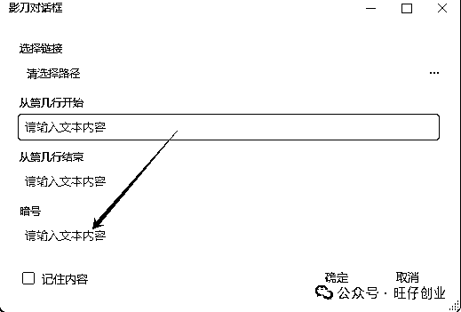

# 全平台文章洗稿工具

可公开访问的文章链接都能处理；目前实测最稳的是👸号、今日头条、搜狐号。这套脚本仅限Windows，Mac用户请自行装个Windows环境再来。

## 一：注册影刀并安装客户端
https://www.winrobot360.com/share/activity?inviteUserUuid=598859198794305538

## 二：申请进入应用市场
https://www.winrobot360.com/share/accede?inviteKey=e63955eb-3ba7-4bf4-bd67-2476508a3a39
加入后到桌面版即可找到。

## 三：新装影刀后的插件准备
（Edge、谷歌、比特的安装方法都在这里）

## 四：使用指南

### 第一步：准备表格
模板我放在夸克网盘里，链接自取：
https://pan.quark.cn/s/7587d3317a90
把需要处理的文章链接列在第一列即可，后面的列会在跑完流程后自动补充。👸号、头条的链接实测稳定，理论上只要是能直接跳转的文章都能洗。

### 第二步：启动界面各项怎么填
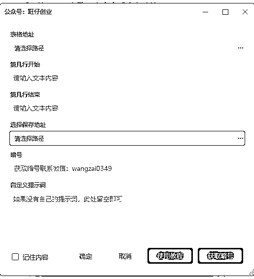
保存地址：选一个你打算存放Word的目录。跑完后会出现同名文件夹，洗好的Word就放在里面。
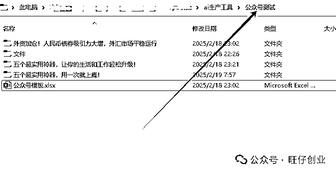
开始行：数据从表格第几行开始处理。
结束行：处理到第几行为止。
暗号：龙哥盟。
自定义提示词：不填就使用系统内置的引导语。如果自己写提示词，建议带上这句：输出的标题和正文都要用代码块包裹，不要输出多余提示语以及markdown。
ps：一次可以放很多链接进去批量处理，等洗稿跑完再对接👸号发布脚本，会轻松非常多。

### 第三步：跑之前要确认
先在Edge浏览器里登录Kimi：https://kimi.moonshot.cn/

# 👸号发布（Edge/谷歌单账号）

脚本只适配Windows，Mac请自行开启双系统。

## 一：影刀还没装的，把上面那个链接再走一遍
https://www.winrobot360.com/share/activity?inviteUserUuid=598859198794305538

## 二：进应用市场加入
Edge应用市场入口
谷歌应用市场入口
加入完成后到桌面版找脚本。

## 三：新装影刀后的插件准备
（配置方式和前面相同，Edge/谷歌/比特都一样）

## 四：怎么操作

### 1：先把表格配好
模板下载：
我放到夸克网盘了，点链接就能存。开个夸克App直接看也行，在线播放视频还支持电视投屏。
https://pan.quark.cn/s/c88b18f6864d
模板下载后可以跟洗稿工具配合使用。

### 1.1 原创者（A列）
需要勾选原创时，在这列填署名；不勾就留白。

### 1.2 标题（B列）
不用解释了吧。

### 1.3 内容来源（C列）
用洗稿工具产出的内容，直接把结果表对应内容复制过来；放入自己的内容时，填一个文件夹路径（文件夹内只允许存在一个Word文件）。

### 1.4 封面图（D列）
填封面图路径。获取方式：右键图片选“复制路径”，复制出来通常带引号，类似"F:\下载文件暂存\海报中转\蓝色科技扫码关注👸号二维码.png"，粘贴进表格时记得把两边引号去掉。不需要封面就空着。

### 1.5 话题标签（E列）
有话题就按 #话题 的格式写；不写留空。

### 1.6 原文链接（F列）
需要就放链接，不需要就空。

### 1.7 创作来源（G列）
模板里列了四种关键词，按模板格式填，比如选AI生成就填“ai”。不选则留空。

### 1.8 发布状态（H列）
脚本跑完之后会自动回填状态，方便你追踪进度。

### 1.9 固定开头（I列）
想把一段固定文案放在文章最前面，就先建一个Word放好该文案，再把Word路径填进这列。

### 1.10 固定结尾（J列）
同理，结尾的固定文案也先放在Word中，再把路径填进J列。

## 2：启动界面的填法（支持记住内容，方便复跑）
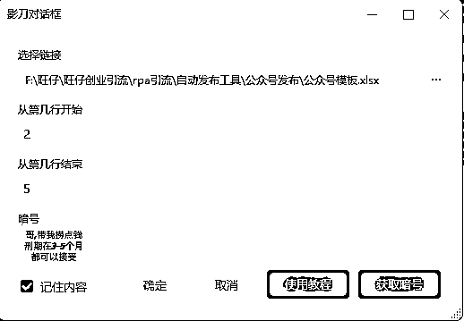
开始行号：从表格第几行开始发文。
结束行号：发到哪一行结束。
举例：只发第二行的文章，两格都写2；发第二篇和第三篇就填2和3，页面会生成对应清单。单个周期最多支持8篇文章。

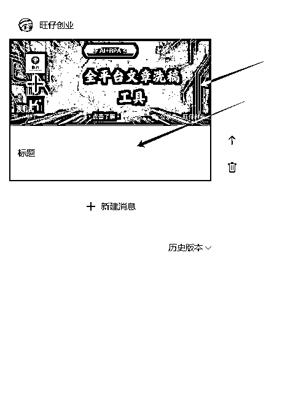
这里要填暗号：龙哥盟。

## 五：开始前的准备
先在Edge或谷歌里登录以下两个后台：
👸号：https://mp.weixin.qq.com/
墨滴：https://editor.mdnice.com/
从没用过墨滴的话，记得先建一个文件夹，再在其中新建一个文章标题。

# 👸号发布（谷歌多账号版）

脚本仅适配Windows，Mac请自行开启双系统。

## 一：影刀安装步骤看上文，不重复贴了
https://www.winrobot360.com/share/activity?inviteUserUuid=598859198794305538

## 二：应用市场申请加入
谷歌多账号脚本市场：邀请加入应用市场_影刀RPA
加入后去桌面版找脚本。

## 三：新装影刀后的插件准备
（同上，照着前面配就行）

## 四：怎么操作

### 1：表格配置（所有sheet的单元格格式都先设为文本，教程附后）
模板：
夸克网盘分享的「👸号自动发布模板」，链接直接保存，通过夸克App打开还支持在线播放和投屏。
https://pan.quark.cn/s/bd20a449f085

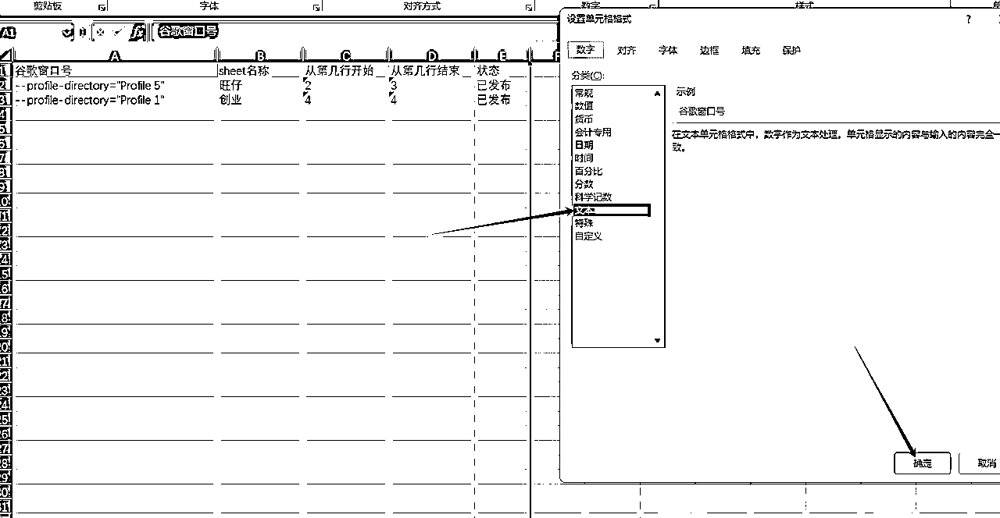

模板和前面的单账号版一样，但使用前要配合洗稿工具。

#### 1配置页说明
多账号版建议控制在3-5个账号内，数量再往上涨就用比特浏览器。

##### A列：谷歌窗口号
可以理解成一个窗口代表一个账号。具体怎么找对应谷歌用户ID直接看图。

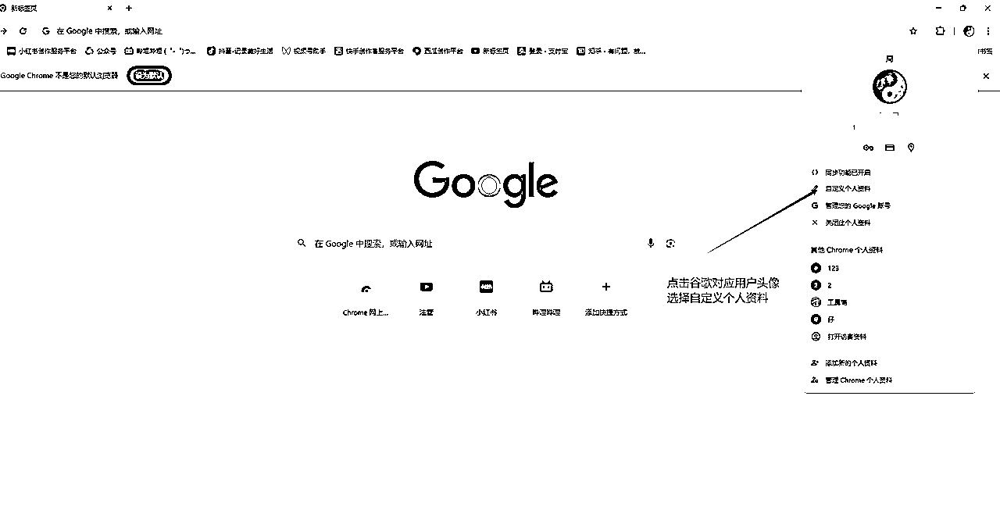

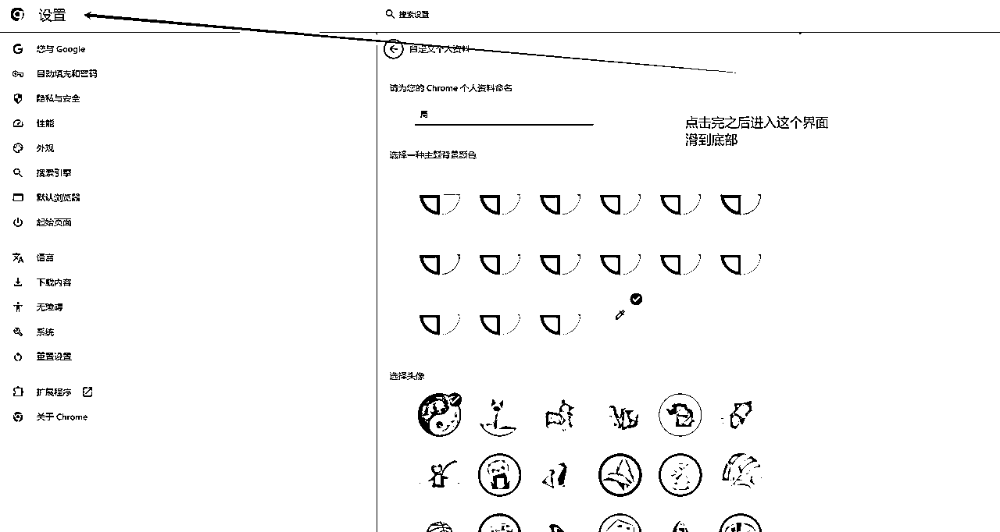

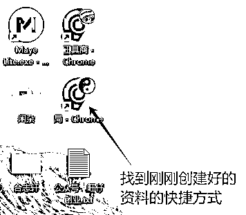

目标中的路径是这样："C:\Program Files\Google\Chrome\Application\chrome.exe" --profile-directory="Profile 1"

把其中的--profile-directory="Profile 1

放入表格

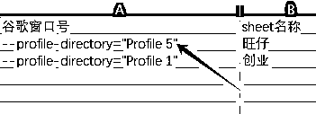

##### B列sheet名称

名称不要起单数字，可以起汉字，或者数字加符号，例如：18-0

其中配置页这个sheet名称不要改

其他的像旺仔 创业 这俩个sheet页面只要能和表格名称对应上就行

##### CD列从第几行开始

C列这里代表着你对应sheet名称的文章从第几行开始发布（下面就代表着从名称为旺仔的表格的第二行开始发布文章）

D列这里代表着你对应sheet名称的文章从第几行结束发布（下面就代表着从名称为旺仔的表格的第三行的文章发布之后就会结束）

开始行号：从内容页面表格第几行开始发布文章

结束行号：到内容页面表格第几行的文章结束

ps：如果只发一篇文章，比如只发第二行的文章，就在开始行和结束行都写2

如果一次发俩篇文章，就在开始行填2，结束行填3，就会生成下图的格式

单词最多可添加8篇文章，要注意

##### E列状态

在该窗口的谷歌浏览器结束后，会自动记录

#### 2.1原创者配置（A列）

如果要勾选原创选项，在A列输入名字，不勾选原创则留空。

#### 2.2标题（B列 顾名思义，不赘述）

#### 2.3内容地址（C列）

如果是用我的洗稿工具洗出来的，直接复制洗稿之后的表格即可

如果是自己的内容，填入文件夹地址（该文件夹下务必只有一个word文件）

#### 2.4封面图地址（D列）

复制封面图的文件地址进去，右键图片，找到复制路径，复制出来的是这样的格式："F:\下载文件暂存\海报中转\蓝色科技扫码关注👸号二维码.png"

在填入表格时去掉引号，即：F:\下载文件暂存\海报中转\蓝色科技扫码关注👸号二维码.png

如果不添加封面图，表格留空就行

#### 2.5话题（E列）

如果要添加话题的话用上面的格式即可：#话题

如果不添加话题留空

#### 2.6原文链接（F列）

要添加链接直接表格内放入链接

不添加留空即可

#### 2.7创作来源（G列）

一共4种来源选择，按照我表格模板来就行（切记不要更改，比如你要选择ai生成，就直接在表格输入ai）

不选择来源则留空

#### 2.8发布状态（H列）

在文章发布后会自动输入状态，方便更改

#### 2.9固定开头（I列）

如果文章要在开头插入固定开头，先创建一个word文档，把要固定的内容填入word。之后在I列输入开头文档的文件地址。

#### 2.10固定结尾（J列）

如果文章要在结尾插入固定结尾，先创建一个word文档，把要固定的内容填入word。之后在J列输入结尾文档的文件地址。

### 2启动页面

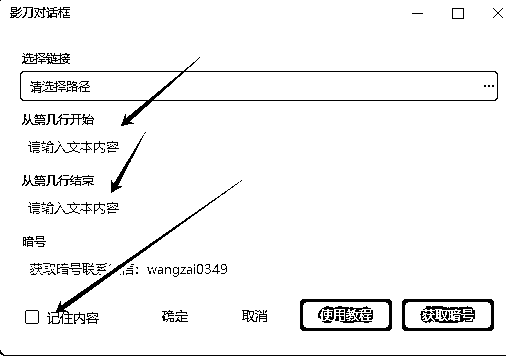

从第几行开始代表着从配置页的第几行开始，不是代表着文章发布页第几行，这里代表着从5号窗口开始运行，结束也是同样的道理

暗号：龙哥盟

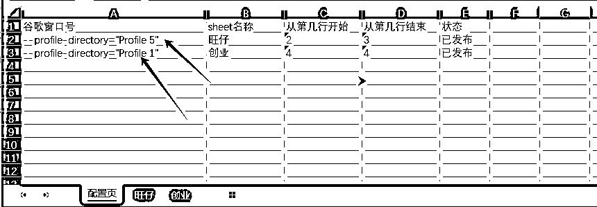

## 五：准备工作

首先在edge浏览器登入墨滴平台（https://editor.mdnice.com/）

在不同用户谷歌浏览器内部登陆对应👸号：https://mp.weixin.qq.com/

如果是第一次使用墨滴，务必先创建一个文件夹，在文件夹内创建一个文章标题

# 👸号发布（比特浏览器多账号）

所有应用不支持mac电脑，如果是mac电脑，请开启双系统win模式（自行百度）

## 一：注册下载影刀

https://www.winrobot360.com/share/activity?inviteUserUuid=598859198794305538

## 二：加入应用

比特浏览器脚本市场：邀请加入应用市场_影刀RPA

加入应用后，在桌面版找到应用

## 三：影刀首次内部插件配置（切忌，这里新手务必看此教程的比特配置）

（内部包含edge，谷歌，比特浏览器插件安装）

## 四：使用教程

### 1：配置表格（所有表格全部设置单元格格式为文本）教程

表格下载：

我用夸克网盘分享了「👸号自动发布模板」，点击链接即可保存。打开「夸克APP」，无需下载在线播放视频，畅享原画5倍速，支持电视投屏。

链接：https://pan.quark.cn/s/bd20a449f085

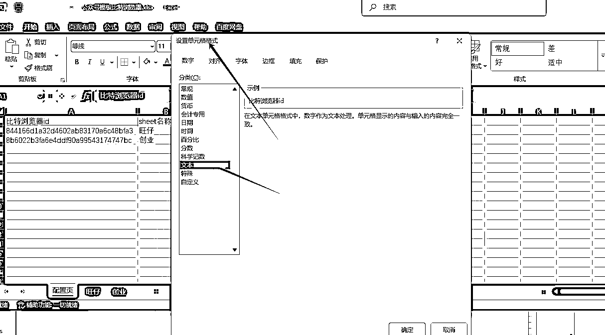

下载好配置表格，结合上面给大家的洗稿工具

#### 1配置页

##### A列比特窗口号

不会配置比特浏览器的看这里面的比特插件安装

##### B列sheet名称

名称不要起单数字，可以起汉字，或者数字加符号，例如：18-0

其中配置页这个sheet名称不要改

其他的像旺仔 创业 这俩个sheet页面只要能和表格名称对应上就行

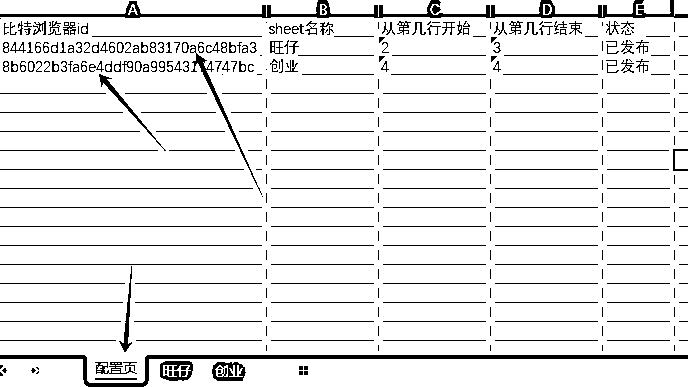

##### CD列从第几行开始

C列这里代表着你对应sheet名称的文章从第几行开始发布（下面就代表着从名称为旺仔的表格的第二行开始发布文章）

D列这里代表着你对应sheet名称的文章从第几行结束发布（下面就代表着从名称为旺仔的表格的第三行的文章发布之后就会结束）

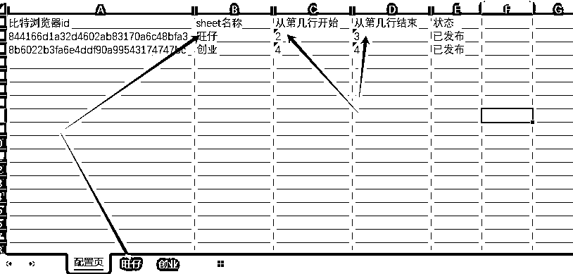

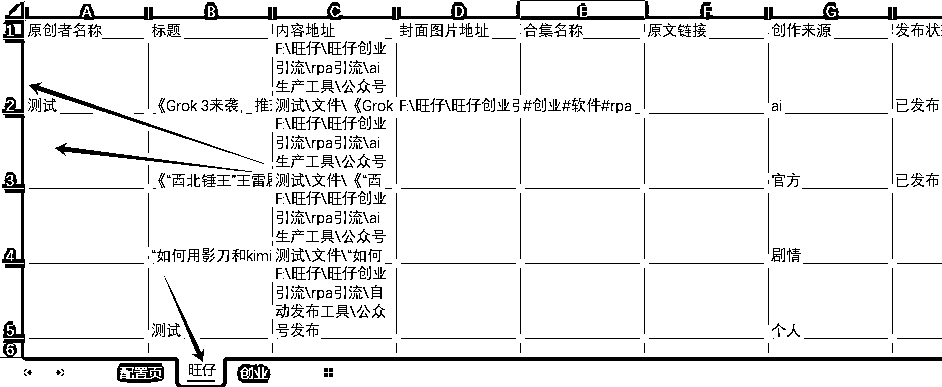

开始行号：从内容页面表格第几行开始发布文章

结束行号：到内容页面表格第几行的文章结束

ps：如果只发一篇文章，比如只发第二行的文章，就在开始行和结束行都写2

如果一次发俩篇文章，就在开始行填2，结束行填3，就会生成下图的格式

单词最多可添加8篇文章，要注意

##### E列状态

在该窗口的谷歌浏览器结束后，会自动记录

#### 2.1原创者配置（A列）

如果要勾选原创选项，在A列输入名字，不勾选原创则留空。

#### 2.2标题（B列 顾名思义，不赘述）

#### 2.3内容地址（C列）

如果是用我的洗稿工具洗出来的，直接复制洗稿之后的表格即可

如果是自己的内容，填入文件夹地址（该文件夹下务必只有一个word文件）

#### 2.4封面图地址（D列）

复制封面图的文件地址进去，右键图片，找到复制路径，复制出来的是这样的格式："F:\下载文件暂存\海报中转\蓝色科技扫码关注👸号二维码.png"

在填入表格时去掉引号，即：F:\下载文件暂存\海报中转\蓝色科技扫码关注👸号二维码.png

如果不添加封面图，表格留空就行

#### 2.5话题（E列）

如果要添加话题的话用上面的格式即可：#话题

如果不添加话题留空

#### 2.6原文链接（F列）

要添加链接直接表格内放入链接

不添加留空即可

#### 2.7创作来源（G列）

一共4种来源选择，按照我表格模板来就行（切记不要更改，比如你要选择ai生成，就直接在表格输入ai）

不选择来源则留空

#### 2.8发布状态（H列）

在文章发布后会自动输入状态，方便更改

#### 2.9固定开头（I列）

如果文章要在开头插入固定开头，先创建一个word文档，把要固定的内容填入word。之后在I列输入开头文档的文件地址。

#### 2.10固定结尾（J列）

如果文章要在结尾插入固定结尾，先创建一个word文档，把要固定的内容填入word。之后在J列输入结尾文档的文件地址。

### 2启动页面

从第几行开始代表着从配置页的第几行开始，不是代表着文章发布页第几行，这里代表着从第几行的窗口开始运行，结束也是同样的道理

## 五：准备工作

首先在edge浏览器登入墨滴平台（https://editor.mdnice.com/）

在不同用户的比特浏览器内部登陆对应👸号：https://mp.weixin.qq.com/

如果是第一次使用墨滴，务必先创建一个文件夹，在文件夹内创建一个文章标题

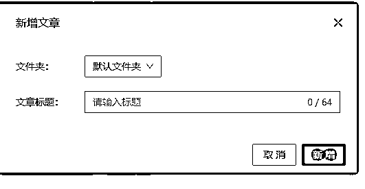

# 📕发布（edge/谷歌浏览器单账号）

所有应用不支持mac电脑，如果是mac电脑，请开启双系统win模式（自行百度）

## 一：注册下载影刀

https://www.winrobot360.com/share/activity?inviteUserUuid=598859198794305538

## 二：加入应用

edge浏览器应用市场

谷歌应用市场

加入应用后，在桌面版找到应用

## 三：影刀首次内部插件配置

（内部包含edge，谷歌，比特浏览器插件安装）

## 四：使用教程

### 1：配置表格

表格下载：

我用夸克网盘分享了「📕模板」，点击链接即可保存。打开「夸克APP」，无需下载在线播放视频，畅享原画5倍速，支持电视投屏。

链接：https://pan.quark.cn/s/2ba2577fc0dc

#### 1.1笔记类型（A列）

在A列选择图文或者视频。

#### 1.2保存状态（B列）

目前设置了三种状态，一种直接发布，一种定时发布，一种存草稿。这11个字不要改动，按我模板来。

（存草稿的时候要注意，📕只能保存最近一条内容，而且存完草稿后不能发布作品了，要不然会把之前的草稿顶掉）

#### 1.3文件存放地址（C列）

此次为文件夹地址（确保此文件夹内部只有你要发布的图片或者视频）

图文：需要给文件排一下序号，默认第一个是封面图

视频：最好的搭配是一个视频搭配一个封面图（视频格式要mp4）

#### 1.4视频封面图地址（D列）

此次放入视频的封面图地址：

案例：F:\旺仔\旺仔创业引流\rpa引流\自动发布工具\📕发布\测试\视频存放\2.jpg

如果没有封面图或者是图文类的，此处留空即可

#### 1.5标题（E列）

#### 1.6正文（F列)

直接把文案复制到表格即可，表格里面什么格式，到发布页面就是什么格式

#### 1.7话题（G列）

如果要添加话题的话用上面的格式即可：#话题

如果不添加话题留空

#### 1.8地址(H列）

如果要添加地点直接就填入框中，如果不添加则留空

#### 1.9合集（I列）

从上往下数，第一个就填1，后面一次类推（不选择就留空）

#### 1.10群聊（J列）

从上往下数，第一个就填1，后面一次类推（不选择就留空）

#### 1.11定时发布（K）列

如果设置定时发布，就在1.2保存状态处填写：定时输出，发布时间格式为：2025-03-15 11:20

如果不设置就留空

#### 1.12状态（L）列

此次不需要填写内容，在表格运行后会自动输入

#### 1.13商品id（M）列

这会自动挂商品，大家在表格输入商品id，如果一次添加多个商品，就以这种格式输入：

第一个/第二个（例如：67ced07a9635/671ae3e3a）

### 2：启动页配置

开始行号：从表格第几行开始发布文章

结束行号：到表格第几行的文章结束

发布时间间隔：我这设置默认60（速度太快浏览器会出现验证）

## 五：准备工具

表格配置之后在edge或者谷歌浏览器登陆📕对应账号

# 📕发布（谷歌浏览器多账号）

所有应用不支持mac电脑，如果是mac电脑，请开启双系统win模式（自行百度）

## 一：注册下载影刀

https://www.winrobot360.com/share/activity?inviteUserUuid=598859198794305538

## 二：加入应用

谷歌浏览器多账号脚本市场:邀请加入应用市场_影刀RPA

加入应用后，在桌面版找到应用

## 三：影刀首次内部插件配置

（内部包含edge，谷歌，比特浏览器插件安装）

## 四：使用教程

### 1：配置表格（所有表格全部设置单元格格式为文本）教程

表格下载：

我用夸克网盘分享了「📕模板」，点击链接即可保存。打开「夸克APP」，无需下载在线播放视频，畅享原画5倍速，支持电视投屏。

链接：https://pan.quark.cn/s/2ba2577fc0dc

#### 1配置页

谷歌多账号最好控制在3-5个账号之内，再多了就需要比特浏览器了。

##### A列谷歌窗口号

（这里可以理解为一个窗口一个号）

找到对应谷歌用户id

目标中的路径是这样："C:\Program Files\Google\Chrome\Application\chrome.exe" --profile-directory="Profile 1"

把其中的--profile-directory="Profile 1

放入表格

##### B列sheet名称

名称不要起单数字，可以起汉字，或者数字加符号，例如：18-0

其中配置页这个sheet名称不要改

其他的像旺仔 创业 这俩个sheet页面只要能和表格名称对应上就行

##### CD列从第几行开始

C列这里代表着你对应sheet名称的文章从第几行开始发布（下面就代表着从名称为旺仔的表格的第二行开始发布文章）

D列这里代表着你对应sheet名称的文章从第几行结束发布（下面就代表着从名称为旺仔的表格的第三行的文章发布之后就会结束）

#### 2内容页配置

##### 2.1笔记类型（A列）

在A列选择图文或者视频。

##### 2.2保存状态（B列）

目前设置了三种状态，一种直接发布，一种定时发布，一种存草稿。这11个字不要改动，按我模板来。

（存草稿的时候要注意，📕只能保存最近一条内容，而且存完草稿后不能发布作品了，要不然会把之前的草稿顶掉）

##### 2.3文件存放地址（C列）

此次为文件夹地址（确保此文件夹内部只有你要发布的图片或者视频）

图文：需要给文件排一下序号，默认第一个是封面图

视频：最好的搭配是一个视频搭配一个封面图（视频格式要mp4）

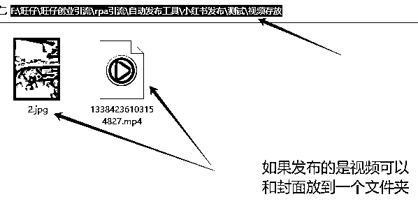

##### 2.4视频封面图地址（D列）

此次放入视频的封面图地址：

案例：F:\旺仔\旺仔创业引流\rpa引流\自动发布工具\📕发布\测试\视频存放\2.jpg

如果没有封面图或者是图文类的，此处留空即可

##### 2.5标题（E列）

##### 2.6正文（F列)

无需手动调整格式，Excel表格中的排版会完整同步到发布页面。

##### 2.7 话题（G列）
希望带上话题时，按 `#话题` 的方式填写就有效；不打算带话题就空着。

##### 2.8 地址（H列）
要显示所在地点，直接在指定位置填入地址；不显示则略过。

##### 2.9 合集（I列）
合集按顺序编号：首个为1，往后顺延即可，不选则留白。

##### 2.10 群聊（J列）
群聊编号规律同上，没有要加入的群就空着。

##### 2.11 定时发布（K列）
使用定时发送时，先将保存状态设为“定时输出”，再按 `2025-03-15 11:20` 的样式填入发布时间；不定时就不用填。

##### 2.12 状态（L列）
程序跑完会自动写入，无需人工干预。

##### 2.13 商品ID（M列）
要挂商品就把ID贴在对应位置；多个商品用斜杠分开，写法参考 `67ced07a9635/671ae3e3a`。

### 运行参数说明
- 起始行：任务从参数页中的某一行启动。
- 结束行：任务到参数页中的某一行停止。
- 发布间隔：默认设定为60秒，数值太小会触发浏览器的安全验证。

这里的行号指向参数页，而不是内容Sheet。以第5个窗口为例，想让它在第5个窗口开始运行，起始行填5即可，结束规则同理。

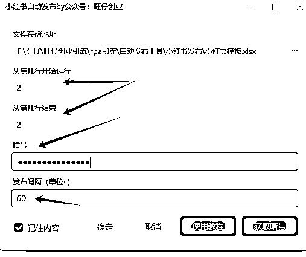

### 发布前准备
设置好Excel后，用Edge或Chrome登录对应📕账号。

# 📕自动化发布（比特浏览器多开）

本工具链不支持macOS，Mac用户请自行改装Windows双系统（具体方法可搜索）。

## 1. 获取影刀
前往官网注册影刀并安装：https://www.winrobot360.com/share/activity?inviteUserUuid=598859198794305538

## 2. 添加应用
在比特浏览器的脚本市场中找到“邀请加入应用市场_影刀RPA”，完成加入后，桌面版里即可看到该应用。

## 3. 首次插件配置
影刀内部集成了Edge、Chrome、比特浏览器所需的插件安装说明。

## 4. 操作指引

### 4.1 表格设定（先把全部单元格统一设为“文本”格式）
📕模板放在夸克网盘，保存地址如下。用夸克App打开可免下载直接预览，画质支持5倍速，也能电视投屏。
https://pan.quark.cn/s/2ba2577fc0dc

#### 参数页
##### A栏：比特浏览器窗口号
不会配置比特浏览器的用户，请学习此处的比特插件安装教程。

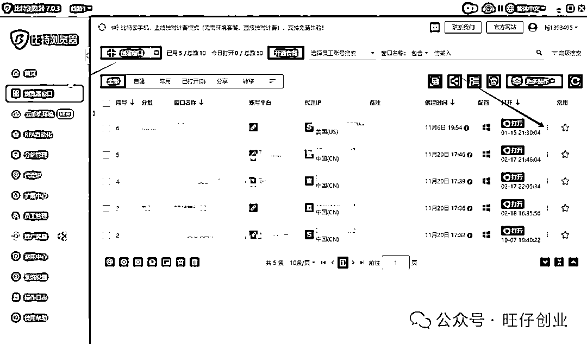

##### B栏：Sheet的命名
命名时不要只写一个数字，最好用汉字，或者数字加符号，比如 `18-0`。参数页这个Sheet的名字保持原样；其余像“旺仔”“创业”等工作表，只要与对应表名匹配即可。

##### C、D栏：发布范围
C列是当前工作表的起始发布行，比如“旺仔”表第2行开始发；D列是结束发布行，比如“旺仔”表第3行发完即止。

起始行与结束行指的是内容Sheet的行位，E栏状态会在该窗口Chrome结束运行后自动标记。

#### 工作表字段详解
##### 2.1 笔记类型（A列）
下拉选择图文或视频。
##### 2.2 保存方式（B列）
提供三种可选：直接发布、定时发布、存草稿。模板中的11个字不要改动。
特别提醒：📕只保留最近一条草稿，如果存完草稿后又发布了新内容，之前的草稿会被顶掉。
##### 2.3 素材存放路径（C列）
这里填文件夹地址，且文件夹内不能出现其他无关文件。
- 图文：给文件排好序号，第一张自动作为封面。
- 视频：建议一个视频配一张封面，视频文件必须为MP4。

##### 2.4 视频封面文件位置（D列）
视频需要封面时，在此写入封面图路径，例如 `D:\我的素材\封面\2.jpg`。图文或没有封面则空着。
##### 2.5 标题（E列）
##### 2.6 正文（F列）
把文案粘到Excel里即可，Excel里是什么布局，发布出去就是什么布局。
##### 2.7 话题（G列）
需要话题写 `#话题`，不需要就留空。
##### 2.8 地址（H列）
要定位就把地址填入，免定位留空。
##### 2.9 合集（I列）
编号从1开始递增，不参与则留白。

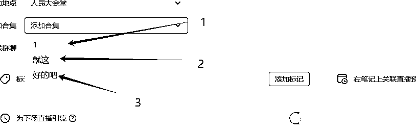

##### 2.10 群聊（J列）
编号规则与合集一致，未选择就留空。

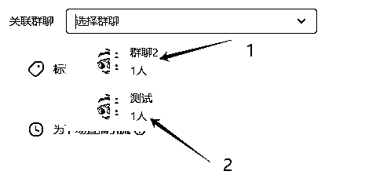

##### 2.11 定时发布（K列）
需要定时时，把保存状态改成“定时输出”，时间按下述格式输入 `2025-03-15 11:20`。

##### 2.12 状态（L列）
由系统自动完成，无需手工填写。
##### 2.13 商品ID（M列）
自动挂商品功能由此列驱动，多商品采用 `ID1/ID2` 写法，例如 `67ced07a9635/671ae3e3a`。

### 运行参数
内容与上节一致：起始行、结束行针对参数页；发布间隔默认60秒，过快容易触发验证。

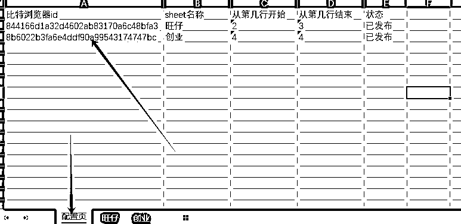

### 开始之前
表格配置完毕后，在比特浏览器中登录对应的📕账号。

# 抖音自动化发布（Edge/Chrome单账号）

macOS不支持，Mac用户请开启Windows双系统。

## 1. 安装影刀
影刀的注册安装地址与前文相同。

## 2. 加入应用市场
Edge浏览器应用市场与Chrome应用市场均可加入该应用，添加完成后在桌面版打开。

## 3. 插件准备
影刀内部已准备Edge、Chrome、比特浏览器的插件安装步骤。

## 4. 使用教程

### 4.1 配置Excel
抖音模板网盘地址：https://pan.quark.cn/s/25a001c72456
该链接可在夸克App中直接预览，无需下载也能看，支持原画5倍速与电视投屏。

#### 内容表配置细节
##### 1.1 笔记类型（A列）
A列决定内容形式：图文或视频。
##### 1.2 保存方式（B列）
三种状态与📕一致：直接发布、定时发布、存草稿，11字固定格式不可改。
使用存草稿时需留意：抖音同样只保存最近一条草稿，存草稿后再发布新作品，原来的草稿就被取代了。
##### 1.3 素材文件夹（C列）
填入文件夹路径，文件夹里只放要发布的图片或视频。
- 图文素材排序后，首张默认为封面。
- 视频素材推荐一个视频外搭配一张封面，视频格式限MP4。

##### 1.4 封面图路径（D列）
与视频封面配置相同，填写图片所在路径即可。没有封面或发图文时留空。
##### 1.5 标题（E列）
##### 1.6 正文（F列）
模板中F列内容怎么写，发布页就怎么显示，因此直接复制文案即可。
##### 1.7 话题（G列）
格式为 `#话题`，不需要则空置。
##### 1.8 合集（H列）
合集序号从1起依次递增，不选则留空。

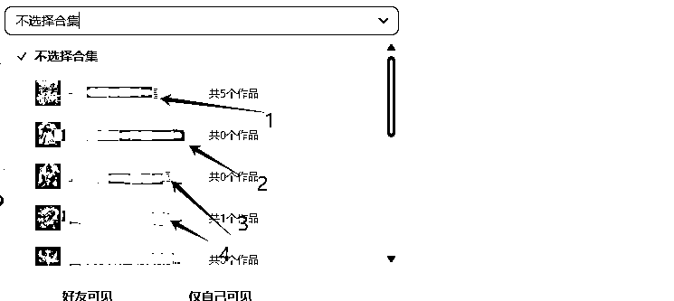

##### 1.9 定时发布（I列）
设置定时前先把保存状态填为“定时输出”，时间格式同前：`2025-03-15 11:20`。
##### 1.10 状态（J列）
由程序自动补充，无需填写。
##### 1.11 图文音乐（K列）
想要给图文配背景音乐，把音乐名写在此列，程序会取第一行自动匹配。

### 运行参数
起始行、结束行分别对应内容Sheet的起止位置；发布间隔建议保持60秒，过小会弹出验证。

### 最终检查
上述设置做好后，在Edge或Chrome登录要使用的抖音账号。

# 抖音自动化发布（Chrome多开）

macOS运行不了该工具，Mac用户请准备Windows双系统。

## 1. 影刀下载
安装包下载入口同上，不再重复粘贴链接。

## 2. 找到应用
通过邀请链接加入：https://www.winrobot360.com/share/accede?inviteKey=e63955eb-3ba7-4bf4-bd67-2476508a3a39
加入完成后，桌面版即可见应用。

## 3. 影刀内部插件配置
Edge、Chrome、比特浏览器相关的插件安装，均在影刀内部说明里。

## 4. 上手步骤

### 4.1 Excel配置（单元格统一设置为文本格式）
抖音模板的网盘地址已在前文，打开夸克App即可在线查看，支持5倍速播放和电视投屏。

#### 设置页
Chrome多账号建议控制在3到5个之间，再多请改用比特浏览器。

##### A栏：Chrome窗口号
可以这样理解：一个窗口就是一个账号位。先找到对应的谷歌用户id。

Chrome目标路径示例：`C:\Program Files\Google\Chrome\Application\chrome.exe --profile-directory="Profile 1"`
实际填充时只需复制 `--profile-directory="Profile 1"` 到Excel中。

##### B栏：Sheet命名
不接受单个数字命名，汉字或数字加符号都可以，如 `18-0`。参数页的Sheet名不要动，其他Sheet命名能对应上就行。

##### C、D栏：发布范围
C列定义该工作表从第几行开始发布，D列定义发到第几行结束，两个数值都以对应Sheet为准。例如从“旺仔”第2行开始、第3行结束，则填2和3。

#### 发布内容表说明
##### 2.1 笔记类型（A列）
选择图文或视频。
##### 2.2 保存方式（B列）
同样三种：直接发布、定时发布、存草稿，11个字保持模板原样。
关于草稿：抖音只保留最近一条草稿，如果存稿后又发布，旧草稿会被顶掉。
##### 2.3 素材路径（C列）
填写图片或视频所在文件夹路径，文件夹内不得混杂其他素材。
- 图文：按顺序编号，首张为封面。
- 视频：一个视频对应一张封面为最佳，格式只能是MP4。

##### 2.4 封面文件地址（D列）
专供视频配封面时使用，示例路径：`F:\封面目录\2.jpg`。图文或无封面则略过。
##### 2.5 标题（E列）
##### 2.6 正文（F列）
在F列粘贴文案，发布页会保留Excel里的换行与样式。
##### 2.7 话题（G列）
`#话题` 的写法即可，不需要就留白。
##### 2.8 合集（H列）
从1开始计数并递增，不参与则空白。

##### 2.9 定时发布（I列）
将保存状态改为“定时输出”，并在I列写入要发布的时间，格式为 `2025-03-15 11:20`。
##### 2.10 状态（J列）
程序运行结束后会自动写状态。
##### 2.11 图文配乐（K列）
填写音乐名称即可为图文配上音乐，运行时会自动采用第一行。

### 运行参数
起始行、结束行均指内容Sheet内的行位；发布间隔保持默认60秒，避免过快触发验证。

### 收尾准备
Excel填写完成后，在Edge或Chrome登录对应的抖音账号。

# 抖音自动化发布（比特浏览器多开）

macOS不支持本套方案，Mac用户请切到Windows双系统。

## 1. 影刀安装
影刀注册与安装方法与前文完全一致。

## 2. 引入应用
比特浏览器脚本市场中的“邀请加入应用市场_影刀RPA”即是入口，加入后从桌面版开启应用。

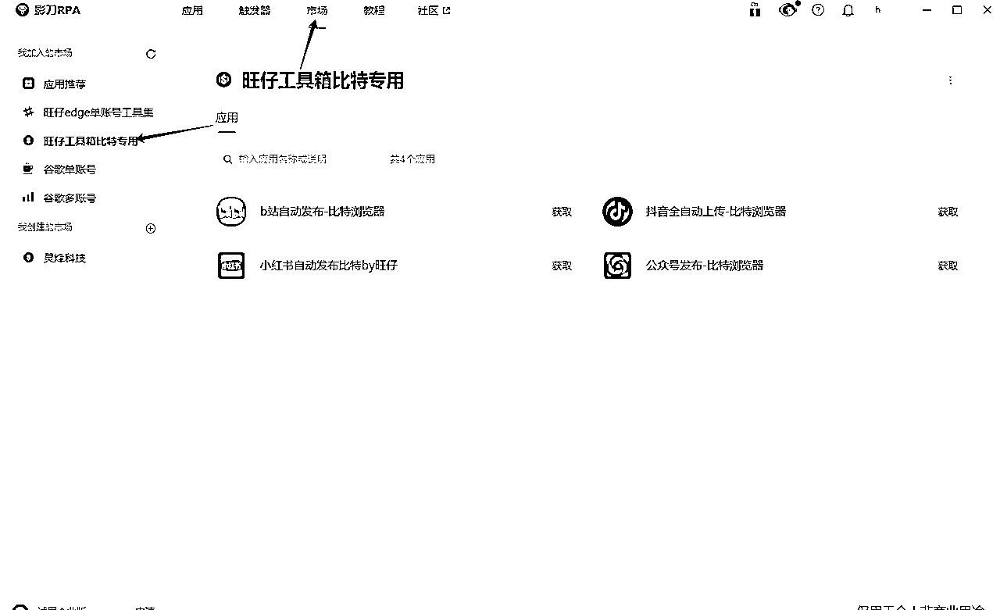

## 3. 插件安装
Edge、Chrome、比特浏览器的插件安装指引均内置在影刀中。

## 4. 配置流程

### 4.1 Excel配置（全Sheet单元格设为文本格式）
抖音模板的网盘链接见上方，在夸克App中打开即可预览，享受5倍速与投屏功能。

#### A栏：比特窗口号
比特浏览器配置遇到困难时，可回看前面“比特插件安装”部分的说明。

#### B栏：Sheet命名
命名规则与之前一样：避开单数字，可用汉字或数字加符号（如 `18-0`）。参数页名称锁定不动，其余Sheet能与表名对应即可。

#### C、D栏：发布范围
逻辑与前文相同：C列填起始行，D列填结束行，均以对应Sheet的行数为准。

C列用来标记对应工作表里的内容从哪一行开始推送举例来说，下面示例就是从名为旺仔的表格第二行起开始发布

D列则用来标记对应工作表里的内容到哪一行停止推送，示例中表示发布到名为旺仔的表格第三行后即结束

起始行号：内容表从第几行起开始发布

结束行号：内容表发布到第几行停止

#### E列 状态

当该窗口的 Chrome 结束后会自动写入记录

### 2 内容页设置

#### 2.1 笔记类型 A列

在 A 列里挑选图文或视频两种形式。

#### 2.2 保存状态 B列

目前共提供三种状态：直接发布、定时发布、存草稿。这 11 个字请不要修改，按模板填写。

存草稿时注意：抖音仅保留最近一条草稿，且草稿保存后若再发布新作品，原有草稿会被覆盖。

#### 2.3 文件存放路径 C列

此处填写文件夹路径，要求文件夹内仅放本次要发布的图片或视频。

图文：文件需按序号排序，默认第 1 张为封面。

视频：建议一个视频配一张封面，视频格式为 mp4。

#### 2.4 视频封面图路径 D列

填写视频封面图片的地址：

示例：F:\旺仔\旺仔创业引流\rpa引流\自动发布工具\📕发布\测试\视频存放\2.jpg

若无封面或为图文类型，此处可空着。

#### 2.5 标题 E列

#### 2.6 正文 F列

直接把文案粘到表格里即可，表格中的格式会原样带到发布页。

#### 2.7 话题 G列

需要加话题时按此格式：#话题

不需要就留空。

#### 2.8 合集 H列

从上到下依次填写 1、2、3…… 不填则留空。

#### 2.9 定时发布 I列

若要定时发布，请在 1.2 保存状态处填写 定时输出，时间格式为：2025-03-15 11:20

不需要则留空。

#### 2.10 状态 J列

无需手动填写，表格运行时会自动写入。

#### 2.11 图文配乐 K列

图文需要配音乐时，在此列填写音乐名称，系统会自动匹配首行。

### 2 启动页设置

起始行号：从表格第几行起发布

结束行号：发布到表格第几行结束

发布间隔：默认 60 秒，间隔过短浏览器易触发校验。

## 五 准备工具

表格配置完成后，在比特浏览器中登录对应的抖音账号。

# B站发布 适用于 Edge / 谷歌浏览器单账号

本应用暂不支持 Mac，Mac 用户请自行切换到 Win 双系统。

## 一 注册下载影刀

https://www.winrobot360.com/share/activity?inviteUserUuid=598859198794305538

## 二 安装应用

Edge 浏览器应用市场

谷歌浏览器应用市场

安装完成后在桌面版里找到应用。

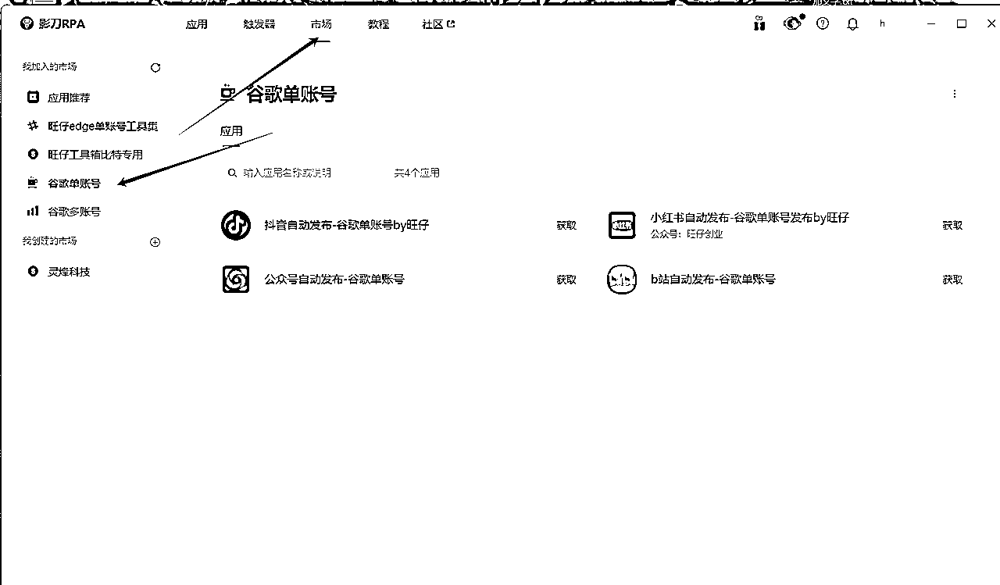

## 三 影刀首次插件配置

内含 Edge、谷歌、比特浏览器插件安装向导。

## 四 使用指南

### 1 表格配置

表格下载：

用夸克网盘分享的「b站模板」，点链接保存。打开夸克 APP 可在线观看，支持电视投屏。

链接：https://pan.quark.cn/s/5e034b4a593f

#### 1.1 发布状态 A列

B站最多保存 30 条草稿，请勿过多。

#### 1.2 视频标题 B列

#### 1.3 文件存放路径 C列

填写文件夹路径，确保文件夹里只有要发布的视频。

视频：建议视频配一张封面，格式 mp4。

#### 1.4 视频封面图路径 D列

填写封面图片地址：

示例：F:\旺仔\旺仔创业引流\rpa引流\自动发布工具\📕发布\测试\视频存放\2.jpg

无封面时留空。

#### 1.5 标签 E列

需要话题时格式为：#话题

不加则留空。

#### 1.6 简介 F列

不写可留空。

#### 1.7 合集 G列

默认填第一个。

#### 1.8 发布状态 H列

无需填写，运行后自动写入。

### 2 启动页设置

起始行号：从表格第几行起发布

结束行号：发布到第几行结束

发布间隔：默认 60 秒，太快易触发验证。

## 五 准备工具

配置完成后，用 Edge 或谷歌浏览器登录对应 B站账号。

# B站发布 谷歌浏览器多账号

不支持 Mac，请使用 Win 系统。

## 一 注册下载影刀

https://www.winrobot360.com/share/activity?inviteUserUuid=598859198794305538

## 二 安装应用

谷歌浏览器多账号脚本市场:邀请加入应用市场_影刀RPA

安装后在桌面版找到应用。

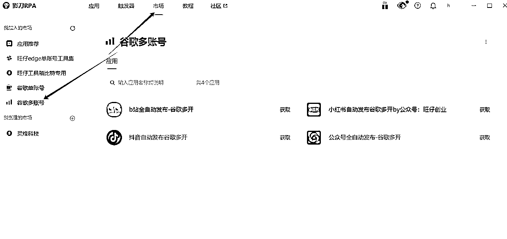

## 三 影刀首次插件配置

内含 Edge、谷歌、比特浏览器插件安装。

## 四 使用指南

### 1 表格配置 全部单元格格式设为文本

表格下载：

夸克网盘分享「b站模板」，链接保存。打开夸克 APP 在线播放。

链接：https://pan.quark.cn/s/5e034b4a593f

#### 1 配置页

谷歌多账号建议控制在 3-5 个，超出建议用比特浏览器。

##### A列 谷歌窗口号

可理解为一个窗口对应一个账号。

找到对应的 Chrome 用户 ID。

目标路径示例："C:\Program Files\Google\Chrome\Application\chrome.exe" --profile-directory="Profile 1"

把 --profile-directory="Profile 1" 这部分填入表格。

##### B列 sheet 名称

名称避免单数字，可用汉字或数字加符号，如 18-0。

配置页 sheet 名称不要改。

其他如 旺仔、创业 等 sheet，只要与表格名对应即可。

##### C D 列 行号范围

C列代表对应 sheet 的文章从第几行开始发布，示例为旺仔表格从第2行开始。

D列代表对应 sheet 的文章到第几行结束，示例为旺仔表格到第3行结束。

#### 2 内容页

##### 2.1 发布状态 A列

B站最多保存 30 条草稿。

##### 2.2 视频标题 B列

##### 2.3 文件存放路径 C列

文件夹路径，内仅放要发布的视频。

视频建议配封面，mp4 格式。

##### 2.4 视频封面图路径 D列

示例：F:\旺仔\旺仔创业引流\rpa引流\自动发布工具\📕发布\测试\视频存放\2.jpg

无封面留空。

##### 2.5 标签 E列

格式 #话题，不加留空。

##### 2.6 简介 F列

不写可留空。

##### 2.7 合集 G列

默认第一个。

##### 2.8 发布状态 H列

运行后自动填写。

### 2 启动页设置

起始行号：从第几行开始

结束行号：到第几行结束

发布间隔：默认 60 秒，避免过快触发验证。

## 五 准备工具

配置好后在谷歌浏览器登录 B站账号。

# B站发布 比特浏览器多账号

不支持 Mac，请切 Win 系统。

## 一 注册下载影刀

https://www.winrobot360.com/share/activity?inviteUserUuid=598859198794305538

## 二 安装应用

比特浏览器脚本市场：邀请加入应用市场_影刀RPA

安装后在桌面版找到应用。

## 三 影刀首次插件配置

包含 Edge、谷歌、比特浏览器插件安装。

## 四 使用指南

### 1 表格配置 全部设为文本格式

表格下载：

夸克网盘分享「b站模板」

链接：https://pan.quark.cn/s/5e034b4a593f

#### 1 配置页

##### A列 比特窗口号

不会配置可参考内置比特插件安装说明。

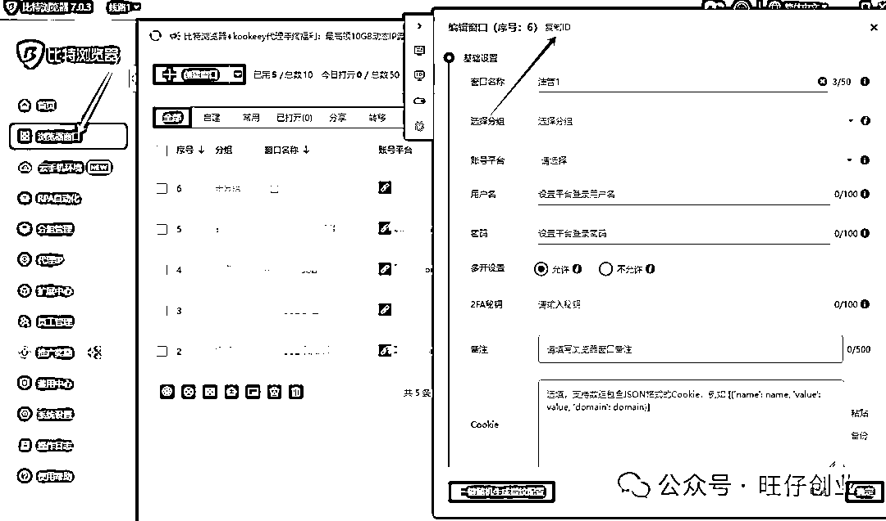

##### B列 sheet 名称

避免单数字，可用汉字或数字+符号如 18-0。

配置页 sheet 名称勿改。

其他 sheet 如 旺仔 创业，只要与表格名称对应即可。

##### C D 列 行号范围

C列为对应 sheet 文章起始行，示例旺仔表格从第2行开始。

D列为对应 sheet 文章结束行，示例旺仔表格到第3行结束。

起始行号：内容页表格从第几行开始

结束行号：内容页表格到第几行结束

##### E列 状态

当该窗口的 Chrome 结束后自动记录。

#### 2 内容页配置

##### 2.1 发布状态 A列

B站最多保存 30 条草稿。

##### 2.2 视频标题 B列

##### 2.3 文件存放路径 C列

文件夹路径，仅放视频。

视频建议配封面，mp4。

##### 2.4 视频封面图路径 D列

示例：F:\旺仔\旺仔创业引流\rpa引流\自动发布工具\📕发布\测试\视频存放\2.jpg

无封面留空。

##### 2.5 标签 E列

格式 #话题。

##### 2.6 简介 F列

可留空。

##### 2.7 合集 G列

默认第一个。

##### 2.8 发布状态 H列

自动写入。

### 2 启动页设置

起始行号：从第几行开始

结束行号：到第几行结束

发布间隔：默认 60 秒，防止过快触发验证。

## 五 准备工具

配置完成后在比特浏览器中登录 B站账号。

# 小绿书发布 Edge / 谷歌浏览器单账号

不支持 Mac，请用 Win 系统。

## 一 注册下载影刀

https://www.winrobot360.com/share/activity?inviteUserUuid=598859198794305538

## 二 安装应用

Edge 浏览器应用市场

谷歌应用市场

安装后在桌面版找到应用。

## 三 影刀首次插件配置

含 Edge、谷歌、比特浏览器插件。

## 四 使用教程

### 1 表格配置

表格下载地址：

夸克网盘分享「小绿书模板」

链接：https://pan.quark.cn/s/3875d9b42917

#### 1.1 图片地址 A列

文件夹地址，文件夹内仅放要发布图片。

图文：文件需排序，默认第一张为封面。

#### 1.2 文章标题 B列

#### 1.3 文章内容 C列

#### 1.4 创作来源 D列

共 4 种来源，按模板填写，切勿更改，如选 AI 生成则填 ai。

不选留空。

#### 1.5 发布状态 E列

发布后会自动写入，方便后续修改。

### 2 启动配置

起始行号：从第几行开始发布

结束行号：到第几行结束

时间延迟：避免操作过快触发校验

暗号：龙哥盟

## 五 准备工作

在 Edge 或谷歌浏览器登录👸号：https://mp.weixin.qq.com/

# 小绿书发布 谷歌浏览器多账号

不支持 Mac，请用 Win 系统。

## 一 注册下载影刀

https://www.winrobot360.com/share/activity?inviteUserUuid=598859198794305538

## 二 安装应用

谷歌浏览器多账号脚本市场:邀请加入应用市场_影刀RPA

安装后在桌面版找到应用。

## 三 影刀首次插件配置

含 Edge、谷歌、比特浏览器插件。

## 四 使用教程

### 1 表格配置

表格下载地址：

夸克网盘分享「小绿书模板」

链接：https://pan.quark.cn/s/3875d9b42917

#### 1 配置页

谷歌多账号建议 3-5 个，更多建议用比特浏览器。

##### A列 谷歌窗口号

一个窗口对应一个账号。

找到对应 Chrome 用户 ID。

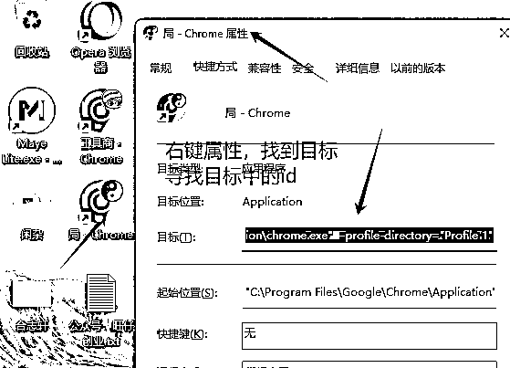

今天整理一份影刀RPA自动化实操，包含三个应用：谷歌浏览器发👸号小绿书、比特浏览器多账号发小绿书、闲鱼自动上架。内容比较细，建议先收藏再对照配置。

## 一、谷歌浏览器小绿书发布

先用谷歌浏览器打开👸号后台：https://mp.weixin.qq.com/ ，保持登录状态。

接着看目标路径。Chrome 快捷方式的目标里有这么一段：

C:\Program Files\Google\Chrome\Application\chrome.exe --profile-directory="Profile 1"

把其中 `--profile-directory="Profile 1"` 这部分复制到表格中。

sheet 命名注意：配置页这个 sheet 名不要改；其他分表，像“旺仔”“创业”，不要用单个数字命名，用汉字或数字加符号都可以，例如 18-0。分表名能和表格名称对应上就行。

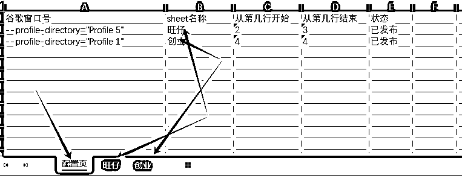

C、D 两列控制发布范围。C 列填分表中开始发布的起始行，D 列填结束行。比如“旺仔”表里 C=2，就从第二行开始发；D=3，就说明第三行发完即止。

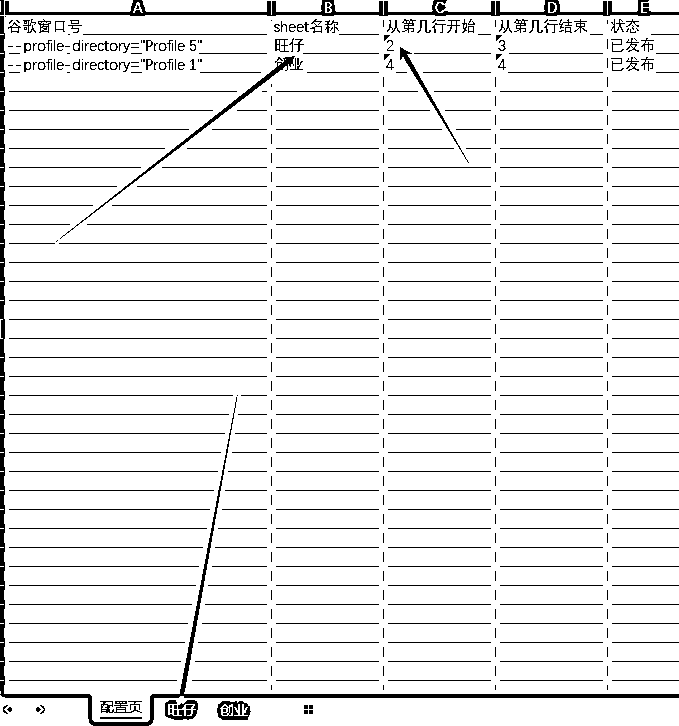

内容页各列：

- A 列图片地址：这里填文件夹地址，文件夹内只允许放待发布的图片；图文场景下先给文件排序，默认第一张作为封面。
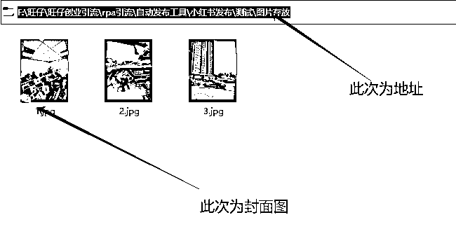
- B 列文章标题、C 列文章内容：字面意思，不用多解释。
- D 列创作来源：有 4 种备选，按模板里的写法来，千万别随意改。例如要选 AI 生成，直接在表格里输入“ai”；不选则留空。
- E 列发布状态：发布后系统自动写状态，方便后面改。

启动配置：

- 开始行号：从第几行开始发。
- 结束行号：发到第几行为止。
- 时间延迟：防止手速太快触发浏览器验证。
- 暗号：龙哥盟。

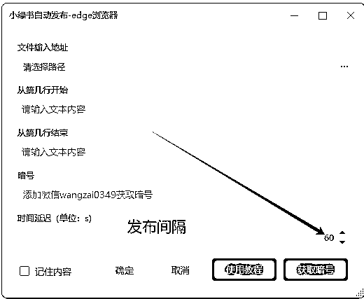

## 二、比特浏览器多账号小绿书发布

这套不兼容 Mac，苹果电脑请先装好 Windows 双系统（不会装就搜一下教程）。

先下载影刀：https://www.winrobot360.com/share/activity?inviteUserUuid=598859198794305538

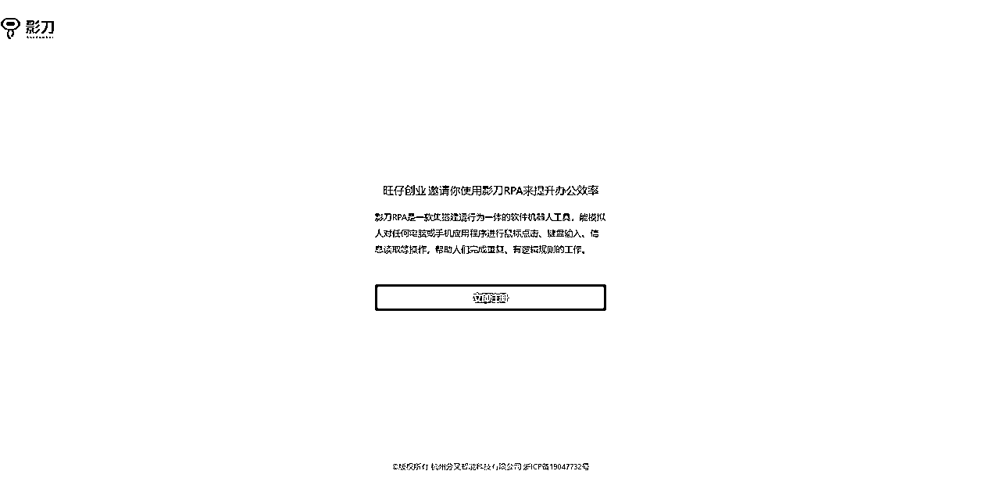

然后在比特浏览器的脚本市场里找到“邀请加入应用市场_影刀RPA”，申请加入应用。加入成功后，从桌面版客户端里找到这个应用。

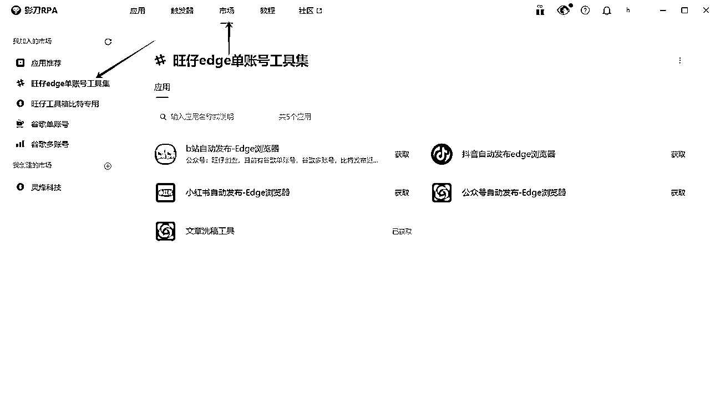

第一次使用还要配置影刀内部插件，里面包含了 Edge、谷歌、比特浏览器插件安装。

表格已放到夸克网盘，名称是「小绿书模板」，点链接保存：

https://pan.quark.cn/s/3875d9b42917

（用夸克App打开即可在线播放，不下载也能看，支持原画5倍速和电视投屏。）

配置页：

- A 列填比特窗口号；如果还不会配比特浏览器，可以看表格里的比特插件安装说明。

- B 列 sheet 名称：不要用单一数字，建议汉字或数字加符号，比如 18-0；“配置页”这个名字固定不变；其他像“旺仔”“创业”这些分表，只要和表格名称能对上就行。

- C、D 列：分别代表某个 sheet 的起始发布行和结束发布行。例如“旺仔”表，C=2 就是从第二行开始发，D=3 就是第三行发完停。同时还有开始行号和结束行号，意思是内容页表格从哪一行开始发布、到哪一行结束。

- E 列状态：对应窗口的谷歌浏览器结束运行后，会自动记录状态。

内容页配置和上面一样：

- A 列图片地址（文件夹里只放待发布图片，第一张默认封面）

- B 列标题、C 列内容
- D 列创作来源：4 种来源按模板填，AI 生成就写“ai”，不选留空
- E 列发布状态：发布后自动更新

启动配置：开始行号、结束行号、时间延迟（避免操作太快被浏览器识别成机器人）。

注意：正式开始前，先在比特浏览器里登录👸号：https://mp.weixin.qq.com/

## 三、闲鱼自动上架

同样不支持 Mac，Mac 用户请先配好 Windows 双系统。

影刀下载地址：https://www.winrobot360.com/share/activity?inviteUserUuid=598859198794305538

应用加入链接：https://www.winrobot360.com/share/accede?inviteKey=e63955eb-3ba7-4bf4-bd67-2476508a3a39

申请通过后，到桌面版里找到应用。

首次使用同样需要配置影刀内部插件（包含 Edge、谷歌、比特浏览器插件）。

闲鱼模板在夸克网盘，文件名叫「闲鱼模板」，链接如下：

https://pan.quark.cn/s/d4496a50f3fc

（夸克App打开即可看，不用下载，支持5倍速原画和电视投屏。）

表格各列：

- A 列账号序号：从 1、2、3 开始依次填，账号多了就继续 4、5……按实际情况来。
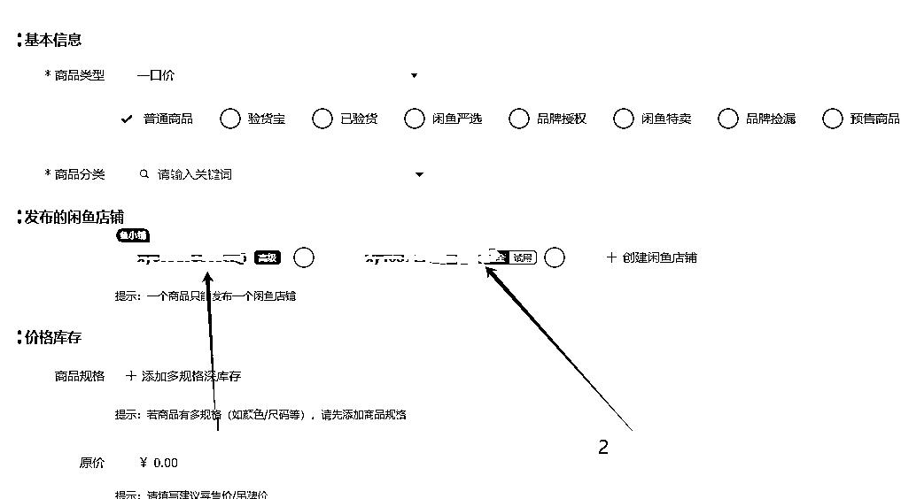
- B 列商品标题、C 列商品内容：正常填写即可。
- D 列商品分类：可以写自己的分类，比如“虚拟游戏 / 游戏 / 游戏服务 / 其他游戏服务”；图省事直接填三级或四级类目也行，例如“游戏服务 / 其他游戏服务”，系统会默认选第一个分类。
- E 列商品图片地址：文件夹里只允许放商品图片，其他东西一律不要放。

- F 列发货地：按闲鱼要求的省/市/区格式填写，比如“广东省/潮州市/潮安区”，或者像“北京/北京市/西城区”这样的写法。

- G 列售价、H 列原价、I 列库存、J 列状态。

启动配置：

- 开始行号：从表格第几行开始上架商品。
- 结束行号：到第几行商品结束。
- 时间延迟：防止操作过快触发验证。

开始前，先在 Edge 或谷歌浏览器里登录闲管家：https://goofish.pro/sale/statistics