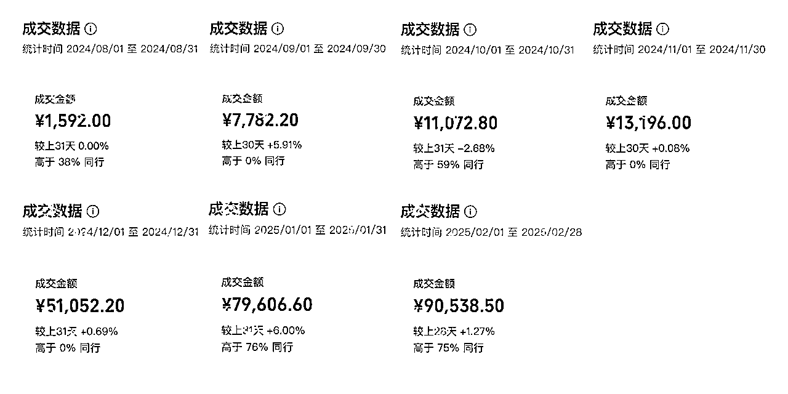
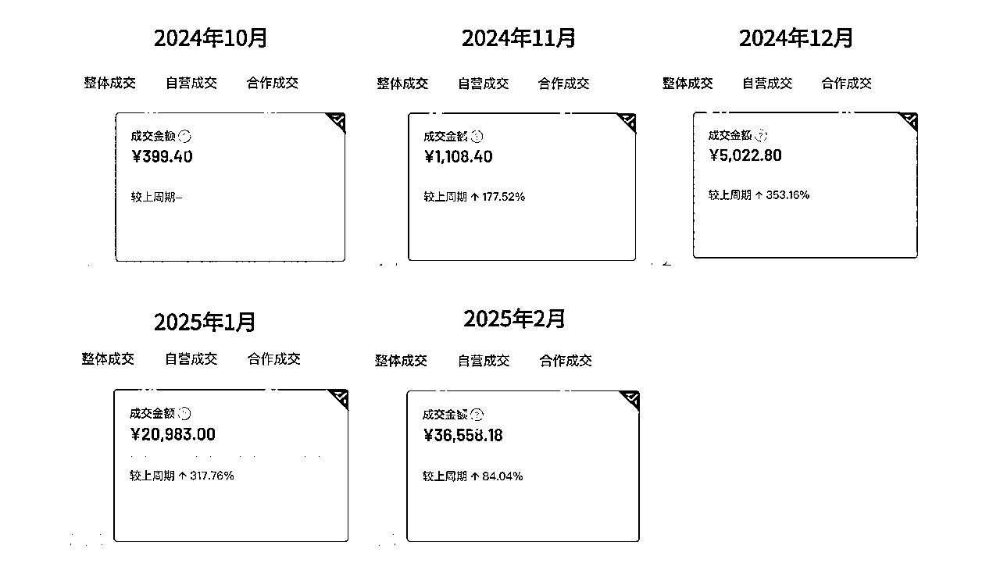
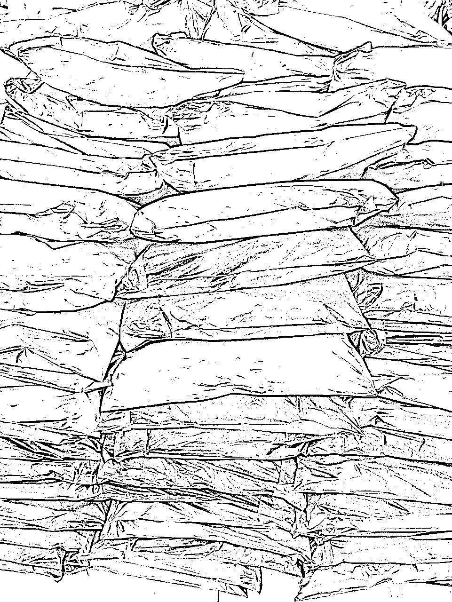

# 一个奔五实体店老板，零基础玩转直播七个月做到月销13万的复盘笔记

# 前言与经营数据

主角有点出人意料：近五十岁，从未直播过，电脑几乎不会用，话术全靠手抄，之前连直播间都没下过单。七个月的时间，从一片空白做到单月13万销售额。

没有逆袭神话，没有夸张的投入，也没有高深的打法，全文就是两个素人碰到问题就硬着头皮解决的笨办法，记录的是正在发生的真实过程。

全程零投放、零技巧，硬生生把账号养起来。

本文会讲清楚起因、规划、准备、遇到的卡点、解决思路、踩过的坑和最终总结。

直播电商这块我们的经验非常浅，恳请各位前辈多提意见。

先看一下目前的跑量情况：

先看视频号：

再看抖音的：

视频号从8月开始试水，抖音到10月才上线，一边播一边学。因为风姐还要顾着实体店和家里的事，进度一直很慢。12月中旬风姐彻底关店，全职投入直播。12月起基本保持每月播40场左右，每场2-3小时。直到上个月也就是2025年2月，视频号与抖音合计GMV接近13万，退款率约45%左右，退货退款率约25%。退款率比前几个月高了10个点以上，主要是春节假期和预售导致。

2月只有28天，且春节期间几乎没播，加上面料厂放假导致断货、预售周期长达15天、发货慢、物流时效差，假期影响下发货前的退款异常高。如果剔除这些因素，数据还会更好一些。

大致情况如此，下面说故事。

故事里的两个人：

1、风姐，女装实体店主，年近五十。巅峰时期同时经营四家店，单店月销10万+，选品、采购、陈列、动线全自己操盘。早年做过女装工厂的几乎所有工种，织补手艺非常好，毛衣破个洞她能从衣服其他部位抽线补上，几乎看不出痕迹。疫情后生意走下坡，自己焦虑乱投钱做餐饮、美妆，亏了不少，只剩下一家店。店面房租加电费每月3.5万，还不算一个正式店员加一个兼职的工资。去年6月跟我聊起直播卖女装，8月正式开播。连续数月每月亏损2万多后，去年年底实在撑不住，12月关店，全职做直播电商。

2、龙一心，也就是我。干了10年HR，副业瞎折腾过跨境、线下美业、小众医疗器械电商、视频号带货，都有点微不足道的成绩。前年开始用自己会的一点东西帮朋友做业务拓展和转型，攒了几个成功的案例。虽然在直播电商我也算新手，但跟风姐聊完后觉得可以试着孵化一个直播间，于是有了这段经历。

# 启动前的思考

## 1.1 为什么先做视频号

我觉得当时视频号还没有被过度竞争，包容度高，愿意播就能出单，正反馈来得比其他平台快一点。有正反馈就能坚持下去，后续再开其他平台会更顺。

## 1.2 盘点资源

新事要先看自己有没有能力扛住，俗称掂量掂量。

### 1.2.1 风姐的优劣势

长处：对服装行业门儿清，清楚中老年女性的穿衣需求和偏好，在选品上不容易被坑，对爆款有很强的嗅觉，后面也反复验证了这点。

短处：身高偏矮，不太适合做全身出镜的女装直播。年纪偏大，长时间站播体力吃不消。对电商一无所知，电脑只会用现成的收银软件收款，打字都费劲。从来不在直播间消费。

### 1.2.2 我的优劣势

长处：参加过不少视频号航海，对平台有一定理解。独立操盘过新奇特、养生茶等类目，最高单日佣金破万。做过拼多多、Tiktok+Shopify、抖音引流实体，短视频和商品图都能自己完成，可以把业务闭环自己跑通。在几家百亿级公司做过招聘负责人和组织发展负责人，能把商业模式和线上运营翻译成风姐能听懂的话，对新业务流程梳理和执行有经验。

短处：从未接触过服装，对女装几乎零感知。没做过服装直播，这个类目比我之前玩过的类目要求高很多，设备、灯光、机位、直播配置都是未知。

## 1.3 定位与打法

1、像素级复制：过往经验告诉我，同行都是聪明的，看似不合理的地方往往是资源妥协的结果。对新人来说，先照搬再理解，即使当时觉得怪也先跟着做。

2、极致性价比：服装教育成本低，性价比是长期活下去的核心。质量好不好收到手就知道，现在运费险是标配，不合适直接退。

3、中老年女装：视频号用户画像匹配，且风姐一直做中老年女装，选品和供应链很熟。

4、最小成本起步：没赚钱就别乱花钱，能将就就将就，先跑起来再说。

# 准备阶段

想法有了，就开始准备。但从何下手？先看直播。

## 2.1 先看直播

风姐完全零基础，以前不看直播也不在直播间买东西，网购只用拼多多，网感仅限于刷抖音看家长里短。为了让她快速找到感觉，我让她每天在视频号上看女装直播，每天至少2小时，前三天不要问我问题，先自己看能不能总结出东西。

看直播能看出什么？

至少能回答：
1、店铺开了多久，卖了多少单，目前单场多少单，转化率多少？
2、一天播几场，开播和收播时间？
3、直播间几个主播？
4、除了主播还有几个人？
5、直播间在哪？是实景还是假背景？
6、主播在几个平台播，主要平台是哪个？
7、团队大概有多少间直播间？
8、是用直播伴侣还是手机直播，用不用镜子？

看得久了还能发现：
9、用直播伴侣的话，摄像设备是手机投屏还是相机，手机投屏用什么软件？
10、手机直播有几个机位分别对应哪个平台，主机位是哪个？
11、直播间几盏灯，什么类型的灯，放哪里？
12、直播间多大，有几个场景分别做什么？

每个细节都有用。

## 2.2 对标账号怎么选

我的标准是：开店一年以内，转化率超2%，单场4小时卖300件以上，个人或小团队，1-2个主播，话术偏平播，只卖自己小店商品的账号。

## 2.3 为何这么选

起号成功，个人小团队能力强，一般不重度投流，评论区水军少，容易复制。话术平播，模仿难度低，对零基础新手更友好。

## 2.4 为什么要卖自营店商品

视频号里大部分服装直播都是卖自己店铺的货。跑完市场后才明白原因，后面选品部分会解释。

## 2.5 筛选标准

我希望项目周期长，不要玩快钱。账号要踏实，靠好产品、好内容、好服务起量，最关键的是能复制。

1、好产品：服装不用教育，极致性价比是前提。选定对标后我们把货都买回来实测。
2、好内容：套路少，主要讲产品和展示产品，不是刷花活塑品造焦虑。
3、好服务：回消息快，发货快，售后处理及时。
4、能复制：再好的间也得能复制。

账号确定后，进入像素级模仿阶段。

# 模仿落地

## 3.1 模仿拆解

话术、场景、产品，三样同步。

话术最简单，录屏转文字整理。
场景也不难，有什么照做就行。
最难的是产品，去找。

## 3.2 怎么找到同款货源

网上找了1688、拼多多、淘宝、各类批发网，都没找到合适的。

最后用最原始的方法：找营业执照注册在服装批发市场的账号，下单买一件，收货地址和营业执照地址一致，判断大概率是本地拿货。于是去实地跑市场。

那天一早我就和风姐杀到批发市场，两人一间间店逛。一个市场逛完去下一个市场，一个区逛完换另一个区。逛了一个多小时终于找到同款，但质量差很多；再逛，又找到同款面料不一样；再逛，找了一家款式质量都接近，但裤子没吊牌，不知道是不是同一家。

正聊着是不是这款的时候，一个熟悉身影走进来进了这家店，跟店主交谈。那人正是我们对标主播！戴着口罩我们一眼就认出来了。

几乎是神助攻。

* 我们小声问：是不是这款？
* 对方主播走过来说：别找了，就这款，就是从这家拿的！

聊完我们问怎么拿货，老板娘问要多少，少的话有，多的话要等，有客户定了卖爆了。这也侧面印证了货源。我们拿了几手，每尺码一件，留了名片拍了门头。

因为主播除了当季爆款还有前一季款和其他款，我们又找了几家有同款且质量相近的店拿了点货建立初步联络，后续可以合作。

这趟也验证了风姐的选品能力很强，一路上她对我这个门外汉的疑问都能解答，哪些款现在能卖、哪些款过段时间会好卖、流苏款比带标的好卖等等，后来在别人的直播间里一一被印证。

这趟的核心结论是定价策略：
主推款毛利40-50%，其他款50-70%。风姐评估后认为质量和线下售价对比性价比极高。算完各项费用，这个定价几乎没有投流空间，跟付费团队不需要硬抢，靠稳扎稳打长期做。

产品找到后，复制场景。

## 3.3 场景复制

我之前只玩过短视频引流和绿幕直播，服装实景难度大很多。之前看直播的观察派上用场。

实景：对标是实墙板材加实木装饰条。我们按最小成本原则复制。
1、场地：老小区40平左右，月租1500不到。
2、墙面：贴与对标接近颜色的墙纸，泡沫装饰条代替，200块搞定。
3、地毯：照着买2.5x3米，180左右。

软装：落地衣架、沙发、小抱枕，颜色款式大小都尽量一致，摆放角度一致。

灯光：当时最头疼。尝试下来，小间最简单做法：左右各一个球灯，腿灯打亮下半身，顶灯打亮空间背景就够了，受众没有那么挑。

搭配：直接抄主播穿搭，上衣裤子配饰尽量保持一致。

摄像：先用备用机iPhone12，效果凑合。后来换新品时双色面料在手机上表现差，借朋友Sony微单+直播伴侣。

收音：能听清就行。主播声音小就带无线麦，直播伴侣可调增益。

总搭建成本5000不到，镜头里看上去几乎一样。

## 3.4 上架商品

开店流程航海手册都有，不赘述。建议自己办个体工商户，别在网上买执照，后面麻烦。

上架要点：

1、详情图：货源商一般会给图，挑几张上传。不够就去对标账号或电商平台以图搜图补充，图片太大就压缩。批发商图常带货号，用美图秀秀去处即可。
2、标题：可直接抄对标，再根据理解微调。对纯直播而言影响不大。

筹备结束，下一步就是训练主播。

# 启动

## 4.1 主播训练

我勉强算个培训师，有点说话经验，战战兢兢开始第一次孵化。

### 4.1.1 第一阶段 理解与体感

理解：先让风姐理解电商逻辑和全貌，她在其中扮演什么角色。

对奔五、几乎不会电脑、没在直播间买过东西的人，讲账号流量平台服务费投流各种率她会懵。用她最熟悉的线下店类比：

* 平台就是商场。
* 店铺就是商场里的店。
* 线下按月交租金，线上按成交抽服务费，多卖多交。
* 流量就是过路人，点击是进店，直播是店员介绍，下单是到收银台付款。
* 直播买东西比拼多多能看更多信息，还能要求看细节。
* 快递相当于把衣服寄过去让客户摸试穿照镜子。
* 不合适就退，退货运费商家承担，买运费险相当于退货券。

培养网感：找、看、拆。

找对标账号。
看对标直播，每天看完复盘交流，让风姐描述话术结构和动作要点。
拆话术结构，重新组合，最起码能回答客户：我为什么需要？为什么这个价？为什么买你这儿？为什么现在买？什么颜色尺码适合？怎么下单？

风姐不熟悉软件，一遍遍手写整理，我深受震撼。

### 4.1.2 第二阶段 能说会演

有人面对真人能说，面对镜头就卡壳。风姐也是优秀销售，但对着镜头大脑空白。线上和线下销售方式差异大，隔着屏幕只能靠主播输出信息，状态要更热情。

先能说，再能演。

能说分两步：
先读，把整理好的话术读熟，有话可说。
再改，读多了会觉得拗口，改成自己顺口的表达。

前段时间帮风姐复盘服装直播，我最大的感受是：这行不是“会说”就行，得“会演”。

先说说熟产品要到什么程度。我的标准很简单：不管对方问什么，你能不能立刻用准备好的话术接住。如果每次都要想半天，那客户早划走了。

服装类目特别有意思，用户不需要你教育，甚至可能反过来教育你。所以直播要求更高。我们把改好的话术带到真实场景里，对着产品一遍遍练，嘴、手、表情全得同步。她最初放不开，我们花了挺长时间，把每个动作和每句表达拆开，慢慢磨。

风姐最容易忘词。后来用“记忆宫殿法”调整：眼睛的落点、手指的指向、口中的话术，三者对齐。这个口诀一用，忘词少了很多。

等风姐能比较流畅地讲完整场，我们就直接开播。没压力时她播几分钟就喊累，所以干脆用真实直播逼她。最开始每场只播半小时，约定好了，只要开了播，哪怕只是站着，也要把这半小时熬满；我没说关播，她不许下播。就这样“逼”着练，风姐从最开始一天1单，到一场5单，再到现在最高的一场99单。这条路还在继续优化，我也在看她还能再往前走多远。

当然，踩坑是逃不掉的。下面几个坑，花了不少时间才摸索出答案，写出来给同行避避雷。

**退货退款，真的考验心态。** 我遇到过买家寄来一包榨菜当退货，签收后第二三天才填物流单号，你如果先拆了快递，那就真的说不清了。寄错衣服更常见，每周都能收到几件，而且没有一件质量比我们卖的好。正规流程是：客户申请→退货→收包裹→在高清摄像头底下拆包裹（最好有扫码退货系统）→确认数量、确认不影响二次销售→退款。但小卖家很难做到，房间小、货堆得满，哪来的摄像头工作台，人也不够。所以我们摸索出一套轻量版：收到包裹先用剪刀在快递表面开个小口，确认是不是自家店铺的货，看看吊牌和包装袋还在不在——有原包装袋的通常没问题，也有例外；再数一下数量，没问题就退款。有些包裹在系统里找不到对应退货单，就统一收好，别急着拆。遇上没吊牌、包装袋不是原版、甚至货不对板的，立刻拿出手机录下拆包过程，再去系统里协商或拒绝退款。平台一般会支持商家，就是周期比较长。流程顺序千万别错，错一步就可能损失一件衣服。

**退款率、退货率是女装永恒的话题。** 降低发货前退款率，最有效的两招：挂现货链接、及时打单发货。像过年前后供货不稳、备货不够的时候，只能挂预售，那个阶段发货前退款率会明显飙高。所以前一天晚上的单，第二天一早打；白天的单，播完就马上打。这样能明显压住发货前退款率。

退货率的核心是降低预期差，主要在三个地方：质量、颜色、尺码。质量上，同一个版型的上衣，拿货价有15、30、60的，有的直播间挂60的样品，发30甚至15的货，退货率不高才怪。我们坚持极致性价比，在这方面很稳。颜色上，直播间灯光色温、亮度、软件调色都会影响，多找几部不同品牌、不同型号的主流手机自己测测。尺码上，尺码不合适是退货第一原因，但人的身形差异太大，很难有一套标准推荐。我们的办法是结合同行和有经验的人的意见，再在换品后过一段时间给退货用户打电话回访，根据反馈修正推荐。

**错发漏发也躲不掉。** 刚起量后的第三周，我就发现错发漏发明显变多。抖音还有异常包裹提示，🛰️小店连提示都没有，换季换品的时候更严重。我们用了两个办法。

第一个是分开打印：打印面单时不要所有订单混在一起。主推款量大，单独拉一组；其他款按货号分开；同一订单买了多件的，也单独打印。这样发货时各归各，错发自然少很多。

第二个叫“二次核对”。第一步贴标签：先按货号、颜色、尺码打印热敏小标签，打包时贴在快递袋外面。光听描述可能觉得跟直接贴面单没区别，实际用起来才知道省力在哪。以前要反复核对面单上的信息跟包裹里的货是否一致；现在只要确认袋子里的货标签对不对就行。第二步贴面单：每场直播结束，把面单完整打出来，不要撕开，按顺序往贴好小标签的包裹上贴。贴完把整长条面单纸从头捋一遍，看有没有漏掉的。以前为了赶速度，把一长串面单撕开分类，结果空间小货又多，面单掉进缝里、被包装袋盖住太常见了。现在这样处理大量单件包裹特别好用，错发漏发少了，发货压力也小很多。因为只要有货，随时可以提前打包贴标签，直播完只要贴面单就行。小团队人手不足的话，这个方法挺值得参考。当然，如果哪位大神有更好的办法，也想请教一下。

**直播伴侣也要注意。** 视频号和抖音的默认亮度不一样。同一个视频源，在视频号看着刚好，放到抖音上浅色衣服就过曝，颜色也怪。视频号能调的参数比较少，所以我的做法是优先保证视频号画面，抖音再额外调一调。

**没有流量怎么办？** 别把太多心思花在换对标、换场景、换设备上，多从主播、话术、动作、表达上找原因。大多数时候，问题出在人身上。

写到这里已经快一万字了，还有很多细节没法展开。关于运营层面的东西，赚钱里已经很多，就不重复了。也再次恳请大家多给我些优化建议，当局者迷，感激不尽。

最后说点题外话。这篇文章不光是复盘过程，更想记录风姐的执着和那股不断自我迭代的劲头。她因为持续不出单、无法稳定出单哭过好多次，但每次哭完半小时，擦干眼泪继续干。我相信，只要路是通的，不断优化就一定能走通。

就用风姐第一次单日发货破百的画面收尾吧——祝大家都能源源不断地赚钱。
