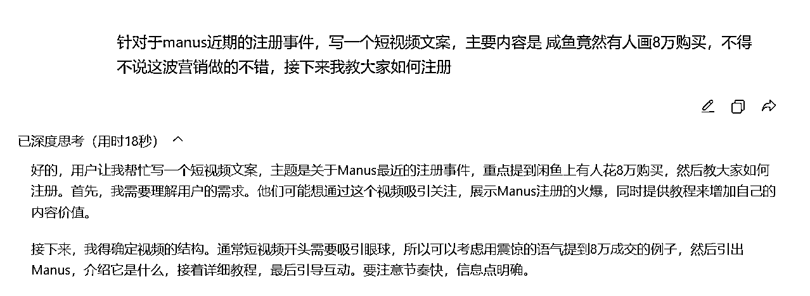
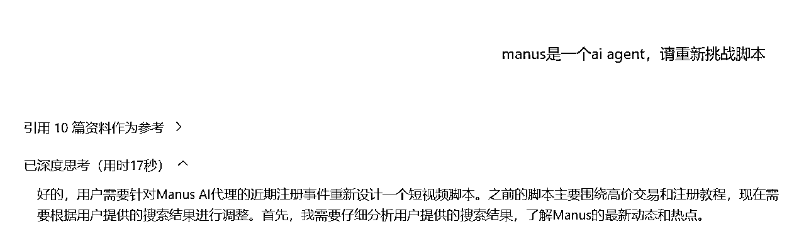
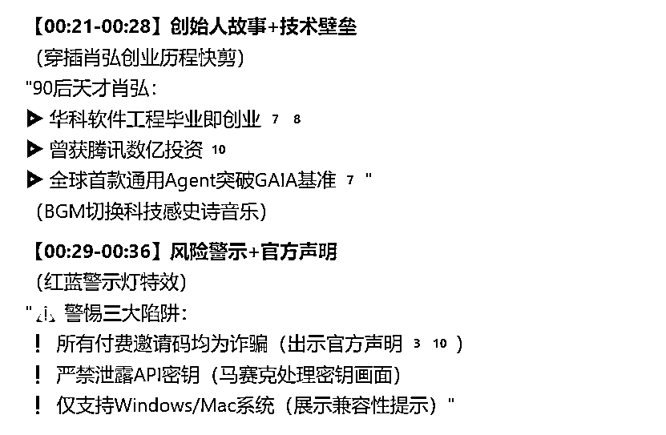
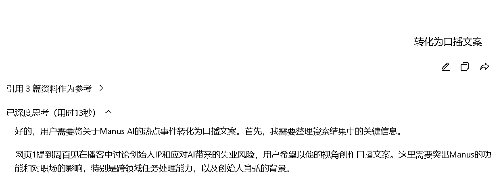
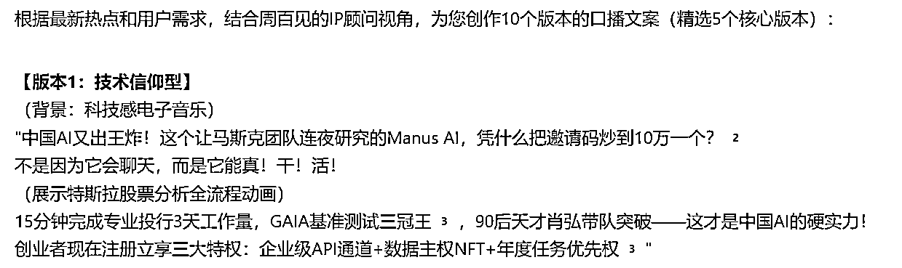
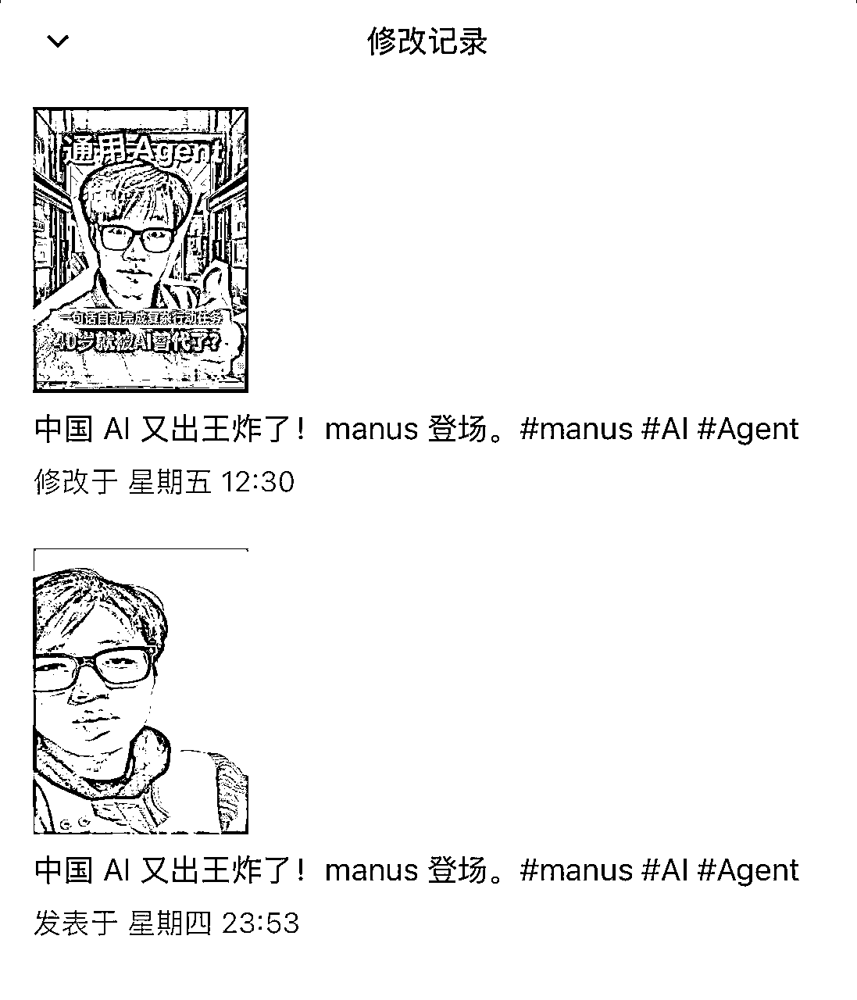
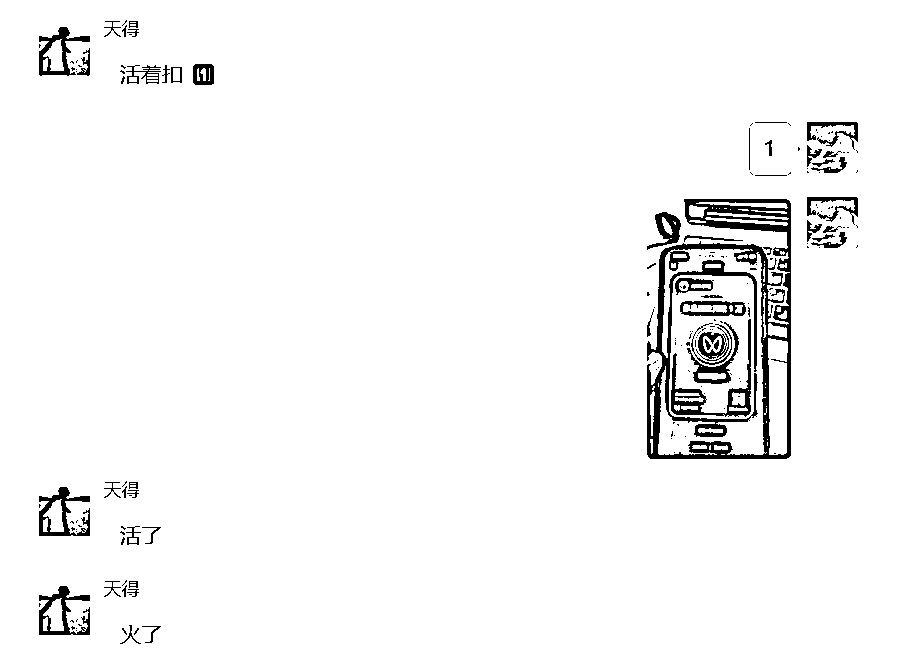
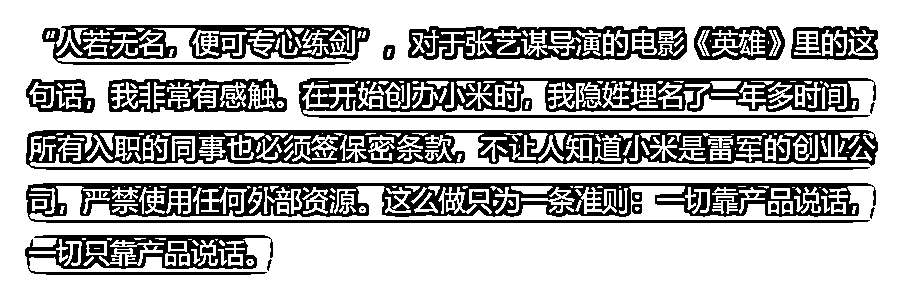

# 新手第一次发视频，为什么能突破1.2万播放？真正改变我的，不是爆款，而是迈出了第一步

很多人不是没有想法，而是总觉得自己还没准备好。

设备不够好、表达不够顺、镜头感不足、剪辑不会做、怕熟人看见……这些理由听起来都很合理，于是我们一次次把“开始”推迟，最后连第一步都没有迈出去。

但我的第一条短视频，就是在几乎所有条件都不理想的情况下完成的。没有支架，没有精心布置的场景，头发两天没洗，拍摄时间甚至已经到了晚上十点多。可就是这样一条并不完美的视频，第二天播放量超过3000，随后突破1万，最终达到1.2万以上。

回头看，这次经历最重要的收获，并不是“我做出了爆款”，而是我终于明白：很多事情，不是等准备好了才开始，而是开始之后，才会逐渐变好。

## 一、为什么决定做这条视频？

### 1. 热点带来了机会

3月6日，Manus成为中国AI圈最受关注的话题之一。

有头部AI博主亲自体验后高度评价，也有大量自媒体跟着官方演示进行解读和传播。国产AI天然带有一层情绪价值，很多人乐于看到中国的产品被拿来和海外产品比较，甚至产生“终于可以扬眉吐气”的兴奋感。

更关键的是，Manus的邀请码非常难得。

当时，哪怕是头部博主，也可能需要通过各种渠道才能拿到邀请码。很多普通用户不仅要解决网络问题，还要填写申请信息，至于什么时候能拿到、最终能不能拿到，完全不是自己能够决定的。

热点、民族情绪、权威背书、稀缺资源，这些因素叠加在一起，传播的基础已经形成了。

### 2. 争议让话题更有张力

就在大家普遍称赞Manus的时候，硅星人发布了王兆洋署名的文章《想并肩 DeepSeek 不能靠自嗨和邀请码》，观点明显更加克制，甚至带有质疑意味。

一个方向是集体叫好，另一个方向是提醒大家不要盲目兴奋，矛盾自然就出现了。

与此同时，稀缺邀请码也催生了大量灰色交易。闲鱼上开始出现注册教程、代注册服务，甚至有人把一个邀请码炒到了8.8万元，最后连官方都不得不出面回应。

对自媒体来说，这种“热度很高+资源极少+观点相反”的组合，本身就具备很强的内容张力。

### 3. 真正让我决定拍摄的，是用户价值

不过，仅仅有热点和争议，还不足以让我动手。

如果只是转述别人说过的话，看看不同账号的观点，我并没有太大兴趣。没有亲自体验，我也很难形成真正属于自己的判断。

直到晚上十点左右，我看到老图发布的《手把手教你，5分钟申请到8万元一个的Manus邀请码！》。

那一刻，我突然意识到：我可以做一条真正能帮助别人的视频。

我可以告诉大家如何注册，提醒他们避开风险，也可以把我知道的信息整理出来。即便很多AI社群里的成员已经掌握了方法，仍然会有大量普通用户正在寻找答案。

这群人，就是我应该服务的对象。

于是，我决定拍。

## 二、真正开始之前，我也有很多顾虑

### 1. 我同样害怕被熟人看见

我曾经反复想过：

如果朋友刷到这条视频怎么办？

他们会不会笑话我？

我的样子是不是很难看？

我不擅长面对镜头，也不会拍摄，不会剪辑，文案能力也未必适合短视频。

别人已经做得那么成熟了，我现在开始，会不会显得特别可笑？

这些问题看似是在分析风险，实际上更像是在给自己寻找一个不行动的理由。

我不想直接面对这种恐惧，于是给自己找了一个折中方案：用小号发布。

只要大号不点赞、不转发，熟人就不容易发现。这样一来，我至少可以先迈出去。

### 2. 时间太晚，还会影响身边的人

决定拍摄时已经十点多了。

按照平时的习惯，这个时间应该洗漱、休息，或者和女朋友一起打游戏、看电视。可我当时已经进入了状态，一个人在客厅里反复练习：

“中国AI又出王炸了！”

“不行，重来。”

我们住的是一间租金400元的毛坯房，屋里空荡荡的，隔音也很差。即使女朋友在最里面的房间，也能清清楚楚听到我的声音。

她当然会觉得烦。

我并不是一个特别擅长处理情绪的人。很多时候，我会觉得对方只是因为小事生气，简单哄两句就算了。于是我一会儿回到电脑前拍摄，一会儿过去安慰她，来回反复，直到视频最终发布。

现在回想，这其实并不是最好的沟通方式。很多人宁愿用敷衍的方式暂时平息矛盾，也不愿意认真坐下来解决问题。

但那天的我，就是在这种手忙脚乱的状态中，把视频完成了。

## 三、文案是怎么做出来的？

我以前写过10万+文章，但短视频文案是另一套逻辑。

由于长期缺少社交，也不怎么刷短视频，我很清楚自己的短视频表达和网感并不强。再加上当时留给我的时间很少，所以我决定借助AI完成初稿。

我没有直接使用DeepSeek官网版本，主要是因为它的联网能力相对有限。最后选择了腾讯生态里的元宝加DeepSeek，可以直接联网读取近期👸号文章，方便了解最新信息。

推理模型不一定需要特别复杂的提示词。李继刚老师在《推理模型的prompt》中提到，告诉模型背景和目标，通常就足够了。

而在我看来，和大模型沟通，本质上也像是在和人沟通。有效沟通离不开四个要素：

- 观察到了什么
- 自己有什么感受
- 真正需要什么
- 希望对方完成什么

基于这个思路，我写了一段并不复杂的提示词。

但元宝似乎完全不知道Manus是什么，直接把它理解成了一个刚刚走红的Web3域名，还告诉我注册是免费的。

我只好重新解释，告诉它Manus是一款AI Agent。

现在回头看还有一个细节很有意思：当时我写的是“重新挑战脚本”，而不是“重新撰写脚本”。直到后来整理文章时才发现这个错误。由此可见，当时的状态确实非常紧张，连这种明显的问题都没注意到。

好在，元宝重新帮我生成了一版脚本。

但它写出来的内容太像专业宣传片方案了：创业历程快剪、科技感配乐、警示灯特效……这些东西在正常制作中当然没问题，可我当晚没有时间完成复杂拍摄。

我需要的不是一份宏大的导演脚本，而是一段拿起来就能读、拍完就能发布的文案。

这一次，它给出了五个版本。

其中第一版整体不错，只是没有具体写清楚注册流程。那就补上这部分，直接开拍。

## 四、设备简陋，反而让我没有继续拖延

当时我没有手机支架，只能用手举着拍。

居住环境是一间毛坯房，背景就是普通的白墙。作为“人、货、场”中的场景，显然谈不上专业。

那几天天气很冷，我已经两天没洗澡，头发乱得像鸡窝。时间又已经很晚，我不可能为了拍一条视频，专门洗澡、吹头发、整理造型。

如果我告诉自己，等支架买了、房间布置好了、头发洗干净了再开始，那这条视频大概率永远都不会出现。

所以我只能逐个绕开问题：

没有支架，就手持拍摄；

背景不理想，就尽量挡住；

头发没整理，就把镜头靠近一些；

其他问题，先不管。

先做出来再说。

我之前看过一份口播手册，里面提到过一个提词器软件。但因为长时间没有使用，账号已经退出。重新登录还需要去卧室拿另一部手机接收验证码，重新注册也很麻烦。

最后，我选择自己背。

一遍一遍地读，一遍一遍地练。卡顿了就重来，忘词了就继续，表达不够流畅也没关系。

我并不是靠专业设备和成熟技巧取胜，我能依靠的，只有真实。

拍摄完成后，剪辑也非常简单：

没有背景音乐；

没有复杂音效；

没有动画包装；

主要就是一段正面口播，再配上几张相关截图；

字幕使用的是剪映新用户赠送的免费识别功能，也没有使用智能剪辑口播。

封面同样是系统自动生成的。直到第二天视频数据起来以后，我才发现封面不够美观，随后找了参考账号重新更换。

标题直接采用文案的第一句话，没有额外让AI生成所谓的“爆款标题”。标签也是临时想到什么就填什么。

视频在凌晨前发布。

发出去的那一刻，我整个人突然轻松了，赶紧回房间哄女朋友，然后睡觉。

## 五、第二天爆了，但我知道这并不代表我很厉害

第二天醒来，播放量已经超过3000。

后来，视频突破1万播放，我当然会兴奋。但冷静下来之后，我也清楚，这条视频能够获得传播，更多是因为踩中了当时的热点，而不是因为我的制作能力有多强。

它带来了播放、点赞和关注，却没有立刻带来收入。除了未来可能参与创作者分成之外，这些流量暂时没有完成变现。

更重要的是，这是一批泛流量。

我真正想吸引的用户是谁？

我希望和哪些人建立连接？

我想服务谁，又想反对什么？

谁会成为我的朋友，谁只是短暂路过？

这些问题，我现在依然没有完全想清楚。

从长期规划来看，我更愿意参考B站UP主“古必的精读书柜”的方式：隔一段时间稳定产出优质短视频，平时持续学习AI相关知识，最好聚焦某一个具体方向，再把AI作为辅助工具；晚上进行免费直播教学，把完整回放整理后进行收费。

这样做的好处是，不必每天盯着流量波动，也不用不断重复同一套追热点的话术。对我自己的能力积累来说，也更有价值。

## 六、小号还是大号？我最后选择不再躲藏

3月7日晚，视频正式突破1万播放后，我把这个消息发到了包含父母和弟弟的家庭群里。

没想到第二天早上，我还在睡觉，父亲已经把相关内容发到了朋友圈。

很快，亲戚朋友陆续看到了这条视频。那一瞬间，我其实有些抵触和不自在。

直到当天晚上，我在学校等电梯回家时，把一句话记进了flomo：

如果现在都不愿意让身边的人知道，那么未来也很难被更多人看见。

我突然意识到，继续逃避并不能解决问题。

我不想重新注册一个账号，不想永远活在别人的评价里，也不想因为担心熟人议论，就放弃自己想做的事情。

亲戚朋友偶尔提点意见，其实也未必是坏事。平时没有太多时间和他们联系，现在他们通过视频了解我的近况，至少多了一种交流方式。

我当然不是完美的创作者，但只要每一条视频都比上一条更好，就已经足够了。

这就是我，也是真实的我。

阅读《小米创业思考》时，我看到了一句话：

这正是我想要达到的状态。

现在被亲戚朋友知道的，也只是很小一部分人。真正重要的，是继续专注于提升能力。小号和大号并没有本质区别，小号可以慢慢成长为大号，而所有大号，也都是从最初的无人关注开始的。

终有一天，我们要做到的，是让产品和内容替自己说话。

## 七、1+1不一定等于3，但每一次行动都不会白费

我曾经在猿编程卖课期间，累计打过1500多分钟电话。

那段经历让我明白，很多分配来的用户并不是精准客户。他们对编程缺乏了解，甚至只是抱着试试看的心态。仅仅上了四节课，就希望家长支付2000多元，当然并不容易。

一个周期十天，面对三十个家长，你可能会遇到各种情况：

有人拒接电话；

有人号码无效；

有人直接辱骂；

有人拒绝添加微信；

有人不愿意下载APP；

有人不上课；

有人不交作业；

有人聊到一半直接拉黑。

不到最后，你永远不知道谁会真正成交。

即使对方每天准时上课、按时完成作业、回复消息也很积极，也不代表他一定愿意付费。有时候，他只是想先把免费的部分全部拿走。

那我们是不是就可以不打电话、不发消息，等客户主动下单？

当然不行。

新手不会表达怎么办？

公司有现成话术，有标准流程，甚至会细化到每隔几分钟应该发送什么内容。照着练，照着说，先行动起来。

说错了怎么办？

下次改。

当场发现自己说错，就直接向家长承认；后来复盘发现不妥，下次联系时再解释。家长也是普通人，他们不喜欢机械僵硬的话术，很多时候，坦诚和真诚反而更容易建立信任。

如果你已经判断某个用户大概率不会购买，是不是就应该放弃？

也不一定。

你可以把他当成练习对象，把能想到的表达都尝试一遍，同时弄清楚他为什么不买、真正的顾虑是什么。下一次遇到类似用户时，就能提前判断和应对。

所有发生过的事情，最终都可能成为你的经验。

写文章如此，拍视频如此，做直播也是如此。

即便打了很多电话，最后依然没有卖出课程，你的努力也不会被完全忽略。身边的同事和主管可能会因为看见你的坚持而主动帮助你。他们曾经也经历过类似阶段，所以更愿意拉你一把。

当然，这种帮助不是靠刻意索取，而是长期努力之后自然形成的信任。

努力会变成方法，真诚会带来连接，而团结往往是在你持续行动之后才出现的。

## 八、写给还没有开始的人

我记录这段经历，不是为了证明自己做得多好。

相反，我想告诉那些和当时的我一样，反复犹豫、不敢露脸、害怕被熟人看见、总觉得条件不够成熟的人：

你不需要等到万事俱备，才有资格开始。

第一条视频可以粗糙，第一篇文章可以不完美，第一次直播也可以紧张。重要的不是一开始就做得漂亮，而是你愿不愿意先把第一步走出去。

这次经历让我明白，所谓突破，很多时候并不是数据突然上涨，而是你终于没有再次选择逃避。

希望2025年，我们都能少一点犹豫，多一点行动，在各自的道路上继续往前走。

最后，用《忆秦娥·娄山关》与大家共勉：

> 西风烈，长空雁叫霜晨月。霜晨月，马蹄声碎，喇叭声咽。  
>   
> 雄关漫道真如铁，而今迈步从头越。从头越，苍山如海，残阳如血。