# AI辅助剧作接单：从零到月赚一万的实操复盘
作者：龙哥

先介绍一下自己。我是龙哥，2023年就进了赚钱社区，拿过龙珠，做过航海实战嘉宾，也上过不少实战分享。过去两年，我和团队一直扎根在AI内容服务领域，算是比较早把大模型工具引入内容生意的人。

这篇文章想聊一个具体的细分方向：剧作脚本代工。

我们自己已经交付了两百多份短剧及中等篇幅的脚本，这个品类带来的收入差不多有五万块。之所以愿意把方法写出来，是因为这个市场还在增长，新入局的人越来越多，但真正能把流程跑通的人并不多。

我会按顺序拆解：怎么判断这个方向、从哪些渠道接单、怎么用AI提高产出、怎么准备作品、怎么避开常见坑。内容尽量照顾零基础的朋友，看完可以直接照做。

文末我也会放一份脚本案例合集，需要的话直接拿走。

先讲一段我自己的经历。

我老家在贵州的一个山村，小时候村里没通电，晚上要靠煤油灯。爸妈没上过学，种了一辈子地，对我们的期待很朴素：多认几个字，以后去镇上教书，那是他们能想象到的体面日子。

我后来上了普通本科，毕业后没去找工作，反而一头扎进创业的坑。借钱、网贷，前前后后投入五十多万做线下门店，最后全亏完了，还欠下二十四万。那段时间真的难，每天都在想怎么填坑。

实在没办法，只能转线上。从电商做起，也接过传统的内容代工，反正什么能赚钱就干什么。等AI工具大规模出现，我判断这是机会，立刻把重心压了上去。刚开始只有两个人，一路摸索，把大模型用在简历包装、文案代工上，慢慢跑出了效果。现在公司有二十人，去年做到五百万的成绩，八个天猫店在运营，闲鱼、种草社区的流量渠道也都打通了。我们还搭过一个几百人的写手外部协作网，扶持过不少小型创作团队。

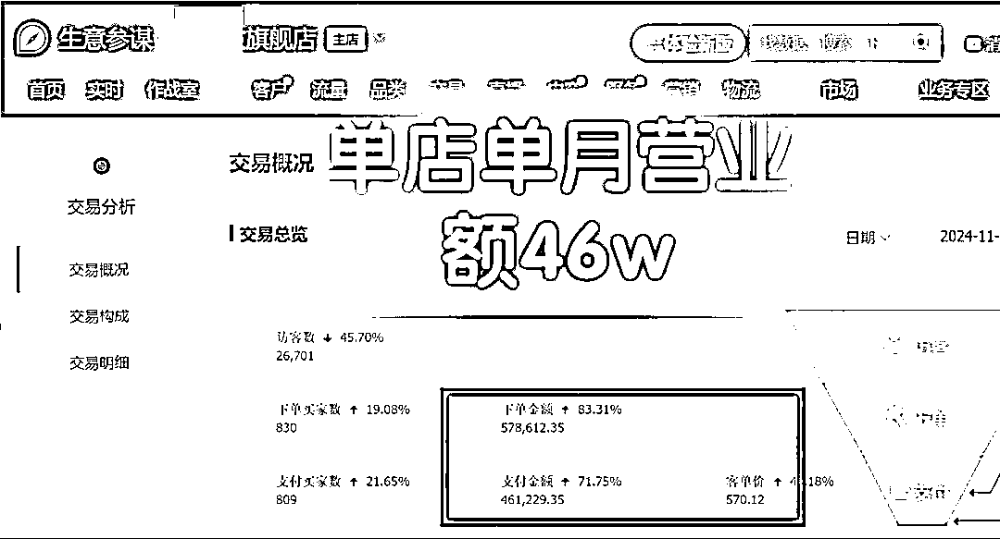

这些成绩绝对值不算高，但能说明一件小事：没有背景、没有资源的人，靠着找对方向和持续执行，也能把日子越过越好。AI这波浪潮，给了很多人重新起跑的机会。

再说回剧作脚本。我们是从2024年底开始内测这个方向的，当时只想着在既有业务旁边找个补充，没想到越做越觉得有搞头。客户问得越来越多，单笔报价从几十块到几千块都有，更关键的是AI在这里能帮上大忙——出初稿、拆结构、设计反转，样样都省力。

眼下我们的客户来源主要是两个：一个是闲鱼，一个是淘宝。下面截了几个订单实拍，金额还可以，交付后客户普遍满意，也陆续有人回来复购。


有些圈友问起我进入这个赛道的缘由。其实逻辑很直接：AI能干的内容方向虽然多，但很多品类已经卷成红海。剧作脚本还处在窗口期，懂的人少，能稳定交付的人更少。再加上短片、广告、游戏都在扩张，内容平台愿意为优质故事花钱，需求自然被顶起来了。

我们在这个方向也是从零起步，之前没有任何剧本功底。一边接单一边学，慢慢整理出一套自己的流程：怎么聊需求、怎么定价、怎么交付、怎么做售后。这条路一点都不神秘，只要肯花时间，同样能复制。

社区里的实战信息密度很高，我经常泡在里面看别人的交易复盘。建议你也每天留一点时间刷一刷，光看肯定没用，边看边做，进步会非常快。

下面开始进正题。

先聊一个基础问题：剧作脚本到底是什么？

简单讲，它是给影视、戏剧、游戏、竖屏短片等创作团队使用的施工图。内容包括人物对白、事件推进、场景布置、动作指示，甚至会标注灯光、音效这些执行层面的细节。导演靠它组织拍摄，演员靠它理解人物，剪辑靠它把握节奏。

亚里士多德很早就总结过戏剧的六个核心维度：叙事结构、角色塑造、主题表达、语言风格、视觉呈现和听觉设计。这套框架到今天依然成立。

那这个市场为何越来越大？我琢磨着，最根本的原因就是：人天生喜欢听故事，而所有屏幕都在抢好故事。

第一，视频平台对短内容的需求近乎饥渴。一些热门剧集一开拍就是几十集，单集只有一两分钟，照样要把冲突、爽点、悬念安排满。这些内容离不开脚本的支撑。

第二，电影、游戏、广告都在抢好故事。大制作需要长期打磨故事线，游戏要写大量对白和分支剧情，广告也趋向于用一段有情节的短片来打动用户。整个市场对好故事的胃口，正在以几何级数膨胀。

第三，内容生产工具普及之后，人人都能上阵。一个人拿手机也能拍剧情短片，随口几句对话就是微型脚本，这类创作带来了散而多的小额订单。

第四，观众越来越懂套路，没有新意的内容很难留住人。创作方只能不断推翻旧模式，寻找更刺激的设定，脚本的更新频率因此被大幅拉高。

第五，好故事的商业回报惊人。一部作品做成了，出品方往往能赚到好几倍利润，平台也愿意为独家版权掏真金白银。资本不断进场，愿意为故事买单的人只会越来越多。

所以一句话总结：只要人类对故事的食欲不被满足，脚本就会一直是被市场争抢的“硬通货”。

脚本的类型怎么划分？我比较习惯用五个维度来看。

按使用场景，有给大银幕拍的“电影本”，有给长剧集用的“剧集本”，也有给剧场排演的“舞台本”。电影本重视画面规模和镜头设计，剧集本要照顾每集结尾的悬念，舞台本则更依赖现场互动和对白爆发力。

按题材方向，常见的有高甜向、悬疑向和逆袭向。高甜向负责提供情感幻想，悬疑向用谜题把好奇心一直吊着，逆袭向则让观众代入底层翻身的快感。

按篇幅长短，有长故事、短剧、广告本。长故事适合慢慢塑造人物，短剧要求开头三秒抓住眼球，广告本要在几十秒里讲清一个品牌故事。

按制作方式，还有互动故事、竖屏内容、AI辅助写稿这几种。互动故事让用户自己选路线，竖屏内容根据手机习惯多用近景和特写，AI辅助写稿则靠提示词快速搭出结构。

按终端用途，又能分出游戏任务、动画剧集、企业宣传情景剧等类别，适用范围比很多人想得更宽。

对刚入门的人来说，最容易上手的三个切入点：高甜反转类短剧、广告短片脚本、社区短故事。这三个方向需求明确，价格也好商量。前期不要死磕原创，先拿成熟爆款做参考，把结构拆开看，再套进自己的创意，等跑通流程再慢慢形成风格。

再来说说平台怎么选。

我的建议分三步推进。先从威客网站和招聘软件上找直发需求，练手为主，目的是熟悉甲方的要求和交付节奏；然后在闲鱼、淘宝，还有拼多多和种草社区这些地方开店或发内容，让客户主动找过来；等作品积累够了，再去投简历、签约，拿长期合作。

短期阶段，优先接五百元以下的小单。一来竞争没那么激烈，二来试错成本低，做完三五单，你就知道市场真正要的是什么了。

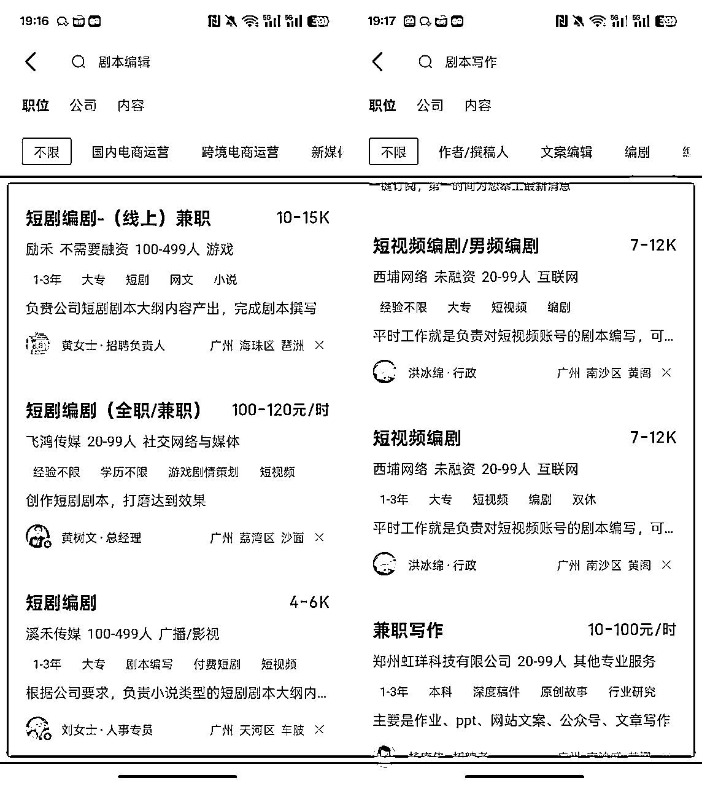

内容社区的玩法也值得单独说一说。种草平台上搜故事脚本的人比想象中多得多，而且不强求账号有多少粉丝，一篇笔记只要踩中痛点就可能爆。内容方向可以是脚本片段展示、爆款拆解、创作心得、避坑提醒等。闲鱼与淘宝那边，则侧重于上架服务、优化标题和详情页，同样能获得稳定咨询。


如果想让收入更稳定，可以考虑往签约方向发展。


一线平台门槛偏高，但通过后收入更稳，续约也更有保证；中小平台对新人友好，不过签合同之前要把版权归属、分成比例、独家条款这些细节看清楚，防止踩坑。

我自己总结的进阶路线是：前一个月先接零散小单攒手感，不要想着一步登天；中间两个月左右集中火力，找到适合自己节奏的平台和品类，做出几个代表作品；再往后就争取签约或者培养老客户，把一次性买卖变成稳定收入。

接下来回答一个大家都关心的问题：新手怎么赚到第一笔五百块？

先讲几个心法，都是我们拿真金白银换来的：

一是别太在意文采。甲方要的是能用的结构化内容，不是文学作品，能出货、出得快比什么都重要。

二是别怕没有作品。用AI做几个展示稿，完全可以当敲门砖。重点不是作假，而是让客户一眼看出你能交付什么。这个行业里很多看起来很资深的合作案例，早期都是包装出来的。先把门面撑起来，活下来才有机会。

三是别等准备好了再动手。先接单，再在干活的过程中补齐能力，做完几十单，专业度自然就上来了。

真正拉开差距的不是天赋，而是手脚够不够勤快。你连续七天每天发几十条接单信息，还怕没人问吗？五百块只是起点，跑通一次，后面复制放大就行。

具体操作分几步。

先定主战场。前期不要搞全面开花，只挑一个渠道深耕：闲鱼可以，淘宝可以，威客网站也可以。把服务挂出去、把笔记发出去、把信息投出去，让潜在客户能看到你。

接着，准备样稿。没有真实案例，就用AI来做。借助DeepSeek这类面向中文场景的大模型，把题材、篇幅、格式、风格要求写清楚，很快就能得到一份结构完整的脚本。再把它整理成专业文档，标题采用“某项目合作案例”的样式，排版统一，导出成带密码的PDF。客户看到这么标准的文件，信任感立刻不一样。

具体来说，电脑上直接访问官网，手机上通过🛰️官方入口就能开始体验。

```
你是一个专业编剧，需要写一段300字的战神归来短剧剧本，要求：  
场景：主角被丈母娘辱骂，隐藏的战神身份曝光  
关键点：丈母娘下跪、保镖出场、黑卡打脸  
包含专业术语：分镜号（如SC-01）、景别（中景/特写）、情绪升格  
输出格式：  
【分镜号】场景描述（画面+台词）  
```

提示词是关键。平台类型、故事题材、人物设定、篇幅长度、冲突方式、交付格式，全部交代清楚，AI才能给你接近成品的内容。

```
【SC-01】别墅客厅（中景）  
丈母娘（摔茶杯）：“你这个废物，不离婚就滚！”  
林峰（低头握拳特写）：“您确定要这样？”  
【SC-02】大门外（仰视镜头）  
10辆奔驰刹停，黑衣保镖齐喊：“恭迎战神归位！”  
丈母娘（后退半步）：“你...你到底是谁？！”  
【SC-03】客厅（慢动作升格）  
林峰（甩出黑卡砸桌）：“这张卡能买你全家的命！”  
丈母娘（瘫坐地上）：“我错了！求您放过我们！”  
```

生成之后，不要直接拿去交差。台词是否生硬、情节是否连贯、节奏是否拖沓、人物前后是否一致，都需要人工过滤。改到满意，再存档成为自己的案例。

接着，先从不费脑的小单接起。什么叫不费脑的小单？就是需求明确、甲方要求不高、AI很好处理的活。比如十五秒口播、种草文案、短剧的分场大纲、直播间剧情编排。这类活金额不高，但流程短，非常适合跑通全链路。

同时要小心白嫖型客户。有的人说先试写一段，写完人就不见了；有的人反复要求修改，最后一句不满意就不付钱。遇到这类情况，提前说清试稿范围、修改次数和付款节点，保护好自己的劳动成果。

最后，用AI把产量拉起来。核心流程一句话：拆解需求、生成初稿、人工调整。

给AI下指令时，尽量把信息给足。比如要做一部竖屏短剧，你可以告诉它这是复仇向爽剧，开场戏在同学聚会上受辱、结尾身份反转，第二场大佬亮相、反派开始慌，第三场全面清算，让AI照这个思路铺分场。

```
你是一个专业短剧编剧，需要写3集逆袭打脸剧，每集1分钟。  
要求：  
第1集：女主穿地摊货参加同学会，被校花嘲讽，服务员突然下跪喊“大小姐”  
第2集：女主继承万亿集团，校花公司破产，哭着求原谅  
第3集：女主让校花扫厕所，拍视频发朋友圈  
每集包含：时间节点、场景描述、对话（带爽点台词）  
```

AI交出来的东西只是毛坯房，人工装修一步都不能省。我们重点打磨人物语气统一、动作提示具体、画面可执行这几个方面，尽可能让客户拿到就能拍。

最后再唠叨两句。

做AI内容服务，核心不是用工具替代人，而是让工具帮你省力，再用人的判断去控质量。剧作脚本之所以适合新人，原因很实际：需求分散、进入门槛低、AI帮得上忙、从小单到大单有清晰的成长阶梯。

如果你想试，就从最小的动作开始：先锁定一块阵地，准备三份样稿，再持续发布接单信息。第一单通常最难接，可它会把整套流程完整教给你。跑通之后，复制、优化，大部分人都能做到月赚一万的水平。

这次分享就先到这里。希望这篇内容对你有点启发，也欢迎在评论区聊聊你的想法，我们一起交流。

```
你是一个专业编剧，需要根据以下需求生成短视频分镜脚本：  
主题：战神归来打脸岳母  
关键点：隐藏身份曝光、保镖出场、甩黑卡打脸  
包含元素：分镜号（如SC-01）、景别（中景/特写）、情绪升格  
输出格式：  
【分镜号】画面描述 + 台词 
```

# 交付成品

## 60秒短剧分镜：隐藏大佬回府，前岳母彻底傻眼

**片长：约1分钟｜情绪路径：先压迫，再逆袭，最后完成身份与财富的双重反差**

### 分镜设计

**【镜头01】室内·豪宅会客区·半身**

岳母把一份文件甩到桌面，杯中的水被震得洒落，正好沾湿林战的裤腿。

**岳母嗤笑：**  
“赶紧签字。我女儿马上就是赵家少爷的未婚妻，你这种一无所有的人，拿什么留住她？”

---

**【镜头02】手部近距离**

林战垂在身侧的手慢慢收紧，指节泛白。背景声压低，只剩骨节轻响。

---

**【镜头03】室外·雨夜·高位远景**

一道闷响传来，别墅大门轰然敞开。雨幕之外，车灯连成一片，十余辆越野车整齐停下。

**护卫们齐声：**  
“恭迎统帅回府！”

---

**【镜头04】岳母面部极近景**

她的眼神骤然凝住。瞳仁中，林战将那份协议从中撕开，纸张碎片缓缓落地。

**林战平静开口：**  
“赵家三日前亲自登门，想用半数产业换我的一句点头。”

---

**【镜头05】慢速推进**

一张深色贵宾卡划过空中，重重落在岳母面前。镜头扫过卡面上的金属编号。

**林战：**  
“这里面的额度，买下你们家现在拥有的一切，还绰绰有余。”

---

**【镜头06】静物近景**

卡片猛然刺入果盘中的西瓜，红色汁液飞溅，岳母下意识缩手。

音效：锐利破风声。

---

**【镜头07】低机位·室内**

护卫首领将赵家少爷拖进客厅，直接推倒在岳母身边。

**首领：**  
“赵氏资产已经冻结。遵照您的意思，人还留着。”

---

**【镜头08】嘴部近景**

岳母嘴唇发颤，想伸手触碰那张卡，唇上的妆被蹭出一道难看的痕迹。

**岳母哽咽：**  
“女婿……我刚才都是开玩笑的。统帅大人，您别跟我计较……”

---

**【镜头09】环拍**

林战抬脚压住她伸来的手，鞋底缓缓落下。

**林战冷声：**  
“你刚才不是说，我配不上吗？”

---

**【镜头10】监控画面·极近景**

屏幕里，岳母狼狈地跪在地上寻找那张卡。画面忽然跳动成雪花，卡片在鞋底下碎裂。

**屏幕字幕：**  
“真正的反击，从来不需要解释。”

---

### 拍摄提醒

1. **身份反差要提前埋钩子**  
   不要一开始就把林战的真实背景说透，可以先拍他的克制，再通过车队、护卫和赵家崩盘逐层揭示。

2. **道具承担叙事功能**  
   深色卡片上可压印“SWORD-01”，既体现特殊身份，也方便后续做视觉记忆点。

3. **情绪节拍要清晰**  
   前半段让观众感到憋屈，后半段连续释放信息与冲突。每隔几秒改变一次画面重点，避免情节停滞。

4. **细节辅助人物崩溃**  
   岳母的妆容、发饰、手部动作都可以逐步失控，让她的外在体面随着真相揭开一点点瓦解。

---

## ②人工润色：让成稿摆脱“机器整齐感”

到了交稿前，最重要的不是继续堆辞藻，而是让人物说话、动作和叙事顺序更像真实创作者写出来的内容。

### 1. 替换模板化名称

如果人物姓名、企业名称过于常见，可以结合故事发生地或行业背景重新命名。比如通过地方公开企业信息，挑选符合地域气质的公司名称，但要注意隐私、版权与实际使用风险。

### 2. 让对白更接近日常交流

过于完整、工整的句子往往缺乏生活气。可以根据人物年龄、职业和地域加入停顿、口头语或不完整表达，例如：

“你急什么呀，先把话听完。”

但方言和网络流行语不要堆太满，必须服务人物性格，不能为了“像真人”而强行塞梗。

### 3. 打散过分规整的叙事

线性推进并非错误，但短内容需要更快建立悬念。可以先抛出车队入场的结果，再切回岳母刚才的羞辱，让观众带着疑问观看后续。

### 4. 补充可表演的微动作

人物心理不一定要直接写出来，可以让演员通过动作表现：岳母说狠话前整理袖口，听见赵家破产后咽口水，林战准备开口时先看一眼被撕碎的协议。

### 5. 结合当下语境

热点词可以适量出现，例如“限制高消费”“被列入失信名单”等，让剧情更有现实感。但热点只应作为背景信息，不能喧宾夺主。

# 04｜接单过程中的真实教训：别让辛苦成果变成免费样稿

做内容服务，本质上是在出售时间、经验和解决问题的能力。因为成稿通常可以被对方直接使用，所以筛选合作对象、确认交付边界、管理修改流程，都不能马虎。

早期遇到过无偿取稿的客户，也遇到过由于需求变化和沟通不足引发的争议。吃亏并不可怕，关键是把每次损失转化成下一次接单的规则。

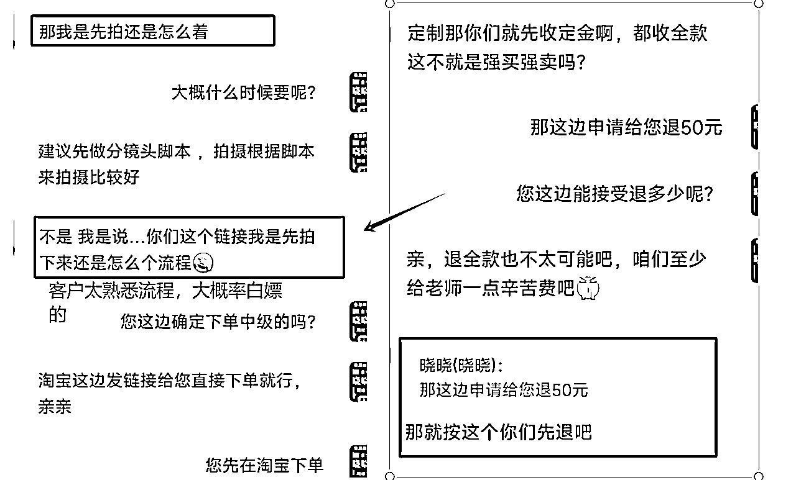

## 1）两次典型翻车经历

### 情况一：需求中途彻底变轨

对方起初只说“按照你的判断来”，没有提供题材、受众、参考作品和使用场景。连续完成数版之后，对方突然要求把都市故事改成玄幻修炼题材。

最后不仅没有正常结算，还额外承担了约200元的制作成本。

**得到的教训：**  
开工前必须把主题、人物、风格、时长、交付节点和改稿范围写清楚。模糊授权，往往意味着后续无限返工。

### 情况二：学生团队拿稿参赛后失联

对方表示项目经费紧张，只能先支付一小部分费用。稿件交付后，他们拿去参加比赛并取得名次，之后却迟迟不回应，剩余款项最终没有收回。

损失虽然只有几百元，但暴露出一个问题：没有明确付款节点和使用授权，所谓“校园项目”也不能成为跳过合同的理由。

后来还有一些类似经历，不再一一展开。重要的是，接单前先把风险挡在门外。

## 2）合作前风险排查表

| 对方的说法 | 可能隐藏的问题 | 对方可能的真实诉求 | 建议应对 |
|---|---|---|---|
| “你先说说大概怎么做” | 目标尚未明确 | 想免费获得完整方案 | 先询问参考案例、受众、用途和交付标准，方案只给到足够报价的程度 |
| “预算真的不多” | 价格与需求不匹配 | 低价切入，再不断增加任务 | 先拆分基础版与升级版，明确不同预算对应的服务内容 |
| “先做一小段看看” | 可能套取创意 | 拿到试稿后自行加工 | 提供付费试稿，或只展示过往案例，不交付可直接使用的完整内容 |
| “我们要做行业顶级效果” | 目标很高，投入很低 | 用有限费用复制成熟项目 | 把需求拆成剧情、画面、表演、后期等模块，确认客户最重视哪一部分 |
| “要年轻人喜欢的表达” | 目标人群描述过宽 | 让创作者盲目追逐网络流行语 | 先确认年龄层、平台、地区和近期案例，再决定语言风格 |
| “改到满意为止” | 修改边界没有上限 | 借口调整持续索取新劳动 | 合同写明修改轮次、反馈形式、交付范围和超出后的计费规则 |

**可执行的合同设置：**

- 标明包含几轮修改，超出后按次或按小时收费；
- 规定修改仅限表达、细节与局部情节，不包含更换题材、主角关系或整体方向；
- 通过电子签约工具留存确认记录；
- 所有新增要求尽量用文字确认，避免只凭聊天语音判断。

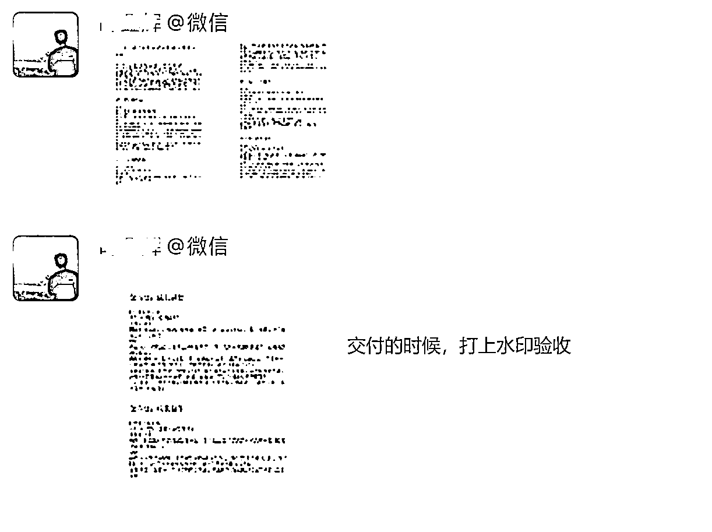

## 3）常见交付案例

### 类型1：课本舞台剧

报价180元，借助工具完成初稿，再根据演出人数、时长和课堂要求进行简单整理，整体用时不到15分钟。

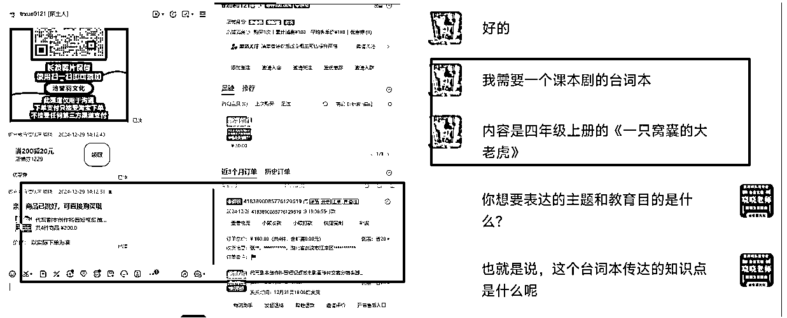

### 类型2：情境表演稿

一份约10分钟的校园情境稿，收费200元。交稿后客户反馈良好，说明需求越具体，越容易快速完成。


### 类型3：双人或多人对白

以现成结构为基础生成对话，再做语气和人物区分，制作时间控制在15分钟以内，报价50元。

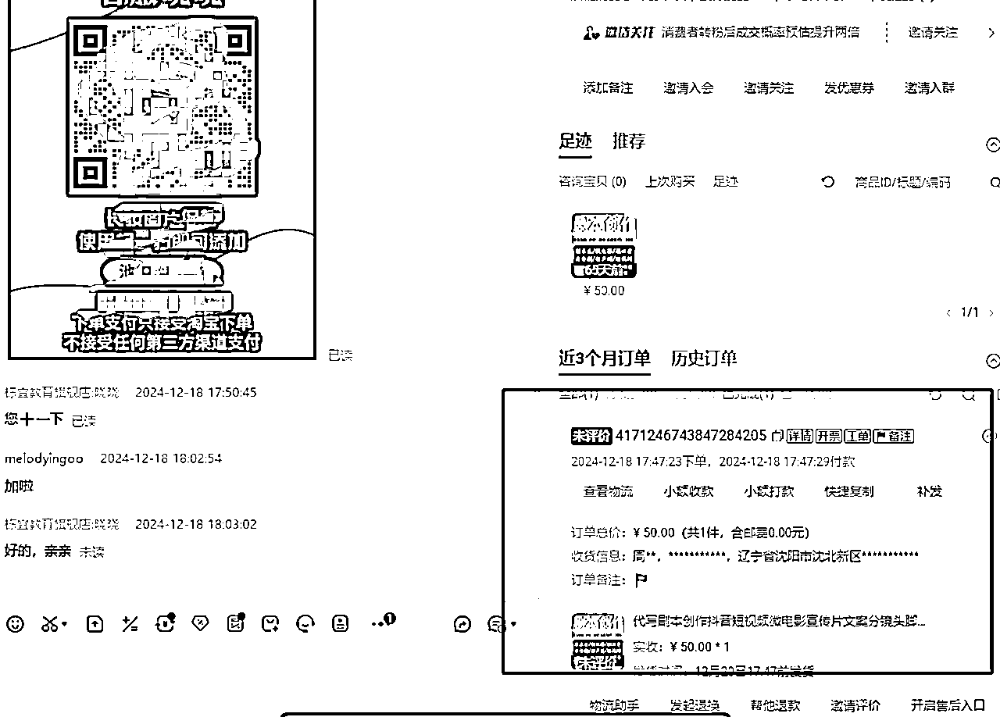

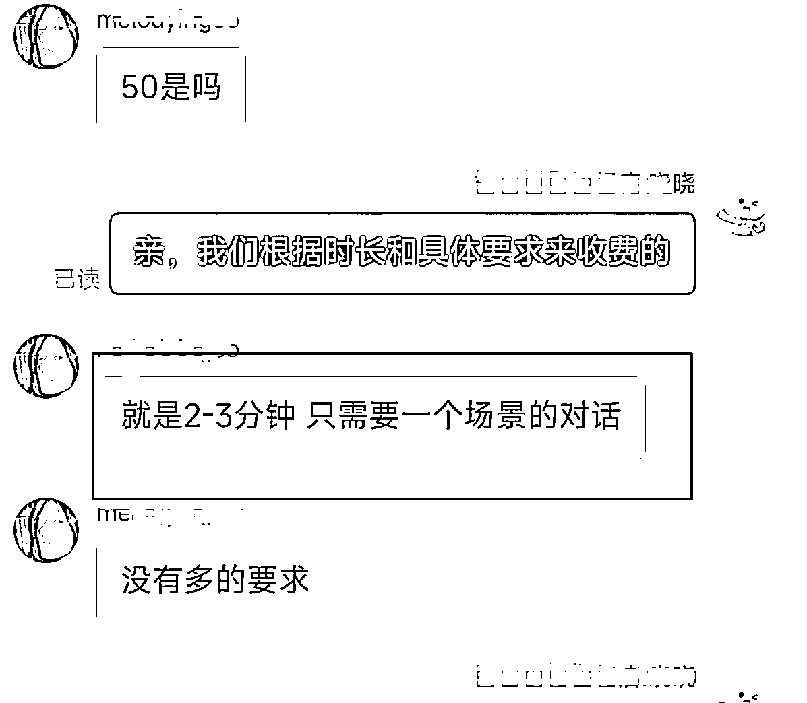

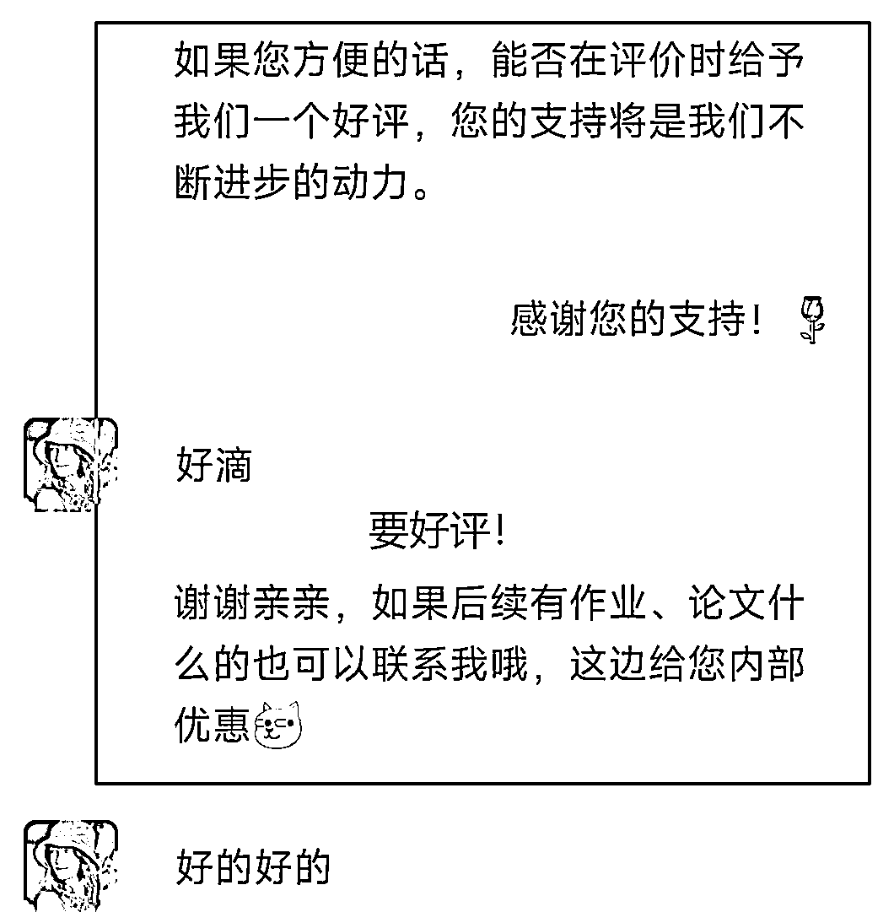

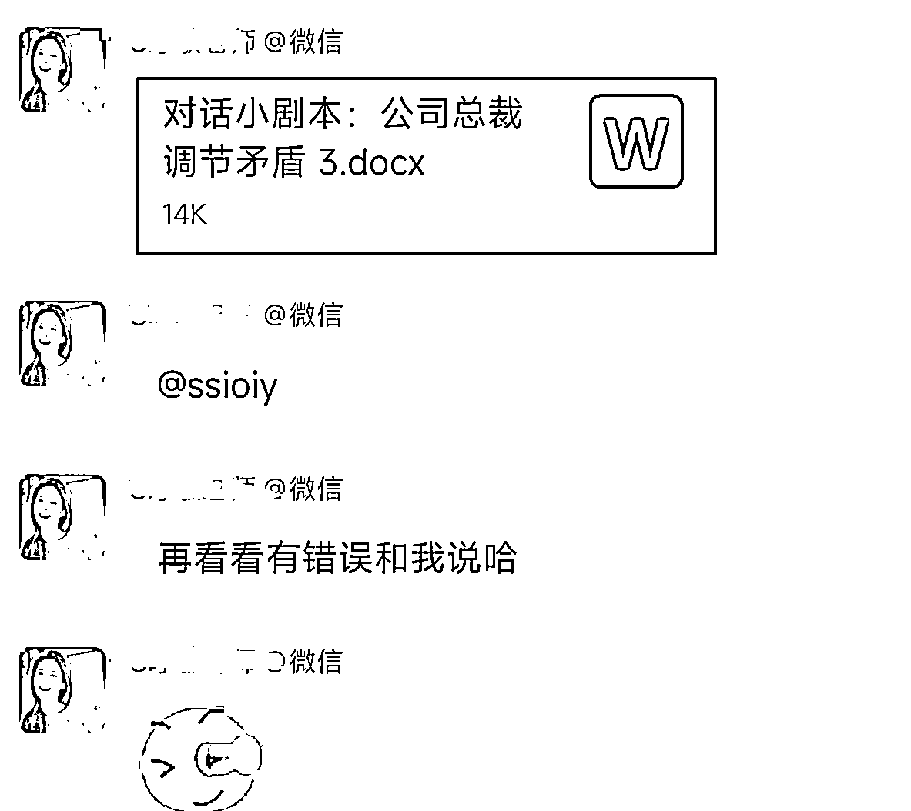

### 类型4：企业活动演出稿

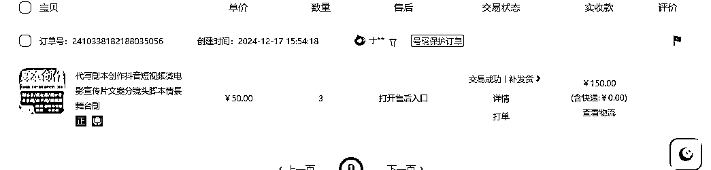

### 类型5：短视频内容脚本

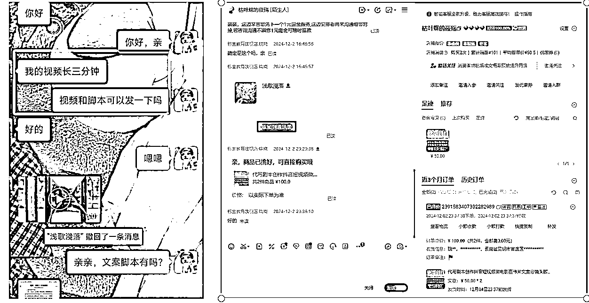

## 4）从创作到交付，几个容易忽视的原则

我参与拍摄过二十多条信息流内容，最大的感受是：短剧不是把故事讲完就结束，而是要持续推动观众的情绪。冲突要尽快出现，反馈要足够明确，台词要能马上被演出来。

### ①先确认这份稿子给谁使用

如果文本交给演员排练，就应该让演员一看便知道人物此刻做什么、为什么做、怎么说。不要只写漂亮的环境描写，却不告诉表演动作。

**不建议：**  
“黄昏的光线落在旧窗帘上，女孩站在逆光里，睫毛投下淡淡阴影。”

演员看完仍然不知道该如何行动。

**更适合排演：**  
“女孩一把扯断项链，珠子滚满地面；她冲到男方面前，抬手打过去，带着哭腔喊：‘今天不把婚离了，我就不走！’”

人物动作、情绪和台词都清楚，现场更容易执行。

### ②少写无法执行的形容

“一夜旖旎”“霸气侧漏”“心如刀绞”“眼神拉丝”这些词看似有画面，实际很难指导演员。

可以改成具体行为：

- “她盯着门口三秒，忽然把手机摔到地上。”
- “他说完没有看对方，只把袖口重新扣紧。”
- “她想哭却忍住，最后只说了一句‘算了’。”

让情绪落到动作上，现场才有操作空间。

### ③人物姓名和台词都要降低记忆负担

不常见的字、过于复杂的名字，会增加演员记忆和现场沟通成本。普通场景可以使用“张医生”“李经理”“王队长”这类职业加姓氏的称呼。

对白尽量短、直接、符合人物身份。少用古文式表达，也不要让角色连续说大段空泛道理。

### ④正式开工前确认预付款

无论通过内容平台、社交平台还是熟人介绍，只要属于正式委托，原则上都应先收到约定比例的预付款，再进入创作阶段。

预付款不是不信任客户，而是确认双方都愿意为项目投入。应聘、公开征集等特殊情况另行判断。

## 5）选题方向参考

影视与短内容的题材很多，常见方向包括：

- 都市情感与关系冲突；
- 逆袭成长与身份反差；
- 家庭伦理与现实矛盾；
- 职场竞争与商业博弈；
- 悬疑推理与反转揭秘；
- 轻喜剧、校园故事和职场小品；
- 品牌宣传、企业活动与教育场景。

选择题材时，不要只看“听起来是否热门”，还要结合平台受众、制作预算、演员条件和拍摄场地。

## 6）新手常见疑问

### Q：哪些人会购买剧本服务？

独立制片团队、小型影视公司、广告与品牌机构、企业活动组织者、教育机构、短视频创作者、网剧制作方、游戏和互动娱乐团队、个人微电影或求婚视频制作者、话剧社团、活动策划公司，以及需要长期内容供应的传媒机构，都可能产生此类需求。

### Q：必须购买会员才能开始吗？

不一定。部分🛰️小程序提供基础功能，可以先用免费工具完成初步尝试，例如「闪剪」中的相关剧本功能。

### Q：对方提出修改怎么办？

可以这样回复：

“没问题，请把需要调整的角色、场景或段落具体标注出来。本次服务包含三轮常规修改，超出范围的内容我们再单独确认。”

### Q：不懂专业表达怎么办？

可以让工具先做语言转换，例如：

“请把下面这句话改写成普通初中生也能听懂的表达：［粘贴原句］”

但改写后仍要结合角色身份和拍摄场景人工检查。

# 05｜剧本报价与沟通参考

价格不是随口报出的数字，而是由篇幅、难度、交付速度、修改次数和客户配合度共同决定。

## 1）基础计算思路

**应收金额 = 内容规模 × 项目难度 + 额外服务费 + 加急成本 - 可协商优惠**

最后一项不是鼓励随意降价，而是提醒创作者：时间紧张、需求模糊或合作意愿不足时，不一定要接单。

## 2）定制项目的主要报价因素

### 一、篇幅与使用时长

- 3—10分钟的轻量内容：约300—800元；
- 10—30分钟的中等篇幅：约800—2000元；
- 超过30分钟的完整内容：通常从2000元起，需结合类型、人物数量和结构复杂程度单独评估。

### 二、交付速度

- 常规周期为3—7天，可按正常价格执行；
- 若压缩到1—2天完成，可在基础费用上增加约20%—40%的加急费。

### 三、题材与定制程度

- 喜剧、反转等需要反复打磨节奏的项目，可在基础价格上增加约10%；
- 金融、医疗等专业领域，需要额外查资料和校验表达，通常可增加约15%；
- 围绕客户个人品牌、企业创始人或固定IP打造的人设内容，定制程度更高，可上浮约50%。

## 3）可设置的产品档位

### ①短视频与广告文案

可按时长、镜头数量、出镜人数、是否包含口播和修改次数区分套餐。

### ②小品、相声与舞台表演稿

重点核算人物数量、表演时长、现场调度以及包袱密度。

### ③网络剧与微电影文本

需要把人物关系、分场结构、情节推进和拍摄难度纳入报价，不能只按字数计算。

## 4）常见沟通话术

### 一、客户担心成品不符合预期

**问：怎样才能保证成稿符合我的想法？**

可以回复：

“你可以发一两个参考作品，或者描述希望观众看完后的感受，比如想要温暖、反转、轻松还是压迫感。我会先整理需求和结构，再按节点同步进度，避免最后才发现方向不一致。”

### 二、客户只会说“我要感人的”

可以继续追问：

“你说的感人更接近亲情、爱情还是成长？希望观众先笑后哭，还是从头到尾保持克制？有没有喜欢的影视片段可以参考？”

把情绪词拆成具体场景，才能真正落笔。

### 三、客户询问费用与付款方式

可以说明：

“项目采用分阶段付款：确认合作后支付30%启动款，完成大纲并确认后支付50%，终稿交付前结清剩余款项。这样双方都能按节点确认方向。”

### 四、客户要求先做一半再付款

可以回复：

“为了保障创作时间，项目需要先确认启动款后排期。我们会按大纲、初稿、终稿分节点反馈，付款节点和交付进度一一对应。”

### 五、客户临时要求加急

可以回复：

“我先确认题材、篇幅和素材是否齐全。如果需要压缩到较短周期，会按照加急项目重新排期和核算费用。”

### 六、中途想更换方向

小范围调整，例如个别台词、动作或镜头，可以在约定范围内处理；如果要改人物关系、整体题材或故事主线，则属于重新开发，应重新确认周期和价格。

### 七、客户询问版权归属

可以在合同中写清楚：交付内容的使用权、署名方式、保密义务、付款完成后的权利转移方式，以及未结清款项时的使用限制。

不要简单承诺“绝对不会有任何相似”，而应说明创作流程、资料来源和双方责任边界。

### 八、客户担心被指控抄袭

可以回复：

“项目会根据你的需求重新创作，并尽量避开已有作品中的具体表达。我们会保留沟通记录和创作过程，交付后按照合同约定处理使用权与保密事项。如果涉及特别敏感的参考作品，建议提前说明并进行风险评估。”

# 06｜新手工具清单

可以准备以下几类工具：

- 需求收集与表单工具；
- 大纲、人物和情节整理工具；
- 台词朗读与语音检查工具；
- 文案校对、敏感词和相似度检测工具；
- 合同签署、收款与交付留痕工具；
- 项目排期与版本管理工具。

工具只能提升效率，不能替代需求判断、事实核验和最终审核。

# 写在最后

这次复盘真正想说明的，不只是如何写一份稿子，更是如何把内容能力变成可持续的服务。

智能工具可以帮助你搭建框架、整理素材、生成初稿，但能否交付一份真正可拍、可演、可修改、可结算的成品，仍然取决于创作者的判断力和执行力。

未来的竞争，不是谁按下生成按钮更快，而是谁更懂用户、更懂场景，也更懂得保护自己的时间与劳动成果。

先把流程跑通，再逐步提高质量；先建立稳定的现金流，再谈规模化。对创作规律和商业边界保持敬畏，才有可能在内容行业走得更远。

以下为往期相关内容，感兴趣可以继续阅读：

帖子1：《单月营收破20w，AI代写深度复盘，内附多个变现玩法~》

帖子2：《AI+拼多多写作店铺，单店月均10000+姆级教程，内附详细运营方法~》

帖子3：《AI+简历修改，首月盈利7000+，低成本高收益的保姆级教程，附带多个接单平台详细操作步骤及避坑指南》

帖子4：《互联网小白，加入赚钱2个月赚回了30倍门票复盘》

帖子5：《通过开写作店铺年入50w的项目拆解》

帖子6：《被低估的赚钱项目：揭秘月入1万加的手机壳行业的暴利之路！》