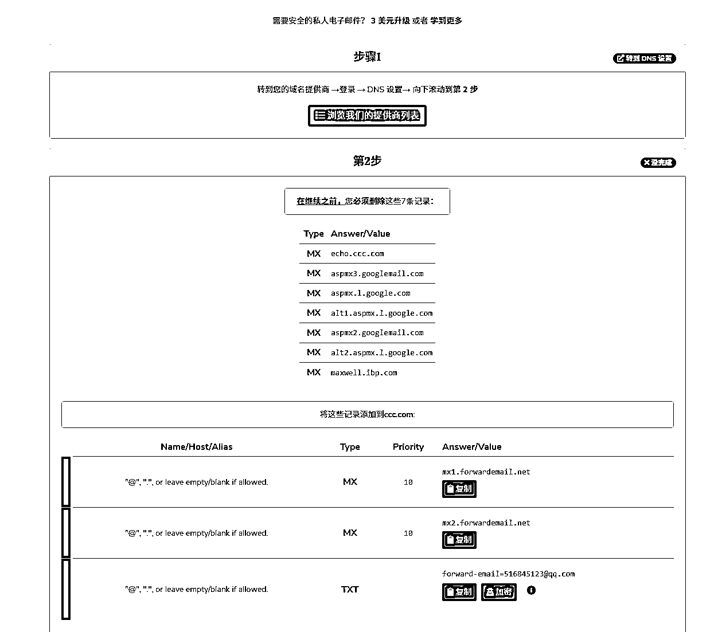
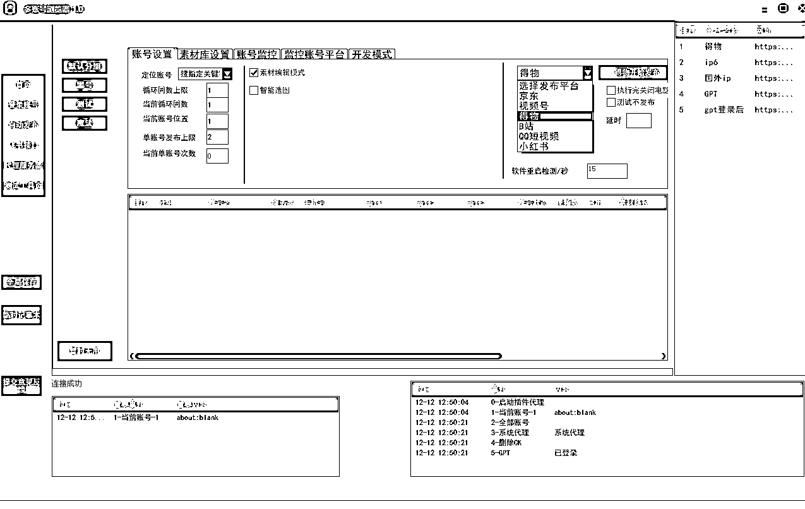

做多账号矩阵这件事，我踩过不少坑，也攒下了一套比较省钱的实操路子。今天就把手机号、邮箱、IP、设备这几个环节的低成本方案一次性说清楚，希望对刚起步的朋友有用。

先说我自己的背景：我主要做自动化脚本和工具，给工作室提供“人工+自动化”的整套方案。从早期的知乎、视频号、得物、快手、京东，一路做到小红书。每个平台的风控规则看着五花八门，但拆到底层，绕不开三样东西：手机号、IP、设备。无论你想做多少个号，把这三样搞定，其他问题都好说。

**一、手机号：怎么低成本搞到一堆能稳定收验证码的号？**

想一个人名下拥有多个手机号，最常规的办法是办注册卡。一个人可以在不同运营商实名办多张卡，月租确实便宜，但问题也明显——卡一多，管理特别乱。我之前实名的卡有四十多张，平时闲置没事，一拿出来用就成了麻烦精。最常遇到的是二次实名风控，验证码收不到，找卡商一问，又得一步步解除风控。因为卡来自不同品牌，解封方式五花八门，搞几次就烦了，最后能正常使用的没剩几张。

折腾几年下来，我的结论是：老老实实选移动、联通、电信的卡，反而最省心。三家的差别也给你们捋一下：

- 移动：最低套餐9元，额外开一个小号5元，四个号码合计24元。性价比中等，胜在注册没有地区限制，而且能直接绑支付宝自动充值，绑多少号都行。话费低于10元自动扣，基本不用管。
- 联通：最低月租8元，一个账户最多注册4个小号。有优惠的时候一个号一年48元，但部分地区有限制。而且小号的优惠套餐只有注册时能买，活动一结束，月租就涨到12元。自动充值方面，一个支付宝最多绑一个号。
- 电信：一个号最低5元，月租最便宜。但小号业务已经下线，目前只能办实体卡。

**最优解：** 条件允许的话，找几个朋友帮忙，每个人实名一张移动卡就够了。一张移动卡能开几个和多号，两张卡插进同一部双卡手机，就能同时接8个号码的验证码。实体卡绑上支付宝自动充，小号话费从主卡扣，只要给主卡充钱就行，省心到起飞。

**二、邮箱：不花钱怎么无限拓展？**

说实话现在国内很多平台不强制要邮箱了，但留着备用没坏处。先说Gmail的隐藏玩法：

- 用“点号”：在邮箱名里任意位置加“.”，比如 example@gmail.com 和 ex.ample@gmail.com，收件都会进同一个主邮箱。
- 用“+”号：比如 example+shop@gmail.com、example+news@gmail.com，同样全部落到主邮箱，还能用筛选器自动分类，一眼看出这封邮件是注册哪个平台用的。

如果你需要大量不同邮箱，可以用无限邮（2925.com）和百变邮（uu.me），注册一个主账号，下面能开出无数个子账号，接验证码完全够用。

想拥有永久属于自己的邮箱系统，成本大概80块钱。买一个.com域名（别贪便宜买冷门后缀，我之前买过.vip，后来ForwardEmail取消支持，邮件直接收不到了），再配合ForwardEmail.net做邮件转发。这服务是免费的，而且不碰邮件内容，隐私性很好。官网有中文引导教程，跟着操作半小时就能搞定。流程大致是：注册账号 → 添加域名 → 改MX记录到mx.forwardemail.net → 验证 → 创建转发地址（比如 info@你的域名.com）→ 指向你常用的Gmail或Outlook，之后所有邮件都会自动转发过来。

**最优解：** 想零成本就无限邮+Gmail组合；有长期打算就自己搭一个，把收件地址统一转到常用邮箱。

**三、IP：从共享到独享，怎么选？**

最简单的方案是“爱加速”，一个月20元。优点是便宜、IP多，缺点是所有用户共用，你可能分到一个被用到烂的IP，容易连累账号。

稍微进阶一点是自己搭IP。在B站搜“华为云 20IP”有一堆教程。单个IP成本大概1.7元，流量每GB大约6毛。注意两点：一是得通过教程里的邀请链接注册华为云才有优惠，自己新注册的账号没有这个价格；二是如果你不会搭，可以直接联系教程UP主，他大概率很乐意帮你搭，毕竟你充值他有返佣。

自己搭的IP虽然成本高点，但干净、可控、只属于你一个人，还能直接接入矩阵工具，实现浏览器自动切换IP登录。

**最优解：** 打算长期做矩阵的话，自建IP是必须走的一步。

**四、设备：手机端和电脑端怎么矩阵化？**

**手机端：** 我现在用的是小米和vivo。小米是淘汰下来的旧机子，vivo X27是去年200多块收的二手，用着特别顺手。如果你前期不想投入太多，可以考虑安卓虚拟机。我一直在用voms虚拟机，功能很全，可以改各种设备参数。酷安上也有不少适配不同系统的版本，安卓12-14都有对应的。链接我放这儿：`https://pan.baidu.com/s/1TQ9OcgR4n3-WJDaYFCPQvA?pwd=ms5e` 提取码：ms5e。

如果项目放大、利润可观，可以上云手机，但买的时候一定问清楚IP是不是独立。预算充足就直接买实体机，200块左右的二手就够用，vivo X27亲测能打。

**最优解：** 前期虚拟机+云机过渡，跑通了再买实体机。

**电脑端：** 我自己写了不少平台的全自动发布软件，今年把它们整合成了一款工具箱，能实现多账号切换、浏览器环境伪装、IP隔离、自动发布，还接了微信视频号数据异常监控和飞书机器人提醒。这个软件一直免费开放，有需要的自己拿。

市面上也有成熟的指纹浏览器，比如AdsPower——适合跨境电商和海外社媒，自带RPA，能自动化跑批量任务；比特浏览器——专门做真机信息模拟和代理IP深度匿名化，也是多开防关联的好手；还有VMLOGIN、紫鸟等。免费付费都有，看你的项目预算和需求。

**最优解：** 电脑端没有标准答案，选适合自己项目流程的就好。

以上就是我这些年做多账号矩阵的核心方法论。从手机号到邮箱，从IP到设备，每一步都有低成本起步的玩法。重点是别一开始就砸钱买一堆用不上的东西，先用最省钱的方式跑通流程，等项目验证了再逐步加码。

