# 60台手机换来4869个精准客资：📕矩阵废号流全复盘

我是龙哥，长期深耕📕。年初给自己立了个规矩：2025年在社区输出10篇高质量实操文，这是第二篇。

这篇想完整复盘我从2025年1月起，靠📕矩阵废号流，往私域导入4869位精准客户的整个过程。我会结合自己多年做流量的经验，把获客这件事聊透，并附上整套可复制的操作手册。

提前打预防针：我的部分观点可能和主流看法不太一样。如果读下来觉得荒唐，别喷我，我真的会很难受😭

目录如下：
1. 付费投放不是万金油——我的大型打脸现场
2. 内容，才是获取客资的真正支点
3. 矩阵+投放，是放大客资的最好杠杆
4. 获客SOP全流程拆解
5. 最后说几句实在话

我尽量长话短说，省各位的时间。

# 一、付费投放不是万金油，打脸现场

## 1. 认认真真做了套课，准备投聚光

24年底，我围绕自己的业务打磨了一套培训课程，本来想用聚光投放获客。对我而言这算舒适区，毕竟我刚写了篇聚光投放的精华帖，信心相当足。

结果竟然投不了。聚光对赚钱、副业、医疗、教育、法律这类敏感类目卡得极严，素材根本送不上去。硬要投也可以，只能把素材包装得非常隐晦，隐晦到转化率基本归零。

这条道等于被堵死，只能另想出路。

## 2. 我以前说“打粉”是垃圾生意，现在脸疼

半年前，我在一篇👸号文章《打粉是个垃圾生意》底下留过一句评论：

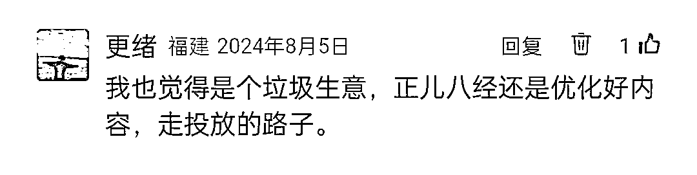

这回真被打脸了。投放指望不上，只能老老实实回头研究我曾经看不上的“打粉”。

# 二、内容，才是获取客资的真正支点

## 1. 打粉界的黑话太多，一度看懵

从零接触打粉，短时间内被灌了一堆陌生词：自热、截流、521养号法、云机、港老港新、地推、厅卡……听得我一头雾水。

我猜你也差不多。算了，懒得逐个啃，我直接自己跑0-1。

## 2. 用内容撬动客资

我拿一张新办的手机卡，注册了一个从没登录过任何内容的全新📕号。

然后围绕目标客户，逐个拆解他们的痛点、痒点、爽点、需求点，再去翻同类目下的爆款笔记，最终整理出几套数据反馈相当不错的获客模板。

这个思路跟我之前做聚光素材模板时完全一致，感兴趣的可以翻我前面的帖子。

模板里埋了个全网通用的钩子——“加我领资料”。没两天，🛰️就加频繁了。

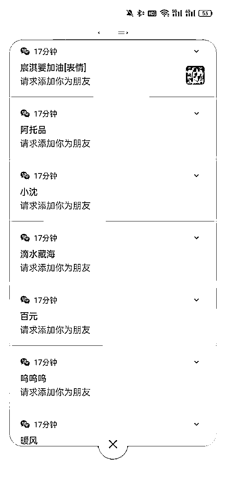

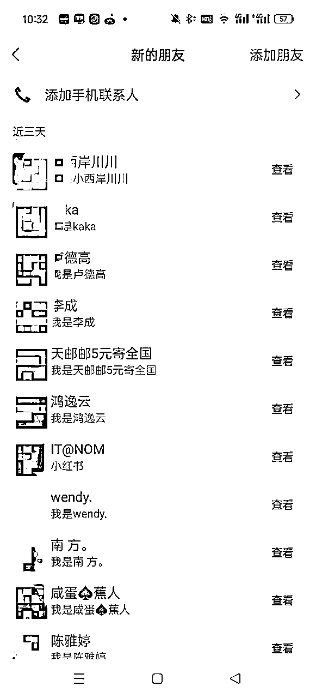

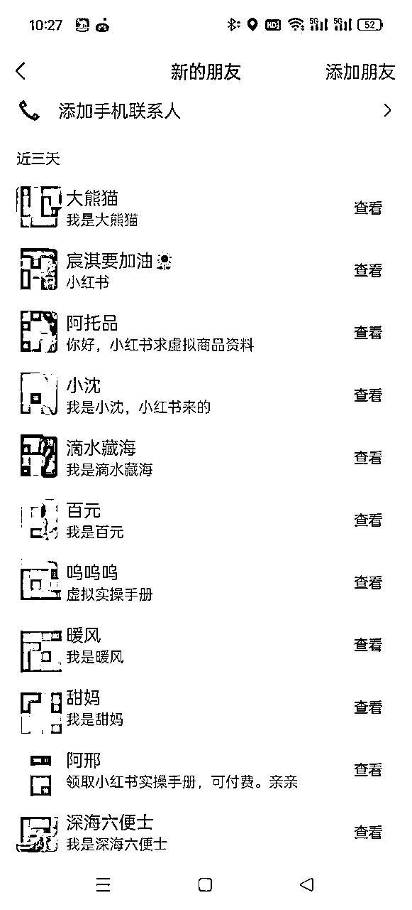

紧接着账号开始被限流、被提示违规。但我内心毫无波动，甚至有点小兴奋。号封得慢，只能说明业绩不行。拿到多少流量，和封号速度天然正相关。这世上很多事都是这样，此消彼长。

关于📕，被问到最多的一句话永远是：“怎么引流才能既安全又不违规？”

我的回答：不发笔记，就永远不会违规。

2025年我的一个小目标，是让📕封掉我1000个账号。

我找到了撬动客资的支点，也跑通了0-1。下一步就是上杠杆，去撬动更多线索。

# 三、矩阵+投放，是放大客资的最好杠杆

好素材做出来之后，关键在于让更多人看到它。要么用投放把内容推给更多人，要么走矩阵号路线，把内容反复分发。

说实话投放省事得多，可惜我这块儿投不了。

## 1. 买设备、买号、买工具

我进了一批手机，凑够60台。又配了60个📕号，优先选港新号，便宜。花小几百入手了一个发布工具，可以给笔记快速降重，然后一键批量分发。

接着就把此前测试过、数据很好的模板，用工具撒到了60个号上面。

结果是全线遇冷：大部分号0播放，薯条别想投，只有一小部分账号能带来零星🛰️好友。

这天是2025年1月11日。

## 2. 晾了几天，发现一个关键细节

刚好赶上过年，生意上的事堆成山，这套矩阵废号流的实验被晾了几天，经典的“过完年再说”。

1月18号晚上回家路上刷📕，我无意中在推荐页刷到之前那批没流量、投不了薯条的号——它们居然有曝光了。当时以为只是巧合。

结果第二天，1月19号，我在发现页刷到不下20个账号，全是1月11号那天批量发了内容的号。🛰️新增人数也明显涨上来。

可之前它们发的笔记，明明都是零播放、投不了薯条。

为什么偏偏在7天之后，突然集体出现在推荐流里？

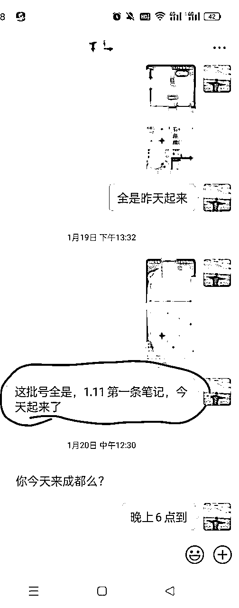

结合早年在互联网公司做业务的经验，我基本断定：这是📕业务安全风控机制的表现。7天这个数字，大概率就是风控代码里的一个阈值。

## 3. 问DeepSeek，又做了一组对照实验

内容支点没问题，但杠杆被风控死死压住。如果能摸清风控策略，就能制定对策绕开它，让杠杆真正撬起来。

于是我找DeepSeek聊了下：

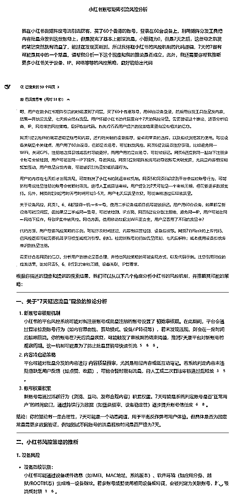

DeepSeek也认可我的推断，还补充了一些防风控思路，基本上和市面上的打粉教程大差不差。

我这个人最反感拿不可控变量的偶然现象当结论，这不科学。于是设了一组对比实验：30台手机、30个账号，分成3拨，每拨10台设备、10个号。所有账号都是同一批香港新号，设备型号也完全一致，同一批购入。当然，100%控变量我不敢保证。

三拨的差别在于：

1. 第一拨：登录完，啥也不干；
2. 第二拨：按大家常见的养号流程走一遍；
3. 第三拨：上来直接用批量工具发内容。

7天之后，结果如下：

第一拨（晾着不动）：8个号有流量，2个号没有。
第二拨（正常养号）：7个号有流量，3个号没有。
第三拨（直接发内容）：7个号有流量，3个号没有。

结论其实很清晰：📕对疑似风险账号的观察周期就是7天。只要7天内没有触发明显的异常行为，7天过后基本都会恢复正常。养不养号，差别不大。

## 4. 其他潜在风控机制和应对思路

### 设备风控

**设备指纹**：平台会结合IMEI、MAC地址、系统版本、应用分身、越狱/ROOT状态等信息，给设备生成唯一指纹。多个账号在相同设备上频繁切换，很容易被判定为关联账号，触发限流或封禁。
应对：用比特浏览器给每个账号一个独立窗口，每次打开都生成随机设备指纹。

**设备黑名单**：一旦某台设备登录过违规账号，指纹可能被标记，后面再登录新号也可能直接被限流。
应对：刷机或者用ROOT工具修改IMEI、序列号等硬件标识，绕开平台识别。

### IP与网络风控

**IP集中度检测**：平台会监控同一IP下账号的活跃情况。同一个IP短时间登录大量账号、批量发布内容，很容易被判定为机器操作或黑产行为。
应对：用软路由把流量分散开、动态切换IP，模拟真实用户分布，让IP地址能落到全国各地。

**基站定位与GPS**：平台能通过基站信息判断设备是不是扎堆出现，比如同一栋办公楼。
应对：关掉GPS和定位，模拟真实用户的地理移动，偶尔把手机带出门溜一圈。这是我目前能想到的办法。

### 账号行为风控

**内容相似度检测**：批量分发的笔记如果文案重复、图片雷同，容易被判定为低质或机器生成。平台有可能使用NLP模型或图像哈希算法做识别。
应对：新号注册后先晾7天，过了风控期再操作。

**互动行为异常检测**：平台会收集点赞、评论、分享、关注等行为数据，用统计方法分析时间序列，识别不合常理的活跃模式。
所以我一直反感“养号”的说法。除非你真拿着手机真人刷，但那时间成本太高。用脚本去刷，还不如什么都不干。

# 四、获客SOP全流程拆解

## 1. 需要准备的东西

1. 足够多的手机设备。数量看自己需求。注意识别是不是被其他工作室玩废过的机器。我私下偏好红米9A、10A、K40，价格200到500不等，渠道不推荐，免得像夹带私货。
2. 一台或多台软路由。拼多多买就行，性价比很不错。具体规格问客服，店铺我就不说了，基本都差不多。使用教程客服会远程手把手教你。

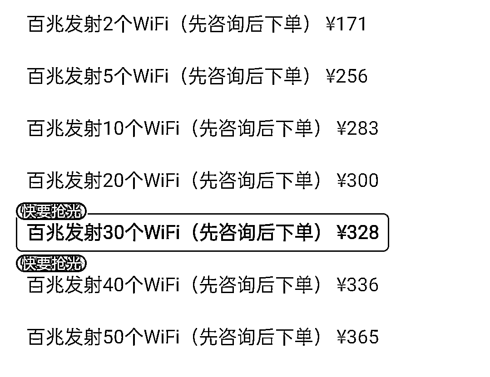

3. 下载一个比特浏览器，注册账号。
4. 买一个矩阵分发工具。简单来说，就是把一篇📕笔记的图片去重，标题和文案用AI改写，然后一次性分发到多个账号。工具不做推荐，你真想做，一搜就能搜到，很多社群也有，价位300到500。

后面我只讲我自己是怎么跑的，相当于给我自己团队写了一份SOP。别的流派也会有别的选择，但我只交代我的做法。

## 2. 打磨一批能打的获客模板

工欲善其事，必先利其器。素材作为支点，重要性不用多说。

先找一批同行数据不错的笔记，逐个拆解，看它到底击中了用户的什么心理。这个动作做到位了，你产出的内容想不打动人，都难。

我自己拆解的内容和思路放在这里，希望能帮你少走弯路👉

## 3. 配置软路由WiFi和比特浏览器

### 软路由

你可以把它理解成一台特殊的路由器，它放出来的Wi-Fi信号，IP地址可以在全国各个城市来回切。用它就是为了规避IP集中度检测。

具体用法，拼多多买完之后客服会远程帮你配好。

说下我的操作：一个Wi-Fi信号一般20到30块钱，我倾向选贵一点的，不然用起来卡顿，操作体验很难受。每5台设备连同一个Wi-Fi，IP我选广东，离香港近，链路质量好一点。

当然，一个Wi-Fi信号下面挂的设备越少越安全。我挂5台，纯粹是经济考量，想省点预算。

### 比特浏览器

你可以把它理解为一个能同时运行多个“谷歌浏览器”的工具，而且每个浏览器都能单独配置IP、修改设备指纹。靠独立的浏览器指纹来规避平台识别。

下载网址👉https://www.bitbrowser.cn/

同类工具还有不少，但我用比特浏览器更顺手。

操作步骤：

点击“创建窗口”：

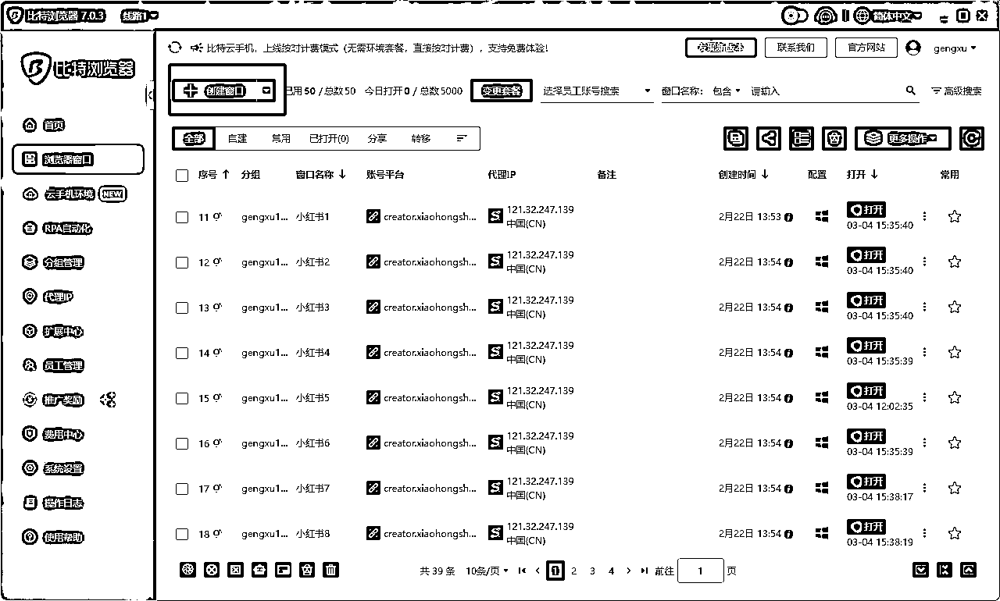

账号平台选“其他”，URL直接填📕创作者中心的登录页👉https://creator.xiaohongshu.com/login，其他字段随便填，Cookie会自动生成。

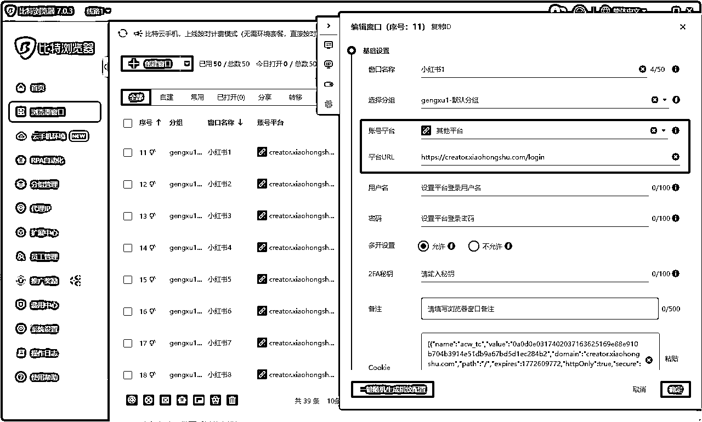

代理这一栏，主要是把IP填进去。IP可以自己用天翼云搭，教程去抖音搜“天翼云搭建IP”就能找到。嫌麻烦的话直接买，一个也就几块钱。我一般5到10个号用一个IP，核心是省钱。

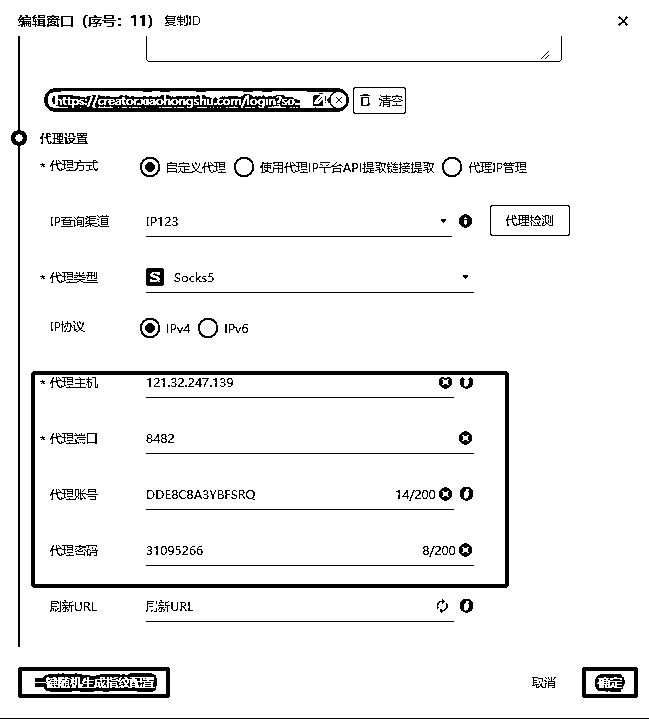

界面上的其他选项全部保持默认，不用额外动。

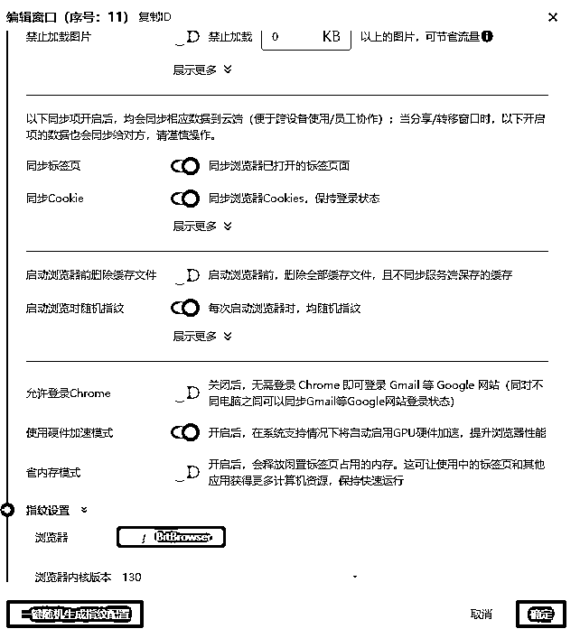

## 4. 边操作，边屯号

因为📕对疑似异常的账号有7天风控观察期，我的策略就是：一部分号正在发内容，同时再囤一波新号放那儿。这样即便前面一批号被封了，后面也不会出现7天空窗期，新号随时能补上。

## 5. 用工具批量发内容

再强调一遍：工具是什么我不推荐，不承担任何责任。你只需要知道市面上存在这种工具就行。

它的核心功能就三件事：图片去重、标题文案AI改写、一键分发到多个📕号。

真想做，一搜就有，很多社群里也能找到。

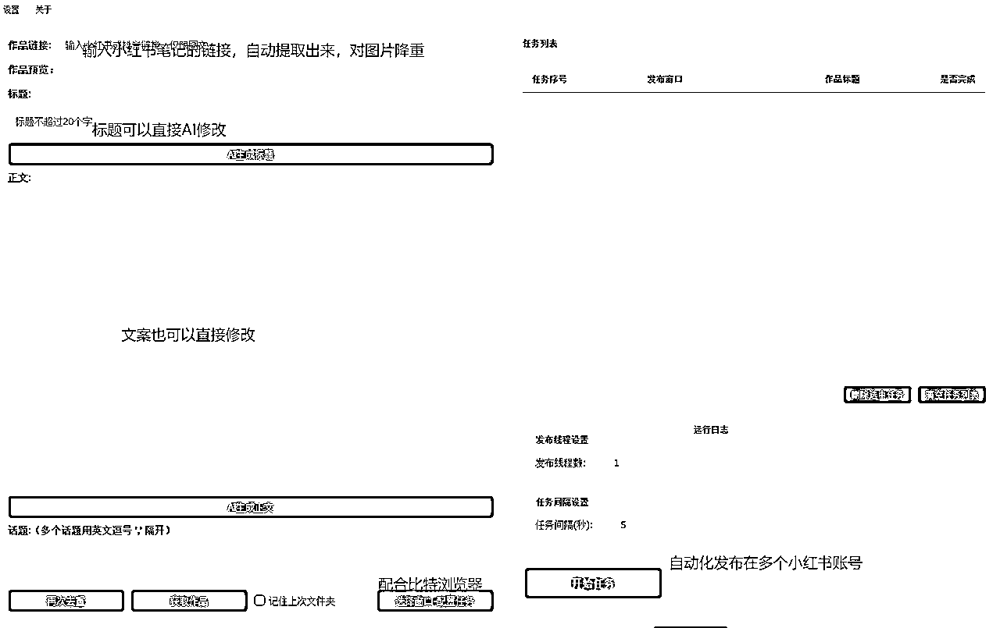

发完就等着流量进来就行了。

## 6. 两个引流小方法

先说一句：世界上不存在所谓“安全引流”，这是一个悖论。做好号随时没的心理准备就行。

引流🛰️的手段五花八门，贪多嚼不烂。只分享两个我常用的，个人体感违规率较低，转化也还行。

### 方法一：群聊引流

创建群聊，右上角就有入口，点一下就行。

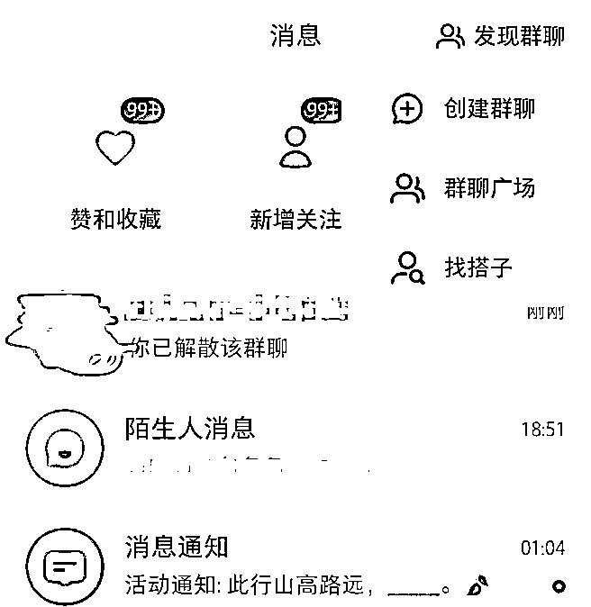

打开“个人主页展示”，这样你的主页会出现群聊入口，感兴趣的人可以直接点进来。

群聊里设置“关联笔记”，把你想引流的笔记挂上去，笔记下方就能看到进群入口。

群公告是引到私域的好入口。能不能提供有吸引力的钩子、怎么让用户心甘情愿加🛰️，都靠群公告的设计。

注意：群公告这一步先别放🛰️号，容易触发违规，导致群聊建不起来。

关键操作：小号先进群，发一条含🛰️号的消息，群主把那条消息置顶。用户一进群，最上面就能看到。偶尔会出现置顶不上的情况，没事，让小号隔段时间进来发一次，比如：

窝的\ /是 🛰️号

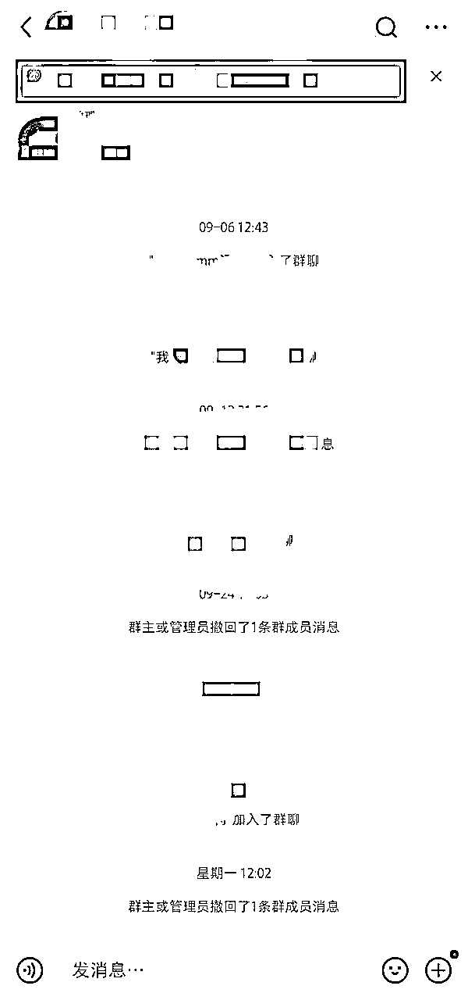

这里一定要实测，确认小号发出的消息有没有被系统吞掉。

其他设置方面：
开启“对新成员展示历史消息”，后来进群的人也能看到你之前发过的引流内容。
“进群确认”我没有开，让想进的人直接进。你也可以根据自己需要，设置成手动通过。

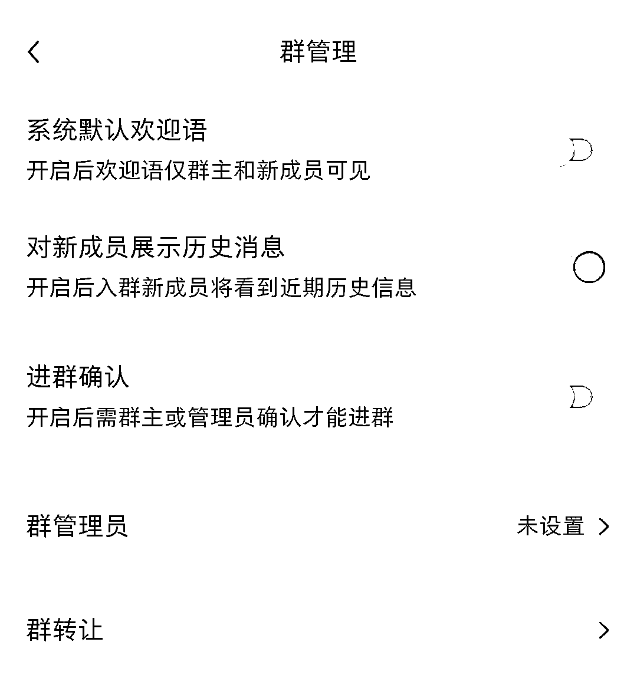

广告问题也要提一嘴：目前📕群聊没有禁言功能，总会有人进群发广告。办法很原始：手动撤回、拉黑、踢出去。

### 方法二：专辑引流

点开“收藏”，右侧能看到“专辑”功能。

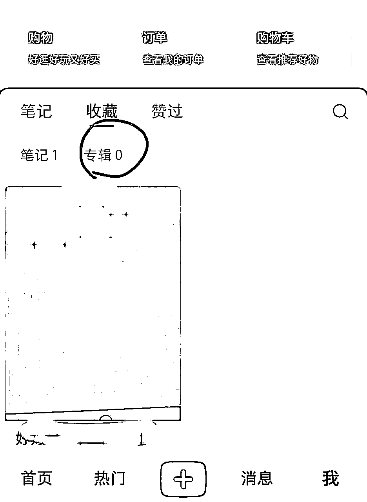

点进去之后，能看到“创建新专辑”。

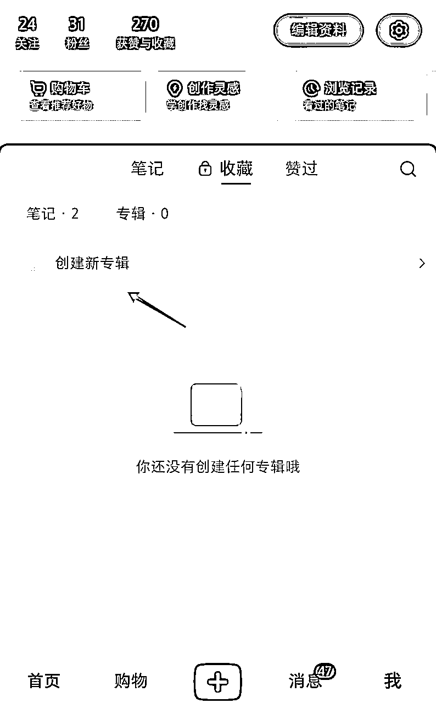

点击“新建”。

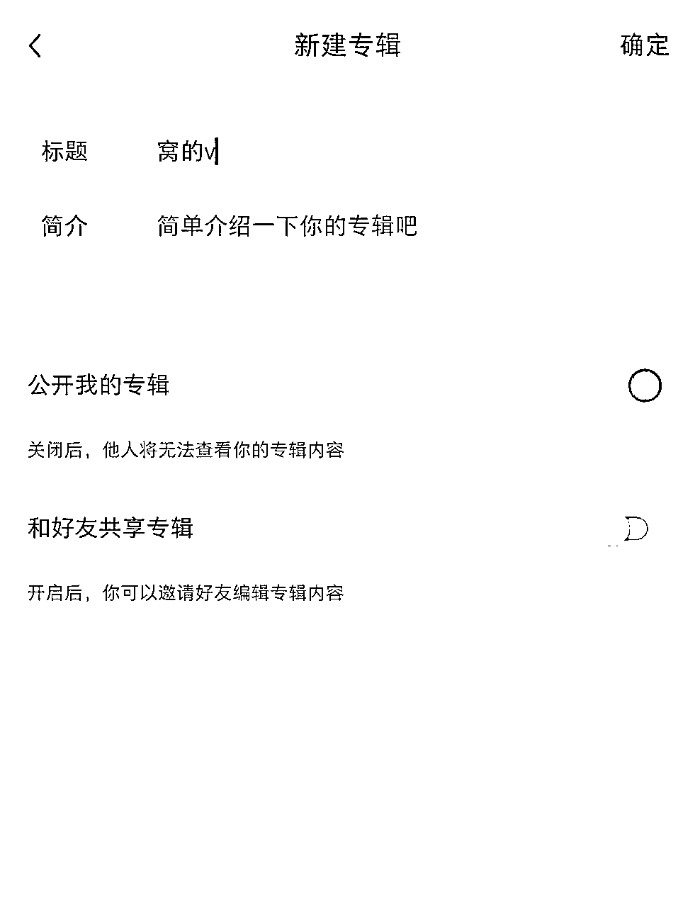

标题输入“窝的v”，其他字段全部留空，然后确定。

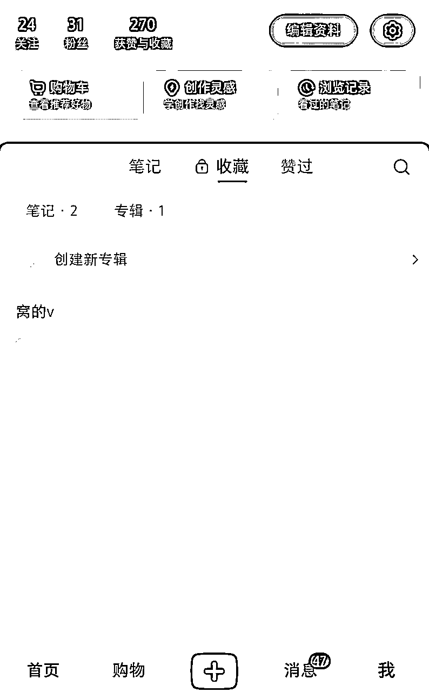

这时候专辑已经建好了，但内部是空的，需要添加笔记。注意这里没法任意添加平台笔记，只能加自己收藏过的内容。选择小号发布的那条🛰️笔记就可以，这一步需要小号来配合完成。

这里有个和“收藏引流”不一样的点：以前用收藏做引流，必须把隐私收藏权限打开，别人才能看到。但专辑不同，就算你关闭收藏、直接转发给他人，对方也照样能看到，所以对隐私权限没有要求。

最后效果是这样的：

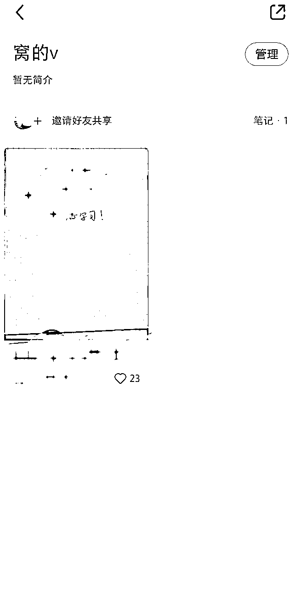

关于转发：选好已经添加了内容的专辑，点右上角的分享，可以私信发给最近聊过天的人，或者你已经关注的好友。

注意：主动私信你的陌生人，不会出现在“最近聊天”里，只有互相关注后才会出现在列表。互关确实有点麻烦。

那怎么处理？可以先打个招呼制造互动。比如对方来找你求资料，你回一句：“是需要某某资料对吗？”这样就形成了互动。接着看消息界面有没有出现“由于你和对方未互相关注，你回复之前，ta只能发送1条文字消息”的提示。如果有，得等对方先回你一句，你才能转专辑；没有的话，直接转过去就行。

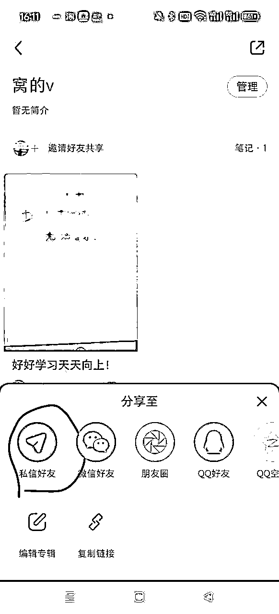

发出去之后的效果是这样的：

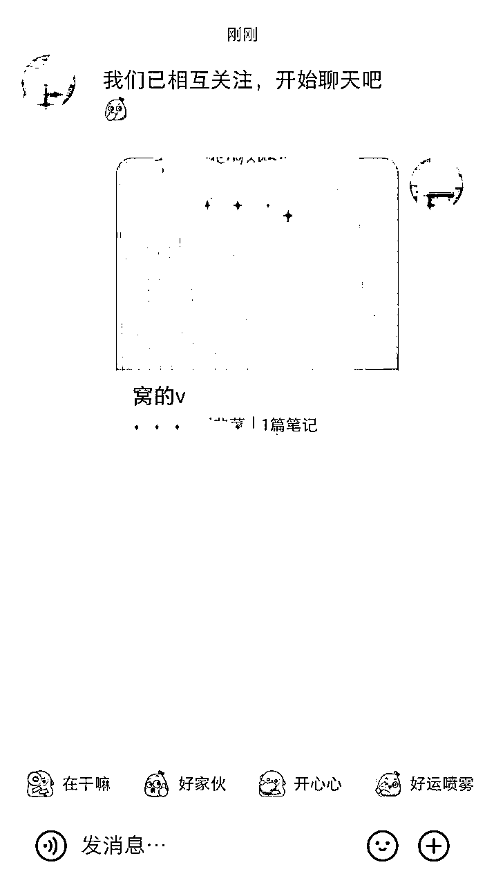

🛰️号直接亮出来，清清楚楚。

而且接收方长按消息无法举报，拉高了举报门槛，被举报的概率自然降了下来。我用下来体感不错。

# 五、最后说几句实在话

## 1. 获客的底层逻辑，其实很朴素

宏观来看，获客就是三步：做出一篇有效果的广告素材，想办法把它曝光给更多目标用户，最后让用户看到并转化。曝光方式，要么投流，要么矩阵。

无非是在触达用户的过程中，会遇到一些阻碍。

困难可以解决，限制可以规避，流量可以用钱换，方法总比困难多。

我就是要把手里的优质素材推给更多对的人。缺什么补什么，没有“不能”，只有“不想”。

## 2. 内容能力，必须死磕到底

这是整套玩法的底盘。支点先立稳了，杠杆才撬得动。

给所有做互联网的人一个忠告：一定要把内容写作这件事练起来。

当你持续输出内容时，你对人性本质的理解会慢慢沉淀下来，网感也会自然长出来。两者同时具备之后，搞钱其实没那么难，简单到像上个厕所一样顺手。

再说一个心态问题：永远别去怪客户。

你觉得客户素质不行、话多、拖着不下单、要求多，这些现象的根源都不在客户身上。只能说明你的获客信息没能把对的人筛进来，让他们迟迟不愿掏钱；要么就是你的产品本身没足够吸引力，让人下不了决心；要么就是你的成交能力还不够，让客户没办法放心买单。

关于废号流获客这套打法，我自己也是最近才在摸索，体系和想法都还不够完整。希望做生意的朋友能去知识星球评论区跟我聊聊，这个我会认真看。飞书那边我不回复，🛰️我也尽量不加，星球评论区交流最有效率。

今天就聊到这里，收个尾。

如果你觉得这段话对你有点用，给我一个赞吧，感谢你的支持！