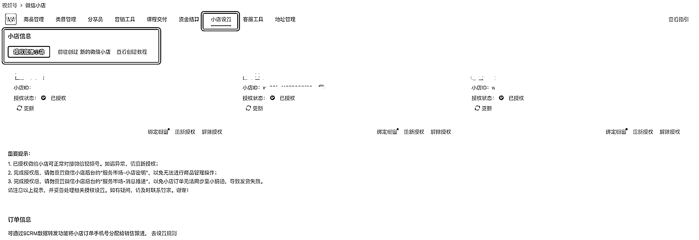
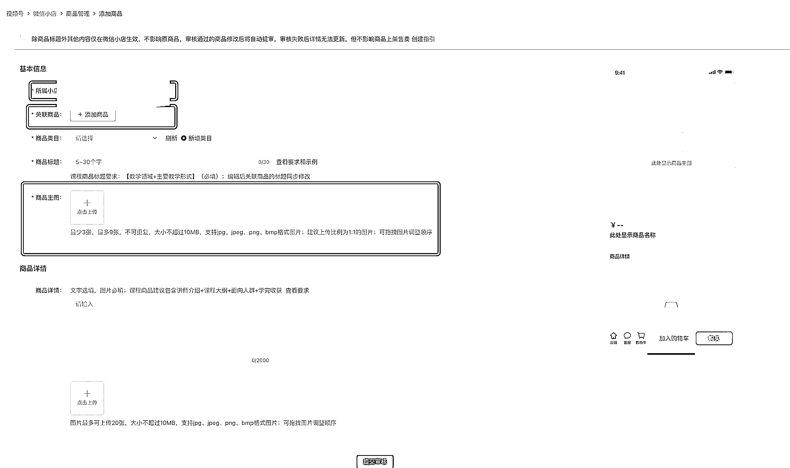
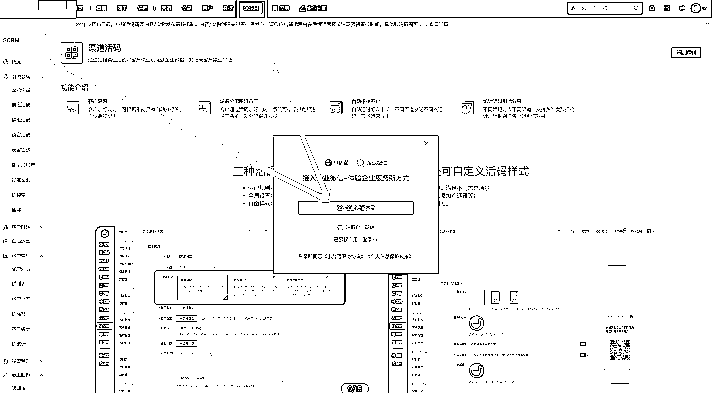

# 视频号带货卖课，成交后秒开课的实操打法

> 原文：[`www.yuque.com/for_lazy/zhoubao/ntaoobbg05mt31na`](https://www.yuque.com/for_lazy/zhoubao/ntaoobbg05mt31na)

龙哥盟的伙伴们好，我是专注视频号 IP 做知识付费的桑桑。团队这些年深耕教育培训赛道，趟过不少坑，也攒了些可复制的方法。参加涛哥 @杨涛 的上海线下交流会后，受“做网红不如做圈红”这句话启发，我开始把圈层做深做透，10 月份也拿到了小鹅通线上联盟教练的身份。感谢涛哥的点拨。

我们一直聚焦在视频号的变现上，积累的也都是能落地的玩法。视频号在 2025 年的商业价值已经不用再去解释了。这几个月来找我聊的客户，从早期的 IP 孵化，已经明显转向线下产业带主理人，他们是主动找上门来布局视频号，不像 22 年时还要我去一个个劝入场。

今天就把一个我们反复帮学员解决的细节点位拆给大家：视频号小店成交后，小鹅通自动授课。直播间里用户一付款，课程立刻能点开学习，不用人工激活等待，退课率直接被拉低。这个小技巧对做知识付费的老师很有参考价值。

说明：该方案需要小鹅通专业版及以上

核心流程大致分三块：小鹅通建课、视频号小店授权关联、小店上架发货。

小鹅通侧建课

先把原始视频素材上传到资源管理里的素材中心视频区，然后在课程模块新建课程，选择复制素材上架。课程定价和展示位设置好，为后续自动开课铺路。

课程封面建议用 16:9 比例，jpg/png 格式，文件小于 5MB，清晰度最佳 750px*422px。

授权打通

视频号小店和微信小店绑定小鹅通。注意两边主体可以不一致，绑定成功后，学员用下单手机号就能直接登录小鹅通小程序或 App 看课，不需要你手动发激活码。

在授权管理页面完成小店授权后，用户购买虚拟商品，使用购课手机号登录小鹅通小程序即可查看学习权限。

小鹅通商品和视频号小店商品做关联

 images.zsxq.com/Fp2g6Et6h0Nzn5dMDvUhDTIjE92P) images.zsxq.com/FoPmYvlGj-pj9ST2kFUvqonQQkUV)

小鹅通可以关联企业微信，企业微信主体也可以和课程主体不同，使用时会产生额外费用，但对大多数运营团队来说已经足够用。

微信小店上架

类目审核方面，知识付费课程目前只需提供 ICP 备案证书和产品说明书即可，备案主体之间可相互授权。

发货模式选择虚拟自动发货

学员有三种常见的学习入口：

一是点收到的短信链接，用购课手机号登录小鹅通学员端直接看课；
二是添加企业微信后，发 H5 链接绑定手机号进课，遇到账号合并冲突需提前提示；
三是直接用购课手机号登录小鹅通 App 学习。

批量开课补充方案

一是导入学员 uid 开课，需要配合企微助手使用；
二是导入手机号开课，看课方式同自动发货逻辑。

技术基础配置

微信数据互通需要先在微信开放平台完成配置：[`open.weixin.qq.com`](https://open.weixin.qq.com)

需要提前授权：企业微信、微信小店

 images.zsxq.com/FttW4o3D9G2FzWgKM0ky4L-PQLWa) images.zsxq.com/FjHTOg8bvEJipIwvteqY1SgGPFk8)

小鹅通的价格确实不算便宜，但用顺手后能明显提升运营效率，其他主流的卖课平台也基本都有类似的自动授课能力，只是流程略有差异。