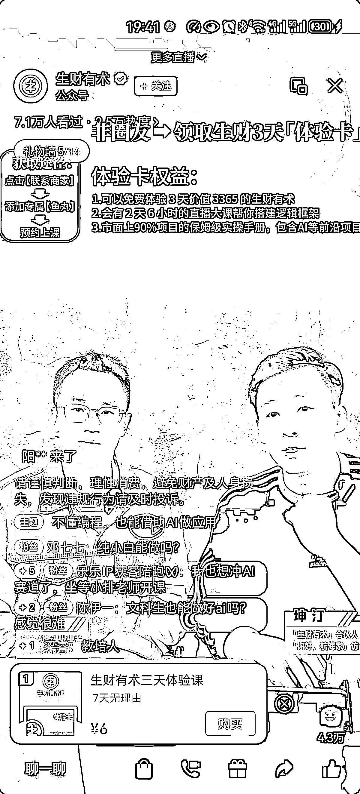

# 别急着给自己挂上“独立开发者”这个名号

> 原文：[`www.yuque.com/for_lazy/zhoubao/gixg2fk3pf4yol8y`](https://www.yuque.com/for_lazy/zhoubao/gixg2fk3pf4yol8y)

哈喽，我是刘小排。

上周我把第一次直播约给了赚钱有术，没想到峰值在线破了 1 万，真的很感谢大家的陪伴和支持。

直播里，@坤汀抛了一个没准备的提问：你怎么看**独立开发者陷阱**？

我把自己的梳理写下来，抛出来大家一起聊聊。

## 一、先说清楚，陷阱到底指什么

最近身边自称独立开发者的人越来越多。不少是前大厂程序员，离职后想单枪匹马做自己的软件产品。

所谓的陷阱就是：大部分挂着这个名号的人，钱没赚到，生活过得很拧巴。

市面上常见的解释是时间不够导致项目烂尾、没钱维持、想法反复、经验不足、缺少长期驱动力、项目换来换去、完美主义钻技术牛角尖……

我更想说的是，问题可能出在名字本身。“独立开发者”这个称呼，很可能就是个误区。

## 二、为什么这个词本身就不太对劲

### 2.1 里头藏着一股傲慢

打个比方。

做微信公众号的自媒体人，核心工作就是写文章、做内容。你见过有人把自己叫“独立打字员”吗？

为什么写作者不叫自己独立打字员，写代码的人却乐意叫自己独立开发者？

根子里是一种优越感。

“开发者”三个字，潜意识里觉得比“打字员”高贵。还在大厂时，他们只敢自称码农，出了大厂就敢把头衔抬高了。

再加上一个“独立”，就是在做对比，仿佛在说：看，我能一个人搞定，你们大厂一群人还搞不定。

你去看“独立”能搭配的词，都是独立音乐人、独立艺术家、独立策展人，听起来都很高大上。谁会说自己是独立保洁、独立保姆、独立打字员呢？

一旦你开始用“独立开发者”自我介绍，傲慢可能已经悄悄进来坐下了。

### 2.2 这个标签会把人带偏

市场上当然有成功的独立开发者，但更常见的是下面这幅画像，请勿对号入座。

在“独立”这块，他们爱强调：

1. 不用坐班打卡
2. 哪里都能办公

在“开发者”这块，他们爱强调：

1. 我是全栈，前后端算法全包
2. 我技术很强
3. 经常在社交媒体发技术干货，塑造技术大牛人设
4. 我做东西特别快

我把这些叫做副作用，因为它们正在跑题。**你是要做软件生意来的吧？产品在哪？用户在哪？怎么运营？商业模式呢？**

注意力在哪，影响力就在哪。你盯着什么，什么就会被放大。

一旦你给自己贴上独立开发者这个标签，就容易过度聚焦“独立”和“开发”，反倒忘了软件生意的本质。

就像如果公众号作者把自己叫独立打字员，他很可能就死磕打字速度，反而忘了内容和读者。

长期被这个标签绑住的人，容易往几种方向滑：

第一种：**孔乙己式**。张口就是“回字有几种写法”，换成技术就是“XX框架比YY框架好，但都不如ZZ框架”。没赚到钱就说自己价值观高，别人赚的是脏钱。

第二种：**表面光鲜的割韭菜**。朋友圈晒一排产品截图，显得产量惊人，然后推销课：“我一年做了 20 个产品，想学吗？买我的课。”

第三种：**技术传教士**。沉迷用 Haskell、OCaml、Lisp 等小众语言造轮子，乐此不疲地争论这些语言比 Python、NodeJS 更优美，专门编段子嘲讽用 PHP 的人。

第四种：**开源道德卫士**。每天花好几个小时在群里批判闭源是资本剥削，然后炫耀自己 GitHub 上的 Star 数超过了谁谁谁。

第五种：**一根筋反营销**。坚信酒香不怕巷子深，结果产品日活常年个位数。

他们离最初的目标——做一个能赚钱的软件产品——越来越远。

## 三、怎么跳出来

### 先换个更靠谱的自我定位

孔子说：君子不器。

老子意思是君子不要像器皿一样只能干一件事，而要多面、能适应。

今天很多人习惯用单标签给人定位。

“你女朋友做什么的？”“老师”
“你妈妈呢？”“医生”
“你爸爸呢？”“公务员”
“你呢？”“码农，不对，现在叫独立开发者。”

这种对话默认人只有一种用途，还能用一个词概括。错了。

看看赚钱有术里厉害的人，你能用一个“医生”这样的词去概括龙哥、涛哥、明白老师、Sky 老思吗？

你不需要成为“独立开发者”，你需要成为你自己。

一个更好的定位，应该能实践不器之道。真正改变世界的人，都能在收放自如中跳出技术的宿命。

想不到好名字的话，先拿个保底分的名字：软件产品公司老板。

1. 用“老板”，提醒自己要不器，产品生意不只是写代码。
2. 用“软件产品”，提醒自己初心，开发只是生意的一个环节。
3. 用“公司”，提醒自己别把“独立”当成勋章，社会奖励的是协作者。

### 把功夫放在需求洞察上

这个观点我在《Build a Business, Not an App》里讲过，可以去看看。[`t.zsxq.com/aOxJE`](https://t.zsxq.com/aOxJE)

这里再补一个我很喜欢的例子，Peter Levels。

技术层面，他恐怕比你差。他还在用被嘲讽的 PHP、jQuery、SQLite，2024 年才开始摸 NextJS 和 React，还没完全上手。他从不标榜技术大牛，反而经常在 Twitter 上问一些很基础的技术问题，分享自己学新东西的过程。

需求洞察层面，他是高手，擅长解决自己的问题和身边人的问题。

[`nomads.com/`](https://nomads.com) 数字游民第一社区。2013-2014 年，Reddit 论坛上都在问哪个城市适合远程工作，却没有可视化数据库。他自己是数字游民，就做了这个。

[`remoteok.com/`](https://remoteok.com) 远程招聘平台，只收录允许远程的职位。他当时找远程工作很困难，就做了这个。

[`rebase.co/`](https://rebase.co/) 全球数字游民签证数据库。2020 年后各国签证信息分散混乱，他做了个自动更新的数据库，成了全球最大的信息库。

商业层面，收入基本全靠产品。他公开列出每个产品的收入，月入约 30 万美元。

你觉得他是独立开发者吗？他技术很“菜”，可能比中文圈很多自称独立开发者的人都菜。按中文圈标准，他发的这些内容根本没人点赞。

他的成功来自洞察需求：先找到问题，再解决问题。他的产品总是先解决自己和朋友的痛点，从这里长出最深的洞察。

## 总结

- “独立开发者”不是好标签，不要轻易拿来用，它自带傲慢。
- 注意力决定影响力。过度聚焦“独立”和“开发”，就会忘了软件生意的本质。
- 君子不器，给自己换个更合适的定位吧。

最后，赚钱有术 3 月份的航海马上开船，有两条 AI 应用相关的船，一条学做 Web 网站，一条学做 iOS App。千万别错过！

我常说，现在是只要有 idea 就能赚钱的时代。

很快，我们会看到各行各业的朋友，带着各种标签一起进来做产品，各展所长。加油！

谢谢大家。