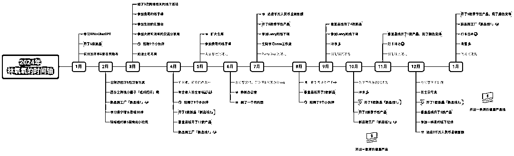
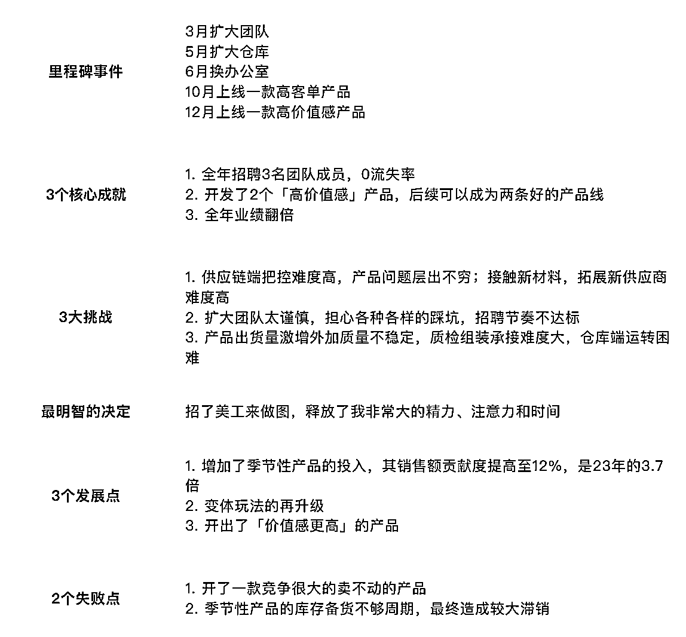
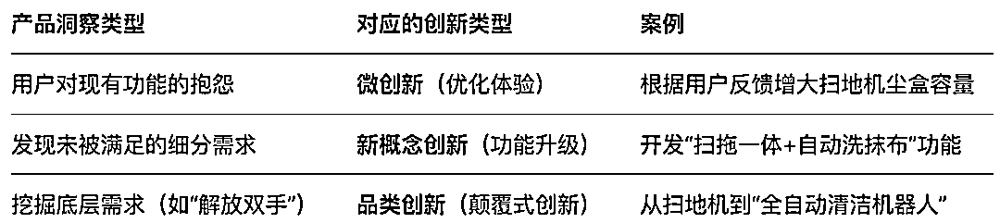
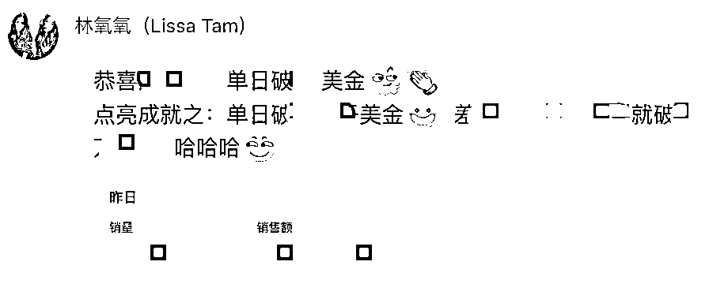
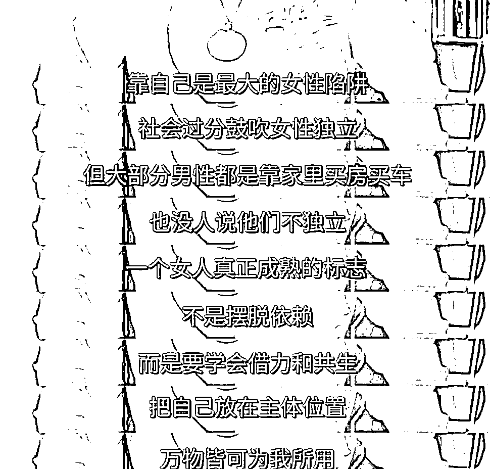
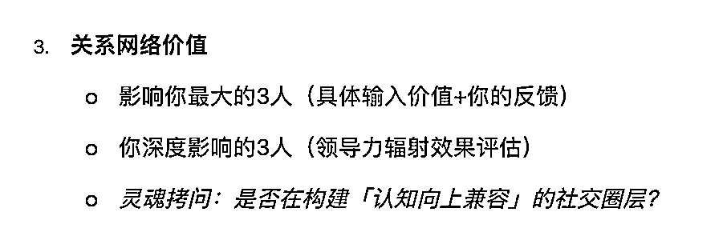
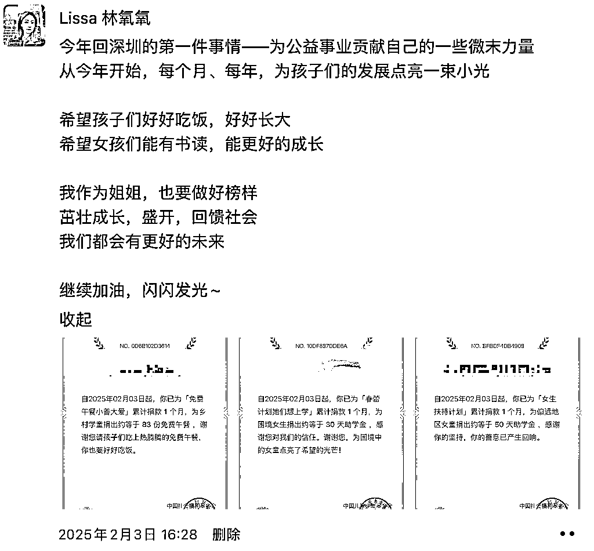
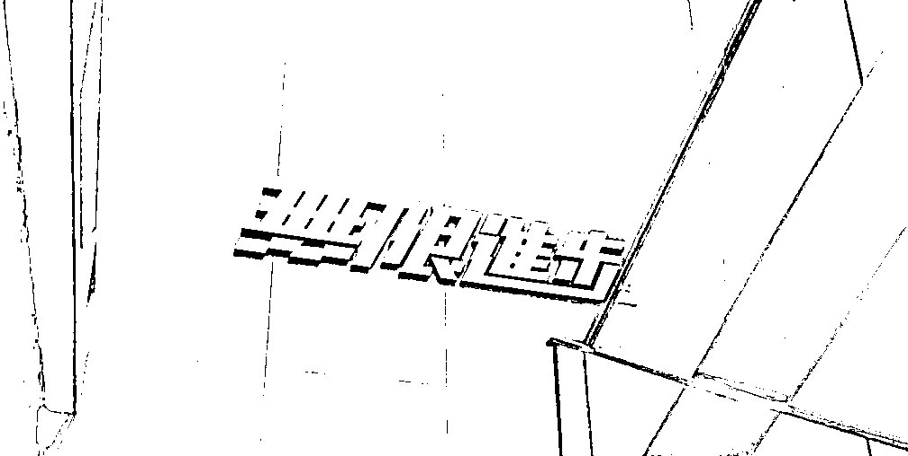

# 在不确定里，稳住可复制的增长

> 原文：[`www.yuque.com/for_lazy/zhoubao/zzhp20abciqaz4uc`](https://www.yuque.com/for_lazy/zhoubao/zzhp20abciqaz4uc)

## 在不确定中，构建确定性增长

作者： Lissa 林氧氧

日期：2025-02-25

嘿，赚钱的伙伴们，又到一年一度“拖延症选手”晒总结的时间了 :)

我是 Lissa 林氧氧，深圳跨境电商的摸爬打滚派。这篇标题是 DeepSeek 帮忙拟的，我的大脑那天直接宕机了。

2024 赶路时没什么感觉，回头一看，竟然塞满了事。营收涨了、品线拓了、团队搭了。走完两轮完整周期后，对“做生意”这件事的体感更清晰了。

下面是我这一年的复盘，聊聊 2024 的时间线、内在变化、产品打法和团队打法，以及 2025 的三个关键词，希望能给你一点参考。

## 一、2024 复盘

### 一、2024 时间轴

这是 2024 的时间轴。

这一年我新上了两条还不错的品线，把垂直品线往外铺，累计新增约 45 个 SKU，业绩做到翻倍。

这一年把重心放在产品和团队上，回报也随之而来。工作和生活进入了一个更舒服的阶段——和而不同。

**终于能做到松弛有度地创业了——事情开始有了长线的味道，真正像一份事业。**

这一年触达的板块更多，创业算是彻底走上正轨了。

在 23 年复盘里，我写过想「做更有价值感的产品」，这一年我把它推进了，也收到了正向反馈。

说实话挺难的，两个项目基本耗掉了整整一年才落地。其中一个要开私模，新材料带来的坑源源不断，对别人是常识，对我们就是天降灾难。另一个是全新材质，要找新工厂，工厂对接一直是我的致命短板。

万幸，一年下来做到了，而且结果也还算漂亮。

24 年的核心成败，基本都绕着产品和团队展开。[运营层面的打法和之前变化不大](https://mp.weixin.qq.com/s?__biz=MzkxNDI5MTMxMw==&mid=2247484265&idx=1&sn=104739f7219c1f54eea58ec78d691c15&scene=21#wechat_redirect)，唯一的差别是，**时间沉淀下来的资源链接，在新品冷启动时能派上用场**。

### 二、底层性格的迁移

22 年做过一次盖洛普优势测试，24 年 11 月底我又测了一次，还找醒醒做了解读。

 images.zsxq.com/FujXyUzwtcwzhiQoGU_yeEqqmcsF) images.zsxq.com/FkxxuA3xOIuL_7zxMZoHliEDkR2h)

 images.zsxq.com/FkTkyA0k_5fBIyY4vsvxCv5GYAce) images.zsxq.com/FiHYpfZBVSSO6_OsZs9IOHDvud5h)

和 22 年对比，变化非常明显。用醒醒的话说就是：日子过得更顺了。

看到报告我都想哭。盖洛普第一次的结果可能更贴近底层特质，但每次复测都能看到“觉察后刻意调整”的痕迹。

影响力维度从第 4 跑到第 1，战略思维升到第一名，关系建立也往前走了。

竞争优势感减弱了，我更自洽了；业务正向反馈让我更自信、更踏实；搭建团队的过程锤炼了我。

学会管住情绪，管住对他人的期待；对自己严，对别人宽；从自己扛结果，到让别人也能拿到结果。

这些产品上的跃迁和团队上的成长，正是我接下来想分享的。希望对你有用，也希望 25 年能遇到更多同频的人一起往前走。

## 二、产品与团队的新进化

### 一、我的开品新逻辑

**  **

**从**[数据化选品](https://articles.zsxq.com/id_ttgkj58gmmro.html)******“一个品类多个产品”，到****[垂直品类精铺](https://articles.zsxq.com/id_7774fsi0tmii.html)****“同一个品线的多个产品”，再到如今的场景需求驱动研发。**

我说的场景需求开发，是先通过数据或熟悉的赛道锁定天花板较高的市场，再深挖使用场景、痛点、颜值偏好，用 KANO 模型提炼用户显性需求和隐性需求，对功能做迭代优化，对外观做重设计，从而做出新品。

功能上必须和竞品拉开差距，要让人感觉“性价比更高、功能更全、结构更好用”，颜值上必须更胜一筹。

核心工作就是找对市场，然后把用户需求吃透。

这些年下来，我感觉自己在这块有点天赋，能相对直觉地感知用户想要什么、卡在哪、怎么改，然后做针对性优化迭代。

***�****杂而不乱，形成组合壁垒**

回头看能成，可能正因为技能点很散。创业到 24 年 8 月，产品图全是自己做，拍摄也是自己跟，审美被狠狠锻炼；处理差评时我很能共情用户，推己及人，删差评率不错，所以对用户情绪的感知更敏锐。判断一个赛道有机会后，我会手绘方案打样，拿回来测一周，改、再试、再改。

就这样拼出了自己的复合优势。

产品有差异化，运营就轻松很多。天花板高的品，客单能抬起来，销量也稳。

两个数据支撑：

1. 创新/微创新产品，转化最高做到 40%。

2. 多次缺货时我们直接关广告或提价，单量波动不大，补齐库存后很快回本位。

 images.zsxq.com/FgtuxkHitHyFema9YAL_b8wHxlSI)​ images.zsxq.com/FqH4DP6cGE2eFjTM126ny51Eq5dK)

过去我做得多的是微创新，门槛低，被抄很快，红利期也就 3-6 个月。后来做私模类的高创新品，窗口期能拉到 6-12 个月。

运营端要做的就是起跑就冲刺，卡住位置。转化优秀、单量健康、关键词霸榜、收录量拉满，让抄袭者很难追上。

***�****用户洞察与创新**

上周听尚媛媛老师的课，才知道原来有门专业课叫《用户洞察》。它把“感知需求落地创新”系统化了，大厂和设计公司里，专门有用户体验研究员/用户研究分析师在做这件事。

**产品洞察结合产品创新，核心是发现需求和创造价值的闭环。**

用户洞察是通过调研产出用户报告、行为模型、需求优先级排序如 KANO、改进建议方案。

之后是产品创新，按创新程度分三类：微创新、新概念创新、品类创新。

我们常做的就是微创新，通过 VOC，尤其是差评，优化迭代。

新概念创新周期更长，通过 VOC 好评提到的增项需求、深度场景行为模拟、行业经验、AI 和竞品分析，找到潜在痛点，提出假设再用问卷访谈验证优先级。

品类创新则是挖掘用户说不出的底层需求，创造新品类。比如 Beatbot 的泳池清洁机器人，创始人团队租别墅深度体验一周，挖出“水面清洁”需求，后来拿到安克、高瓴投资。

创新越高，研究越深、成本越大、风险越高。但本质要求一样：在一个品类里深耕。

更有价值感的产品，基本都是深耕后识别出更深需求，再做功能或创意升级。

路径大概是：选品类 → 微创新 → 积累用户数据发现新需求 → 新概念创新 → 积累更多场景数据 → 品类创新。

如：有线吸尘器 → 大功率有线 → 大功率无线 → 扫地机器人。

也可以倒过来迭代：品类创新定方向 → 新概念落地成具体产品 → 微创新持续打磨。

如：自动扫地机器人 → 扫拖一体 → 扫拖一体自动洗抹布

### 二、团队上的关键成长

24 年初我就搭好了全年团队骨架，招聘虽然有点拖延，整体比 23 年好太多。

几个核心收获：

***�****领导者的情绪稳定和沟通方式，决定下限**

5 月份我还偶尔控制不住情绪波动。运营在产品推广上没想法，把球踢回来，我当时沟通方式很差，带了反问和情绪化的感慨。

过程别扭，结果也不好，我当时也察觉了，后来问了 aggen，他说：

“遇到问题对方卡住想甩锅时，要主动引导，不要吐槽也不要语气随意。”

比如“广告花了一百多美金只出了一单”，要用这个案例引导分析，一起找根因找对策，而不是对立。不要带情绪。

那是我最后一次在沟通和情绪上失分。之后所有沟通都基于“我们一起来把事做好，从哪些角度展开？没想法也没关系，先列行动清单边做边看”。

这个底层心态是真的。

我会观察自己的情绪波动，有感觉时就停、深呼吸、重来。**文字太冰冷时，我会刻意转为对话，面对面说更温和更有温度，也少了误会和内耗。**

冷静、理性、有方向；情绪稳定、积极阳光，是领导者的基本素养。这是 24 年我成长最大的一块。

***�****小公司，管理谈不上，多是人情和关系**

看阶段看人。早期时间精力紧，重点是业绩和变现。放权、信任、粗管就对了。优秀的人不需要管。

我这个阶段主要靠“人情与关系”，准确说是信任和真心。

我做了几件小事：

1. 每月一次团建，打球、聚餐或在办公室一起做吃的。
2. 每次活动几乎都拍照，修美美的打印出来。
3. 每月开一次月会，复盘产品，也问大家对公司的建议和优化点，强调有问题要说，不要内耗。
4. 办公室常备零食、牛奶、可乐，自取。
5. 日销到新高度就全公司下午茶奖励，每周固定下午茶。最多时一周三次。
6. 节日一起装饰办公室，给空间“换皮肤”。

 qK6a-ICMC53sRZbKT) images.zsxq.com/FmbUoeKBVrG90q8LKuM_jh-m1DoI)

**  **

***�****胜仗要庆祝**

我很爱夸人。图好看夸，销量新高夸，销售额破纪录夸，拿下 BSR 夸。

日销到新高度一定发群里一起喝下午茶。历史性节点就打印贴墙上。

我喜欢这种快乐又友好的工作氛围。每一份努力都被看见。

我也会持续开品，让快乐和成就感不断延续，胜利接连出现。

***�****别空谈人情，要把钱给到位**

这一年我最大的觉察：**老板越慷慨，管理能力越高。**

3 月招到人，我就把手上最赚钱的品线分出去了，大部分是老品。分之前我也肉疼，后来想通了：只有让运营感受到好产品，才更有留存意愿，也会更精细化运营。公司资源不是零和，要把蛋糕做大。

吃过开荒苦，我更相信先把路走通再复制。运营转正就能拿提成，体验很好。

产品给力、运营给力、效果好、提成多。公司赚钱、信心足、福利更好、开品积极、拿到好品的概率更高，业绩更高提成更多。正循环。

每次分资源分钱的肉疼，都是格局的提升。

***�****招自己喜欢的人，为自己招人**

小团队氛围关键。招人是来帮你干活的，你喜不喜欢、顺不顺手，极重要。

就一点犹豫，可能就招来价值观不合的人，消耗双方。

以前我觉得能力重要态度重要，现在我觉得**价值观匹配第一，态度第二，能力第三**。价值观往往在招聘和第一个月体现在沟通顺滑度和好感度上。

为自己招人。招来的人是来帮你的，你的感受很重要。他们觉得不匹配自己也会走。

关注自己的感受，对选择信任你、陪你走的人更真诚一点。

**公司能走多远，取决于创始人**。你要持续学习成长，提升判断力、找方向和找钱的能力，才能给跟着你的人更大的成长空间。

————————

说白了，小公司靠老板拼命干，言传身教。躬身入局，亲手弄脏。

我可以是工作狂加班到深夜，但不会要求员工一样。我作为老板本就该更努力，扛更重的责任，让信任我和努力工作的伙伴有更好的未来。

我说的、我做的，都是我真信的，有使命感的。

我相信这家小公司一定能为了同一个目标奋斗，一定有人情味，一定热爱生活、向阳而生、有追求、有态度，会不断打磨自己和作品。

**这些细节就构成了公司的价值观**。先招味道对的，再呼应上面说的。

## 三、2025 的核心关键词

复盘完 2024，我很开心，有成长有生活，事业也有突破。当然也有没做到的事和新问题。文章太长暂不细说。前路漫漫，兵来将挡水来土掩。

保持心态上的“Gain 收获”，别掉进“Gap 差距”。复盘的意义就是看见每年的进步，心里发自内心感慨：哇，我又变好了，这一年真精彩！

内心富足、精神饱满、自信阳光、充满动力。这就是我现在的状态。

2024 我们谈十倍增长，我定了一个三年目标。2025 仍在路上，**今年我的核心关键词有三个：渠道、借力共生、社会价值。**

***�****渠道拓展**

今年的增量，我想一部分会来自渠道。

过去只做亚马逊美国站，随着产品体系完善和价值量产品线的上线，可以开始拓展欧洲站以及沃尔玛、独立站等。

年初我把欧洲站的合规成本算了一遍，从商标申请到本地 VAT，再到各国差异化的运营规则，整体投入明显比美区更高。门槛上去之后，竞争的烈度也会相对缓和。核心的判断是：手上已有体量的产品，直接铺到五大欧洲市场是最顺的打法，美区之外的其他渠道也遵循同样的逻辑。

讲到这里，又绕回了老问题——团队搭建与招人。笑死，希望今年能撞上点儿运气，碰到真正对味的伙伴。

***�****借力共生**

这词是我借用庆奶的。

过去几年我一直在说女性要独立、世界很大自己扛。到了 2024 年，我的感受更具体了，**真正的独立不是单打独斗，而是心智成熟到懂得借力、懂得协作**。事情永远做不完，钱也永远赚不完，关键是能否找到对的人，以及怎么把利益分配好。

再一个就是人脉网络的经营。能深度交流的同行、肯带路的前辈、平时能瞎聊的生活好友，这三类关系都得有。关系不是等来的，得靠自己主动去规划。今年读《别独自用餐》触动很大，也是雪球 Kerrey 送的书，非常感谢 Kerrey。

多出门交流学习，同时经营生活圈的友谊。朋友的质量比数量重要，三五个就够了。

以前我把全部注意力放在工作上，现在我会主动约我欣赏的人聊天，出门玩也会记得带伴手礼。所有关系都需要经营，你的精力投向哪里，结果就会长在那里。

创业路很长，千万别让自己一个人闷头走。

***�****社会价值**

回深圳的第一件事，就是在腾讯公益开启月度捐赠，把每月盈利里固定拿出一部分回馈社会，现在也戴上了小红花，哈哈。

目前在支持三个方向：免费午餐、女生上学、女生扶持。为孩子谋一个更好的明天，为女生创造更好的成长空间。这件事，是我这个“搞钱女孩”身上最闪亮的部分。女孩们加油！

对我而言，社会价值不止于捐赠。

商业本身也在创造社会价值。做出更优质、更有体感的产品，切实解决用户痛点，这就是一种价值输出。

希望今年在商业和产品端能有更扎实的成长。将来也想持续输出专业内容，用知识帮助更多价值观相近的人。

创业这件事，真的越来越上头了 :)

最后最后！感谢@龙哥老大、@杨涛涛哥长期输出的高质量信息，让我们视野更开阔、赚钱思路更及时。感谢@Lenry、@拓跋勇的无私分享，是我专业成长与交流的重要来源。感谢我的好朋友@左烨紫，我们互相吐槽、一起对焦焦虑，让焦虑变得不那么沉重，哈哈。

特别感谢@醒醒同学，有你我再也不怕自己的表达被审判、被挑刺。在你这里可以完全放松地讲真话。

以下是我在龙哥盟的精华帖，按时间排序

[`t.zsxq.com/eNZcw`](https://articles.zsxq.com/id_7774fsi0tmii.html) 我是如何做到百万美金销售额的? ｜Lissa 林氧氧的 2023 年总结

[`t.zsxq.com/03E27qvjM`](https://t.zsxq.com/03E27qvjM) 手把手教你如何选出月入上万的单品

[`t.zsxq.com/03RvRzFqr`](https://t.zsxq.com/03RvRzFqr) 我是如何毕业两年晋升为跨境电商大厂经理的

[`t.zsxq.com/03AUZrVZn`](https://t.zsxq.com/03AUZrVZn) 手把手带你在亚马逊开店卖货

[`t.zsxq.com/03QneyJyJ`](https://t.zsxq.com/03QneyJyJ) 10 人团队做亚马逊年营收 7000w 的方法论

[`t.zsxq.com/03z3NJa2b`](https://t.zsxq.com/03z3NJa2b) 疫情下，跨境电商还有机会入局吗

[`t.zsxq.com/033nu7MFM`](https://t.zsxq.com/033nu7MFM) 不靠广告，如何在亚马逊 3 个月把一个产品做到 100W 销售额

[`t.zsxq.com/03MFMjQF6`](https://t.zsxq.com/03MFMjQF6) 我是如何 3 个月时间推出一个类目老大商品的

一篇分享贴

[`t.zsxq.com/17KzThejb`](https://t.zsxq.com/17KzThejb) 我是如何度过亚马逊创业这一年（经历/营收/时间管理/日常）

* * *

评论区：

慧慧孙 : 好强！