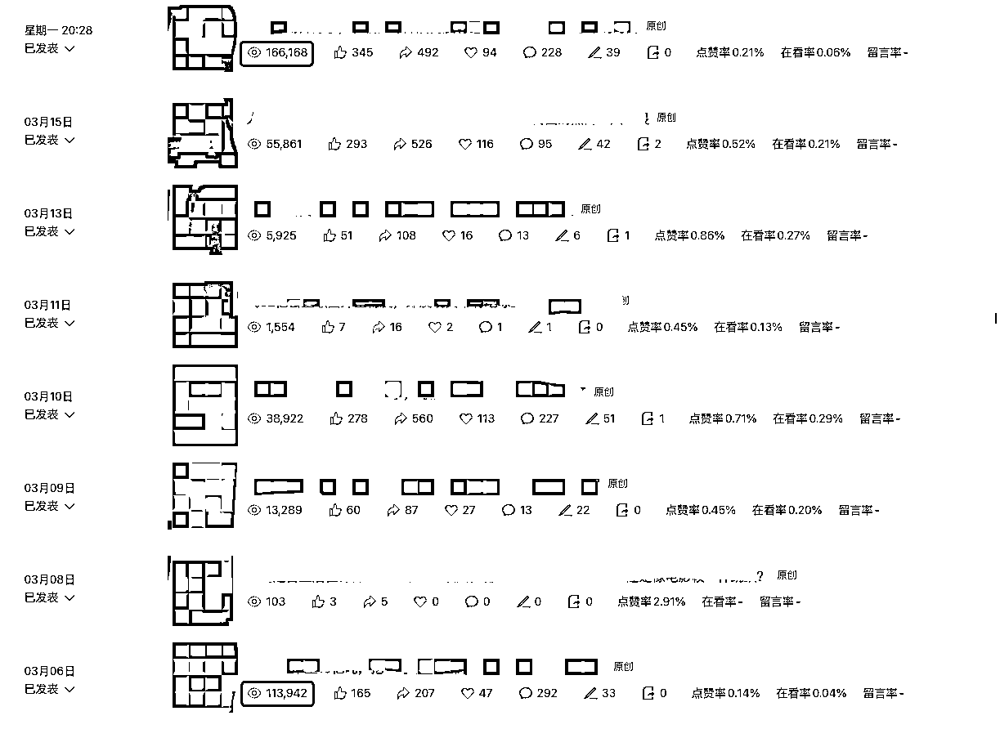
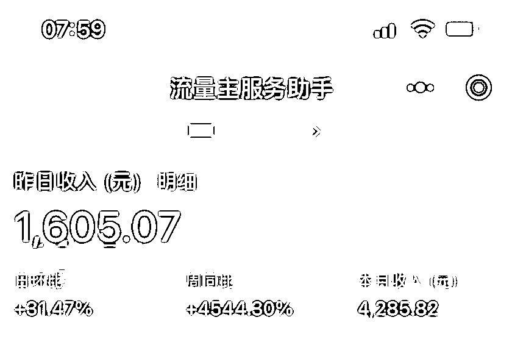
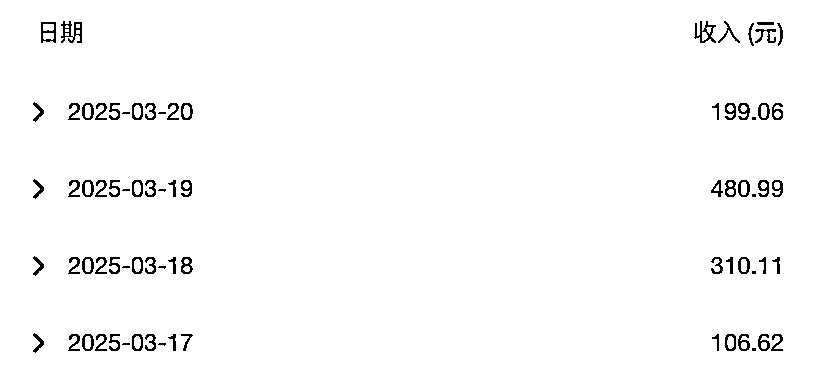
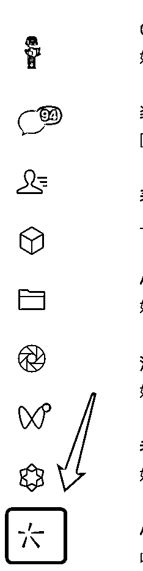
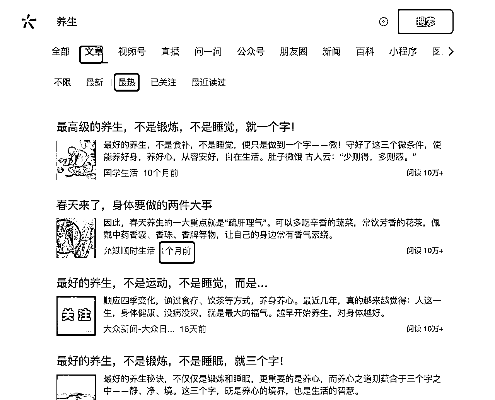
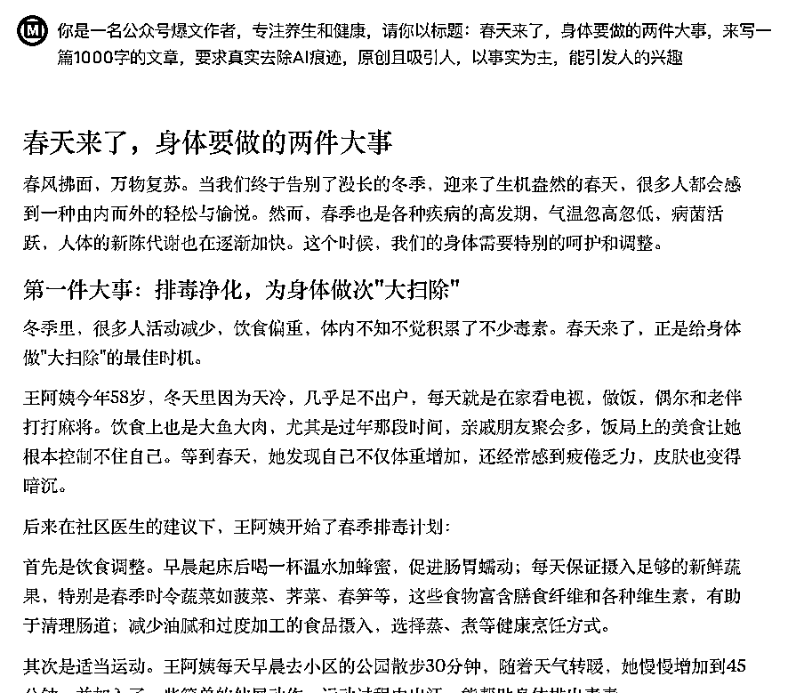
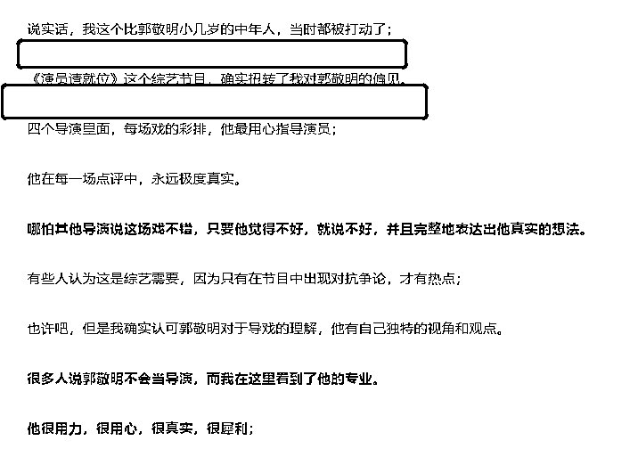
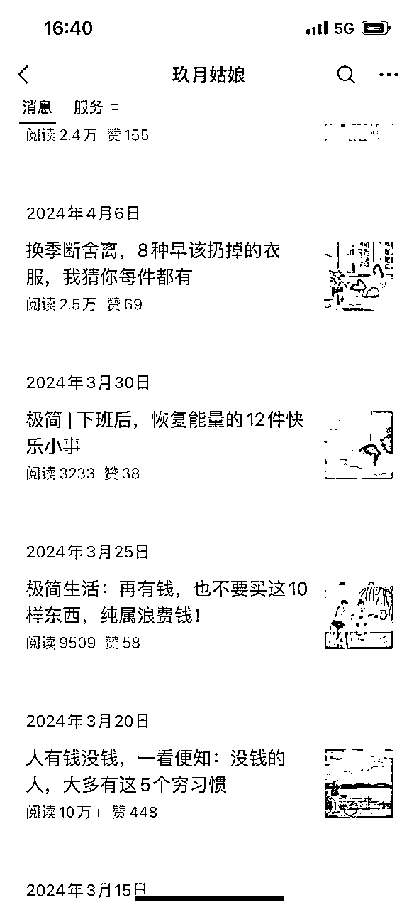

# 10万+公众号爆文是怎么炼成的？5分钟拆解给你看

> 来源：[https://hez86518tv.feishu.cn/docx/DUVHdHdymoSwR0xwiajcd3hGnte](https://hez86518tv.feishu.cn/docx/DUVHdHdymoSwR0xwiajcd3hGnte)

| 版本 | 更新描述 | 作者 | 更新日期 |

| V1.0 | 新建文档 | 科学羊 | 2025-03-21 |

* * *

大家好，我是科学羊🐑，持续在日更10W+爆文公众号专栏的作者，也是报社签约编辑、海外内容创业者、游戏视频创作者、B站游戏UP主。

好久没见啦❤️，今天又来赚钱群里丢干货了～

前几期聊了不少海外赛道，今天换个话题，聊聊国内的卷王赛道——爆文公众号。

别再觉得公众号已经凉了、是夕阳赛道了，在我看来它早就不是什么副业小打小闹的级别了，更像是人人都能薅到的一份零花钱福利。

过去做公众号，得老老实实学基础、学运营、练写作，现在门槛完全变了，除非你是一张白纸。

现在很多人都在做RPA自动化，我也看到过，但这不是今天的主线。RPA虽好，可控性差、学习成本也不低。

废话收一收，直接上干货。

* * *

先放一下我最近的实测结果给大家看看

# 一、实测数据展示

今天不讲公众号的入门、运营心法和其它避坑，本期偏微精品，重点分享我自己跑通的实操经验，给各位大佬一点参考。

# 二、10W+爆文的制作流程

如果你是小白，先搞懂一篇爆文是怎么跑起来的。如果你已经是老手，可以看看我近期琢磨出的些许心得，或许能打到点上。

一篇稿子想快速冲到10W+，我总结了5个必不可少的环节，少一个都不行。

第一：找对标，锁定7-8W以上、最好是10W+的爆款；
第二：刷文，至少两遍；
第三：人工修改+润色；
第四：查重+审校；
第五：发布；

下面逐条拆开讲。

## 2.1 找对标，锁定爆款

这个很多人都懂，就是去微信搜一搜找，现在PC端微信也支持了。

以「养生」为例，打开搜一搜 > 最热 > 筛选近1个月的文章，优先挑小众爆款，大号的稿子不具参考价值。

很多人看到这里会想，打开文章学习一下内容再写？

不，那样就太费劲了。我教你的方法要更狠更省事。

直接抄标题，内容完全不用看。我们的目的不是学习怎么写，是拿收益。内容部分交给了AI，你不用操心。

而且直接复用爆款内容刷文，很容易被判侵权。只拿标题外壳，安全又高效。

比如看到《春天来了，身体要做的两件大事》这个标题，拿下它就进入下一步。

## 2.2 刷文

刷文的意思是，用AI根据标题生成正文。我现在用的指令非常简洁，AI已经不需要长篇大论的prompt了。

养生类例子：

你是一名公众号爆文作者，擅长养生健康，请你以标题：春天来了，身体要做的两件大事，写一篇1000字左右的文章，要求去AI痕迹、原创度高、有吸引力、以事实为依据，能激发阅读兴趣。

把指令丢给GPT或Claude直接出稿就行。

如果结果不满意，可以把Claude的稿子再丢给GPT二次加工。两者顺序可以互换，我常用这种交叉打磨的方式。

你是一名公众号爆文作者，擅长养生健康，请你以标题：春天来了，身体要做的两件大事，写一篇1000字左右的文章，要求去AI痕迹、原创度高、有吸引力、以事实为依据，能激发阅读兴趣。

以下是参考：

春风拂面，万物复苏。当我们告别漫长冬季迎来生机盎然的春天时，很多人会感到由内而外的轻松愉悦。但春季也是疾病高发季，气温多变、病菌活跃、新陈代谢加快，身体需要特别的调养和调整....

这样操作能让不同模型互相拉开差异度，原创性也会提升。第二步完成。

## 2.3 人工修改+润色优化

AI出稿后别直接发，需要人工手改。手改的核心是加：配图、断句、分段、润色。

这一步不能省，决定了阅读体验。比如：

粥左罗说过，文章要留白、分空行，减少阅读压力；

图文搭配，提升体验感...
重点信息加粗、下划线、变色...

本质上就是发之前自己通读一遍，确认舒服不卡顿。

强烈建议多看爆款的排版，这其实就是一篇文章的UI设计。

另外封面和配图尽量保持统一风格。

## 2.4 查重

查重一定要做，比如易撰这类平台就能查。

https://www.yizhuan5.com/

除了查重，还要重点排查「敏感词」，有敏感词平台是不会推流的。

## 2.5 发布

发布时间对新号影响不大，什么时候发都行。只要被推流，就能持续很久。

老号则需要培养习惯，我的「科学羊」号基本固定在每天早上07:30左右发。

# 三、我对爆文的看法

总结下来有4点：

第一，运气成分。自媒体不像接单，作品好不好不由客户说了算，而看平台愿不愿意推。

怎么提高运气？最粗暴有效的方法就是多发。想做流量主的，建议多养几个号，每个号权重、标签都不一样，发的东西不一样，入池概率也不同。

当然，好的内容早晚会被看见。比如我YouTube发了30条，里面就有一条300万播放，关键是内容本身要过线。

第二，标题决定生死。标题不带冲击力，上万阅读也没法爆。

我观察到，带数字、金钱、性等刺激元素的标题，更容易点燃阅读欲。适当带点刺激没毛病。

以前有人评论我说，标题党，点进来驴头不对马嘴，骗人！我想说，如果我不这么写，你会点进来吗？

不走刀尖，你体会不到那种成就感，这也是一种认知升级。

第三，重复是王道。爆款会一直爆。

去年到今年我写了360多篇原创，60%以上过万，10%以上是爆款。我很少翻旧账重写，一直在写新内容。后来我偶尔把自己之前的爆款拿出来改写重发，反而数据更好，有时候还超过原版。可能粉丝多了，权重也起来了。

第四，融合价值。好的内容自带价值。我爱看各式各样的文章，看到一篇好文，我就会想，能不能把它和一个10W+爆款标题融合一下，不就是一篇新稿了？

再分享一个引流小技巧：偶尔发科普小绿书，照抄即可，不存在原创问题，能激活账号权重，也能增加信心。

新手做公众号别太追求完美，你一天写的精致文发出去半年没人看，还不如随便写写发出来。先做到随意、到位就行，IP积累到一定量级再认真输出。

# 四、起号常见问题

我最近空手起了一个新号，现在在公海期跑量，保守估计月入2K没问题。综合测试多个号，我提炼出3个经验：

1、起号没流量，换领域再换，换三次以上还不行就注销重开。我试过换几次也能起，只是周期更长；
2、号一直没起量，可以放一个月持续更，仍有机会；
3、强烈建议在一个领域深耕，别乱跳。我养的几个长盛号，都是单点深耕，等权重起来后，基本只要标题对，都能被自然推流。

# 五、总结

一句话归纳：找到爆款标题，用好AI工具，重视排版美化，通过查重和敏感词筛查，这套组合拳才能稳定产出吸引人的高质量爆文。

以上就是本期的分享，感谢圈友支持～

# 往期精华帖赚钱分享