# 闲鱼迪士尼代付复盘：我如何从亲自跑腿，走到流量、履约与矩阵协同

大家好，我是大白，目前是一名互联网自由职业者，加入赚钱有术还不到一年。

去年，我在闲鱼尝试虚拟电商，切入的是迪士尼购物代结账。前后运营过 3 个账号，其中最高的一天，单账号收入超过 2000 元。

这篇内容不讲抽象的“风口机会”，而是把这门生意从验证需求、亲自交付，到搭建合作网络和扩大订单的过程完整记录下来。

---

# 一、这门生意的基本结构

整个流程可以拆成“获客”和“履约”两部分。

前端负责：

- 在闲鱼上架服务；
- 接待咨询；
- 收取预约定金；
- 确认顾客的门店与时间。

后端负责：

- 联系拥有迪士尼年卡的合作人员；
- 在园区内完成现场购物结账；
- 将优惠后的商品交付给顾客。

顾客支付定金后，我会在年卡合作群里发布需求。确定有人能够承接后，再把双方安排进微信沟通群，由现场人员完成后续服务。

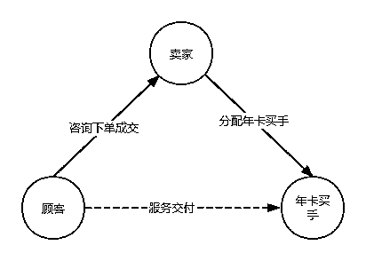

我在其中承担的是连接需求与履约资源的角色：前面获取订单，后面组织服务，中间赚取价差。

---

# 二、利润逻辑：折扣之间的空间

迪士尼年卡用户购物时通常能享受八折左右的优惠，而顾客通过代付服务购买，实际支付一般约为原价的九折。

两种价格之间的差额，就是业务的毛利来源。

比如：

- 商品原价 1000 元，理论空间约 100 元；
- 商品原价 3000 元，理论空间约 300 元；
- 若每天完成 20 笔、每笔留下 100 元，理论日收入就是 2000 元。

以上只是买手分成前的计算结果，实际收益还要扣除现场履约人员的提成及其他成本。

---

# 三、最初的尝试：没有在航海项目中破局，却在旧链接里发现机会

去年年初，我刚经历裁员，处于重新寻找方向的阶段。一次偶然机会，我加入了赚钱有术。

刚进去时，社区里各种高收入案例非常多，容易让人误以为机会遍地都是。后来我决定先行动，再判断，于是参加了当时的闲鱼高客单实战。

选择闲鱼，主要考虑两点：

1. 起步资金要求低，试错成本相对可控；
2. 我过去曾靠出售虚拟资料赚到过 5000 元，只是账号因违规被封，项目才中断。

一开始我也期待自己能快速找到“万能方法”，但航海结束后，指定项目并没有跑通从 0 到 1。

真正持续产生订单的，反而是我主账号里发布的迪士尼代结账服务。

这个结果给了我一个重要提醒：市场验证过的微小信号，往往比别人描述得很漂亮的机会更值得研究。

---

# 四、方向选择：把已有信号继续放大

无论是自由职业，还是参加实战活动，最终都要面对同一个问题：时间和精力不可能无限投入。

当时摆在我面前的选择是：

- 继续投入那个迟迟没有结果的方向；
- 还是围绕已经产生订单的迪士尼业务继续深挖。

和朋友交流时，他问了我一句：

> 既然这条路已经出现了真实需求，为什么不沿着它继续往下做？

我后来意识到，项目选择不一定要追求“听起来最热门”，更应该看自己手里有没有真实反馈。

于是，我把主要精力转移到迪士尼年卡代付这条线上。

---

# 五、正式投入前，先验证两类信息

## 1. 观察闲鱼同行的订单密度

在投入时间之前，我先做了基础调研。

当时搜索过的词包括：

- 迪士尼年卡八折代付；
- 迪士尼年卡代结账；
- 迪士尼购物优惠；
- 迪士尼借卡购物。

我重点查看相关账号的商品动态、成交痕迹和更新频率。

判断需求是否相对稳定时，我采用了一个简单标准：如果某个服务链接在近 30 天里连续 7 天以上都有成交，而且日均能够达到 5 笔左右，就说明这不是偶然流量，而是存在持续购买需求。

通过这些数据，可以初步判断：

- 有没有真实市场；
- 同行是否已经验证过模式；
- 普通账号的订单空间；
- 自己未来可能触达的收入区间。

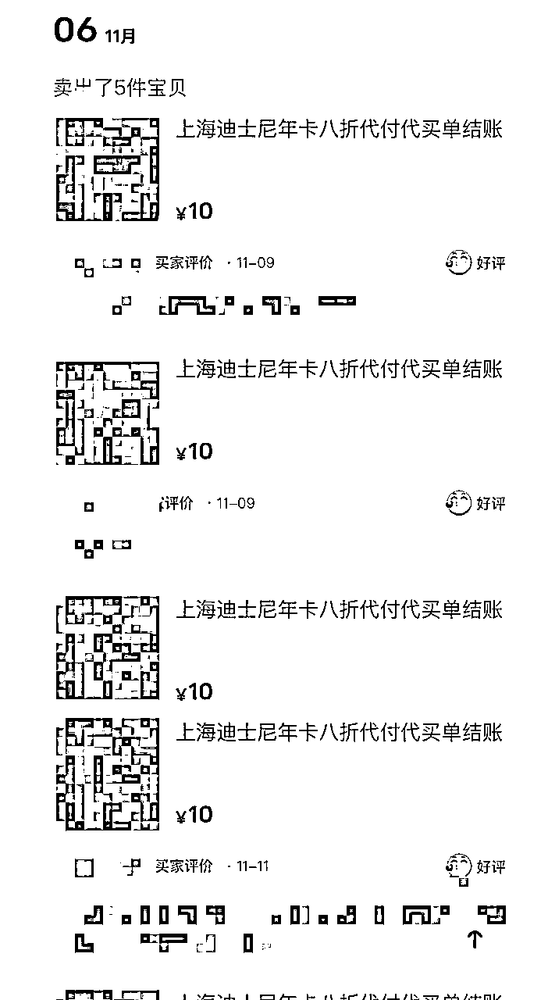

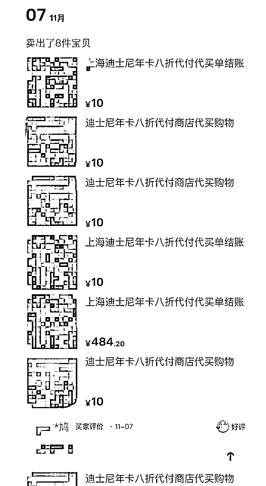

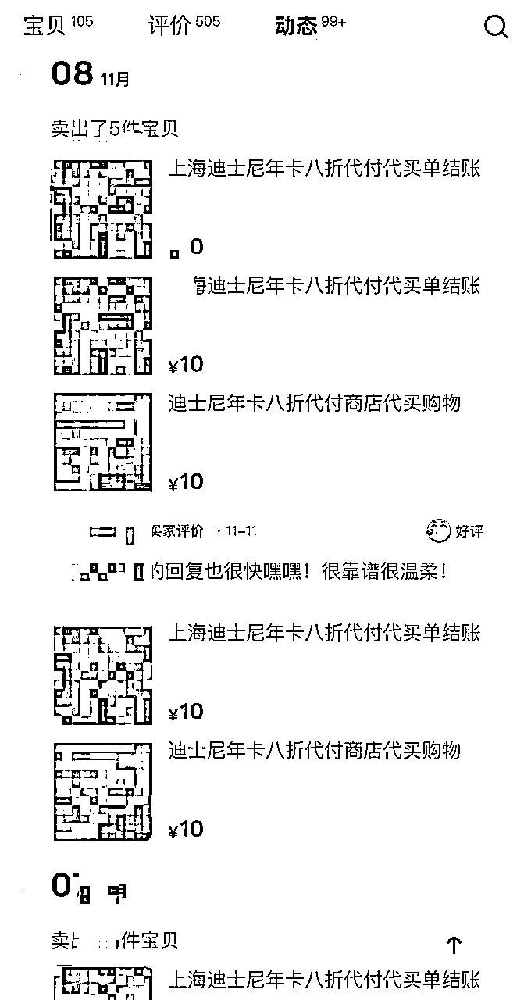

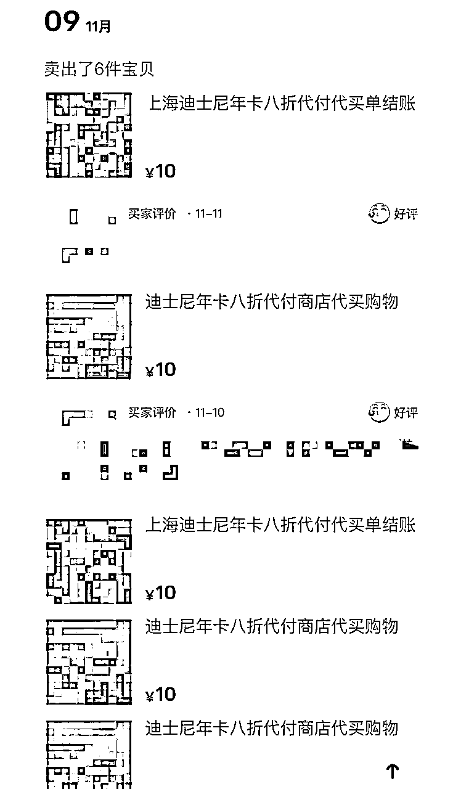

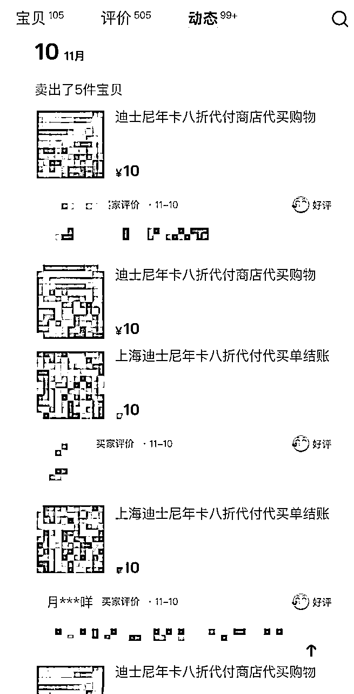

## 2. 到园区观察线下场景

线上数据之外，我还去迪士尼商店做过现场观察和服务。

实测下来，按每天 8 小时计算，大约能完成 10 笔左右。有些时段需求会集中出现，短短一小时内就可能遇到 3 组需要优惠结账的顾客。

这一步让我确认，需求并非只存在于闲鱼搜索结果里，线下确实有顾客愿意为折扣服务买单。

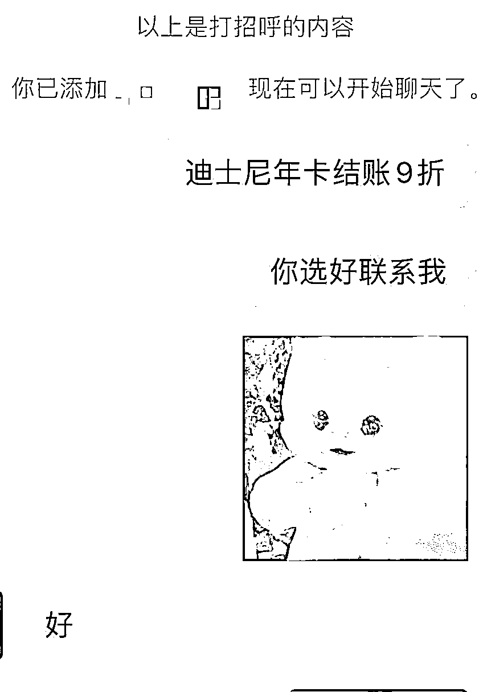

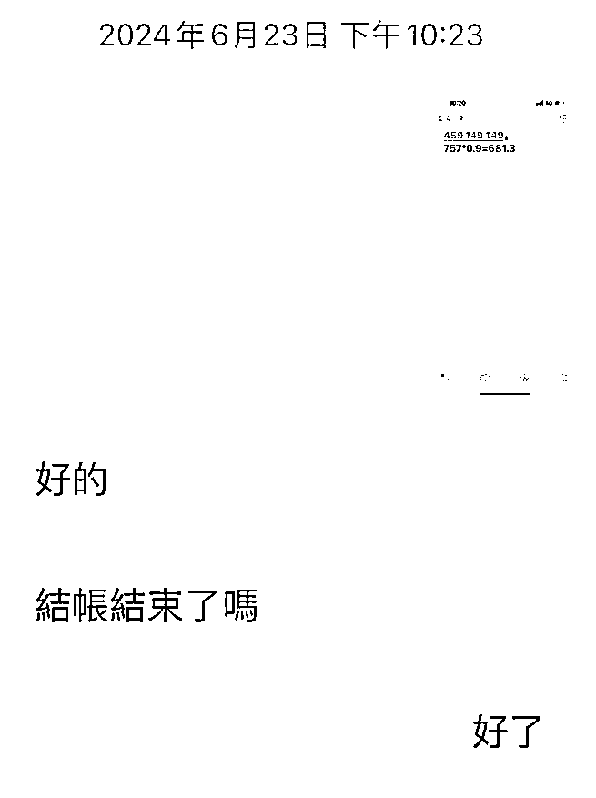

---

# 六、闲鱼前端的搭建方式

## 1. 标题：覆盖用户会搜索的表达

我会从成交表现较好的同行链接中整理高频词，再重新组合标题。

例如：

- 迪士尼购物优惠；
- 迪士尼打折结账；
- 迪士尼年卡八折；
- 迪士尼借卡购物；
- 迪士尼代付；
- 迪士尼现场代结账。

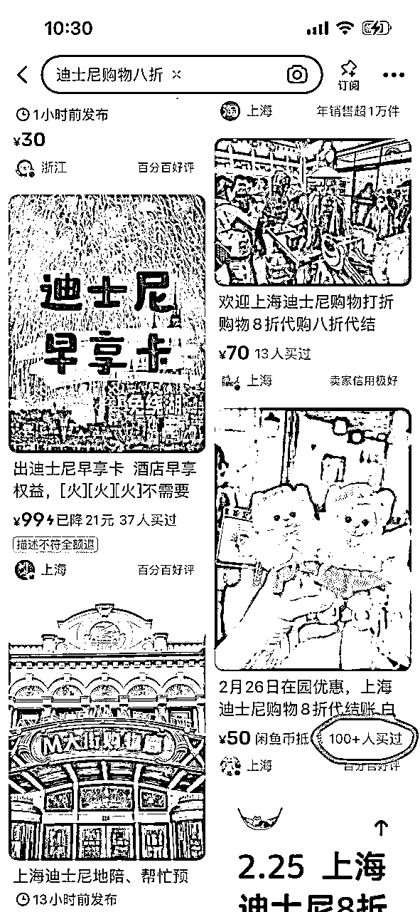

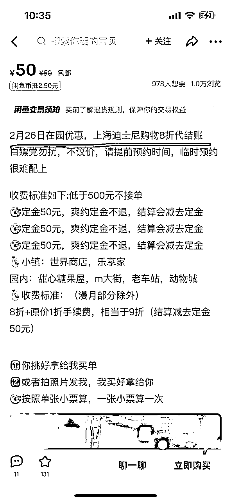

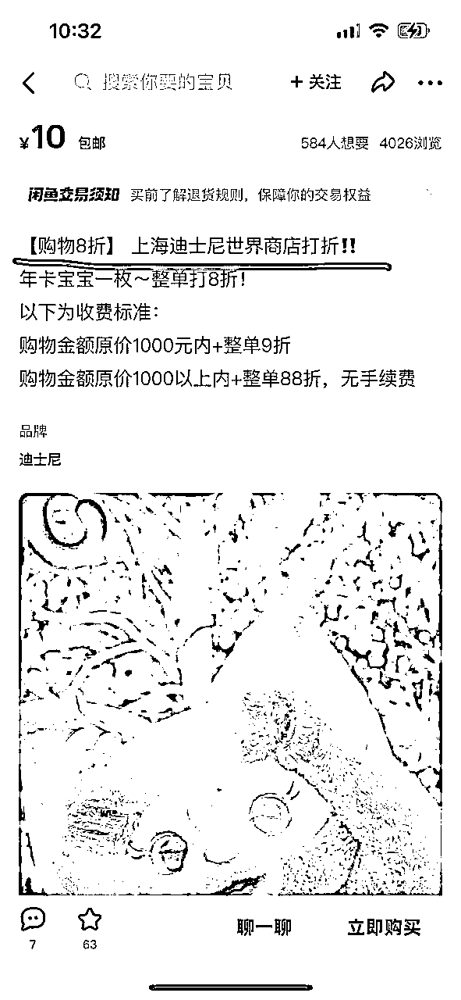

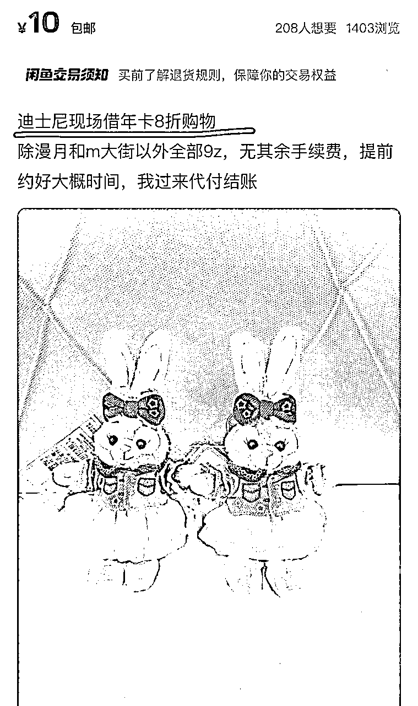

标题里可以突出“八折”这个吸引点击的卖点。

这里的八折对应的是年卡用户的优惠成本，并非顾客最终支付价。实际收费、服务费以及操作规则，要在详情页中进一步解释。

## 2. 详情页：提前消灭模糊地带

详情页可以参考成熟同行的结构，但内容必须按照自己的服务方式重新组织。

至少要交代：

- 收费依据；
- 不同金额区间的计费方式；
- 预约步骤；
- 现场见面方式；
- 需要顾客准备的材料；
- 定金能否退回或抵扣；
- 哪些情况不接受服务。

规则越明确，后续私聊中反复解释的次数越少，也更容易避免交易争议。

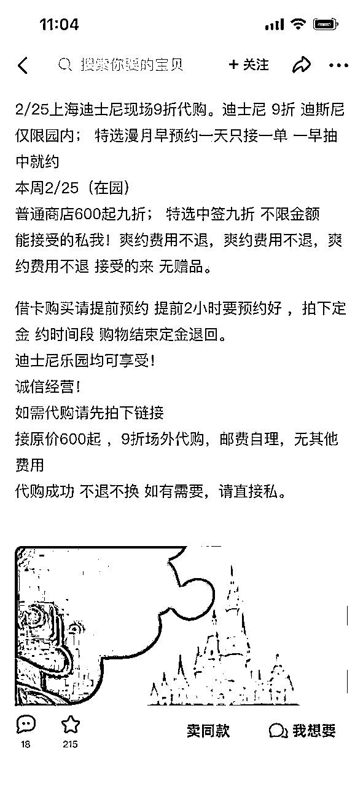

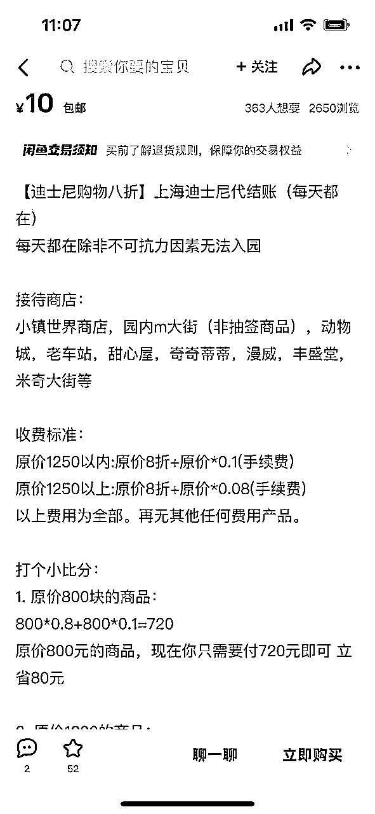

## 3. 主图：让用户快速看懂

图片素材主要有三种来源：

- 参考同类高点击商品；
- 在内容平台寻找相关图片；
- 到园区后自行拍摄。

设计时不需要把信息塞满，重点是：

- 画面明亮整洁；
- 商品主体足够清楚；
- 公仔、挂件等具有代表性的商品容易被识别；
- 构图端正，不要明显歪斜。

我使用过 16:9 图片比例，因为它在手机信息流中占据的视觉面积更大。

## 4. 定价：展示价主要承担预约作用

同类服务的页面标价通常在 10 到 50 元之间。

这笔钱大多是预约定金，不代表最终商品价格。顾客真正需要支付的金额，要结合商品原价、服务费以及现场结算规则确定。

## 5. 图片上的关键词

主图可增加少量文字标签，例如：

- 迪士尼代结账；
- 迪士尼代付；
- 迪士尼购物优惠。

控制在 2 到 5 个词组即可，标签太多反而会削弱画面重点。

---

# 七、现场履约人员的招募渠道

## 1. 迪士尼收货圈子

一些迪士尼收货群，成员主要包括个人代购、收货商家和相关店铺从业者。群里经常会出现收货清单，其中有不少成员本身拥有年卡，也会频繁进入园区。

所以，早期可以通过这类圈子接触潜在合作人员。

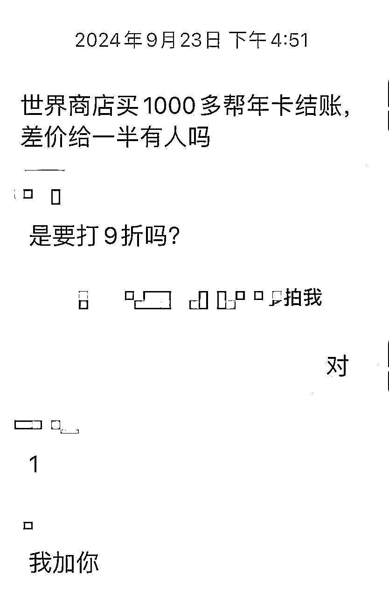

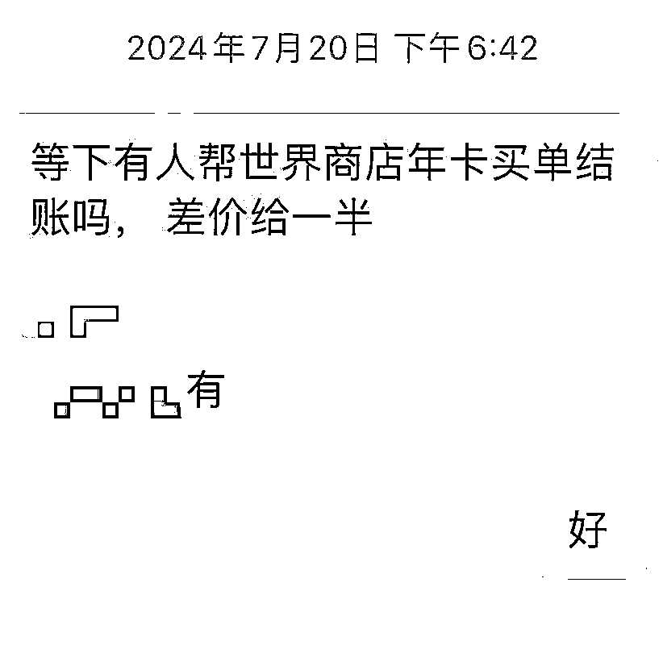

但这个渠道后来越来越难稳定使用，原因主要有两点：

第一，年卡用户每年通常存在购物额度限制，常见额度约为 10 万元；

第二，园区对代购、代付的管理逐渐收紧。

例如，部分商品包装胶带会带有随机数字，买手还可能需要消耗购物优惠券。通常每周只有 5 张券，一笔原价 1000 元的订单，现场人员实际可能只能获得约 50 元收益。

5 张券全部使用后，周收益也许只有 200 元左右。

因此，不少买手会把券留给新品、热门款或具有溢价的商品，例如饼饼双肩包。单纯依靠收货群，后期很难持续获得充足履约资源。

## 2. 在内容平台寻找年卡合作方

我还通过内容平台搜索“迪士尼年卡代付”等关键词，筛选近期发布、仍有合作意愿的年卡用户，再私信沟通。

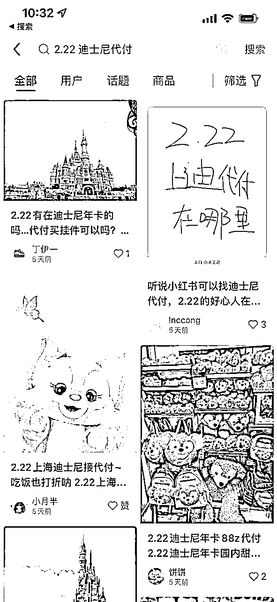

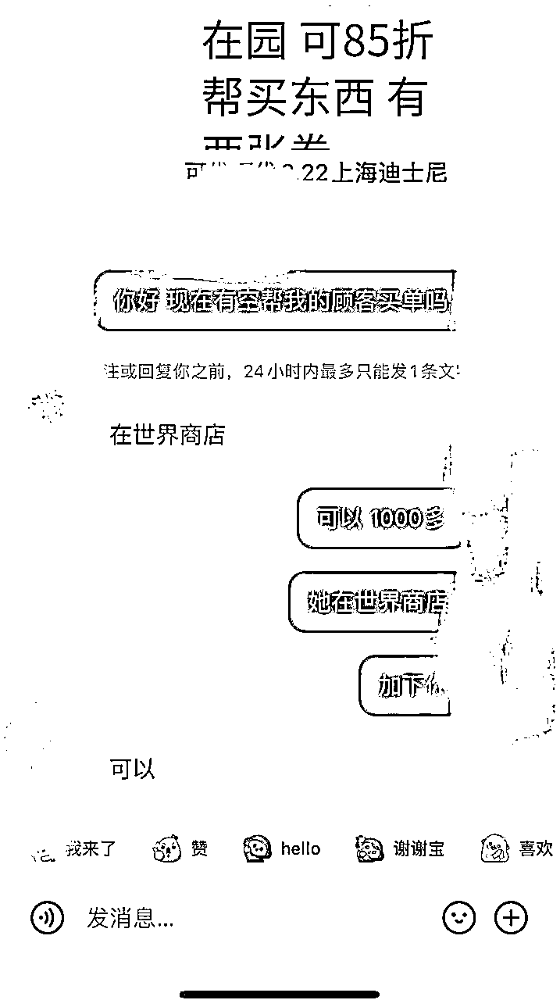

不少年卡用户原本就在做 85 折左右的服务。如果双方按照比例分成，现场人员的到手收益与自己独立接单接近，通常更容易达成合作。

---

# 八、第一阶段：所有事情都由自己完成

项目刚起步时，我负责全部工作：

- 商品发布；
- 线上咨询；
- 确认门店和时间；
- 到园区等待；
- 现场结账；
- 处理售后和沟通。

通常我会提前与顾客约好时间和商店，再赶到附近等待。顾客选好商品后，双方在店里碰面，由我利用年卡完成付款。

刚开始，这种方式还能运转，但随着订单增多，限制很快出现。

## 1. 无法覆盖全天候需求

顾客的购物时间并不固定，有人上午来，也有人晚上才到。

如果几笔订单碰巧集中在同一时段，就会互相冲突；若顾客分散在不同门店，还需要频繁移动，一旦赶不过去，订单就可能流失。

## 2. 现场交付会挤压线上获客

我在店里处理订单时，无法及时查看闲鱼消息。

结果就是：

- 现场服务占用了注意力；
- 新咨询得不到及时回应；
- 订单越多，个人越容易陷入疲于奔命。

这时我开始思考，能否把“获取订单”和“完成服务”拆开。

## 一个临时订单带来的启发

有天晚上接近 10 点，一位顾客已经挑好价值约 2000 元的商品，但我当周可用的购物券已经消耗完毕。

我注意到店里还有一位同行，正在寻找需要折扣结账的顾客，于是试着把这笔需求转给他。

对方同意帮忙，并提出将利润平分。

那一刻我意识到：我不必亲自处理每笔订单，只要能够掌握稳定的客源，再把需求交给现场资源完成，业务就有机会脱离个人时间上限。

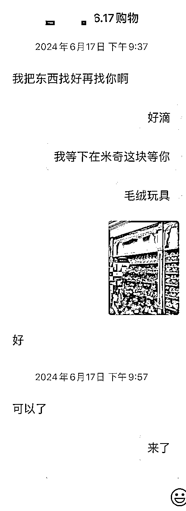

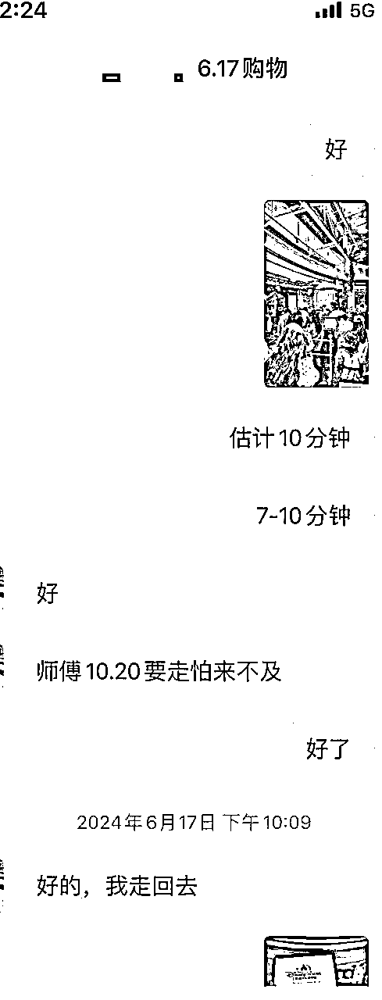

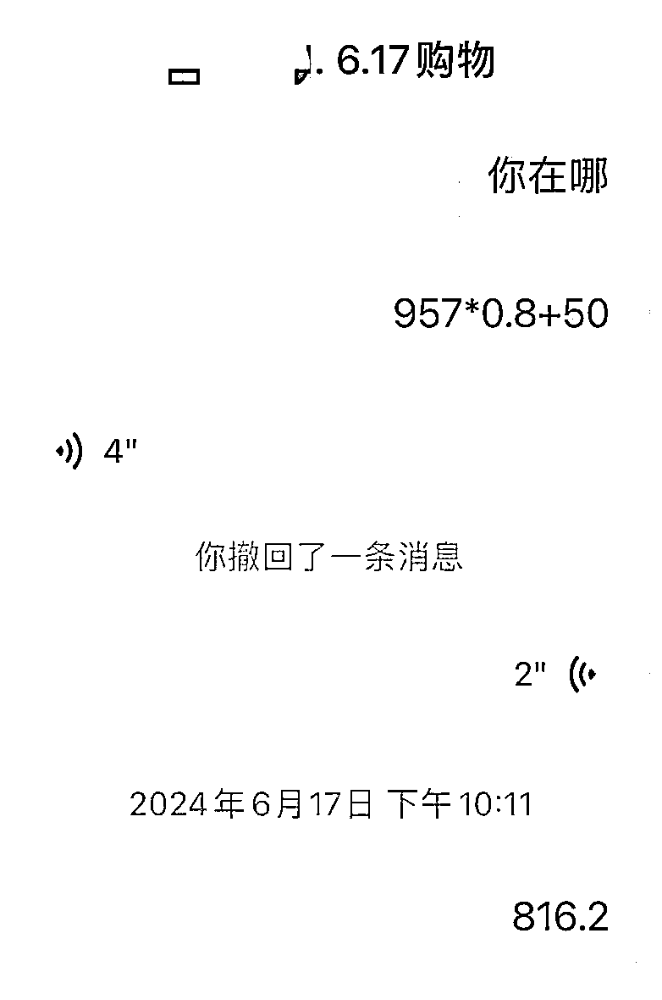

---

# 九、第二阶段：我负责获客，合作方完成履约

确定拆分思路后，接下来的关键是建立足够大的现场人员池。

我把目光放到了内容社区，原因是：

- 上面有不少年卡用户主动发布代付信息；
- 他们已经熟悉园区流程；
- 很多人原本接受的就是 85 折左右；
- 采用五五分成后，双方的收益预期比较接近。

于是，我开始发布合作信息并主动联系潜在合作方。

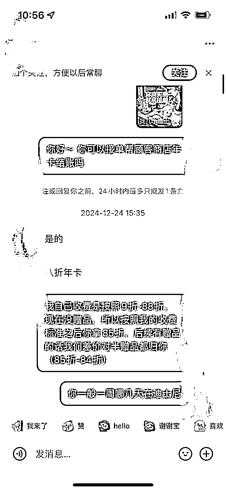

陆续筛选出几位合作者后，我把他们统一放进微信工作群。

新的工作流变成：

1. 闲鱼收到咨询；
2. 顾客支付预约金；
3. 在工作群发布订单；
4. 现场人员确认承接；
5. 双方进入单独沟通窗口；
6. 合作方完成现场结账；
7. 我负责前端流量与订单调度。

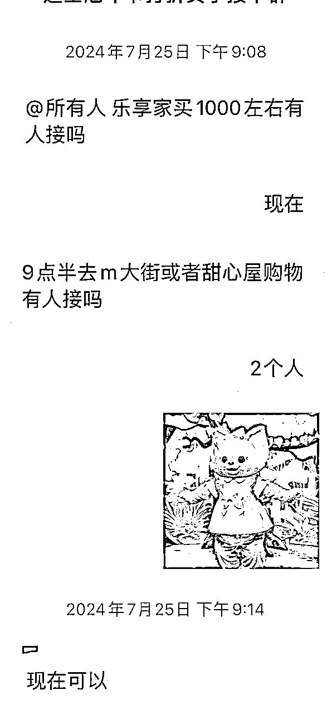

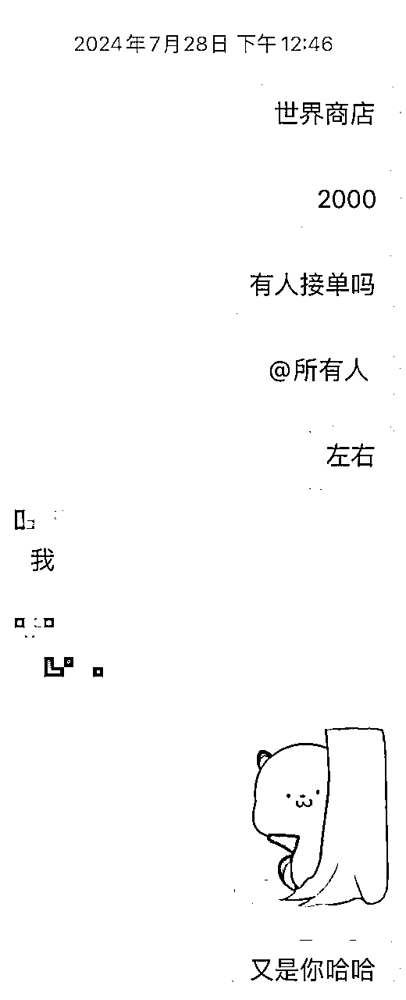

服务沟通示意如下：

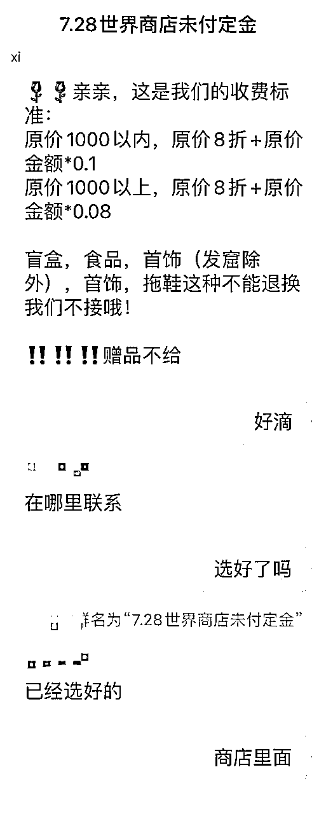

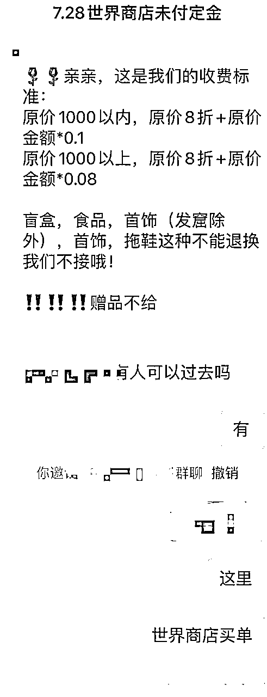

此时，我的身份发生了变化：不再只是跑腿结账的人，而是负责连接客户和履约资源的组织者。

---

# 十、第三阶段：从单账号走向协同矩阵

运行一阵后，咨询量虽然增加，但整体订单仍没有明显跃升，距离日均 20 笔的目标还有差距。

我考虑过自己继续增加闲鱼账号，但如果所有账号都由我亲自回复，客服压力会迅速膨胀。

于是，我尝试让身边的人参与，同时验证新人是否能够按照标准流程快速上手。

具体做法是：

- 把手机里拍摄的园区和店铺图片统一上传到网盘；
- 整理标题、图片、详情页的制作规范；
- 编写发布操作说明；
- 让参与者按照模板搭建自己的商品页面。

这样，新参与者不需要从零摸索，完成基础培训后就能开始测试。

---

# 十一、矩阵扩张后的实际难题

## 难题一：临时需求出现时，现场资源不一定在线

有些顾客临时决定购物，固定合作方可能刚好不在园区。

这时我会把订单发到自己维护的迪士尼相关群组，询问是否有人能够临时承接。

确认人员后，再把双方安排到单独沟通窗口，同时将新合作方加入后续的接单网络。

## 难题二：园区内暂时没有可用年卡人员

过去曾尝试过线上“洗单”方式，让顾客先通过平台付款，再由其他方式完成折扣处理。

因为这种模式存在逃单风险，后来曾要求顾客先完成闲鱼付款，以降低交易风险。

当时使用过的话术如下：

但随着园区政策变化，这种做法已经不再适合。

现在商品胶带上的随机编码与购物小票编码需要匹配，才可能办理退货退款。线上代买在售后和凭证方面的风险明显增加，因此不能再把它当作常规解决方案。

## 难题三：有人不愿意支付平台定金

遇到不愿先付定金的顾客，我通常先添加微信，确认商品、时间和服务条件。

等现场人员与顾客碰面时，再要求对方补拍预约链接。

如果对方始终拒绝通过闲鱼留下订单记录，我就不会继续承接。

---

# 十二、订单放大的过程

在运营期间，我持续更新商品页面，每天测试两条新链接，重点观察：

- 哪种图片更容易获得点击；
- 哪类标题带来的咨询更多；
- 什么价格更适合作为预约入口；
- 哪种文案能减少解释成本。

持续测试数月后，某条链接开始稳定获得成交。

我随后使用闲鱼币做推广，继续放大曝光。

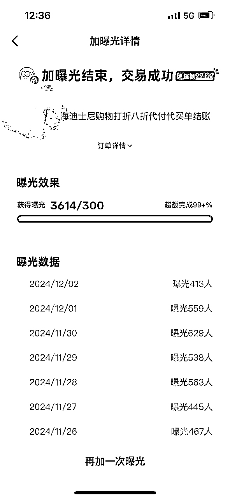

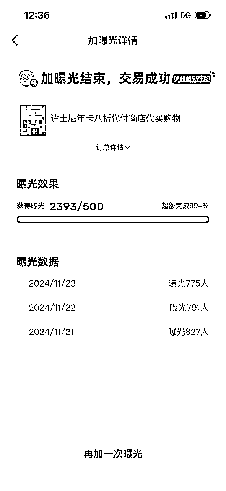

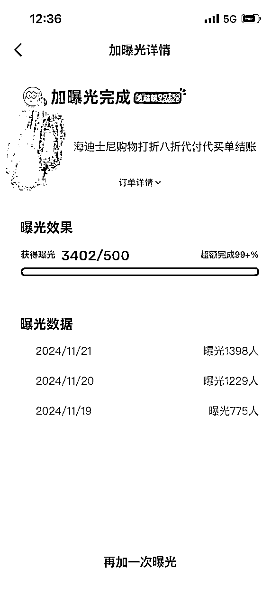

那段时期，单日咨询峰值超过 100 人。

已经支付预约金的订单，加上咨询后暂未付款的需求，最高接近 50 笔。由于不少订单完成后会退出或清空聊天记录，后台只能展示部分内容。

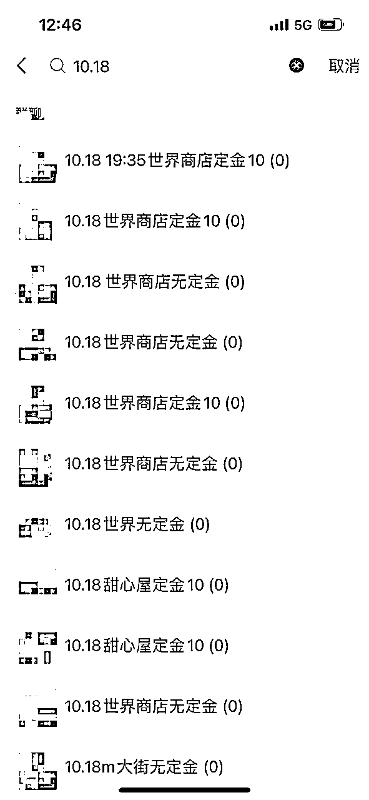

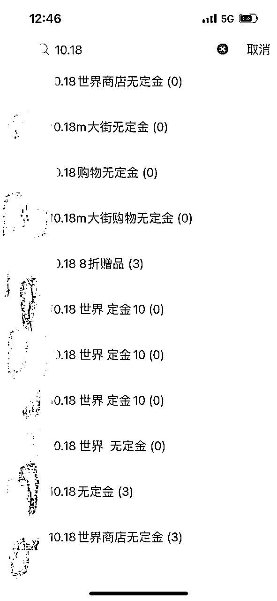

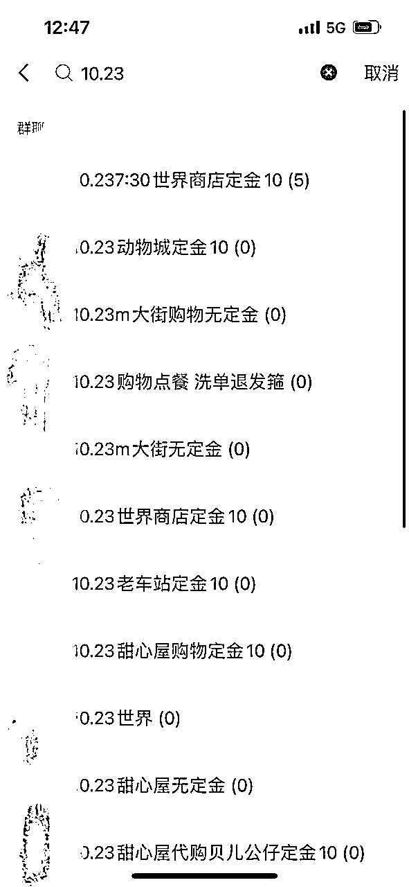

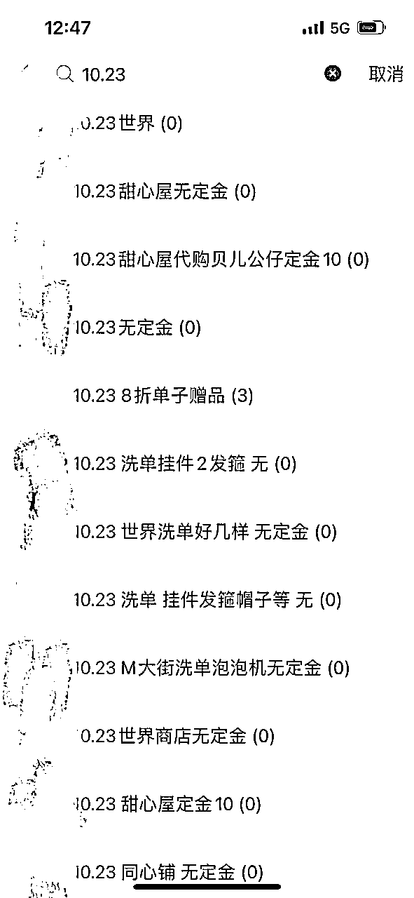

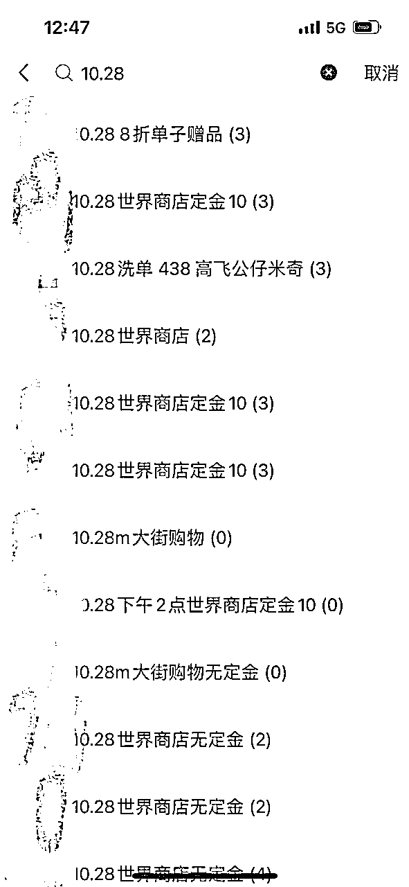

单日收入也从几百元提升到四位数，最高突破 2000 元。

---

# 十三、继续优化：把重复沟通交出去

订单增长后，真正消耗精力的不是寻找客户，而是大量重复问答。

常见问题包括：

- 折扣如何计算；
- 预约金是多少；
- 能否退款；
- 需要提前多久预约；
- 现场如何碰面；
- 临时下单是否能够安排。

如果所有问题都由我亲自回复，时间很快会被低价值沟通占满。

所以后续我把部分基础客服工作交给外包人员，自己集中处理：

- 商品页面和账号运营；
- 订单分发；
- 履约资源调度；
- 异常情况；
- 合作关系维护。

同时，随着订单规模扩大，我重新和现场合作方谈分成。

因为我能够提供连续订单，并且附带一些赠品资源，最终谈下了两位较稳定的年卡合作人员。订单量上升、履约成本下降后，单日收入又接近翻倍。

---

# 十四、最终复盘：这条路的门槛在哪里？

## 1. 入门容易，稳定放量难

基础操作并不复杂：

- 搭建闲鱼页面；
- 获得用户咨询；
- 收取预约金；
- 调度现场人员；
- 完成订单交付。

真正困难的是后端资源。

顾客购物往往临时发生，而年卡用户多数是兼职参与，能否在指定时间及时响应，直接决定了订单能不能落地。

## 2. 需求存在，但规则变化会影响利润

从高峰期每天上百人的咨询量来看，迪士尼购物优惠服务确实有消费需求。

目前不少现场人员仍然以兼职形式参与，加上购物券数量和使用规则存在限制，市场并非完全饱和。

但这类业务高度依赖园区政策，包装、凭证、优惠券和退换货规则的变化，都可能影响交付方式。因此，不能只关注流量，也要持续检查合规风险和实际履约条件。

## 3. 还有其他延伸场景

除了商品代结账，还可以围绕园区消费需求继续观察，例如：

- 园区代点餐；
- 特定商品代买；
- 活动周边代购；
- 主题季限定商品服务。

这个项目给我的最大启发是：一个小需求能否做大，不只取决于有没有订单，还取决于能否完成市场验证、拆分工作流程、建立履约网络，并最终形成一套可复制的协作机制。