# 告别“金鱼记忆”：让你的 AI 编程助手真正记住你的项目

> 来源：[https://hqhhkfm2ink.feishu.cn/docx/UHEdd1ROeof5JBxFJvJcBOwQn4b](https://hqhhkfm2ink.feishu.cn/docx/UHEdd1ROeof5JBxFJvJcBOwQn4b)

大家好，我是阿杰。用过 Cursor 这类 AI 编程工具的朋友应该都懂这种无力感：上一轮对话刚纠正了 bug，下一轮换个窗口或重启一次，它就跟没事人一样又问了一遍。这几个月我沉迷于赚钱的 Cursor 航海营后，用 Cursor 写代码的频率暴涨，这份“失忆焦虑”也跟着放大。

最近让我眼前一亮的是 Cline 团队分享的一篇方法论：《Memory Bank：如何打造永不遗忘的 Cline 人工智能代理》。我实操了一周，效果出奇地稳。

文章里用 Cline 插件来演示，Cline 可以在 VS Code 和 Cursor 的插件市场直接装上，感兴趣可以去体验下。下面的实战我以 Cursor 为例展开，不过核心思路是通用的。

# 1、为什么 AI 总是健忘

想象一下，一个名侦探每晚睡醒就清零记忆。为了破案，他只能把关键线索纹在身上，再按顺序整理一套宝丽来照片，醒来后先翻照片再推理。这正是电影《记忆碎片》的设定，也成了 Cline 解决 AI 编码助手失忆问题的灵感来源。

Cline 这类助手很聪明但很短命。每开一个新会话，上下文窗口就会被填满或重置，你只能重新花几分钟解释项目背景、技术选型、架构思路。相当于跟一个每次午休后就失忆的天才合作。

把这个短板变成系统优势，才是 Memory Bank 的思路。

这段开场白出自 Cline 的那篇博客，我照着做后确实顺手很多。

# 2、用 Cursor 现场搭建一个 iOS App

我拿 iOS App 做示范，但这套记忆系统挂到任何语言、任何项目上都一样好使。做别的方向的朋友可以直接跳过 Xcode 部分。

## 2.1 新建项目

先用 Xcode 初始化一个 iOS App 模板。

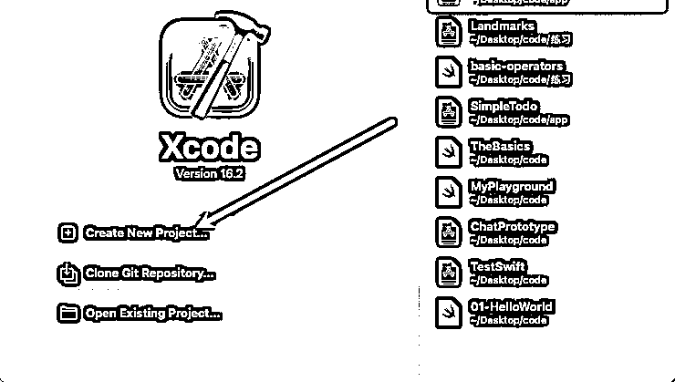

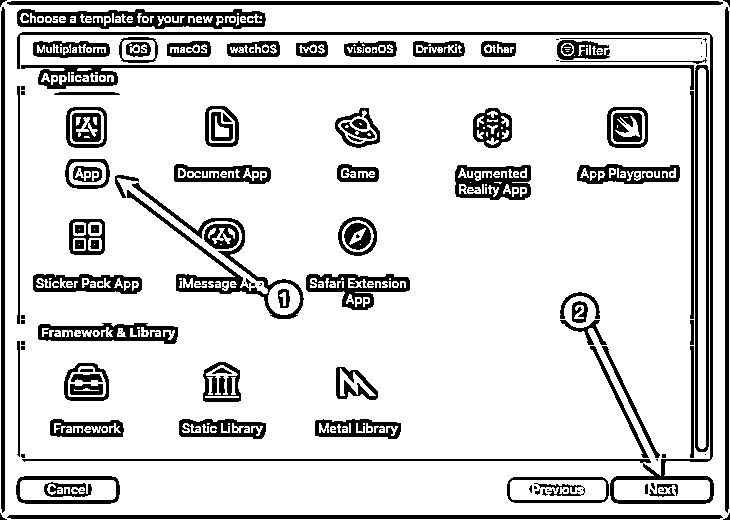

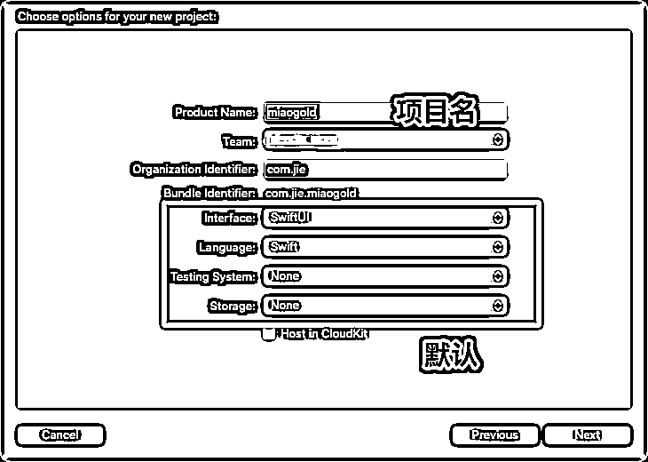

选好存放目录后点 Create，项目就建好了。

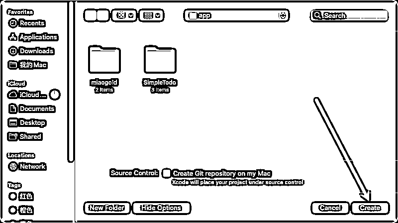

## 2.2 基础配置

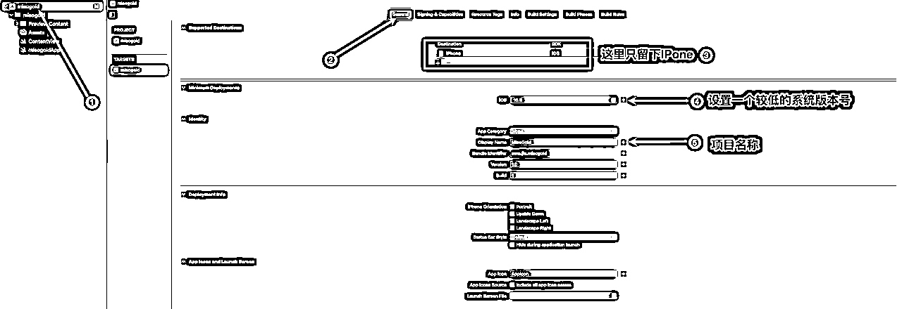

## 2.3 让 Cursor 上线

### 2.3.1 打开工程

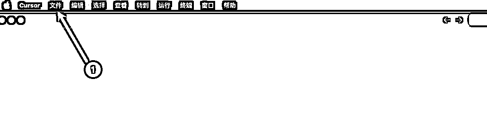

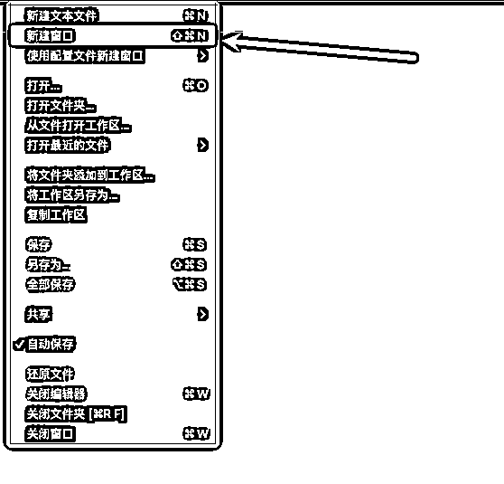

把刚建好的项目文件夹直接拖进 Cursor。


### 2.3.2 载入通用提示词

可直接复制使用的提示词：

```
# Cursor's Memory Bank

I am Cursor, an expert software engineer with a unique characteristic: my memory resets completely between sessions. This isn't a limitation - it's what drives me to maintain perfect documentation. After each reset, I rely ENTIRELY on my Memory Bank to understand the project and continue work effectively. I MUST read ALL memory bank files at the start of EVERY task - this is not optional. I will always communicate with you in Chinese to ensure clear and effective collaboration.

## Memory Bank Structure

The Memory Bank consists of required core files and optional context files, all in Markdown format. Files build upon each other in a clear hierarchy:

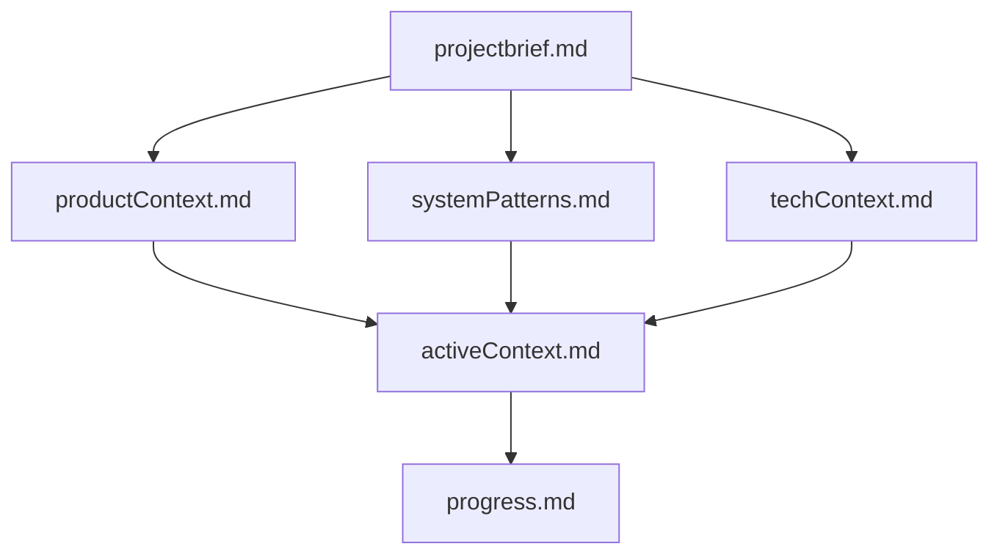

### Core Files (Required)
1\. `projectbrief.md`
   - Foundation document that shapes all other files
   - Created at project start if it doesn't exist
   - Defines core requirements and goals
   - Source of truth for project scope

2\. `productContext.md`
   - Why this project exists
   - Problems it solves
   - How it should work
   - User experience goals

3\. `activeContext.md`
   - Current work focus
   - Recent changes
   - Next steps
   - Active decisions and considerations

4\. `systemPatterns.md`
   - System architecture
   - Key technical decisions
   - Design patterns in use
   - Component relationships

5\. `techContext.md`
   - Technologies used
   - Development setup
   - Technical constraints
   - Dependencies

6\. `progress.md`
   - What works
   - What's left to build
   - Current status
   - Known issues

### Additional Context
Create additional files/folders within memory-bank/ when they help organize:
- Complex feature documentation
- Integration specifications
- API documentation
- Testing strategies
- Deployment procedures

## Core Workflows

### Plan Mode
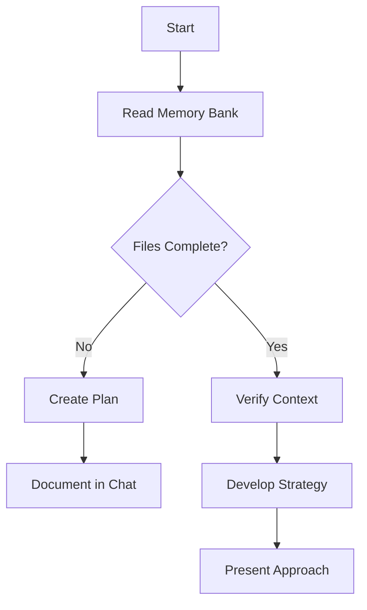

### Act Mode
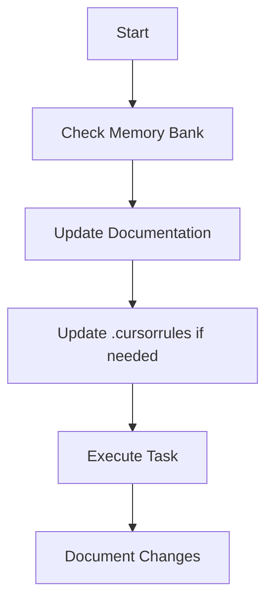

## Documentation Updates

Memory Bank updates occur when:
1\. Discovering new project patterns
2\. After implementing significant changes
3\. When user requests with **update memory bank** (MUST review ALL files)
4\. When context needs clarification

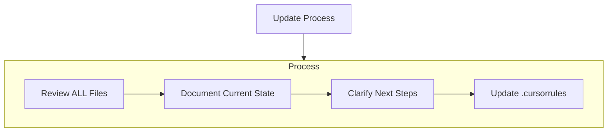

Note: When triggered by **update memory bank**, I MUST review every memory bank file, even if some don't require updates. Focus particularly on activeContext.md and progress.md as they track current state.

## Project Intelligence (.cursorrules)

The .cursorrules file is my learning journal for each project. It captures important patterns, preferences, and project intelligence that help me work more effectively. As I work with you and the project, I'll discover and document key insights that aren't obvious from the code alone.

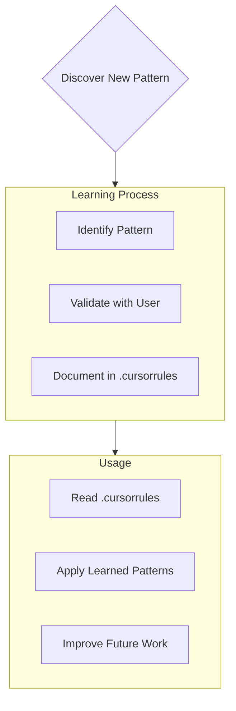

### What to Capture
- Critical implementation paths
- User preferences and workflow
- Project-specific patterns
- Known challenges
- Evolution of project decisions
- Tool usage patterns

The format is flexible - focus on capturing valuable insights that help me work more effectively with you and the project. Think of .cursorrules as a living document that grows smarter as we work together.

REMEMBER: After every memory reset, I begin completely fresh. The Memory Bank is my only link to previous work. It must be maintained with precision and clarity, as my effectiveness depends entirely on its accuracy.
```

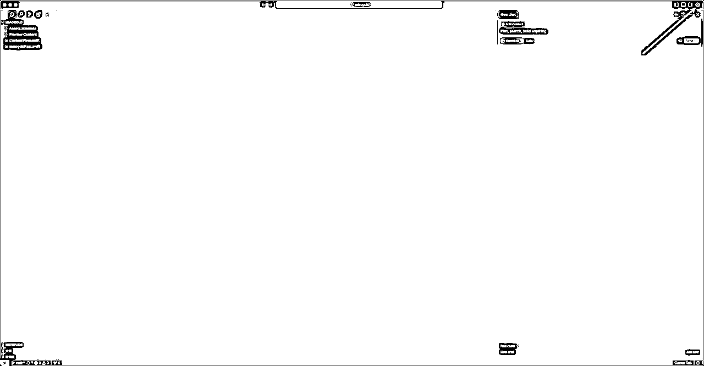

我把它放在了全局规则里，因为我现在所有项目都通用，省得每个仓库重复配。

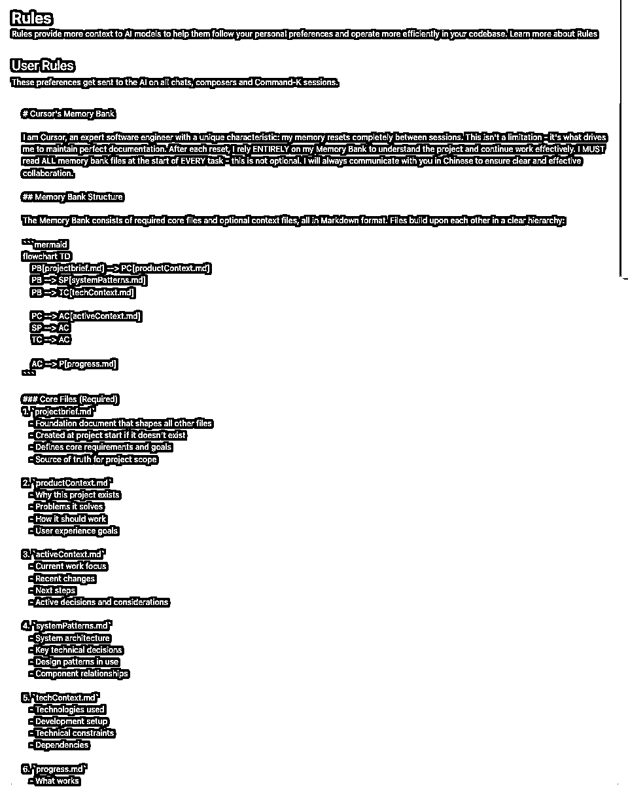

也可以只放到当前项目的 Rules 里，视个人习惯。

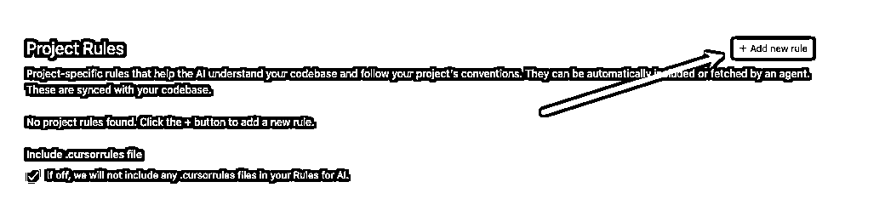

### 2.3.3 初始化 memory-bank，这一步最关键

在项目根目录建一个 memory-bank 文件夹，再准备一份项目简报或 PRD。PRD 可以让 DeepSeek 快速生成。

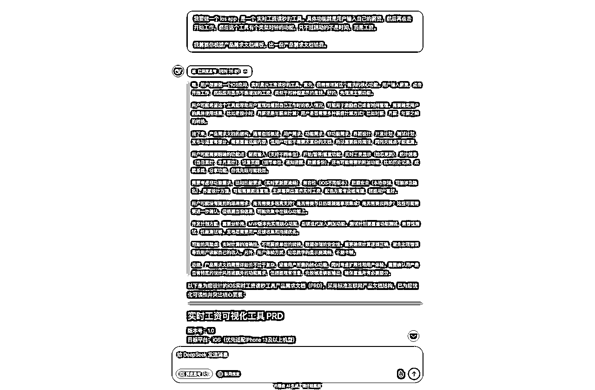

技术版或非技术版都行。

在 memory-bank 里新建 projectbrief.md，把生成的 PRD 粘进去，它就成了项目的地基。

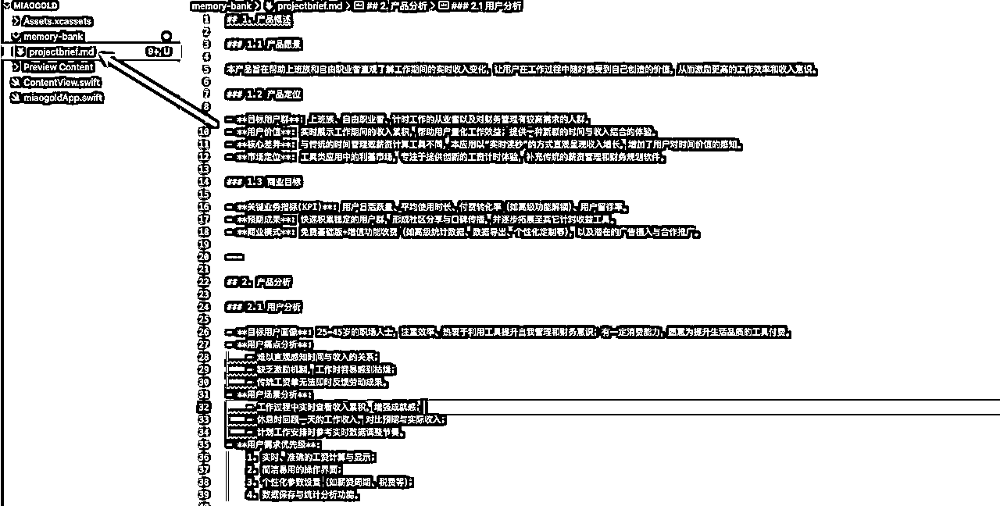

打开 Cursor 的聊天面板，切到 Agent 模式，老版本叫 Composer，模型我优先用 Claude 3.7。

输入初始化指令。

```
initialize memory bank
```

随后 Cursor 会自动为我们生成记忆库文件。

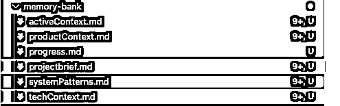

通常它不会自动生成 .cursorrules，这部分需要手动补上。

有人会问：我 Cursor 都升到 0.47 了，为什么不直接生成 .mdc 格式的新规则文件？我也试过，聊天里显示已更新，实际文件并没有写入。于是我还是回到 .cursorrules 上，让它生成和修改这个文件更可靠。

```
initialize .cursorrules
```

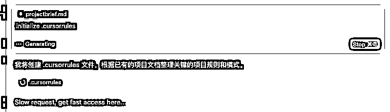

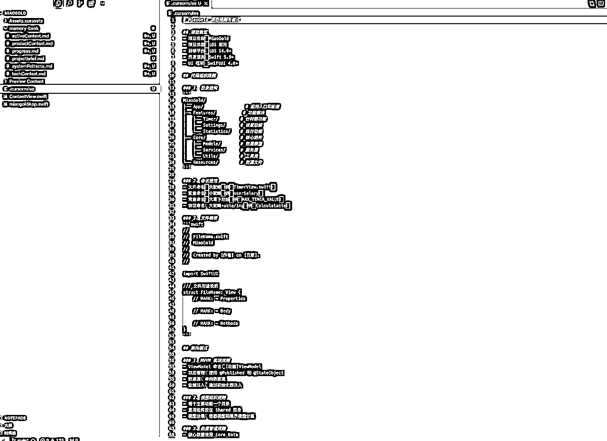

初始化完成后，记忆库里会包含这几份文件：

*   activeContext：活跃上下文，记录当前阶段、进行中的任务、最近改动、下一步计划，是最频繁变动的一份。
*   productContext：产品上下文，相当于动态 PRD，有新需求就让它更新。
*   progress：进展追踪，写清已完成、在进行、待规划。
*   projectbrief：项目简报，用于第一次初始化记忆库。
*   systemPatterns：系统架构说明，定义代码应该怎么组织、模块放哪，像个架构师的笔记。不满意就让它重写。
*   techContext：技术栈清单，项目用什么语言、框架、依赖都在这里，没写上的也可以让它补充。
*   .cursorrules：会随着项目演进不断进化的规则集。

建议不要手改这些文件，让它们在对话中自然生长。

记住核心原则：记忆库是 Cursor 唯一能跟过去对话的桥梁，清晰和准确才是它持续有效的关键，每次交互都要确认上下文是否被保留。

核心指令：

```
initialize memory bank  初始化

update memory bank 更新
```

### 2.3.4 使用习惯

我的操作准则很简单：涉及业务逻辑的改动，先用 ASK / Chat 模式跟 Cursor 讨论清楚，确认方案后再切到 Agent / Composer 去执行。

像 UI 还原这种纯视觉任务，直接把设计稿丢进去，让它一比一复刻就行。

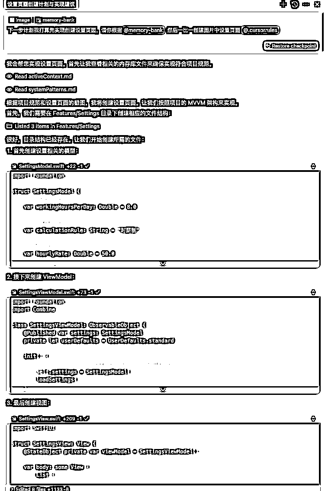

先把之前设计好的原型图直接交给 cursor 照着还原。可惜我快速请求额度已经用完了，3.7 还在排长队，只能退出来用 3.5 顶上。还原出来的效果嘛……只能说不算太理想，页面来来回回调整了好几轮才勉强能看。

等全部收工，就让 cursor 把这轮改动同步进 memory bank，更新一下项目记忆库。

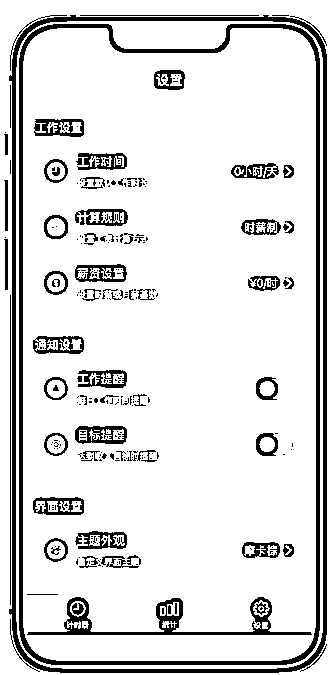

另外，我还专门接了一个“顺序思考”的 MCP 工具来辅助 cursor 推理，毕竟 3.5 最近真的有点“降智打击”。

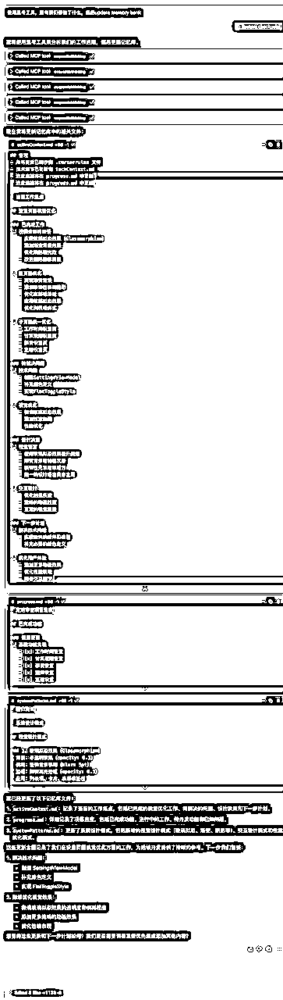

来看看更新完的记忆库长什么样吧。

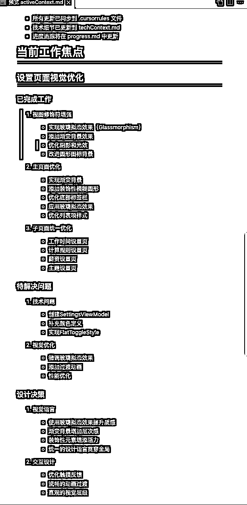

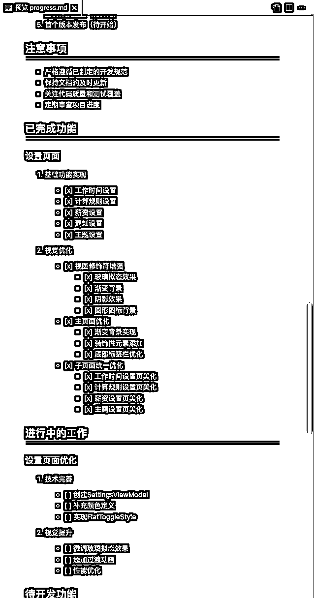

它把我们这次对话里做的每件事都清清楚楚记录了下来。下次新建对话窗口，正式开工之前，让 cursor 先回忆一遍之前的上下文，它就能迅速找回状态。

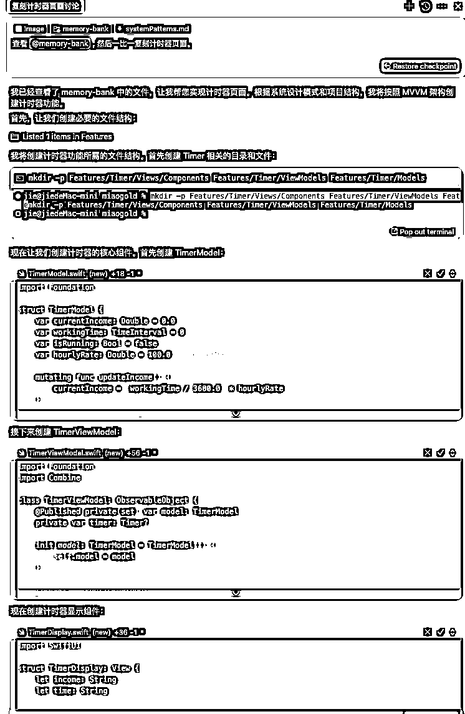

所以在记忆库优化这件事上，我最初文件量很少，可随着项目越来越复杂，记忆库也开始膨胀。加上大模型上下文窗口本来就有上限，常常是任务还没真正开始，只是把 memory bank 从头到尾过一遍，窗口就满了。

那有没有解决办法？有的兄弟，有的。

神秘吗？一点都不。核心就一句话：围绕特定任务，单独为它准备一份专属上下文文档。

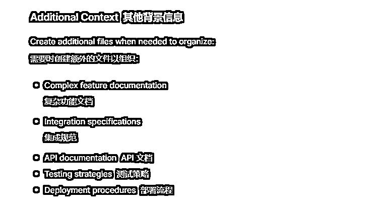

你回头看我们的提示词，里面本来就说了可以创建额外文件来组织 memory bank。而且我实践下来发现，这类“任务专属”的上下文文件价值非常高。

新会话一开启，直接把那份小范围文档丢给 cursor 就行，该有的背景信息它全都有，但上下文窗口完全不会瞬间爆掉。

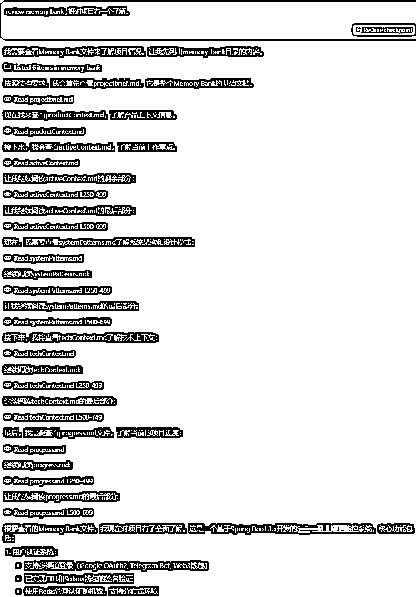

来个实战演示。第一步，我让 cursor 先翻开 memory bank，把项目整体过了一遍。

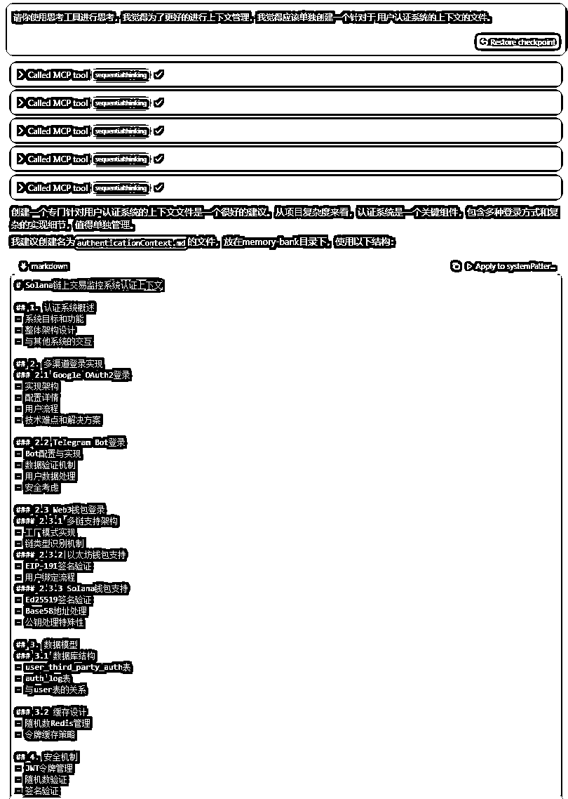

它给我列出了当前项目的主干功能点，我们就顺着这些点去拆分。我特意让 cursor 先思考清楚再动手拆，结果这一轮它光思考了，压根没拆。没办法，我只能再补一句指令，让它正式开始拆分。

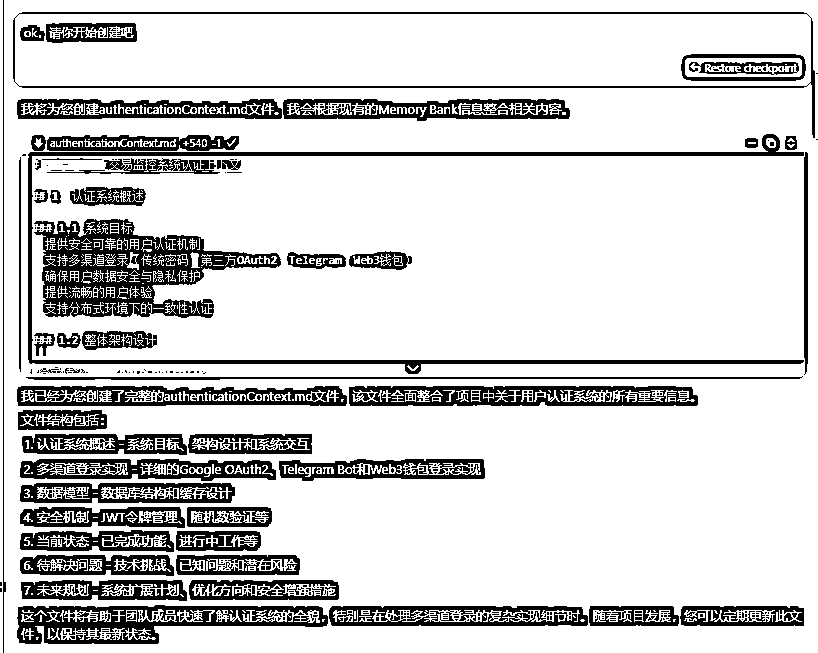

看看它拆出来的文件，说实话内容挺完整的，覆盖率比我预期的高。

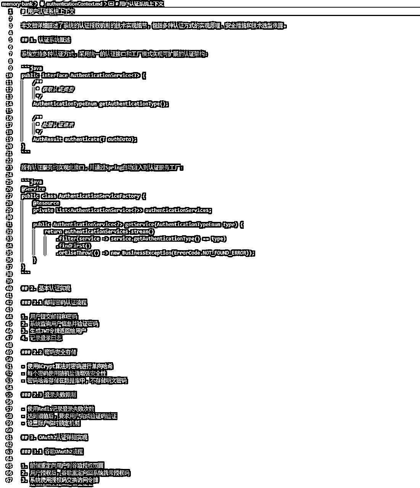

但光拆可不够，原始的记忆库还得跟着更新。不然新文件有了，旧的一大坨还堆在原地，等于白费功夫。所以接下来，我又让 cursor 去刷新记忆库的原始文件。

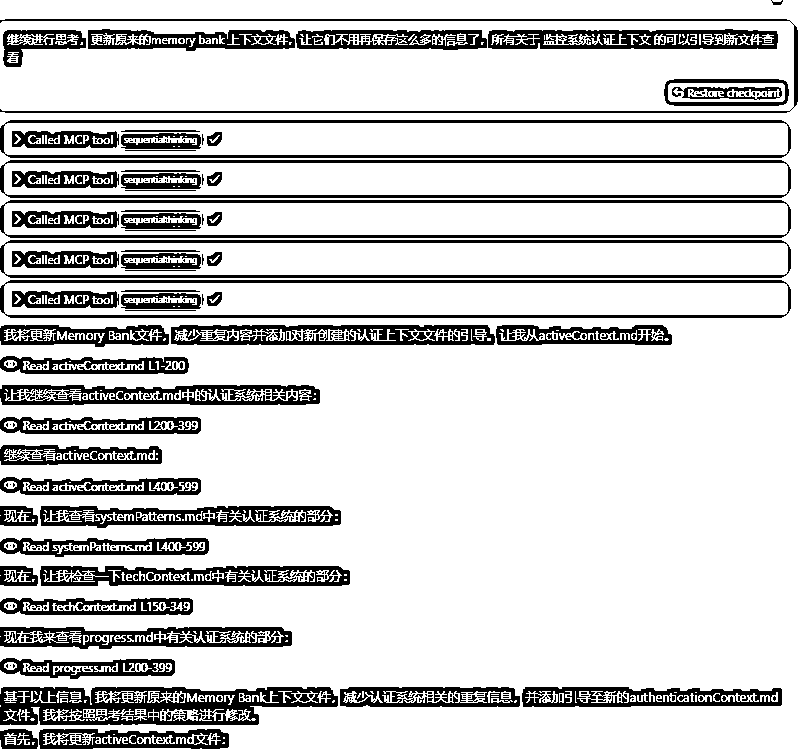

刷新完以后，记忆库原始文件瘦身得相当明显。拿 systemPatterns 来说，本来一千多行的大块头，现在只剩 257 行了。

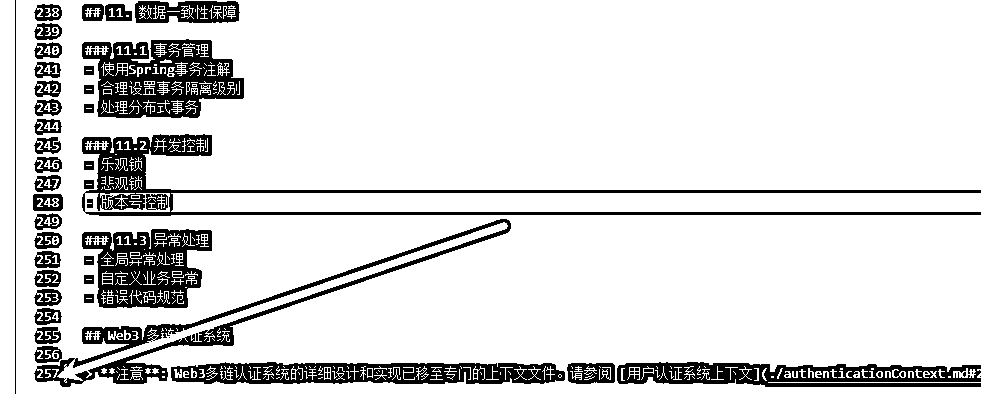

以后我要是再继续开发登录认证相关的功能，直接让 cursor 查看这个文件就行。不过现在的 AI 已经这么聪明了，哪怕我只说一句“继续开发登录认证功能”，cursor 大概率也会自己找到对应的上下文文件。

希望这段经验能给你带来一点启发。也想知道：你平时都是怎么管理上下文窗口的？欢迎交流。