# 线下同城发售实战复盘：从销售新人到10天进账近2万，我做对了什么？

> 来源：[https://iq64gi1kezp.feishu.cn/docx/AZ8FdRJHuoE22Hxwvw7cvl5WnAb](https://iq64gi1kezp.feishu.cn/docx/AZ8FdRJHuoE22Hxwvw7cvl5WnAb)

大家好，我是天豪。

过去五年，我一直在市场一线做商务，接触过房地产、本地流量服务等不同领域，也拿过一些销冠成绩。

销售这份工作并不轻松。陌生拜访、反复沟通、处理拒绝，都是日常。但当你通过一次交流准确判断出对方真正需要什么，再把合作推进下来，那种成就感很难被替代。

我能在这条路上坚持下来，核心原因很简单：我确实喜欢做业务。热点会变化，项目会更替，但真正能长期支撑一个人的，往往不是追风口的兴奋感，而是对一件事持续打磨的兴趣。

如果你想从没有商务基础开始，训练自己成为能够独立谈客户、拿结果的BD，那么「同城发售」提供了一套非常适合实战入门的路径。

此前，我长期接触实体商家，看到很多老板都有明确的获客焦虑。读完孙策老师、大林老师及其他前辈关于同城发售的分享后，我决定报名去年10月的线下实体发售航海。到目前为止，我已经在这个项目中连续实践了4个月。

目前，我的日均成交量大约为2—3单，最高纪录是单日8单。今年春节后重新开工，10天时间里，个人收益接近2万元。

接下来，我会从四个方面展开：

1. 这个项目具体做什么，以及它的市场空间  
2. 我的业绩结果与实操心得  
3. 之后的职业规划  
4. 选择航海项目时，如何判断与避雷  

# 一、同城发售到底做什么？未来空间在哪里？

## 从加入项目到真正上手，日常工作是什么？

目前项目中主要有商务、交付、团队长、销转等不同分工。我自己的路径，是先从一线商务做起，之后逐步转到销转岗位。

新成员进入后，第一步并不是立刻去推销，而是先建立对行业、市场和服务方案的整体认识。

如果把线下航海比作一场团队游戏，那么每个人都有自己的位置：有人负责寻找和沟通客户，有人负责后端交付，有人负责组织团队，有人负责电话转化。大家分工协作，共同完成一场从获客到成交再到交付的完整闭环。

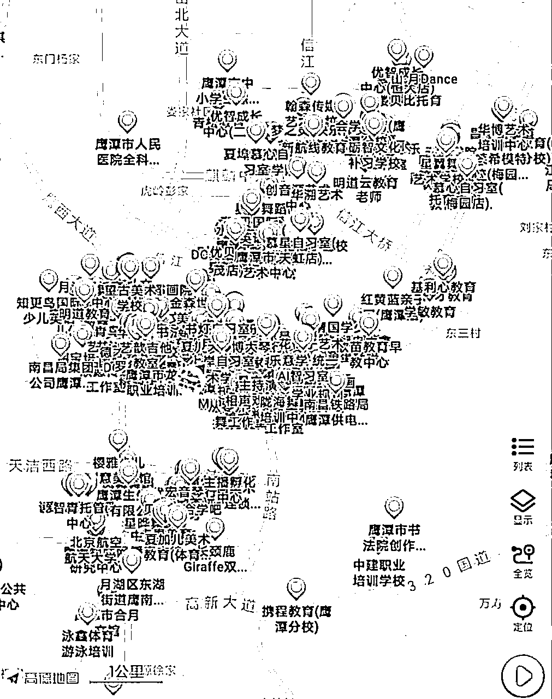

我加入这一期航海时，通知是前一晚收到的，第二天早上就办完离职手续，随后订下了从广东出发的高铁票。

决定之后迅速行动，不给自己留下反复犹豫的空间，这是我当时的状态。

每个落地城市都会配备团队长和助教，完全没有经验也不用独自摸索。前期课程会帮助大家补齐行业知识、产品信息和基本沟通方法。

到了当地，先处理两个生活问题：住处和出行工具。

一般会由团队负责人综合预算，并结合成员意见统一安排。

生活安排妥当，正式工作便开始了。以商务岗位为例，我把每天的动作归纳为：

- 寻找目标机构  
- 预约负责人  
- 线下面谈  
- 推进签约  
- 复盘改进  

当前主要服务的是教培、艺培机构。由于不少机构周一休息，周二至周五通常下午甚至晚上才集中授课，所以白天需要根据地图和门店信息进行排查。

如果机构尚未营业，就先通过电话预约；如果现场有人，则争取直接找到负责人沟通。动作本身并不复杂，但怎样提高有效触达率、准确找到决策人，需要在实践中不断总结。

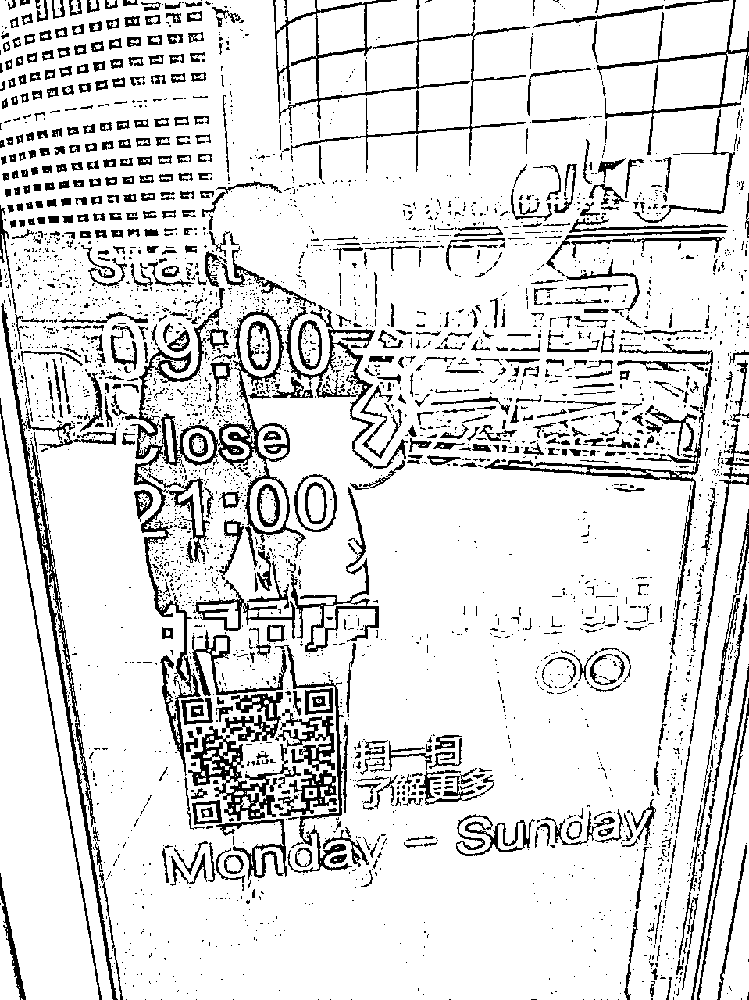

能够和真正的负责人建立会谈，通常意味着已经完成了重要的一步。对方愿意抽时间了解，说明需求和兴趣至少存在一部分。后续能否成交，取决于我们是否能把方案讲清楚、把问题问出来，再给出匹配的解决方式。

有些客户当天不会签约，也不代表没有机会。只要对方的需求明确，就应该记录下来，后续持续跟进。

初次谈客户时紧张、表达不顺都很正常。助教和团队长会陪着大家完成前几次实战。跟随带教见客户时，建议全程录音，回去后反复整理。

有价值的录音，不一定是老师单方面讲得精彩，而是客户提出尖锐问题后，带教如何拆解、回应并推进。这样的内容更值得重复学习。

此外，也可以把录音交给【通义听悟】，借助AI提取沟通结构和重点，帮助自己逐渐形成清晰的谈单框架。

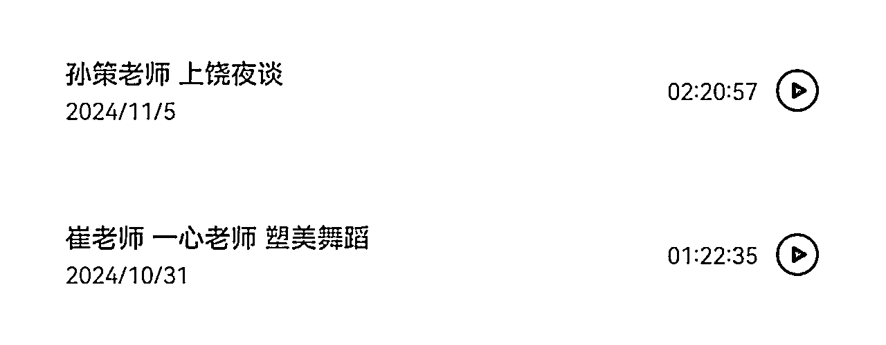

如果顺利签约，后端会有交付老师继续完成服务落地。但前端从需求确认、方案表达，到客户预期管理，每一个环节都不能粗糙。

整体来看，这项工作会同时训练沟通、判断、表达、执行、复盘等多方面能力。

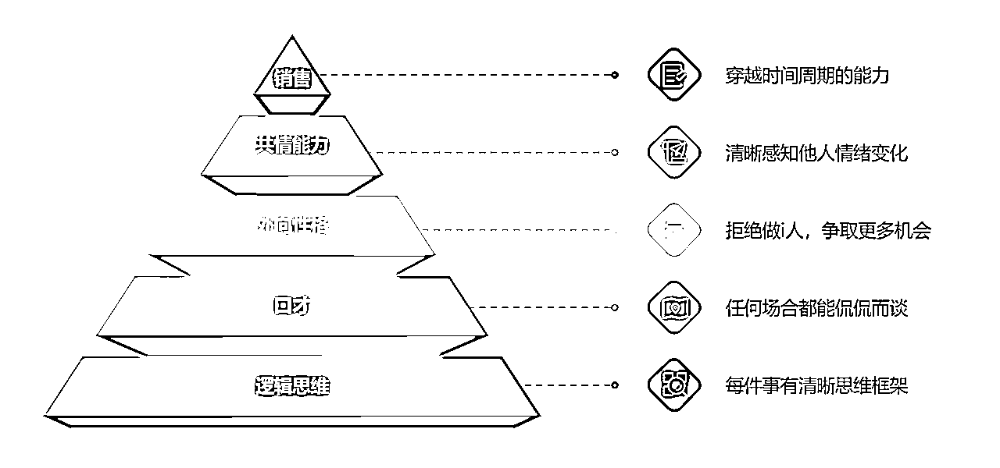

## 从线下面谈到电话销转

随着项目的服务模式和获客方式不断更新，今年年初，我从广东来到山东泰安，开始接触销转岗位。

公司通过抖音巨量广告获取机构线索，我们负责尽快联系客户，并在较短的电话沟通中，了解对方现状、梳理需求、介绍方案，通常在1—2次通话内推动成交。

电话沟通看似省去了路上奔波和面对面交流，实际上对逻辑组织能力要求更高。客户可能从任何角度提问，但只要底层思路清楚，就能迅速判断问题指向，并找到背后的真实顾虑。

## 现在进入，还算晚吗？

有句话说，种树最好的时间是很久以前，其次便是当下。

正式加入同城发售前，我曾在本地流量公司工作，通过探店视频为商家做曝光。期间接触过美业、瑜伽、口腔、眼科、餐饮等多种业态。

这些经历让我看到，许多实体老板确实希望借助线上内容获得客流，但他们熟悉的是自己的专业领域，并不擅长新媒体获客。过去的服务往往只承诺曝光，不对实际转化负责，而单条内容的收费却不低，这让我始终觉得服务链条并不完整。

后来了解同城发售的模式后，我认为它更接近实体商家真正需要的结果：不仅帮助机构获得关注，还要围绕招生、成交和后续服务搭建完整方案。

判断一个项目能否长期发展，最终还是要回到市场需求。

现阶段，同城发售仍处于不断扩张的阶段，当前重点服务的是教培行业的线下招生。结合不同地区的成交反馈、客户需求和竞争情况，只要教培行业仍然存在，招生服务就仍有较长的实践周期，保守估计至少还有三年空间。

与此同时，项目已经在尝试进入瑜伽形体、托育水育、口腔等行业。未来覆盖的领域不会局限在教培，实体商业中存在获客需求的行业，都可能成为服务对象。

项目内部也在持续更新，从商务支持到交付协同，流程越来越成熟。对于个人来说，除了收益机会，更重要的是能沉淀一套可迁移的能力：

- 商务沟通  
- 方案表达  
- 客户判断  
- 电话转化  
- 团队协作  
- 项目管理  

在项目中继续发展，既可以走商务，也可以选择交付、销转、团队管理，甚至成为区域合伙人。

# 二、我的结果与实战心得

## 业绩结果

### 一线商务阶段

商务期间，我先后在江西、湖北两个省份进行市场实践。

由于个人安排，我抵达上饶时已经比团队晚了一周，最终在那里完成了5单。之后转到湖北宜昌和荆门，两个城市的订单量都超过了十单。

以江西市场的12单做一个简单测算：

假设每家机构售出30份199元课包，每份课包的收益按100元计算，那么：

12 × 30 × 100 = 36000元

如果商务阶段按30%计算，个人对应收益为：

36000 × 30% = 10800元

如果是合作成交，则再按照具体比例进行分配。需要说明的是，这只是新人阶段、只承担商务工作的收入测算。

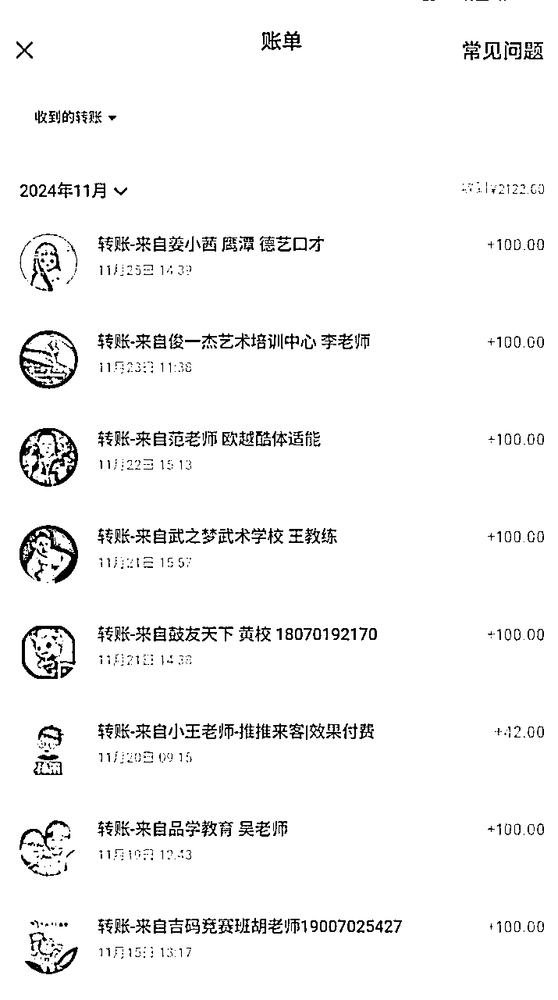

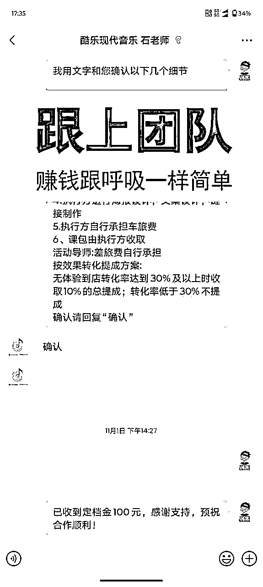

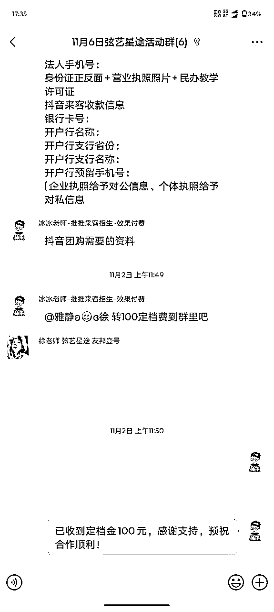

### 电话销转阶段

2月9日到达泰安后，我开始每天处理不同机构的线索。

10天内，我完成了25家机构的成交，平均每天约2—3家，累计个人收益接近2万元。

销售并不是固定天赋，而是可以通过重复训练持续增强的技能。与同一行业的客户交流越多，遇到的问题越丰富，自己的回应速度和表达方式就越成熟，成交概率也会随之提高。

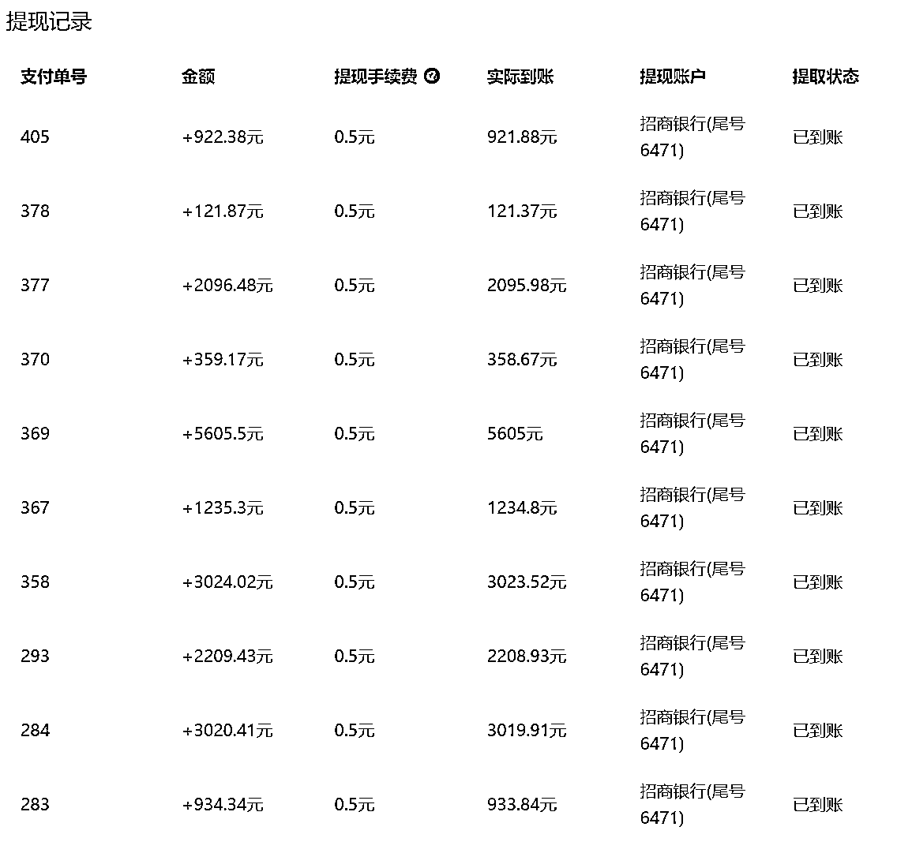

## 除了收入，我还收获了什么？

### 1. 心态发生了变化

我原本在东莞工作，家在广州，毕业后一直处于企业职场环境中。放弃相对稳定的工作，投入一个陌生项目，对我来说确实需要勇气。

一方面，赚钱社群让我接触到很多主动行动的人；另一方面，骨子里那种不愿安于现状的劲头，加上女朋友的支持，让我最终决定出发。

真正做出选择后，很多事情反而变得简单：既然已经上路，就只能继续行动。而且这条路是自己感兴趣、也认为有发展空间的方向。

我至今记得抵达上饶后的第三天，第一次独自出去陌生拜访。第一家机构叫童创未来，一楼没有人，我一路走到二楼，看到正在安装窗帘的校长后才鼓起勇气开口，回头看确实有点像误入现场。

第一次介绍方案时，我的开场、动作和语气都很僵硬，手里的打印材料也没能帮助我把重点讲清楚，想表达的价值卡在嘴边，半天组织不好。

但经过持续实战之后，现在的我在谈话气势、沟通节拍、方案说明和异议处理方面，都有了明显提升。

害怕并不会因为等待自动消失，真正有效的办法，是用足够多的行动把陌生感磨掉。

### 2. 沟通与观察能力被重新训练

在项目中，只要愿意主动开口，表达能力、气场、情绪控制和观察细节的能力都会得到锻炼。

每次沟通时，不仅要把自己的观点说清楚，还要注意客户的语气、停顿、表情和反应，从这些细节判断对方的兴趣程度与真实顾虑。

### 3. 认识了许多同行伙伴

线下实战期间，我结识了不少优秀伙伴，包括一起合作成交的冰冰老师、带教大林老师、负责交付的芦老师，以及总是用“干就完了！”鼓励大家的车车老师和小王老师。

每位伙伴都有自己的长处，也让我看到不同的做事方式。

## 我的几条实操经验

### 经验一：先弄懂产品，再研究客户

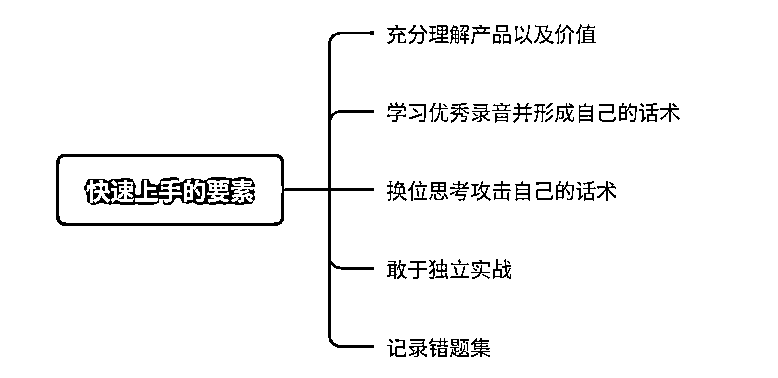

真正有效的话术，不是把一段文字背熟，而是知道产品服务哪类客户、能够创造什么价值、具体解决哪种问题。

刚加入时，我花时间把产品结构、服务流程和方案价值重新整理了一遍。只有把这些内容真正理解，后续表达才会自然。否则即使背下了整套话术，也很难应对现场变化。

话术本身也需要持续更新。可以先预判客户可能提出的问题，再和助教进行模拟；更直接的方式，是尽快进入真实沟通，用市场反馈校正自己的表达。

每一次谈单都像一次考试。遇到没答好的问题，不要回避，而是记录下来，及时补足。问题积累得越多，表达就越稳。

### 经验二：用足够多的行动换取概率

销售本质上是一个概率模型。

优秀销售之所以成绩稳定，并不只是因为天赋更强，而是他们接触了更多客户，遇到过更多场景，也因此拥有更丰富的应对经验。

所以，结果往往来自有效投入的累积。想在航海中取得成绩，就不能只停留在听课和讨论层面。

我们每天早上8:30开会，会议结束后规划拜访路线，很多时候回到住处已经是晚上八九点。

### 经验三：站到客户立场，主动拆除顾虑

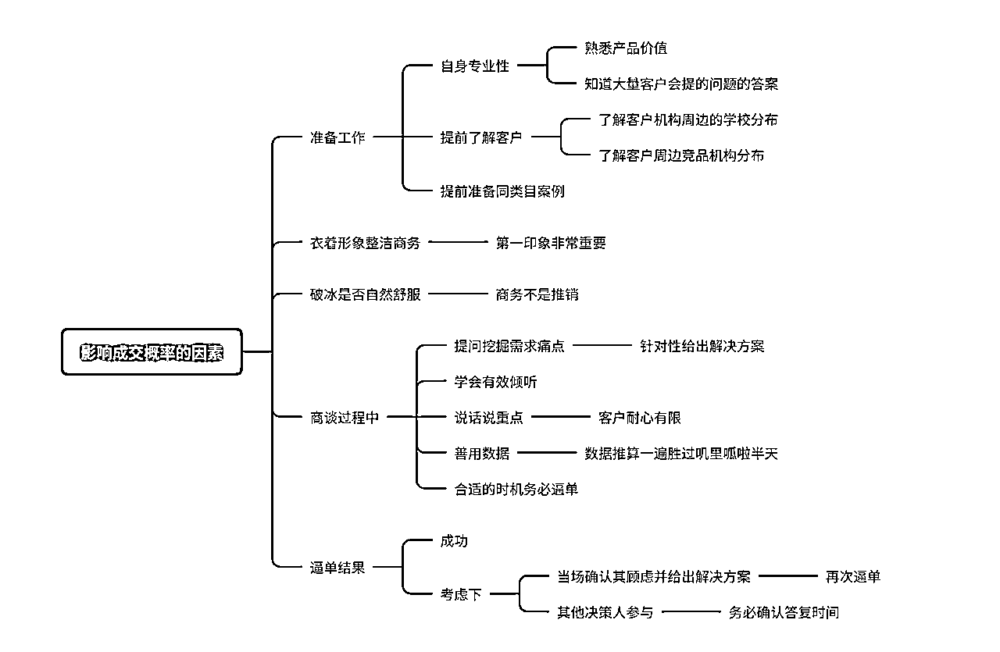

能够见到机构负责人，本身就是一次难得的沟通机会。有限的时间里，要尽量让对方听明白我们能提供什么，以及这件事为什么值得做。

客户说“回去考虑一下”时，不要马上结束对话。可以礼貌追问：目前主要还在顾虑哪一部分？是预算、效果、时间，还是执行方式？

即使当天没有签约，只要能把问题问清楚，并帮助客户进一步厘清判断标准，后续合作也会更顺畅。

成交之前，实际上一直在做同一件事：降低客户心里的不确定性。

### 经验四：主动帮助伙伴，自己也会进步

我很认同一句话：

不要只等别人照亮自己，也要学着成为能够照亮别人的人。

线下项目里，大家会遇到各种临场问题。车车老师常说“干就完了！”，这句话真正的价值，不在于口号本身，而在于遇到困难时还能不能保持行动。

我之所以能在短时间里提升独立谈单和成交能力，也和帮助队友一起沟通、共同复盘有很大关系。

帮助别人梳理问题时，你会被迫把自己的思路讲清楚；而这个过程，往往也是一次更深的自我训练。

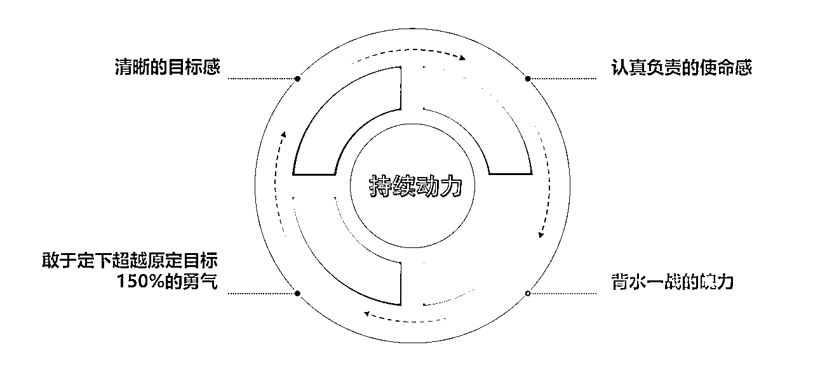

我还记得木易老师那篇《绑着炸弹做淘宝，负债百万的逆袭之路》。很多时候，一个人的潜力并不是一开始就能看见的，惰性和恐惧反而会不断替我们预设失败。

不要反复问自己：“如果最后没做成怎么办？”

可以把问题换成：“这个月怎样完成20单？”

目标明确后，行动会变得具体：今天要联系多少家、约见多少人、复盘哪些问题。即使最终没有完全达到目标，结果通常也会比一直观望更好。

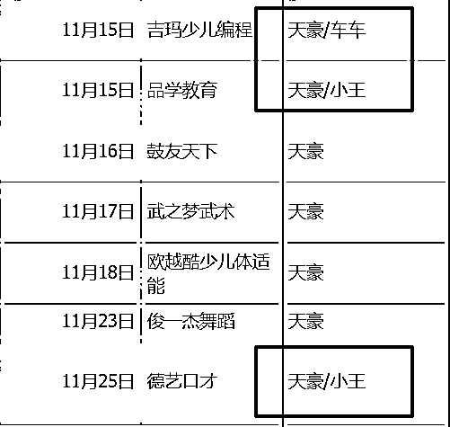

# 三、下一阶段，我准备怎么走？

目前项目内部大致有前端商务、后端交付、销转、团队长和区域合伙人等发展方向。

我已经参与过商务与销转两类工作。接下来，一方面继续提高自己的商务谈单能力，另一方面帮助更多想做好商务的伙伴；同时，把销转过程中的经验沉淀成更清晰的流程和SOP。

只有同时理解前端获客、客户转化与后端交付，才能真正具备设计完整方案的能力。

对我来说，从一线商务逐步走向团队管理，再到区域合伙人，是接下来持续升级的路线。

# 四、面对众多航海项目，如何做选择？

现在可选择的航海越来越多，面对不同方向，很容易陷入不断比较、不断报名的循环。

我自己就走过这段弯路。

过去参加过视频号口播带货、Web3、同城发售，也在赚钱之外付费学习过小红书IP训练。回头看，项目本身并没有错，真正的问题在于，我总是希望通过追逐下一个热点快速获得结果。

每个方向都尝试一点，却没有任何一个持续投入。像是在不同地方反复挖坑，坑很多，但没有一处挖得足够深。最后消耗了大量时间，真正能留下的成果却很有限。

所以，航海更像是帮助你完成从0到1，而不是承诺一夜之间改变收入。

课程、教练和团队能提供起步条件，但从1到10、再到100，依靠的是个人选择后的长期执行。选定方向后，要给它足够时间，持续验证、修正和放大。

当然，也有人会因为给项目设置了太多筛选条件，导致任何方向都觉得不合适。如果你正处于这种状态，可以看看刘小排老师的文章《为什么你进了「龙哥盟」，还是赚不到钱?》，或许会得到一些启发。

# 写在最后

感谢龙哥盟，感谢孙策老师，让我有机会在线下实战中重新确认自己的方向。

这是我第一次在赚钱发帖，也特别感谢@梁靠谱 老师和@大林老师在内容表达上的指导。靠谱老师温暖又认真，大林老师专业能力很强。

希望每位圈友都能找到适合自己的项目，愿大家在2025年持续行动、持续拿到结果！