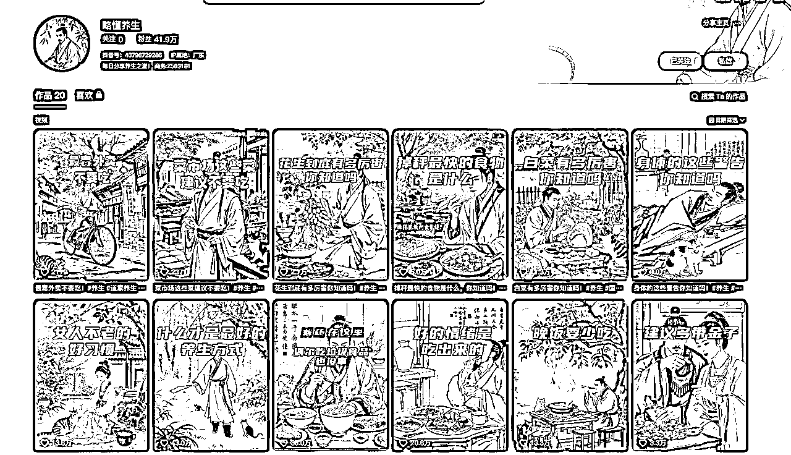
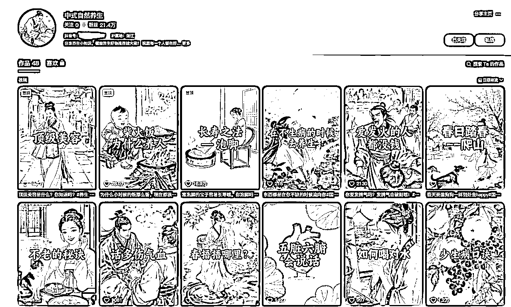
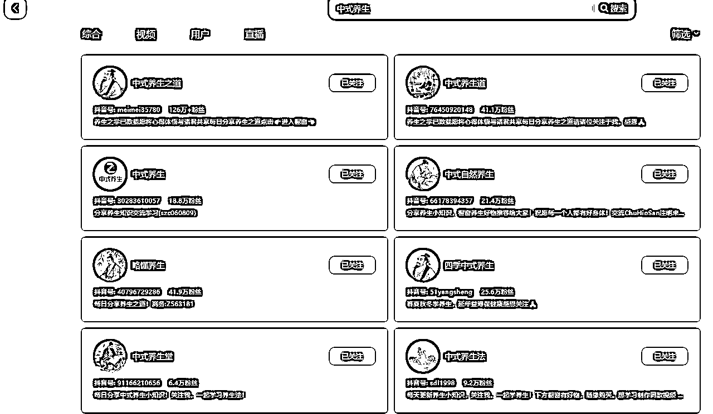
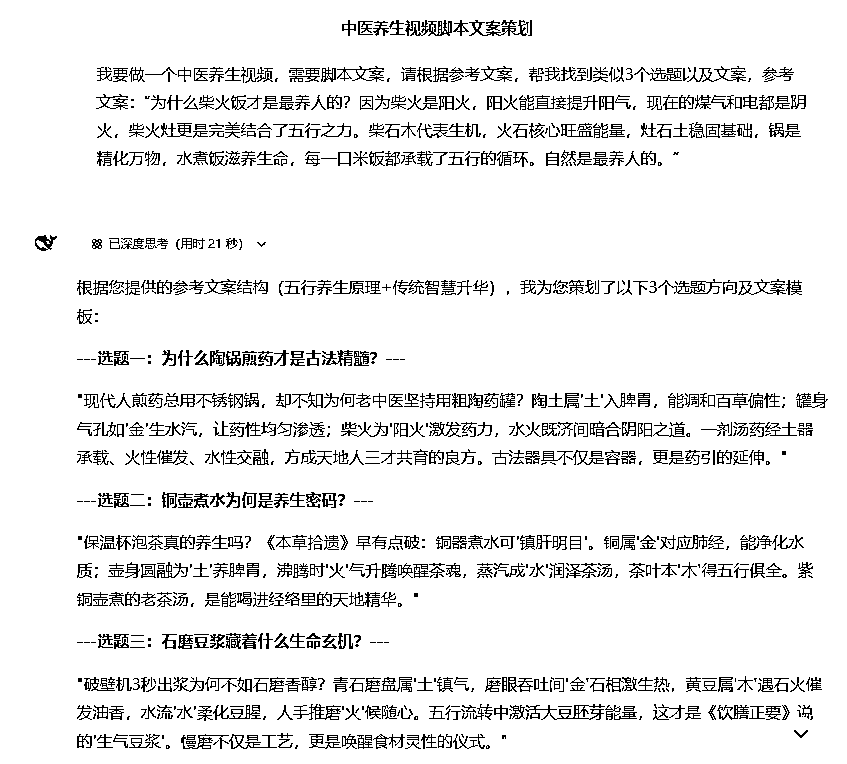
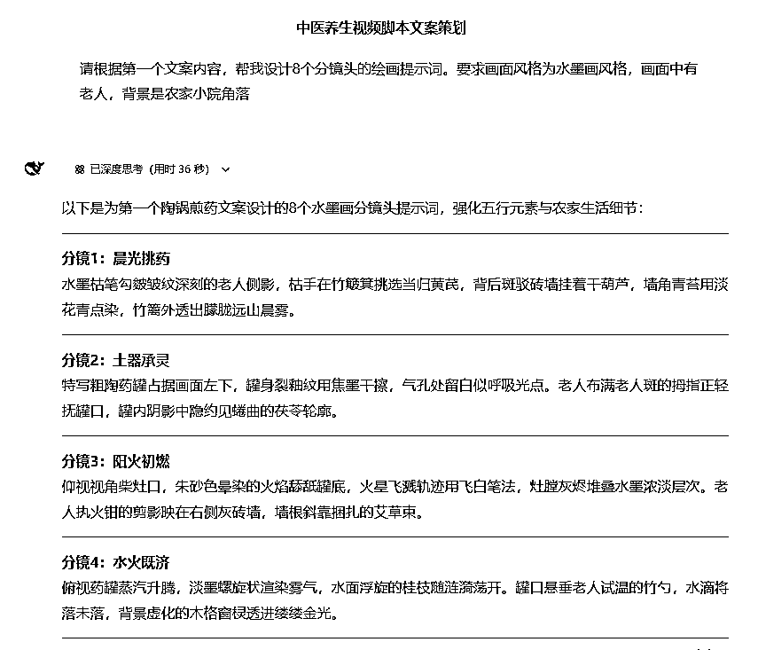
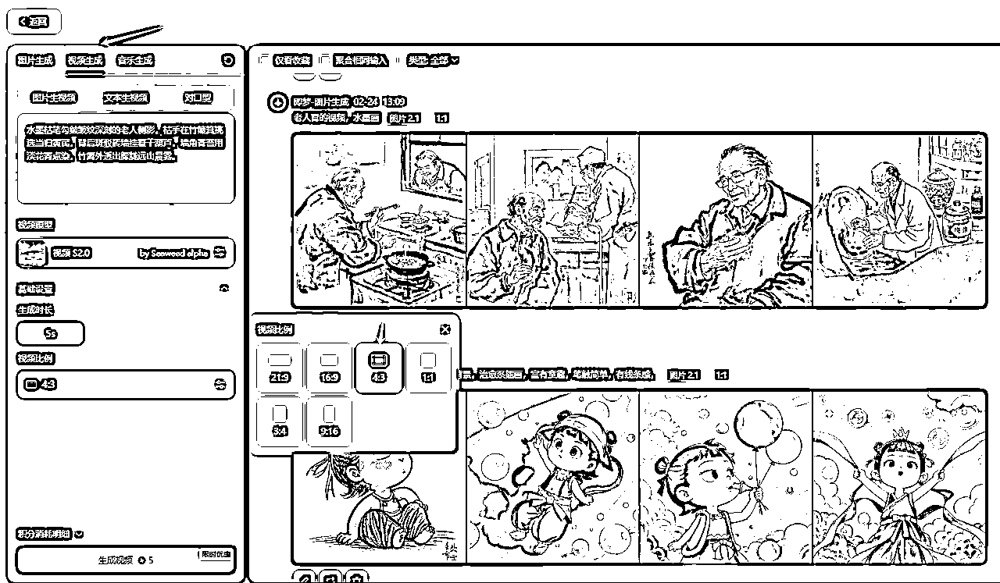
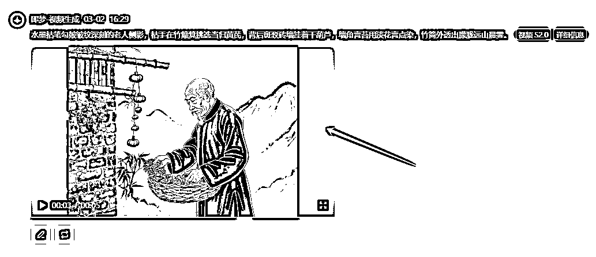
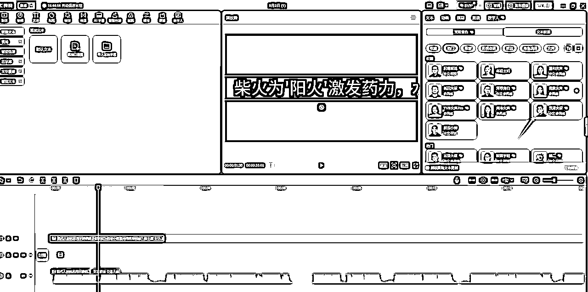

# Deepseek撬动养生赛道起号全流程拆解

> 来源：[https://dmrbcelpjz.feishu.cn/docx/QTSydX29coPz8IxBj8zcyuyynAf](https://dmrbcelpjz.feishu.cn/docx/QTSydX29coPz8IxBj8zcyuyynAf)

大家好，我是Longer，专注龙哥盟 RPA 教学。

今天拆解一波近期涨粉极快的养生垂类玩法。

有个账号叫「略懂养生」，完全靠 AI 产出，目前只发了 20 条内容，粉丝已经突破 41.9 万。

# 实操四步走，AI 全流程自动化

## 第一步 让 Deepseek 批量产出脚本

直接打开 Deepseek 官网：https://chat.deepseek.com/

把下面这段话丢进去，让它模仿风格出选题+文案：

我要做一个中医养生的短视频，需要脚本文案，请参照参考文案的风格，帮我创作 3 个同类型选题及对应文案，参考文案：“为什么柴火饭才是最养人的？因为柴火是阳火，阳火能直接提升阳气，现在的煤气和电都是阴火，柴火灶更是完美结合了五行之力。柴石木代表生机，火石核心旺盛能量，灶石土稳固基础，锅是精化万物，水煮饭滋养生命，每一口米饭都承载了五行的循环。自然是最养人的。”

## 第二步 让 Deepseek 输出分镜与画面描述词

把刚得到的脚本喂回去，让模型拆成分镜，并给出每镜头的画面关键词提示词。

## 第三步 用即梦批量生成视频画面

把提示词复制到即梦进行画面生成。

单张镜头生成的参考效果出来后，余下镜头照此流程批量生成即可。

## 第四步 剪映一键成片

### 1. 配音
把生成的文案粘进剪映文本朗读里，建议选偏中老年、沉稳的大叔音。

### 2. 上字幕
用剪映的识别字幕功能自动生成字幕。

### 3. 调字体
挑选风格搭调的字体，字号适当放大，保证清晰易读。

### 4. 加背景音
根据内容调性选一段轻柔的背景音乐，音量调低不抢戏。

### 5. 导出发布
编辑完成后导出，一条养生向短视频就成型了。

# 账号变现路径

1、带货变现
挂健康相关商品，比如维生素片、黄芪、枸杞、养生茶等。

2、广告合作
开通星图接单，或等品牌方私信加单，按条结算。

3、账号出售
粉丝做上 10 万+后，整体打包出售。

4、导流获粉
把粉丝导到后端私域，由对方结算导流费用。

5、收徒教学
简介挂上收徒微信，吸引同行付费学习。