# 5天全流程复盘，关于京东外卖项目的「指南/避坑」

> 来源：[https://ox9k4rncex0.feishu.cn/docx/RUFidx1nNoGyZBxMIorctj56nRd](https://ox9k4rncex0.feishu.cn/docx/RUFidx1nNoGyZBxMIorctj56nRd)

# 前言

大家好，我是彻易Heawcyrt。

2004年生人，全网累计粉丝过万，大学二年级时实现经济独立，目前以自由职业做副业变现为主，欢迎志同道合的朋友交流。

初次注意到这个机会，是在2月12日晚，一位朋友圈里的老板发的状态：“京东要做外卖了，认识服务商吗，想合作”。当时只是随口感叹，美团饿了么的垄断终于有人要挑战了，并没有当回事。回头想想，当时没立刻嗅到商机，多半是因为看到“服务商”三个字，本能觉得这是机构玩家的事，个人掺和不进。

直到一周后的2月18日下午，有人刷到京东外卖的拉新动态，说在任推邦就能接单，地推一家给170。傍晚又看到各类资讯号夸张宣传“日入过千”，赚钱群里还有人晒出进账1万的截图。

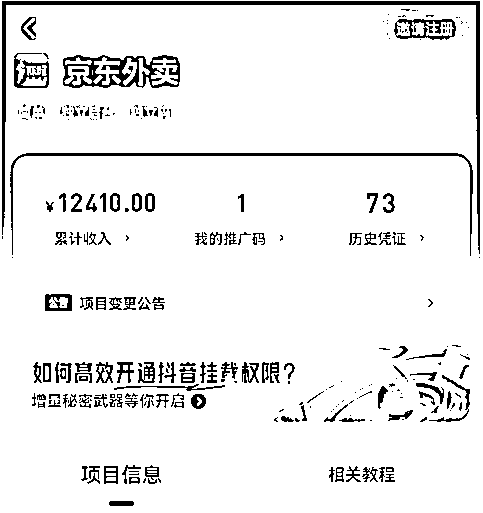

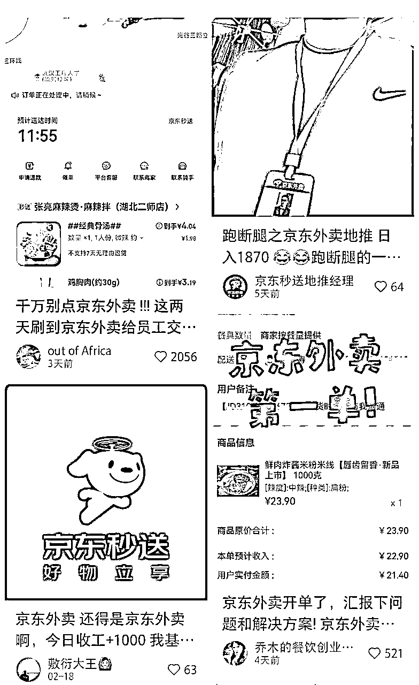

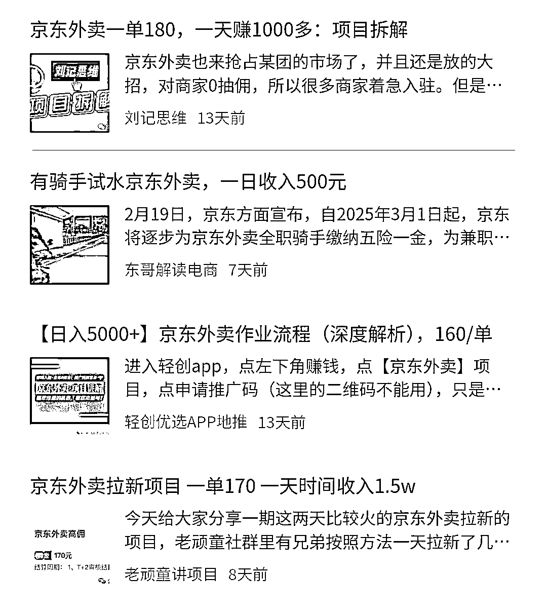

于是我决定试水。第一是之前没做过线下地推，想锻炼跟各色人群沟通、现场开口谈合作的临场力；第二是平台刚起步，入驻零成本零抽成，多添一个渠道，商家基本没有拒绝的理由。

# 一. 出街前的准备

1. 制服与证件牌
2. 一本给商家的简明流程手册/电子版
3. 巡店路线表
4. 先线上预热商家

## 1. 制服与证件牌

在拼多多或淘宝上下单，一套下来约20元左右，价格更低的10元也有。是否必须？必须，原因有三。

* 穿在身上自带身份感，胸口的“京东外卖”标识让店老板第一眼就觉得正式、可信；
* 这相当于移动的宣传物料，有些老板正愁怎么入驻，看到你上门会主动招手。我的5天里几乎每天都会被马路上的人喊住；
* 有位店主原话：“今天来了七八拨年轻人推入驻，我都不太搭理，感觉你最像专业的，还有衣服牌子。”

一个同行分享的小技巧：外形偏成熟、没有学生气的话，可以只戴证件牌不穿制服。因为穿制服戴牌的通常是基层员工，只挂牌的更像片区负责人。

## 2. 一份通俗易懂的SOP手册/打印件

地推前我为商家定制了一份入驻指引：

👉

上门时，老板有意向就用平板演示。纸质版容易受雨水、手汗、折皱、遗失影响复用率，所以更建议做成电子版。

## 3. 探店规划表

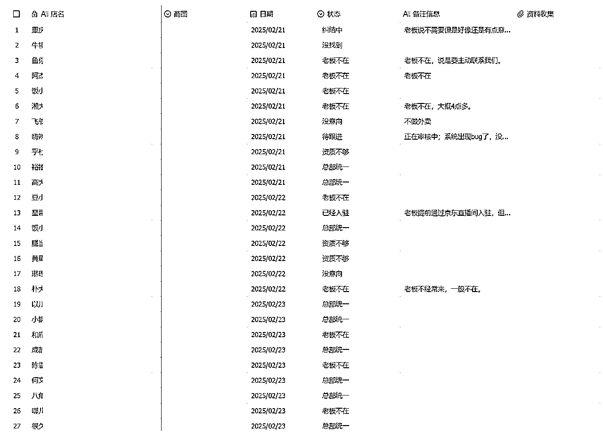

以商圈为单位，先在大众点评里筛出商圈内的门店，列出拜访顺序并做记录，出发前核对，避免漏掉。

## 4. 提前线上找一些店家试水

这个建议是我爱人给的，效果超出预期。

线上先跟商家聊，可以摸清他们的关注点和顾虑，线下被问到也能从容应对，否则现场答不上来会直接掉信任。我在等制服快递的前一天就在家线上私聊，操作思路：

1. 在大众点评/美团找有实体店且已做外卖的商家，符合京东外卖准入条件；
2. 找到美团/饿了么店铺页，通常可以私信商家，直接索要微信，大多会给；
3. 若对方问意图，先说要点单，再加好友；
4. 平台一般能查到商家电话，复制加微信，基本都是店铺官方号，不是老板私人号；
5. 加上后直说在推广新平台帮他们增收，或直接表明负责京东外卖入驻；
6. 不给的就放弃，总有愿意的。实测饿了么商家回复率和微信通过率更高。

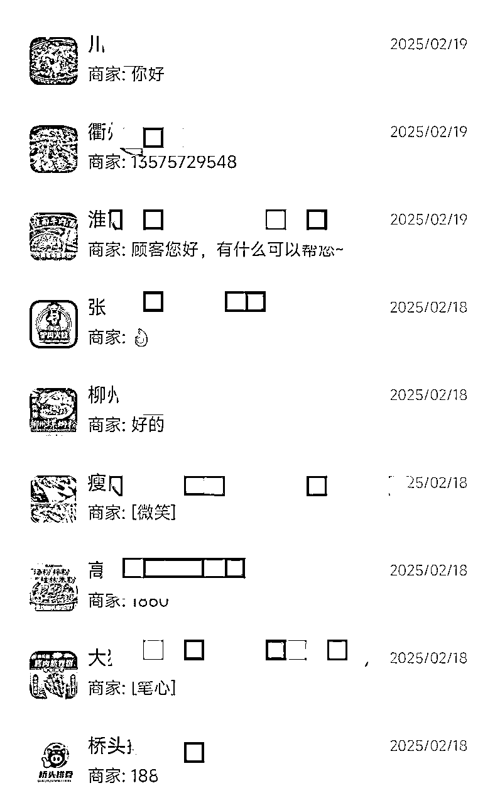

加到微信后直接开聊，具体话术见后文。

线上意愿强可以直接远程协助入驻或约定线下指导；线上没反应也不算死，可以保留为线下目标，因为微信上很多老板会因不信任而沉默。

# 二. 时间和店铺的选择

## 1. 合适的时间

最推荐工作日下午。上午多数商家10点才开门，一开门就忙午市，沟通时间紧张。我通常13:30出发，17:00前收工。

额外提醒：雨天别偷懒。雨天店里客流少，环境安静，更适合坐下来慢慢聊。

## 2. 合适的店铺类型

1. 热门连锁品牌别去❌，肯德基、麦当劳、袁记云饺这类基本由总部统一谈判；
2. 购物中心店铺尽量避开❌。杭州的样本是，商场店老板多为隐形大股东或听总部/商场安排，现场找不到决策人。有些店面不起眼也是连锁；
3. 独立个体户是主攻对象✔。去商圈是为周边街区的个体店，而不是商场内部。

# 三. 心态与沟通建议

## 1. 核心心态：我是来提供帮助的

第一次上门我非常紧张，上次做类似工作是三年前，开口都费劲。所以一定要给自己心理暗示：我是来帮商家的，帮他们开拓新收入。

抱着这个心态，语气更有底气。而且是免费服务、不收任何费用，底气更足。拒绝很常见，我第一家就被拒了，老板说外卖水很深，做好堂食就行。我没有硬拗，介绍了京东外卖的优势，对方仍拒绝，我便表示理解祝好。没走几步，对方把我叫回，领我去隔壁几家店，让其他店主扫我微信，说他自己不做但邻居可能需要。

如果当时一听拒绝就掉头走，就不会有后面的“露天小会”了。所以保持礼貌、客气、有韧性，别轻易放弃。

## 2. 话术建议：利他、显专业

### 开场
“老板您好，我是京东外卖的，最近在帮附近商户办理入驻，看您家评分和销量都不错，想请教下是否了解这个新平台？”
强调“帮周边商户”而非“帮你”。说帮你会让人觉得天上掉馅饼，说帮别人会产生从众焦虑。

### 对方表示好奇
“现在美团饿了么抽成一般在20%左右吧[停顿]。京东现在起步，5月1日前入驻的商户抽成0，后续一年内保持5%。”
停顿很重要。实际抽成25%-30%，故意报低点引对方纠正。当他说“哪有20%，都30%了”时，再顺势对比京东的0抽和5%承诺，冲击感更强。

### 对方说了解过
“明白了，我这边就是负责周边商户入驻的，免费不收费，只需要提供相关证件，我给您演示一下。”递平板，强化专业感。

### 对方担心客流
“您看，入驻不花钱。现在京东外卖商家还在积累阶段，奶茶店居多。我们现在重在聚商家，等商家量上来后会推出一波用户补贴活动，年轻人会逐渐使用。京东的品牌背书也摆在这里，趁周边入驻的店还少，先占位，后面就有先发优势。”
突出平台品牌力。有人会追问优惠是否由商家承担，可以回应：“美团饿了么的优惠商家承担比例更高，我昨天听商家说美团10元券商家自付9元。京东对券的补贴比例更高，主打品质外卖，不做低价走量。”追问具体数字就说按城市消费水平动态调整。

### 完全没兴趣
“好的，那加个微信吧，后续平台做起来您有想法再联系我。打扰了，祝生意兴隆。”

### 已入驻
“好的，请问是通过什么渠道入驻的？使用体验如何？遇到过什么问题？”为后续服务积累素材。

### 老板不在
“您好，我是京东外卖的，帮周边商户办理入驻，请问老板一般什么时间在店？”或“方便要一下老板的微信吗？”很多老板不常驻店，尤其是淡季。先拿时间、留联系方式，后续跟进。

# 四. 协助商户入驻

跑了60多家后的体会是：必须全程协助。让商家自己操作错误率高，京东审核极严，证件模糊、反光、边角缺失都会被拒，还有不少系统bug。之前帮一家店，花了1小时多排错并打电话找人工复审。建议线下陪同操作，必要时多试几次。

具体步骤👉：

# 五. 常见问题 Q & A

## Q1. 零佣金，配送费怎么算？
3公里内约3元，超出部分按城市浮动。

## Q2. 能沿用美团饿了么的打印机吗？
不能，需另购京东指定打印机。

## Q3. 经营者和法人不一致怎么办？
京东要求上传资料时，姓名、地址等信息需保持一致，无法不一致。

## Q4. 资料看起来没问题却提示错误？
逐项复查：
* 编号是否正确
* 图片是否清晰
* 照片方向是否正确
* 优先用大众点评评分；若用美团评分，需用美团美食评分，非外卖评分
* 评分需截图，不可拍照
* 证件不可缺角、反光
* 关闭AI美颜
仍不行可间隔一天再试，亲测有效。

## Q5. 什么时候能结算？
规则常变。任推邦用户请每日查看规则详情，其他渠道也需确认。

## Q6. 商家订单何时可提现？
到账商家端约3天，提现到账T+1。

## Q7. 支持校园众包配送吗？
因地而异，初期多数地区不支持。

## Q8. 一张营业执照能否开多店？
不可以，京东外卖一照一店，禁止虚拟店铺。

遇到无法解答的问题，保持底气硬着头皮回应，或说平台刚上线功能不完善，加微信晚上反馈总部。必要时可致电400-002-0020咨询京东秒送客服。

# 六. 最后：我不建议个人单独做这个项目❌

我连续做了5天，每天13:30-17:00，平均每天完成一单。但第5天后停止了，因为第一天签的那单至今未通过审核，网上负面信息增多，任推邦规则又调整，出现“测试期，结算以京东反馈为准”等模糊表述。我想见到回款再继续，结果到现在无一单通过。

核心问题：难赚钱。

即便外界宣传火热，我的体感是投入产出比很低。我在杭州，实地才明白“美食荒漠”的含义，到处是连锁品牌，这些店基本由总部统一签约；个体小店稀少，即便找到，要么老板不在，要么是苍蝇馆子、家庭作坊，评分和门店条件难以达标。

准入门槛也一直在抬高：最开始只要营业且菜品≥5；后来要求连续营业5天且菜品≥15；现阶段要求真实开单且菜品数量超过美团饿了么，还要绑定京东钱包。让陌生人去说服商家下载京东金融、开通钱包，信任成本极高。

商家审核不过要回访，菜单不全要帮忙完善。忙前忙后，如果店铺在京东上长期不开单，后续停更，你的佣金也随之作废。

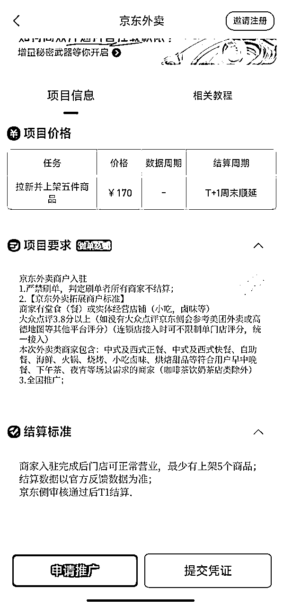

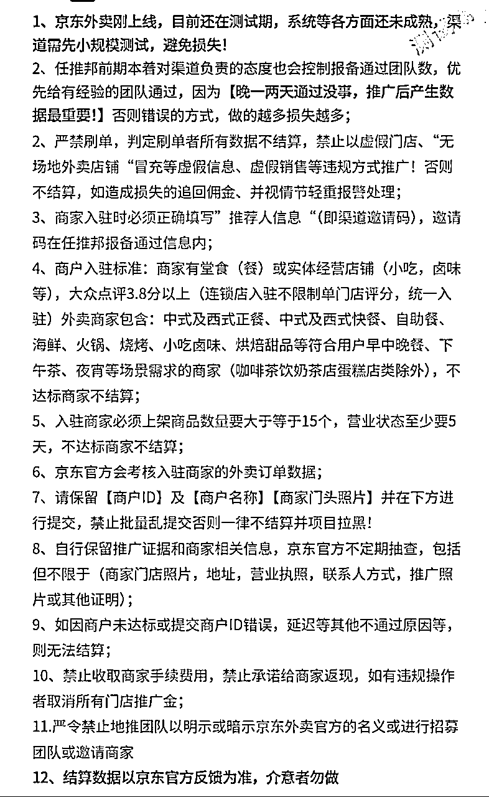

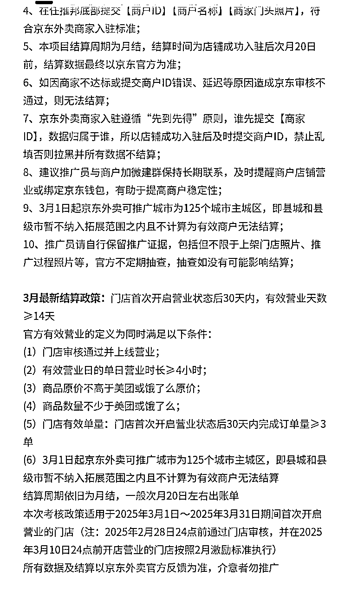

“小规模测试，控制风险”“结算以京东官方反馈为准，不接受者勿参与”——措辞很微妙。不开单不是商家的问题，是平台用户量不足，却让推广人员承担后果。更麻烦的是改成月结，3月1日入驻的商家，满足条件也要等到4月20日左右才结算，期间规则随时可能变化。

我也看了不少圈内人的评价。

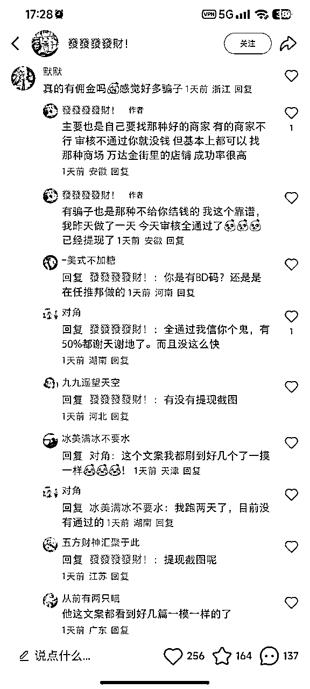

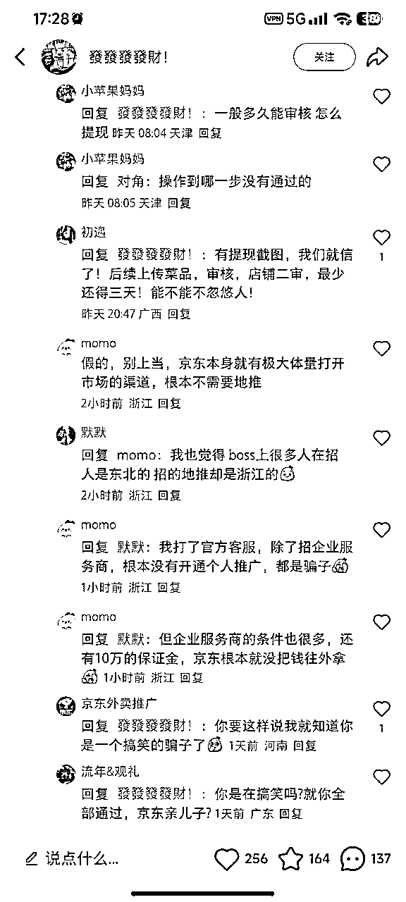

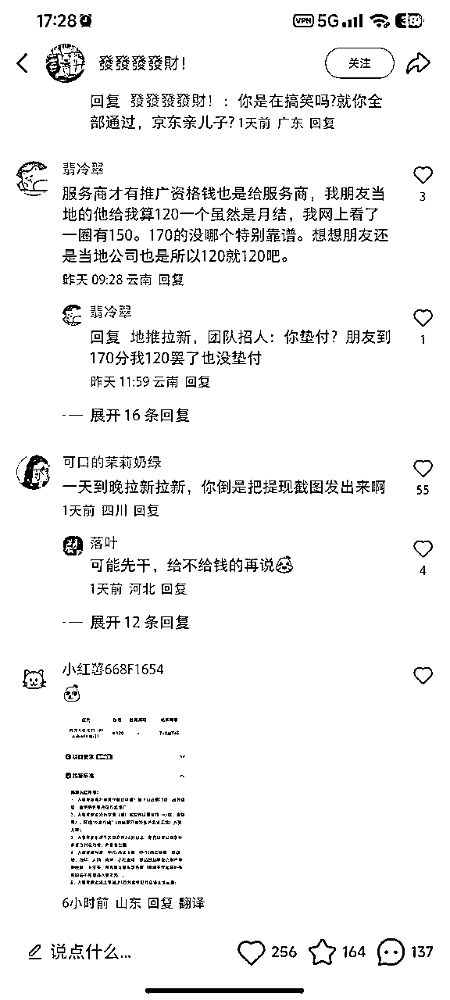

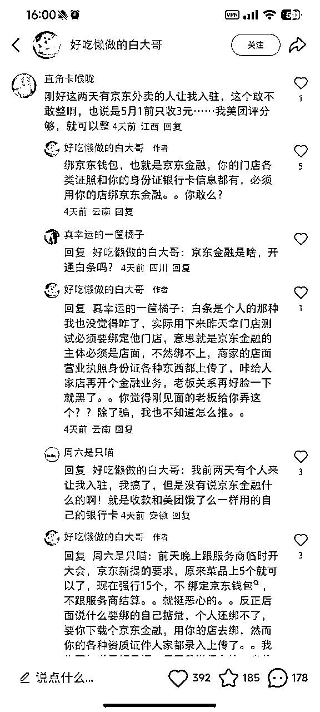

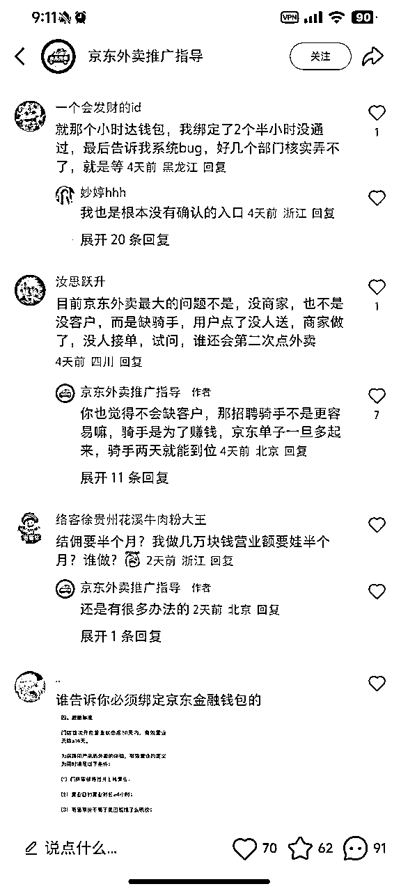

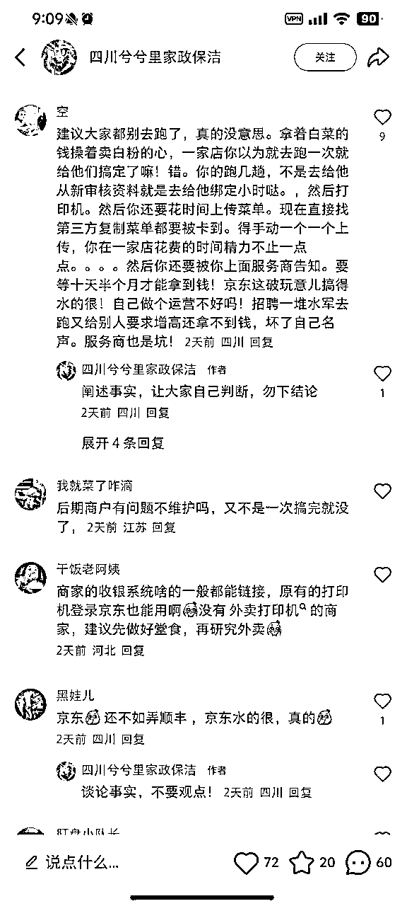

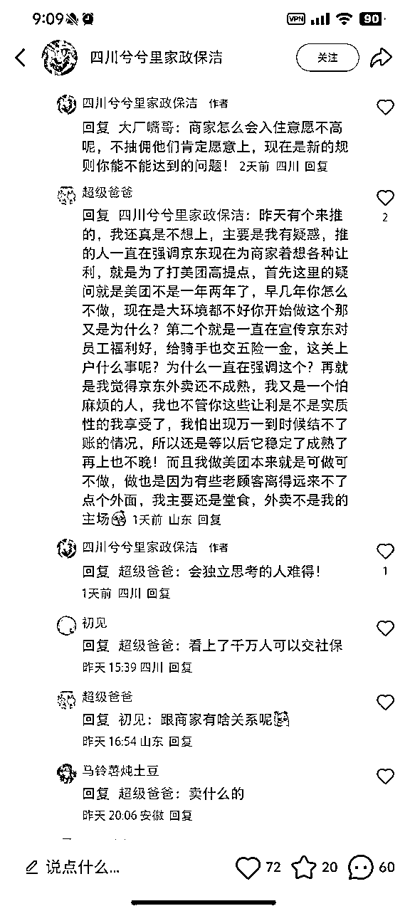

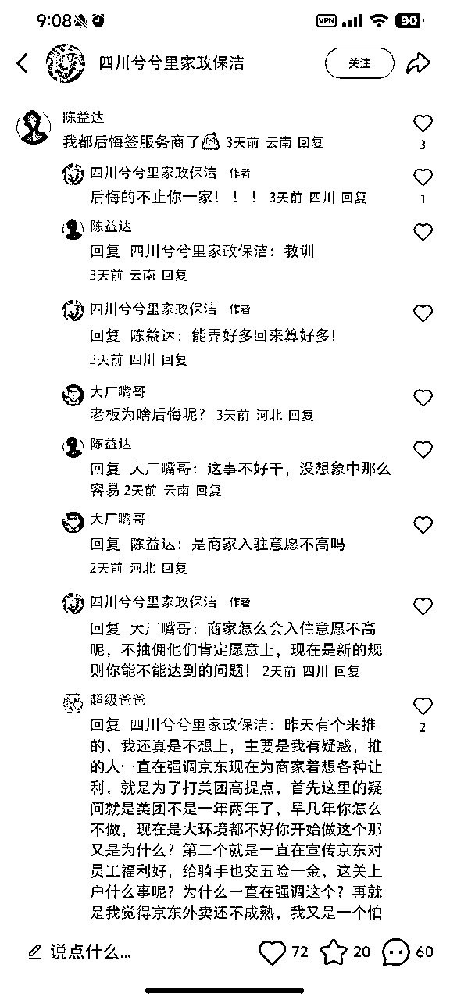

直接致电京东官方，对方并不承认这种地面推广形式。别真的给别人当免费劳动力。全网梳理下来，能看到真实到账凭证的，要么是PS，要么是老图，要么是服务商垫资。任推邦属于服务商一方，目前未见公开的真实提现记录。

平台不拨款，服务商很难长期垫资，而且不少服务商已后悔入局。至于“省团”，我没有尝试，也没精力再投入。杭州市场确实不适合个人操作，回报率太低。如果走BOSS直聘招募的带薪地推，有固定工资结算会稳妥一些，但薪资水平不高，不如去做正经销售。

### ——最后总结

带不走现金，就带走经验。作为在杭州发展的在校大学生，这次地推让我和城市产生更多连接。和老板聊、和同行聊、和外卖骑手聊，甚至在公交上被陌生老人搭讪，一路聊到发现住同一小区。

这次经历让我找回了高考后那个暑假，独自在陌生城市求生存时的冲劲和真实社会互动的感受。

遗憾的是文章发布晚了好几天，不过总算完成了。