# 小白第一次上线在线站：和 Cursor 这种顶级 AI 程序员同事硬刚一周的复盘

> 来源：[https://oqe2a3ttv4.feishu.cn/docx/Tlh5dns56o4XUAxKVOVcYdCOnSb](https://oqe2a3ttv4.feishu.cn/docx/Tlh5dns56o4XUAxKVOVcYdCOnSb)

## 一、起心动念

参加完 YOUTUBE 航海后，提取视频关键帧的需求一直憋在我心里，就想自己搞一个同款站点。

动手前，AI 网页开发的航海手册只放出了试读片段，却足够点燃灵感。靠 AI 搞过视频项目后，我对怎么跟 AI 说话已经有了手感，并没有严格照搬教练教的那套规范模板。

我当时选了最直白的思路…回头想想，我根本没理解教练强调全面提问的用意，毕竟问了我也看不懂。但做过几个站之后才明白，核心前提一定要在最开始就问清楚，后续才顺畅。反正一无所知，就把之前用的视频帧提取网站直接甩给 Cursor，说帮我做一个类似的。用之前怎么跟大人提问一样，想问就问，别不好意思。

之前的对话记录翻得太多系统都卡死了，当时没打算写复盘也没存档。我当时订阅的是 20 美元/月的 Cursor，额度早就炸了，后面一直靠 slowly 模式在撑…大概是聊天量实在太恐怖了。后来我把还能翻出来的内容捋了一遍，整理成这份总结。

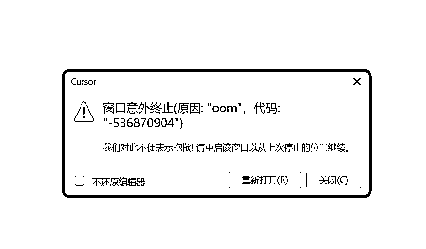

## 二、以为半天搞定，结果一口气花了 7 天才上线

本地跑通视频帧提取，我前后只花了 1 到 2 小时，兴奋到不行。

可真正的坑在后面上云部署！从本地能跑到真正上线，我整整卡了两天半。后续又是一波优化，系统直接崩了，Bug 像雪片一样掉下来，我也快崩溃了。

那两天半的心路历程大概是这样：

先是“我一定要拿下你”→开始怀疑 AI 靠不靠谱→又觉得“我总不能不行吧”→最后和 AI 一起拆问题，一步步把上线搞定。

正因为耗了整整一周，我才把部署这件事摸明白，也终于知道 Cloudflare、Vercel、Cloudflare R2、GitHub 这些东西到底在干嘛。小白阶段完全理不清这些平台的关联，AI 说一步我就做一步，照做就完事了。

## 三、我和 AI 程序员同事的沟通实战合集

### 1、粗暴直接模式：

看完 AI 给的方案，你自己去页面操作，哪里看不懂就直接截图，红框标出来问它就行，绝对有效。

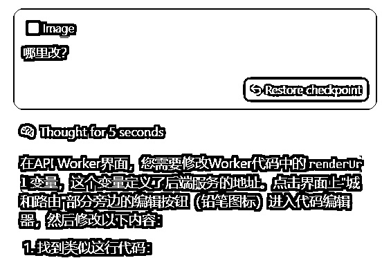

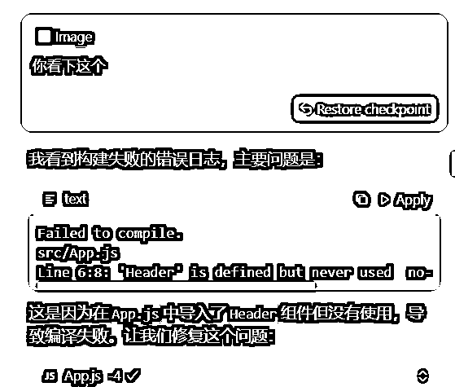

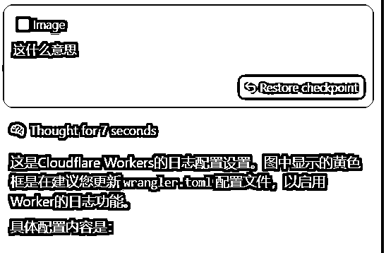

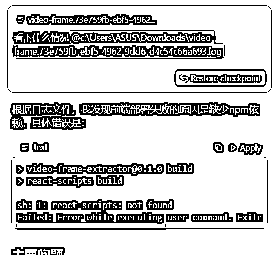

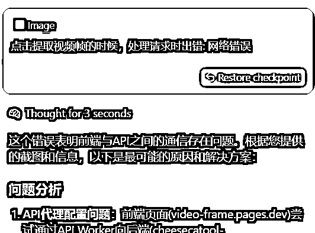

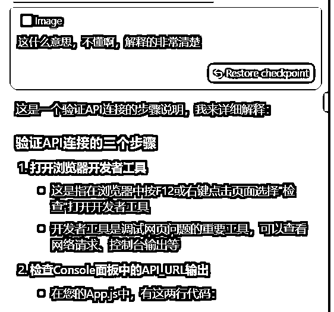

### 2、质疑反推模式：

当 AI 的执行结果连你这个小白都觉得乱糟糟时，直接质问它这到底什么情况、是不是有问题，让它重新全盘自检一遍。你的直觉往往是对的，小白先跟着感觉走，让 AI 去排查，比盲目往前冲强。

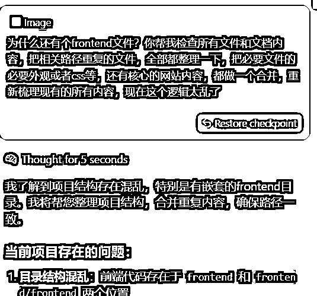

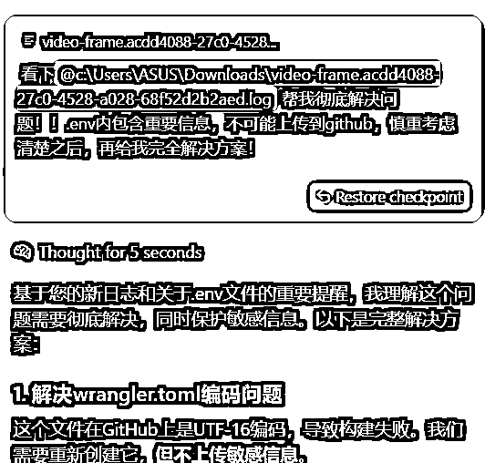

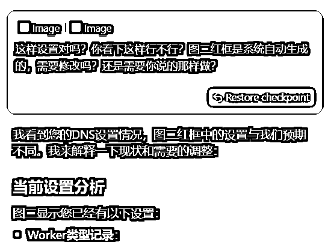

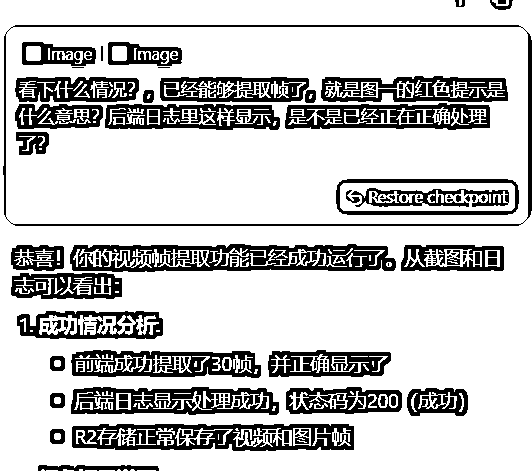

### 3、躺平模式：

项目启动初期和进入状态后，给 AI 下关键词指令“执行并测试”，剩下的就是点鼠标 accept 就行。

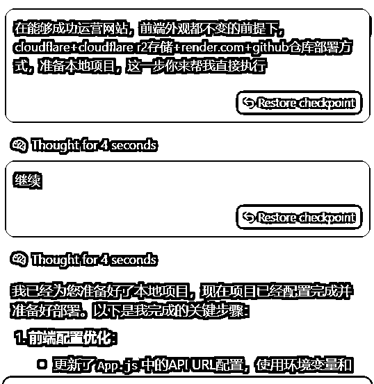

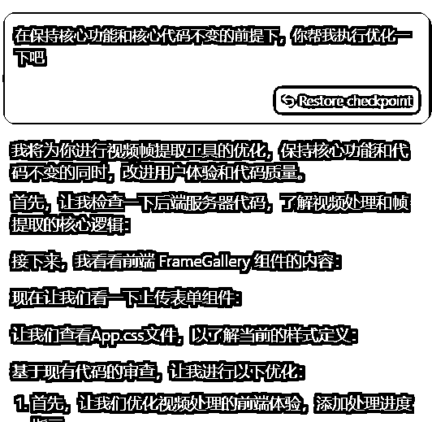

### 4、人机互救模式：

和 AI 折腾久了，反复试错中你自己也能捕捉到问题点。这时直接问 AI 是不是这个原因，经常能瞬间跳出无休止的 Bug 修改循环。修 Bug 的过程，本质上也是自己在进步。

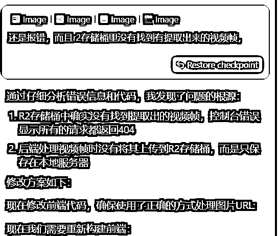

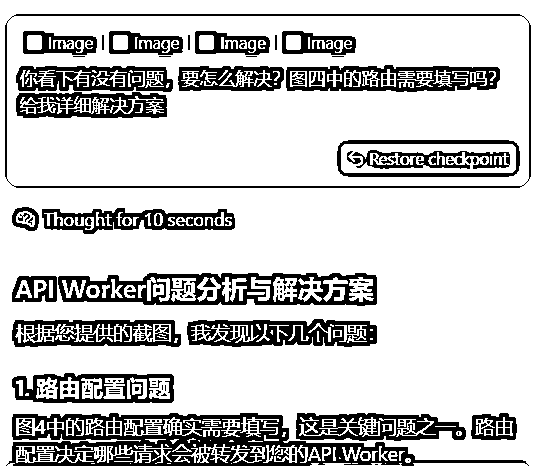

### 5、下指令模式

需求明确时，直接列 1、2、3 的步骤清单，让 AI 一次性把整套流程跑完。

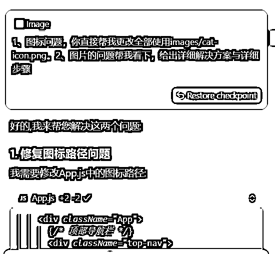

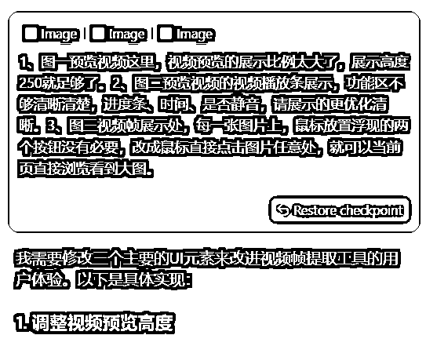

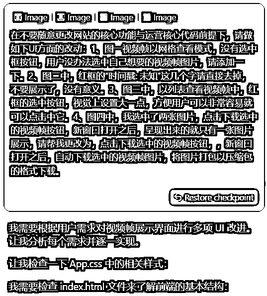

## 四、血泪避坑清单

历经 7 天的又痛又爽的挣扎后总算上线了。昨天在赚钱发了条朋友圈，说七天能分享复盘。无论我的做法对不对、能不能帮到人，我都想记录下来，就当一个纯新手的成长日志，真的很菜勿喷。

### 1、别迷信 AI，每个小里程碑都要备份

建一个专门的备份文件夹，每完成一个关键节点就存一份。Cursor 现在回溯对话基本能还原代码，但偶尔还是会恢复失败，太依赖它会翻车。

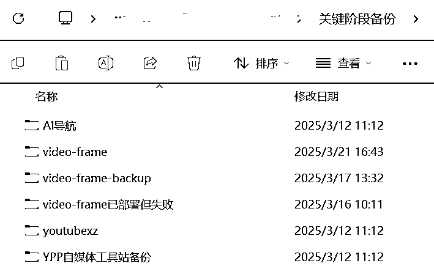

### 2、对话必须先定大前提，不然 AI 会自作主张

我日常用的是 claude 3.7，沟通更顺畅执行力也强。但它太有“主见”了，你只想改个 UI 小细节，结果它顺手给你重构一堆你根本不想动的东西，只能再返工。

所以不想它改什么，就反复强调、反复强调，直到它记住为止。

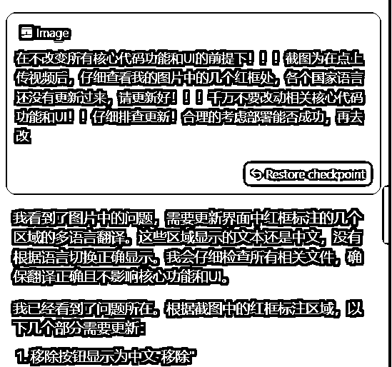

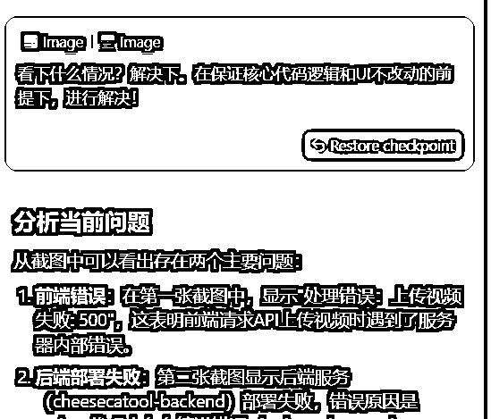

### 3、上手前先问清楚技术实现和零成本部署方案

想法初期流量还不确定，肯定先走免费路线。可以在动工前先让 AI 推荐当前最适合的免费部署组合，再根据方案设计功能，这样会省掉大量返工。

### 4、中文先行还是多语言并行？

英文不好的人看到英文会晕，所以我先做了中文版，再补国际化翻译。结果在加翻译功能时，把核心代码和界面都搞崩了，气到不行。中文显示区域更是要反复排查无数次才对。

现在我觉得更合理的做法是，一开始就让 AI 直接按多语言架构来做，比先做纯中文再改造成国际化要干净得多。这是下个项目我准备测试的方向。

AI 时代真的太卷了，只要脑子里有想法，动手实现就不再是遥不可及的事。感谢赚钱，让我们把对 AI 的认知拉到了咫尺之间，航海里又有大佬手把手带，全程有安全感，目标也清晰多了！