# 海外产品篇：盈利方式哪些？怎么做？

> 来源：[https://bwvzbvg3i3.feishu.cn/docx/USJqdlHxRo5QHRxSV1KcWezqn8d](https://bwvzbvg3i3.feishu.cn/docx/USJqdlHxRo5QHRxSV1KcWezqn8d)

大家好，我是书虫，自我介绍就略过，有兴趣可以去看我之前的帖子

大学毕业生如何实现百万存款?完整复盘0-1的财富进阶：

小红书商单变现——长周期可做：

从做AI镜像到开始做海外产品，是因为做过一个规模还不错的站，而且有一部分用户会持续续费使用。即使我离开，站点照常运转，也能持续产生收益，体验到管道收入的快感，所以觉得两者思路相通，能迁移过去，于是开始探索和尝试

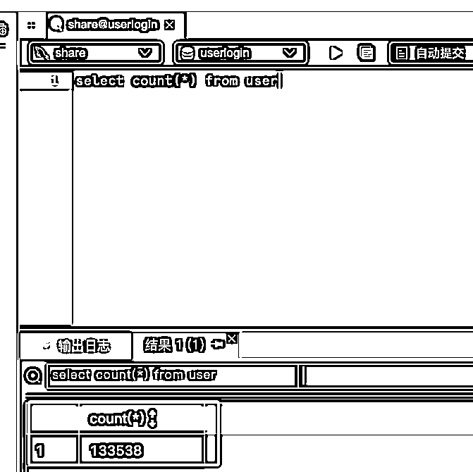

开篇内容很基础，面向新手，大佬可随意翻阅或直接离开

主要是给小白普及做海外产品的赚钱逻辑，我们的目标很直接，就是变现，所以得先搞清楚钱怎么来才有学习动力

## 海外产品靠什么盈利？

这通常是大家最关心的，先讲清楚，主要分两类

### 1. 谷歌广告

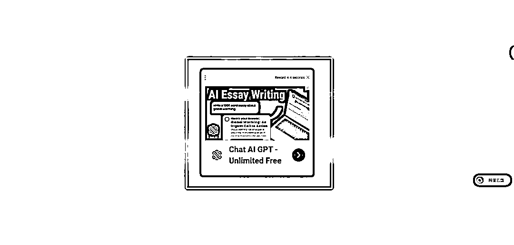

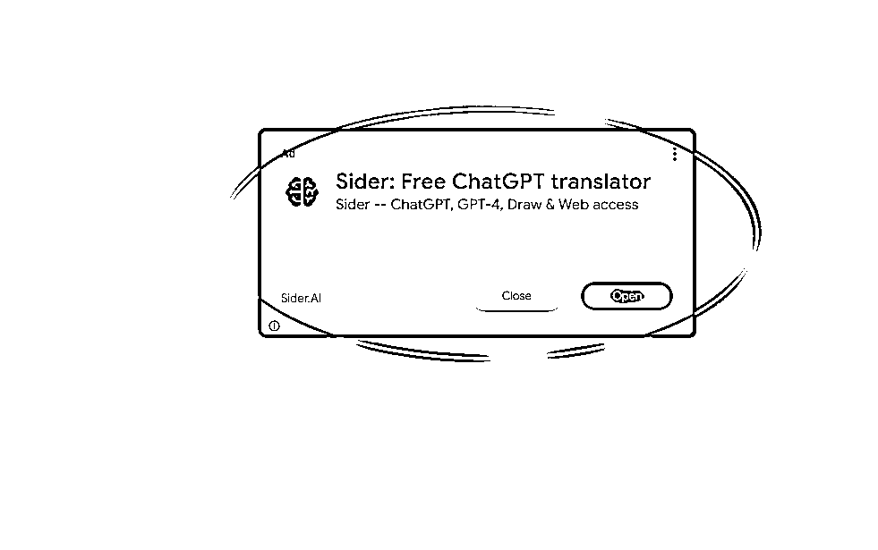

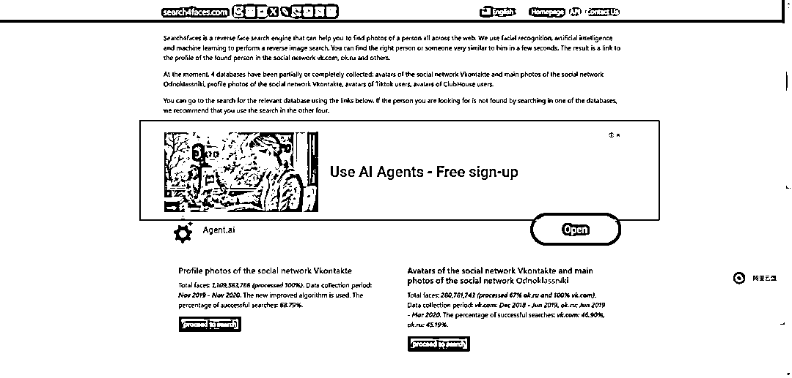

以上三种，都属于谷歌广告的变现形式，可以内嵌在页面里，也可以以弹窗形式出现，本质都是谷歌基于搜索行为做精准投放

我收到的广告是GPT，为什么能这么准不是重点，重点是站点被使用，广告被展示，我们就能分到钱；和国内的今日头条、百家号、微信公众号逻辑一样，有人看就有广告，有点击就有收入

### 2. 接入支付

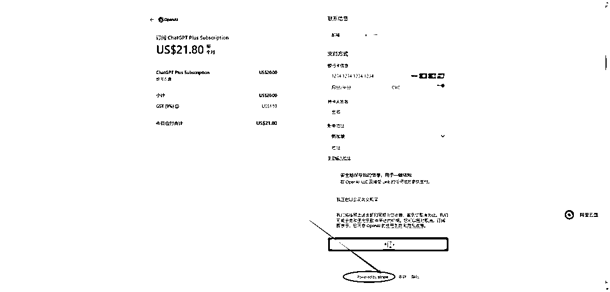

像chatgpt、claude、midjourney这类热门AI工具，都是接入stripe做收款的，我们也能去申请注册，淘宝上代办的不少。只要你做出能解决痛点的产品，就会有精准用户愿意付费

产品不一定要做到chatgpt那么庞大，解决小众需求也能活，比如国内pdf转word官网要收费，但也有人做单次一元的转换服务，用户急用不想开会员，就会选择付费

还有AI套壳软件，很多人见过，因为官方功能覆盖不到，开发者做了差异化产品，有些甚至几乎照搬官网页面，但在使用次数和体验上更贴合用户，比如我朋友做的suno版本

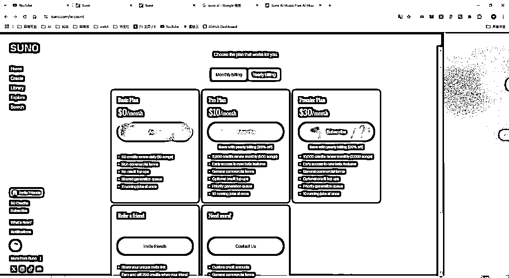

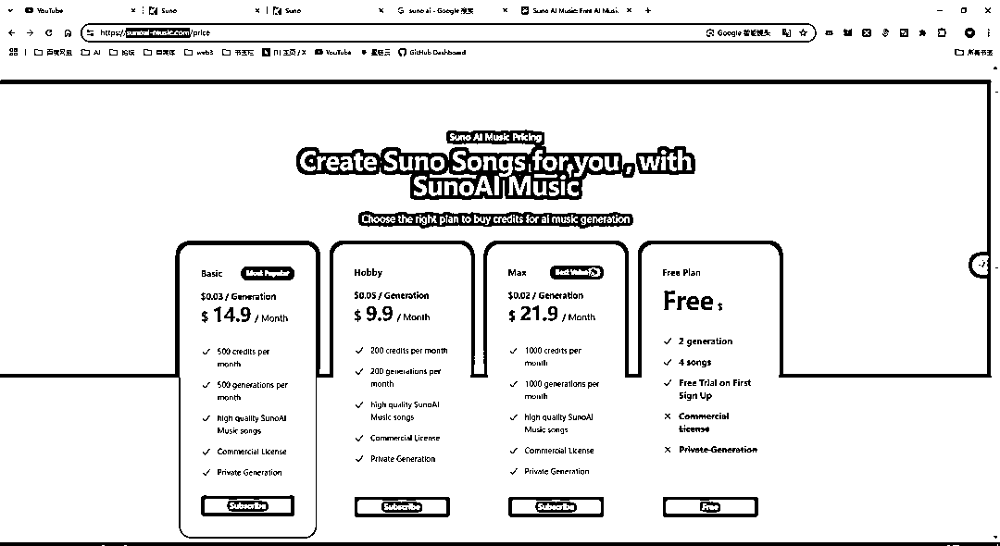

看起来很像，但恰好能满足一部分人群的需求

## 做什么类型网站？

类型很多，内容站放内容，工具站放功能，导航站汇总链接，游戏站放小游戏

不同品类玩法不同，但变现核心仍是广告和订阅，也有人用来引流到站外。导航站排名上去了，你的新站想上榜也能付费

### 1. 内容站

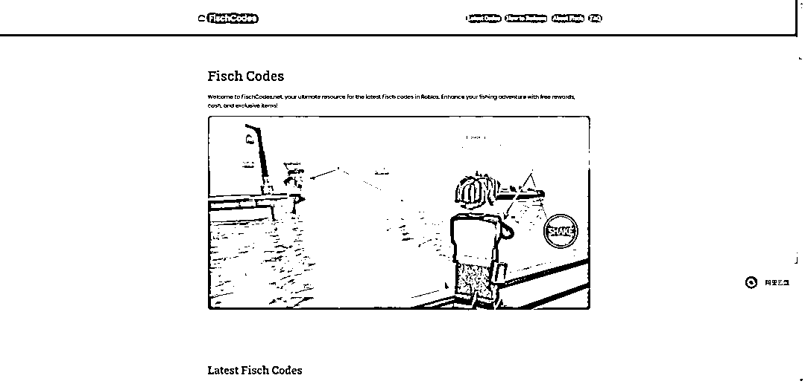

如图，用户需要什么内容，你就做一个持续产出的站点，用户有需求搜索时就能触达你

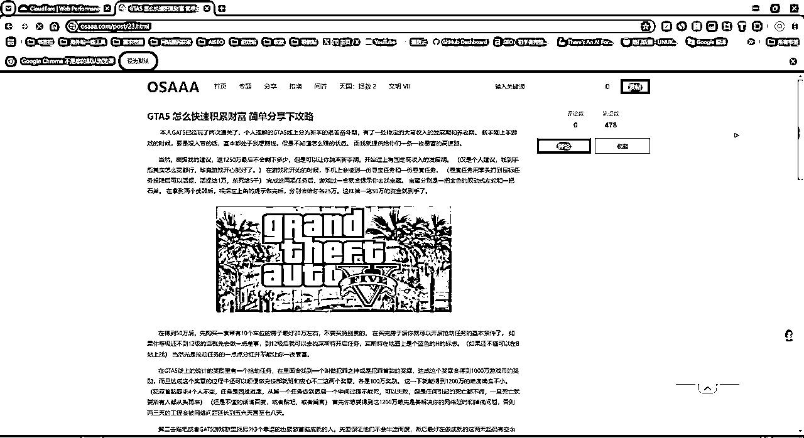

以GTA5为例，这种游戏很适合做攻略。别人还没做，你先做了，卡关的玩家一搜教程，搜出来的可能就是你

现在AI迭代很快，我了解2023年那会不少站长靠AI批量发低质文章占关键词，现在已被修复不少。但我们仍可以用AI辅助写作，像AI代写论文一样，做到机器难识别，写完后人工二改即可

如果是独立开发者，选游戏要看兴趣，你喜欢玩会做得更开心。有个圈友@彩笺提到《monster hunter wilds》，即将发售，如果你对单机感兴趣，先抢注域名，发售后第一时间体验并写心得，站点很可能起量

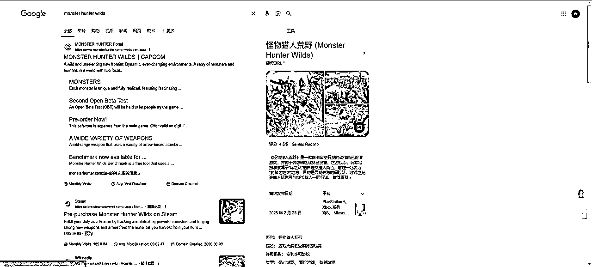

### 2. 工具站

做文档转换就是典型，很多人有这需求，你实现并持续迭代，或功能已完备排名靠前，用户就会长期使用

这类站点是独立开发者追求的理想形态，基本免维护，后续只需做外链和投放维护排名，排名稳定基本就是被动收入

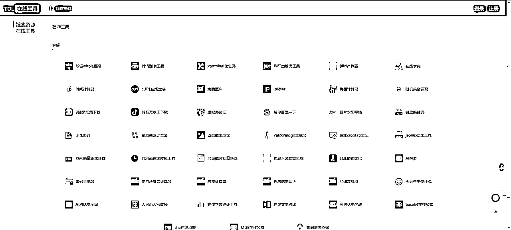

还有聚合型工具站，把大量小众工具整合在一起，每个入口流量不大，集合起来体量可观

### 3. 导航站

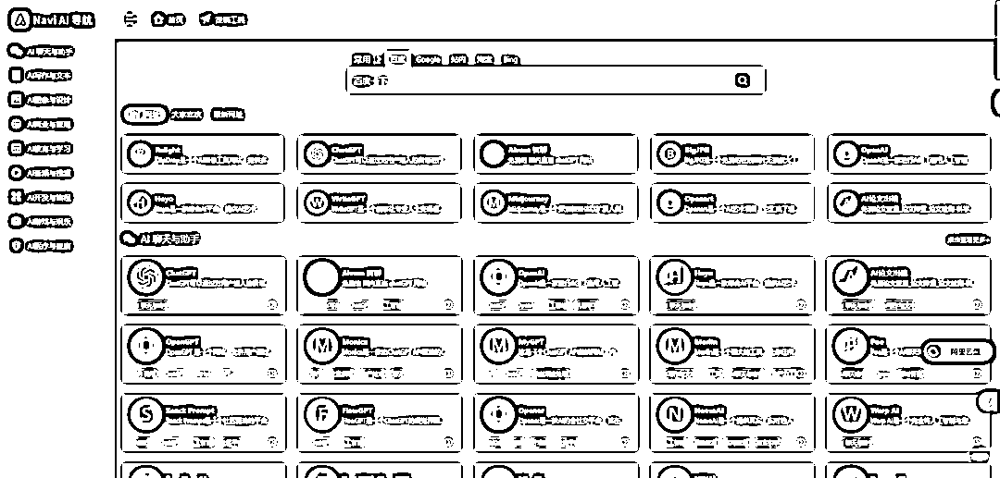

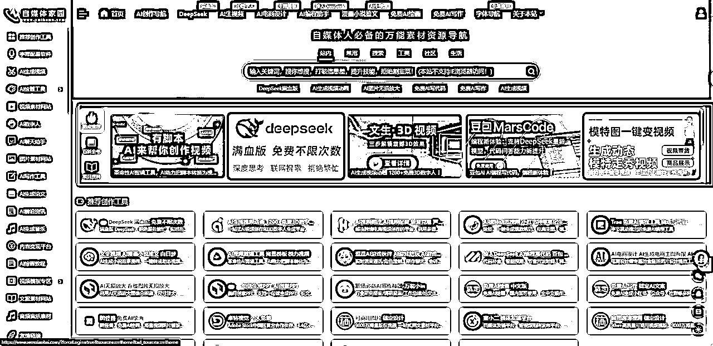

自媒体或AI工具导航，把行业相关站点收集整理，有人找资源就会来你站。你把站点做精、分类清晰，收藏率会很高

我自己浏览器也存了好几个这类站，找竞品或替代品时会去对比

图中红框明显是广告位。很多小众跳转导航也是付费上榜，比如全球最大导航站 theresanaiforthat.com，一个坑位300多美元

### 4. 游戏站

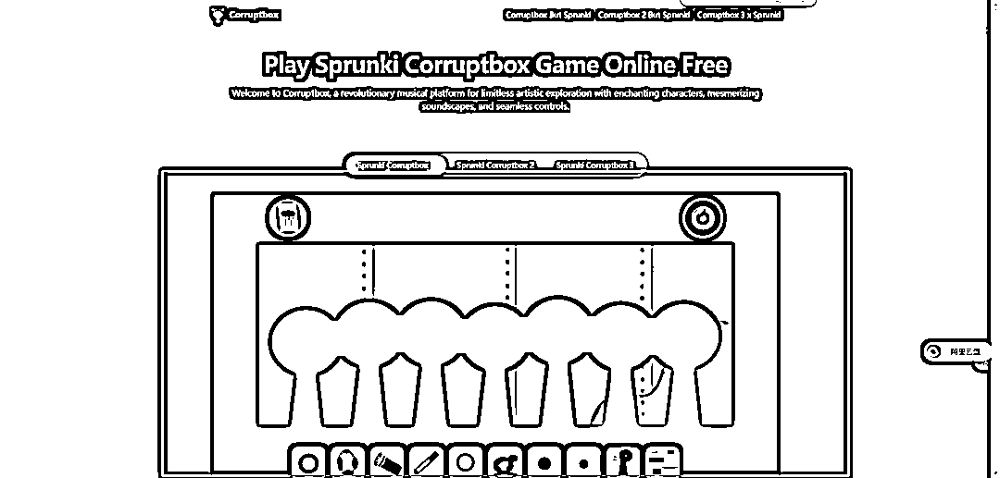

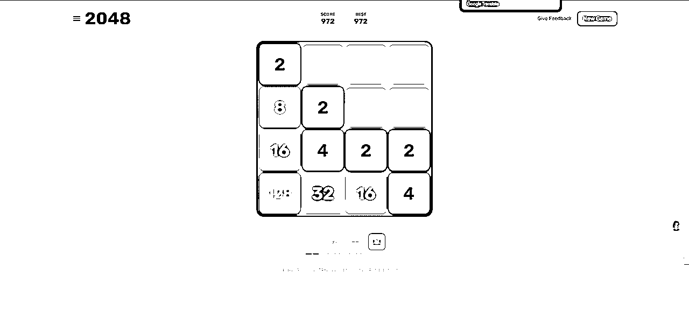

游戏站多是页游和小游戏，不需要3A大作，解决一部分人群需求即可。比如我个人很喜欢2048

微信小程序、抖音小程序也有很多类似小游戏，变现靠广告。那为什么出海做？

1. 赚的是美金，汇率1:7.3
2. 面对全球用户，不是只做国内
3. 上线门槛低，国内小程序审核繁琐，海外站上线很快

以上看起来可能不够高大上，但个人开发者本就不该跟大厂硬拼，做一小撮精准用户就够了。哪怕只有2000个用户，每月10美元，也有2万美元收入，这已经很可观

## 怎么知道做什么网站？

### 1. 基础网站扫盲

可以用谷歌趋势 trends.google.com，看感兴趣词的相关话题热度。2025.2.25，claude3.7发布，这个词在飙升。我们加的关键词是"claude sonnet 3.7"，但榜首是"claude sonnet 3.7 api"，很有意思，去搜一下

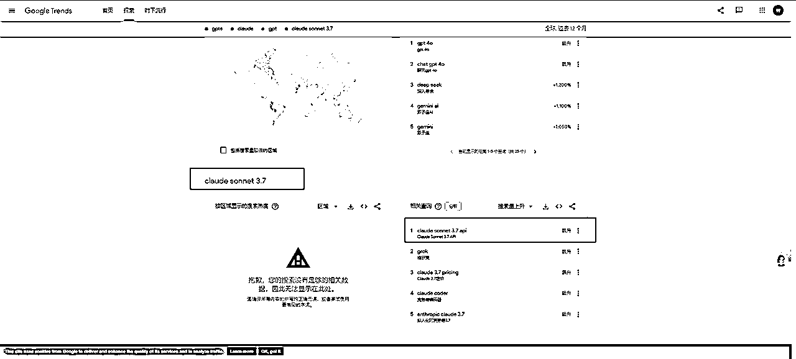

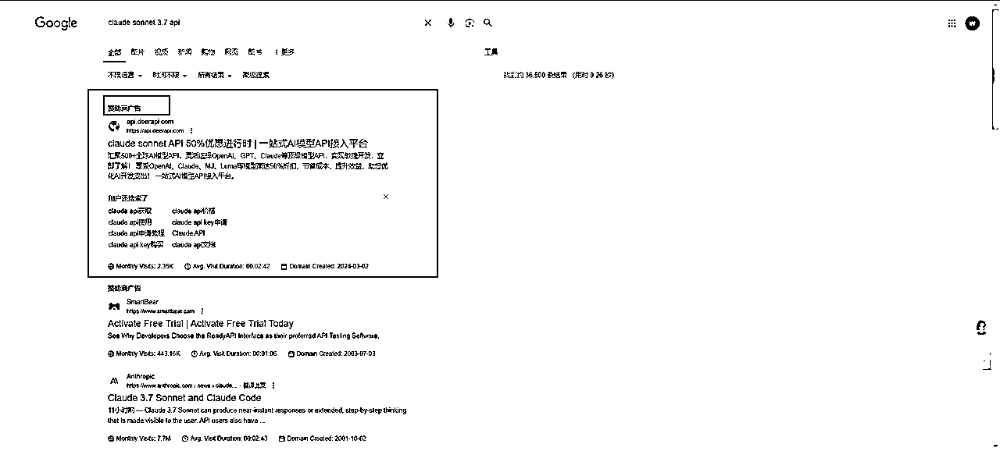

搜出来更有意思，恰好是同行，小红框显示赞助商广告，说明对方已对"claude sonnet 3.7 api"做投放，第一名就是他，拿到大量流量

找关键词就是层层深挖，比如看到这个同行反应快，我没跟上，但经验有了，下次类似词就能尝试

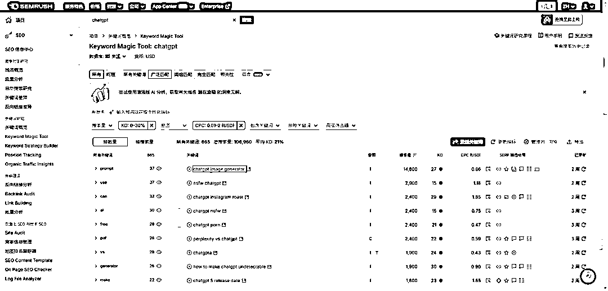

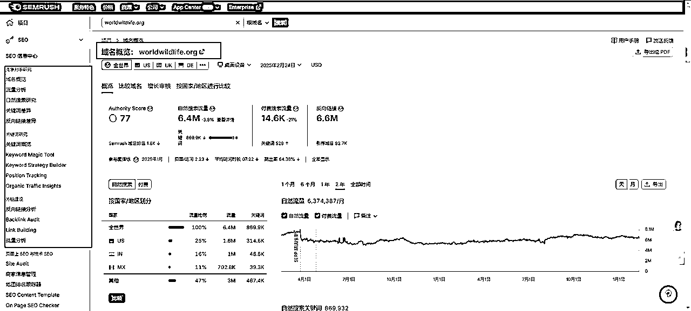

还可以用 semrush.com 和 similarweb.com 这类更专业的词挖掘工具，直观分析关键词或站点

这三类工具是目前主流的选择

### 2. 使用技巧＆筛选标准

平台用semrush

1. 搜索种子词
2. 剔除低价值国家
3. 设置KD 0-29，CPC>=0.1美元，按搜索量降序，得到一批搜索量尚可、难度低、有价值的词
4. 长尾词搜索量1.5w左右可考虑，KD<30，看CPC
5. 去谷歌实搜，看能否竞争，是否陷阱词
6. 找长尾词的长尾词，看SERP是否多为内页
7. 看google trends是否季节性

以上是前辈分享的经验，仅供参考

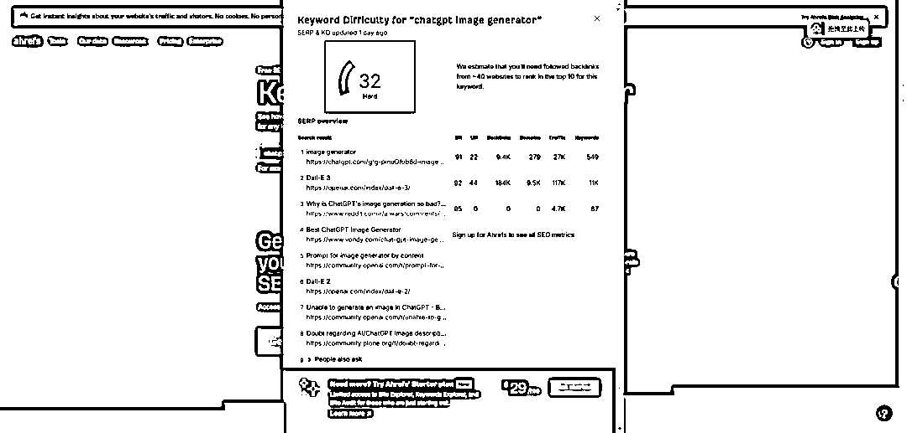

再找出第一名的拓展词，去 ahrefs.com/keyword-difficulty 查难度，显示32，对新手算偏难了，最好选新词练手，建立信心

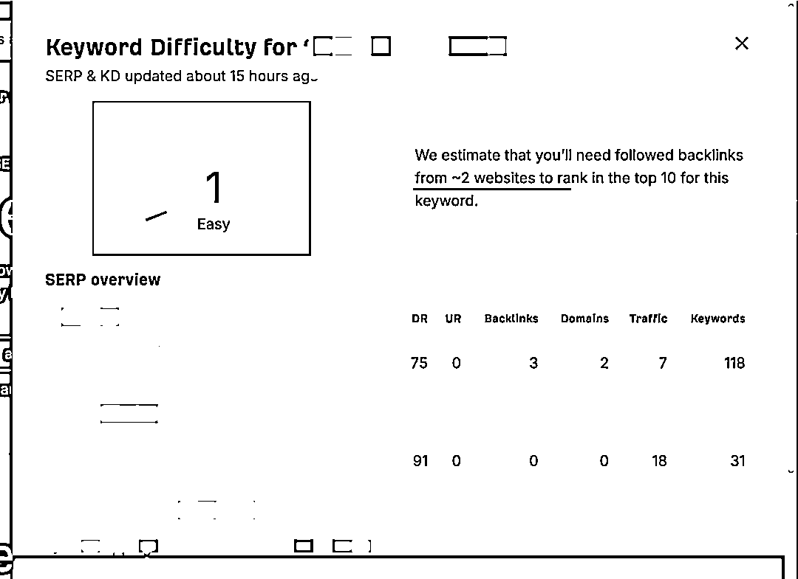

如图，难度为1，几乎无人做，你做了就有需求用户会找到你

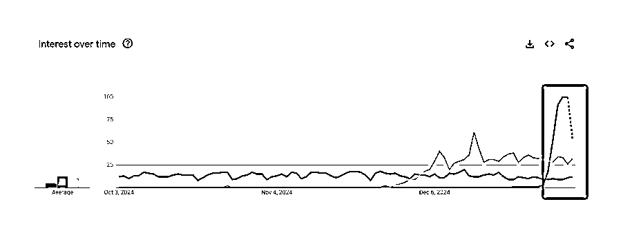

新词标准：

1. 7天内出现
2. 趋势持续上升
3. 搜索量达到基准词的20%

如图蓝色条近期才起，通过趋势图能很直观判断

确定新词后还要判断适合哪种站点：内容、游戏、工具、导航，后续能否持续产出，维护成本多大，都要考虑

新词最关键的是速度，比别人更快给出用户想要的内容，就能占先手，再靠持续输出和外链维护排名

### 3. 外链排名维护

外链就是在别人站点上放你的链接或跳转，提升权重。来源站越大，排名越靠前

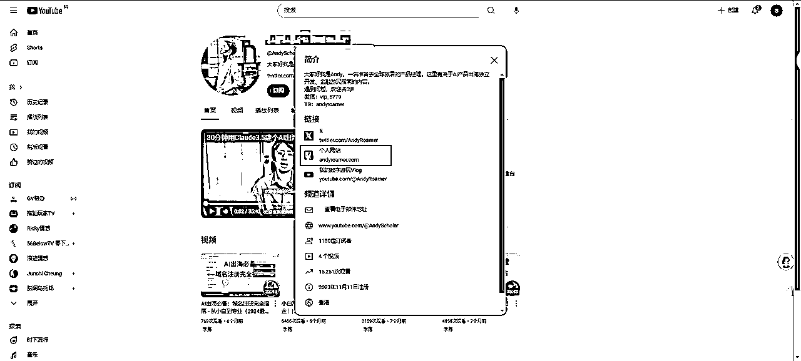

在YouTube上挂博客链接就是常见方式，属于冷启动的有效手段

实操小技巧：

①研究竞品，分析流量结构，若外链流量远大于搜索流量，就去找他获取外链的渠道，照搬

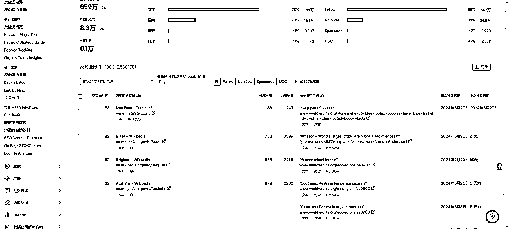

用专业工具可查对标站的外链来源，若是可手动提交或软文形式，就值得模仿

②站点多了，加上前辈沉淀的外链资源，就会形成自己的固定发布渠道。我这里也有一份出海前辈整合的外链文档，方便参考

当然也能做谷歌投放，但建议站上有营收后再投，比如投1美元回本1.2美元，就很划算，这也是我未来想做的，通过加杠杆放大

建站教程可在赚钱内找，或等刘小排老师开课。想先动手可看cursor航海教程上手

## 最后：这是一个长周期的事

可以确定这是长周期项目，变现不会立刻到来。我预期三个月跑通一个，跑通后吃五年十年很正常

了解我的人知道，我的AI镜像产品已经很稳定，客户持续不断

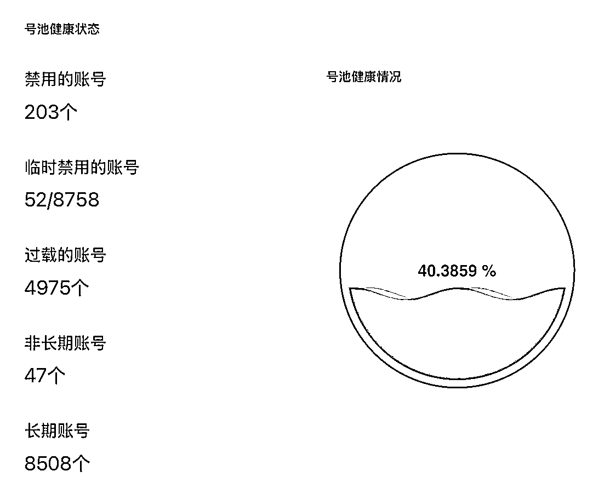

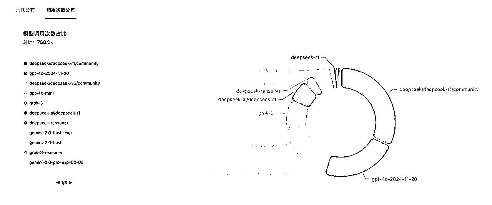

这是2月份以来的API使用量

我之后想做的都是这种，我人不在线站点照常运行，有使用就有收入，能解决问题就有钱

不想再做短平快项目，毕业了要为未来规划。当然短平快也不是不行，若认知不足缺正反馈，做做也好

这个赛道有门槛，教程少需编程基础，但AI编程大幅降低难度，基本靠AI就能完成，也筛选掉了很多人，所以目前还不算太卷

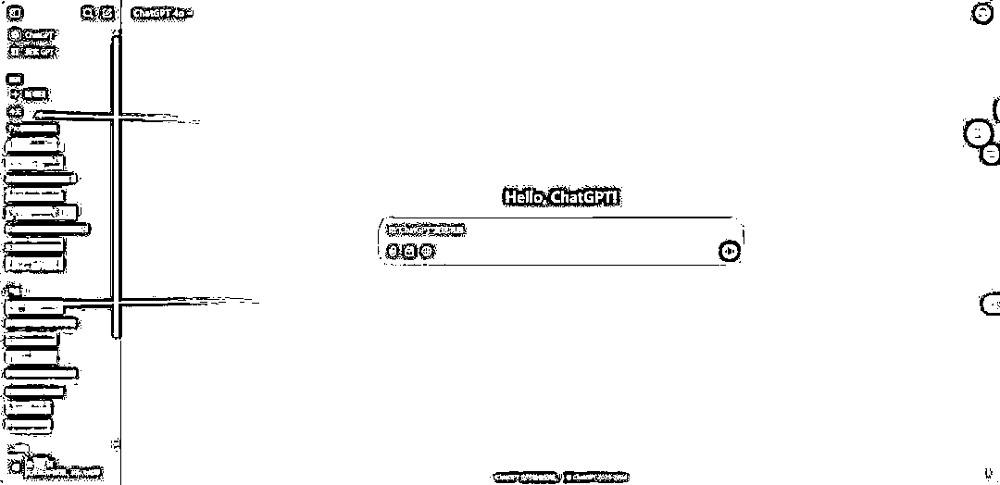

现在AI很强，我遇到的大部分问题都能用GPT解决。知识要与时俱进，这个时代善用AI效率能提升数倍