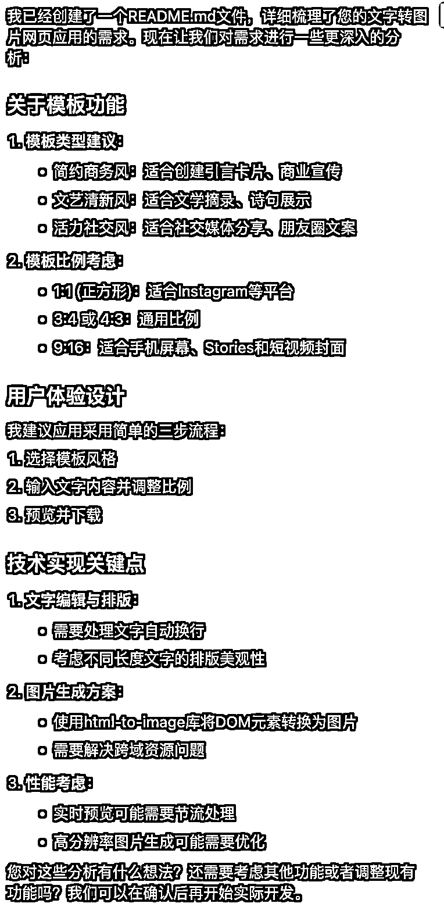
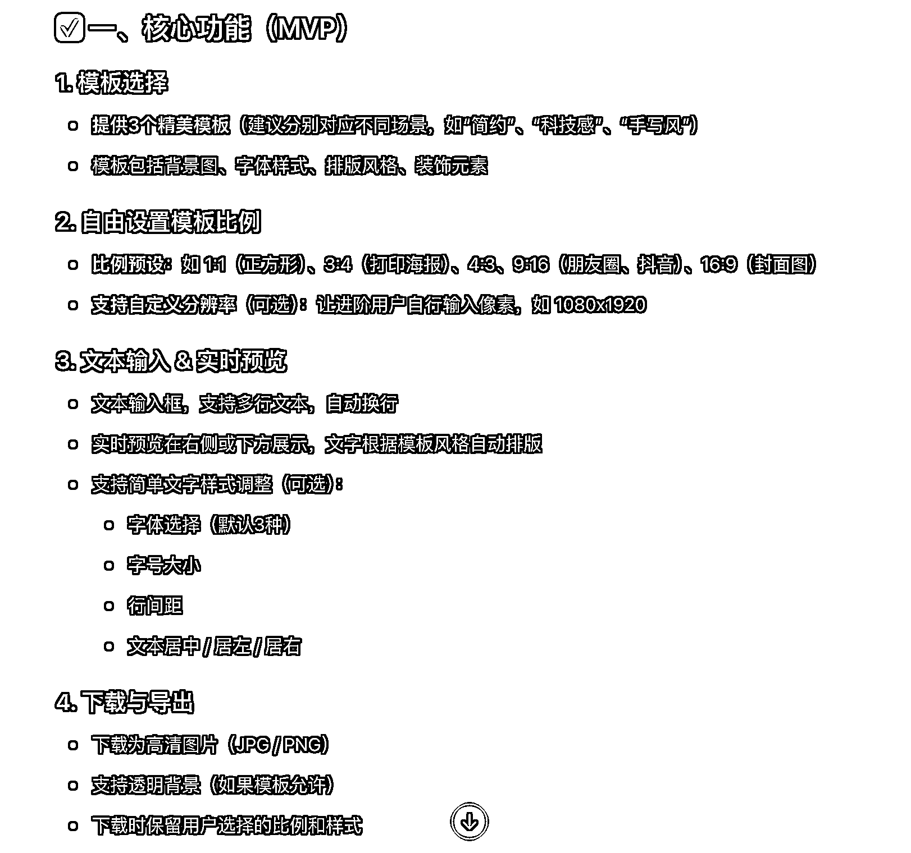
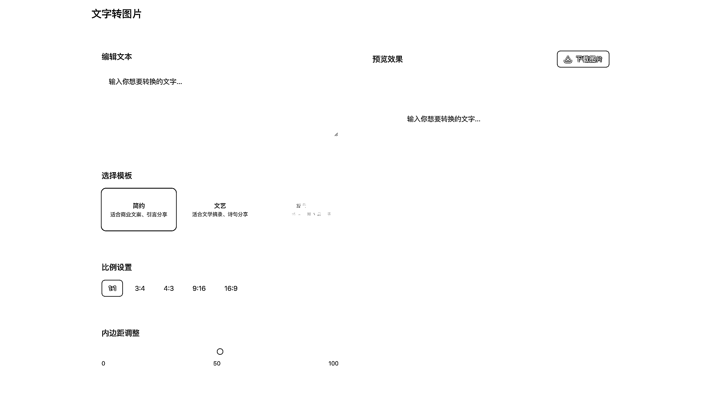
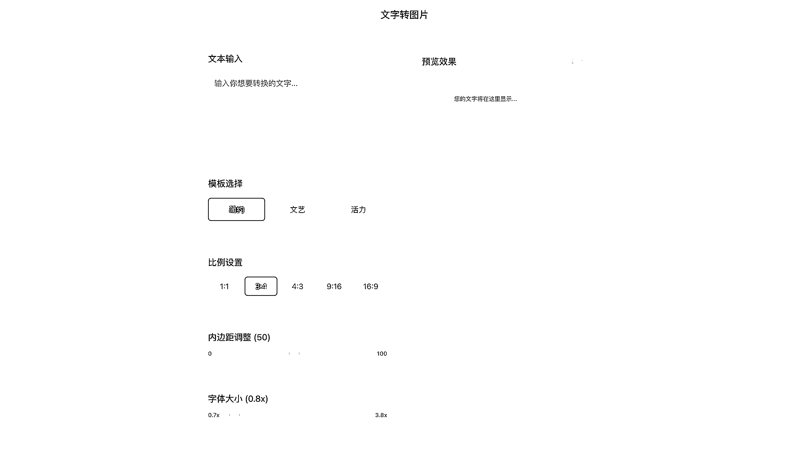

# 从翻车到真香：一个AI编程小白的四小时极限拯救记
作者：龙哥

前几天，我刚刚啃完《Cursor-零基础做软件应用》航海手册，整个人膨胀得不行——感觉凭借AI，什么软件都能分分钟造出来。正好有位朋友提到她做读书分享时，需要把书里的金句做成图片，但市面上的工具要么收费，要么难用，体验一言难尽。我心里暗喜：这不就是送上门的练手机会嘛！

然而现实立刻给了我一套组合拳。我吭哧吭哧搞了四个小时，踩了无数个“想当然”的坑。情绪也像过山车：一开始烦躁到想摔键盘，后来硬着头皮继续，慢慢找到节奏，最后还真做出了东西。那一刻，忽然懂了龙哥说过的那句话：“一个人可以不依赖于别人，创造出一些新东西，这是真正快乐的来源。”

我相信每个新手都会经历这个阶段，把我的过程写出来，希望给你一点信心。

## 第一站：Cursor，开局翻车

我的需求很明确：做一个在线文字转图片的网页，能选模板、能调比例（比如3:4、9:16）、输入文字就能预览和下载。于是我把需求扔给Cursor，结果它撸起袖子就要直接建项目，把我吓了一跳。

我赶紧拦住它：“先别急着开发，帮我把需求理清楚，顺便写个README记录讨论结果。”它倒是听话，输出了一堆方案：

可看完有点小失望——基本都是把我原话换了个说法，不过它对模板类型的建议倒是挺专业。我好奇心来了，就让它直接开干。几分钟后，页面出来了，我一看心凉半截：这UI简直是十几年前的风格。所谓的模板，无非是换换背景色和字体颜色；图片里的文字间距和字号也没有任何美感。说实话，这个水平虽然能满足朋友，但完全打动不了我。

当时特别泄气，这么简单的功能，AI就做成这样？可答应了朋友的事又不能不算数。冷静下来琢磨，可能是我需求描述不够细。于是转头去问ChatGPT。

## 第二站：ChatGPT，也不省心

我请ChatGPT以资深产品经理的身份，帮我把需求完善一下。它确实从功能、体验、技术、扩展几个维度给了方案，但搞得特别复杂。我让它简化成MVP，它倒是给了框架，可细节仍然很虚：只说要字体选择，却没说要哪些字体、字号范围多少、行间距多大。这种需求丢给Cursor，结果可想而知。

到这里我差点想放弃了。AI也就那么回事？就在郁闷的时候，我想起了刘小排的那篇《5分钟做个网站，人人都能学会》，里面提过一个叫bolt.new的工具。之前我试过，效果相当惊艳，要不拿它试试？

## 第三站：bolt.new，惊喜来了

给bolt提需求前，我特意加了一句从AI进化论-花生那里偷师的话：“你是个非常出色的工程师和设计师，请在完成功能设计的基础上帮我实现出色的有苹果风格视觉设计。”

bolt这次没废话，直接开写代码。成果让我眼前一亮：页面真的漂亮！虽然还有Bug，但已经让我有动力继续打磨了。我本来让它做6个模板，结果发现模板只是换背景色，没意思。就又想起Cursor之前提过的场景化建议，于是让bolt改成3个模板：“简约”适合商业文案、“文艺”适合文学摘录、“活力”适合社交媒体。同时修复了文本换行、字号间距等问题。

几轮调整后，整体已经很好看了，见图：

不过还没等我高兴完，bolt提示我：免费额度用完了。唉，感觉功亏一篑。可转念一想：为什么不把从bolt这儿试出来的优化点，拿去改造之前那个丑丑的Cursor项目呢？

## 第四站：再战Cursor，终于成了

说干就干，我把在bolt上调通的参数一一告诉Cursor：多行文本自动换行、文本居左、字间距0px、行间距31.68px、内边距范围0-100默认50、字体大小范围0.7x-3.8x默认1，外加“苹果风格”视觉设计。前三个功能轻松搞定，但UI还是老样子。我干脆把bolt的界面截图丢给它：

“页面布局和样式调整成图片中的效果，其他功能别动。”

有了参考图，Cursor的效率立刻上来了。可后来又发现字体大小调整功能消失了，字间距和行高也不对。我反复强调，来回改了好几轮。这里学到一个小知识点：行高如果设成固定像素，字号一变就不协调，最好用相对值，比如1.8倍行高，这样能随字体大小自动调整。

之后又解决了下载图片空白、页面闪烁、功能丢失、部署问题。整个过程就是十几个来回的“我发现问题—问AI—改—再问”，最后页面终于变成了扁平又好看的成品：

接下来是部署。我想让朋友能直接打开链接，就在AI指引下部署到Vercel。结果朋友说打不开，一查才知道国内网络访问Vercel某些节点不稳定。又想起bolt之前推荐过Netlify，于是换到Netlify重新折腾。这次朋友终于能顺利打开了。

## 最后的感悟

这次经历让我意识到，新手最大的毛病，就是恨不得“一步到位”。一旦达不到，负面情绪立刻上头，想跑路。如果这不是答应朋友的事，我可能早就放弃了。所以啊，给自己找一个外部约束，真是个好办法。

回头看，我第一次用Cursor失败时，明明可以继续追问AI“怎么改”，但我没有；用ChatGPT时，明明可以让它继续细化规则，我也没有。直到bolt让我眼前一亮，我才开始认真思考。这整个过程，就是被情绪推着走的。

航海手册里有句话特别对：“有问题是好事，不要害怕问题。”以前看到就划过去了，这次是真真切切体会到。遇到问题，耐心分析、耐心解决，一次不行就两次，两次不行就三次，总能搞定。

另外，我之前总觉得“等我学会编程再来用AI”，体验完才发现，技术真的不重要，用技术做什么才重要。把AI当成你的技术合伙人，你提需求，它负责实现，你甚至不必懂代码。

当然，平时积累也很重要。这次很多灵光乍现——突然想起某个工具、某个参数、某个案例，都是因为之前刷帖刷到的。当时觉得没用，关键时刻跳出来，才知道多香。多看帖子，点连成串，真的有用。

最后再用龙哥的话收个尾：掌握了AI编程，“像是长了翅膀，或者像断了的胳膊被接上了，是自由的感觉。”

路漫漫其修远兮，吾将上下而求索。共勉！

对了，关于MVP设计，最重要的一点是确定最小关键要素。比如“文字转图片”里，关键就是：图片模板、字体、字体大小、字间距、行间距、内边距。如果把我在这次过程中提出来的需求整合成一份提示词，扔给Cursor或bolt，一秒就能生成一个可用的应用，你也可以试试。