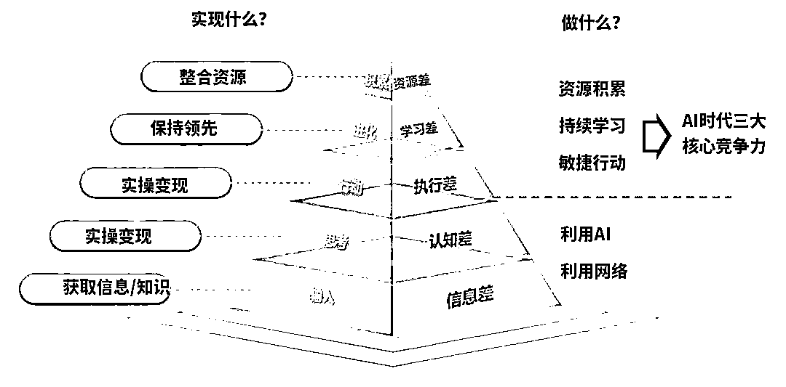

# 零基础闯入AI圈，她从专科老师逆袭成畅销书作者，只因做对了这5件事

很多人以为，能写出AI畅销书的人，一定从一开始就站在浪潮之巅。但其实，来来的起点比大多数人都普通。

她只是一名师范专科毕业的老师，在讲台上站了整整10年。2023年刚接触生财有术时，她连AI的门都没摸到，完全是行业小白。可就是这样一个人，如今却顶着一个闪闪发光的身份——AI畅销书作者。

回顾这段经历，来来始终觉得，是生财有术在她最焦虑、最迷茫的时候，像导师一样拉了她一把。她说，如果你现在也找不到方向，不必急着否定自己，只要愿意相信、愿意行动，别人能做到的事情，你同样能做到。拒绝内耗，踏实走好每一步，属于你的生财之路自然会浮现。

那么，一个零基础的新手，要怎么快速追平那些比你先跑的人？来来把她的实战经验浓缩成了5招，专门用来“打破差距”：

第一招，用风向标磨平信息差。每天抽出几分钟刷刷风向标，AI圈里在聊什么、有什么新动向，你都能第一时间跟上，不再当局外人。

第二招，用生财小组拉高认知差。一个人看问题总是有边界的，加入小组和同频的人一起碰撞，很多想不通的行业逻辑会瞬间通透。

第三招，用精华帖扫清执行差。光知道还不够，关键要会做。精华帖里全是过来人踩过的坑和留下的步骤，照着学，执行起来至少省一半力气。

第四招，用航海实战补齐学习差。看十遍不如做一遍，在航海实战里真刀真枪地上手操作，才能真正把知识变成自己的能力。

第五招，用线下聚会和航海家积累资源差。很多机会不会写在公开帖子里，线下深度交流和高质量社群，才是撬动资源的关键。

这五招，来来都一一走过。从一个连AI概念都说不清楚的小白，到如今带着自己署名的畅销书站在大家面前，她只花了一年多的时间。如果你也想知道每一步具体怎么落地，她整理了一份完整指南，放在下面的链接里：

[飞书链接](https://aigcstudy.feishu.cn/wiki/VwhrwoBa3iv3OYkHHNMcSf0enuf?from=from_copylink)

别小看自己，也别再等待。只要开始行动，你的逆袭故事，或许就从今天开始。