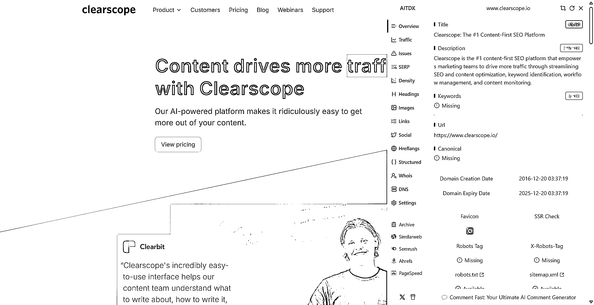

# 看榜单（7）Best-AI-Tools-revenue501

## 看榜单（7）Best-AI-Tools-revenue501

作者： 行知

日期：2025-04-14

> 受刘小排老师对 AI 产品领域的敏锐判断影响，我决定把精力放在每天深挖 AI 榜单上的工具。恰好看到“良辰美”已经在落地实践，并采用了刘老师提出的“翻石头”提问思路，这让我更加坚定这是一条能真正吃透产品的路径。于是我启动了每天品鉴一款产品的公开学习打卡，欢迎圈内朋友一起监督，也请不吝指正，让我的节奏更准、方向更稳。

> 
> 
> 近期看到同行过产品榜单的速度很快，自己盘算了一下，按现在这个节奏把整张榜单吃透得花一年多，机会成本太高。
> 
> 
> 于是我打算适度提速，但也尊重自己对新事物的陌生感。计划分三步走来调整：
> 第一阶段：先把总榜通刷。原则是每天研读一个产品，碰到信息密度低的时候就酌情提速或筛掉。最关键的是稳住自己的状态，用自己能接受的方式推进。SOP 必须跑完整，但每天投入控制在 1 小时左右。
> 第二阶段：按产品品类和核心能力把同类工具批量对照研究。
> 第三阶段：把看产品变成日常的工作习惯。

Clearscope 是目前市面上口碑较高的、由 AI 驱动的内容优化解决方案，因操作门槛低、实操中对 SEO 效果的提升明显而广受好评，主要用户集中在预算充裕的大型企业和专业内容团队。它的卖点集中在直观的操作界面、精准的关键词拓展建议，以及与现有工作流的顺滑对接。不过，高价位的订阅门槛和在 AI 生成文案、页面深度分析等方向的功能边界，也为后来者留下了切入空间。

内容优化赛道竞争正变得越来越白热化，但整体体量仍在持续扩张，这背后是自然搜索流量对企业价值的不断抬升。直面 Clearscope 的挑战需要扎实的技术积累和可观的资金投入，但如果从性价比、内置 AI 写作能力或垂直细分场景切入，依然有机会做出差异化。做一款能在竞争中站稳脚跟的产品，核心在于对用户真实痛点的深刻把握、相较于现成方案的明显超越感，以及长期保持创新和服务口碑的决心。拆解 Clearscope 的打法和短板，可以为寻找新机会提供清晰的参考坐标。

* * *

评论区：

赵坤 : 想问问你每天整理这么一份大概要花多长时间，有没有用 AI 辅助处理

糖饼 : 直接看这里 这位圈友及时响应的[[https://toolify-insights.online]](https://toolify-insights.online])([`toolify-`](https://toolify-) insights.online)

行知 : 每天大概 1 2 个小时；必须借助 AI 工具整合，不然刘小排老师的精华内容就吃不透了。

山的那边 : 能否告知一下具体看了刘小排老师的哪一篇？

行知 : 这一篇：翻石头 tps://scys.com/articleDetail/xq_topic/5121548228815414

山的那边 : 感谢