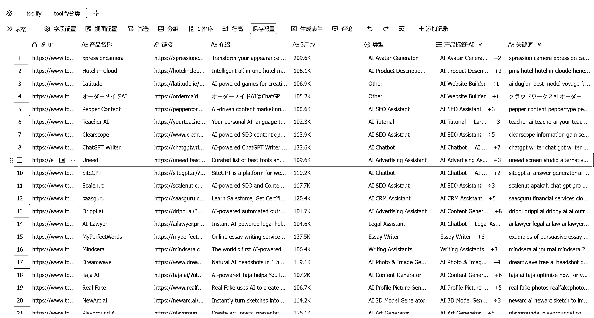

# 我的AI榜单学习笔记：别让“刷榜”抢了主线的戏

因为受到刘小排老师关于AI产品分析的启发，我给自己定了一个小目标：每天拆解一个榜单上的AI产品。前几天偶然看到“良辰美”也在做类似的实践，而且他用的正是刘老师那套“翻石头”提问法，这让我更加确信，用这个框架来研究产品很有效。于是我把自己的“每日一品”计划公开出来，请圈子里的伙伴监督，也希望大家多提建议，帮我不断校准方向。

昨天回头一数，才发现自己之前看过的内容只是很小一部分。为了提效率，我索性把toolify上的榜单信息全部拉了出来，后面准备按不同类别成批地过一遍，再做多维度对比，让刷榜这件事变得更有趣味，不至于枯燥。

其实我清楚，光靠机械地刷数量不行，过程中要随时调整姿势，保护好自己的热情，才能把这件事坚持做下去。更重要的是要提醒自己：刷榜单只是当前阶段的一个环节，它并不是这件事的重头戏，可别把主次搞反了。

最后，谢谢大家的点赞支持。

