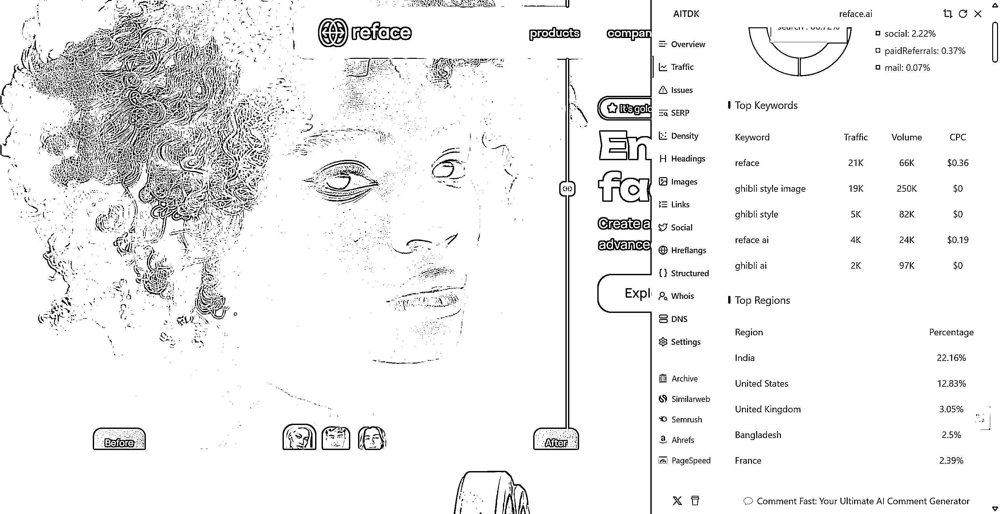

# 看榜单（9）Best-AI-Tools-revenue133

作者：行知  
日期：2025-04-16

受刘小排老师对 AI 产品的剖析影响很深，我决定把每天的时间用来拆解 AI 榜单上的产品。无意中注意到“良辰美”已经在做类似尝试，它运用了刘老师提出的“翻石头”式提问思路，这让我更加坚定这确实是读懂一个产品的捷径。于是我启动了“每日一品”的自学打卡，也在这里公开进行，欢迎圈里的朋友们一起来监督，听到你们的坦诚建议，能帮我更快调整节奏，一起进步。

这次临时换掉原本要看的产品，原因很简单：它在三月份因为“ghibli”这个关键词吃到了约 40 万的搜索流量，引起了我的兴趣。顺手查了一下来源，发现印度用户贡献了相当大的比例，这也侧面印证了 ghibli 热度在三月确实为它拉来了一波很可观的自然访客。

* * *

评论区：

暂无评论