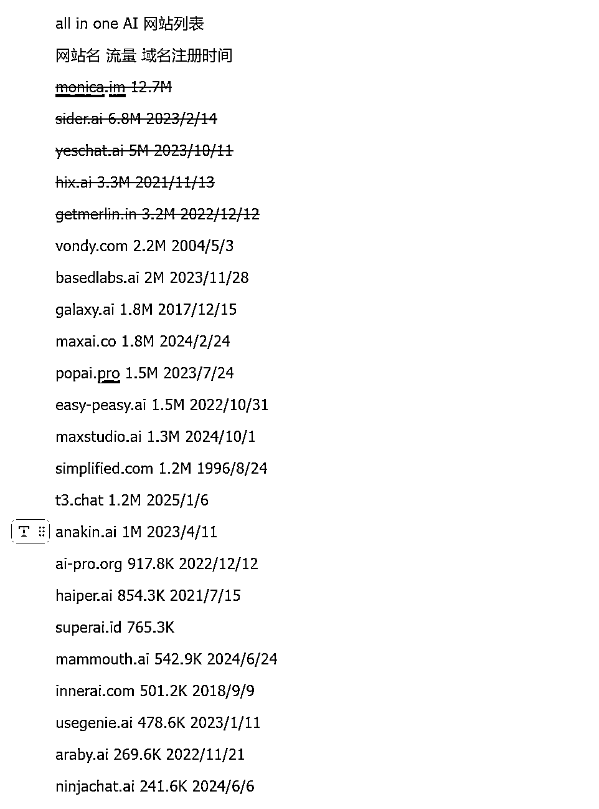

# (12 赞)榜单观察(10) 一站式 AI 产品全景


## (12 赞)榜单观察(10) 一站式 AI 产品全景

作者： 行知

日期：2025-04-17

> 在刘小排老师对 AI 产品的剖析下深受启发，我决定每天拆解一个 AI 榜单产品。无意间看到“良辰美”的实践方式，其采用了刘老师“翻石头”的提问方法，让我认同这的确是吃透产品的捷径。我已启动每日一品的学习打卡，在此公开进度，恳请圈内伙伴监督指正，也期待大家的坦诚点评，帮我校准思路，一起进步！



## **横向对比与复盘**

### 共性特征

**AI 是价值内核:** 各类产品都以 AI 技术为核心驱动，价值主张集中在提效提速、自动化处理、激发创造力以及让信息获取与处理更顺畅。

**主流形态分布:**

```
1\. 1.
```

**AI 助手/Copilot 浏览器插件:** 典型如 Monica、Sider、Merlin、MaxAI，直接嵌入浏览器成为高频入口，竞争格外白热化。

```
2\. 2.
```

**AI 写作与内容生产平台:** 比如 Hix.ai、Easy-Peasy.ai，主打海量模板和细分工具，满足多样化内容创作需求。

```
3\. 3.
```

**AI 聊天聚合与模型访问平台:** 像 YesChat.ai、t3.chat，核心是让用户低门槛体验多种模型或享受免费额度。

```
4\. 4.
```

**AIGC 创意类工具:** 如 BasedLabs、MaxStudio、Haiper，聚焦图像、视频等生成创作。

**收费模式:** **Freemium 免费增值**几乎成了行业标配，先用免费版吸量，再靠功能分级、用量分级订阅变现。

**获客路径:** **SEO** 在写作和聊天聚合类产品中效果显著；**浏览器插件商店**则是助手类产品的核心自然流量来源。内容营销和口碑裂变同样不可或缺。

**创业潮明显:** 大量高流量产品的域名多集中在 2022 年底到 2024 年初上线，正是 ChatGPT 爆发后掀起的应用创业浪潮。

**底层依赖强:** 产品能力上限很大程度上受限于 OpenAI、Anthropic、Google 等基础大模型的性能与 API 供给。

### 差异化体现

**定位与功能侧重各异:** 有面向全能的通用助手，也有深耕写作、聚合聊天、AIGC 生成、自动化流程，乃至特定区域或语言服务的垂直产品。

**用户分层明显:** 虽然人群高度重叠，但产品会通过功能偏好筛选特定客群，例如 Hix 聚焦写作者，Haiper 瞄准视频创作者，Araby 锁定阿拉伯语用户。

**成熟度背景不一:** 既有 Vondy、Simplified 这样的老品牌 AI 化转型，也有大量新创团队。域名年龄跨度很大。

**流量体量悬殊:** 从千万级访问到数十万级差距明显，折射出市场格局和产品所处生命周期的不同。

**地域与语言切口:** 已出现 Superai.id 服务印尼、Araby.ai 服务阿拉伯语等案例，市场区域化、语言化趋势加剧。

**创新点有限:** 头部产品功能趋同，差异更多体现在界面体验、小而美的特色功能、支持的模型种类、定价策略以及生态联动上。YesChat 走的是“免费优先”的差异化路线，虽吸量快但风险高。

**域名选择多样:** `.ai` 最常见，但 `.com`、`.co`、`.in`、`.pro`、`.org`、`.id`、`.chat` 等也广泛存在，背后是可用性、品牌定位和区域考量的权衡。

### 个人观察与反思

**红海市场需求却真实:** AI 助手与工具赛道已高度拥挤，尤其通用助手和写作工具。但庞大流量证明用户对效率提升和创作赋能的需求是刚性的。

**浏览器插件是决胜场:** 对通用 AI 助手而言，插件形态能无缝切入用户工作流，是流量与留存的关键战场。

**免费策略吸睛但暗藏风险:** YesChat 这类高流量免费产品验证了“免费”对用户的强吸引力，但合规与可持续运营压力巨大，不建议作为长期打法。

**差异化决定生死:** 新玩家或存量玩家必须找到可防守的差异点：

```
1\. 1.
```

**垂直深耕:** 聚焦某一行业、职业或特定任务链，做出深度。

```
2\. 2.
```

**体验极致:** 在交互流畅度、性能稳定性和可靠性上做到极致。

```
3\. 3.
```

**技术突破:** 利用新模型特性或自有数据/算法形成壁垒。

```
4\. 4.
```

**社区生态:** 搭建用户社区或与主流工具形成深度互联。

```
5\. 5.
```

**区域语言:** 精准服务特定地理或语言市场。

**老牌转型的机会:** 拥有历史域名和存量用户的公司，如 Vondy、Simplified，若能将 AI 有效融入现有业务，信任背书和用户基础会是优势。

**多模态 AIGC 是增量:** Haiper 等视频类产品的崛起说明，突破纯文本、向图像、视频、音频等形态延伸，是重要的增长方向。

**变现仍是难题:** Freemium 虽普及，但如何提升付费转化、做高 ARPU，同时覆盖高昂的模型调用成本与研发投入，是全行业痛点。

**对团队要求极高:** 既要懂技术集成，又要懂产品与体验，还要擅长投放与增长，更要适应技术与市场日新月异的变化。

总体来看，这份榜单呈现了一个极度活跃却竞争惨烈的 AI 应用生态。想切入或已在其中的玩家，必须同时具备清晰定位、持续创新、有效获客和健康商业模式。对普通用户而言，这既是选择过剩的幸福，也是需要花时间甄别、找到最契合自身工作与创作场景的工具难题。

[`vz1gcav68m.feishu.cn/wiki/I7StwKhlNi3YgNkRY5scY9g5nkh?from=from_copylink`](https://vz1gcav68m.feishu.cn/wiki/I7StwKhlNi3YgNkRY5scY9g5nkh?from=from_copylink)

* * *

评论区：

暂无评论