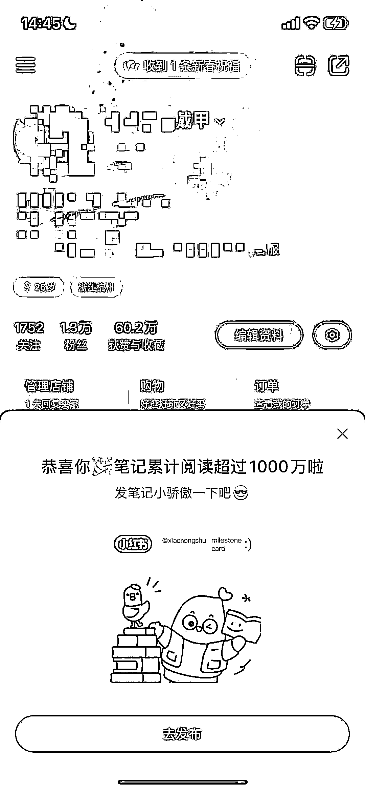
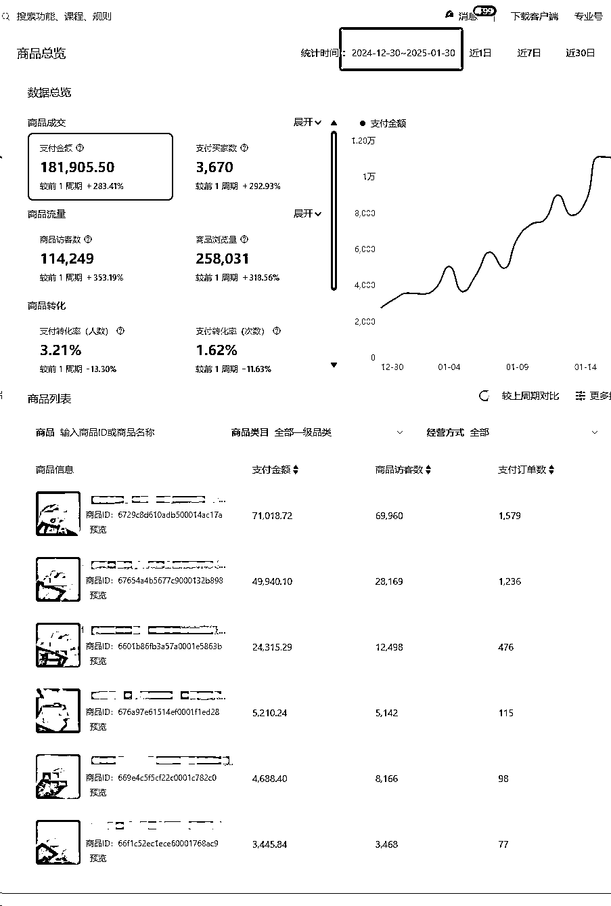

# (22 赞)单月从 0 到 18 万 GMV——📕电商（爆款模板）深度剖析

一个月，GMV 从 0 到 18 万+，不投流、不直播，这大概是小本生意梦寐以求的剧本。而 98 年出生的电商摄影师温妮，靠着一套“📕爆款模板”，真把这个剧本演了出来。

她常驻杭州，日常就是帮淘宝/📕商家拍产品图和短视频。2023 年 11 月搬到杭州后，她继续接摄影单，同时悄悄开始探索📕穿戴甲项目。那段时间，她一边积累拍摄素材，一边观察平台上的流量规律；到 2024 年 4 月，终于整理出一套可复用的“📕爆款模板”，并靠它做出了好几个千万级浏览量的穿戴甲账号。

关于她如何进入电商摄影圈，以及尝试 AI 电商摄影的经历，她在过往分享中都有详细记录。

整个过程，既没有直播卖货，也没有花钱买流量，唯一的动作就是把爆款模板反复用、反复发。结果，在 2025 年春节前的旺季，单个账号单月做到了 18 万+ GMV。

完整拆解文档已经放到飞书，想参考的朋友可以直接去看。

值得一提的是，评论区还有个小彩蛋：有人提醒文档链接打不开，温妮亲自回应“现在再试试”；另有一位读者评论说，“拆商”这个词用得特别精准。

从拍图接单的摄影师，到月销 18 万+ 的📕玩家，温妮的实战路径说明：所谓爆款，不是靠运气瞎碰，而是能被拆成可复用模板的。