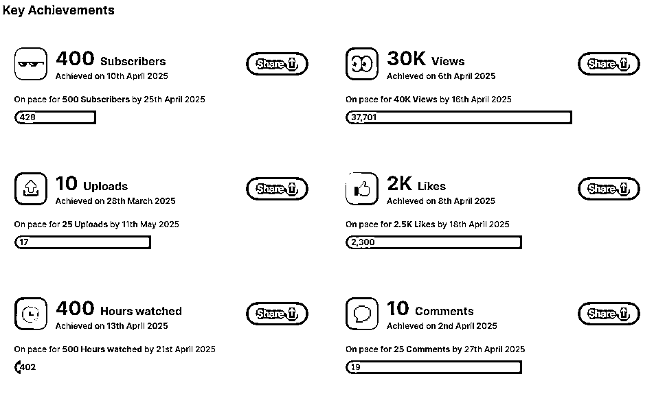
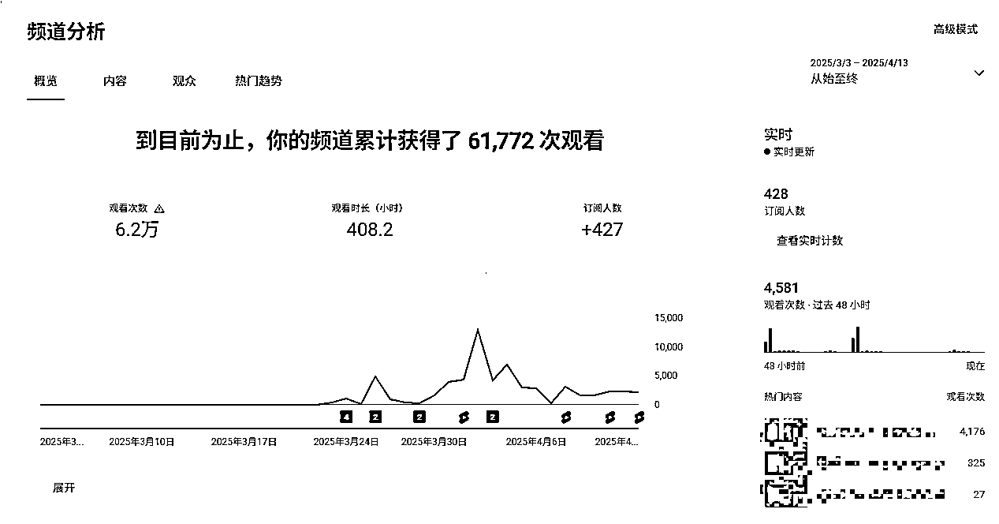

# (27 赞)YouTube 第一次航海总结复盘： 从“素人”到“航海者”的心路历程

大家好，我是老鹰，一个在龙哥盟刚上岸的萌新船长。说实话，复盘这事儿我不是头一回干，但这次航海确实是我加入赚钱后的第一次——心里一半是期待，一半是打鼓。期待的是终于能正儿八经地钻研YouTube运营，打鼓的是我这种纯小白，真能跟上大部队的节奏吗？还能不能整出点小成绩？

先看看眼下这成绩单吧：频道攒下了427个订阅，总播放量刚过6万大关。

搁在同期船员里，这数字大概只能算“末班车”水平。可我把它亮出来，真心不是想比谁更惨，而是想说句掏心窝子的话：出发之前，一定得给自己的期待值装上“安全阀”。不然等最终数据摆到眼前，心理落差太大，很容易就地躺平。

经过这趟3月的实战航行，收获最大其实不单是那些运营技巧，更是一场和自我的深度对话。踩过的坑、绕过的弯、破过的局，都成了宝贵的航标。整个历程我捋了捋，大致能分成四个阶段：出航前的筹备、航行中的实操、碰壁时的应对、以及复盘后的所得与下一步航线。

想知道更完整的细节？我全写进飞书文档里了，想看的直接点：[‌​⁠‬‍​​​⁠​⁠⁠​​​‌‌​​​​⁠​‬​​‬​​​‌​⁠⁠‌​​‬‌​‌​‬​Youtobe 第一次航海总结复盘 从“素人”到“航海者”的心路历程 - 飞书云文档](https://p76vqogctb.feishu.cn/docx/VGMXdJilGohhUVx3AmgczwXYnHf)

那条评论区里的互动也挺暖的，有人夸我复盘细致，也有人帮我校正了标题的拼写瑕疵。这种氛围，大概就是同路人相扶前行的意义吧。