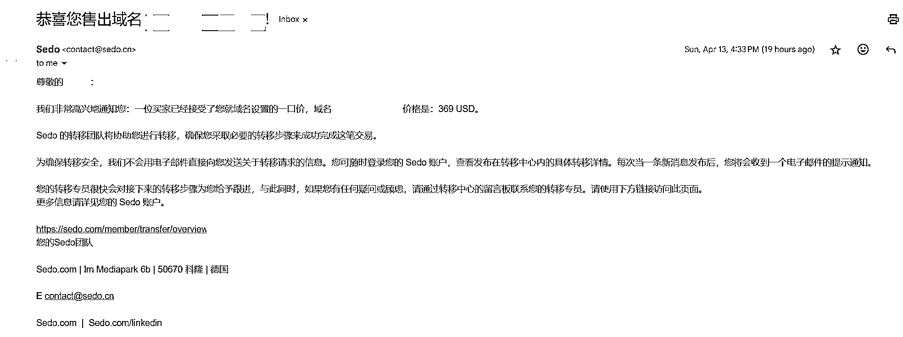
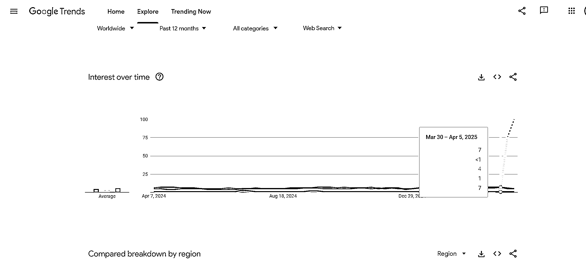
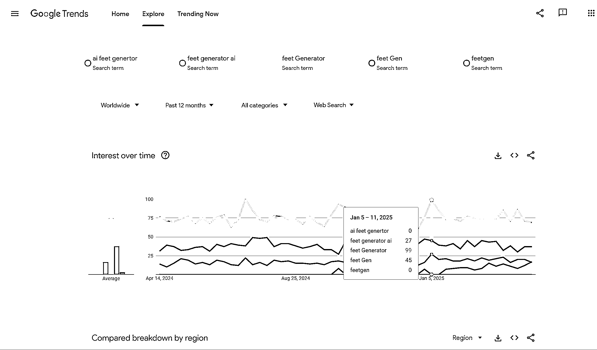
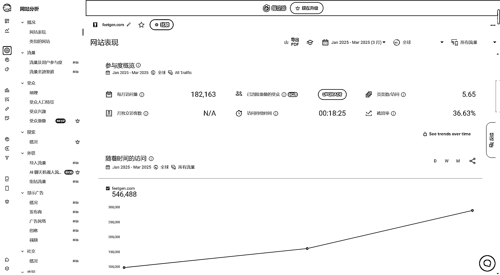
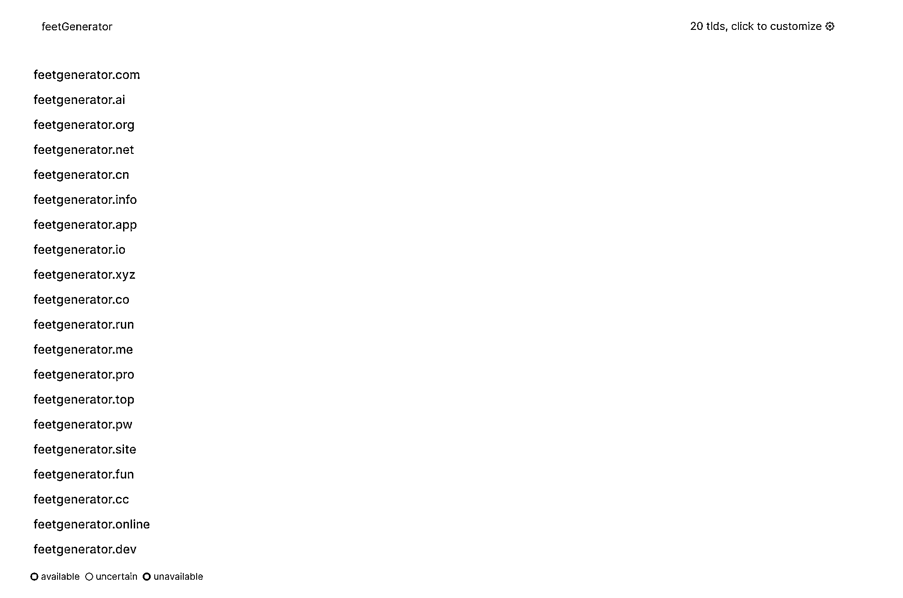

# (精华帖)(158 赞)获得第一笔找新词收入，来自卖域名，分享我的找词思路

昨天刚把手里一个“新词”域名卖出去，算是靠“找词”这条路，赚回了第一笔真金白银。

其实我并不是在热度起来之后才看到的。最早注意到它，是9号那天。那时候谷歌趋势里，上一周的数据还没更新完，整条曲线只露出了一个小拐角，搜索量看起来平平无奇，后面那段黄色的实线也不过是系统给的预测值罢了。

我的第一反应是：以我现在的技术水平，这个功能我压根做不出来。但既然这么早就捕捉到了潜力的苗头，先把域名抢下来总不会错。于是拍下后立刻挂到了Sedo上，第一次卖域名没啥底气，就定了个很低的价格，想着只要能卖出去，验证整条路子能走通，就不算亏。

接下来说说我的找词方法。

我知道自己现阶段就是个小白，英语也不好，硬去啃Semrush那种数据分析平台，或者从谷歌趋势里大海捞针找词，实在吃力。所以我干脆换个思路：不去直接找词，而是反着来——看用户们到底在找什么样的工具。

具体操作不复杂：锁定一个想了解的词根，用爬虫在谷歌搜索框里批量模拟输入，比如想看“AI”相关的，就自动敲“ai a”“ai b”一直到“ai z”，把下拉词列表全抓下来。然后从这些词里挑出陌生又感兴趣的，放到谷歌趋势和谷歌搜索里再验证一遍，看看人们真实的搜索意图是什么，市面上有没有人解决。

每查一个词，都会感叹“原来还有这种需求”“竟然还有这种工具”。我卖出去的那个域名，就是靠这个笨办法捞出来的。

后面我打算更进一步：每天定时跑一遍下拉词汇，跟之前抓到的数据做对比，去重之后挑出当天新冒出来的词。这个量应该不大，人工筛起来也不会太费劲。

举个例子，找词过程中我注意到一个词：“ai feet generator”。先去谷歌趋势和Semrush看，搜索量很低；再拿去谷歌搜，发现只有一个叫feetgen.com的网站，独自承接了全部需求。

通过这个网站反过来查词，能发现“feet generator ai”“feet generator”这些词的搜索量其实不算小。再去看Similarweb，整站几乎找不到直接的同类竞品，属于独一份的存在。

再仔细观察它的流量来源和去向，能明显看到搜索流量在持续上涨，来自PayPal和Stripe的支付占比也很高，而且同样呈现上升势头，说明这个工具的变现能力一点都不弱。

然后去查相关的关键词域名，发现“feet generator”这种更适合SEO的全拼组合，居然也没有别人注册，整条赛道就他一家在跑。

我的判断是：这是一个非常典型的小众需求，竞争小，闷声赚钱，大厂看不上眼，个人开发者却完全有机会进去分一杯羹。只要你的技术能力能cover住，完全可以一试。

用这种思路筛下去，还能发现不少类似的情况——那种只有一个或两个产品在悄悄满足的需求，正是我一直想找的niche市场。

顺便说一句，星球发不了附件，我把配套的东西放网盘了，里面有两个文件：一个是爬关键词的Python脚本，代码可以按需求自己改；另一个是用这个脚本爬到的、以“AI”为词根的上万个下拉词文本。其实这套玩法放到抖音、小红书、Reddit、推特上，我觉得也完全能跑出效果，感兴趣的圈友可以拿去试试。

以上是我的一点小经验，如果能给大家带来启发就太好了。如果你有延伸想法，欢迎评论区一起聊。