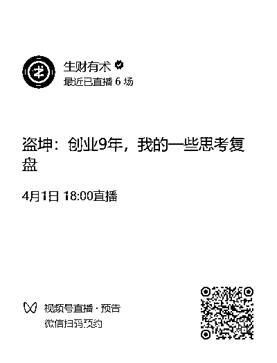

# 做自己热爱、且能力够得着的、最大的那颗星

很多人来问我怎么选副业赛道，朋友龙哥的回答很直白：别碰知识付费，天花板太矮。

这不是客气，是他真切的体感。龙哥盟已经算副业知识付费里顶流的存在了，放眼整个知识付费江湖，语文数学英语这些大盘，和它比起来就是降维打击；哪怕是会计培训、人力培训这种细分赛道，也完全不在一个量级。

底层的方法论可能差不多，可一旦选定赛道，收益的上限基本就被锁死了。

“回头看，走了不少弯路，踩了不少坑。最遗憾的，其实是早年的自我降维，是想象力的贫瘠，是被‘普通人’三个字给封印了。”

这是我前阵子发在朋友圈的一句话，也是这十年创业里最深的体悟。今天就用四个关键词，把这个话题串起来聊。

**1、选大盘**

雷军在 2013 年的一次访谈里说过：创业时要挑自己喜欢、能驾驭、并且市场体量最大的方向，越大的盘越好。这是他在金山时期最大的反思。

他用金山词典和金山毒霸做对比。词典只是毒霸一个零头的市场。更深层的是整个赛道的选择失误。

1992 年雷军入金山，1998 年接任 CEO，2007 年金山上市，首日市值 6 亿港币，如今 500 亿左右。同期马化腾 1998 年创腾讯，2004 年上市首日近 600 亿港币，如今 4.7 万亿；李彦宏 2000 年办百度，2005 年上市首日近 40 亿美金，如今 345 亿美金。阿里、网易、UC 等甚至更晚起步，结果也远超金山。

有人会说雷军能力不行。可等他卸下金山这个包袱后，进化明显加快。2010 年创办小米，手机做到全球前三；2020 年再战汽车，把毕生声誉押上。小咪手机年营收近 2000 亿，小米汽车起飞，集团市值突破万亿。

他后来总结过一句狠话：用战术上的勤奋去掩盖战略上的懒惰，是创业者最大的陷阱。

金山在某程度上拖慢了雷总的节奏，这也是龙哥劝人别做知识付费的缘由。

把视角拉近到我自己。几年前我深耕淘宝蓝海，算不上拼命也算勤奋。无论在运营打法还是团队管理上再怎么优化，年利润也很难冲破 500 万的天花板。

后来转做 MCN，投身 IP 孵化、短视频带货、直播带货。有时候一个头部娱乐主播一个月能顶过去一年淘宝蓝海的全年业绩。我可能什么也没变，只是换了赛道、换了人。

我并不觉得当下做的事有多高阶，反而觉得自己被拴住了。过去成就我的东西，现在也在限制我。

这对个人也一样。送外卖和做地产销售，天花板完全不同。同样是卖房，在重庆和在深圳做，结局也天差地别。

我哥大学毕业就去深圳做房产中介，现在带团队年入 200-300 万，手底下一个同学一年也做了 50 多万。而我认识的在重庆做房产中介的朋友，即便在门店和商圈里算优秀的，月均也就一万多。

赚钱里项目信息很多，我不贬低任何一个项目，但产出差距是真实的。淘宝蓝海我带出过不少年入百万的学员，可如果说靠闲鱼带货做到年入百万，概率极低。

再如 AI 代写，工具提升效率后，本质和以前的枪手业务有什么区别？还不是卖时间。一篇带货笔记可能卖一万、十万、几十万，边际成本递减；而卖体力的活，时间就是天花板。

选大盘，人生下半场，去做自己喜欢、能力范围内，尽可能大的梦想。

**2、去魅**

想赚一千万，就去做能赚一千万的生意。闲鱼卖货想做到千万，几乎不现实。

很多人卡住的点不是看不到大盘，也不是没能力做，而是自我降维的认知和想象力的匮乏，缺少拥抱百万千万的野心和勇气。

敢想，才有机会做到。连想都不敢想，更别谈做。

我刚做内容电商时，只敢做搬运、混剪、无人机半无人，潜意识里觉得自己没资格做原创。那原创真的那么高不可攀吗？

在赚钱里，一个人做原创号做得风生水起的案例很多。线下培训里，月销几十上百万的账号主，多是大学生、宝妈、自由职业者或夫妻档。我资源不差，为什么他们能我不能？因为自我设限，因为我长期浸泡在无货源搬运的圈子里，就默认自己只能做这个。

缺的不是资源，是心里的成见，是认知上的自我矮化。

我们总被这些声音裹挟：现在入场晚了，都是个例，都是靠人脉。做梦可以，但要做在能力范围的梦。能力的边界是可以拓展的，别让偏见锁住思维。脚踏实地很重要，更要抬头看星空。

否则这个世界就诞生不出比亚迪、华为、DeepSeek。

我老家在重庆秀山的中寨村。童年时从县城到主城要三天，先坐车再坐船再坐车，村里到县城还要换乘两次。那里三省交界，民风剽悍，我初中就染上赌博，迷上老虎机，差点辍学。

现在回想后怕。后来小学同学被砍死，有人赌博家破人亡，有人磨平棱角过着清贫的日子。成功没有终点，失败却有分界线，一旦你放弃希望、认命自我降维，那失败就已经发生。

做不做成是后话，至少要保留向上冲的勇气。

打破认知枷锁，对自己去魅，对世界去魅。

加入赚钱后，我开始尝试不只是淘宝蓝海。加入私董会后，发现那些赚几千万上亿的老板，也不过一颗脑袋两只眼睛。去魅之后，野心才真正被点燃。

这个世界就是个大草台班子，别把任何人神化，也别把自己妖魔化。盗坤是普通人，龙哥也是普通人，刘强东当年上大学学费还是全村凑的。

认知可以补，技能可以学，唯独野心的觉醒要靠自己。

不要用当下的能力去框定未来的高度，要用野心去定义未来的战场。

刘邦 39 岁时看到秦始皇巡游发出大丈夫当如是也的感慨。六年后陈胜吴广起义，刘邦与樊哙、周勃在芒砀山起事，招揽萧何、曹参，自封沛公。后来入咸阳得张良，进而聚韩信、陈平，吞并彭越、英布，最终垓下击败项羽，打造汉朝集团，跟着他的人都飞黄腾达。

刘邦是亭长，我们是普通人。他的梦是开朝立国，我们的梦先从百万起步又如何？

去魅不是一篇稿子就能完成，是持续刷新认知的过程。最好的方式是看见，看见别人如何做到。刘邦当年能有大志，因为他见过世面，去过魏国大梁，投靠过信陵君，结识过张耳，成为门客，模仿其礼贤下士、合纵连横的打法。

现在信息爆炸，不需要跑两百里，微信读书看传记，短视频看访谈，学习成本极低。

**3、终局思维**

知道了要选大盘，也去掉了自我设限。可很多人还是会说：有野心有什么用，我没资源没背景没人脉。

强东起步不过普通人剧本，雷军接手金山时才 6 个人，龙哥的赚钱起步也是一个人近乎零成本。

不要用当下的资源去限制终局，要用终局去倒推资源配置。看一道题，先问凭什么不能是我，而不是凭什么会是我。

能不能做是后面的事，先大胆做梦，小心验证。

此前一个做代账的朋友找我聊增长，我没直接给抖音优化建议，而是问他想没想过一年签一万家甚至几万家客户。他目瞪口呆，觉得自己现在一个月签几百个已经很顶了。

我给他举了个例子。很多房产中介的经纪人并非纯雇佣，而是合作关系，自办个体户或个人独资公司，公司打佣金他们开发票。像我哥所在的公司，经纪人首次办执照要交 4000 地址代办费加 2000 代账费，每年 2000 代账费。公司在深圳有三万人。

价格不算便宜，但因为是公司指定合作方，担心税务和打款问题，大部分人都会用。只要搞定这个公司里有决策权的人，就等于搞定三万个客户。再看美团骑手、天鹅到家的阿姨、上门按摩的新兴群体，逻辑相同：搞定关键决策人，就能批量拿到客户。

我不确定他会不会这么做，但我希望他先用终局思维找真正有几万张执照的公司，研究他们的运营和获客逻辑，再去思考怎么切入。

神州租车的陆正耀用 9 年上市，6 年把瑞幸做到一万家店，被踢出后两年又开了一万家店。有人会说他资源多。可如果给你二十亿，你能在四年开一万家店吗？大多数人会先开一家店，跑通模型再慢慢加，最后做个抖音招商 IP，以为两年能招一万家。

代账是轻资产，成本主要是人力和营销。他一年的课程私董会支出就有十几万，我问他如果把这笔钱拿来招大客户经理加公关预算，给得起吗？他说给得起。那就可以从小规模试起。

**4、均值回归**

写到这里已经六千字了。

最后一个关键词，均值回归。有野心的人就算在小县城当公务员，也会觉得按部就班憋屈，最终还是会辞职去闯。向往安稳的人，即便在陆家嘴上班，也会因节奏被压垮，最终选择归隐。

我写这篇不是要让向往安稳的人变得好斗，而是想点燃那些本就心里有火的人。这里是聊钱不伤感情的地方。

成功的路径其实只有一条：按自己喜欢的方式过一生。

人生下半场，去做你喜欢、你能做的、最大的梦！

我是盗坤，创业九年，兼赚钱布道师。下周二 4 月 1 日会在龙哥盟视频号继续聊创业思考，有兴趣可扫码预约，我们不见不散。

1. 创业如何挑选适合自己的赛道
2. Who not How，创业者的人才观
3. 直播 IP 孵化的底层逻辑
4. 野心：创业者的个人进化

* * *

评论区：

陈江河 : 感触很深，不能用现在的能力去预判未来结局，要以终为始，让目标去塑造能力

白酱油 : 写得真好，很有启发

百哥 : 牛

路飞 : 读完热血沸腾

大脸猫 : 很有启发

忘忘不念 : 期待后续

Boom 哥 : 热血沸腾，就该敢想敢干

Yankee 阳基 : 很共鸣，做大的别做小的，做难而正确的事