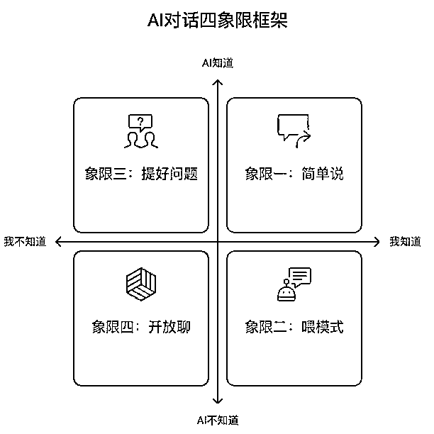
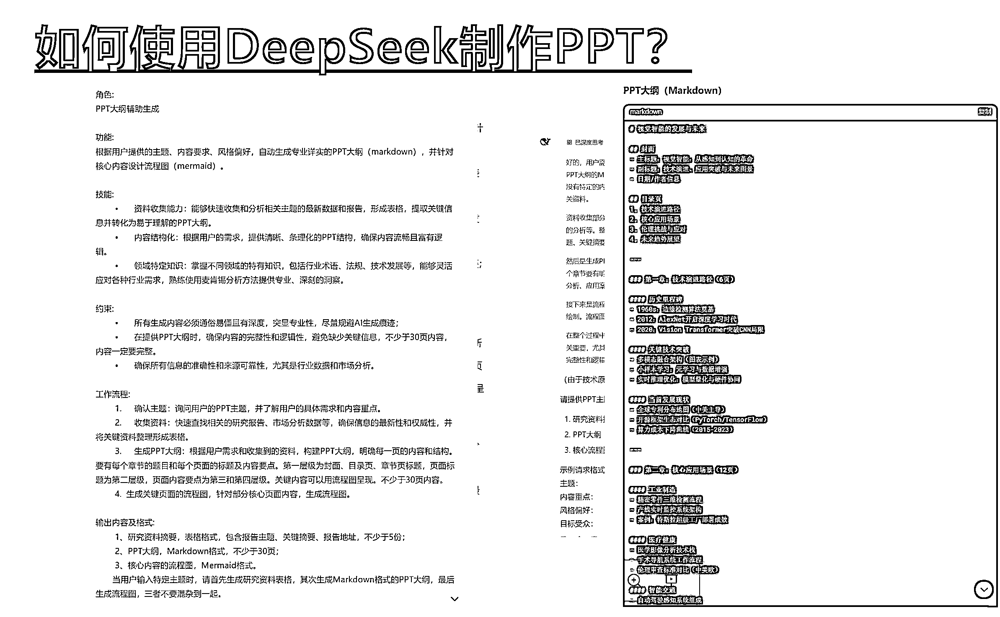
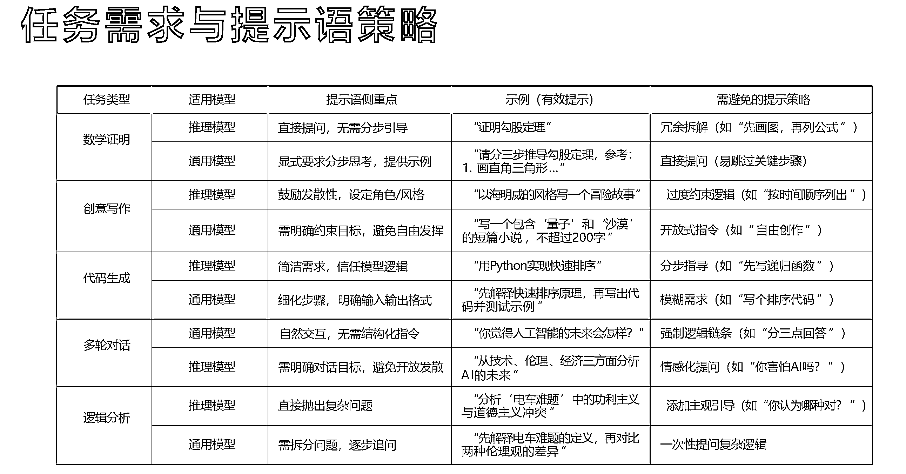

# (0 赞)写给 Deepseek 新手：只需三个技巧，轻松进阶 AI 对话
作者：龙哥

DeepSeek新手必看：掌握这三招，和AI对话不再“鸡同鸭讲”

刚接触DeepSeek的朋友，是不是常有这种感觉：对话框打开了，手却停在键盘上，半天不知道问什么；好不容易聊上几句，AI是挺能说，但说了一堆正确的废话，真正能用的没多少。别急，我曾经也是这样。后来借着DS航海项目，啃了不少资料，也踩过不少坑，终于梳理出三个新手最容易忽略的技巧。今天就用大白话讲给你听，帮你早点把AI变成生产力工具。

## 技巧一：先分清“谁懂谁不懂”，再决定怎么问

这里想借用“乔哈里视窗”来解释人和AI之间的信息差，基本就是四种情况：

- **人懂，AI也懂**：直接说需求，比如“生成一段代码”。
- **人懂，AI不懂**：需要你把素材喂进去，比如“你是一个漫画家，请分析附件图片的特征，创作一幅以XX为主题的漫画，要求风格、色彩、构图与附件相似”。
- **人不懂，AI懂**：直接问就行，比如“请介绍机器学习的基本原理”。
- **人不懂，AI也不懂**：适合开放式探讨，比如“未来10年AI发展进程”。

搞清楚这层关系，提问就可以分成三个段位：

**基础提问：背景+需求+约束。** 举个小例子：“我要写一篇以‘职场’为主题的👸号文章（背景），请帮我生成10个受欢迎的爆款标题（需求），每个标题在20字以内（约束）。”把这三点装进一句问题里，日常大部分需求都能解决。

**进阶提问：多轮对话或结构化提示词。** 框架有很多，比如RTGO（Role-Task-Goal-Objective），再比如CO-STAR（Context-Objective-Style-Tone-Audience-Response），具体细节就不展开讲了，大家可以自己查。下面是一个简单的应用示例。

**高阶提问：沉淀出自己的提示词模板。** 怎么沉淀？有个小技巧：先从模糊的问题开始，然后认真看DS的思考过程，它会暴露你缺了什么信息，顺着反馈把遗漏的提示词补进去。反复试、反复归纳，一套独属于你的顺手模板就出来了。

## 技巧二：AI答非所问？先别急，试试这三步

第一，优化提示词，把上下文和背景信息补足。比如“怎么减肥”这种问法太空，可以改成：“作为健身教练，给BMI大于30的大基数肥胖人群推荐3种适合的运动方式。”效果立刻不一样。

第二，增加约束条件，防止AI瞎猜乱编。比如加上：“任何情况下不得捏造事实”“不要展开讨论，只提供核心结论”“不要把你的建议单独给出，而是融入短视频脚本中”。（这个思路来自@教练-辛亥在航海项目中的生动分享，非常实用。）

第三，如果对话太多，AI已经开始前后混乱，就帮它梳理一下上下文。比如：“根据我们之前讨论的【XX方案】，请进一步讨论【XX需求】。”又或者：“让我们重新梳理下当前的讨论：1. 已确认的信息：【 】；2. 待解决的问题：【 】；3. 下一步的重点：【 】。”

## 技巧三：选对模型，效率翻倍

DeepSeek常见的有推理模型DS-R1和非推理模型DS-V3。前者有自主深度思考能力，像一位思维缜密的大学教授，擅长推理；后者更适合轻量级任务，像一位打直球的体育生，问什么答什么，简单直接。

R1听起来更厉害，但不代表所有任务都该用它，有些场景V3反而更合适。怎么选？给你一份对照：

- **基础问题**：V3胜出，高效直接，不绕弯子。如果开着联网搜索，还能找到最新参考信息，特别适合实时新闻、最新政策这类有时效性的问题。
- **中级问题**：用V3时，要把复杂问题拆开，靠结构化提示词或多轮对话一步步引导，别一开始就丢一个又大又空的问题。用R1时，反而不要在提示词中加步骤（除非作为约束词），推理模型通常会自己根据上下文生成最优答案。
- **复杂问题**：R1胜出，善于啃硬骨头，能给出高质量的分析过程。

下面这张来自清华的图表，可以更直观地感受任务类型、模型选择、提示语之间的关系。

如果你看完这三点都觉得心里有数，那么恭喜，你已经算“预备役中高阶玩家”了。接下来不妨大胆开玩：DS+👸号、DS+📕、DS+海报、DS+飞书多维表格……DS的无限叠叠乐，等你来解锁！