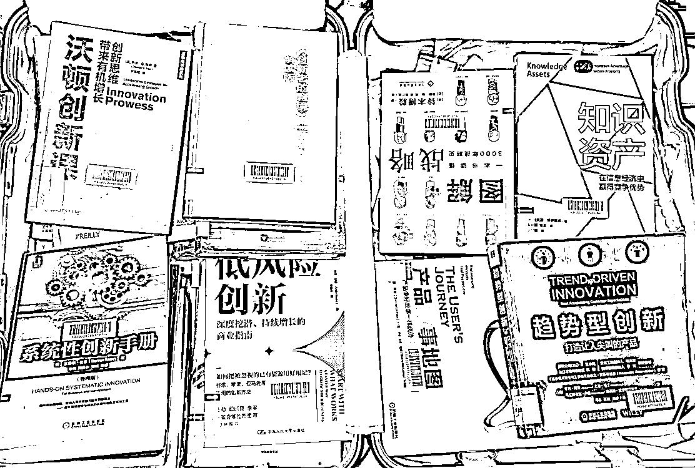
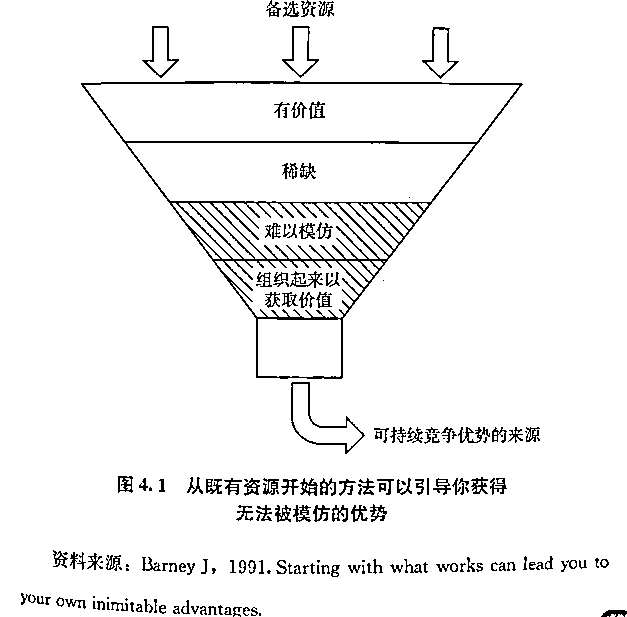

# 跨界做亚马逊的实战复盘：从 0 到首款盈利的 80% 成功率是怎么来的
作者：龙哥

过去一年半，我的主战场就钉在亚马逊上，很少出来冒泡。最近在航海家群里随口提到一句，我在亚马逊的第一款产品直接开始盈利，后面做的品基本没亏过，成功率大概在八成左右。@黄小鱼 当场就让我把思路摊开讲一讲。

说实话没有那么玄乎。一方面是 SEVEN 的带路给对了方向，另一方面是我开品节奏很慢，还赶上孩子刚出生，得克制投入。运气占了一部分，笨功夫也占了一部分。这套经验对想跨界做新项目的朋友或许有点参考价值。

# 一、引路人，关键又不关键

## 引路人为什么重要

我的贵人、师傅是 @SEVEN，龙珠榜常年 TOP1 的大佬。我后来注册公司，两个字里嵌了一个女儿的名字，和一个与 SEVEN 有关的字。足以说明他对我的分量。

有机会在 SEVEN 的 408 里待了几个月，手把手带流程，和小焦、蕣等几位伙伴一起把跨境的底层打通，选品逻辑也建立起来了。第一款产品是 SEVEN 看过点头的，正式上线就盈利。资金和信心一次性被喂饱，后面才敢继续。

## 引路人也并不重要

很多人听完第一反应是：我要去找 SEVEN。错。

SEVEN 那里出来的人不少，亏十几万再起来的比比皆是，首款就能赚钱的凤毛麟角。

师傅只负责把门打开，修行全在自己身上。高人点醒常常就一句话，别指望保姆式喂养。

“修行在个人”“修行在个人”“修行在个人”

下面讲的才是我自己修行的部分，也是全文重点。

### 用反事实来判断贵人

怎么判断是否遇到真贵人？先学会感恩和反事实推演。

人都倾向把成功揽到自己身上，把失败甩给别人。

1. 贵人点了一句，自己拼命执行成功了，就说“他就说了一句，跟我没关系”。
2. 贵人指了个方向，自己方法错了失败了，就把锅甩给贵人。以后谁还敢给你建议？

判断工具：反事实思考——如果当时情况不同，结果会怎样。

**算得上引路人的信号：**
1. 行业前辈指认一个新市场，并给出具体切入打法。
2. 帮你对接到关键客户或合作伙伴。
3. 师傅亲授手艺的核心诀窍。

**不算引路人，只是普通帮助：**
1. 朋友劝你“多努力”“多读书”，没有具体路径。
2. 网课老师讲公开渠道随手能查到的基础知识。

因为没有赚钱，我根本不可能认识 SEVEN，所以赚钱也是我的引路人。但就算进了赚钱，也不见得能收获。关键看你是否全程投入：是否持续输出获得信任、是否真诚待人、是否积极线下链接。

总结：引路人很重要，没有他弯路会更多；但成败最终还是看自己。

# 二、先学会怎么不失败

我总结下来，任何赛道都是先学会避坑，再谈成功。因为成功路径千差万别，可复制的往往是失败模式。

## 失败一：成本失控

**机会无处不在，唯一的硬条件是活下去。**

电商不像纯网赚，必须有实体现金投入。这既是劣势，也是门槛，能筛掉没准备的人。

很多老板一上来就租场地、招人，固定成本每月一万起步，能撑几个月？美金汇率 7:1，赚的时候爽，亏的时候痛。广告点一次 1 美金，7 元，几十下点击就没了。现金流断、供应链断，直接被淘汰。

我的做法是极致压成本：在家打包，书房当仓库，做完一件发一件。0 到 1 的阶段一个人扛，省钱的同时把各个环节摸透。

**别拉长战线。** 起步期不要摊大饼做多市场。精力、资金都不允许。

先把一个细分产品做透：创新点、平台规则、市场人群。等打法成熟、团队能分担时再扩张。每个市场的调性和用户习惯不同，分散了就等于自杀。

## 失败二：冲大市场、追爆款

新手最爱问：这个市场容量大不大。初创个体和大卖的策略不能一样。

起步应该做大卖不屑做的事，越细、越麻烦、空间越小越好。先赚小钱赚经验，积小胜为大胜。

一上来追爆款的风险是：流量来了大货发出去，流量突然没了——违规了、被对手狙击了。资金被死死卡住，退出市场。

**打法是找弱的打。**

战略要回答打不打、跟谁打、在哪打、何时打。战术只是怎么打。

别去正面硬碰资源远超你的对手。选狭窄细分，找到产品和运营都弱的对手，用供应链和创新去碾压。

**侧翼包抄，逐步扩张。** 不要一开始正面进攻，从对手防线薄弱的边缘切入。先占边角，形成据点，再向中腹渗透。得一寸是一寸。

例子：蓝牙耳机是红海，第一名太强。别直接上。正好可以做“儿童听书耳机”、“儿童运动耳机”、“女性运动耳机”，先在细分打出名声，再围成优势。

## 失败三：价格战，是最下策

看到有人爆了利润还高，就抄品打价。竞争有四个层面：伐谋、伐交、伐兵、攻城。攻城是最下策。

大卖的爆品广告费高、利润薄，你打价格战，杀敌一千自损八百，先亏是确定的。

我的做法三件套：
① 产品和功能必须比对手强
② 深挖客户刚需
③ 只挑弱对手下手

我甚至经常比对手贵，卖得还更好。

## 失败四：不亲手上阵，想靠招聘解决

很多国内老板想花 100 万组建团队直接进军海外，失败率很高。

**盲人摸象。** 根据我实操经验，选品和运营在 0-1 期是分不开的。很多选品灵感来自广告后台数据，有时产品起不来是运营没打通，调整后又活了。打包时也经常冒出新想法。

0-1 必须自己下场，把流程跑通，形成 SOP，再逐步外包。

## 失败五：看利润不看现金流

很多基金经理是靠提高风险来提高收益——查理·芒格。

**利润不等同于现金。**

一件货成本 50 卖 250，利润率很美，但在亚马逊 FBA 模式下，货先躺仓库，钱被冻结。卖不出去、周转慢，利润就是纸面富贵。

增长陷阱：销量翻倍，库存要准备不止双倍。很多店铺死于扩张太快现金流断裂。

对策：资金有限就别做爆款，别做周转慢、成本高的品。

# 三、如何找到真正可行的路径

**回到源头知识。** 很多人只看自媒体，不看源头。投资也一样，听大 V 复盘不如啃经典。

亚马逊有卖家大学，基础知识很全，却没几个人看。跑去自媒体找“刷单资源”“亲戚开小店防封”“律师解店”，本质是方法论就错了，用国内打法硬套全球平台。

**每个平台有自己的气质。** 亚马逊是数据公司，自作聪明去造假，数据公司会不知道？

## 1、算多则胜，算少则败

干之前要步步为营。战略上先研究平台气质、创始人逻辑、创业与创新的底层。

研究亚马逊平台时我看的书
 images.zsxq.com/FrSbuZdZVTS1k81nhB7uRVohqall) images.zsxq.com/FtE28cti-1zZFaeZ1U8tZUsKmZ7g)

研究战略、创新时批量阅读的书

## 2、在行动中创造信息差

战略可以学，信息差靠自己产生。

粟裕研究韦岗伏击战，从地形到手榴弹投掷距离抠细节。创业同理。

① 从实操和反思里挖一手信息
信息差有时来自外部，但更多来自自己动手。我的很多产品洞察来自广告后台和包装细节，外人看不到。

反思要全面：不仅复盘对错，还要问为什么这样想？背后信念是什么？情境、性格、时机起了什么作用？越细越值钱。

创业反思表格可参考： images.zsxq.com/FpSFAHH2XbfL0SZxpQZGaHnRRWoo)

② 用旧优势做组合创新
别总想着复制对手。更低风险的是围绕自身优势组合。

我的一款女性运动耳机卖得好，就延伸出女性运动袜子，比从零做袜子的玩家更有优势。我擅长写作投资，就做相关垂类产品。背靠赚钱和即刻出海圈，能直接请教前辈。这是复制不来的。

③ 建系统，而非追单一爆品
从“做一个爆款”转向“建立持续找好品的系统”。产品开发是可设计、可迭代的系统。每个品都要极致复盘，用来打磨系统。

# 后记

AI 对我帮助很大。亨利·福特说，如果车没发明，人们会说要一匹更快的马。AI 时代别再问怎么让马跑更快。

很多人关注优化工作流，几个月后也就是一句话的事。AI 对我的最大价值是批量阅读、快速提炼优质知识，直指战略关键点。

这次分享就到这里，希望对想做亚马逊或从 0-1 孵化新项目的人有点用。也欢迎链接更多前辈交流。

* * *

评论区：

黄小鱼🐠 : 牛哥好快！从投资领域跨行做跨境电商，真的干一行成一行 [强][强][强]

老黄牛 : [抱拳][抱拳]

良辰美 : 非常珍贵的经验，对我过往失败的反思很有启发，太感谢分享了，这是不可多得的非常深入的亚马逊电商实践分析，希望后晚夜话畅聊

光年 : 牛哥太牛，系统化思维，既有战略又重细节[强]

老黄牛 : 好啊，提早聊聊啊

老黄牛 : [抱拳][抱拳]

三告 : 腻害腻害，我没做过，但是老婆在做亚马逊，有些观念很有启发，希望后面可以交流请教

追梦 : 错位竞争确实是个切入市场的好办法[强]